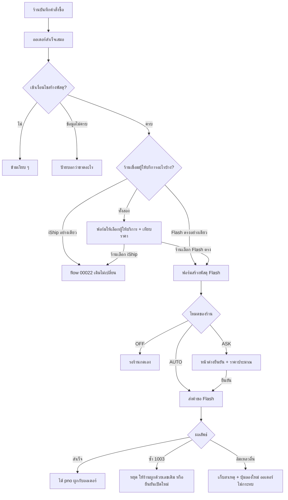

> **โมดูล:** 00084 — Flash Express Direct Integration
> **ประเภทเอกสาร:** Product Requirements Document (PRD)
> **เวอร์ชัน:** 0.1
> **วันที่จัดทำ:** 2026-10-22
> **สถานะ:** Draft — รอ user review (ห้ามเขียนโค้ดก่อน user อนุมัติ PRD+BRD ตาม HR11)
> **เจ้าของเอกสาร:** BA + PO + PM (ดู [[Feature-Docs-Ownership]])
> **งานวิจัยต้นทาง:** `docs/research/2026-10-22-flash-express-open-api.md` (อ้างเป็น "R§n")
> **ฟีเจอร์พี่น้อง:** 00022 iShip Shipping Integration — เอกสารนี้อ้าง BR-ISHIP-n เมื่อใช้กฎเดิมซ้ำ

# PRD: เชื่อม Flash Express ตรง (Flash Express Direct Integration)

---

## Executive Summary

ทุกวันนี้ร้านบน Deep ส่งพัสดุกับ Flash ได้ทางเดียวคือผ่าน **iShip** (คนกลางรวมขนส่ง) ซึ่งทำงานได้ แต่มีสี่เรื่องที่ร้านและเราเจอ ได้แก่ ร้านที่มีสัญญากับ Flash เองได้ราคาสัญญาไม่ได้เพราะต้องซื้อผ่านราคาของ iShip · สถานะพัสดุจาก iShip ไม่ละเอียดและไม่มีหลักฐานการส่ง (POD) · มีร้านที่ใช้ Flash อยู่แล้ว (เปิด Open API กับ Flash ไว้) แต่ใช้ใน Deep ไม่ได้ · และงานทุกอย่างต้องพึ่งคนกลางอีกชั้น (บนข้อมูล prod พัสดุ iShip ที่ active 64% ไม่มี event ติดตามเลย — ดู R§7.3 ข้อ 4)

ฟีเจอร์นี้ให้ร้านวาง **รหัสร้านค้า Flash (`mchId`) กับ Secret Key ของตัวเอง** ที่ได้จาก Flash ลงในหน้าตั้งค่าครั้งเดียว (แบบเดียวกับการวาง Token ของ iShip) จากนั้นเปิดพัสดุ Flash จากคำสั่งซื้อ พิมพ์ใบปะหน้า 100×180 หรือ 100×75 มม. ยกเลิก เรียกรถเข้ารับ และเห็นสถานะ ค่าส่งจริง น้ำหนักจริง และหลักฐานการส่งที่ Flash ยิงกลับมาเอง โดย **Deep ไม่ถือบัญชีหลัก ไม่สร้าง sub-account และไม่ยุ่งกับเงิน** — Flash เรียกเก็บเงินกับร้านโดยตรง สอดคล้องกับ BR-ISHIP-52/53

ร้านหนึ่งใช้ **iShip และ Flash ตรงพร้อมกันได้** (ตัดสินแล้วโดย user) ฟอร์มสร้างพัสดุต้องให้ร้านเลือกชัดว่าจะเปิดกับใคร และแสดงราคาโดยประมาณของ Flash ตรงข้างตัวเลือกของ iShip ให้เทียบกันได้

สิ่งที่ฟีเจอร์นี้ **ทำให้ไม่ได้** และต้องบอกร้านตรง ๆ คือ **การปิดงาน COD อัตโนมัติ** — Flash ไม่มี API หรือ webhook ที่บอกว่า "โอนเงิน COD ให้ร้านแล้ว" (R§1) ร้านต้องกดยืนยันรับเงินเองเหมือนเดิม

---

## 1. Business Goals & KPIs

### 1.1 เป้าหมายทางธุรกิจ

| เป้าหมาย | รายละเอียด |
|----------|-----------|
| **ได้ราคาสัญญาที่ถูกกว่า** | ร้านที่มีสัญญากับ Flash ใช้ราคาสัญญาของตัวเองได้ (ค่าประมาณขอได้ด้วยตารางราคาสัญญา — R§3.1 #13) ไม่ต้องจ่ายตามราคาที่ iShip ตั้ง |
| **สถานะพัสดุแม่นกว่า + มีหลักฐานการส่ง** | Flash ยิงสถานะ เส้นทาง น้ำหนักจริง ค่าส่งจริง และ POD (ผู้เซ็นรับ รูป พิกัด) กลับมาเองและตั้ง URL ได้ผ่าน API ไม่ต้องรอใคร (R§3.1 #17) ช่วยเรื่องข้อพิพาทของฟีเจอร์ 00055 |
| **รองรับร้านที่ใช้ Flash อยู่แล้ว** | ร้านที่มีบัญชี Flash Open API อยู่แล้วเอามาใช้กับ Deep ได้ทันที ไม่ต้องเปิดบัญชี iShip เพิ่ม |
| **ลดการพึ่งคนกลาง** | พัสดุ Flash ไม่ต้องผ่าน iShip — ถ้า iShip ล่มหรือเปลี่ยนเงื่อนไข ร้านที่ส่ง Flash ตรงไม่กระทบ |

### 1.2 ตัวชี้วัดความสำเร็จ (KPIs)

| KPI | คำอธิบาย | เป้าหมาย |
|-----|----------|---------|
| **ร้านที่เชื่อม Flash ตรงสำเร็จ** | ร้าน `vertical = ONLINE_SALES` ที่มีบัญชี Flash สถานะ ACTIVE ÷ ร้านที่เริ่มกรอก mchId/key | ≥ 80% (ด่านใหญ่คือร้านยังไม่มี key จาก Flash — ไม่นับร้านที่ไม่มีบัญชี Flash) |
| **สร้างพัสดุ Flash สำเร็จรอบแรก** | พัสดุ Flash สถานะ CREATED โดยไม่ต้องลองใหม่ ÷ ความพยายามทั้งหมด | ≥ 95% |
| **พัสดุ Flash ที่มี event ติดตามอย่างน้อย 1 รายการภายใน 24 ชม.หลัง Flash รับของ** | วัด webhook + poll รวมกัน (ตรงข้ามกับ iShip ที่ 64% ไม่มี event) | ≥ 95% |
| **พัสดุที่ส่งถึงแล้วมี POD** | พัสดุ Flash state=5 ที่มีหลักฐานการส่งถูกเก็บ ÷ พัสดุ state=5 ทั้งหมด | ≥ 90% |
| **พัสดุ Flash ที่มีค่าส่งจริง (`carrierPrice`) ภายใน 3 วันหลังรับของ** | วัดว่า webhook ราคาทำงานจริง | ≥ 90% |
| **ที่อยู่ถูก Flash ปฏิเสธ (1004/1005)** | สัดส่วนครั้งที่สร้างพัสดุแล้วโดน error ที่อยู่ | ≤ 3% (ตัวชี้ว่าการจับคู่ตำบล/อำเภอ/จังหวัดถูกต้อง) |

---

## 2. User Personas (กลุ่มผู้ใช้งาน)

### 2.1 เจ้าของร้านที่มีสัญญา Flash ของตัวเอง

**ข้อมูลพื้นฐาน:**
- ส่งพัสดุ Flash วันละหลายสิบถึงหลายร้อยใบ ทำสัญญากับ Flash โดยตรง ได้ `mchId` และ Secret Key มาแล้ว (หรือเคยใช้ Flash Open API กับระบบอื่น)
- เปิดบัญชีเงินสดหรือเครดิตกับ Flash ไว้

**เป้าหมาย:**
- ใช้ราคาสัญญาของตัวเองใน Deep ไม่ต้องจ่ายแพงกว่าเพราะผ่านคนกลาง
- เปิดพัสดุ พิมพ์ใบปะหน้า และดูสถานะ/POD จากหน้าเดียว

**ความต้องการ:**
- วาง mchId + key ครั้งเดียวแล้วใช้ได้ ระบบบอกทันทีถ้าผิด
- เห็นราคา Flash ของตัวเองเทียบกับ iShip ก่อนเลือก
- พิมพ์ใบปะหน้าขนาดที่เครื่องพิมพ์ของตัวเองใช้ (100×180 หรือ 100×75)

**จุดปวด (Pain Points):**
- ใช้ Deep สร้างออเดอร์ แต่ต้องเปิด Flash Printer ไปกรอกที่อยู่ซ้ำเพื่อให้ได้เลขพัสดุสัญญา
- ถ้าไปใช้ iShip เพื่อให้เปิดพัสดุใน Deep ได้ ก็ต้องจ่ายตามราคาของ iShip

### 2.2 ร้านที่ใช้ทั้ง iShip และ Flash ตรง

**ข้อมูลพื้นฐาน:**
- ส่ง Flash ผ่านสัญญาตัวเองเป็นหลัก แต่ยังใช้ iShip สำหรับ J&T, Kerry, SPX ฯลฯ

**เป้าหมาย:**
- เลือกขนส่งต่อใบโดยดูราคาจริง ไม่ต้องสลับระบบ

**ความต้องการ:**
- ฟอร์มสร้างพัสดุเดียว เลือกได้ว่าเปิดผ่าน iShip หรือ Flash ตรง
- แยกออกชัดเจนว่า "Flash ผ่าน iShip" กับ "Flash (บัญชีของร้านเอง)" คือคนละเส้นทาง คนละบิล

**จุดปวด (Pain Points):**
- สองเส้นทางที่ชื่อขนส่งเหมือนกัน ถ้าแสดงไม่ชัดจะเลือกผิดแล้วบิลไปลงผิดที่

### 2.3 พนักงานร้าน

**ข้อมูลพื้นฐาน:**
- แพ็คของและเปิดพัสดุ ไม่ใช่เจ้าของบัญชี Flash

**ความต้องการ:**
- สร้าง/ยกเลิกพัสดุ พิมพ์ใบปะหน้า โดยไม่เห็นและไม่แก้ mchId/key

**จุดปวด (Pain Points):**
- ถ้าต้องส่ง key ให้พนักงาน key นั้นถอนคืนไม่ได้ และ Flash ไม่มีการจำกัดสิทธิ์ต่อคน

### 2.4 ผู้ซื้อ

**ความต้องการ:**
- เห็นเลขพัสดุ Flash และชื่อขนส่งบนหน้า `/o/{token}` คัดลอกได้ เหมือนพัสดุ iShip ทุกประการ

### 2.5 แอดมิน Deep

**ความต้องการ:**
- แยกให้ออกว่าปัญหาอยู่ที่ Deep หรือ Flash (error code ที่ Flash ตอบ, ผล webhook, ผลลายเซ็น) โดย **ไม่เห็น Secret Key ของร้าน**

---

## 3. Business Requirements

### 3.1 การเชื่อมต่อบัญชี Flash ของร้านเอง

**ความต้องการ:**
- ร้านกรอก `mchId` และ Secret Key (ที่ Flash ออกให้) ในหน้าตั้งค่าการจัดส่ง แยกการ์ดจาก iShip
- ระบบพิสูจน์ก่อนบันทึกด้วยการเรียก Flash ด้วยคำขอราคาถูกที่ต้องลงลายเซ็น (เช่น ดูรายการคลังผู้ส่ง `/open/v1/warehouses`) ถ้าไม่สำเร็จไม่บันทึก
- ร้านเปลี่ยน key ทับได้ ยกเลิกการเชื่อมต่อได้ และเห็นสถานะ (เชื่อมต่อแล้ว / ต้องตรวจ mchId-key / ยังไม่ได้เชื่อมต่อ)
- เมื่อเชื่อมสำเร็จ ระบบพยายามตั้งที่อยู่รับแจ้งสถานะ (webhook) ให้ร้านอัตโนมัติผ่าน API ของ Flash — **แต่ห้ามเขียนทับ webhook ที่ร้านตั้งไว้กับระบบอื่นอยู่แล้วโดยไม่ถามเจ้าของร้าน** (ดู BR-FLASH-79)

**Business Rules:**
- ร้านเป็นเจ้าของ mchId/key เอง **Deep ไม่ถือบัญชีหลัก ไม่สร้าง sub-account** (user ตัดสินแล้ว)
- ร้านหนึ่งมีบัญชี Flash ได้ 1 บัญชี และมีควบกับ iShip ได้ (ข้อจำกัดเดิม "1 ร้าน 1 บัญชีขนส่ง" เปลี่ยนเป็น "1 ร้าน 1 บัญชีต่อผู้ให้บริการ")
- `mchId` เดียวกันเชื่อมกับร้าน Deep สองร้านพร้อมกันไม่ได้
- Secret Key ถือเป็นความลับเทียบเท่า Token ของ iShip: เข้ารหัสเก็บ ไม่แสดงซ้ำ ไม่ลง log ไม่ปรากฏต่อแอดมิน
- เปลี่ยน `mchId` ในการเชื่อมต่อเดิมไม่ได้ ต้องยกเลิกแล้วเชื่อมใหม่ (กันพัสดุเก่าผูกกับรหัสร้านค้าที่ไม่ใช่เจ้าของ — Flash ตอบ 1019 ถ้า pno ไม่ใช่ของ mchId นั้น)
- ฟีเจอร์นี้ใช้ได้เฉพาะร้านประเภทขายสินค้า (`Shop.vertical = ONLINE_SALES`) เหมือน iShip

**เหตุผล:**
- Flash ไม่มี OAuth หรือ token ชั่วคราว มีแค่ key ลับ จึงต้องพิสูจน์ด้วยการเรียกจริงตอนวาง
- การไม่ถือบัญชีหลักทำให้ Deep ไม่รับบิลแทนร้าน (ไม่ขัด BR-ISHIP-52/53) และไม่ต้องรับความเสี่ยงเรื่องเงิน COD

### 3.2 การสร้างพัสดุ Flash จากคำสั่งซื้อ

**ความต้องการ:**
- ใช้ flow เดียวกับ iShip: โหมด AUTO / ASK / OFF ต่อร้าน, ปุ่มสร้างพัสดุจากหน้ารายละเอียดออเดอร์, ลองใหม่ได้เมื่อล้มเหลว
- เมื่อร้านเชื่อมทั้ง iShip และ Flash ฟอร์มสร้างพัสดุให้เลือก "เปิดกับใคร" ชัดเจน ค่าเริ่มต้นตามที่ร้านตั้ง **ระบบห้ามเลือกเจ้าที่ถูกที่สุดแทนร้านเอง**
- รองรับทั้งพัสดุเก็บเงินปลายทาง (COD) และไม่เก็บ
- สร้างพัสดุแล้วได้เลข `pno` ผูกกับออเดอร์ทันที

**Business Rules:**
- ออเดอร์หนึ่งใบมีพัสดุที่ยังใช้งานอยู่ได้ **1 ใบรวมทุกผู้ให้บริการ** (ขาไป 1 + ขากลับ 1 ตามเดิม) — เปิด Flash ซ้อนบนใบ iShip ที่ยังไม่ยกเลิกไม่ได้
- ความล้มเหลวฝั่ง Flash ห้ามทำให้การสร้างออเดอร์ล้มเหลว (BR-ISHIP-21)
- ยอด COD ตัดสินจากวิธีชำระเงินของออเดอร์ใบนั้น ผู้ขายกรอกทับได้ (BR-ISHIP-89/90/91 ใช้ซ้ำ)
- ที่อยู่ผู้รับต้องครบ ตำบล อำเภอ จังหวัด รหัสไปรษณีย์ และเบอร์โทร ถ้าไม่ครบต้องบอกว่าขาดอะไร (BR-ISHIP-24/33 ใช้ซ้ำ)
- ถ้า Flash ตอบ "พัสดุซ้ำ" (1003) โดยไม่บอกเลขเดิม ระบบ **ห้ามถือว่าสำเร็จ และห้ามเปิดใบใหม่เงียบ ๆ** — ต้องให้ร้านตัดสินใจ (ผูกด้วยเลขพัสดุเดิม หรือยืนยันว่าไม่มีใบเดิมแล้วเปิดใหม่)

**เหตุผล:**
- การเปิดพัสดุคือค่าใช้จ่ายจริง ต้องไม่เกิดซ้ำ และต้องไม่เกิดโดยร้านไม่ได้สั่ง
- 1003 เป็นจุดที่เอกสาร Flash ไม่ตอบว่าส่งซ้ำแล้วจะได้เลขเดิมคืนหรือไม่ และไม่มี endpoint ค้นด้วยเลขอ้างอิงของเรา (R§3.1 #4) จึงต้องมีทางออกที่ปลอดภัยโดยไม่เดา

### 3.3 ที่อยู่ หน่วย และข้อมูลที่ต้องแปลง

**ความต้องการ:**
- ที่อยู่ผู้ส่ง/ผู้รับถูกแปลงเป็นรูปแบบของ Flash อย่างถูกต้อง โดยเฉพาะระดับตำบล/อำเภอซึ่งเป็นกับดักเดียวกับที่เคยเกิดกับ iShip
- น้ำหนักและเงินถูกแปลงหน่วยที่จุดเดียวและถูกต้องตรงตัว

**Business Rules:**
- ตำบล/แขวงของ Deep ไปช่อง `DistrictName` ของ Flash · อำเภอ/เขตของ Deep ไปช่อง `CityName` ของ Flash (ผู้ส่งก็ทำเหมือนกัน) — ห้ามจับคู่ตามชื่อฟิลด์ และต้องมีเทสเฉพาะเป็นเงื่อนไขก่อนปล่อย (เทียบ BR-ISHIP-31/32)
- ชื่อจังหวัดห้ามใช้ตัวแปลงของ iShip (ซึ่งแปลง "กรุงเทพ" เป็น "กรุงเทพมหานคร") เพราะตัวอย่างของ Flash ใช้ "กรุงเทพ" ต้องยืนยันรูปสะกดที่ Flash รับกับ training ก่อนปล่อย และมีตารางแปลงจุดเดียว
- Flash ใช้ **กรัม** และ **สตางค์** ส่วน Deep เก็บ **กิโลกรัม** และ **บาท** — แปลงขาไป/ขากลับที่ขอบ client จุดเดียว ห้ามปัดเศษแล้วเงินคลาด

**เหตุผล:**
- ที่อยู่ผิดช่องไม่มีอะไรฟ้อง (ข้อมูลผ่านทุกด่าน) แล้วพัสดุตีกลับทั้งระบบ — บทเรียนจริงของ iShip ที่เคยเกิดแล้ว 2 ครั้ง (PRD 00022 §11.4)
- หน่วยผิด 100 เท่าคือเงินผิด 100 เท่า

### 3.4 ราคาโดยประมาณและเทียบกับ iShip

**ความต้องการ:**
- ในฟอร์มสร้างพัสดุ/แผงเทียบราคา มีแถว "Flash (บัญชีของร้านเอง)" แสดงข้างรายการขนส่งของ iShip พร้อมราคาโดยประมาณ
- กำกับว่าเป็นราคามาตรฐานหรือราคาสัญญา และเป็นค่าประมาณ

**Business Rules:**
- ราคาที่ Flash ตอบเป็นค่าประมาณ "ราคาจริงขึ้นกับการออกบิล" (ตามเอกสาร Flash เอง) — บันทึกเป็น `estimatedPrice` ใช้สำรองเท่านั้น ห้ามแสดงเป็นราคาจริง
- ถ้าประเมินไม่ได้ ต้องแสดงว่าประเมินไม่ได้ ห้ามเดา และห้ามทำให้ iShip ทั้งชุดล้มตาม (BR-ISHIP-36)
- Flash ตรงไม่ใช่ส่วนหนึ่งของรายการขนส่ง iShip — แสดงแยกแถว ติดป้ายให้เห็นว่าคนละบิล

### 3.5 ใบปะหน้า

**ความต้องการ:**
- พิมพ์ใบปะหน้า Flash ได้จากหน้าเรา เลือกขนาด 100×180 มม. (ค่าเริ่มต้น) หรือ 100×75 มม. ตั้งต่อร้าน
- พิมพ์ซ้ำได้ไม่จำกัด เห็นว่าเคยพิมพ์แล้วหรือยัง

**Business Rules:**
- ไฟล์ออกผ่านระบบของเรา ห้ามให้เบราว์เซอร์ถือ key ไปคุย Flash เอง
- พัสดุที่ยกเลิกแล้วพิมพ์ไม่ได้
- Flash คืน PDF ทีละใบ ไม่มีรวมหลายใบ — ใน v1 พิมพ์ได้ทีละใบ การเลือกพิมพ์หลายใบที่มี Flash ปนอยู่ต้องบอกชัดว่าใบ Flash ถูกข้ามเพราะอะไร (ดู §5 และคำถามเปิด)

### 3.6 ติดตามสถานะ ค่าส่งจริง น้ำหนักจริง และหลักฐานการส่ง

**ความต้องการ:**
- สถานะพัสดุ Flash 9 ค่าถูกแปลงเป็นชุดรหัสสถานะเดิมที่ระบบแสดงอยู่แล้ว ทำให้ไทม์ไลน์ ป้ายสถานะ กองงาน "พัสดุมีปัญหา" และ "ตีกลับ" ใช้ได้ต่อโดยไม่สร้าง UI ใหม่
- รับ webhook จาก Flash (สถานะ เส้นทาง น้ำหนัก ราคา คนขับ) และมีรอบเช็คสำรองเมื่อ webhook หาย (Flash ส่งย้อนหลังไม่ได้)
- ค่าส่งจริง น้ำหนักจริง และค่าธรรมเนียม COD จาก Flash ถูกเก็บลงช่องเดียวกับของ iShip เพื่อให้หน้ากำไร/ต้นทุนทุกหน้าใช้ได้ทันที
- เมื่อส่งถึงแล้ว เก็บหลักฐานการส่ง (ผู้เซ็นรับ รูป พิกัด) เป็นหลักฐานข้อพิพาท

**Business Rules:**
- สถานะพัสดุเป็นคนละชุดกับสถานะออเดอร์ และ **ห้ามเปลี่ยนสถานะออเดอร์เอง** (BR-ISHIP-40/41/42/44)
- **ไม่มีการปิดงาน COD อัตโนมัติสำหรับ Flash** เพราะ Flash ไม่มีสัญญาณ "โอนเงินแล้ว" — "ส่งถึงแล้ว" ห้ามถูกตีความว่า "เงินเข้าแล้ว" (BR-ISHIP-45.1)
- webhook ของ Flash ลงนามแค่ `mchId` + `nonceStr` ไม่ครอบเนื้อหา จึงเชื่อเนื้อหาไม่ได้เต็มที่ — ตัวเหตุการณ์ที่กระทบการปิดงานหรือเงินต้องยืนยันซ้ำกับ Flash ก่อน (BR-FLASH-73)
- ตัวเลข "ต้นทุนค่าส่ง" ต้องนิยามเดียวทั้งระบบ (HR16) — ดูคำถามเปิด D-1 ว่าค่าธรรมเนียมตัวไหนนับเป็นต้นทุน

### 3.7 ยกเลิกพัสดุและเรียกรถเข้ารับ

**ความต้องการ:**
- ยกเลิกพัสดุได้ก่อน Flash รับของ ถ้ารับไปแล้วบอกตรง ๆ ว่าต้องจัดการกับ Flash เอง
- เรียกรถเข้ารับ (`/notify`) ระดับที่อยู่ผู้ส่ง ยกเลิกคำขอเข้ารับได้ และเห็นข้อมูลคนขับ/ช่วงเวลาที่ Flash แจ้ง

**Business Rules:**
- ยกเลิกพัสดุกับยกเลิกคำขอรถเป็นคนละคำสั่ง (R§3.1)
- ที่อยู่เดียวกันเรียกรถซ้อนไม่ได้ขณะงานเดิมค้าง (Flash ตอบ 1010) ต้องบอกร้านให้ชัด
- รหัสคำขอรถเปลี่ยนได้เมื่อ Flash โอนงานให้คนขับคนอื่น ต้องเก็บรหัสปัจจุบันจาก webhook ไว้ใช้ยกเลิก

---

## 4. Business Rules & Constraints

### 4.1 กฎทางธุรกิจหลัก

| กฎ | คำอธิบาย |
|----|----------|
| **ร้านเป็นเจ้าของบัญชี Flash เอง** | Deep ไม่ถือ mchId หลัก ไม่ถือ sub-account ไม่ถือเงิน Flash เรียกเก็บร้านโดยตรง (เงินสดหรือเครดิตตามสัญญา) |
| **1 ร้าน 1 บัญชีต่อผู้ให้บริการ** | iShip และ Flash ตรงใช้พร้อมกันได้ แต่ละเจ้ามีได้ 1 บัญชี |
| **1 ออเดอร์ 1 พัสดุที่ยังใช้งาน (รวมทุกผู้ให้บริการ)** | กันเปิดซ้ำข้ามผู้ให้บริการ |
| **ออเดอร์ต้องรอดเสมอ** | Flash ล่มหรือตอบผิด ห้ามกระทบการสร้างออเดอร์ |
| **Secret Key เป็นความลับ** | เข้ารหัสเก็บ ไม่แสดงซ้ำ ไม่ลง log ไม่ส่งกลับ client ไม่แสดงต่อแอดมิน |
| **ร้านเป็นคนเลือกผู้ให้บริการเอง** | ระบบไม่เลือกเจ้าที่ถูกสุดแทนร้านโดยอัตโนมัติ |
| **ไม่แตะสถานะออเดอร์เอง** | สถานะ Flash ไม่เปลี่ยนสถานะออเดอร์ของ Deep ไม่ว่ากรณีใด |
| **ส่งถึงแล้ว ≠ เงิน COD เข้าแล้ว** | ไม่มีการปิดงาน COD อัตโนมัติสำหรับ Flash ร้านยืนยันเอง |
| **Deep ไม่ยุ่งกับเงินค่าส่ง** | ไม่หักกระเป๋า `SellerWallet` ไม่แสดงยอดเครดิต/เงินสดของบัญชี Flash ไม่รับประกันยอด COD |
| **ฟรีทุกร้าน** | ไม่มีแพ็กเกจ ไม่คิดค่าบริการ |
| **ไม่เขียนทับ webhook ของร้านโดยไม่ถาม** | ร้านที่ใช้ Flash อยู่แล้วอาจมี webhook ไประบบอื่น |

### 4.2 ข้อจำกัดทางธุรกิจ

| ข้อจำกัด | รายละเอียด |
|---------|-----------|
| **ร้านต้องมีบัญชี Flash Open API ก่อน** | Deep เปิดบัญชีให้ไม่ได้ และเอกสาร Flash ไม่บอกวิธีร้านขอ key ด้วยตัวเอง ("ติดต่อเจ้าหน้าที่ Flash") — ไม่ใช่ปุ่มที่ร้านกดสมัครเองในแอป |
| **Flash 1 URL ต่อ 1 ชนิดต่อ 1 mchId** | ตั้งที่อยู่รับแจ้งสถานะของ Deep = แทนที่ของเดิมของร้าน |
| **ไม่มีสัญญาณ COD โอนเงิน** | ปิดงาน COD อัตโนมัติไม่ได้ (R§1) |
| **ไม่มี endpoint ค้นพัสดุเดิม** | ค้นด้วยเลขอ้างอิงของเราหรือรายการพัสดุไม่ได้ — นำเข้า/ผูกจำนวนมากไม่ได้ ทำได้เฉพาะผูกทีละใบด้วยเลขที่ร้านพิมพ์เอง |
| **พัสดุหลายกล่อง (subParcel) ไม่รองรับใน v1** | 1 พัสดุ = 1 กล่อง |
| **ราคาเป็นค่าประมาณ** | ยอดจริงขึ้นกับการชั่ง/วัด/ออกบิลของ Flash |
| **ยังไม่ทราบ rate limit / นโยบาย retry webhook** | เอกสาร Flash ไม่ระบุ (R§1) |
| **ส่งในประเทศไทยเท่านั้น** | |

### 4.3 กรณีข้าม แจ้งเตือน และกันไว้ก่อน

**ข้ามเงียบ ๆ (ปกติ):** ร้านไม่ได้เชื่อม Flash · โหมด OFF · ออเดอร์ไม่ต้องจัดส่ง · ออเดอร์ BOOKING/DIGITAL/SERVICE/SUBSCRIPTION · ร้านไม่ใช่ ONLINE_SALES

**ต้องแจ้งร้านพร้อมบอกวิธีแก้:**
- ที่อยู่ผู้รับไม่ครบ / เบอร์ผู้รับว่าง / ยังไม่ตั้งที่อยู่ผู้ส่ง
- mchId/key ใช้ไม่ได้ (Flash ตอบ 1001/1002)
- ที่อยู่ไม่ตรงกับระบบ Flash (1004 ผู้ส่ง · 1005 ผู้รับ · 1022 นอกพื้นที่ · 1021 รหัสไปรษณีย์ไม่ครบ 5 หลัก) — **บอกว่าฝั่งไหน**
- ร้านยังไม่เปิดบริการ COD กับ Flash (1008)
- รับของไปแล้วยกเลิกไม่ได้ (1015) · เรียกรถซ้อน (1010) · ยกเลิกรถไม่ได้ (1011)
- Flash ตอบผิดพลาดหรือติดต่อไม่ได้

**กันไว้ก่อนถามซ้ำ:** ออเดอร์มีพัสดุที่ใช้งานอยู่แล้ว → แสดงใบเดิม · คำขอเก่ายังไม่รู้ผล → ไม่ยิงซ้ำ · 1003 → ไม่เปิดใบใหม่จนร้านตัดสิน

---

## 5. Out of Scope (นอกขอบเขต)

สิ่งที่ฟีเจอร์นี้ **ไม่รองรับ** หรือ **ไม่รับผิดชอบ** ใน v1:

| หัวข้อ | คำอธิบาย |
|--------|----------|
| **ปิดงาน COD อัตโนมัติ** | Flash ไม่มี API/webhook บอกการโอนเงิน — ร้านกดเอง · ย้ายไป Phase 2 ถ้า Flash เปิดช่องทาง |
| **บัญชีหลักของ Deep / sub-account** | ตัดสินแล้วว่าร้านใช้ของตัวเอง |
| **นำเข้า/ผูกพัสดุ Flash เดิมจำนวนมาก** | Flash ไม่มี endpoint รายการพัสดุ (ผูกทีละใบด้วยเลขที่ร้านพิมพ์เป็นข้อเสนอ ดู BRD FR-FLASH-023) |
| **สร้างพัสดุด้วยเลข tracking ที่ร้านกำหนดเอง (`ordersByMchPno`)** | ต้องขอสิทธิ์จาก Flash และ Deep ไม่จำเป็นต้องใช้ |
| **แก้ไขพัสดุหลังสร้าง (`modify`)** | ร้านยกเลิกแล้วเปิดใหม่แทน (เอกสารไม่บอกว่าแก้ได้หลังรับของหรือไม่) |
| **พัสดุหลายกล่อง (subParcel)** | |
| **พัสดุขากลับ (RETURN) ผ่าน Flash ตรง** | ฟีเจอร์คืนสินค้า 00056 ยังเปิดใบขากลับผ่าน iShip เท่านั้น |
| **พิมพ์ใบปะหน้า Flash หลายใบรวมไฟล์เดียว** | Flash คืน PDF ทีละใบ และโปรเจกต์ยังไม่มีไลบรารีรวม PDF — พิมพ์ทีละใบใน v1 |
| **คัดลอกรูป POD เข้า storage ของเรา** | รอยืนยันอายุของ URL รูปจาก Flash กับ training ก่อน |
| **ใช้คลังผู้ส่ง (`warehouseNo`)** | v1 ส่งที่อยู่ผู้ส่งเต็มจากค่าตั้งต้นของร้าน (ใช้ `/warehouses` เป็นตัวพิสูจน์ key เท่านั้น) |
| **การคิดค่าบริการ / แสดงยอดเครดิตบัญชี Flash** | |
| **เปลี่ยนสถานะออเดอร์/Trust Score จากสถานะขนส่ง** | ตั้งใจไม่ทำ (BR-ISHIP-41/44) |
| **ร้านบริการ/บ้านพัก** | เฉพาะ ONLINE_SALES |
| **ส่งต่างประเทศ / ขนส่งด่วนภายในวัน** | |

---

## 6. Risks & Mitigation (ความเสี่ยงและแนวทางแก้ไข)

### 6.1 ความเสี่ยงทางธุรกิจ

| ความเสี่ยง | ผลกระทบ | ระดับความรุนแรง | แนวทางแก้ไข |
|-----------|---------|-----------------|-------------|
| **เชื่อมแล้ว Deep เขียนทับ webhook ที่ร้านตั้งไว้กับระบบอื่น** | ระบบเดิมของร้าน (ERP/ระบบแจ้งลูกค้า) หยุดรับสถานะเงียบ ๆ | **สูง** | อ่านค่า webhook เดิม (`/webhook/setting/infos`) ก่อน · ถ้ามี URL ของคนอื่นห้ามเขียนทับโดยไม่ได้รับยืนยันจากเจ้าของร้าน · ค่าเริ่มต้น = ไม่ทับ แล้วใช้ poll แทน |
| **ร้านเข้าใจว่าส่งถึง = เงิน COD เข้า** | ร้านไม่ได้กดยืนยันรับเงิน หน้ากำไร/ค้างรับเพี้ยน | **สูง** | หน้าพัสดุ Flash COD ติดป้ายตรง ๆ "Flash ไม่แจ้งการโอนเงิน COD — ตรวจยอดกับ Flash แล้วกดยืนยันรับเงินเอง" |
| **ที่อยู่ส่งผิดระดับ (ตำบล↔อำเภอ) / สะกดจังหวัดไม่ตรง** | พัสดุผิดพื้นที่ ตีกลับ หรือ Flash ปฏิเสธ 1004/1005 | **สูง** | ตารางจับคู่ตายตัวในเอกสาร · เทสเฉพาะเป็นเงื่อนไขบังคับก่อนปล่อย · ยืนยันรูปสะกดกับ training · แสดงฝั่งที่ผิด (ผู้ส่ง/ผู้รับ) |
| **เปิดพัสดุซ้ำเสียเงินสองครั้งเมื่อ retry หลัง response หาย** | เสียเงินซ้ำ/พัสดุซ้ำ | **สูง** | ใช้เลขอ้างอิงเดิมเสมอ · 1003 ไม่ถือสำเร็จและไม่เปิดใหม่เงียบ ๆ · ทางออกผูกด้วยเลขเดิม |
| **ต้นทุนค่าส่งนิยามไม่ตรงกับ iShip** | กำไรสองเส้นทางเทียบกันไม่ได้ ตัวเลขเพี้ยนเงียบ | กลาง | เคาะนิยามก่อนเขียนโค้ด (คำถามเปิด D-1) ใช้ตัวคำนวณกลางตัวเดิม |
| **ร้านไม่มี key / ติดต่อ Flash ไม่ได้** | เชื่อมไม่สำเร็จ ฟีเจอร์ไม่มีคนใช้ | กลาง | หน้าเชื่อมต่ออธิบายตรง ๆ ว่าต้องมีบัญชี Flash Open API และขอ key จากเจ้าหน้าที่ Flash |
| **พนักงานเปิดพัสดุพร่ำเพรื่อ** | ค่าใช้จ่ายบานปลาย | กลาง | บันทึกผู้กระทำทุกครั้ง (BR-ISHIP-28 ใช้ซ้ำ) |

### 6.2 ความเสี่ยงทางเทคนิค

| ความเสี่ยง | ผลกระทบ | แนวทางแก้ไข |
|-----------|---------|-------------|
| **อัลกอริทึมลายเซ็นยังพิสูจน์ไม่ได้** — ตัวอย่างในเอกสารคำนวณซ้ำไม่ได้ และเอกสารเขียนทิศเรียงขัดกันเอง (R§2.3) | ทุกคำขอตอบ 1002 หรือเลวร้ายกว่านั้นคือผ่านบางกรณีแล้วพังบางกรณี | เขียนเทสตามอัลกอริทึมของโค้ด demo ทางการ · **ได้ test vector จริงจาก training ก่อนเปิดปุ่มเชื่อมให้ร้านใด ๆ** · ฟีเจอร์ผ่านด่านการเชื่อมต่อรายร้านที่พิสูจน์สดทุกครั้ง · ห้ามเก็บ credential ฝังในโค้ด demo ลง repo |
| **ที่อยู่ผู้ส่งและผู้รับสลับ CityName/DistrictName** | ดู 6.1 | บล็อกเกอร์เทส |
| **webhook ลงนามไม่ครอบเนื้อหา** — ปลอมเนื้อหาได้ถ้ารู้ key หรือแอบดูทราฟฟิก, replay ไม่ได้ป้องกัน | สถานะ/ราคาปลอมเข้ามาเขียนข้อมูลเงิน | secret สุ่มใน path ต่อร้าน · เทียบ mchId กับร้าน · ยืนยันซ้ำด้วย `/routes` ก่อนประทับ `deliveredAt`/`returned*`/`problemAt` · ราคา/น้ำหนักรับเมื่อ pno เป็นของร้านนั้นจริง + ผ่านเกณฑ์สมเหตุผล + เก็บ payload ดิบ |
| **webhook ต้องตอบ `{"errorCode":"1","state":"success"}` เท่านั้น** | ตอบรูปอื่น Flash ยิงซ้ำไม่จบ | route ใหม่แยกจาก iShip ที่ตอบ `{ok:true}` · เทสรูป body เป๊ะ |
| **webhook ของพัสดุที่ไม่ได้สร้างผ่าน Deep** | ร้านที่ใช้ Flash อยู่แล้วจะได้ webhook ของพัสดุที่เปิดนอก Deep ด้วย (ผูกกับ mchId) — เก็บข้อมูลส่วนบุคคลเกินจำเป็น | pno ที่ไม่รู้จัก: ตอบสำเร็จเพื่อให้ Flash หยุดยิง แต่ไม่เก็บ payload/รูป เก็บแค่ตัวนับสำหรับตรวจสอบ |
| **`outTradeNo` ซ้ำ (1003) แยกไม่ออกว่าเคยสำเร็จหรือไม่** | พัสดุซ้ำหรือค้างกำกวม | ดู 6.1 + ถาม Flash ว่ามีวิธีค้นด้วย `outTradeNo` |
| **หน่วยผิด (กรัม/สตางค์)** | เงินผิด 100 เท่า น้ำหนักผิด 1000 เท่า | แปลงที่ขอบ client จุดเดียว + เทสขอบเขต (ทศนิยม, 0.01 กก.) + ปฏิเสธค่าที่ไม่เป็นจำนวนเต็มหลังแปลง |
| **ค่าใน webhook เป็น string ทั้งหมด วันเวลาหลายรูป** | parse พลาดเขียนเวลาผิด | ตัว parse ทนทุกรูป ถ้า parse ไม่ได้เก็บดิบไม่เดา (ตาม convention partial-data) |
| **สถานะ "ส่งถึง" ของ COD ในตัวช่วยเดิมนับว่ายังไม่จบจนกว่าจะเห็น payment_success** | พัสดุ Flash COD ถูก poll ไม่รู้จบ และค้างในกอง "รอเงิน COD" ตลอดกาล | ตัวตัดสินจบของ sync ต้องรู้จักผู้ให้บริการ — Flash COD จบที่ delivered (BR-FLASH-49) พร้อมเทส |
| **โค้ดที่หาบัญชีด้วย `shopId` เดี่ยว จะพังเมื่อ unique เป็น (shopId, provider)** | iShip ของร้านที่มี Flash ด้วยหาบัญชีผิดตัว | ไล่ทุกจุดที่เรียก (พบ ≥10 จุดใน `iship.service.ts` และ `order-return.service.ts`) ให้ระบุ provider · เทสว่าเชื่อม Flash แล้วพฤติกรรม iShip ไม่เปลี่ยน |
| **ไม่มี credential Flash ให้ทีมทดสอบ** | QA กับ training ทำไม่ได้ | พึ่งร้านนำร่องให้ mchId/key ของ training (ดูคำถามเปิด) · ระหว่างรอ ทำได้เฉพาะเทสหน่วยกับ test vector ของ demo และ mock — ห้ามประกาศว่า "ผ่าน" จนกว่าจะยิงจริงสำเร็จ |
| **rate limit ไม่ทราบ** | ถูกบล็อกตอนทำ poll ถี่ | throttle 15 นาทีต่อร้านแบบเดิม · ใช้ `routesBatch` (≤500 ตัวอักษรของ pno ต่อคำขอ) แทนรายใบ |

---

## 7. Glossary (อภิธานศัพท์)

| คำศัพท์ | ความหมาย |
|---------|----------|
| **Flash Express (Flash)** | ขนส่งเอกชนไทย — ฟีเจอร์นี้เชื่อมผ่าน Open API ของ Flash โดยตรง |
| **mchId** | รหัสร้านค้าที่ Flash ออกให้ลูกค้า (ใช้ระบุตัวตนในทุกคำขอ) ไม่ใช่ความลับเต็มระดับแต่ถือเป็นข้อมูลภายใน |
| **Secret Key (key)** | รหัสลับที่ Flash ออกให้ ใช้ลงลายเซ็นทุกคำขอและตรวจ webhook |
| **ลายเซ็น (sign)** | ค่าที่คำนวณจากพารามิเตอร์ทั้งหมดบวก key ด้วย SHA256 (ไม่ใช่ HMAC) ตัวพิมพ์ใหญ่ — ส่งไปกับทุกคำขอ |
| **pno** | เลขติดตามพัสดุของ Flash (= `trackingNo` ในระบบเรา) |
| **outTradeNo** | เลขอ้างอิงออเดอร์ฝั่งเรา (≤64 ตัวอักษร) ที่ส่งให้ Flash ใช้กันซ้ำ (= `idempotencyKey`) |
| **webhook** | ที่อยู่ที่ Flash ยิงข้อมูลสถานะกลับมาหาเรา แบ่ง 5 ชนิด: สถานะ · เส้นทาง · น้ำหนัก · ราคา · คนขับ |
| **POD (Proof of Delivery)** | หลักฐานการส่ง: ผู้เซ็นรับ รูปลายเซ็น รูปถ่าย พิกัดพนักงาน |
| **estimate_rate** | บริการประเมินค่าส่งของ Flash (ค่าประมาณ ไม่ใช่ราคาจริง) |
| **ราคาสัญญา** | ราคาที่ร้านตกลงกับ Flash เอง (ต่างจากราคามาตรฐาน) |
| **/notify (เรียกรถ)** | คำสั่งเรียกพนักงาน Flash เข้ารับพัสดุ แยกจากการสร้างพัสดุ |
| **training env** | ระบบทดสอบของ Flash (`open-api-tra`) ต่างจาก production (`open-api`) |
| **ตำบล / อำเภอ** | ระดับที่ต้องจับคู่อย่างระวัง — Deep `subdistrict` = Flash `DistrictName`, Deep `district` = Flash `CityName` |
| **สตางค์ / กรัม** | หน่วยของเงินและน้ำหนักที่ Flash ใช้ (Deep ใช้บาท/กิโลกรัม) |

---

## 8. Success Metrics (ตัวชี้วัดความสำเร็จ)

เมื่อระบบทำงานได้ดี ควรมีผลลัพธ์ดังนี้:

| ตัวชี้วัด | ค่าที่คาดหวัง | วิธีวัด |
|----------|---------------|--------|
| **เชื่อมสำเร็จตั้งแต่ครั้งแรก (ของร้านที่มี key)** | ≥ 90% | ร้านที่บันทึกผ่าน ÷ ร้านที่กดบันทึก |
| **สร้างพัสดุ Flash สำเร็จรอบแรก** | ≥ 95% | ไม่ต้องกดลองใหม่ ÷ ความพยายามทั้งหมด |
| **พัสดุซ้ำที่เกิดจาก retry** | **0** | นับ `pno` ซ้ำต่อ `orderId` ที่ active |
| **webhook ที่ตอบรูป body ถูกต้อง** | 100% | เทส route + log สถานะตอบ |
| **พัสดุ Flash ที่ไม่มี event เลยหลังรับของ 24 ชม.** | ≤ 5% (iShip อยู่ที่ 64% ณ 2026-08-24) | ShipmentEvent ต่อพัสดุ active |
| **พัสดุส่งถึงที่มี POD** | ≥ 90% | |
| **ค่าส่งจริงของพัสดุ Flash ที่มีตัวเลขภายใน 3 วัน** | ≥ 90% | `carrierPrice` ไม่ null |
| **ที่อยู่ถูกปฏิเสธ (1004/1005)** | ≤ 3% | log ผลสร้างพัสดุ |
| **webhook ร้านเดิมที่ถูกเขียนทับโดยไม่ได้ยืนยัน** | **0** | ตรวจจาก audit การตั้ง webhook |

---

## 9. Dependencies & Assumptions

### 9.1 สิ่งที่ต้องพึ่งพา (Dependencies)

| ระบบ/ส่วนประกอบ | ความสัมพันธ์ |
|-----------------|-------------|
| **Flash Express Open API** (production `open-api.flashexpress.com`, training `open-api-tra.flashexpress.com`) | ผู้ให้บริการภายนอก — สร้าง/ยกเลิกพัสดุ ติดตาม ใบปะหน้า เรียกรถ ตั้ง webhook |
| **ฟีเจอร์ 00022 iShip Shipping Integration** | ใช้ตาราง `ShopShippingAccount` / `OrderShipment` / `ShipmentEvent` / `ShipmentPickup` ร่วม · ใช้ flow โหมด AUTO/ASK/OFF, ตัวคำนวณต้นทุนกลาง, ตัวเทียบราคา |
| **ฟีเจอร์ 00055 หลักฐานข้อพิพาท** | ที่เก็บ POD |
| **ฟีเจอร์ 00039 / 00016 / 00078 (ปิดงาน-ต้นทุน-กำไร)** | อ่านคอลัมน์ `deliveredAt` `carrierPrice` `codFee` — ต้องไม่เพี้ยนเมื่อมีพัสดุ Flash |
| **ระบบเข้ารหัสความลับเดิม** (`token-crypto`) | เก็บ key |
| **ชุดข้อมูลที่อยู่ไทยของ Deep + ต้นไม้ที่อยู่มาตรฐานของ Flash** | จับคู่และยืนยันชื่อจังหวัด/อำเภอ/ตำบลก่อนส่ง |
| **ระบบสิทธิ์พนักงานร้าน (00012/00071)** | เจ้าของตั้งค่า พนักงานใช้งาน |
| **cron สถานะพัสดุเดิม** | เพิ่มสาขา Flash |
| **ร้านนำร่องที่มี mchId/key (production และ training)** | จำเป็นต่อ QA จริง — ทีมยังไม่มี credential ใด ๆ |

### 9.2 สมมติฐาน (Assumptions)

- ร้านมีสัญญา/บัญชี Flash Open API อยู่แล้วและได้ `mchId` กับ key จากเจ้าหน้าที่ Flash
- ร้านที่ต้องการ COD ผ่าน Flash ตรงได้เปิดบริการ COD กับ Flash แล้ว (ถ้าไม่ Flash ตอบ 1008)
- ฟอร์มสร้างพัสดุเลือกผู้ให้บริการที่ร้านตั้งเป็นค่าเริ่มต้นไว้ ไม่เลือกตามราคา (ยืนยันกับ user ในคำถามเปิด)
- ใบปะหน้า 100×180 เป็นค่าเริ่มต้นเพราะ Flash ใช้เป็นขนาดมาตรฐาน ร้านเปลี่ยนเป็น 100×75 ได้
- ราคาที่ร้านเห็นเมื่อเทียบใช้ "ตารางราคาสัญญา" ก่อน ถ้า Flash ไม่รองรับสำหรับบัญชีนั้นให้ตกไปราคามาตรฐานพร้อมป้าย (ยังพิสูจน์ไม่ได้ ต้องลองกับ training)
- ผู้ใช้ปลายทางไม่เห็นความต่างระหว่าง Flash ผ่าน iShip กับ Flash ตรง ยกเว้นชื่อเส้นทางในหน้าร้าน
- ที่อยู่ผู้รับในออเดอร์มาจากช่องค้นหาที่อยู่ของระบบ (ตำบล/อำเภอ/จังหวัด/รหัสครบ)
- ข้อมูลกำไรของพัสดุ Flash ใช้ค่าจากคอลัมน์เดิม (`carrierPrice` `estimatedPrice` `codFee`) ผ่านตัวคำนวณกลางตัวเดิม
- เวลาใน webhook ที่ไม่มีโซนเวลา ถือเป็นเวลาไทย (Asia/Bangkok) จนกว่าจะยืนยันกับ training
- รูป POD เก็บเป็นลิงก์ของ Flash ใน v1 (ยังไม่คัดลอกเข้า storage)

---

## 10. Appendix

### 10.1 ตัวอย่าง User Journey

**Scenario A: ร้านที่มีสัญญา Flash เชื่อมต่อครั้งแรก**

1. เจ้าของร้าน (ONLINE_SALES) เข้าหน้าตั้งค่า เห็นการ์ด "Flash Express (บัญชีของร้านเอง)" แยกจาก iShip
2. กด "เชื่อมต่อ" ระบบอธิบายว่าต้องมี mchId และ Secret Key จาก Flash ซึ่งขอได้จากเจ้าหน้าที่ Flash
3. วาง mchId + key กด "ทดสอบและบันทึก" ระบบเรียก Flash ด้วยคำขอที่ลงลายเซ็น (ดูรายการคลังผู้ส่ง)
4. สำเร็จ → เข้ารหัสเก็บ หน้าจอแสดง "เชื่อมต่อแล้ว · mchId …1234 · key ลงท้าย …a9f3"
5. ระบบอ่านค่า webhook ที่ร้านตั้งไว้กับ Flash — ว่างอยู่ จึงตั้ง URL ของ Deep ให้ครบ 5 ชนิด
6. ร้านกรอกที่อยู่ผู้ส่ง เลือกขนาดใบปะหน้า 100×180 เลือกโหมด "ถามทุกครั้ง" บันทึก

**Scenario B: ร้านใช้ Flash อยู่แล้ว มี webhook ไประบบอื่น**

1. ร้านมีระบบแจ้งลูกค้าของตัวเองรับ webhook สถานะจาก Flash
2. วาง mchId + key เชื่อมสำเร็จ
3. ระบบเจอ URL สถานะ/เส้นทางเดิมชี้ไปที่อื่น → **ไม่ทับ** แสดงรายการ "Flash ส่งสถานะไปที่ ... อยู่แล้ว" และให้เลือก "คงเดิม ใช้การเช็คอัตโนมัติรอบละ 15 นาที" (ค่าเริ่มต้น) หรือ "เปลี่ยนมาใช้ Deep" พร้อมคำเตือนว่าระบบเดิมจะหยุดรับ
4. ร้านเลือกคงเดิม — พัสดุยังได้สถานะ ช้ากว่าเล็กน้อย แต่ระบบเดิมของร้านไม่พัง

**Scenario C: เปิดออเดอร์ COD แล้วสร้างพัสดุ Flash (โหมดถามทุกครั้ง)**

1. ร้านบันทึกออเดอร์ COD ยอด 890 บาท 2 รายการ
2. ระบบถาม "สร้างพัสดุที่ไหน" แสดง iShip (J&T 39 บาท ฯลฯ) และ "Flash (บัญชีของร้านเอง) ≈ 32 บาท · ราคาสัญญา · ประมาณการ"
3. ร้านเลือก Flash ตรง ตรวจยอด COD 890 บาท กดยืนยัน
4. ได้ `pno` ผูกกับออเดอร์ พิมพ์ใบปะหน้า 100×180
5. สองวันต่อมา Flash ยิง webhook น้ำหนัก ราคา ค่าธรรมเนียม COD → ช่องต้นทุนของออเดอร์เปลี่ยนจากประมาณการเป็นจริงเอง
6. ส่งถึงแล้ว → ระบบเก็บ POD แต่ป้ายเตือน COD ยังอยู่ "Flash ไม่แจ้งการโอนเงิน — กดยืนยันรับเงินเองเมื่อเงินเข้า"

**Scenario D: คำขอสร้างพัสดุหมดเวลา แล้ว retry เจอ 1003**

1. ร้านกดสร้างพัสดุ คำขอหมดเวลา ระบบบันทึกเป็น "ล้มเหลว"
2. ร้านกดลองใหม่ → Flash ตอบ "พัสดุซ้ำ" (เลขอ้างอิงเดิมถูกสร้างไปแล้วในรอบแรก)
3. ระบบ **ไม่** บอกว่าสำเร็จ และไม่เปิดใบใหม่ ขึ้นข้อความ "อาจมีพัสดุถูกสร้างไว้แล้วที่ Flash — ตรวจที่ Flash Printer แล้วใส่เลขพัสดุเพื่อผูก หรือยืนยันว่าไม่มีใบเดิมเพื่อเปิดใหม่"
4. ร้านใส่เลข `pno` ที่เห็นใน Flash Printer → ระบบตรวจกับ Flash ว่าเป็นของ mchId นี้จริง ผูกกับออเดอร์ได้

### 10.2 แผนภาพการเลือกเส้นทางสร้างพัสดุของร้านที่มีทั้ง iShip และ Flash ตรง

### 10.3 ตารางจับคู่ข้อมูลที่ต้องระวังเป็นพิเศษ

| ข้อมูลใน Deep | ความหมายจริง | ช่องของ Flash (ผู้รับ / ผู้ส่ง) |
|---------------|--------------|-------------------------------|
| `shippingAddress.line1` | บ้านเลขที่ / ถนน | `dstDetailAddress` / `srcDetailAddress` |
| `shippingAddress.subdistrict` · `senderSubdistrict` | **ตำบล / แขวง** | `dstDistrictName` / `srcDistrictName` |
| `shippingAddress.district` · `senderDistrict` | **อำเภอ / เขต** | `dstCityName` / `srcCityName` |
| `shippingAddress.province` · `senderProvince` | จังหวัด (รูปสะกดต้องตรงกับที่ Flash รับ) | `dstProvinceName` / `srcProvinceName` |
| `shippingAddress.postcode` · `senderPostcode` | รหัสไปรษณีย์ 5 หลัก | `dstPostalCode` / `srcPostalCode` |
| น้ำหนัก (กก., ทศนิยม 2) | | `weight` (กรัม, จำนวนเต็ม) |
| ยอด COD / ค่าส่ง / มูลค่าประกัน (บาท) | | `codAmount` / ราคา / `insureDeclareValue` (สตางค์, จำนวนเต็ม) |

### 10.4 ค่าเริ่มต้นที่เสนอ (ถ้า user ไม่ค้าน = ใช้ตามนี้)

| หัวข้อ | ข้อเสนอ |
|--------|---------|
| นิยามต้นทุนค่าส่ง (`carrierPrice`) ของ Flash ตรง | รวมค่าขนส่งและค่าธรรมเนียมที่ Flash เรียกเก็บร้านต่อใบ: freight + พื้นที่ห่างไกล + ส่งด่วน + ประกันมูลค่า + Box Shield + บรรจุภัณฑ์ + ใบปะหน้า · **ไม่รวม** ค่าธรรมเนียม COD (เก็บใน `codFee` แยก เหมือนนิยามเดิมของ iShip) |
| ลองใหม่หลัง 1003 | ปิดปุ่มลองใหม่ธรรมดา เปิดทางผูกด้วยเลข `pno` และทางยืนยันเปิดใหม่ |
| ผูกพัสดุด้วยเลข `pno` ทีละใบ | อยู่ใน v1 (เป็นทางออกของ 1003 และของร้านที่เปิดพัสดุใน Flash Printer ไปแล้ว) — ตัดออกได้ถ้า user ไม่ต้องการ |
| การเขียนทับ webhook ที่มีอยู่ | ไม่ทับ เว้นแต่เจ้าของร้านยืนยัน |
| ขนาดใบปะหน้า | 100×180 มม. |

---

**หมายเหตุ:**
เอกสารนี้เป็นการบันทึกความต้องการทางธุรกิจ (Business Requirements) โดยไม่มีรายละเอียดทางเทคนิค
สำหรับ Functional Requirements / User Story / Acceptance Criteria ดู [[BRD]] ของโมดูลนี้
สำหรับ technical specification ดู [[SRS]] ของโมดูลนี้ (จะเขียนหลัง user อนุมัติ PRD+BRD)
