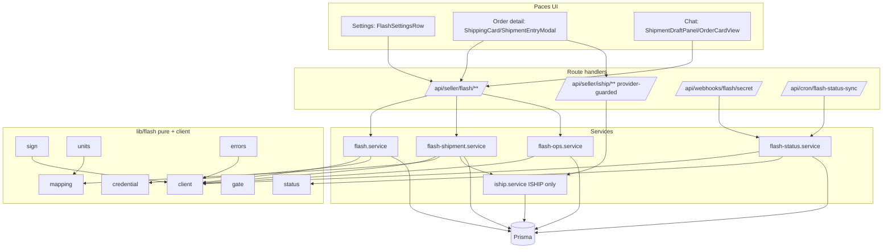
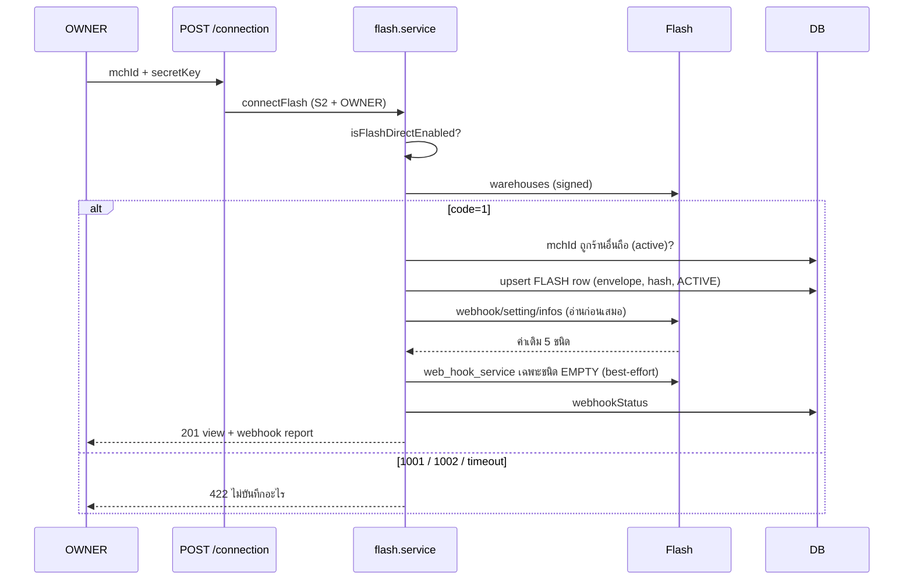
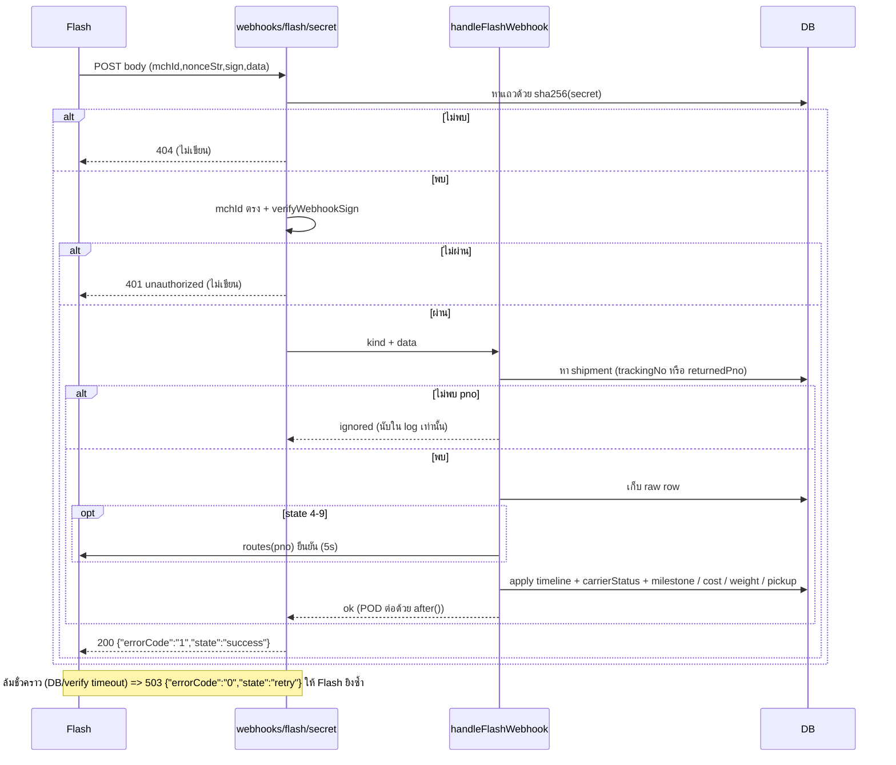
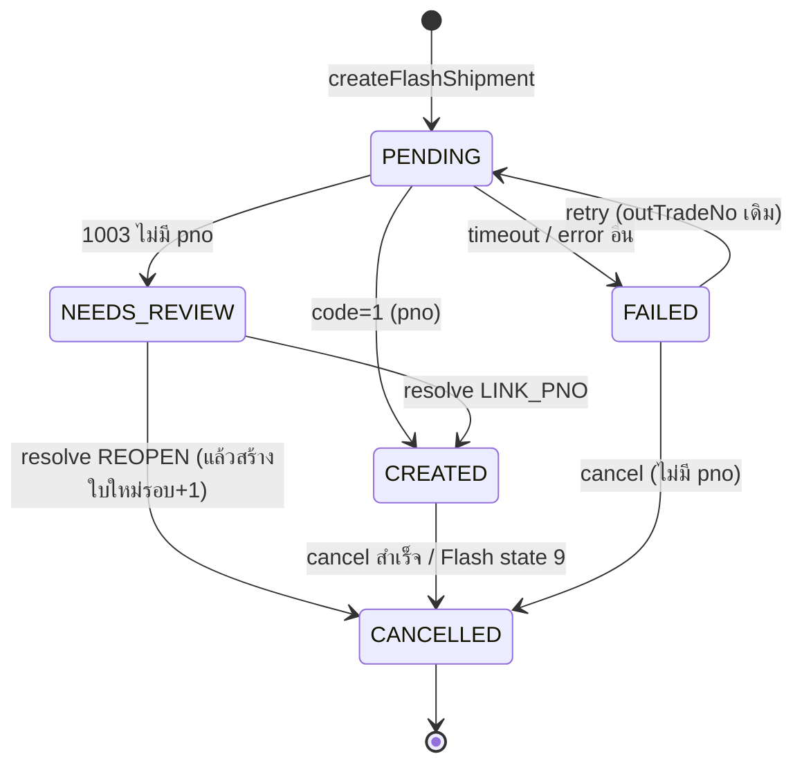

> **โมดูล:** 00084 Flash Express Direct Integration
> **ประเภทเอกสาร:** System Design Spec (SDS)
> **เวอร์ชัน:** 0.1
> **วันที่จัดทำ:** 2026-10-22
> **สถานะ:** Draft
> **เจ้าของเอกสาร:** SA

# SDS: เชื่อม Flash Express ตรง (System Design Spec)

---

## 1. บทนำ และ References

### 1.1 วัตถุประสงค์
ออกแบบว่า "อะไรจะถูกสร้าง/แก้ที่ไหน อย่างไร" เพื่อให้ Controller dispatch developer ได้ทันที ตาม [[SRS]] (TFR-FLASH-001..024) โดยออกแบบเรียบง่ายตามสถาปัตยกรรม 00022 เดิม ไม่เพิ่ม framework

### 1.2 ขอบเขตการออกแบบ
สร้างโมดูลคู่ขนาน (`lib/flash`, `services/flash*`, route ใหม่) และแก้ 00022 เฉพาะจุดที่ต้องรู้จักผู้ให้บริการ — รายการจุดแก้ทั้งหมดอยู่ใน §8 (ถ้าจุดไหนไม่อยู่ในตาราง = ห้ามแก้ = CREEP ตาม OOS-18)

### 1.3 เอกสารอ้างอิง
[[SRS]] · [[API]] · [[DATABASE]] · scope baseline · research R§ · 00022 SDS/API · retro 2026-10-18 (00080) · memory `feedback_service_error_route_mapping`

---

## 2. Architecture Overview

### 2.1 แนวทาง
**ขนานไม่ผสม:** Flash มี client / service / route / webhook / cron ของตัวเอง แชร์เฉพาะ "ของที่เป็น pure และไม่ผูก iShip" (eligibility, payment-sync, ตารางสถานะกลาง, helper ที่อยู่/ผู้ส่ง, `recordOrderEvent`, `reserveTrackingNotice`, `syncOrderPaymentToParcel`, `route-helpers` `ishipJson/readJson`) ผล: Flash ล่ม/พังไม่ลามถึง iShip และเทส 00022 ไม่ต้องเปลี่ยนความหมาย

ลูกศร `FSH --> IS` = นำเข้า `applyReceiverPatch` / `resolveOrderIdByToken` เท่านั้น (เพิ่มคำว่า `export` ที่ `applyReceiverPatch` ไม่เปลี่ยนตรรกะ — CS-31)

### 2.2 Deploy
Vercel serverless เดิม · `vercel.json` เพิ่ม 1 cron `/api/cron/flash-status-sync` (`*/5 * * * *`) · env ใหม่ 4 ตัว (§9.3) ไม่มี secret ใหม่ (ใช้ `CHANNEL_TOKEN_KEY`, `CRON_SECRET` เดิม)

---

## 3. Component Design

### 3.1 Module layout และที่ตัดสิน provider

| ไฟล์ (ใหม่) | หน้าที่เดียว | exports หลัก (สัญญาสำหรับ dispatch ขนาน) |
|-------------|--------------|------------------------------------------|
| `src/lib/flash/constants.ts` | ค่าคงที่จุดเดียว | `FLASH_LIMITS`, `FLASH_COST_COMPONENTS`, `FLASH_VERIFY_STATES`, `FLASH_POLL`, `FLASH_RETURN_DELIVERED_MEANS_RETURNED`, `FLASH_PROVINCE_TABLE` |
| `src/lib/flash/sign.ts` | ลายเซ็น | `isBlankValue`, `signParams`, `buildFormBody`, `newNonce`, `verifyWebhookSign` |
| `src/lib/flash/units.ts` | หน่วย | `bahtToSatang`, `satangToBaht`, `kgToGram`, `gramToKg`, `FlashUnitError`, `parseSatangStrict` |
| `src/lib/flash/errors.ts` | error | `FlashError`, `FlashErrorCode`, `mapFlashCode`, `redactFlash`, `classifyFlashRetryUX`, `flashUserMessage(code, upstream?)`, `FlashServiceError` |
| `src/lib/flash/gate.ts` | ประตู/โหมด | `TRAINING_VECTOR_VERIFIED`, `isFlashDirectEnabled`, `isFlashDryRun`, `flashBaseUrl`, `flashWebhookBase` |
| `src/lib/flash/credential.ts` | envelope/masking | `encodeCredential`, `decodeCredential` (ใช้ `token-crypto`), `maskMerchantId`, `newWebhookSecret`, `hashWebhookSecret` |
| `src/lib/flash/client.ts` | HTTP | `flashCall` + ฟังก์ชันต่อ endpoint (`warehouses, createOrder, cancelOrder, routes, routesBatch, deliveredInfo, labelPdf, estimateRate, notify, cancelNotify, webhookInfos, setWebhook`) |
| `src/lib/flash/mapping.ts` | params | `buildCreateOrderParams`, `buildEstimateParams`, `foldCodItems`, `normalizeFlashProvince`, `buildFlashOutTradeNo`, `findMissingFlashParcelFields` |
| `src/lib/flash/status.ts` | สถานะ/ตัวอ่าน | `mapFlashState`, `describeMarker`, `parseFlashTime`, `isFlashTrackingSettled`, `FLASH_PICKUP_STATE`, `readFlashPrice`, `readFlashWeight`, `normalizeRoutes`, `normalizeBatchRoutes` |
| `src/lib/flash/webhook-parse.ts` | ตัวแกะ body | `parseWebhookBody(contentType, text)`, `inferFlashWebhookKind`, `classifyWebhookUrl` |
| `src/lib/flash/route-helpers.ts` | แมป error → HTTP | `mapFlashError(err, {context})` (delegate `IShipServiceError` → `mapIShipError`), `flashJson`, `flashError` |
| `src/lib/shipping/provider.ts` | helper ข้ามผู้ให้บริการ (pure) | `providerLabel`, `shipmentSourceLabel`, `shipmentApiBase(provider)`, `hasUsableShipment(status)`, `isCodManualConfirmNotice(provider,codAmount)` |
| `src/lib/shipping/after-create.ts` | ตัดสิน AUTO/ASK/CHOOSE (pure) | `decideAfterCreate(providers)` |
| `src/services/flash.service.ts` | บัญชี/ตั้งค่า/webhook sync/pickup/estimate/panel | `getFlashConnection, connectFlash, verifyFlash, disconnectFlash, getFlashSettings, updateFlashSettings, syncFlashWebhooks, getFlashPanelOrReason, estimateFlashPrice, requestFlashPickup, cancelFlashPickup, loadFlashAccount, withFlashGuard, recordFlashAudit` |
| `src/services/flash-shipment.service.ts` | สร้าง/ลองใหม่/resolve/ผูก | `createFlashShipment, retryFlashShipment, resolveReviewShipment, previewFlashPno, linkFlashShipment` |
| `src/services/flash-ops.service.ts` | ยกเลิก/ใบปะหน้า/traces/เลิกผูก | `cancelFlashShipment, getFlashLabelPdf, getFlashTraces, unlinkFlashShipment` |
| `src/services/flash-status.service.ts` | apply สถานะ/ต้นทุน/POD/ซิงก์ | `applyFlashRoutes, handleFlashWebhook, syncFlashStatuses, captureFlashPod, captureFlashCharges, stampFlashMilestones` |

### 3.2 จุดที่ตัดสิน provider (dispatch)
| ชั้น | วิธี | เหตุผล |
|------|------|--------|
| **Route** | Flash มี route tree ของตัวเอง; UI เลือก base ด้วย `shipmentApiBase(shipment.provider)` | ไม่ต้องแตะ route iShip 11 เส้น (BR-FLASH-67) · error map แยก |
| **Service (iShip)** | ฟังก์ชันที่รับ `shipmentId`/`orderId` ใน iShip เพิ่ม `provider:'ISHIP'` ใน where หรือ guard `NOT_FOUND`/`SHIPMENT_EXISTS` (CS-ตาราง §8) | กัน id ของ Flash หลุดเข้าทาง iShip |
| **Webhook/Cron** | route แยก service แยก | BR-FLASH-78 |
| **อ่านรวม (หน้าออเดอร์/แชท)** | หน้า RSC ดึงทั้ง `getShipmentPanel` (iShip) และ `getFlashPanelOrReason` แล้วเลือกใบ `LATEST` ล่าสุดของทั้งสอง | ไม่แก้ `getShipmentPanelOrReason` ให้ซ้อน provider |
| **Batch ใบปะหน้า** | route iShip เดิม + `getLabelPdf` แยกใบ non-ISHIP เข้า `skipped` | ตามที่ S-9 สั่ง |

---

## 4. Data Flow

### 4.1 เชื่อมต่อ + ลงทะเบียน webhook

### 4.2 Flow หลัก: สร้างพัสดุ — ดู [[SRS]] §4.1

### 4.3 Webhook

### 4.4 State machine ของ `OrderShipment.status` (ฝั่ง Flash)

### 4.5 Poll สำรอง
cron → เลือกร้าน ACTIVE → throttle 15 นาที → ก้อน `pnos ≤ 500 chars` → `routesBatch` → `applyFlashRoutes` ต่อใบ → ซ่อม POD → อัปเดต `statusSyncedAt`

---

## 5. Integration Points

| จุดเชื่อม | ประเภท | Contract | ความเสี่ยงเมื่อล่ม |
|-----------|--------|----------|--------------------|
| Flash Open API | external | POST form + SHA256 sign → JSON `{code,message,data}` (ใบปะหน้า PDF) | สร้าง FAILED (ลองใหม่ได้) · poll ข้ามรอบ |
| Flash → webhook | external | 5 ชนิด, ตอบ `{"errorCode":"1","state":"success"}` | หายได้ (ส่งย้อนหลังไม่ได้) ⇒ poll ซ่อม |
| `token-crypto` | internal | `encryptToken/decryptToken` | |
| `order-event.service`, `auto-notify.service` | internal | tx เดียวกับ mark CREATED | |

**Timeout/Retry/Idempotency:** ตาม SRS TFR-001/009/010/016 — create ไม่ retry อัตโนมัติ (ร้านกด) · idempotency = `outTradeNo` เดิม + unique ที่ DB

---

## 6. Technical Decisions

### TD-FLASH-01: ขนานไม่ผสม (route/service/webhook/cron แยก)
- **ตัดสินใจ:** ดู §3.2
- **เหตุผล:** BR-FLASH-67/78 · ลด blast radius · เทส iShip ไม่ต้องเข้าใจ Flash
- **ทางเลือกที่ตัดทิ้ง:** (ก) ให้ route iShip dispatch ตาม `OrderShipment.provider` — ต้องแตะ 11 route + error map รวม, UI เดิมไม่เปลี่ยนแต่ผูก error สองระบบ (ข) abstraction `ShippingProvider` interface — over-engineering
- **ผลกระทบ:** UI ต้องรู้ `provider` เพื่อเลือก base path (helper เดียว)

### TD-FLASH-02: นิยาม "มีพัสดุ" — ใช้ตัวไหน ที่ไหน (บทเรียน retro 00080)

| เส้นทางใหม่/ที่แก้ | นิยามที่ใช้ | เหตุผล |
|--------------------|-------------|--------|
| `createFlashShipment` ด่านใบเดิม | **LATEST** (`status<>CANCELLED ∧ FORWARD`) + unique ที่ DB | รวม FAILED/NEEDS_REVIEW/dry-run ที่ยังจองช่อง |
| `getFlashPanelOrReason().shipment` | **LATEST**, `createdAt desc` | หน้าต้องเห็นใบที่ล้มเพื่อกดลองใหม่ |
| `activeElsewhere` (ใบ ISHIP ที่ขวางการสร้าง Flash) | **LATEST** | ตรงกับ unique index |
| หน้าออเดอร์ `hasLiveShipment` (ซ่อนส่งเอง) / `shipmentSource` | `shipmentSource` = **LATEST** (มีใบใดก็ตามของระบบ) · `hasLive` = **ACTIVE** ผ่าน `hasLiveIshipShipment()` เดิม (ชื่อเดิม แต่ implement ไม่ผูกผู้ให้บริการ) | คงพฤติกรรมเดิมของหน้า |
| `syncFlashStatuses` ชุดตาม | **ACTIVE** + `provider:'FLASH'` (spread `ACTIVE_FORWARD_SHIPMENT`) | ต้อง `CREATED` จริง ไม่ใช่ dry-run |
| กำไร/แดชบอร์ด/ยอดขาย/รายงาน LINE | **ACTIVE** ผ่านทางเดิมทั้งหมด (ไม่แก้) | `resolveOutboundShippingCost` ไม่ผูก provider |
| `backfillShipmentEvidence`, `syncShipmentStatuses`, `handleStatusWebhook` (iShip) | เติม `provider:'ISHIP'` | กัน Flash ปน |

ทุก query Flash ที่มี `status:'CREATED'` ต้องมี `direction` (spread `ACTIVE_FORWARD_SHIPMENT`) ไม่งั้น blocker `shipment-direction.test.ts` แดง · ห้ามเขียน `where: { status: { not: 'CANCELLED' } }` เปล่า

### TD-FLASH-03: credential envelope ใน `accessTokenEnc` (DD-3)
- **ตัดสินใจ:** เข้ารหัส JSON `{v,k,w}` (key + webhook secret) ด้วย `encryptToken`
- **เหตุผล:** ต้องมี plaintext webhook secret ตอนลงทะเบียนซ้ำ/เปลี่ยนชนิด แต่ DB ล็อกให้เก็บแค่ hash; ไม่มีคอลัมน์ใหม่; หมุน secret ได้เมื่อเชื่อมใหม่
- **ทางเลือกที่ตัดทิ้ง:** (ก) derive secret ด้วย HMAC(key, accountId) — หมุนไม่ได้ (ข) เพิ่มคอลัมน์ `webhookSecretEnc` — ขัด DB ที่ล็อก (ค) ใช้ secret เดียวระดับระบบ — รั่วทีเดียวทุกร้าน
- **ผลกระทบ:** `decodeCredential` เป็นจุดเดียวที่ parse; envelope เสียหาย ⇒ `TOKEN_INVALID` (ให้ร้านวางใหม่)

### TD-FLASH-04: ยืนยัน state ปลายทางด้วย `routes` ก่อนประทับ
- sign ของ webhook ไม่ครอบ `data` (R§2.4) ⇒ webhook = ตัวกระตุ้น, `routes(pno)` = ความจริง (BR-FLASH-73) · ตัดทิ้ง: เชื่อ body เมื่อ sign ผ่าน (ปลอม state ส่งถึง ⇒ 00039 ปิดออเดอร์ ⇒ Trust Score)

### TD-FLASH-05: ไม่เรียก `advanceOrderOnCarrierMove` / `settleCodFromCarrier` จาก Flash
- BR-FLASH-40/44 · ร้านกด "จัดส่งแล้ว/รับเงิน" เอง · เทสสแกนซอร์ส `flash*` ไม่มีชื่อสองตัวนี้/`codSettledAt`/`payment_success`
- **ข้อควรรู้ (DD-6):** 00039 `autoConfirmDelivered` อ่าน `deliveredAt` ของ ACTIVE ทุก provider ⇒ ใบ Flash ที่ส่งถึงถูกปิดออเดอร์ได้เมื่อพ้น 7 วัน (รวม COD ที่ร้านยังไม่กดรับเงิน) — พฤติกรรมเดียวกับ iShip, BRD ระบุ 00039 เป็นระบบที่เกี่ยวข้อง; ไม่แก้

### TD-FLASH-06: poll เป็น route แยก (DD-2)
- ตัดทิ้ง "เพิ่มสาขาใน cron iShip": รอบ iShip ใช้เวลา/maxDuration ร่วมกัน, ล้มพร้อมกัน, FR-062 เขียนว่า "สาขา" ⇒ เราตีความเป็น "รอบเดียวกันตารางเวลาเดียวกัน แยก handler"

### TD-FLASH-07: ที่เก็บ raw webhook = `ShipmentEvent` (`source='WEBHOOK_RAW'`)
- ไม่มีตารางใหม่ (DB ล็อก) · iShip เก็บ raw ที่ `ShipmentEvent.payload` เหมือนกัน · ผู้อ่านไทม์ไลน์มีที่เดียว (`iship.service` getTraces — ไม่ถูกเรียกกับแถว FLASH) และ Flash มี reader ของตัวเองที่กรอง raw ออก
- unknown pno: **ไม่เก็บ** (BR-FLASH-77) — นับด้วย log บรรทัดเดียว

### TD-FLASH-08: ไม่มี "ผู้ให้บริการเริ่มต้น" แบบถาวร (DD-5 / G-2)
- ไม่มีคอลัมน์ ⇒ ใช้ `createMode` ต่อผู้ให้บริการ + `decideAfterCreate` ที่ถามทุกครั้งเมื่อมีสองเจ้า (ปลอดภัยกว่าเลือกเอง BR-21)

### TD-FLASH-09: ใบปะหน้า/POD ไม่คัดลอกรูปลง storage — ลิงก์ Flash (OOS-9)

### TD-FLASH-10: `outTradeNo` อักขระล้วน (P0-5) — กันกรณี Flash ปฏิเสธ `:` / `-`

### TD-FLASH-11: audit ระดับร้านเป็น log-only (G-1) — รอ Controller

---

## 7. Traceability

| SRS | SDS element | สถานะ |
|-----|-------------|-------|
| TFR-001/002/003/022 | §3.1 sign/units/errors/gate/client · TD-FLASH-03 | Draft |
| TFR-004/005/006 | flash.service · §4.1 · TD-03 | Draft |
| TFR-007 | §8.1 CS · §8.2 · §8.3 | Draft |
| TFR-008..012 | flash-shipment.service · §4.2 · §8.4 | Draft |
| TFR-013/014/015 | flash-ops/flash.service · §8.1 CS-13..15 | Draft |
| TFR-016..020 | flash-status.service · §4.3 · TD-04/05/07 | Draft |
| TFR-021 | lib/shipping/provider · §9 UI | Draft |
| TFR-023/024 | §8.5 · G-1 | Draft |

---

## 8. Technical Design (System Architect)

### 8.1 ตาราง CS — ทุกจุดที่ต้องรู้จักผู้ให้บริการ

> `tsc` จับได้เฉพาะ `findUnique/update/upsert({where:{shopId}})` (เพราะ DB เลิก `shopId @unique`) — แถวที่ระบุ "เงียบ" คือ `updateMany/findMany/count` หรือ query ตาม id ที่ tsc ไม่มีทางฟ้อง ต้องมี blocker test สแกนซอร์ส

| CS | ไฟล์:บรรทัด (ปัจจุบัน) | สภาพปัจจุบัน | วิธีแก้ที่ต้องทำ | tsc จับ? |
|----|------------------------|--------------|------------------|----------|
| 01 | `services/iship.service.ts:219` loadAccount | `findUnique({where:{shopId}})` | `where:{shopId_provider:{shopId,provider:"ISHIP"}}` | ใช่ |
| 02 | `:236` markTokenInvalid | `updateMany({where:{shopId}})` | เพิ่ม `provider:"ISHIP"` — **ไม่งั้น iShip 401 จะ mark แถว FLASH เป็น TOKEN_INVALID** | **เงียบ** |
| 03 | `:257` getConnection | findUnique shopId | compound ISHIP | ใช่ |
| 04 | `:280` connect upsert | `where:{shopId}`, create ไม่ระบุ provider | compound ISHIP + create `provider:"ISHIP"` ชัด ๆ | ใช่ |
| 05 | `:314` verifyConnection (findUnique) / `:319` update | shopId | compound ISHIP ทั้งคู่ | ใช่ |
| 06 | `:334` disconnect | `updateMany({where:{shopId}})` | เพิ่ม `provider:"ISHIP"` — **ไม่งั้นถอด iShip ล้างแถว FLASH** (BR-FLASH-19) | **เงียบ** |
| 07 | `:372` getSettings · `:402` updateSettings findUnique · `:406` update | shopId | compound ISHIP | ใช่ |
| 08 | `:583` getShipmentPanelOrReason | findUnique shopId | compound ISHIP | ใช่ |
| 09 | `:754` getShipmentPanelState | findUnique shopId (select status) | compound ISHIP | ใช่ |
| 10 | `:2461` syncShipmentStatuses | findUnique shopId | compound ISHIP | ใช่ |
| 11 | `:2479` `tracking` findMany (ชุดพัสดุที่ตาม) | `{shopId, status:"CREATED", trackingNo≠null,…}` ไม่มี provider | เติม `provider:"ISHIP"` — **ไม่งั้นส่ง pno ของ Flash ไป iShip query_orders/get_order** (allow-list ของ `shipment-direction.test` ต้องยังเขียว) | **เงียบ** |
| 12 | `:2514` / `:2650` update statusSyncedAt | where shopId | compound ISHIP | ใช่ |
| 13 | `:941` createShipment — ใบเดิม `FAILED` แล้ว retry | ไม่ดู provider | select `provider`; ถ้า `active.provider!=="ISHIP"` ⇒ `SHIPMENT_EXISTS` ("มีพัสดุ Flash อยู่แล้ว — จัดการที่การ์ด Flash") **ก่อน** เข้าทาง retry | เงียบ |
| 14 | `:1261` retryShipment · `:1447` cancelShipment · `:1716` getTraces · `:3216` unlinkShipment | `findFirst({id,shopId})` | เติม `provider:"ISHIP"` ใน where (id ของ Flash ⇒ NOT_FOUND) | เงียบ |
| 15 | `:1522` getLabelPdf `rows` | เลือก id,status,trackingNo; `loadAccount` ก่อน | select `provider`; ใบ `provider!=="ISHIP"` ⇒ `skipped` เหตุผล "ใบปะหน้า Flash พิมพ์ได้ทีละใบ"; เรียก `loadAccount` **หลังแยกใบ** เฉพาะเมื่อมีใบ ISHIP; ถ้าเหลือ 0 ใบ ISHIP และมี Flash ถูกข้าม ⇒ `INVALID_STATE` ข้อความระบุ Flash ทีละใบ | เงียบ |
| 16 | `:2122` handlePickupWebhook · `:2148` cancelPickup · `:1908` requestPickup create | `findFirst({ticketPickupId})` / `{id,shopId}` | เติม `provider:"ISHIP"` | เงียบ |
| 17 | `:2041` handleStatusWebhook | `findFirst({refCode|trackingNo})` | เติม `provider:"ISHIP"` | เงียบ |
| 18 | `:2383` backfillShipmentEvidence rows | ไม่กรอง provider | เติม `provider:"ISHIP"` (มิฉะนั้น `captureShipmentEvidence` เรียก iShip ด้วย pno ของ Flash) | เงียบ |
| 19 | `:431/:499/:117` toShipmentView / SHIPMENT_SELECT / ShipmentView | ไม่มี `provider` | เพิ่ม `provider: true`, field `provider: string`; `lastErrorMessage`: ถ้า `provider==="FLASH"` ⇒ `flashUserMessage(code, upstream)` แทน `new IShipError(code as never)` (กัน `userMessage = undefined`) · เพิ่ม `provider` ใน `ShipmentViewJson` (`lib/iship/context.ts`) | ใช่/เงียบ |
| 20 | `services/order-return.service.ts:248` | findUnique shopId (select status) | compound ISHIP (ขากลับ = iShip เท่านั้น OOS-7) | ใช่ |
| 21 | `app/api/cron/iship-status-sync/route.ts:57` | `findMany({where:{status:"ACTIVE"}})` | เติม `provider:"ISHIP"` — **ไม่งั้นร้านซ้ำและแถว FLASH เข้ารอบ iShip** | **เงียบ** |
| 22 | `app/(paces)/seller/(chat)/inbox/page.tsx:161` | `count({shopId in, status:ACTIVE})` | **คงเดิมโดยตั้งใจ** (นับทั้งสองผู้ให้บริการ = "ร้านมีขนส่งที่ติดตามสถานะได้") + คอมเมนต์ + เทส | — |
| 23 | `app/api/chat/shop-context/route.ts:69` | findUnique shopId (select status,createMode) | compound ISHIP (ไป `ishipCreateMode`/`hasShipping`) **และเพิ่มอีก query FLASH** → ตอบ `flash:{available,connected,createMode}` ตรงกับ seed ของ layout | ใช่ |
| 24 | `app/(paces)/seller/(chat)/layout.tsx:177` | findUnique shopId | compound ISHIP + query FLASH (seed ค่าเดียวกับ CS-23; ใช้ `resolveChatIshipCreateMode` กับ FLASH ได้เช่นกัน) | ใช่ |
| 25 | `app/(paces)/seller/(fullscreen)/orders/new/page.tsx:104` | `getConnection(shop.id)` (หลัง CS-03 ถูกต้องอยู่แล้ว) | เพิ่ม `getFlashConnection` seed `flashCreateMode` | — |
| 26 | `lib/iship/status.ts:214-226` carrierTrackingSettled | `delivered` + COD ยังไม่ settle = ยังไม่จบ | เพิ่ม parameter `provider?:string\|null`; `provider==="FLASH"` ⇒ `delivered` จบทันที (ไม่รอ payment_success) · ผู้เรียกเดิม (`getTraces` iShip) ไม่เปลี่ยนค่า (ISHIP/undefined) · SQL ใน CS-11 ถูกกรอง ISHIP แล้ว | — |
| 27 | `lib/iship/status.ts:306` describeShipmentStatus | default คืน `{text:status}` | เพิ่ม `NEEDS_REVIEW` → `{text:"ต้องตรวจสอบพัสดุ", tone:"warning"}` | — |
| 28 | `lib/chat-order-progress.ts:53` · `(chat)/_components/OrderCardView.tsx:220` | `status !== 'FAILED'` / `=== 'FAILED'` | ใช้ `hasUsableShipment(status)` (= `status==='CREATED'` หรือ `PENDING`?) — ให้ `NEEDS_REVIEW` ปฏิบัติเหมือน `FAILED` | เงียบ |
| 29 | `services/auto-notify-message.service.ts:73-77,124-146` | select ไม่มี provider; `source:'ISHIP'` ทุก shipment ⇒ แนบลิงก์ iShip | select `provider`; `source: s.provider==='ISHIP' ? 'ISHIP':'MANUAL'` | เงียบ |
| 30 | `(dashboard)/orders/components/OrdersTable.tsx:627` | `shipmentId` เฉพาะ `provider==='ISHIP'` | ส่ง id ของ FLASH ด้วย + `provider` ให้ hover เลือก base path | — |
| 31 | `iship.service.ts` `applyReceiverPatch` (private) | | เติมคำว่า `export` เท่านั้น | ใช่ |
| 32 | `lib/validations.ts`, `lib/route-capabilities.ts` | | เติมของ Flash (§8.5) | — |
| 33 | tests เดิมที่ mock/สร้าง `shopShippingAccount` (`services/__tests__/iship-shipment-retry.test.ts:16,108`, `manual-dispatch.test.ts:98`) | mock ด้วย `findUnique: vi.fn()` | ปรับ mock ให้รับ compound where; ห้ามเปลี่ยนความหมายเทส | — |

**blocker test ใหม่ `src/lib/iship/__tests__/iship-provider-scoping.test.ts`** (สแกนซอร์ส): (ก) ไม่มี `shopShippingAccount.(findUnique|update|upsert)\(\{\s*where:\s*\{\s*shopId` (ข) ทุก `shopShippingAccount.(updateMany|findMany)` ในไฟล์ iship/cron/order-return มี `provider` (ค) ทุก `orderShipment.(findFirst|findMany|updateMany)` ใน `iship.service.ts` ที่ผูก id/trackingNo/refCode มี `provider` หรือ `direction`+เหตุผลใน allow-list (ง) `flash*.ts` ไม่มี `advanceOrderOnCarrierMove|settleCodFromCarrier|codSettledAt|payment_success` (จ) `src/components/safepay/iship` ไม่ fetch `/api/seller/flash` ตรง ๆ โดยไม่ผ่าน `useIShipUrl()`

### 8.2 ทุกที่ที่ `status==='FAILED'` ถือเป็น "ลองใหม่ได้" และการกัน `NEEDS_REVIEW`

| ที่ | พฤติกรรม | `NEEDS_REVIEW` |
|-----|----------|----------------|
| `iship.service.ts:941` createShipment | FAILED ⇒ retry | ≠FAILED ⇒ `SHIPMENT_EXISTS` อยู่แล้ว (เพิ่ม provider guard — CS-13) |
| `iship.service.ts:1131` createReturnShipment | ขากลับเท่านั้น | ไม่เกี่ยว (Flash ไม่มีขากลับ) |
| `iship.service.ts:1261` retryShipment | รับ FAILED เท่านั้น | `INVALID_STATE` (ตกอยู่แล้ว) + provider guard |
| `flash-shipment.service.ts retryFlashShipment` (ใหม่) | รับ FAILED เท่านั้น | `NEEDS_REVIEW` error 409 ข้อความ "ใช้ผูกด้วย pno หรือยืนยันเปิดใหม่" |
| `components/safepay/iship/ShipmentStatusView.tsx:351` | กิ่ง `status==='FAILED'` = ปุ่มลองใหม่/แก้ไข | กิ่ง `NEEDS_REVIEW` แยก **วางใต้ hook ทุกตัว** (React #310 — ดู comment บรรทัด 339-343 และเทส `shipment-status-view-hooks.test.ts`) แสดง 2 ทางออก ไม่มีปุ่มลองใหม่ |
| `(chat)/_components/ShipmentDraftPanel.tsx:519` | `ctx.shipment.status==='FAILED'` = ปุ่มลองใหม่/แก้ไข | เพิ่มกิ่ง `NEEDS_REVIEW` (ใช้ component เดียวกับด้านบน) |
| `(chat)/_components/OrderCardView.tsx:220` | FAILED ⇒ แสดงชิปสถานะแทนเลขพัสดุ | ปฏิบัติเหมือน FAILED (CS-28) |
| `lib/chat-order-progress.ts:53` | FAILED ⇒ `hasShipment=false` | ปฏิบัติเหมือน FAILED (CS-28) |
| `lib/iship/status.ts:306` describeShipmentStatus | | ข้อความเฉพาะ (CS-27) |
| `lib/iship/errors.ts classifyRetryUX` (UI ใช้ตัดสินปุ่มเด่น) | code ไม่รู้จัก ⇒ `retry` | Flash ใช้ `classifyFlashRetryUX` ของตัวเอง (`DUPLICATE_ORDER`⇒`review`) — **UI ต้องเลือกตัวตัดสินตาม `provider`** (`lib/shipping/provider.ts: retryUxFor(provider, code)`) |
| SQL/where ที่ `status:'CREATED'` (กองงาน/กำไร) | | NEEDS_REVIEW ไม่ใช่ CREATED ⇒ ไม่ปนกองโดยอัตโนมัติ |
| `OrderShipment_active_order_key` | | `status<>'CANCELLED'` ⇒ จองช่อง (กัน Flash/iShip เปิดซ้อน) |

### 8.3 Error mapping ข้ามไฟล์ (บังคับ — `feedback_service_error_route_mapping`)

> ทุก custom Error ใหม่ที่ service `throw` ต้องมี route catch → HTTP ครอบ **ในตารางนี้** และมี task เติม route (T-id) — เทส: route-level test ต่อ error type (ยิง mock service throw แล้วเช็ค status)

| Error ที่ throw | throw ที่ | ผู้เรียก (route) | catch → HTTP | task |
|-----------------|-----------|------------------|--------------|------|
| `FlashError` ทุก code (ตาราง SRS App.A) | `lib/flash/client.ts` → `flash*.service` | ทุก route `/api/seller/flash/**` | `mapFlashError`: `UPSTREAM_TIMEOUT`→504 · `UPSTREAM_ERROR`/`UNKNOWN_CODE`→502 · `MERCHANT_NOT_FOUND`/`SIGN_INVALID`→**422 ที่ `/connection`+`/connection/verify`**, **409 ที่เหลือ** · `SENDER_ADDRESS_INVALID`/`RECEIVER_ADDRESS_INVALID`/`POSTCODE_INVALID`/`SENDER_OUT_OF_AREA`/`COD_NOT_ENABLED`/`INVALID_REQUEST`→422 · `DUPLICATE_ORDER`→409 · `NOT_CANCELLABLE`/`PICKUP_PENDING`/`PICKUP_NOT_CANCELLABLE`→409 · `PARCEL_NOT_FOUND`→404 · `NOT_MERCHANT_PARCEL`→422 | T8a/T8b |
| `FlashServiceError` (`NOT_CONNECTED`409 · `FEATURE_DISABLED`404 · `SHIPMENT_EXISTS`409 · `NEEDS_REVIEW`409 · `INCOMPLETE_DATA`422 · `NOT_ELIGIBLE`403 · `NOT_FOUND`404 · `INVALID_STATE`409 · `MERCHANT_IN_USE`409 · `MERCHANT_CHANGE_NOT_ALLOWED`409 · `PNO_TAKEN`409 · `INVALID_INPUT`400) | `flash*.service` | ทุก route Flash | `mapFlashError` ตาม `SERVICE_STATUS` ตารางเดียวกัน | T8a |
| `FlashUnitError` (ทศนิยมเกิน/ติดลบ/NaN) | `lib/flash/units.ts` ← `mapping` | create/estimate/pickup | **แปลงเป็น `FlashServiceError("INCOMPLETE_DATA")` ที่ service** (ไม่ปล่อยถึง route) → 422 | T6a |
| `FlashValidationError` (COD >999, ประกันไม่มีมูลค่า, รหัสไปรษณีย์) | `mapping` | create | แปลงเป็น `INCOMPLETE_DATA`+ข้อความ ที่ service → 422 | T6a |
| `IShipServiceError` (`NOT_FOUND` จาก `resolveOrderIdByToken`) | `iship.service` ที่ route Flash เรียก | route Flash | `mapFlashError` ต้อง `instanceof IShipServiceError` → delegate `mapIShipError` | T8a |
| `Prisma.PrismaClientKnownRequestError` P2002 (`merchantId` partial unique / `trackingNo`) | `connectFlash`, `linkFlashShipment`, `applyFlashRoutes` | route / webhook | connect ⇒ `MERCHANT_IN_USE`; link ⇒ `PNO_TAKEN`; returnedPno ⇒ log ข้าม; อื่น ⇒ `mapFlashError` default 500 `UPSTREAM_ERROR` | T5/T6b/T7a |
| ทุก error ใน `handleFlashWebhook` | `flash-status.service` | `api/webhooks/flash/[secret]` | Prisma/verify-timeout/อื่นไม่รู้จัก ⇒ **503** `{"errorCode":"0","state":"retry"}` · `FlashError(MERCHANT_NOT_FOUND\|SIGN_INVALID)` ⇒ mark TOKEN_INVALID แล้ว 200 success · `FlashError(PARCEL_NOT_FOUND\|NOT_MERCHANT_PARCEL)` ⇒ 200 success (ไม่มีอะไรให้ทำ) · body parse ไม่ได้ ⇒ 200 success | T7b |
| ทุก error ใน cron | `syncFlashStatuses` | `api/cron/flash-status-sync` | ร้านละ try/catch (นับ `failed`) · ทั้งรอบ 500 `{error:"internal_error"}` | T7b |
| `getFlashLabelPdf` ตรวจ `%PDF` ไม่ผ่าน | service | label route | ไม่ใช่ PDF + มี envelope ⇒ `FlashError` ตามตาราง; ไม่ใช่ทั้งสอง ⇒ `UPSTREAM_ERROR` 502 | T6b/T8b |

### 8.3a ปลายทางที่ต้องเติม route-capabilities (บังคับ)
ทุก route ใหม่ใต้ `src/app/api/seller/flash/**` (ไม่ใช่ webhook/cron ซึ่งอยู่ใน prefix class) ต้องลงทะเบียนใน `src/lib/route-capabilities.ts` ใน**คอมมิตเดียวกับไฟล์ route** (เทส `route-capability-inventory` บังคับสองทาง) — รายการเต็มใน [[API]] §3

### 8.4 สร้างพัสดุ — จุดที่ต้องไม่พลาด (checklist สำหรับ developer + reviewer)
1. `applyReceiverPatch` ก่อนตรวจ (บทเรียน 00022) · `shopId` ใน where ของ order ทุกครั้ง
2. สร้างแถว `PENDING` **ก่อน** ยิง (unique `idempotencyKey` คือด่านกันกดซ้ำ)
3. คำขอ Flash ห้ามอยู่ใน `$transaction` ที่เปิดค้าง (timeout 20s) — เขียน PENDING แยก ยิง แล้วค่อย tx mark
4. `syncOrderPaymentToParcel(orderId, codAmount, userId)` ก่อนยิง (ให้ผลเหมือน iShip)
5. COD ที่ Flash ตอบ 1008 ⇒ `FAILED` + `COD_NOT_ENABLED` ห้ามเปิดแบบไม่ COD แทน และ UI classify `fix-data` (ไม่เชิญลองซ้ำ)
6. `reserveTrackingNotice` เฉพาะ non-dry-run · `dispatchAutoNotifyAfterCommit(ledgerId)` หลัง commit
7. best-effort estimate ห่อ try/catch กลืน (บทเรียนเดียวกับ iShip) และบันทึก `optionsSnapshot.flash.pricingTable`
8. ไม่มีการเขียน `Order.status` ในไฟล์ `flash*.ts`

### 8.5 สิทธิ์ (Auth/permission rules)
NextAuth session + service guard (ไม่ใช่ RLS): `requireGeneralShop({cap, shopId})` ใน route ทุกเส้น + `ONLINE_SALES` ในตัว · เพิ่ม helper `requireFlashOwner(guard)` (`effRoles.includes("OWNER")` ไม่ผ่าน ⇒ `forbiddenRoleResponse()`) สำหรับ connect/change key/disconnect/settings PUT/webhook sync (DD-1) · view ที่คืนให้ non-owner ไม่มี `merchantId` เต็ม · webhook/cron ไม่มี session (ตรวจ secret+sign / `CRON_SECRET` เต็มสตริง ไม่ตั้ง env = ปฏิเสธ)

### 8.6 Database impact
ไม่แตะ schema เพิ่ม (ล็อกแล้ว) — ต้อง `npx prisma generate` ก่อนเริ่ม T4 (relation `Shop.shippingAccounts`, compound unique) · ผู้ใช้ต้อง apply migration บน local (HR15 ข้อ 2) · **ห้าม** `migrate dev` / `db pull` กับฐานแชร์ · ช่องว่างที่ต้องขอ `safepay-database` ตัดสินก่อน push (ไม่ใช่ก่อนเริ่มโค้ด): G-1 (audit), G-3 (OrderEvent CHECK)

### 8.7 Error handling เชิงพฤติกรรม
Flash ล่ม/ช้า: create ⇒ FAILED (ออเดอร์ไม่กระทบ) · label/traces ⇒ 502/504 ข้อความไทย (traces ใช้ค่าที่เก็บไว้ถ้ามี เหมือน iShip) · webhook ⇒ ตอบตามตาราง §8.3 · cron ⇒ ข้ามร้าน · ทุก `lastErrorMessage` เก็บ upstream ที่ผ่าน `redactFlash`

### 8.8 Affected files (absolute)

**Create** (ใต้ `/Users/craftman/orca/workspaces/safepay/FlashExpress`):
`src/lib/flash/{constants,sign,units,errors,gate,credential,client,mapping,status,webhook-parse,route-helpers}.ts` · `src/lib/flash/__tests__/*` · `src/lib/flash/__fixtures__/*` (redacted) · `src/lib/shipping/{provider,after-create}.ts` (+tests) · `src/services/{flash,flash-shipment,flash-ops,flash-status}.service.ts` (+`__tests__`) · `src/app/api/seller/flash/{connection,connection/verify,settings,webhook/sync,order-context,price,shipments,shipments/preview,shipments/link,shipments/[id]/{retry,cancel,resolve,unlink,label,traces},pickups,pickups/[id]/cancel}/route.ts` · `src/app/api/webhooks/flash/[secret]/route.ts` · `src/app/api/cron/flash-status-sync/route.ts` · `src/lib/iship/__tests__/iship-provider-scoping.test.ts` · UI: `src/app/(paces)/seller/(dashboard)/settings/FlashSettingsRow.tsx`, `src/components/safepay/flash/{FlashCreateForm,FlashReviewPanel,FlashLinkPanel,FlashPickupSheet}.tsx`

**Modify:** `prisma/schema.prisma` (มีแล้ว) · `src/services/iship.service.ts` (CS-01..19,31) · `src/services/order-return.service.ts` · `src/app/api/cron/iship-status-sync/route.ts` · `src/app/api/chat/shop-context/route.ts` · `src/app/(paces)/seller/(chat)/layout.tsx` · `src/app/(paces)/seller/(chat)/inbox/page.tsx` (คอมเมนต์) · `src/app/(paces)/seller/(fullscreen)/orders/new/page.tsx` · `src/lib/iship/{status,context}.ts` · `src/lib/chat-order-progress.ts` · `src/services/auto-notify-message.service.ts` · `src/lib/validations.ts` · `src/lib/route-capabilities.ts` · `src/app/api/orders/[token]/shipment-evidence/route.ts` · `src/lib/iship/after-order-create.ts` · UI ที่ §9 · `vercel.json` · `.env.example` · `docs/SRS.md` · `CLAUDE.md`

### 8.9 Implementation order
ดู TASKS: T1 → (T2 ∥ T3) → T5 ∥ T7a → T6a ∥ T6b ∥ T7b → T8a → T8b → UI (T9 ∥ T10a ∥ T10b) → T10c ∥ T11 → T12 → QA; T4 (CS sweep) ขนานกับ T1 และต้องเสร็จก่อน T6

---

## 9. UI Surfaces (mapping เท่านั้น — รายละเอียดจาก `safepay-ux`)

ขั้น UX: **ใช่** (แตะ `src/components/**`, `src/app/(paces)/**`, `src/app/(marketing)/**`) ทุกงาน UI ผ่าน `safepay-ux` + `/impeccable critique` + `clarify`; commit UI ต้องมี `Base: theme/...`; toast = `pacesToast`; modal = Swal (`@/lib/paces-swal`); ห้าม emoji/arbitrary Tailwind

| # | พื้นผิว | ไฟล์เป้าหมาย | Theme source (Paces `theme/paces/Admin/TS/src/app/(admin)/…`) |
|---|---------|---------------|-----------------------------------------------------------------|
| U1 | การ์ด/แถว "Flash Express (บัญชีของร้านเอง)" + โมดัลเชื่อม/ตั้งค่า/เรียกรถ/webhook | `src/app/(paces)/seller/(dashboard)/settings/FlashSettingsRow.tsx` (พี่น้อง `ShippingSettingsRow.tsx`) | `form/elements/components/InputTextfieldType.tsx` + `ui/cards/page.tsx` + `ui/modals/page.tsx` + `ui/badges/page.tsx` + `ui/alerts/page.tsx` |
| U2 | ฟอร์มสร้างพัสดุ Flash + ตัวเลือกผู้ให้บริการ + แถวราคา | `src/components/safepay/flash/FlashCreateForm.tsx` (พี่น้อง `ShipmentCreateForm.tsx`), `PriceCompareSheet.tsx` | `form/elements/components/InputTextfieldType.tsx` · `ui/accordions/page.tsx` |
| U3 | การ์ดการจัดส่งหน้ารายละเอียด + สถานะ/ไทม์ไลน์/ใบปะหน้า/ยกเลิก/ป้าย COD | `orders/[token]/components/ShippingCard.tsx`, `ShipmentEntryModal.tsx`, `src/components/safepay/iship/ShipmentStatusView.tsx` | `apps/ecommerce/(orders)/order-details/components/ShippingActivity.tsx` |
| U4 | กิ่ง NEEDS_REVIEW (ผูก pno / ยืนยันเปิดใหม่) | `src/components/safepay/flash/FlashReviewPanel.tsx` | `ui/alerts/page.tsx` + `ui/modals/page.tsx` |
| U5 | ผูกด้วย pno | `src/components/safepay/flash/FlashLinkPanel.tsx` (พี่น้อง `ShipmentLinkPanel.tsx`) | `form/elements/components/InputTextfieldType.tsx` |
| U6 | แผงพัสดุในแชท + การ์ดออเดอร์ | `(chat)/_components/ShipmentDraftPanel.tsx`, `OrderCardView.tsx`, `ShipmentRail.tsx` | ตามพี่น้องเดิม (ไม่มี theme ตรง: ต้อง Explore ถ้าเพิ่ม layout ใหม่) |
| U7 | Swal ถาม/เลือกผู้ให้บริการหลังสร้างออเดอร์ | `src/lib/iship/after-order-create.ts` + `DraftOrderProvider.tsx`, `OrderCreateForm.tsx` | `ui/modals/page.tsx` |
| U8 | รายการออเดอร์: hover card, พิมพ์หลายใบ (รายการถูกข้าม) | `orders/components/{ShipmentHoverCard,OrdersTable,BulkActionBar}.tsx` | พี่น้องเดิม (ต้อง Explore: รูปแบบรายการ "ถูกข้ามเพราะ…" ใน Paces ถ้าเพิ่ม layout ใหม่) |
| U9 | หลักฐานการส่ง (POD) ฝั่งร้าน | `orders/[token]/components/ShipmentEvidencePanel.tsx` | ต้อง Explore: คอมโพเนนต์แกลเลอรี่รูป/ลายเซ็นใน theme Paces |
| U10 | ผู้ซื้อ `/o/{token}` (Vuexy) | ส่วนเลขพัสดุเดิมใน `src/app/(marketing)/o/[token]/` | `src/views/apps/invoice/preview/PreviewCard.tsx` (ตาม `docs/system/ui-guideline/customer/page-sourcing.md`) — ไม่ต้องเปลี่ยน layout ถ้าไม่มีป้ายใหม่ |

ข้อควรระวัง UI ที่ต้องส่งให้ `safepay-ux`: (1) `ShipmentStatusView` มี hook-order trap (§8.2) (2) ทุก fetch ของ Flash ผ่าน `useIShipUrl()` (ต่อ `?shopId=`) พร้อม blocker test (3) ป้ายแยกผู้ให้บริการใช้ `shipmentSourceLabel` เท่านั้น (HR16) (4) ข้อความ Swal เดิมที่เขียนว่า "iShip" (เช่น `after-order-create.ts`, ข้อความปฏิเสธส่งเองเมื่อมี live) ต้องผันตามผู้ให้บริการ

### 9.3 env / config
| env | ใช้ที่ | ค่าเริ่มต้น |
|-----|-------|-------------|
| `FLASH_API_BASE_URL` | `flashBaseUrl()` | ว่าง = `https://open-api.flashexpress.com` (training = `https://open-api-tra.flashexpress.com`) |
| `FLASH_DIRECT_ENABLED` | `isFlashDirectEnabled()` | ว่าง = ปิด (ต้อง `1`; prod ต้องผ่าน `TRAINING_VECTOR_VERIFIED` ด้วย) |
| `FLASH_DRY_RUN` | `isFlashDryRun()` | ว่าง; `1` ใช้ได้เฉพาะ `NODE_ENV≠production` |
| `FLASH_WEBHOOK_BASE_URL` | URL ที่ลงทะเบียนกับ Flash | ว่าง = `NEXTAUTH_URL` (dev ต้องตั้งเป็น tunnel ที่ Flash เข้าถึงได้) |

---

## 10. Decision & Gap Register (ให้ Controller ยืนยันก่อน dispatch)

| ID | เรื่อง | ค่าที่ spec ใช้ | ทางเลือก/ผลถ้าเปลี่ยน |
|----|--------|-----------------|------------------------|
| DD-1 | BRD บอก STAFF วาง/เปลี่ยน/ถอน key และตั้งค่าไม่ได้ แต่ cap `S2` ของ 00022 = [OWNER, MANAGER] | `S2` + `requireFlashOwner` (OWNER เท่านั้น) | ถ้าต้องการเท่า iShip: ลบ helper 1 บรรทัดต่อ route |
| DD-2 | FR-062 เขียน "สาขาใน cron iShip" | route cron แยก schedule เท่ากัน | ถ้ายืนยันสาขา: ย้าย loop เข้า route เดิม (เสี่ยงลาม) |
| DD-3 | key/secret เก็บอย่างไร | envelope JSON เข้ารหัสใน `accessTokenEnc` (ต่างจากข้อความ DATABASE.md D-2 เล็กน้อย: ยังเป็นความลับเดียวกัน คอลัมน์เดียว) | เพิ่มคอลัมน์ = ต้องแก้ migration ที่ยังไม่ apply |
| DD-4/G-1 | Audit ระดับร้าน (ตั้งค่า/ทับ webhook, เชื่อม/ถอน) ไม่มีตารางรองรับถาวร | `recordFlashAudit` = log บรรทัดเดียว | ขอ `safepay-database` เพิ่ม `ShopShippingAccount.auditLog Json?` (migration ยังไม่ apply แก้ได้) |
| DD-5/G-2 | ไม่มีคอลัมน์ "ผู้ให้บริการเริ่มต้น" | ถามทุกครั้งเมื่อมีสองเจ้า | เพิ่มคอลัมน์ในร้าน/บัญชี |
| DD-6 | 00039 ปิดออเดอร์ 7 วันหลัง `deliveredAt` ครอบ Flash COD | ปล่อยตามเดิม | เพิ่มเงื่อนไข COD ใน auto-confirm = แก้ 00039 (OOS-18) |
| DD-7 | `advanceOrderOnCarrierMove` ไม่ทำงานกับ Flash | ไม่เรียก (ร้านกดจัดส่งแล้วเอง) | |
| DD-8 | sign/mchId ผิดที่ webhook | 401 (Flash อาจยิงซ้ำ) | ตอบ success เงียบ = เสียสัญญาณ key ถูกเปลี่ยน |
| DD-9 | `outTradeNo` อักขระล้วน | `F<uuid ไม่มีขีด>A<n>` | |
| DD-10 | Evidence route ส่ง `pod` whitelist | 6 ฟิลด์ | |
| G-3 | `OrderEvent_type_check` ต้อง migration ถ้าเพิ่ม type | ไม่เพิ่ม type ใหม่ ใช้ `SHIPMENT_CANCELLED` meta.reason | |
| G-4 | หลักฐาน problem/return (00055) ของ Flash | นอก v1 | เพิ่ม S-id |
| G-5 | URL ติดตามพัสดุ Flash ที่พิสูจน์แล้ว | ไม่แนบลิงก์ | ใส่ `TRACKING_LINKS.FLASH` เมื่อยืนยัน |
| G-6 | สีเงินค่า "ประเมินล้ม" ฯลฯ ที่ UX ต้องออกแบบ | — | `safepay-ux` |

---

### 10.1 มติของ Controller (2026-10-22)
- ยอมรับค่าที่ spec ใช้ทุกข้อ (DD-1..DD-10, G-2..G-6)
- **สัญญาร่วมที่ล็อก (Controller เขียนเอง):** `src/services/flash-account.ts` = `findFlashAccount, unpackFlashAccount, loadFlashAccount, loadFlashAccountByWebhookSecret, markFlashTokenInvalid, recordFlashAudit, appendAudit` — `loadFlashAccount`/`recordFlashAudit` ย้ายจาก flash.service มาที่นี่ (ทุก service ของ Flash นำเข้าจากไฟล์นี้)
- **G-1 แก้:** เพิ่ม `ShopShippingAccount.auditLog Json?` ใน migration `20261022120000_00084_flash_express` (ยังไม่ apply) — `recordFlashAudit` เขียนลงคอลัมน์นี้ (append, เก็บล่าสุด 50 รายการ) **และ** log บรรทัดเดียว `[flash-audit]`

---

## 11. สรุป

**ลำดับ build ที่แนะนำ:** T1 (ลายเซ็น/หน่วย/error/gate) → T2/T3 (mapping+status ∥ client) ขนานกับ T4 (กวาด CS) → T5/T7a → T6a/T6b/T7b → T8a/T8b → UI → QA · ส่วนที่ยิง Flash จริงเปิดได้เมื่อมี credential training เท่านั้น (ไม่ประกาศ DONE โดยไม่มีหลักฐาน)

**Open Questions:** ดู §10 และ [[SRS]] Appendix C
