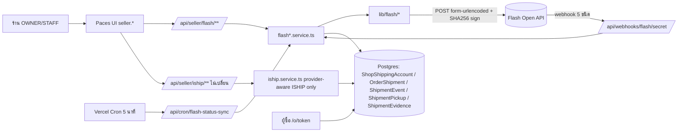
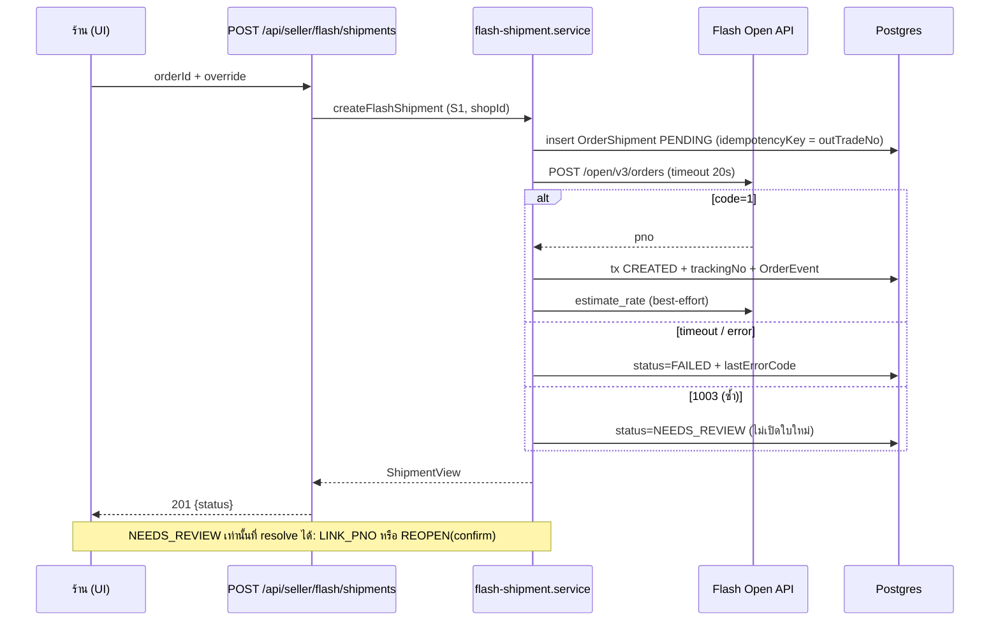

> **โมดูล:** 00084 Flash Express Direct Integration
> **ประเภทเอกสาร:** Software Requirements Specification (SRS) - TECHNICAL
> **เวอร์ชัน:** 0.1
> **วันที่จัดทำ:** 2026-10-22
> **สถานะ:** Draft (รอ Controller ยืนยัน Decision Register ใน SDS §10 ก่อนเริ่มเขียนโค้ด)
> **เจ้าของเอกสาร:** SA (ดู [[Feature-Docs-Ownership]])

# SRS: เชื่อม Flash Express ตรง (Software Requirements Specification — Technical)

---

## 1. บทนำ (Introduction)

### 1.1 วัตถุประสงค์ของเอกสาร
กำหนดข้อกำหนดเชิงเทคนิคของการเชื่อม Flash Express Open API ตรง (ร้านใช้ mchId + Secret Key ของตัวเอง) คู่กับ iShip ในร้านเดียวกัน สำหรับ DEV / QA / Reviewer โดยทุกข้อ trace กลับ FR/BR ใน [[BRD]] และ S-id ใน `docs/scope/2026-10-22-00084-flash-express-scope-baseline.md`

### 1.2 ขอบเขตเชิงระบบ
- **อยู่ใน:** `src/lib/flash/**` (ใหม่) · `src/services/flash*.service.ts` (ใหม่) · `src/app/api/seller/flash/**` · `src/app/api/webhooks/flash/[secret]` · `src/app/api/cron/flash-status-sync` · จุดเชื่อม provider-aware ในโค้ด 00022 ตามตาราง CS ใน [[SDS]] §8
- **ไม่อยู่ใน:** OOS-1..19 ของ scope baseline (ปิดงาน COD อัตโนมัติ, sub-account, หลายกล่อง, ขากลับ, รวม PDF, แก้พัสดุ, POD ให้ผู้ซื้อ, `warehouseNo`, ยอดเครดิต Flash, capability ใหม่, ตรรกะ iShip)
- **Schema:** ล็อกแล้วใน [[DATABASE]] + `prisma/migrations/20261023120000_00084_flash_express/` — SRS นี้ไม่เปลี่ยนสัญญา DB (ช่องว่างที่พบอยู่ใน SDS §10 G-1)

### 1.3 เอกสารอ้างอิง
| เอกสาร | ความสัมพันธ์ |
|--------|-------------|
| [[PRD]] / [[BRD]] (FR-FLASH-001..071, BR-FLASH-01..85) | ที่มาข้อกำหนด |
| `docs/scope/2026-10-22-00084-flash-express-scope-baseline.md` | S-1..S-17 / OOS / Change Log |
| `docs/research/2026-10-22-flash-express-open-api.md` (อ้าง "R§n") | ข้อเท็จจริง Flash API (ยังไม่ได้ยิงจริง) |
| [[DATABASE]] | สัญญาข้อมูลที่ล็อก |
| 00022 `SRS.md` / `SDS.md` / `API.md` | พี่น้อง — รูปแบบ client/service/route ที่ยึดตาม |
| `docs/retro/2026-10-18-00080-manual-shipment-dispatch-retrospective.md` | บทเรียนนิยาม "มีพัสดุ" 2 ตัว |

### 1.4 นิยามและตัวย่อ
| คำ | ความหมายเชิงเทคนิค |
|----|--------------------|
| **pno** | เลขพัสดุ Flash = `OrderShipment.trackingNo` |
| **outTradeNo** | เลขอ้างอิงฝั่งเรา = `OrderShipment.idempotencyKey` (รูปตัวอักษร+ตัวเลขล้วน ดู TFR-FLASH-008) |
| **satang / gram** | หน่วยของ Flash (เงิน/น้ำหนัก) — Deep เก็บบาท/กก. |
| **credential envelope** | ข้อความ JSON ที่ถูกเข้ารหัสเก็บใน `ShopShippingAccount.accessTokenEnc` ของแถว FLASH: `{"v":1,"k":"<secretKey>","w":"<webhookSecret>"}` |
| **ACTIVE** (นิยามพัสดุ) | `ACTIVE_FORWARD_SHIPMENT` = `status='CREATED' ∧ isDryRun=false ∧ direction='FORWARD'` (`src/lib/shipment-direction.ts`) |
| **LATEST** (นิยามพัสดุ) | `LATEST_FORWARD_SHIPMENT` = `status<>'CANCELLED' ∧ direction='FORWARD'` (รวม PENDING/FAILED/NEEDS_REVIEW/dry-run) |
| **NEEDS_REVIEW** | ค่า `OrderShipment.status` ใหม่: Flash ตอบ 1003 โดยเราไม่มี pno |
| **P0** | การพิสูจน์กับ training env ของ Flash (ยังไม่มี credential) |

---

## 2. ภาพรวมสถาปัตยกรรม

### 2.1 บริบทระบบ

### 2.2 องค์ประกอบหลัก
| Component | หน้าที่ | Stack |
|-----------|---------|-------|
| `lib/flash/sign.ts` | ลายเซ็น SHA256 + form body + ตรวจ webhook | TS pure |
| `lib/flash/units.ts` | บาท↔สตางค์, กก.↔กรัม (จำนวนเต็มตรงตัว) | TS pure |
| `lib/flash/errors.ts` | `FlashError`, ตารางรหัส→หมวด/ข้อความไทย, redact | TS pure |
| `lib/flash/client.ts` | HTTP client (timeout, `Accept-Language: th`, dry-run) | fetch (server-only) |
| `lib/flash/mapping.ts` | สร้าง params สร้างพัสดุ/ประเมินราคา, สลับตำบล/อำเภอ, พับรายการ COD | TS pure |
| `lib/flash/status.ts` | state 1–9 → carrierStatus, ตัวอ่านราคา/น้ำหนัก, ตัว parse เวลา, ตัวตัดสิน "จบแล้ว" | TS pure |
| `services/flash.service.ts` | เชื่อม/ทดสอบ/ถอน/ตั้งค่า/webhook registration/pickup/estimate/panel | Prisma |
| `services/flash-shipment.service.ts` | สร้าง/ลองใหม่/resolve 1003/ผูก pno | Prisma |
| `services/flash-ops.service.ts` | ยกเลิก/ใบปะหน้า/traces/เลิกผูก | Prisma |
| `services/flash-status.service.ts` | apply สถานะ (webhook+poll ใช้ร่วม), ต้นทุน, POD, sync | Prisma |
| `api/seller/flash/**` | route บาง: guard → Valibot → service → JSON | Next 16 route |
| `api/webhooks/flash/[secret]` | รับ webhook (แยกจาก iShip โดยสิ้นเชิง) | Next 16 route |
| `api/cron/flash-status-sync` | สำรอง `routesBatch` | Next 16 route |

### 2.3 Deploy
Serverless (Vercel) — ไม่มีตัวจับเวลาในหน่วยความจำ: throttle 15 นาทีเก็บใน `ShopShippingAccount.statusSyncedAt` แถว FLASH · งานหนักหลังตอบ webhook ใช้ `after()` ของ `next/server` และมี poll เป็นตัวสำรอง

---

## 3. ข้อกำหนดเชิงฟังก์ชันเชิงเทคนิค (TFR)

### TFR-FLASH-001: ลายเซ็นและรูปแบบคำขอ
- **Trace to:** FR-FLASH-070 · BR-FLASH-62/63/64/66 · S-1
- **อัลกอริทึม (`signParams`)**:
  1. รับ params ทั้งหมดที่จะส่ง (ไม่รวม `sign`; ถ้ามีคีย์ `sign` ให้ทิ้ง) — ค่า `undefined`/`null` = ไม่ส่งและไม่เซ็น
  2. แปลงทุกค่าเป็น string (`String(n)`; `NaN`/`Infinity` → throw)
  3. **ค่า "ว่าง"** = สตริงว่าง หรือมีแต่อักขระ `\t \n \v \f \r SPACE \u001C-\u001F` → **ไม่นำมาคิดลายเซ็น แต่ยังส่งใน body** (`"0"` ไม่ใช่ค่าว่าง)
  4. เรียงชื่อคีย์ตาม **ASCII ค่า code unit จากน้อยไปมาก case-sensitive** (ห้าม `localeCompare`)
  5. ต่อเป็น `k1=v1&k2=v2…` ด้วย **ค่าดิบ** (ไม่ trim ไม่ urlencode) แล้วต่อท้าย `&key=<secretKey>`
  6. `SHA256` (ไม่ใช่ HMAC) ของ UTF-8 → hex → **ตัวพิมพ์ใหญ่**
  7. ส่ง body เป็น `application/x-www-form-urlencoded; charset=UTF-8` (urlencode ทุกค่าตอนส่งเท่านั้น) พร้อม `mchId`, `nonceStr` (hex สุ่ม 32 ตัว), `sign`
  8. path variable (`{pno}`, `{id}`) ไม่เข้าลายเซ็น
- **ฟิลด์ JSON string** (`subItemTypes`) เซ็นด้วยสตริงที่ส่งจริง (`JSON.stringify` ครั้งเดียวแล้วใช้ค่าเดียวกันทั้งเซ็นและส่ง)
- **Webhook ขาเข้า:** `verifyWebhookSign({mchId,nonceStr,sign}, key)` = เทียบ `signParams({mchId,nonceStr}, key)` กับ `sign.toUpperCase()` ด้วย `timingSafeEqual` (ตรวจความยาวก่อน) — เอกสาร Flash ระบุว่าเซ็นเฉพาะ `mchId`+`nonceStr`
- **Header:** `Accept-Language: th` ทุกคำขอ · `Accept: application/json` (ใบปะหน้า `application/pdf`)
- **Timeout:** read 10s · estimate 12s · write (create/cancel/notify) 20s · label 30s · verify-ใน-webhook 5s (หมดเวลา = `UPSTREAM_TIMEOUT`)
- **Base URL:** `FLASH_API_BASE_URL` (ฝั่งเซิร์ฟเวอร์เท่านั้น; ไม่ตั้ง = production; BR-FLASH-18) ไม่รับจากผู้ใช้
- **Postcondition:** ไม่มี key/sign ใน log, ข้อความ error, payload ที่เก็บ, response ทุกชนิด (redact ที่ทุกทางออก)
- **Edge:** key ที่มีช่องว่างภายในถูกปฏิเสธตั้งแต่ Valibot · ค่า `0` ต้องอยู่ในลายเซ็น (mutation test)

### TFR-FLASH-002: หน่วยเงินและน้ำหนัก
- **Trace to:** BR-FLASH-26 · S-1(ง)
- `bahtToSatang(n)`: รับ number/Decimal/string ที่มีทศนิยม ≤ 2 ตำแหน่ง → จำนวนเต็ม (คำนวณผ่านสตริง `toFixed(2)` ไม่คูณ float ตรง ๆ) · ทศนิยมเกิน 2 ตำแหน่ง/ติดลบ/NaN → `FlashUnitError` (ปฏิเสธก่อนส่ง)
- `kgToGram(kg)`: kg ทศนิยม ≤ 2 → กรัมจำนวนเต็ม (ผลคูณของ 10) · เกินนั้นปฏิเสธ
- ขาเข้า: `satangToBaht(v)` รับ **เฉพาะสตริง/ตัวเลขจำนวนเต็มไม่ติดลบ** (`/^\d+$/`) → บาท 2 ตำแหน่ง · `gramToKg(g)` ปัดครึ่งขึ้นที่ 2 ตำแหน่ง (DB `Decimal(6,2)`; ค่ากรัมดิบอยู่ใน payload ที่เก็บ)
- Round-trip: `satangToBaht(bahtToSatang(x)) === x` ทุก x ที่มี ≤ 2 ทศนิยมในช่วง 0–10,000,000

### TFR-FLASH-003: อนุกรมวิธาน error
- **Trace to:** BR-FLASH-36/64/65 · S-1(จ)
- `FlashError(code, {upstreamMessage, httpStatus, flashCode})` · `userMessage` เป็นไทยที่ร้านแก้ต่อได้ · ข้อความดิบเก็บเฉพาะ `upstreamMessage` ที่ผ่าน `redactFlash` แล้วเท่านั้น
- ตารางครบทุกรหัสใน BR-FLASH-65 อยู่ใน Appendix A · รหัสไม่รู้จัก → `UNKNOWN_CODE` ข้อความทั่วไป + เก็บ `flashCode` ดิบ
- `invalidatesConnection`: เฉพาะ `MERCHANT_NOT_FOUND`(1001) / `SIGN_INVALID`(1002) — timeout, `0`, `1000`, HTTP 5xx, ไม่ใช่ JSON **ห้าม** เปลี่ยนสถานะ (BR-FLASH-14)
- `classifyFlashRetryUX(code)` → `retry | fix-data | connection | review` (ใช้ตัดสิน UI ว่าปุ่มไหนเด่น; `review` = 1003)

### TFR-FLASH-004: เชื่อม / ทดสอบ / เปลี่ยน key / ถอน
- **Trace to:** FR-FLASH-001/002/003 · BR-FLASH-01..05/10..19 · S-3
- **connect(shopId, userId, {mchId, secretKey})** ลำดับบังคับ: (1) gate ฟีเจอร์ (TFR-FLASH-022) (2) `warehouses` ลงลายเซ็นด้วย credential ที่วาง — ไม่ `code=1` = ไม่เขียน DB (3) ตรวจ mchId ใช้งานโดยร้านอื่น (`provider='FLASH' ∧ merchantId ∧ status<>'DISCONNECTED' ∧ shopId<>this`) → `MERCHANT_IN_USE` ข้อความเดียวไม่บอกร้าน (**ตรวจหลังพิสูจน์ key เท่านั้น** กันใช้เป็นตัวสอบถามว่า mchId ใครใช้ Deep) · ชน partial unique (P2002) ถือเป็นผลเดียวกัน (4) ถ้าแถว FLASH ที่ไม่ DISCONNECTED มี `merchantId` อยู่แล้วและต่างจากที่วาง → `MERCHANT_CHANGE_NOT_ALLOWED` (BR-FLASH-16) (5) `upsert` ด้วย `where: { shopId_provider: { shopId, provider: "FLASH" } }`: เขียน envelope เข้ารหัส (`encryptToken`), `tokenLast4` = 4 ตัวท้ายของ key, `merchantId`, `status='ACTIVE'`, `connectedByUserId`, `lastVerifiedAt`, `lastVerifyError=null`, `webhookSecretHash=sha256(w)`; แถวใหม่ `createMode='OFF'`; เปลี่ยน key ใช้ `w` เดิม ส่วนเชื่อมใหม่หลัง DISCONNECTED สร้าง `w` ใหม่ (6) หลังเขียนแล้วค่อยลงทะเบียน webhook แบบ best-effort (TFR-FLASH-006) — ล้มไม่ทำให้ connect ล้ม
- **verify:** เรียก `warehouses` · `1001/1002` → `TOKEN_INVALID` + `lastVerifyError` · timeout/อื่น ๆ → **ไม่เปลี่ยนสถานะ** · สำเร็จ → `ACTIVE` + `lastVerifiedAt`
- **disconnect:** best-effort ปิด webhook ที่ชี้มา Deep (TFR-FLASH-006) → เขียน `accessTokenEnc=''`, `tokenLast4=null`, `status='DISCONNECTED'`, `webhookSecretHash=null`, `webhookStatus='NOT_SET'`, `webhookRegisteredAt=null`, `lastVerify*=null` · **คง `merchantId` และพัสดุ/ประวัติทั้งหมด** · ทุก `where`/`updateMany` ระบุ `provider:'FLASH'` (ห้ามกระทบแถว ISHIP — BR-FLASH-19)
- **สิทธิ์:** OWNER เท่านั้นสำหรับ connect/change key/disconnect/override webhook/แก้ settings (DD-1) · ทุก view ที่คืนไม่มี key/envelope; `merchantId` เต็มเฉพาะ OWNER, คนอื่นได้ `merchantIdMasked`
- **Edge:** แอดมิน Deep ไม่มีเส้นทางอ่าน key (ไม่มี admin route) · vertical ไม่ใช่ `ONLINE_SALES` → 403 `NOT_ELIGIBLE` ทุก route (ผ่าน `requireGeneralShop`)

### TFR-FLASH-005: ค่าตั้งต้นของร้าน
- **Trace to:** FR-FLASH-010 · S-3
- ใช้คอลัมน์เดิมของแถว FLASH: sender* (7) · `defaultWeight` · `defaultWidth/Length/Height` (ไม่บังคับสำหรับ Flash) · `defaultCategoryId` (0–11,99) · `optOnTime` · `optBoxShield` · `optIsInsured` · `optProductValue` · `defaultRemark` (≤200) · `createMode` · `labelSize` (`BIG` ค่าเริ่มต้น | `SMALL`) · **ไม่มี** `defaultCodEnabled` (BR-ISHIP-90) และไม่ใช้ `optServiceType`/`defaultCourierCode`
- `senderComplete` = `findMissingSenderFields(...)` ว่าง (ใช้ตัวเดียวกับ iShip) · `settingsComplete` = มี `defaultWeight` และ `defaultCategoryId`

### TFR-FLASH-006: ลงทะเบียน webhook อย่างปลอดภัย
- **Trace to:** FR-FLASH-004 · BR-FLASH-70/79 · S-4
- URL ต่อชนิด: `${FLASH_WEBHOOK_BASE_URL ?? NEXTAUTH_URL}/api/webhooks/flash/${w}?k=${kind}` · `w` = secret สุ่ม ≥128 บิต (`randomBytes(24).toString('base64url')`) อยู่ใน envelope; DB เก็บเฉพาะ `sha256(w)` ที่ `webhookSecretHash`
- ลำดับ `syncWebhooks(shopId, userId, {overrideKinds})`: (1) `POST /gw/fda/open/standard/webhook/setting/infos` อ่านค่าเดิม — **ห้ามข้าม** (2) แยกแต่ละชนิด (`status=0, weight=1, price=2, courier=3, routes=4`) เป็น `EMPTY` | `DEEP_OURS` (path secret แฮชแล้วเท่ากับ `webhookSecretHash`) | `DEEP_OTHER` | `EXTERNAL` (โฮสต์อื่น) | `UNKNOWN` (parse รูปไม่ออก) (3) ตั้ง (`serviceCategory=1`) `EMPTY` และ `DEEP_OTHER` (URL ของ Deep ที่ไม่ใช่ secret ปัจจุบัน) **อัตโนมัติ ไม่ต้องให้เจ้าของยืนยัน** + `EXTERNAL` เฉพาะ `overrideKinds` ที่เจ้าของยืนยัน · `DEEP_OURS` คงไว้ · `UNKNOWN` **ไม่แตะ** (ไม่ทับเด็ดขาดแม้อยู่ใน overrideKinds) (4) บันทึก `webhookStatus`: `REGISTERED` (ครบ 5 ชนิดเป็นของเรา) | `EXTERNAL` (มีอย่างน้อย 1 ชนิดเป็นของคนอื่น/ไม่รู้) | `FAILED` (เรียก Flash ล้ม) | `NOT_SET` และ `webhookRegisteredAt` เมื่อมีการตั้งสำเร็จ (5) audit: ผู้ทำ/ชนิด/เวลา/ผลต่อชนิด ผ่าน `recordFlashAudit` (DD-4 / G-1)
- ตอบกลับ UI: รายการต่อชนิด `{kind, state, host?}` — **แสดงเฉพาะ hostname** ไม่แสดง path/secret/query
- `disconnect` ปิดเฉพาะชนิดที่ `DEEP_OURS` (`serviceCategory=0`); ล้ม = ข้ามไม่บล็อก
- ตัว parse ของ `infos` ทนทั้ง camelCase/snake_case (`pickKey(obj, aliases)`); ถ้าไม่เจอ code/URL → `UNKNOWN`

### TFR-FLASH-007: อยู่ร่วมกับ iShip และการกวาดจุดเรียกบัญชี
- **Trace to:** BR-FLASH-10/19/67 · S-2
- ทุกการหาแถว `ShopShippingAccount` ต้องระบุ `provider` (compound `shopId_provider`) — รายการจุดที่ต้องแก้และวิธีแก้ครบอยู่ที่ [[SDS]] §8.1 (CS-01..CS-30)
- **ห้ามมี** `findUnique/update/upsert({ where: { shopId } })` บน `shopShippingAccount` เหลือ (tsc จับ) และห้ามมี `updateMany/findMany` ที่ไม่มี `provider` ในโค้ด iShip/cron (tsc **จับไม่ได้** — ต้องมี blocker test สแกนซอร์ส: `iship-provider-scoping.test.ts`)
- เทส 00022 ทั้งชุดต้องเขียวเท่าเดิม และมีเทสใหม่: ร้านเดียวมี ISHIP+FLASH พร้อมกัน → connect/disconnect/verify/settings ของฝั่งหนึ่งไม่เปลี่ยนแถวอีกฝั่ง (เทียบทุกคอลัมน์ก่อน-หลัง)

### TFR-FLASH-008: แปลงข้อมูลเป็น params สร้างพัสดุ
- **Trace to:** FR-FLASH-021 · BR-FLASH-25..34 · S-5
- **ที่อยู่ (blocker)**: `senderSubdistrict`/`shippingAddress.subdistrict` (ตำบล) → `srcDistrictName`/`dstDistrictName` · `senderDistrict`/`shippingAddress.district` (อำเภอ) → `srcCityName`/`dstCityName` · จังหวัด → `*ProvinceName` ผ่าน `normalizeFlashProvince` (ตารางจุดเดียว — **ห้ามใช้ `normalizeProvince` ของ iShip**; ค่าเริ่มต้นชั่วคราวและเงื่อนไข P0 ดู Appendix C) · รหัสไปรษณีย์ `^\d{5}$` ก่อนส่ง (1021) · เบอร์ผู้รับ/ผู้ส่งผ่าน `MOBILE_PHONE_RE`
- **ฟิลด์:** `outTradeNo`, `expressCategory` (`1` ปกติ | `2` เมื่อ `optOnTime`), `articleCategory` (0–11,99 ตัวเดียวกับ iShip), `weight` (กรัม), `width/length/height` (ซม. ถ้ามีครบ), `insured`+`insureDeclareValue` (สตางค์; `isInsured` ที่ไม่มีมูลค่า → ปฏิเสธก่อนส่ง), `opdInsureEnabled` (Box Shield), `codEnabled` (**ส่งทุกครั้ง** `0|1`), `codAmount` (สตางค์; ส่งเมื่อเก็บ), `subItemTypes` (เมื่อ COD), `remark` (≤200)
- **COD:** ยอดจาก `override.codAmount ?? resolveDefaultCodAmount(...)` (ตัวเดียวกับ 00022) · ต้องมี `subItemTypes` 1–10 รายการ จำนวน 1–999 — เกิน 10 รายการ: 9 รายการแรกตามเดิม + รายการที่ 10 ชื่อ "สินค้าอื่น ๆ" จำนวน = ผลรวมของที่เหลือ (ผลรวมจำนวนทั้งหมดเท่าเดิม) · รายการใดจำนวน >999 หรือผลรวมของ "อื่น ๆ" >999 → ปฏิเสธก่อนส่งพร้อมชื่อรายการ · COD แต่ไม่มีรายการ → ปฏิเสธ · ยอด COD ติดลบ → ปฏิเสธก่อนส่ง (1009 ไม่ควรถึง Flash)
- **outTradeNo:** `F` + `orderId` ตัด `-` + `A` + เลขรอบ (เช่น `F3f2a…9cA1`) ≤ 64, ตัวอักษร/ตัวเลขล้วน, เท่ากับ `idempotencyKey` ของแถว (ไม่ชนกับรูป `uuid:n` ของ iShip) — รอบเพิ่มเฉพาะหลังยกเลิกใบเดิม/หลัง REOPEN (BR-FLASH-22)
- `findMissing*` ของที่อยู่/ผู้ส่งใช้ฟังก์ชันเดิมของ iShip (ไม่ copy); `findMissingFlashParcelFields` ตรวจเฉพาะ weight>0 และ category

### TFR-FLASH-009: สร้างพัสดุ (AUTO / ASK / OFF / ย้อนหลัง / เลือกผู้ให้บริการ)
- **Trace to:** FR-FLASH-011/020/021 · BR-FLASH-20/21/24/27 · S-6
- ลำดับ `createFlashShipment` (ขนานกับ `createShipment` ของ 00022): gate → โหลดบัญชี FLASH (`DISCONNECTED`/ไม่มี = `NOT_CONNECTED`) → `applyReceiverPatch` (เขียนที่อยู่กลับออเดอร์ก่อนตรวจ) → โหลดออเดอร์ (`shopId` ใน where) → ด่าน "บันทึกเลขส่งเองไว้และไม่มี live" → `checkEligibility` (ตัวเดิม) → ตรวจใบเดิม **ด้วยนิยาม LATEST**: มีใบ → `FAILED`+provider FLASH = ลองใหม่ด้วย `retryFlashShipment` · `NEEDS_REVIEW` = `NEEDS_REVIEW` error · ใบอื่นทุกชนิด (รวมของ iShip) = `SHIPMENT_EXISTS` → ตรวจ parcel → สร้างแถว `PENDING` (provider `FLASH`, `courierCode='FLASH'`, `courierName='Flash Express'`, snapshot ผู้ส่ง/ผู้รับ/ตัวเลือก) → `syncOrderPaymentToParcel` → ยิง `/open/v3/orders` → ผล
- **สำเร็จ:** tx เดียว: `status='CREATED'`, `trackingNo=pno`, `isDryRun`, `attemptCount+1`, เก็บ `sortCode/sortingLineCode/dstStoreName` ใน `optionsSnapshot.flash` · `recordOrderEvent(SHIPMENT_CREATED, actor=ผู้กด)` · `reserveTrackingNotice` (ไม่จอง dry-run) · คืน `ShipmentView`
- **ล้มเหลว:** ดู TFR-FLASH-010 · ความล้มเหลวทุกชนิดคืน **201 + view (`FAILED`/`NEEDS_REVIEW`)** ไม่ใช่ error HTTP (ออเดอร์ไม่กระทบ BR-FLASH-20)
- **หลังสำเร็จ (best-effort, `try/catch` กลืน):** `estimate_rate` → `estimatedPrice` + `optionsSnapshot.flash.pricingTable`
- **ผู้ให้บริการเมื่อเชื่อมสองเจ้า:** ไม่มีตัวเลือกเริ่มต้นที่เก็บถาวร (DD-5) — `decideAfterCreate` (pure) ให้ผล `NONE | {provider,mode} | CHOOSE`: ไม่มีเจ้าที่ ACTIVE และ `createMode≠OFF` → NONE · มีเจ้าเดียว → ตามโหมดของเจ้านั้น · มี 2 เจ้า → `CHOOSE` เสมอ (ถามแม้ตั้ง AUTO) · ห้ามเลือกเจ้าถูกกว่าเอง (BR-FLASH-21)
- **dry-run:** `FLASH_DRY_RUN=1 ∧ NODE_ENV≠production` → create/notify ไม่ยิงจริง คืน pno ปลอม `FLDRY…` + `isDryRun=true` (read-only call ยังยิงจริง); production ไม่มีทางเข้าโหมดนี้

### TFR-FLASH-010: ลองใหม่ ไม่ซ้ำ และ 1003
- **Trace to:** FR-FLASH-022 · BR-FLASH-22/23 · S-6
- `retryFlashShipment` รับเฉพาะ `status='FAILED'` ของ provider FLASH · ใช้แถวเดิม+ `idempotencyKey` เดิมเสมอ · อ่านที่อยู่จากออเดอร์ใหม่ทุกครั้ง (บทเรียน 00022)
- **1003:** ไม่มี `trackingNo` ⇒ `status='NEEDS_REVIEW'`, `lastErrorCode='DUPLICATE_ORDER'`, ไม่ยิงใบใหม่, ไม่คืนว่าสำเร็จ; ปุ่ม/route "ลองใหม่" ปฏิเสธ (`NEEDS_REVIEW` error 409); บันทึกเหตุการณ์ (log + `lastErrorMessage`) เพื่อถาม Flash
- **resolve (ทางเดียวออกจาก NEEDS_REVIEW):**
  - `LINK_PNO {pno}`: ตรวจ `routes(pno)` ตอบ `code=1` (ไม่ใช่ 1019/1006) · pno ไม่ถูกผูกกับแถวอื่น · แล้ว **อัปเดตแถวเดิม** เป็น `CREATED`, `trackingNo=pno`, ล้าง error (keep `source='CREATED'`)
  - `REOPEN {confirmNoExistingParcel:true}`: ต้องเป็น literal `true` · tx: แถวเดิม → `CANCELLED` (`cancelledAt`, `cancelledByUserId`=ผู้ยืนยัน, `lastErrorCode='REVIEW_REOPENED'`) + `OrderEvent SHIPMENT_CANCELLED` meta `{shipmentId, courierName, reason:'FLASH_REVIEW_REOPEN'}` → จากนั้นสร้างใบใหม่ด้วยรอบ `cancelledCount+1` (outTradeNo ชุดใหม่) · ผู้ยืนยัน+เวลา = `cancelledByUserId/cancelledAt` + OrderEvent actor
- ไม่มี OrderEvent type ใหม่ (CHECK `OrderEvent_type_check` ไม่ถูกขยายใน migration ที่ล็อก — ดู SDS G-3)

### TFR-FLASH-011: ผูกพัสดุด้วย pno
- **Trace to:** FR-FLASH-023 · S-7
- `previewFlashPno(shopId, pno)`: เรียก `routes(pno)` → คืน `{state, stateText, carrierStatus, lastRoutes[≤3]}`; 1019/1006 → ข้อความ "เลขนี้ไม่ใช่ของบัญชี Flash ของร้านนี้"
- `linkFlashShipment(shopId, userId, orderId, pno)`: ด่านเหมือน `linkShipment` ของ iShip (ออเดอร์ SHIPPED-mode, ไม่มีใบ active, `trackingNo` ไม่ซ้ำทั้งตาราง) · สร้างแถว `source='LINKED'`, `status='CREATED'`, `idempotencyKey = link:${pno}:${n}`, `estimatedPrice=null` (ไม่ใส่ 0), `codAmount` = 0 (Flash ไม่คืน COD จาก routes — ไม่เดา) · ประทับสถานะปัจจุบันจาก routes ผ่าน `applyFlashRoutes` · `syncOrderPaymentToParcel` **ไม่เรียก** (ไม่รู้ยอด COD ของใบที่ผูก; ป้าย COD มาจากออเดอร์) · unlink = ลบแถว (เหมือน iShip: partial unique ของ `trackingNo` ไม่นับ CANCELLED)
- ไม่มีรายการค้น/นำเข้าจำนวนมาก

### TFR-FLASH-012: ราคาประมาณ
- **Trace to:** FR-FLASH-030 · BR-FLASH-53/54 · S-8
- `estimateFlashPrice`: เรียก `estimate_rate` ด้วย `pricingTable=1` ก่อน; ล้ม/ไม่มีราคา (ที่ไม่ใช่ 1001/1002) → ลอง `pricingTable=0` และคืน `pricingTable:'STANDARD'` (ห้ามติดป้ายสัญญา) · ทั้งสองล้ม → error พร้อมสาเหตุ (ไม่ทำให้ iShip ล้ม: UI เรียกคนละ endpoint)
- `estimatePrice` ตีเป็นบาทด้วย `satangToBaht` (ตัวอย่าง Flash ส่งเป็น string) · ≤0/ไม่ใช่เลข → ถือว่าไม่มีราคา (ห้ามเก็บ 0) · ที่อยู่ตำบลไม่จำเป็นกับ estimate (ส่ง `*ProvinceName/*CityName/*PostalCode`)
- เก็บ `estimatedPrice` ตอนสร้างเท่านั้น · **ห้ามเติมย้อนหลังด้วย estimate** (ไม่มี code path — เทสสแกน)

### TFR-FLASH-013: ใบปะหน้า
- **Trace to:** FR-FLASH-040/041 · BR-FLASH-80/81 · S-9
- proxy ผ่านเซิร์ฟเวอร์ `/pre_print` (BIG, 100×180) หรือ `/small/pre_print` (SMALL, 100×75) ตาม `labelSize` (null=BIG) · ตรวจ 4 ไบต์แรก `%PDF` ก่อนส่ง — ไม่ใช่ PDF ⇒ พยายาม parse เป็น envelope error (`FlashError`) ไม่ส่งไฟล์เสีย
- เงื่อนไข: แถว provider FLASH ของร้านนั้น · `status='CREATED'` · มี `trackingNo` · `!isDryRun` · `LINKED` พิมพ์ได้ถ้า key ใช้ได้ · `CANCELLED/FAILED/NEEDS_REVIEW` พิมพ์ไม่ได้พร้อมเหตุผล
- สำเร็จ → `labelPrintedAt=now`, `labelPrintCount+1`
- **พิมพ์หลายใบ (route iShip เดิม):** ใบ Flash ที่ถูกเลือกต้องเข้า `skipped[]` พร้อมเหตุผล "ใบปะหน้า Flash พิมพ์ได้ทีละใบ" ไม่หายเงียบ; ใบ iShip ยังรวมไฟล์เดิม; ถ้าเลือกมีแต่ Flash → ตอบ 409 INVALID_STATE ที่ข้อความระบุเหตุนี้ (ไม่ใช่ "ไม่มีพัสดุ")

### TFR-FLASH-014: ยกเลิกพัสดุ
- **Trace to:** FR-FLASH-050 · BR-FLASH-82 · S-10
- รับ `status` ที่ไม่ใช่ `CANCELLED/NEEDS_REVIEW` และ `source='CREATED'` (`LINKED` → ใช้ unlink) · มี `trackingNo` ⇒ `POST /orders/{pno}/cancel` · `1015` ⇒ error `NOT_CANCELLABLE` (สถานะคงเดิม) · สำเร็จ/`FAILED` ไม่มี pno ⇒ tx: `CANCELLED`, `cancelledAt`, `cancelledByUserId`, `OrderEvent SHIPMENT_CANCELLED`
- **ไม่ยกเลิก** `ShipmentPickup` ใด ๆ อัตโนมัติ · ยกเลิกแล้วเปิดใหม่ได้ด้วยรอบ outTradeNo ใหม่

### TFR-FLASH-015: เรียกรถ / ยกเลิกรถ / webhook คนขับ
- **Trace to:** FR-FLASH-051/052 · BR-FLASH-83/84 · S-10
- `requestFlashPickup(shopId, userId, {parcelCount, remark})`: ผู้ส่งครบ → `POST /open/v1/notify` (src* จากการตั้งค่า, `estimateParcelNumber`, `remark`) · สำเร็จ ⇒ `ShipmentPickup{provider:'FLASH', courierCode:'FLASH', ticketPickupId, currentTicketPickupId=ticketPickupId, staff*, timeoutAtText, ticketMessage, isDryRun}` · ล้ม ⇒ แถว `FAILED` + ข้อความ (บันทึกผู้ทำ) · `1010` ⇒ ข้อความรอ/ยกเลิกงานเดิม ไม่ลองซ้ำ · dry-run ⇒ ไม่ยิง
- `cancelFlashPickup`: ใช้ `currentTicketPickupId ?? ticketPickupId` · `1011` ⇒ อ่านรหัสล่าสุดจากแถว (webhook อาจอัปเดตระหว่างนั้น) แล้ว **ลองอีกครั้งเดียว**; ยังไม่ได้ ⇒ error `PICKUP_NOT_CANCELLABLE` บอกให้ติดต่อ Flash
- webhook courier: จับแถวด้วย `shopId ∧ provider='FLASH' ∧ (ticketPickupId=X ∨ currentTicketPickupId=X)` (X ทั้งสองค่าใน payload) · แปลง state `0→REQUESTED, 1→ACCEPTED, 2→CLOSED, 3→ACCEPTED(อัปเดต currentTicketPickupId), 4→CANCELLED` · ค่านอกชุด = คงสถานะ · ไม่เจอแถว = ทิ้ง (ไม่สร้างแถวใหม่)

### TFR-FLASH-016: รับ webhook
- **Trace to:** FR-FLASH-060 · BR-FLASH-70..78 · S-11
- `POST /api/webhooks/flash/[secret]` ลำดับ: (1) `sha256(secret)` → หาแถว `provider='FLASH' ∧ webhookSecretHash` ไม่พบ/`DISCONNECTED` ⇒ **404 ไม่มี body ไม่เขียนอะไร** (2) อ่าน body (≤256 KB; JSON หรือ form-urlencoded; `data` เป็น string JSON ก็ได้) — parse ไม่ได้ทั้งก้อน ⇒ ตอบ success ไม่เขียน (กันยิงซ้ำไม่จบ) (3) `mchId` ใน body ต้อง = `merchantId` ของแถว **และ** `verifyWebhookSign` ผ่านด้วย key ของแถว ไม่ผ่าน ⇒ **401** `{"errorCode":"0","state":"unauthorized"}` ไม่เขียน (4) ร้านไม่ใช่ `ONLINE_SALES` ⇒ ตอบ success ไม่เขียน (5) จำแนกชนิด `inferFlashWebhookKind(data, hint=?k)` (6) หา shipment: `provider='FLASH' ∧ shopId ∧ (trackingNo=pno ∨ returnedPno=pno)` (trackingNo ก่อน) — ไม่พบ ⇒ ตอบ success + log นับ (เฉพาะ kind/ไม่มีค่า PII) **ไม่เก็บ payload/ชื่อ/เบอร์/รูป** (BR-FLASH-77) (7) เก็บ raw row (ShipmentEvent `source='WEBHOOK_RAW'`) ก่อน parse (8) apply ตามชนิด (TFR-017/019/015) (9) ตอบ **`200` body ตรงตัว `{"errorCode":"1","state":"success"}`** (10) ความล้มเหลวชั่วคราวของเรา (Prisma, verify timeout) ⇒ **503** `{"errorCode":"0","state":"retry"}` ให้ Flash ยิงซ้ำ
- **Idempotent:** ไทม์ไลน์ upsert ด้วย `@@unique([shipmentId,dedupeKey])` · status `"<state>:<stateDate>"` · routes `"<routeAction|routedAction>:<routedAt>"` · ไม่มีเวลา ⇒ `"<state>:h<hash12>"` · raw `raw:<kind>:<sha256(data)[:32]>`
- **เส้นทางโค้ดแยกจาก iShip:** ไม่ import `handleStatusWebhook`/`handlePickupWebhook` ของ iShip
- **งานหนัก** (ดึง POD) ทำหลังตอบด้วย `after()`

### TFR-FLASH-017: แปลงสถานะ ไทม์ไลน์ และตีกลับ
- **Trace to:** FR-FLASH-061 · BR-FLASH-40..46 · S-12
- ตารางแปลง: (ไม่มี route)→`order_success` · 1→`picked_up` · 2→`in_transit` · 3→`progress` · 4→`issue` · 5→`delivered` · 6→`issue` · 7→`return` · 8→`close` · 9→`cancelled` · ค่าอื่น/parse ไม่ได้ ⇒ **ไม่เปลี่ยน `carrierStatus`** เก็บดิบใน raw
- `applyFlashRoutes(shipment, routesData, source)` (ใช้ร่วม webhook + poll + traces) — กฎ: (ก) สถานะที่กระทบ milestone (4,5,6,7,8,9) **ต้องมาจาก `routes` ที่ยืนยันแล้ว** ไม่ใช่จาก body webhook (BR-FLASH-73): webhook เป็นตัวกระตุ้น แล้วเรียก `routes(pno)` (timeout 5s) แล้วใช้ **คำตอบของ routes เป็นความจริง** (ถ้าต่างจากที่ webhook อ้าง ใช้ routes และ log mismatch) · เรียก routes ไม่ได้ ⇒ ไม่ประทับ + ตอบ 503 (retry) ยกเว้น `MERCHANT_NOT_FOUND/SIGN_INVALID` ⇒ mark `TOKEN_INVALID` และตอบ success (หยุดยิงซ้ำ) (ข) เขียน `carrierStatus/Text/At` เมื่อเวลาของเหตุการณ์ ≥ `carrierStatusAt` เดิม (กันเหตุการณ์เก่ามาทับ) ด้วย conditional `updateMany` (ค) milestone write-once: `problemAt` (`isProblemCarrierStatus`), `returnStartedAt`/`returnedAt` (`returnLegStampOf`), `deliveredAt` (state 5) — `WHERE col IS NULL`; เวลา = เวลาจาก routes (`stateChangeAt`/`routedAt`) ถ้า parse ไม่ได้ ⇒ **ไม่ประทับ** (BR-FLASH-42 ห้ามเดา) (ง) state 9 ⇒ `status='CANCELLED'`, `cancelledAt` (จากฝั่ง Flash) (จ) state 7 ⇒ เก็บ `returnedPno` (ไม่ว่าง ≠ pno; ชน partial unique ⇒ log ข้าม) (ฉ) webhook ของเลข `returnedPno`: บันทึกไทม์ไลน์ด้วย status `return` ไม่ทับ `carrierStatus` ของใบขาไป; ค่าคงที่ `FLASH_RETURN_DELIVERED_MEANS_RETURNED=false` (P0-8) — เมื่อเป็น `true` และ state 5 ของเลขใหม่ ⇒ `return_success` + `returnedAt` (ช) `markerCategory` → ข้อความไทย (Appendix B) ใส่ `ShipmentEvent.statusDesc`
- **ห้ามเด็ดขาด:** สร้าง `payment_success` / เขียน `codSettledAt` / เรียก `advanceOrderOnCarrierMove` / `settleCodFromCarrier` / เขียน `Order.status` จากเส้นทาง Flash (BR-FLASH-40/44) — เทส property + สแกนซอร์ส

### TFR-FLASH-018: รอบเช็คสำรอง
- **Trace to:** FR-FLASH-062 · BR-FLASH-47/49 · S-13
- Route แยก `GET /api/cron/flash-status-sync` (`CRON_SECRET`, ตารางเวลา `*/5 * * * *`) — ไม่ใช่สาขาใน cron ของ iShip (DD-2) · บัญชีที่ `provider='FLASH' ∧ status='ACTIVE'` + ร้านยังเป็น `ONLINE_SALES` เรียง `statusSyncedAt` nulls first, สูงสุด 40 ร้าน/รอบ, ร้านละ try/catch
- `syncFlashStatuses(shopId)`: throttle 15 นาทีด้วย `statusSyncedAt` · ชุดตามสถานะ = `...ACTIVE_FORWARD_SHIPMENT ∧ provider='FLASH' ∧ trackingNo≠null ∧ createdAt > now-45d ∧ ¬isFlashTrackingSettled(carrierStatus)` · `isFlashTrackingSettled`: `delivered`/`close`/`cancelled`/`return_success` ⇒ จบ (**Flash COD ถึงแล้วจบ ไม่รอ payment_success**) · รวม `pno` (+ `returnedPno` ของใบ `return`) คั่นจุลภาคเป็นก้อน **≤ 500 ตัวอักษร** ต่อ `routesBatch` · ผลก้อน parse ไม่ได้ ⇒ ถอยไป `routes` รายใบสูงสุด 8 ใบ/ร้าน/รอบ
- รอบ poll ใช้ `applyFlashRoutes` ตัวเดียวกับ webhook (dedupe เดียวกัน)
- ซ่อม POD: ใบ `delivered` ที่ไม่มีหลักฐาน `flash_pod` หรือมีแถวที่ `error≠null` ⇒ ลองใหม่ ≤5 ใบ/ร้าน/รอบ
- ร้านที่ key ใช้ไม่ได้ (`TOKEN_INVALID`) ไม่ถูกเลือก · `1001/1002` ระหว่างรอบ ⇒ mark แล้วข้ามร้าน · ล้มอื่น ⇒ ไม่อัปเดต `statusSyncedAt` (รอบหน้าลองใหม่)

### TFR-FLASH-019: ต้นทุน น้ำหนัก ค่าธรรมเนียม COD
- **Trace to:** FR-FLASH-063 · BR-FLASH-52..55 · S-14
- webhook **price** (`data`): `carrierPrice` = (`freightPrice` + `remoteAreaFee` + `speedFee` + `valueInsuranceFee` + `opdInsureFee` + `packagingFee` + `labelFee`) หน่วยสตางค์ ผลรวมจำนวนเต็ม → บาท · `codFee` = `codFee` (แยก ไม่รวม) · `codAmount`, `freightInsurance`, `chargable*`, `pricePolicy` **ไม่รวม** (เก็บใน raw) — นิยามนี้คือ BR-FLASH-52 ที่ user เคาะ (D-1); ปรับได้จุดเดียวที่ `FLASH_COST_COMPONENTS`
- ตัวอ่าน `readFlashPrice(data)`: ทุกองค์ประกอบต้องเป็นจำนวนเต็มไม่ติดลบ (`/^\d+$/`) · `freightPrice` ต้อง >0 ไม่งั้น `carrierPrice=null` · ผลรวม > `FLASH_LIMITS.carrierPriceMaxBaht` (10,000 บาท) หรือองค์ประกอบใดไม่ผ่าน ⇒ **ไม่เขียนทั้งก้อน** (raw ยังเก็บ) · `codFee` ≥0 หรือ null; > `codFeeMaxBaht` (10,000) ⇒ ไม่เขียน
- เขียนเฉพาะเมื่อค่าเปลี่ยนจริง และ null **ไม่ทับ** ค่าเดิม (แบบ `captureCarrierCharges`) · ต้องเป็น shipment ของร้านนั้น (ผ่าน lookup)
- webhook **weight**: `weight` (กรัม จำนวนเต็ม 1..100000) → `actualWeight` กก. (ปัด 2 ตำแหน่ง) · `isOverWeight` = `weight(g) > round(declaredKg×1000)` · `isOverSize` = มิติใดที่วัดได้ >มิติที่ร้านแจ้ง (ร้านไม่ได้แจ้งมิตินั้น = ไม่ตั้งธง) · ค่า `price` ในก้อน weight **ไม่ใช้** · v1 พัสดุ 1 กล่อง
- **ห้าม** เติมย้อนหลังด้วย estimate (BR-FLASH-53) · `resolveOutboundShippingCost` **ไม่ต้องแก้** (ไม่ผูก provider; `source:'ISHIP'` เป็นป้ายประวัติที่ไม่มีผู้อ่าน) — ต้องมีเทส parity ว่าแถว FLASH และ ISHIP ที่ตัวเลขเท่ากันให้ `amount/pending` เท่ากันในทั้ง 3 พื้นผิว (pnl · dashboard · sales)
- **ก่อนเปิดใช้เต็ม:** เทียบ `carrierPrice` กับใบแจ้งหนี้จริง 1 ใบ (เกณฑ์ปล่อย S-14)

### TFR-FLASH-020: หลักฐานการส่ง (POD)
- **Trace to:** FR-FLASH-064 · BR-FLASH-85 · S-15
- เริ่มหลัง `deliveredAt` ถูกประทับจาก routes ที่ยืนยันแล้ว: `POST /orders/{pno}/deliveredInfo` → `ShipmentEvidence{ reason:'flash_pod', traceCount:0, parcel:{kind:'FLASH_POD', signer, signerTypeText, podUrl, photos[≤2], lat, lng, stateDate} }` (ลิงก์รูปของ Flash ไม่คัดลอกเข้า storage)
- ล้ม ⇒ แถวที่ `error≠null` (ไม่ปล่อยเงียบ) แล้วลองใหม่ในรอบ poll (อัปเดตแถว error → สำเร็จ; ไม่ใช่หลักฐานจึงอัปเดตได้) · unique `(shipmentId,reason)` กันซ้ำ · insert ชน ⇒ ถือว่ามีคนเก็บแล้ว
- ฝั่งอ่าน: `GET /api/orders/[token]/shipment-evidence` (S1, ฝั่งร้าน) คืน `reasonText='หลักฐานการส่ง (Flash)'` และ `pod` ที่ whitelist 6 ฟิลด์ (signer, signerTypeText, podUrl, photos, lat/lng, deliveredAt) — ผู้ซื้อไม่มีเส้นทางอ่าน · `backfillShipmentEvidence` ของ iShip ต้องกรอง `provider:'ISHIP'`
- Flash ไม่มีหลักฐานกรณี problem/return ใน v1 (นอก S-id — G-4)

### TFR-FLASH-021: ผู้ซื้อ ป้ายผู้ให้บริการ และ COD
- **Trace to:** FR-FLASH-065 · FR-FLASH-011 · BR-FLASH-49/56 · S-16
- `/o/{token}` ใช้เส้นทางเดิม (พัสดุ ACTIVE ของออเดอร์): แสดงชื่อขนส่ง (`courierName='Flash Express'`) + pno คัดลอกได้ · ไม่แสดงค่าส่ง/รหัสอ้างอิง/ข้อความดิบ/provider ภายใน · ไม่มีพัสดุ ⇒ ไม่แสดงส่วนนี้
- ลิงก์ติดตามที่แนบในข้อความอัตโนมัติ: **ไม่มี** สำหรับ Flash จนกว่ามี URL ที่เปิดพิสูจน์แล้ว (convention ใน `tracking-link.ts`) — `trackingCandidates` ต้องส่ง `source:'MANUAL'` ให้ provider ที่ไม่ใช่ ISHIP เพื่อไม่แนบลิงก์ iShip ผิดตัว
- ชื่อแสดง: `shipmentSourceLabel` → `FLASH`="Flash (บัญชีของร้านเอง)" · `ISHIP` ที่ brand=FLASH="Flash ผ่าน iShip" · อื่น=ชื่อขนส่ง
- ป้ายถาวรบนใบ Flash COD ทุกที่ที่แสดงพัสดุ: "Flash ไม่แจ้งการโอนเงิน COD — ตรวจยอดกับ Flash แล้วกดยืนยันรับเงินเอง" (ตัดสินด้วย `provider==='FLASH' ∧ codAmount>0` ผ่านฟังก์ชัน pure ใน `lib/shipping/provider.ts`)

### TFR-FLASH-022: ประตูปล่อย (BR-FLASH-63) และโหมดทดสอบ
- **Trace to:** FR-FLASH-001/071 · BR-FLASH-18/60/61/63 · S-1
- `isFlashDirectEnabled()` = `process.env.FLASH_DIRECT_ENABLED==='1' ∧ (TRAINING_VECTOR_VERIFIED ∨ NODE_ENV≠'production')` · `TRAINING_VECTOR_VERIFIED` เป็นค่าคงที่ใน `lib/flash/gate.ts` (เริ่ม `false`) พลิกเป็น `true` ได้เฉพาะคอมมิตที่เพิ่ม `training-vectors.json` จริง — มี blocker test: ถ้า `true` ต้องมีไฟล์ vector ≥ 6 รายการและ `signParams` ผ่านทุกรายการ (บังคับด้วยโค้ด ไม่ใช่คำบรรยาย)
- ผลเมื่อปิด: `connect`, `createFlashShipment`, `retryFlashShipment`, `resolveReviewShipment`, `previewFlashPno`, `link`, `requestFlashPickup`, `estimateFlashPrice` ⇒ `FEATURE_DISABLED` (404) (ตรงกับ `assertEnabled()` ใน `flash.service.ts` / `flash-shipment.service.ts`) · `GET connection` คืน `available:false` ให้ UI ซ่อนปุ่ม/การ์ด · ร้านที่มีแถว FLASH อยู่แล้ว **ยังรับ webhook/poll/ถอนการเชื่อมต่อได้** (ไม่ทิ้งข้อมูล)

### TFR-FLASH-023: สิทธิ์
- **Trace to:** BR-FLASH-01..05 · BRD §1.3
- ทุก route ใต้ `/api/seller/flash/**` เรียก `requireGeneralShop({cap, shopId: readIShipShopIdFromQuery(request)})` (ส่ง `shopId` เสมอ — บทเรียน 00037) · ตารางสิทธิ์และ cap ใน [[API]] §3 · ฝั่งจัดการ (connect/ถอน/settings/override webhook) = `S2` **และ** `effRoles ∋ OWNER` (DD-1) ฝั่งใช้งาน (สร้าง/ยกเลิก/พิมพ์/เรียกรถ/ผูก/ดู) = `S1`
- การซ่อน UI ไม่ใช่ด่านสิทธิ์: ร้านไม่ใช่ `ONLINE_SALES` ต้องได้ 403 `NOT_ELIGIBLE` จากทุก route (เทสยิงตรง)

### TFR-FLASH-024: Audit
- **Trace to:** BR-FLASH-66/79
- ผู้ทำ+เวลาที่คงอยู่ในข้อมูลเดิม: `connectedByUserId/lastVerifiedAt` (บัญชี) · `createdByUserId` · `cancelledByUserId/cancelledAt` (พัสดุ) · `ShipmentPickup.createdByUserId` · `OrderEvent` (สร้าง/ยกเลิก/ผูก) · `webhookRegisteredAt/webhookStatus`
- การกระทำระดับร้านที่ไม่มีคอลัมน์รองรับ (ตั้ง/ทับ/ปิด webhook รายชนิด, เชื่อม, เปลี่ยน key, ถอน): `recordFlashAudit` (`src/services/flash-account.ts`) append ลง `ShopShippingAccount.auditLog Json?` (ล่าสุด 50 รายการ `{at,userId,action,kinds?,result?}`) **และ** log JSON บรรทัดเดียว prefix `[flash-audit]` ไม่มีความลับ — **G-1 ปิดแล้ว** (Controller เลือกขยาย schema ใน migration `20261023120000_00084_flash_express`)

---

## 4. ข้อกำหนดส่วนต่อประสาน

สัญญาเต็ม (request/response/error) อยู่ที่ [[API]] — ตารางสรุป:

| Method | Path | Cap | หมายเหตุ |
|--------|------|-----|----------|
| GET | `/api/seller/flash/connection` | S1 | มี `available` |
| POST / DELETE | `/api/seller/flash/connection` | S2+OWNER | เชื่อม/เปลี่ยน key · ถอน |
| POST | `/api/seller/flash/connection/verify` | S2 | ทดสอบ |
| GET / PUT | `/api/seller/flash/settings` | S1 / S2+OWNER | |
| POST | `/api/seller/flash/webhook/sync` | S2+OWNER | ตั้ง/ลองใหม่/override |
| GET | `/api/seller/flash/order-context` | S1 | แผงสร้างพัสดุ |
| POST | `/api/seller/flash/price` | S1 | ราคาประมาณ |
| POST | `/api/seller/flash/shipments` | S1 | สร้าง |
| GET | `/api/seller/flash/shipments/preview` | S1 | ตรวจ pno ก่อนผูก |
| POST | `/api/seller/flash/shipments/link` | S1 | ผูก pno |
| POST | `/api/seller/flash/shipments/[id]/{retry,cancel,resolve,unlink}` | S1 | |
| GET | `/api/seller/flash/shipments/[id]/{label,traces}` | S1 | |
| POST | `/api/seller/flash/pickups` · `/pickups/[id]/cancel` | S1 | |
| POST | `/api/webhooks/flash/[secret]` | secret+sign | prefix class WEBHOOK |
| GET | `/api/cron/flash-status-sync` | CRON_SECRET | prefix class CRON |

### 4.1 Sequence: สร้างพัสดุ + 1003

### 4.2 Sequence: webhook

ดู [[SDS]] §4.3 (ลำดับ ตอบ 404/401/200/503 ครบ)

---

## 5. ข้อกำหนดด้านข้อมูล

### 5.1 ที่เก็บ
ใช้ตารางเดิมของ 00022 ตาม [[DATABASE]] (ไม่มีตารางใหม่): `ShopShippingAccount`(FLASH) · `OrderShipment`(`provider='FLASH'`) · `ShipmentEvent` · `ShipmentPickup` · `ShipmentEvidence`

### 5.2 การใช้ฟิลด์ (สัญญาระดับแอป)
| ข้อมูล Flash | ที่เก็บ |
|--------------|---------|
| mchId | `ShopShippingAccount.merchantId` |
| secret key + webhook secret | `accessTokenEnc` = AES-256-GCM ของ envelope JSON (DD-3) · `tokenLast4` = 4 ตัวท้ายของ key |
| hash ของ webhook secret | `webhookSecretHash` |
| `pno` / `outTradeNo` / `returnedPno` | `trackingNo` / `idempotencyKey` / `returnedPno` |
| sortCode ฯลฯ, pricingTable ของ estimate | `optionsSnapshot.flash` |
| ต้นทุน/น้ำหนัก/ค่าธรรมเนียม COD | `carrierPrice` / `actualWeight`+`isOverWeight`+`isOverSize` / `codFee` |
| raw webhook | `ShipmentEvent{source:'WEBHOOK_RAW', status:'raw:<kind>', dedupeKey:'raw:<kind>:<hash>'}` — ฝั่งอ่านไทม์ไลน์ของ Flash กรอง `source<>'WEBHOOK_RAW'` |
| POD | `ShipmentEvidence{reason:'flash_pod'}` |
| คำขอรถ | `ShipmentPickup{provider:'FLASH'}` + `currentTicketPickupId` |

### 5.3 Migration
`20261023120000_00084_flash_express` additive (ดู [[DATABASE]] §5) · HR15: push `main` = `migrate deploy` บน prod — ต้องบอก user 3 ข้อก่อน push · ห้าม `prisma db pull` (partial index 3 ตัวเป็น unmanaged SQL)

---

## 6. ข้อกำหนดที่ไม่ใช่ฟังก์ชัน

| ด้าน | ข้อกำหนด | เป้า |
|------|----------|------|
| Performance | webhook ตอบ (ไม่นับ verify routes) | p95 < 800 ms; verify ≤ 5 s; ไม่ block ด้วย POD |
| Reliability | Flash ล่ม/ช้า ไม่ลามออเดอร์/iShip | create คืน 201+FAILED ≤ 20 s; cron ร้านละ try/catch |
| Security | key เข้ารหัสทุกที่; redaction; ลายเซ็น webhook; secret ≥128 บิต; ไม่มี credential ใน repo | grep key/sign ใน log = 0; เทส redact |
| Observability | log prefix `[flash-*]` (สรุปจำนวน ไม่มีค่า PII/ความลับ) | ทุก cron รอบมีสรุป |
| Maintainability | ตาราง error/state/ต้นทุน เป็นค่าคงที่จุดเดียว | เทสแตะทุกแถว |
| Compatibility | เทส 00022 ทั้งชุดเขียวเท่าเดิม (BR-FLASH-67) | 0 regression |
| Rate | ไม่ทราบ rate limit ของ Flash — ใช้ throttle 15 นาที/ร้าน + `routesBatch` | ดู R-6 |

---

## 7. ข้อจำกัดและการพึ่งพา

### 7.1 ข้อจำกัด
Flash: POST form-urlencoded เท่านั้น · ไม่มี endpoint ค้นด้วย `outTradeNo` / รายการพัสดุ · ใบปะหน้า PDF ทีละใบ · webhook ส่งย้อนหลังไม่ได้ · ไม่มีสัญญาณโอนเงิน COD · โค้ดที่ทำงานบน Vercel ต้องสั้นและกู้คืนได้

### 7.2 การพึ่งพา
| Dependency | ประเภท | ความเสี่ยง |
|------------|--------|-----------|
| Flash Open API (prod/training) | external | ล่ม ⇒ สร้างล้ม (FAILED) ทุกอย่างอื่นปกติ |
| training mchId/key จากร้านนำร่อง | ภายนอก ทีมยังไม่มี | ปิดประตู BR-FLASH-63 บน production |
| `CHANNEL_TOKEN_KEY` | internal | หาย ⇒ ถอดรหัสไม่ได้ (เหมือน iShip) |
| `CRON_SECRET` | internal | |

### 7.3 สมมติฐาน (ต้องพิสูจน์ใน P0 — Appendix C)
เอกสาร Flash ขัดกันเอง 8 จุด (R§5.4); ทุกค่าที่อิงเอกสารอย่างเดียวอยู่ในค่าคงที่/ตารางจุดเดียวพร้อมเทสที่ต้องแก้เมื่อผล P0 ต่าง

---

## 8. ความเสี่ยงเชิงสถาปัตยกรรม

| ความเสี่ยง | ผลกระทบ | แนวทางลด |
|-----------|---------|----------|
| R-1 `updateMany`/`findMany` ที่ไม่ระบุ provider ไม่ผ่าน tsc | iShip disconnect/poll กระทบแถว FLASH เงียบ ๆ | blocker test สแกนซอร์ส + เทส before/after ทุกคอลัมน์ (TFR-007) |
| R-2 ลายเซ็นผิดทิศ/ผิดการตัดค่าว่าง | ทุกคำขอ 1002 | ประตู BR-63 + vector + mutation |
| R-3 1003 โดยไม่รู้ pno | พัสดุซ้ำ/เสียเงินสองรอบ | NEEDS_REVIEW + ปิด retry + confirm |
| R-4 webhook sign ไม่ครอบ data | ปลอม state ส่งถึง → 00039 ปิดออเดอร์ 7 วัน → Trust Score | verify ด้วย routes ก่อนประทับ + secret ใน path |
| R-5 00039 auto-confirm ใช้ `deliveredAt` ของใบ Flash COD | ปิดออเดอร์ก่อนร้านรับเงิน | ตั้งใจ (พฤติกรรมเดียวกับ iShip COD); ป้ายเตือน + DD-6 |
| R-6 ไม่ทราบ rate limit/retry policy ของ Flash | ถูก throttle / ยิงซ้ำถล่ม | throttle, batch, ตอบ 401 ถูกต้องจบเร็ว, ถาม Flash |
| R-7 access log ของ platform เห็น path ที่มี secret | URL รั่วต่อผู้ดูแล platform | หมุน secret เมื่อเชื่อมใหม่; ไม่ log เองเด็ดขาด |
| R-8 `Order.status` ไม่ขยับ PENDING→SHIPPED อัตโนมัติสำหรับ Flash | ร้านต้องกด "จัดส่งแล้ว" เอง (ต่างจาก iShip) | ตั้งใจตาม BR-FLASH-40/FR-020; UI เสนอปุ่ม |

---

## 9. Traceability Matrix

| BRD / Scope | TFR | Component | สถานะ |
|-------------|-----|-----------|-------|
| FR-070/071 · S-1 | TFR-001/002/003/022 | lib/flash sign/units/errors/gate/client | Draft |
| FR-001/002/003 · S-3 | TFR-004/005/023 | flash.service + routes connection/settings | Draft |
| FR-004 · S-4 | TFR-006 | flash.service webhook sync | Draft |
| BR-10/19/67 · S-2 | TFR-007 | iship.service CS sweep | Draft |
| FR-021 · S-5 | TFR-008 | lib/flash/mapping | Draft |
| FR-011/020/022 · S-6 | TFR-009/010 | flash-shipment.service | Draft |
| FR-023 · S-7 | TFR-011 | flash-shipment.service link | Draft |
| FR-030 · S-8 | TFR-012 | flash.service estimate + price route | Draft |
| FR-040/041 · S-9 | TFR-013 | flash-ops label + iship getLabelPdf | Draft |
| FR-050/051/052 · S-10 | TFR-014/015 | flash-ops cancel + flash pickup | Draft |
| FR-060 · S-11 | TFR-016 | webhook route + flash-status handler | Draft |
| FR-061 · S-12 | TFR-017 | lib/flash/status + applyFlashRoutes | Draft |
| FR-062 · S-13 | TFR-018 | flash-status sync + cron | Draft |
| FR-063 · S-14 | TFR-019 | readFlashPrice/readFlashWeight | Draft |
| FR-064 · S-15 | TFR-020 | POD capture + evidence route | Draft |
| FR-065/011 · S-16 | TFR-021 | lib/shipping/provider + UI | Draft |
| S-17 | — | SRS global / env / retro | Draft |

---

## 10. สรุป

SRS นี้กำหนดการเชื่อม Flash ตรงให้เป็นเส้นทางขนานกับ iShip: โมดูลแยก (`lib/flash`, `services/flash*`, `api/seller/flash`, webhook/cron แยก) แตะโค้ด 00022 เฉพาะจุดที่ต้องรู้จักผู้ให้บริการ (S-2/S-12/S-14 + ช่องว่างที่ทำให้ Flash ปนเข้ากับ iShip เงียบ ๆ ตาม [[SDS]] §8)

**Open Questions / ช่องว่างที่ต้อง Controller ตัดสิน** (รายละเอียดใน [[SDS]] §10): DD-1 OWNER-only vs S2 · DD-2 cron แยก · DD-3 envelope ใน `accessTokenEnc` · G-1 audit ไม่มีที่เก็บถาวร · DD-5 ไม่มีค่า "ผู้ให้บริการเริ่มต้น" · DD-6 ผลของ 00039 กับ Flash COD · P0 ทั้ง 12 ข้อ (Appendix C)

---

## Appendix A — ตารางรหัส Flash → หมวดของเรา (ครอบ BR-FLASH-65)

| Flash code | `FlashErrorCode` | `retryable` | UX | ข้อความไทย (userMessage) |
|-----------|------------------|-------------|----|--------------------------|
| 1001 | `MERCHANT_NOT_FOUND` | ไม่ | connection | ไม่พบ mchId นี้ที่ Flash — ตรวจรหัสร้านค้า (mchId) ให้ตรงกับที่ Flash ออกให้ |
| 1002 | `SIGN_INVALID` | ไม่ | connection | Secret Key ไม่ถูกต้องหรือถูกเปลี่ยนที่ Flash — กรุณาวาง key ใหม่ |
| 1003 | `DUPLICATE_ORDER` | ไม่ | review | อาจมีพัสดุถูกสร้างไว้แล้วที่ Flash — ตรวจที่ Flash Printer แล้วใส่เลขพัสดุเพื่อผูก หรือยืนยันว่าไม่มีใบเดิมเพื่อเปิดใหม่ |
| 1004 | `SENDER_ADDRESS_INVALID` | ไม่ | fix-data | ที่อยู่ผู้ส่งไม่ตรงกับข้อมูลของ Flash — ตรวจตำบล อำเภอ จังหวัด และรหัสไปรษณีย์ในหน้าตั้งค่า |
| 1005 | `RECEIVER_ADDRESS_INVALID` | ไม่ | fix-data | ที่อยู่ผู้รับไม่ตรงกับข้อมูลของ Flash — ตรวจตำบล อำเภอ จังหวัด และรหัสไปรษณีย์ของผู้รับ |
| 1006 | `PARCEL_NOT_FOUND` | ไม่ | — | ไม่พบพัสดุเลขนี้ที่ Flash |
| 1007 | `INVALID_REQUEST` | ไม่ | fix-data | ข้อมูลคลังผู้ส่งไม่ถูกต้อง (ไม่ควรเกิด — เราไม่ใช้ warehouseNo) |
| 1008 | `COD_NOT_ENABLED` | ไม่ | fix-data | บัญชี Flash ของร้านยังไม่ได้เปิดบริการเก็บเงินปลายทาง ติดต่อ Flash |
| 1009 | `INVALID_REQUEST` | ไม่ | fix-data | ยอดเก็บเงินปลายทางไม่ถูกต้อง |
| 1010 | `PICKUP_PENDING` | ไม่ | — | มีคำขอเรียกรถที่ยังค้างอยู่ที่ที่อยู่เดียวกัน — รอให้เสร็จหรือยกเลิกงานเดิมก่อน |
| 1011 | `PICKUP_NOT_CANCELLABLE` | ไม่ | — | ยกเลิกคำขอเรียกรถนี้ไม่ได้ (รหัสคำขอเปลี่ยนหรือคนขับรับงานแล้ว) ติดต่อ Flash |
| 1015 | `NOT_CANCELLABLE` | ไม่ | — | ขนส่งรับของไปแล้ว ยกเลิกจาก Deep ไม่ได้ ต้องติดต่อ Flash |
| 1018 | `INVALID_REQUEST` | ไม่ | fix-data | ยังไม่มีที่อยู่ผู้ส่ง — ตั้งค่าที่อยู่ผู้ส่งให้ครบ |
| 1019 | `NOT_MERCHANT_PARCEL` | ไม่ | — | เลขนี้ไม่ใช่ของบัญชี Flash ของร้านนี้ |
| 1020 | `INVALID_REQUEST` | ไม่ | fix-data | มูลค่าที่เอาประกันไม่ถูกต้อง |
| 1021 | `POSTCODE_INVALID` | ไม่ | fix-data | รหัสไปรษณีย์ต้องเป็นตัวเลข 5 หลัก |
| 1022 | `SENDER_OUT_OF_AREA` | ไม่ | fix-data | ที่อยู่ผู้ส่งอยู่นอกพื้นที่ให้บริการของ Flash |
| 0, 1000, HTTP 5xx, ไม่ใช่ JSON | `UPSTREAM_ERROR` | ใช่ | retry | ระบบ Flash ขัดข้องชั่วคราว คำสั่งซื้อถูกบันทึกไว้แล้ว กดลองใหม่ได้ |
| หมดเวลา | `UPSTREAM_TIMEOUT` | ใช่ | retry | Flash ไม่ตอบสนองภายในเวลาที่กำหนด คำสั่งซื้อถูกบันทึกไว้แล้ว กดลองใหม่ได้ |
| อื่น ๆ | `UNKNOWN_CODE` | ไม่ | retry | Flash ปฏิเสธคำสั่งนี้ (รหัสที่ระบบยังไม่รู้จัก) กรุณาลองใหม่หรือติดต่อทีมงาน |

หมายเหตุ: 1004/1005 ต้อง "บอกฝั่ง" (BR-FLASH-34) ผ่านรหัสต่างกัน · 1003 อาจมาจากการลองใหม่ด้วย `outTradeNo` เดิมเท่านั้น

## Appendix B — markerCategory

14 ผู้รับเลื่อนวันรับ · 40 ไม่อยู่หรือไม่รับสาย · 17 ปฏิเสธรับ · 23 ที่อยู่ผิด · 25 เบอร์ผิด · 26 ยอด COD ไม่ถูก · 29 เบอร์ไม่มีอยู่จริง · อื่น ๆ → "พัสดุมีปัญหา (สาเหตุตามที่ Flash แจ้ง)"

## Appendix C — ทะเบียนสิ่งที่ต้องพิสูจน์กับ training (P0)

| # | หัวข้อ | ค่าที่ใช้ชั่วคราว (ที่อยู่ในโค้ด) | ผลต่อเทส/เอกสาร |
|---|--------|-----------------------------------|-----------------|
| P0-1 | ทิศเรียงลายเซ็น (DESC vs ASC) | ASC (`sign.ts`) | vector จริงต้องตรง — ประตู BR-63 |
| P0-2 | การตัดค่าว่าง (รวม SPACE เดี่ยว) | `BLANK` regex รวม SPACE | vector blank |
| P0-3 | ฟิลด์ JSON string (`subItemTypes`) เซ็นอย่างไร + ชื่อฟิลด์ภายใน `itemName`/`itemQuantity` | เซ็นสตริงที่ส่งจริง | vector + mapping test |
| P0-4 | รูปสะกดจังหวัด กทม. (`กรุงเทพ` vs `กรุงเทพมหานคร`) | `FLASH_PROVINCE_TABLE`: `กรุงเทพมหานคร`→`กรุงเทพ` | BRD ตาราง + mapping test |
| P0-5 | `outTradeNo` อนุญาตอักขระอะไร / ซ้ำคืน pno เดิมหรือไม่ | ตัวอักษร+ตัวเลขล้วน | NEEDS_REVIEW design |
| P0-6 | `pricingTable=1` ใช้ได้ทุกบัญชีไหม | ลอง 1 → ตก 0 | ป้ายราคา |
| P0-7 | รูปคำตอบ `routes` / `routesBatch` (array หรือ map, ชื่อฟิลด์ `routeAction`/`routedAction`, `stateChangeAt` หน่วย) | parse ทนทุกรูป | fixtures |
| P0-8 | "ตีกลับถึงร้านแล้ว" = เลข `returnedPno` ถึง state 5 หรือไม่ | `FLASH_RETURN_DELIVERED_MEANS_RETURNED=false` | BR-FLASH-43 |
| P0-9 | รูป payload จริง webhook 5 ชนิด (body JSON/form, `data` string/object, ชื่อฟิลด์ราคา, ความหมาย `dataSign`/`dataJson`) | `inferFlashWebhookKind` ตามเอกสาร | raw fixtures + BR-FLASH-73 |
| P0-10 | รูปคำตอบ `webhook/setting/infos` | `pickKey` aliases | webhook sync test |
| P0-11 | โซนเวลา timestamp ที่ไม่มีโซน | Asia/Bangkok | parse test |
| P0-12 | ความหมายต้นทุน: `carrierPrice` ตรงกับใบแจ้งหนี้จริง 1 ใบ | `FLASH_COST_COMPONENTS` | ประตู S-14 |

บทสรุปผลทุกข้อต้องบันทึกกลับ BRD (ตาราง BR-FLASH-41, รูปสะกดจังหวัด, โซนเวลา, `dataSign`) — ไม่มี credential จริงหรือของ demo ใน repo/fixture (BR-FLASH-62): fixture ใช้ mchId/key ปลอม และ redact ค่าส่วนตัว
