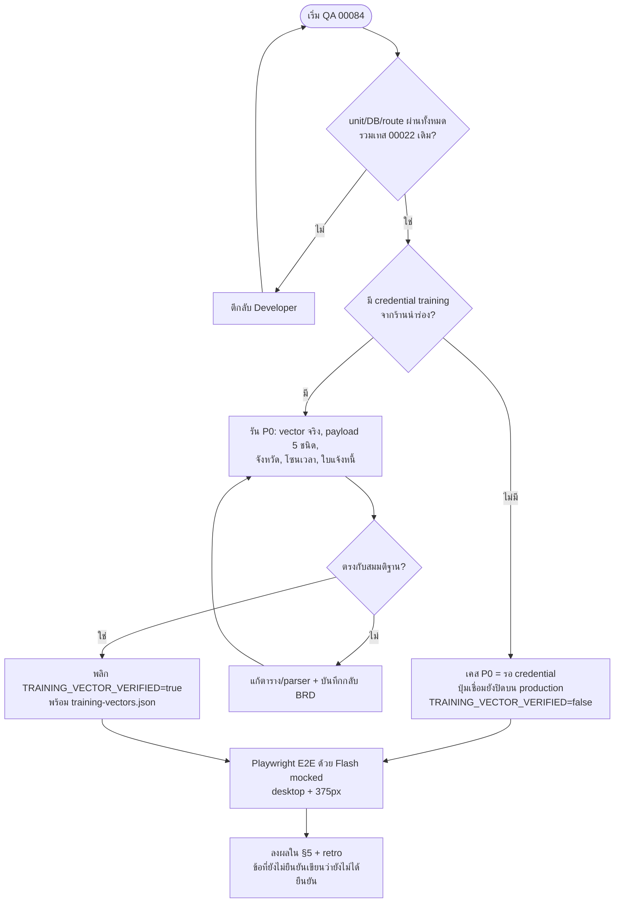

> **โมดูล:** 00084 — Flash Express Direct Integration
> **ประเภทเอกสาร:** Test Case
> **เวอร์ชัน:** 1.0
> **วันที่จัดทำ:** 2026-10-22
> **สถานะ:** Draft — **เอกสารนี้เป็นแผนการทดสอบ ไม่ใช่รายงานผลทดสอบ** (ยังไม่มีเคสใดถูกรัน; ดู §5)
> **เจ้าของเอกสาร:** QA (ดู [[Feature-Docs-Ownership]])

# Test Case: เชื่อม Flash Express ตรง (Flash Express Direct Integration)

> 🔁 TC ที่อ้าง `FLASH_DIRECT_ENABLED`/`FLASH_API_BASE_URL`/`TRAINING_VECTOR_VERIFIED` ให้อ่านเป็น `OPEN_FLASH_EXPRESS` — **แก้ 2026-10-24 (user สั่ง):** สวิตช์เปิดฟีเจอร์เหลือ env ตัวเดียว `OPEN_FLASH_EXPRESS=prod|uat` (ไม่ตั้ง = ปิด · URL ฝังในโค้ด) + `FLASH_PILOT_SHOP_IDS` (ไม่บังคับ) · เลิกใช้ `FLASH_DIRECT_ENABLED` / `FLASH_API_BASE_URL` / ค่าคงที่ `TRAINING_VECTOR_VERIFIED` — การเชื่อมด้วย key จริงคือการพิสูจน์ลายเซ็นกับ Flash ในตัว (ลายเซ็นผิด = 1002 ไม่บันทึก)

---

## 1. Overview

ชุดทดสอบนี้ครอบคลุมฟีเจอร์ 00084 ทั้งเส้น: ลายเซ็น/client ของ Flash, schema และการอยู่ร่วมกับ iShip, เชื่อม/ถอน/เปลี่ยน key, ตั้ง webhook อย่างปลอดภัย, ตัวแปลงที่อยู่/payload, สร้างพัสดุ (COD และไม่ COD), ผูก `pno`, ราคาประมาณ, ใบปะหน้า, ยกเลิก/เรียกรถ, ตัวรับ webhook, แปลงสถานะ, poll สำรอง, ต้นทุน/น้ำหนัก, POD, มุมมองผู้ซื้อและ UI ฝั่งร้าน, และการรับรองเอกสาร

- **เอกสารต้นทาง:** [[BRD]] (FR-FLASH-001..071, BR-FLASH-01..85) · [[SRS]] (TFR-FLASH-001..024, Appendix A/B/C) · [[API]] · [[SDS]] (§8, §9, §10.1) · Scope Baseline `docs/scope/2026-10-22-00084-flash-express-scope-baseline.md` (S-1..S-17 ทุก acceptance ต้องมี ≥1 TC — ดู §3.1)
- **พี่น้อง:** [[00022 - iShip Shipping Integration/TestCase]] (เทส 00022 ทั้งชุดต้องเขียวเท่าเดิม — BR-FLASH-67)
- **Out-of-scope (ไม่ทดสอบว่า "ทำ" แต่มีเคสยืนยันว่า "ไม่ทำ" ในจุดที่เสี่ยง):** ปิดงาน COD อัตโนมัติ (OOS-1), sub-account (OOS-2), นำเข้าจำนวนมาก (OOS-3), แก้พัสดุ/หลายกล่อง/ขากลับผ่าน Flash (OOS-5..7), รวม PDF (OOS-8), คัดลอกรูป POD/แสดงต่อผู้ซื้อ (OOS-9), เครดิต/เติมเงิน Flash (OOS-11), เปลี่ยน `Order.status` (OOS-12)

### 1.1 บริบทที่กำหนดรูปแบบชุดทดสอบ

1. **ทีมยังไม่มี credential ของ Flash** (Scope Assumptions) — เคสระดับ **P0-training** (10 เคส) ต้องใช้ mchId/key ของ training จากร้านนำร่อง จึง **ติดป้าย "รอ credential" และห้ามบันทึกผลเป็นผ่าน/ไม่ผ่าน** จนกว่ามีหลักฐานจริง (ด่านปล่อย BR-FLASH-63: ปุ่มเชื่อมต้องปิดบน production จนกว่า vector จริงผ่าน)
2. **ทดสอบกับ Flash ด้วย mock** — เคส unit/DB/route จำลอง `fetch` ของ client (`lib/flash/client.ts`); เคส E2E-browser ให้ dev server อ่าน `FLASH_API_BASE_URL` ชี้ mock HTTP ในเครื่องที่ spec เปิดเอง (ผู้ใช้เป็นคนรัน dev server พอร์ต 4000 พร้อม env `FLASH_DIRECT_ENABLED=1`, `FLASH_API_BASE_URL=http://127.0.0.1:<port>`, `FLASH_WEBHOOK_BASE_URL` — QA ไม่ start server) ห้ามยิงไป Flash production ในเคสใด
3. **ฐานข้อมูล:** เคส DB/E2E ใช้ `DATABASE_URL` ท้องถิ่นพอร์ต 5434 เท่านั้น (HR13/14); ข้อมูลเทสสร้างและล้างเฉพาะ id ที่เทสสร้าง (`cleanup(userId)` ใน finally) — ห้าม `deleteMany()` เปล่า
4. **Credential ปลอมเท่านั้นใน repo:** key `K1`, mchId `M1`; expectedSign ของ vector V1–V11 สร้างด้วยเครื่องมืออิสระ (`openssl dgst -sha256`) ไม่ใช้ implementation ของเราเป็นแหล่ง expected (TASKS §3)

### 1.2 สภาพแวดล้อม E2E-browser

| รายการ | ค่า |
|---|---|
| Seller | `http://seller.deepth.local:4000` |
| Buyer (เคส `/o/[token]`) | `http://deepth.local:4000` |
| Login | `e2e/helpers/auth.ts` — `createSeller('complete')` + `loginAs(context, seeded)` + `cleanup(userId)` |
| Spec | `e2e/flash-express.spec.ts` ; รัน `npm run e2e` ; browser: `npx playwright install chromium` (ครั้งเดียว) |
| Flash | mock HTTP ในเครื่อง (`warehouses`, `orders`, `cancel`, `pre_print`, `small/pre_print`, `notify`, `routes`, `routesBatch`, `estimate_rate`, `webhook/setting/*`, `deliveredInfo`) |
| Viewport | desktop 1280×800 และมือถือ 375×812 |
| Screenshot | `.screenshots/YYYY/M/D/<desc>-<HHMMSS>.png` เท่านั้น (gitignore แล้ว) |

### 1.3 ระดับของเคส

| Level | ความหมาย | จำนวน |
|---|---|---|
| unit | vitest ล้วน ไม่ต่อ DB/เครือข่าย | 49 |
| DB | vitest ต่อ DB ท้องถิ่น 5434 | 14 |
| route | เรียก route handler/service ด้วย mock Flash | 64 |
| E2E-browser | Playwright บน seller/buyer subdomain (Flash mocked) | 20 |
| P0-training | ต้องใช้ credential training — **รอ credential** | 10 |
| process | ตรวจกระบวนการ/สแกนซอร์ส/เอกสาร | 9 |
| **รวม** | | **166** |

---

## 2. Test Scenarios

> **Mutation** = การทำลายโค้ดโดยตั้งใจ (ชั่วคราว) เพื่อพิสูจน์ว่าเทสแดงจริงตามที่ Scope Baseline บังคับ · เคสป้าย "รอ credential" ไม่นับเป็นผ่าน

### 2.1 S-1 — ลายเซ็น + client + P0

#### TC-FLASH-001: ลายเซ็น: เรียง ASC + ต่อ &key= (V1)

- **Traces:** S-1 · TFR-001 · BR-FLASH-62/66 · FR-FLASH-070
- **Level:** unit
- **Precondition:** key ปลอม `K1` เท่านั้น; expectedSign ของแต่ละ vector สร้างด้วย `openssl dgst -sha256` (ไม่ใช้ implementation ของเราเป็นแหล่ง expected)
- **Steps:**
  1. เรียก `signParams({nonceStr:'n1',mchId:'M1',body:'test'},'K1')`
  2. เทียบ signing string และ hash กับ fixture V1
- **Expected Result:** signing string = `body=test&mchId=M1&nonceStr=n1&key=K1` และ sign = SHA256 hex ตัวพิมพ์ใหญ่ตรง fixture
- **Mutation:** M1 เรียงกลับด้าน · M3 ไม่มี `&` ก่อน `key=` — เทสต้องแดงทั้งสอง

#### TC-FLASH-002: ลายเซ็น: เรียงตาม ASCII case-sensitive (V2)

- **Traces:** S-1 · TFR-001
- **Level:** unit
- **Precondition:** vector V2
- **Steps:**
  1. เซ็น `{b1,A1,mchId,a1,B1,nonceStr}`
- **Expected Result:** ลำดับ `A1,B1,a1,b1,mchId,nonceStr` (ตัวพิมพ์ใหญ่ก่อนเล็ก)
- **Mutation:** M2 ใช้ `localeCompare` — เทสต้องแดง

#### TC-FLASH-003: ลายเซ็น: ค่าว่าง/whitespace ล้วนตัดออกจากลายเซ็นแต่ยังส่งใน body (V3)

- **Traces:** S-1 · TFR-001 · P0-2 · S-1(ค)
- **Level:** unit
- **Precondition:** vector V3 (`remark:'   '`, `memo:'\t'`, `x:'\u001F'`, `e:''`)
- **Steps:**
  1. เซ็นและสร้าง form body จาก params เดียวกัน
- **Expected Result:** signing string = `mchId=M1&nonceStr=n1&key=K1` และ body ยังมี `remark=%20%20%20` ฯลฯ ครบ 4 ฟิลด์
- **Mutation:** M5 ไม่ตัดค่าว่าง · M6 ตัดออกจาก body ด้วย — เทสต้องแดง

#### TC-FLASH-004: ลายเซ็น: ไม่ trim ค่าที่ไม่ว่าง (V4) และ UTF-8 ดิบ (V5)

- **Traces:** S-1 · TFR-001
- **Level:** unit
- **Precondition:** vector V4, V5
- **Steps:**
  1. เซ็น `remark:' a b '`
  2. เซ็น `dstName:'สมชาย ใจดี'`
- **Expected Result:** V4 เก็บช่องว่างหัวท้ายครบ · V5 เซ็นด้วยไบต์ UTF-8 ดิบไม่ percent-encode
- **Mutation:** M7 trim ค่า — เทสต้องแดง

#### TC-FLASH-005: ลายเซ็น: ฟิลด์ JSON string เซ็นด้วยสตริงที่ส่งจริง (V6)

- **Traces:** S-1 · TFR-001 · P0-3
- **Level:** unit
- **Precondition:** vector V6 (`subItemTypes` = `JSON.stringify([...])`)
- **Steps:**
  1. เซ็นและเทียบ body ที่ส่ง
- **Expected Result:** signing string มี JSON ดิบ `[{"itemName":"เสื้อ","itemQuantity":2}]` และค่าที่เซ็น = ค่าที่อยู่ใน body ทุกไบต์

#### TC-FLASH-006: ลายเซ็น: เซ็นค่าดิบแต่ส่งแบบ urlencode (V7)

- **Traces:** S-1 · TFR-001
- **Level:** unit
- **Precondition:** vector V7 (`address:'a&b=c+d%20e'`)
- **Steps:**
  1. เซ็น + สร้าง body
- **Expected Result:** signing string ใช้ `a&b=c+d%20e` ดิบ; body เป็น `address=a%26b%3Dc%2Bd%2520e`
- **Mutation:** M10 urlencode ก่อนเซ็น — เทสต้องแดง

#### TC-FLASH-007: ลายเซ็น: `0`/`"0"` ไม่ใช่ค่าว่าง (V8) และคีย์ `sign` ถูกทิ้ง (V9)

- **Traces:** S-1 · TFR-001
- **Level:** unit
- **Precondition:** vector V8, V9
- **Steps:**
  1. เซ็น `{codEnabled:0, weight:1500,...}`
  2. เซ็นโดยแอบใส่ `sign:'X'`
- **Expected Result:** V8 signing string มี `codEnabled=0` และ `weight=1500` · V9 ไม่มี `sign=` ใน signing string
- **Mutation:** M11 ถือ 0 เป็นค่าว่าง · M8 รวมฟิลด์ sign — เทสต้องแดง

#### TC-FLASH-008: ลายเซ็น: SHA256 ธรรมดา (ไม่ใช่ HMAC) และ hex ตัวพิมพ์ใหญ่

- **Traces:** S-1 · TFR-001 · S-1(ก)
- **Level:** unit
- **Precondition:** ตัวอย่างอัลกอริทึมจากโค้ด demo ทางการ (ถอดเป็น fixture ที่ไม่มี credential จริง)
- **Steps:**
  1. คำนวณ sign เทียบ fixture
- **Expected Result:** ตรงทุกตัวอักษร ตัวอักษรเป็น `[0-9A-F]` ความยาว 64
- **Mutation:** M4 hex ตัวเล็ก · M9 ใช้ HMAC — เทสต้องแดง

#### TC-FLASH-009: verifyWebhookSign: ผ่าน/ไม่ผ่าน/ตัวพิมพ์เล็ก/ความยาวผิด (V10)

- **Traces:** S-1, S-11 · TFR-001 · BR-FLASH-72
- **Level:** unit
- **Precondition:** vector V10
- **Steps:**
  1. verify sign ถูก
  2. verify sign ตัวพิมพ์เล็ก
  3. verify sign ความยาวผิด
  4. verify sign ผิดแต่ความยาวถูก
- **Expected Result:** ถูก=true · พิมพ์เล็กผ่านหลัง upper · ความยาวผิด=false ไม่ throw · ผิด=false (ใช้ `timingSafeEqual` หลังตรวจความยาว)

#### TC-FLASH-010: หน่วย: บาท↔สตางค์ และ กก.↔กรัม round-trip ตรงตัว

- **Traces:** S-1 · TFR-002 · BR-FLASH-26 · S-1(ง)
- **Level:** unit
- **Precondition:** ไม่มี
- **Steps:**
  1. วนค่า 0–10,000,000 บาท (≤2 ทศนิยม) ผ่าน `bahtToSatang` แล้ว `satangToBaht`
  2. วน kg ≤2 ทศนิยมผ่าน `kgToGram`/`gramToKg`
- **Expected Result:** ได้ค่าเดิมทุกตัว ไม่มีความคลาดเคลื่อนจากทศนิยมลอย (เช่น 0.29 บาท = 29 สตางค์)

#### TC-FLASH-011: หน่วย: ค่าไม่เป็นจำนวนเต็มหลังแปลง/ติดลบ/NaN ถูกปฏิเสธก่อนส่ง

- **Traces:** S-1 · TFR-002 · BR-FLASH-26 · S-1(ง)
- **Level:** unit
- **Precondition:** ไม่มี
- **Steps:**
  1. ส่ง 10.005 บาท, -1, NaN, 1.234 กก. เข้าตัวแปลงขาออก
  2. ส่ง `'-5'`, `'1.5'`, `'abc'` เข้า `satangToBaht`
- **Expected Result:** ขาออกโยน `FlashUnitError`; ขาเข้ารับเฉพาะ `/^\d+$/` ที่เหลือโยน/คืนว่างตามสัญญา

#### TC-FLASH-012: ตารางรหัส error ครอบทุกรหัส BR-FLASH-65 + รหัสไม่รู้จัก

- **Traces:** S-1 · TFR-003 · SRS Appendix A · BR-FLASH-36/65 · S-1(จ)
- **Level:** unit
- **Precondition:** รายการรหัสจาก Appendix A: 1001–1011, 1015, 1018–1022, 0, 1000, 5xx, non-JSON, timeout
- **Steps:**
  1. วนทุกรหัสเข้า `mapFlashError`
  2. ส่งรหัส 9999
- **Expected Result:** ทุกรหัสให้ `FlashErrorCode` + `userMessage` ภาษาไทยตาม Appendix A; 9999 → `UNKNOWN_CODE` ข้อความทั่วไป เก็บ `flashCode` ดิบ; 1004→ผู้ส่ง และ 1005→ผู้รับ ข้อความต่างกัน

#### TC-FLASH-013: invalidatesConnection เฉพาะ 1001/1002

- **Traces:** S-1, S-3 · TFR-003 · BR-FLASH-14
- **Level:** unit
- **Precondition:** ไม่มี
- **Steps:**
  1. ถาม `invalidatesConnection` กับ 1001, 1002, timeout, 0, 1000, 5xx, non-JSON
- **Expected Result:** true เฉพาะ 1001/1002 · อื่นทั้งหมด false

#### TC-FLASH-014: redact: key/sign ไม่ปรากฏในข้อความ error, log, payload ที่เก็บ

- **Traces:** S-1 · TFR-001/003 · BR-FLASH-66 · S-1 (grep key/sign ใน log = 0)
- **Level:** unit
- **Precondition:** mock `fetch` ตอบข้อความที่แทรก key `K1` และ sign 64-hex
- **Steps:**
  1. ให้ client โยน `FlashError`
  2. spy `console.*` ระหว่างเรียก connect/create/webhook
  3. grep ผลลัพธ์
- **Expected Result:** `upstreamMessage` ผ่าน `redactFlash`; ไม่พบ `K1` และสตริง 64-hex ใน console, error, payload ที่เก็บ

#### TC-FLASH-015: client: POST form-urlencoded + Accept-Language: th + sign ถูก

- **Traces:** S-1 · TFR-001 · BR-FLASH-64
- **Level:** unit
- **Precondition:** mock `fetch`
- **Steps:**
  1. เรียก endpoint ใดก็ได้ผ่าน client
  2. อ่าน `init.headers`/`init.body`
- **Expected Result:** Content-Type `application/x-www-form-urlencoded; charset=UTF-8` · `Accept-Language: th` · body มี `mchId`, `nonceStr` (hex 32), `sign` ที่ verify ได้ · path variable ไม่อยู่ใน sign

#### TC-FLASH-016: client: timeout / non-JSON / base URL จาก env เท่านั้น

- **Traces:** S-1 · TFR-001/003 · BR-FLASH-18/64
- **Level:** unit
- **Precondition:** mock `fetch` ช้า/ตอบ HTML; ตั้ง `FLASH_API_BASE_URL`
- **Steps:**
  1. ให้ fetch เกินเวลา (read 10s / write 20s / label 30s)
  2. ตอบ non-JSON
  3. พยายามส่ง base URL ผ่านพารามิเตอร์ผู้ใช้
- **Expected Result:** timeout → `UPSTREAM_TIMEOUT` · non-JSON → `UPSTREAM_ERROR` · base URL มาจาก env อย่างเดียว ไม่ตั้ง = production URL

#### TC-FLASH-017: ประตูปล่อย: isFlashDirectEnabled ครบตาราง + blocker `TRAINING_VECTOR_VERIFIED`

- **Traces:** S-1 · TFR-022 · BR-FLASH-63 · FR-FLASH-001/071
- **Level:** unit
- **Precondition:** ตั้ง env `FLASH_DIRECT_ENABLED` × `NODE_ENV` ทุกชุด
- **Steps:**
  1. ประเมินฟังก์ชันทุกชุด
  2. blocker: ถ้าค่าคงที่ = true ต้องมี `training-vectors.json` ≥6 รายการ และ `signParams` ผ่านทุกรายการ
- **Expected Result:** prod ต้องทั้ง env=`1` และค่าคงที่=true · non-prod ต้อง env=`1` · ค่าคงที่เริ่มต้น false · ถ้าเปลี่ยนเป็น true โดยไม่มีไฟล์ vector เทสต้องแดง
- **Mutation:** พลิกค่าคงที่เป็น true โดยไม่เพิ่มไฟล์ — blocker ต้องแดง

#### TC-FLASH-018: credential envelope: เข้ารหัส/ถอดรหัส round-trip และ mask

- **Traces:** S-1, S-3 · TFR-004 · BR-FLASH-13
- **Level:** unit
- **Precondition:** `token-crypto` ในสภาพแวดล้อมเทส
- **Steps:**
  1. encode envelope `{secretKey, webhookSecret}`
  2. decode
  3. ทำ mask key
- **Expected Result:** round-trip ได้ค่าเดิม · mask เหลือ 4 ตัวท้ายเท่านั้น · ค่าที่เก็บไม่ใช่ plaintext

#### TC-FLASH-019: repo ไม่มี credential จริงหรือของ demo Flash

- **Traces:** S-1 · BR-FLASH-62 · S-1 (ไม่มี credential จริงหรือของ demo ใน repo)
- **Level:** process
- **Precondition:** ต้นไม้ไฟล์หลังพัฒนาเสร็จ
- **Steps:**
  1. ค้นหา pattern key/mchId/ตัวอย่างจากโค้ด demo ของ Flash ใน `src/`, `e2e/`, fixtures, `docs/`
  2. ตรวจ `.env.example`
- **Expected Result:** ไม่พบ credential จริง/ตัวอย่าง demo; fixture ใช้ `K1`/`M1` ปลอมและ redact แล้ว; `.env.example` มีเฉพาะชื่อตัวแปร

#### TC-FLASH-020: dry-run: ไม่ยิง create/notify และ production เข้าโหมดนี้ไม่ได้

- **Traces:** S-1, S-6, S-10 · TFR-009 · BR-FLASH-60/61 · FR-FLASH-071
- **Level:** unit
- **Precondition:** ตั้ง `FLASH_DRY_RUN=1` กับ `NODE_ENV` = development และ production
- **Steps:**
  1. เรียก create และ notify ผ่าน client
  2. นับจำนวนครั้ง `fetch`
- **Expected Result:** development: ไม่มี fetch สำหรับ create/notify คืน pno `FLDRY…` + `isDryRun=true` (read-only ยังยิงได้) · production: `isFlashDryRun()` = false เสมอ

#### TC-FLASH-021: P0 — ลายเซ็นตรงกับ test vector จริงจาก training (V11) — รอ credential

- **Traces:** S-1 · P0-1 · BR-FLASH-63(ข) · S-1(ข)
- **Level:** P0-training — **รอ credential (P0): ห้ามบันทึกเป็นผ่าน/ไม่ผ่านจนกว่าจะมีหลักฐานจาก training**
- **Precondition:** **รอ credential:** mchId/key ของ training จากร้านนำร่อง; ไฟล์ `training-vectors.json` ≥6 รายการ (redact แล้ว)
- **Steps:**
  1. ยิงคำขอ read-only (`/open/v1/warehouses`) ด้วย credential training
  2. บันทึกคำขอ/คำตอบเป็น vector
  3. รัน `signParams` ซ้ำกับทุก vector
- **Expected Result:** ได้ `code=1` และ sign ตรงทุก vector → ยืนยันทิศเรียง ASC · พลิก `TRAINING_VECTOR_VERIFIED=true` ได้ **สถานะ: รอ credential (ห้ามบันทึกเป็นผ่าน/ไม่ผ่านจนกว่ามีหลักฐาน)**

#### TC-FLASH-022: P0 — พิสูจน์การตัดค่าว่าง, ฟิลด์ JSON string, ชื่อฟิลด์ภายใน subItemTypes — รอ credential

- **Traces:** S-1 · P0-2 · P0-3
- **Level:** P0-training — **รอ credential (P0): ห้ามบันทึกเป็นผ่าน/ไม่ผ่านจนกว่าจะมีหลักฐานจาก training**
- **Precondition:** **รอ credential** + training
- **Steps:**
  1. ส่งคำขอสร้างพัสดุ/ประเมินราคาที่มีฟิลด์ว่าง (SPACE เดี่ยว) และ `subItemTypes`
  2. สังเกต 1002 vs code=1
- **Expected Result:** ยืนยัน (ก) SPACE เดี่ยวถูกตัดตามนิยาม (ข) `itemName/itemQuantity` เป็นชื่อฟิลด์ที่ Flash รับ — บันทึกกลับ BRD **สถานะ: รอ credential**

#### TC-FLASH-023: P0 — เก็บ payload ดิบ webhook 5 ชนิด + รูปคำตอบ infos/routes/routesBatch + โซนเวลา — รอ credential

- **Traces:** S-1, S-4, S-11, S-12 · P0-5/6/7/9/10/11
- **Level:** P0-training — **รอ credential (P0): ห้ามบันทึกเป็นผ่าน/ไม่ผ่านจนกว่าจะมีหลักฐานจาก training**
- **Precondition:** **รอ credential** + URL ที่ Flash เข้าถึงได้ (tunnel) ตั้งผ่าน `FLASH_WEBHOOK_BASE_URL`
- **Steps:**
  1. ตั้ง webhook training ครบ 5 ชนิด
  2. สร้างพัสดุ training แล้วรอ webhook status/weight/price/courier/routes
  3. บันทึก raw (redact) เป็น fixture
  4. เรียก `setting/infos`, `routes`, `routesBatch`
- **Expected Result:** ได้ fixture จริง 5 ชนิด + รูปคำตอบ → ปรับ parser/ตารางสถานะ/โซนเวลา แล้วบันทึกผลกลับ BRD **สถานะ: รอ credential**

### 2.2 S-2 — Schema + migration + provider scoping

#### TC-FLASH-024: DB: ร้านเดียวมีแถว ISHIP + FLASH พร้อมกันได้

- **Traces:** S-2 · TFR-007 · BR-FLASH-10
- **Level:** DB
- **Precondition:** DB ท้องถิ่นพอร์ต 5434 เท่านั้น (HR13/14) เทสสร้างและลบเฉพาะ id ของตัวเอง
- **Steps:**
  1. สร้างร้านเทส 1 ร้าน
  2. upsert ISHIP แล้ว FLASH ด้วย `shopId_provider`
- **Expected Result:** ทั้งสองแถวอยู่ร่วมกัน; `findUnique({shopId_provider})` คืนแถวถูกฝั่ง

#### TC-FLASH-025: DB: แถว FLASH สองแถวของร้านเดียวถูกปฏิเสธ

- **Traces:** S-2 · BR-FLASH-10
- **Level:** DB
- **Precondition:** ร้านเทสที่มีแถว FLASH แล้ว
- **Steps:**
  1. `create` แถว FLASH ที่สองของร้านเดียวกัน
- **Expected Result:** P2002 (unique `shopId,provider`)

#### TC-FLASH-026: DB: mchId เดียวกันสองร้าน (สถานะใช้งาน) ถูกปฏิเสธ; DISCONNECTED ไม่นับ

- **Traces:** S-2, S-3 · BR-FLASH-17
- **Level:** DB
- **Precondition:** ร้านเทส A, B
- **Steps:**
  1. A เชื่อม mchId=M1 สถานะ ACTIVE
  2. B เชื่อม M1 สถานะ ACTIVE
  3. A ถอน (DISCONNECTED) แล้ว B เชื่อม M1 อีกครั้ง
- **Expected Result:** ขั้น 2 ชน partial unique (P2002); ขั้น 3 สำเร็จเพราะแถว A ไม่นับ
- **Mutation:** ถอด partial unique ออกจาก migration จำลอง — เทสต้องแดง

#### TC-FLASH-027: DB: เชื่อม/ถอน/verify/แก้ settings ของ Flash ไม่เปลี่ยนแถว ISHIP ของร้านเดียวกัน (และกลับกัน)

- **Traces:** S-2, S-3 · TFR-007 · BR-FLASH-19
- **Level:** DB
- **Precondition:** ร้านเทสมีทั้ง ISHIP และ FLASH
- **Steps:**
  1. snapshot ทุกคอลัมน์แถว ISHIP
  2. ทำ connect/verify/PUT settings/disconnect ของ FLASH
  3. snapshot ซ้ำ
  4. ทำกลับด้าน (กระทำฝั่ง ISHIP แล้วเทียบแถว FLASH)
- **Expected Result:** ทุกคอลัมน์ของอีกฝั่งเท่าเดิมก่อน-หลัง (iship-flash-coexistence.test.ts)

#### TC-FLASH-028: Blocker: ไม่มีจุดหาบัญชีด้วย shopId เดี่ยว / ไม่ระบุ provider

- **Traces:** S-2 · TFR-007 · SDS §8.1 CS-01..CS-33
- **Level:** unit
- **Precondition:** ซอร์ส `iship.service.ts`, `order-return.service.ts`, cron iShip
- **Steps:**
  1. รัน `iship-provider-scoping.test.ts` (สแกนซอร์ส `findMany/updateMany/upsert` บน `shopShippingAccount`)
  2. `tsc` ไม่ incremental
- **Expected Result:** ไม่พบ `where:{shopId}` เดี่ยว และทุก `updateMany/findMany` ระบุ `provider` · tsc ผ่าน
- **Mutation:** ลบ `provider` ออกจากจุดใดจุดหนึ่ง — blocker ต้องแดง

#### TC-FLASH-029: เทส 00022 ทั้งชุด + shipment-direction เขียวเท่าเดิม

- **Traces:** S-2 · BR-FLASH-67
- **Level:** DB
- **Precondition:** DATABASE_URL ท้องถิ่นพอร์ต 5434 (ห้ามชี้ prod)
- **Steps:**
  1. รัน `npm test` ส่วน 00022 ทั้งหมด + `shipment-direction.test.ts`
- **Expected Result:** ผ่านครบเท่า baseline ก่อนเริ่ม 00084 (จำนวนผ่านไม่ลดลง; เทสที่ skip ต้องไม่เพิ่ม)

#### TC-FLASH-030: migration เป็น additive ไม่ล้างข้อมูล

- **Traces:** S-2 · BR-FLASH-67 · DATABASE.md
- **Level:** process
- **Precondition:** ไฟล์ `20261023120000_00084_flash_express/migration.sql`
- **Steps:**
  1. สแกน SQL หา `DROP TABLE/COLUMN`, `DELETE`, `TRUNCATE`, `UPDATE` ไม่มี WHERE
  2. ตรวจ partial unique + คอลัมน์ใหม่ nullable/มี default
- **Expected Result:** ไม่มีคำสั่งทำลายข้อมูล; ข้อมูลแถว ISHIP เดิมไม่ถูกแก้ (ผ่อน unique เป็น compound เท่านั้น)

#### TC-FLASH-031: ACTIVE_FORWARD_SHIPMENT นับข้ามผู้ให้บริการ: ใบ Flash บล็อกใบ iShip และกลับกัน

- **Traces:** S-2, S-6 · BR-FLASH-24 · SDS TD-FLASH-02
- **Level:** DB
- **Precondition:** ออเดอร์เทส
- **Steps:**
  1. สร้างใบ ISHIP สถานะ CREATED
  2. พยายามสร้างใบ FLASH ของออเดอร์เดียวกัน
  3. ทำกลับด้าน
- **Expected Result:** DB ปฏิเสธ (P2002 ของดัชนี 1 ออเดอร์ 1 พัสดุ active ต่อทิศทาง); service แปลงเป็น `SHIPMENT_EXISTS`

#### TC-FLASH-032: คอลัมน์ใหม่: currentTicketPickupId / returnedPno / auditLog ใช้งานได้ตามสัญญา

- **Traces:** S-2, S-10, S-12 · DATABASE.md · SDS §10.1 (G-1)
- **Level:** DB
- **Precondition:** ร้านเทส + พัสดุเทส
- **Steps:**
  1. เขียน `returnedPno` ซ้ำค่าเดียวกันสองใบ
  2. append audit 55 รายการ
- **Expected Result:** `returnedPno` ซ้ำถูกปฏิเสธ (partial unique) · `auditLog` เก็บล่าสุดไม่เกิน 50 รายการ

#### TC-FLASH-033: สถานะ migration: แจ้ง user 3 ข้อก่อน push (HR15)

- **Traces:** S-2 · HR15
- **Level:** process
- **Precondition:** ก่อน push คอมมิต schema
- **Steps:**
  1. ตรวจว่ามีบันทึกการแจ้ง: prod ไม่ต้องสั่ง · local ต้อง apply เอง · migrate ล้ม = deploy ไม่ขึ้น
- **Expected Result:** พบบันทึกการแจ้งในรายงาน Controller ก่อน push — ไม่มี = ไม่ผ่านด่าน

### 2.3 S-3 — เชื่อม/ทดสอบ/เปลี่ยน key/ถอน

#### TC-FLASH-034: เชื่อมต่อ: key ผิด → ไม่บันทึก และข้อความแยก 1001 / 1002 / ติดต่อ Flash ไม่ได้

- **Traces:** S-3 · TFR-004 · FR-FLASH-001 · BR-FLASH-12/14
- **Level:** route
- **Precondition:** OWNER ของร้าน ONLINE_SALES; mock Flash ตอบ 1001 / 1002 / timeout ตามลำดับ
- **Steps:**
  1. POST `/api/seller/flash/connection` ทีละกรณี
  2. อ่านแถว `ShopShippingAccount` FLASH หลังแต่ละครั้ง
- **Expected Result:** ไม่มีแถว/ไม่มีการเปลี่ยนแถว; ข้อความไทยต่างกัน 3 แบบตาม Appendix A (`MERCHANT_NOT_FOUND`/`SIGN_INVALID`/`UPSTREAM_TIMEOUT`)

#### TC-FLASH-035: เชื่อมต่อ: ผ่าน → key เข้ารหัส ไม่มี plaintext ในคำตอบ/log

- **Traces:** S-3 · TFR-004 · BR-FLASH-13/66
- **Level:** route
- **Precondition:** mock Flash `/open/v1/warehouses` ตอบ code=1; spy log
- **Steps:**
  1. POST connection
  2. อ่านคอลัมน์ `accessTokenEnc` ใน DB
  3. grep response + log หา key
- **Expected Result:** `status=ACTIVE`, `tokenLast4` = 4 ตัวท้าย, `accessTokenEnc` ไม่ใช่ plaintext, response ไม่มี key/envelope/`webhookSecretHash`, log ไม่มี key; `createMode='OFF'` สำหรับแถวใหม่

#### TC-FLASH-036: เชื่อมต่อ: mchId ถูกร้านอื่นใช้อยู่ → MERCHANT_IN_USE ข้อความเดียว ตรวจหลังพิสูจน์ key เท่านั้น

- **Traces:** S-3, S-2 · TFR-004 · BR-FLASH-17
- **Level:** route
- **Precondition:** ร้าน A เชื่อม M1 แล้ว; ร้าน B
- **Steps:**
  1. B วาง M1 + key ผิด
  2. B วาง M1 + key ถูก (mock code=1)
- **Expected Result:** ขั้น 1 ได้ข้อผิดพลาด key (ไม่รั่วว่า M1 มีคนใช้) · ขั้น 2 ได้ `MERCHANT_IN_USE` ข้อความเดียวไม่ระบุร้าน · P2002 แปลงเป็นผลเดียวกัน

#### TC-FLASH-037: เปลี่ยน mchId ไม่ได้ เปลี่ยน key ได้

- **Traces:** S-3 · TFR-004 · BR-FLASH-16
- **Level:** route
- **Precondition:** ร้านเชื่อม M1 สถานะ ACTIVE
- **Steps:**
  1. POST connection ด้วย M2 + key
  2. POST connection ด้วย M1 + key ใหม่
- **Expected Result:** ขั้น 1 `MERCHANT_CHANGE_NOT_ALLOWED` ไม่เขียน · ขั้น 2 สำเร็จ ใช้ webhook secret `w` เดิม

#### TC-FLASH-038: ถอนการเชื่อมต่อ: ลบ key จริง ประวัติพัสดุยังอยู่

- **Traces:** S-3 · TFR-004 · BR-FLASH-15 · FR-FLASH-002
- **Level:** route
- **Precondition:** ร้านเชื่อมแล้ว มีพัสดุ Flash 1 ใบ
- **Steps:**
  1. DELETE connection
  2. อ่านแถวบัญชี + แถว `OrderShipment`
  3. พยายามพิมพ์ใบปะหน้าของใบเดิม
- **Expected Result:** `accessTokenEnc=''`, `tokenLast4=null`, `status=DISCONNECTED`, `webhookSecretHash=null`, `merchantId` ยังอยู่; พัสดุ/ประวัติครบ pno ยังแสดง; พิมพ์/สั่งการไม่ได้ ข้อความให้เชื่อมใหม่; แถว ISHIP ไม่เปลี่ยน

#### TC-FLASH-039: 1001/1002 ระหว่างใช้ → TOKEN_INVALID; timeout ไม่เปลี่ยนสถานะ

- **Traces:** S-3 · TFR-003/004 · BR-FLASH-14
- **Level:** route
- **Precondition:** ร้าน ACTIVE
- **Steps:**
  1. POST verify โดย mock ตอบ 1002
  2. POST verify โดย mock timeout
  3. POST verify โดย mock code=1
- **Expected Result:** ขั้น 1 สถานะ "ต้องตรวจ" + `lastVerifyError` · ขั้น 2 สถานะคงเดิม · ขั้น 3 กลับ `ACTIVE` + `lastVerifiedAt`

#### TC-FLASH-040: สิทธิ์: STAFF จัดการ/เปลี่ยน/ถอน/override webhook ไม่ได้ (403 ฝั่ง API)

- **Traces:** S-3, S-4 · TFR-023 · BR-FLASH-03 · FR-FLASH-003
- **Level:** route
- **Precondition:** ผู้ใช้ role CHAT, MANAGER, OWNER ของร้านเดียวกัน
- **Steps:**
  1. POST/DELETE connection, verify, PUT settings, POST webhook/sync ด้วยแต่ละ role
  2. GET connection ด้วยแต่ละ role
- **Expected Result:** OWNER ผ่านทุกเส้น · MANAGER/CHAT ถูก 403 ที่เส้นจัดการ (OWNER-only ตาม DD-1) · GET ของ CHAT เห็น `merchantIdMasked` ไม่เห็น mchId เต็ม ไม่เห็น key

#### TC-FLASH-041: ร้านที่ไม่ใช่ ONLINE_SALES ได้ 403 NOT_ELIGIBLE ทุก route (ยิงตรง)

- **Traces:** S-3, S-6, S-9 · TFR-023 · BR-FLASH-01/02
- **Level:** route
- **Precondition:** ร้าน SERVICE_QUEUE และ LODGING + OWNER
- **Steps:**
  1. ยิงทุกเส้นใต้ `/api/seller/flash/**` (ตาม API.md §3)
- **Expected Result:** ทุกเส้นตอบ 403 `NOT_ELIGIBLE`; ไม่มีการเขียน DB

#### TC-FLASH-042: ฟีเจอร์ปิด: FEATURE_DISABLED และ available:false; ร้านเดิมยังรับ webhook/ถอนได้

- **Traces:** S-3, S-1 · TFR-022 · BR-FLASH-63
- **Level:** route
- **Precondition:** `FLASH_DIRECT_ENABLED` ว่าง; มีร้านที่มีแถว FLASH เดิม
- **Steps:**
  1. GET connection
  2. POST connection / shipments / pickups / price / link
  3. POST webhook ของร้านเดิม
  4. DELETE connection ร้านเดิม
- **Expected Result:** GET คืน `available:false` · POST ที่ก่อให้เกิดการเชื่อม/สร้าง/เรียกรถ → 404 `FEATURE_DISABLED` · webhook และ DELETE ของร้านเดิมยังทำงาน

#### TC-FLASH-043: route ทุกเส้นส่ง shopId เข้า requireGeneralShop + registry/route-capabilities

- **Traces:** S-3 · TFR-023 · SDS §8.3a · 00037
- **Level:** unit
- **Precondition:** ซอร์ส routes ใต้ `src/app/api/seller/flash`
- **Steps:**
  1. รัน blocker แบบ iship-shop-scoping
  2. รัน `route-capability-inventory` เทส
- **Expected Result:** ทุก route ประกาศ cap (S1/S2) ครบ webhook=WEBHOOK, cron=CRON; เทสเขียว
- **Mutation:** ลบ `shopId` ออกจาก route หนึ่ง — blocker ต้องแดง

#### TC-FLASH-044: ค่าตั้งต้นร้าน: GET/PUT settings, senderComplete / settingsComplete, ขอบเขต validation

- **Traces:** S-3 · TFR-005 · FR-FLASH-010
- **Level:** route
- **Precondition:** OWNER; ร้านเชื่อมแล้ว
- **Steps:**
  1. PUT settings ครบ
  2. PUT ค่านอกช่วง (category=50, remark>200, labelSize='X', weight<=0)
  3. PUT โดยส่ง `defaultCodEnabled`
  4. GET
- **Expected Result:** ครบ → `senderComplete`/`settingsComplete`=true · ค่านอกช่วงถูก Valibot ปฏิเสธ · `defaultCodEnabled` ไม่ถูกเก็บ · `labelSize` ค่าเริ่มต้น BIG

#### TC-FLASH-045: E2E-browser: การ์ด Flash ในหน้าตั้งค่า — ซ่อนเมื่อ gate ปิด / แสดงเมื่อเปิด (Flash mocked)

- **Traces:** S-3 · U1 · FR-FLASH-001/002 · BR-FLASH-63
- **Level:** E2E-browser
- **Precondition:** dev server `seller.deepth.local:4000` รันด้วย `FLASH_DIRECT_ENABLED=1` และ `FLASH_API_BASE_URL` ชี้ mock ท้องถิ่น (ผู้ใช้ตั้งเอง ไม่ start server); seed seller ด้วย `createSeller('complete')` + `loginAs` (e2e/helpers/auth.ts); `cleanup(userId)` ใน finally
- **Steps:**
  1. เปิด `/seller/settings` ขณะ gate ปิด (spec ตั้ง env ไม่ได้ → ตรวจผ่านคำตอบ `available:false` ที่ mock ด้วย `page.route`)
  2. เปิดอีกครั้งด้วยคำตอบ `available:true`
- **Expected Result:** gate ปิด: ไม่มีปุ่ม "เชื่อมต่อ Flash ตรง"; gate เปิด: เห็นแถว "Flash Express (บัญชีของร้านเอง)" แยกจากแถว iShip; console ไม่มี error

#### TC-FLASH-046: E2E-browser: เชื่อมต่อ Flash — key ผิดแล้วถูก, ปุ่มทดสอบ, เปลี่ยน key, ถอน (Flash mocked)

- **Traces:** S-3 · U1 · FR-FLASH-001/002 · BR-FLASH-12/13/15/16
- **Level:** E2E-browser
- **Precondition:** ต่อเนื่องจากเคสก่อน; mock ตอบ 1002 แล้ว code=1
- **Steps:**
  1. กดเชื่อมต่อ ใส่ mchId + key ผิด → ดูข้อความ
  2. ใส่ key ถูก → บันทึก
  3. reload หน้า
  4. กดทดสอบ
  5. เปลี่ยน key
  6. พยายามแก้ mchId
  7. ถอน (Swal ยืนยัน)
- **Expected Result:** ข้อความผิดพลาดไทยตรง Appendix A ไม่ปิดโมดัล · หลังบันทึกแสดงเฉพาะ mchId + `••••` 4 ตัวท้าย ไม่มี key ใน DOM/Network response · ช่อง mchId ถูกล็อกตอนเปลี่ยน key · ถอนแล้วการ์ดกลับสถานะยังไม่เชื่อมและการ์ด iShip ไม่เปลี่ยน; toast ใช้ `pacesToast`

#### TC-FLASH-047: E2E-browser: พนักงาน (CHAT) เห็นการ์ดแบบอ่านอย่างเดียว ไม่เห็น key/mchId เต็ม

- **Traces:** S-3 · U1 · BR-FLASH-03/05
- **Level:** E2E-browser
- **Precondition:** seed พนักงาน role CHAT ในร้านที่เชื่อมแล้ว
- **Steps:**
  1. login ด้วยพนักงาน → `/seller/settings`
  2. ตรวจ DOM + Network
- **Expected Result:** ไม่มีปุ่มวาง/เปลี่ยน key/ถอน/override webhook; เห็น mchId แบบ mask; ไม่มี key/envelope ในทุก response

#### TC-FLASH-048: UI gate ของ S-3: grep emoji = 0, react-toastify ใน (paces) = 0, fetch ตรงโดยไม่ผ่าน useIShipUrl = 0, Base: theme/...

- **Traces:** S-3, S-16 · HR3/9/12 · SDS §9
- **Level:** process
- **Precondition:** ซอร์สคอมโพเนนต์ Flash ที่เพิ่ม
- **Steps:**
  1. `rg "from ['\"]react-toastify" "src/app/(paces)/"`
  2. grep emoji
  3. `rg "fetch\(['\"\`]/api/seller/flash"` ต้องไม่พบนอก `useIShipUrl`
  4. ตรวจข้อความ commit
- **Expected Result:** ทุก grep = 0; commit มีบรรทัด `Base: theme/...`; มีบันทึกผ่าน `safepay-ux` + `/impeccable critique` + `clarify` + mockup 3 จอ

#### TC-FLASH-049: ร้านเปลี่ยนประเภทออกจาก ONLINE_SALES → ปิด/ซ่อนฟีเจอร์ แต่ไม่ลบการเชื่อมต่อและประวัติพัสดุ

- **Traces:** S-3 · BR-FLASH-04 · BR-ISHIP-04
- **Level:** DB
- **Precondition:** ร้านเทส ONLINE_SALES ที่เชื่อม Flash และมีพัสดุ
- **Steps:**
  1. เปลี่ยน `Shop.vertical` เป็น SERVICE_QUEUE
  2. ยิง route Flash ทุกเส้น
  3. อ่านแถวบัญชี/พัสดุ
- **Expected Result:** ทุก route ได้ 403 `NOT_ELIGIBLE`; แถวบัญชีและพัสดุยังอยู่ครบ; เปลี่ยนกลับแล้วใช้งานต่อได้

#### TC-FLASH-050: ไม่มี sub-account / mchId หลักของ Deep; แอดมิน Deep ไม่มีเส้นทางอ่าน key

- **Traces:** S-3 · BR-FLASH-05/11 · OOS-2
- **Level:** process
- **Precondition:** ซอร์สทั้ง repo + routes admin
- **Steps:**
  1. ค้นหา `new_sub_account`, env mchId/key กลาง
  2. ค้นหา route `admin` ที่อ่าน `accessTokenEnc`/`ShopShippingAccount` ของ Flash
- **Expected Result:** ไม่พบ; ทุกการเรียก Flash ใช้ credential ของร้านนั้นเท่านั้น

### 2.4 S-4 — webhook อัตโนมัติ

#### TC-FLASH-051: webhook sync: ชนิดว่าง → ตั้ง; ชี้มา Deep (ของเรา) → คงไว้

- **Traces:** S-4 · TFR-006 · FR-FLASH-004 · BR-FLASH-79
- **Level:** route
- **Precondition:** mock `webhook/setting/infos` ตอบ 5 ชนิดว่าง แล้วตอบชี้ URL ของเรา
- **Steps:**
  1. POST `/api/seller/flash/webhook/sync`
  2. อ่านจำนวนครั้งที่เรียก `web_hook_service`
- **Expected Result:** กรณีว่าง: เรียกตั้ง 5 ชนิด (`serviceCategory=1`) ด้วย URL `…/api/webhooks/flash/{w}?k={kind}`; กรณีของเรา: ไม่เรียกตั้ง; `webhookStatus=REGISTERED`

#### TC-FLASH-052: webhook sync: ชี้ไปโฮสต์อื่น → ไม่ทับ และคืนเฉพาะโฮสต์

- **Traces:** S-4 · TFR-006 · BR-FLASH-79
- **Level:** route
- **Precondition:** mock infos: `routes` ชี้ `https://other.example/hook?token=SECRET`
- **Steps:**
  1. POST sync
  2. ตรวจ response + log
- **Expected Result:** ไม่เรียกตั้งชนิด routes; response แสดง `{kind:'routes', state:'EXTERNAL', host:'other.example'}` ไม่มี path/query/secret; `webhookStatus=EXTERNAL`
- **Mutation:** ถอดด่าน "อ่านก่อน" (เขียนทับทุกชนิดตรง ๆ) — เทสต้องแดง

#### TC-FLASH-053: webhook sync: เจ้าของยืนยัน override → ทับเฉพาะชนิดที่เลือก; UNKNOWN ไม่ทับเด็ดขาด

- **Traces:** S-4 · TFR-006 · BR-FLASH-79
- **Level:** route
- **Precondition:** infos: `routes`,`price` เป็น EXTERNAL, `weight` parse ไม่ออก (UNKNOWN)
- **Steps:**
  1. POST sync `overrideKinds:['routes']` โดย OWNER
  2. POST sync `overrideKinds:['weight']`
  3. POST sync โดย MANAGER
- **Expected Result:** เขียนทับเฉพาะ `routes` · `weight` (UNKNOWN) ไม่ถูกทับแม้ส่งมาใน override · MANAGER ได้ 403

#### TC-FLASH-054: webhook sync: ลงทะเบียนล้ม → เชื่อมต่อยังสำเร็จ + ป้าย + ปุ่มลองใหม่

- **Traces:** S-4, S-3 · TFR-004/006
- **Level:** route
- **Precondition:** mock warehouses code=1; mock infos/setting ตอบ 5xx
- **Steps:**
  1. POST connection
  2. GET connection
  3. POST webhook/sync (mock ปกติแล้ว)
- **Expected Result:** connection สำเร็จ (`ACTIVE`) และ `webhookStatus=FAILED`; หลังลองใหม่เป็น `REGISTERED`

#### TC-FLASH-055: webhook sync: ทุกการเปลี่ยนมี audit (ใคร/ชนิด/เวลา) และไม่มีความลับ

- **Traces:** S-4, S-3 · TFR-024 · SDS §10.1 G-1
- **Level:** route
- **Precondition:** ร้านเชื่อมแล้ว
- **Steps:**
  1. ทำ connect, override, disconnect
  2. อ่าน `auditLog` และ log `[flash-audit]`
- **Expected Result:** มีรายการต่อการกระทำ: userId, action, kinds, at; ไม่มี key/URL เต็ม/secret; เก็บล่าสุดไม่เกิน 50

#### TC-FLASH-056: ถอนการเชื่อมต่อ: ปิดเฉพาะชนิดที่ชี้มา Deep; ล้ม = ข้าม ไม่บล็อก

- **Traces:** S-4, S-3 · TFR-006 · FR-FLASH-004
- **Level:** route
- **Precondition:** infos: `status` เป็นของเรา, `price` เป็น EXTERNAL; mock `web_hook_service` ตอบล้มในกรณีที่ 2
- **Steps:**
  1. DELETE connection
  2. ทำซ้ำโดย mock ปิด webhook ล้ม
- **Expected Result:** เรียกปิด (`serviceCategory=0`) เฉพาะ `status` ไม่แตะ `price` · กรณีล้ม DELETE ยังสำเร็จ

#### TC-FLASH-057: E2E-browser: ปุ่มลองใหม่ + รายการ webhook แสดงเฉพาะโฮสต์ + ยืนยันทับ (Swal) (Flash mocked)

- **Traces:** S-4 · U1 · FR-FLASH-004
- **Level:** E2E-browser
- **Precondition:** mock infos ผสม EMPTY/OURS/EXTERNAL; OWNER login
- **Steps:**
  1. เปิดโมดัลตั้งค่า Flash
  2. ดูรายการ webhook 5 ชนิด
  3. กดลองใหม่
  4. เลือกทับชนิด EXTERNAL → ยืนยัน
- **Expected Result:** แสดงสถานะรายชนิดและเฉพาะ hostname (ไม่มี path/query); มีข้อความเตือนก่อนทับ; หลังทับสถานะอัปเดต; ไม่มี console error

#### TC-FLASH-058: P0 — ตั้ง webhook ยิงจริงบน training + ยืนยันรูปคำตอบ infos — รอ credential

- **Traces:** S-4 · P0-9/10
- **Level:** P0-training — **รอ credential (P0): ห้ามบันทึกเป็นผ่าน/ไม่ผ่านจนกว่าจะมีหลักฐานจาก training**
- **Precondition:** **รอ credential** training + tunnel
- **Steps:**
  1. เชื่อมร้านทดสอบ training
  2. sync webhook
  3. ตรวจ `setting/infos` ว่าชนิดทั้ง 5 ชี้ URL ของเรา
- **Expected Result:** ยืนยันว่า parse ได้จริงและไม่ทับของเดิม **สถานะ: รอ credential**

### 2.5 S-5 — ตัวแปลงที่อยู่/payload

#### TC-FLASH-059: [blocker] mapping ที่อยู่: ตำบล→*DistrictName, อำเภอ→*CityName (ผู้ส่งและผู้รับ)

- **Traces:** S-5 · TFR-008 · BR-FLASH-30
- **Level:** unit
- **Precondition:** ออเดอร์ที่ `subdistrict='คลองตัน'`, `district='วัฒนา'`; ผู้ส่ง `senderSubdistrict`,`senderDistrict` คนละค่า
- **Steps:**
  1. สร้าง params ผ่าน `buildFlashCreateParams`
- **Expected Result:** `dstDistrictName='คลองตัน'`, `dstCityName='วัฒนา'`, `srcDistrictName=<ตำบลผู้ส่ง>`, `srcCityName=<อำเภอผู้ส่ง>`
- **Mutation:** สลับสองช่องในโค้ด — เทสต้องแดง (ทั้งฝั่ง src และ dst)

#### TC-FLASH-060: จังหวัด: ใช้ตารางของ Flash ไม่ใช้ normalizeProvince ของ iShip

- **Traces:** S-5 · TFR-008 · BR-FLASH-31 · P0-4
- **Level:** unit
- **Precondition:** ค่าจังหวัด `กรุงเทพมหานคร`, `กรุงเทพ`, `เชียงใหม่`
- **Steps:**
  1. map ผ่าน `normalizeFlashProvince`
  2. สแกนซอร์ส `lib/flash` หา import `normalizeProvince`
- **Expected Result:** ผลตรงตาราง `FLASH_PROVINCE_TABLE` (ค่าชั่วคราวจนกว่ายืนยัน P0-4) · ไม่มี import ของ iShip normalizer

#### TC-FLASH-061: รหัสไปรษณีย์ไม่ใช่ 5 หลักถูกปฏิเสธก่อนส่ง

- **Traces:** S-5 · TFR-008 · BR-FLASH-32
- **Level:** unit
- **Precondition:** postcode: `1011`, `101100`, `10A00`, ว่าง
- **Steps:**
  1. สร้าง params
- **Expected Result:** ปฏิเสธก่อนเรียก Flash (ไม่มี fetch) ระบุฝั่งผู้ส่ง/ผู้รับ

#### TC-FLASH-062: COD: รายการ 1–10 จำนวน 1–999; 12 รายการ → รายการที่ 10 = "สินค้าอื่น ๆ" ผลรวมเท่าเดิม

- **Traces:** S-5 · TFR-008 · BR-FLASH-25
- **Level:** unit
- **Precondition:** ออเดอร์ COD 12 รายการ จำนวนรวม N
- **Steps:**
  1. สร้าง params
- **Expected Result:** `subItemTypes` มี 10 รายการ: 9 แรกตามเดิม + "สินค้าอื่น ๆ" = ผลรวมจำนวนของ 3 รายการที่เหลือ; ผลรวมจำนวนทั้งหมด = N

#### TC-FLASH-063: COD: จำนวน >999, ผลรวม "อื่น ๆ" >999, ไม่มีรายการ, ยอดติดลบ → ปฏิเสธก่อนส่ง

- **Traces:** S-5 · TFR-008 · BR-FLASH-25
- **Level:** unit
- **Precondition:** ชุดอินพุตตามชื่อเคส
- **Steps:**
  1. สร้าง params ทีละกรณี
- **Expected Result:** ปฏิเสธก่อนส่งพร้อมชื่อรายการที่เกิน; ไม่มี fetch

#### TC-FLASH-064: ประกันสินค้าไม่มีมูลค่า → ปฏิเสธก่อนส่ง; บริการเสริมแปลงถูก

- **Traces:** S-5 · TFR-008 · BR-FLASH-28
- **Level:** unit
- **Precondition:** `optIsInsured=true` + `optProductValue` ว่าง/มีค่า; `optOnTime`; `optBoxShield`
- **Steps:**
  1. สร้าง params
- **Expected Result:** ไม่มีมูลค่า → ปฏิเสธ · มีมูลค่า → `insured=1`,`insureDeclareValue` เป็นสตางค์ · onTime → `expressCategory=2` · BoxShield → `opdInsureEnabled`

#### TC-FLASH-065: outTradeNo: ตัวอักษร/ตัวเลขล้วน ≤64 เท่ากับ idempotencyKey; รอบเพิ่มเฉพาะหลังยกเลิก

- **Traces:** S-5, S-6 · TFR-008 · BR-FLASH-22 · P0-5
- **Level:** unit
- **Precondition:** orderId UUID
- **Steps:**
  1. สร้างรอบ 1 และรอบหลังยกเลิก 1 ครั้ง
- **Expected Result:** รูป `F<uuid ไม่มีขีด>A<n>` ตรงกับ regex `^[A-Za-z0-9]{1,64}$` และไม่ชนรูป `uuid:n` ของ iShip

#### TC-FLASH-066: 1004 → ระบุผู้ส่ง, 1005 → ระบุผู้รับ, 1021/1022 ข้อความถูก

- **Traces:** S-5 · BR-FLASH-34 · Appendix A
- **Level:** route
- **Precondition:** mock create ตอบ 1004, 1005, 1021, 1022
- **Steps:**
  1. POST `/api/seller/flash/shipments` ทีละกรณี
- **Expected Result:** ใบ `FAILED` พร้อมข้อความไทยที่บอกฝั่งถูกต้อง และ `classifyFlashRetryUX` = `fix-data`

#### TC-FLASH-067: ฟิลด์ที่ขาด: ข้อความบอกช่องที่ขาด (ผู้รับ/ผู้ส่ง/น้ำหนัก/หมวด)

- **Traces:** S-5, S-6 · TFR-008 · BR-FLASH-33
- **Level:** unit
- **Precondition:** ออเดอร์ขาดตำบลผู้รับ; ผู้ส่งขาดเบอร์; defaultWeight=null
- **Steps:**
  1. `findMissing*`
- **Expected Result:** รายการช่องที่ขาดตรง (ใช้ฟังก์ชัน iShip เดิม ไม่ copy)

#### TC-FLASH-068: หมวดสินค้านอกชุด (0–11, 99) ถูกปฏิเสธก่อนส่ง

- **Traces:** S-5 · BR-FLASH-29 · TFR-008
- **Level:** unit
- **Precondition:** ค่า category 12, -1, 50, 99, 0
- **Steps:**
  1. สร้าง params
- **Expected Result:** 12/-1/50 ปฏิเสธก่อนส่ง; 0 และ 99 ผ่าน

### 2.6 S-6 — สร้างพัสดุ

#### TC-FLASH-069: สร้างพัสดุสำเร็จ: pno ผูก, snapshot, ผู้กด, OrderEvent, ไม่แตะ Order.status

- **Traces:** S-6 · TFR-009 · FR-FLASH-020 · BR-FLASH-40
- **Level:** route
- **Precondition:** ออเดอร์ SHIPPED-mode ครบที่อยู่; mock create ตอบ `pno`
- **Steps:**
  1. POST shipments
  2. อ่านแถวพัสดุ + OrderEvent + ออเดอร์
- **Expected Result:** `status=CREATED`, `trackingNo=pno`, `provider=FLASH`, snapshot ผู้ส่ง/ผู้รับ/ตัวเลือก, `createdByUserId`, OrderEvent `SHIPMENT_CREATED` actor=ผู้กด; `Order.status` ไม่เปลี่ยน

#### TC-FLASH-070: Flash ล่ม/timeout → ออเดอร์ยังสำเร็จ ใบเป็น FAILED ลองใหม่ได้ (201 + view)

- **Traces:** S-6 · TFR-009/010 · BR-FLASH-20
- **Level:** route
- **Precondition:** mock create ตอบ 5xx แล้ว timeout
- **Steps:**
  1. POST shipments
  2. อ่านออเดอร์
- **Expected Result:** HTTP 201 + view `FAILED` + ข้อความ "ลองใหม่ได้"; ออเดอร์ไม่ถูก rollback

#### TC-FLASH-071: ลองใหม่ใช้ outTradeNo เดิมเสมอ และอ่านที่อยู่ใหม่จากออเดอร์

- **Traces:** S-6 · TFR-010 · BR-FLASH-22
- **Level:** route
- **Precondition:** ใบ FAILED; แก้ที่อยู่ออเดอร์หลังล้ม
- **Steps:**
  1. POST `/shipments/[id]/retry`
  2. ตรวจ body ที่ส่ง mock
- **Expected Result:** `outTradeNo` = `idempotencyKey` เดิม · ที่อยู่ในคำขอเป็นค่าล่าสุด · `attemptCount+1` · ใช้แถวเดิม (ไม่เกิดแถวใหม่)

#### TC-FLASH-072: [สำคัญ] 1003 ไม่มี pno → NEEDS_REVIEW ไม่นับสำเร็จ ไม่เปิดใบใหม่ ปิดลองใหม่ธรรมดา

- **Traces:** S-6 · TFR-010 · BR-FLASH-23 · FR-FLASH-022
- **Level:** route
- **Precondition:** mock create ตอบ 1003 ใน retry (outTradeNo เดิม)
- **Steps:**
  1. POST retry
  2. POST retry ซ้ำบนใบ NEEDS_REVIEW
  3. นับ create ที่ส่งไป mock
- **Expected Result:** status=`NEEDS_REVIEW`, `lastErrorCode='DUPLICATE_ORDER'` · ไม่มีการสร้างใบใหม่ · retry ซ้ำถูก 409 `NEEDS_REVIEW`
- **Mutation:** ให้ 1003 ถูกจัดเป็น retryable — เทสต้องแดง

#### TC-FLASH-073: NEEDS_REVIEW ทาง (ก) LINK_PNO และ (ข) REOPEN

- **Traces:** S-6, S-7 · TFR-010 · BR-FLASH-23
- **Level:** route
- **Precondition:** ใบ NEEDS_REVIEW 2 ใบ; mock routes ตอบ code=1 / 1019
- **Steps:**
  1. resolve LINK_PNO ด้วย pno ที่ routes ตอบ 1 ใบ และ 1019 อีกใบ
  2. resolve REOPEN โดยไม่ส่ง `confirmNoExistingParcel`
  3. resolve REOPEN ด้วย `true`
- **Expected Result:** LINK_PNO ผ่านเมื่อ routes code=1 → แถวเดิมเป็น `CREATED`+`trackingNo` ล้าง error; 1019/1006 ปฏิเสธ · REOPEN ต้อง literal `true` มิฉะนั้นปฏิเสธ · REOPEN: ใบเดิม→`CANCELLED` บันทึกผู้ยืนยัน (`cancelledByUserId`) + OrderEvent meta `reason:'FLASH_REVIEW_REOPEN'` แล้วเปิดใหม่ด้วย `outTradeNo` ชุดใหม่ (รอบ+1)

#### TC-FLASH-074: เปิด Flash ทับใบ iShip ที่ active → ถูกปฏิเสธ (SHIPMENT_EXISTS)

- **Traces:** S-6, S-2 · BR-FLASH-24 · TFR-009
- **Level:** route
- **Precondition:** ออเดอร์มีใบ ISHIP CREATED; ใบ ISHIP FAILED อีกกรณี
- **Steps:**
  1. POST shipments (Flash)
- **Expected Result:** ใบ active → `SHIPMENT_EXISTS` · ใบ ISHIP ที่ FAILED → `SHIPMENT_EXISTS` (ไม่ลองใหม่ข้ามผู้ให้บริการ) · DB P2002 ถูกแปลเป็น error เดียวกัน ไม่ใช่ 500

#### TC-FLASH-075: 1008 → "ยังไม่เปิด COD" ไม่ลองซ้ำ ไม่เปิดแบบไม่ COD แทน

- **Traces:** S-6 · BR-FLASH-27 · FR-FLASH-021
- **Level:** route
- **Precondition:** ออเดอร์ COD; mock create ตอบ 1008
- **Steps:**
  1. POST shipments
  2. นับ create ที่ส่ง
- **Expected Result:** ส่ง create 1 ครั้งเท่านั้น (`codEnabled=1`); ใบ FAILED ข้อความ `COD_NOT_ENABLED`; ไม่มีคำขอ `codEnabled=0`

#### TC-FLASH-076: ยอด COD ตรงออเดอร์ทุกสตางค์ และส่ง codEnabled ทุกครั้ง

- **Traces:** S-6, S-5 · BR-FLASH-27 · TFR-008
- **Level:** route
- **Precondition:** ออเดอร์ COD 1,299.50 บาท + ออเดอร์ไม่ COD
- **Steps:**
  1. สร้างพัสดุทั้งสอง แล้วอ่านคำขอที่ mock รับ
- **Expected Result:** `codEnabled=1,codAmount=129950` ; ไม่ COD → `codEnabled=0` และไม่มี `codAmount`/`subItemTypes`

#### TC-FLASH-077: ร้านเชื่อมเจ้าเดียว → ไม่มีตัวเลือกผู้ให้บริการ พฤติกรรมเดิม; เชื่อมสองเจ้า → CHOOSE เสมอ ไม่เลือกถูกสุดเอง

- **Traces:** S-6 · TFR-009 · BR-FLASH-21 · FR-FLASH-011
- **Level:** unit
- **Precondition:** ตารางกรณีของ `decideAfterCreate` (เจ้าที่ ACTIVE × createMode)
- **Steps:**
  1. ประเมินทุกชุด
- **Expected Result:** ไม่มีเจ้า ACTIVE หรือ OFF → NONE · เจ้าเดียว → ตามโหมดของเจ้านั้น · สองเจ้า → CHOOSE แม้ตั้ง AUTO · ไม่มีโค้ดเปรียบเทียบราคาเพื่อเลือกอัตโนมัติ (สแกนซอร์ส)
- **Mutation:** ให้ฟังก์ชันคืนเจ้าที่ราคาต่ำกว่า — เทสต้องแดง

#### TC-FLASH-078: โหมด AUTO/ASK/OFF + ย้อนหลัง + ข้ามเงียบ/เตือนตาม BR-ISHIP-23/24

- **Traces:** S-6 · FR-FLASH-020 · BR-FLASH-20
- **Level:** route
- **Precondition:** ร้านเชื่อม Flash เจ้าเดียวตั้ง AUTO / ASK / OFF; ออเดอร์ที่ข้อมูลครบ/ไม่ครบ/ที่มีเลขส่งเอง
- **Steps:**
  1. สร้างออเดอร์ในแต่ละโหมด
  2. สร้างพัสดุย้อนหลังจากออเดอร์เก่า
- **Expected Result:** AUTO: เปิดพัสดุทันทีเมื่อครบ ไม่ครบ→เตือน; ASK: ถามก่อน; OFF: ไม่ทำอะไร; ข้ามเงียบ/เตือนตามกติกา 00022; ออเดอร์สร้างสำเร็จทุกกรณี

#### TC-FLASH-079: ไม่ยิง Flash จริงในโหมด dry-run บน production

- **Traces:** S-6 · BR-FLASH-60 · TFR-009
- **Level:** unit
- **Precondition:** `NODE_ENV=production`, `FLASH_DRY_RUN=1`
- **Steps:**
  1. เรียก `isFlashDryRun()` และ create
- **Expected Result:** dry-run = false บน production; คำขอ create ถูกส่งจริงตามปกติ (หรือถูกบล็อกด้วย gate) — ไม่เกิด pno ปลอม `FLDRY…` บน production

#### TC-FLASH-080: E2E-browser: ส่วน "การจัดส่ง" ในรายละเอียดออเดอร์ — สร้างพัสดุ Flash ครบวงจร (Flash mocked)

- **Traces:** S-6, S-16 · U2/U3 · FR-FLASH-020/021
- **Level:** E2E-browser
- **Precondition:** seller `complete` ที่เชื่อม Flash (mock) + ออเดอร์ ONLINE_SALES ที่อยู่ครบ; `FLASH_API_BASE_URL` → mock
- **Steps:**
  1. เปิด `/seller/orders/{token}`
  2. กดสร้างพัสดุ Flash (ออเดอร์ COD)
  3. ตรวจแถวพัสดุ
  4. reload
- **Expected Result:** ฟอร์มมีรายการ COD และจำนวน; หลังสำเร็จเห็น pno คัดลอกได้ ชื่อ "Flash (บัญชีของร้านเอง)" และป้ายคงที่ COD; reload แล้วข้อมูลยังอยู่ (persist); console ไม่มี error

#### TC-FLASH-081: E2E-browser: Flash ล่ม → ใบ FAILED + ปุ่มลองใหม่ → สำเร็จ ใช้เลขเดิม (Flash mocked)

- **Traces:** S-6 · U3 · FR-FLASH-022
- **Level:** E2E-browser
- **Precondition:** mock create: ครั้งแรกตอบ 503 ครั้งถัดไปตอบ pno
- **Steps:**
  1. กดสร้าง → ล้ม
  2. กดลองใหม่
- **Expected Result:** เห็นสถานะล้มพร้อมข้อความไทยและปุ่มลองใหม่; หลังลองใหม่เป็นสำเร็จ; mock บันทึก `outTradeNo` เดียวกันทั้งสองครั้ง

#### TC-FLASH-082: E2E-browser: NEEDS_REVIEW (1003) — ผูก pno / ยืนยันเปิดใหม่ (Flash mocked)

- **Traces:** S-6, S-7 · U4 · FR-FLASH-022/023 · BR-FLASH-23
- **Level:** E2E-browser
- **Precondition:** mock create ตอบ 1003 → ใบ NEEDS_REVIEW
- **Steps:**
  1. เปิดรายละเอียดออเดอร์
  2. ยืนยันว่าไม่มีปุ่มลองใหม่ธรรมดา
  3. ใส่ pno → ผูก (mock routes code=1)
  4. ทำใหม่กับอีกออเดอร์: กด "ยืนยันไม่มีใบเดิม — เปิดใหม่" (Swal ยืนยัน)
- **Expected Result:** แผงตรวจมือแสดงข้อความ 1003 และสองทางเลือกเท่านั้น; ผูกแล้วเป็นสถานะสำเร็จมี pno; เปิดใหม่ต้องผ่าน Swal ยืนยัน และสร้างใบชุดใหม่

#### TC-FLASH-083: E2E-browser: แผงพัสดุในห้องแชท (chat shipment panel) สร้าง/แสดงพัสดุ Flash (Flash mocked)

- **Traces:** S-6, S-16 · U6 · FR-FLASH-011/020
- **Level:** E2E-browser
- **Precondition:** ห้องแชทของร้านที่มีออเดอร์ draft; เชื่อม Flash (mock)
- **Steps:**
  1. เปิดห้องแชท `seller.deepth.local:4000/…chat`
  2. เปิดแผงจัดส่ง
  3. สร้างพัสดุ Flash
  4. ดูการ์ดออเดอร์ในแชท
  5. จำลอง NEEDS_REVIEW
- **Expected Result:** แผงแสดงตัวเลือกผู้ให้บริการเมื่อมีสองเจ้า; สำเร็จแล้วการ์ด/ราง (ShipmentRail) แสดง pno + ป้ายผู้ให้บริการถูก; NEEDS_REVIEW ถูกปฏิบัติเหมือน FAILED ใน `chat-order-progress` (ไม่ขึ้นสำเร็จ)

#### TC-FLASH-084: E2E-browser: Swal เลือกผู้ให้บริการหลังสร้างออเดอร์เมื่อเชื่อมสองเจ้า

- **Traces:** S-6 · U7 · FR-FLASH-011 · BR-FLASH-21
- **Level:** E2E-browser
- **Precondition:** ร้านเชื่อม iShip(mock)+Flash(mock) ตั้ง AUTO
- **Steps:**
  1. สร้างออเดอร์ใหม่
  2. ดู Swal
- **Expected Result:** ขึ้น Swal ให้เลือก iShip/Flash เสมอ (ไม่ข้ามแม้ AUTO); ไม่มีตัวเลือกใดถูกตั้งไว้ล่วงหน้าจากราคา; ข้อความไม่ระบุ "iShip" ผิดตัว

#### TC-FLASH-085: P0 — สร้างพัสดุ COD / ไม่ COD จริงบน training + พฤติกรรม 1003 และ outTradeNo ซ้ำ — รอ credential

- **Traces:** S-6 · P0-5 · BR-FLASH-22/23
- **Level:** P0-training — **รอ credential (P0): ห้ามบันทึกเป็นผ่าน/ไม่ผ่านจนกว่าจะมีหลักฐานจาก training**
- **Precondition:** **รอ credential** training (บัญชีที่เปิด COD)
- **Steps:**
  1. สร้างพัสดุ COD และไม่ COD
  2. ส่งคำขอซ้ำด้วย `outTradeNo` เดิม
  3. ทดลองตัวอักษรที่ Flash ปฏิเสธ
- **Expected Result:** ยืนยันว่า 1003 คืน/ไม่คืน `pno`, อักขระที่อนุญาต, 1008 เกิดจริงเมื่อบัญชีไม่เปิด COD **สถานะ: รอ credential**

#### TC-FLASH-086: ค่าน้ำหนัก/ขนาดที่ร้านกรอกถูกสื่อสารว่าเป็นค่าที่แจ้ง Flash ชั่งจริงได้ต่าง

- **Traces:** S-6 · BR-FLASH-35
- **Level:** E2E-browser
- **Precondition:** ฟอร์มสร้างพัสดุ Flash
- **Steps:**
  1. เปิดฟอร์ม
  2. ดูข้อความช่วยเหลือข้างช่องน้ำหนัก/ขนาด
- **Expected Result:** มีข้อความบอกว่าคิดเงินตามที่ Flash ชั่งจริง (ไทย ชัดเจน)

#### TC-FLASH-087: ฟีเจอร์ฟรี: ไม่หัก SellerWallet ไม่สร้างรายการเงิน ไม่แสดงเครดิตคงเหลือ Flash

- **Traces:** S-6, S-10 · BR-FLASH-50/51 · OOS-11
- **Level:** DB
- **Precondition:** ร้านเทสมี `SellerWallet` ยอดตั้งต้น
- **Steps:**
  1. สร้างพัสดุ Flash + เรียกรถ + ยกเลิก
  2. อ่านยอด `SellerWallet` และ `WalletTransaction`
  3. ค้น UI หายอดเครดิต Flash
- **Expected Result:** ยอดและรายการเคลื่อนไหวเท่าเดิม (ไม่เกิดแถวใหม่); ไม่มี UI แสดงเครดิต/เติมเงิน Flash

### 2.7 S-7 — ผูก pno

#### TC-FLASH-088: ผูก pno: ของ mchId อื่น (1019) → ปฏิเสธ; เลขที่ผูกกับออเดอร์อื่นแล้ว → ปฏิเสธ

- **Traces:** S-7 · TFR-011 · FR-FLASH-023
- **Level:** route
- **Precondition:** mock routes ตอบ 1019; อีกกรณี pno ผูกกับออเดอร์ B แล้ว
- **Steps:**
  1. GET preview?pno=… และ POST link
- **Expected Result:** ข้อความ "เลขนี้ไม่ใช่ของบัญชี Flash ของร้านนี้" / "ผูกกับออเดอร์อื่นแล้ว"; ไม่มีแถวใหม่

#### TC-FLASH-089: ผูก pno สำเร็จ: preview แสดงสถานะปัจจุบัน, เป็น LINKED, estimatedPrice ว่าง ไม่แสดง ฿0

- **Traces:** S-7 · TFR-011 · BR-FLASH-53
- **Level:** route
- **Precondition:** mock routes ตอบ state 2 พร้อมเส้นทาง
- **Steps:**
  1. GET preview
  2. POST link
  3. อ่านแถว
- **Expected Result:** preview คืน `state/stateText/carrierStatus/lastRoutes ≤3` · แถว `source='LINKED'`,`status='CREATED'`,`estimatedPrice=null`,`codAmount=0`,`idempotencyKey='link:{pno}:{n}'` · สถานะปัจจุบันถูกประทับ

#### TC-FLASH-090: เลิกผูกไม่ยกเลิกพัสดุจริง; ไม่มี UI ค้น/นำเข้าจำนวนมาก

- **Traces:** S-7 · TFR-011 · OOS-3
- **Level:** route
- **Precondition:** ใบ LINKED
- **Steps:**
  1. POST unlink
  2. นับคำขอไป mock
  3. ค้นหา route/UI ที่แสดงรายการพัสดุจาก Flash
- **Expected Result:** แถวถูกลบ; ไม่มีคำขอ cancel ไปที่ Flash; ไม่พบ endpoint/UI นำเข้าจำนวนมาก

#### TC-FLASH-091: E2E-browser: ผูกด้วย pno ในฟอร์มรายละเอียดออเดอร์ (Flash mocked)

- **Traces:** S-7 · U5 · FR-FLASH-023
- **Level:** E2E-browser
- **Precondition:** ออเดอร์ไม่มีพัสดุ; mock routes
- **Steps:**
  1. เปิดแผง "ผูกเลขพัสดุ Flash"
  2. ใส่ pno → ตรวจ
  3. ยืนยัน
  4. กดเลิกผูก
- **Expected Result:** เห็นสถานะปัจจุบันจาก Flash ก่อนยืนยัน; ผูกแล้วแสดง LINKED ไม่มีราคา "฿0"; เลิกผูกแล้วกลับสภาพไม่มีพัสดุ

### 2.8 S-8 — ราคาประมาณ

#### TC-FLASH-092: ราคาประมาณ: สตางค์ string → บาทถูกต้อง; ≤0/ไม่ใช่เลข = ไม่มีราคา

- **Traces:** S-8 · TFR-012 · BR-FLASH-26/53
- **Level:** unit
- **Precondition:** คำตอบ mock `estimate_rate` เช่น `"4500"`, `"0"`, `"abc"`
- **Steps:**
  1. แปลงด้วย `estimatePrice`
- **Expected Result:** 45.00 บาท; 0 และ abc → ถือว่าไม่มีราคา (ไม่เก็บ 0)

#### TC-FLASH-093: ตารางราคาสัญญาก่อน ตกไปมาตรฐานพร้อมป้ายตรงความจริง

- **Traces:** S-8 · TFR-012 · BR-FLASH-54
- **Level:** route
- **Precondition:** mock: pricingTable=1 ล้ม, pricingTable=0 สำเร็จ
- **Steps:**
  1. POST `/api/seller/flash/price`
- **Expected Result:** คืน `pricingTable:'STANDARD'` ห้ามติดป้ายราคาสัญญา; ทั้งสองล้ม → error พร้อมสาเหตุ (ไม่ใช่ 0)

#### TC-FLASH-094: ประเมินล้ม → รายการ iShip ไม่ล้ม และสร้างพัสดุยังสำเร็จ (estimatedPrice ว่าง)

- **Traces:** S-8, S-6 · TFR-009/012 · FR-FLASH-030
- **Level:** route
- **Precondition:** mock estimate ล้ม แต่ create สำเร็จ
- **Steps:**
  1. เรียก price ของ iShip และ Flash แยกกัน
  2. สร้างพัสดุ Flash
- **Expected Result:** iShip ได้ราคาปกติ; Flash แสดงชื่อ + สาเหตุ; พัสดุสร้างได้ `estimatedPrice=null`

#### TC-FLASH-095: ไม่มี code path เติมราคาย้อนหลังด้วย estimate

- **Traces:** S-8, S-14 · BR-FLASH-53 · TFR-012/019
- **Level:** unit
- **Precondition:** ซอร์ส `src/services/flash*`, cron
- **Steps:**
  1. สแกนหาการเขียน `carrierPrice` จาก `estimatedPrice`/`estimate_rate`
- **Expected Result:** ไม่พบเส้นทาง; เทสสแกนเขียว
- **Mutation:** เพิ่มโค้ดเติม carrierPrice จาก estimate — เทสต้องแดง

#### TC-FLASH-096: E2E-browser: แถวราคา "Flash (บัญชีของร้านเอง)" vs "Flash ผ่าน iShip" พร้อมป้ายประมาณการ (Flash mocked)

- **Traces:** S-8, S-16 · U2 · FR-FLASH-030 · BR-FLASH-54
- **Level:** E2E-browser
- **Precondition:** ร้านเชื่อม iShip(mock ราคามี Flash) + Flash ตรง(mock)
- **Steps:**
  1. เปิด PriceCompareSheet
  2. ดูทุกแถว
  3. จำลอง estimate Flash ล้ม
- **Expected Result:** สองแถว Flash แยกชื่อ; ทุกแถวมีป้าย "ประมาณการ"; ราคามาตรฐานไม่มีป้ายราคาสัญญา; เมื่อ Flash ล้มแสดงแถวพร้อมสาเหตุ ส่วน iShip ยังเลือกได้; ผ่าน `safepay-ux` + critique + clarify

#### TC-FLASH-097: P0 — pricingTable=1 ใช้ได้ทุกบัญชีหรือไม่ — รอ credential

- **Traces:** S-8 · P0-6
- **Level:** P0-training — **รอ credential (P0): ห้ามบันทึกเป็นผ่าน/ไม่ผ่านจนกว่าจะมีหลักฐานจาก training**
- **Precondition:** **รอ credential** training (บัญชีที่มี/ไม่มีราคาสัญญา)
- **Steps:**
  1. เรียก estimate ด้วย pricingTable=1 และ 0
- **Expected Result:** ยืนยันพฤติกรรม fallback และข้อความป้าย **สถานะ: รอ credential**

### 2.9 S-9 — ใบปะหน้า

#### TC-FLASH-098: ใบปะหน้า: ได้ PDF ตามขนาดที่ตั้ง (BIG 100×180 / SMALL 100×75) และนับครั้งพิมพ์

- **Traces:** S-9 · TFR-013 · BR-FLASH-80 · FR-FLASH-040
- **Level:** route
- **Precondition:** ใบ CREATED มี pno; ร้านตั้ง `labelSize` = null / BIG / SMALL; mock ตอบ `%PDF`
- **Steps:**
  1. GET `/shipments/[id]/label` ทีละขนาด
  2. อ่าน `labelPrintCount`,`labelPrintedAt`
- **Expected Result:** null/BIG เรียก `/pre_print`; SMALL เรียก `/small/pre_print`; Content-Type PDF; `labelPrintCount+1` และ `labelPrintedAt` ถูกตั้ง

#### TC-FLASH-099: ใบปะหน้า: Flash ตอบ JSON error → ข้อความผิดพลาด ไม่ส่งไฟล์เสีย

- **Traces:** S-9 · TFR-013 · BR-FLASH-80
- **Level:** route
- **Precondition:** mock ตอบ body ไม่ขึ้นต้น `%PDF` (JSON error 1019/5xx)
- **Steps:**
  1. GET label
- **Expected Result:** คำตอบเป็น error ไทยตาม Appendix A ไม่ใช่ไฟล์; `labelPrintCount` ไม่เพิ่ม

#### TC-FLASH-100: ใบปะหน้า: key ไม่ปรากฏในคำตอบ/เบราว์เซอร์/URL

- **Traces:** S-9 · BR-FLASH-66/80
- **Level:** route
- **Precondition:** ใบ CREATED
- **Steps:**
  1. GET label
  2. ตรวจ header/redirect/URL ที่เบราว์เซอร์เห็น
- **Expected Result:** ไม่มี key/sign ใน response header/body/redirect; เซิร์ฟเวอร์เป็นคน proxy เสมอ

#### TC-FLASH-101: ใบปะหน้า: คนนอกร้านขอไม่ได้ และพัสดุยกเลิก/FAILED/NEEDS_REVIEW/dry-run พิมพ์ไม่ได้

- **Traces:** S-9 · TFR-013/023
- **Level:** route
- **Precondition:** ผู้ใช้ร้าน B ขอใบของร้าน A; ใบสถานะต่าง ๆ
- **Steps:**
  1. GET label ข้ามร้าน
  2. GET label ของใบแต่ละสถานะ
- **Expected Result:** ข้ามร้าน → 404/403 ไม่รั่วข้อมูล; สถานะพิมพ์ไม่ได้ → ข้อความระบุเหตุผล; `LINKED` พิมพ์ได้เมื่อ key ใช้ได้

#### TC-FLASH-102: พิมพ์หลายใบที่มี Flash ปน: ใบ Flash อยู่ในรายการ "ถูกข้ามเพราะ…"; ใบ iShip รวมไฟล์เหมือนเดิม; มีแต่ Flash → 409

- **Traces:** S-9 · TFR-013 · BR-FLASH-81 · FR-FLASH-041
- **Level:** route
- **Precondition:** เลือก 3 ใบ: iShip, iShip, Flash / เลือก Flash ล้วน
- **Steps:**
  1. เรียก endpoint พิมพ์หลายใบเดิมของ 00022
- **Expected Result:** ผสม: PDF รวมของ iShip 2 ใบ + `skipped[]` มีใบ Flash พร้อมเหตุผล "ใบปะหน้า Flash พิมพ์ได้ทีละใบ" · Flash ล้วน: 409 `INVALID_STATE` ข้อความระบุเหตุนี้ ไม่ใช่ "ไม่มีพัสดุ"

#### TC-FLASH-103: E2E-browser: พิมพ์ใบปะหน้า Flash จากรายละเอียดออเดอร์ (Flash mocked PDF)

- **Traces:** S-9 · U3 · FR-FLASH-040
- **Level:** E2E-browser
- **Precondition:** ใบ Flash CREATED; mock `/pre_print` ตอบ PDF ตัวอย่าง
- **Steps:**
  1. กดปุ่มพิมพ์ใบปะหน้า
  2. ดักการเปิด PDF/ดาวน์โหลดด้วย `page.waitForEvent('popup'|'download')`
  3. กดซ้ำ
- **Expected Result:** ได้ PDF (ขึ้นต้น `%PDF`); URL ที่เบราว์เซอร์เปิดเป็นของ Deep ไม่ใช่ Flash; จำนวนครั้งที่พิมพ์ในหน้าเพิ่มขึ้น; กรณี mock ตอบ error แสดงข้อความ ไม่มีไฟล์

#### TC-FLASH-104: E2E-browser: เลือกหลายใบในรายการออเดอร์ → พิมพ์ → แสดงรายการใบที่ถูกข้าม (Flash mocked)

- **Traces:** S-9 · U8 · FR-FLASH-041 · BR-FLASH-81
- **Level:** E2E-browser
- **Precondition:** รายการออเดอร์มีใบ iShip และ Flash อย่างละ ≥1
- **Steps:**
  1. เลือกทั้งหมด → BulkActionBar → พิมพ์ใบปะหน้า
- **Expected Result:** ใบ iShip รวมเป็นไฟล์เดียว; ใบ Flash โผล่ในรายการ "ถูกข้ามเพราะ…" พร้อมเหตุผล ไม่หายเงียบ

### 2.10 S-10 — ยกเลิก/เรียกรถ

#### TC-FLASH-105: ยกเลิกพัสดุสำเร็จ → พิมพ์ไม่ได้ เปิดใบใหม่ได้ด้วยเลขชุดใหม่ ไม่ยกเลิกรถเอง

- **Traces:** S-10 · TFR-014 · BR-FLASH-82 · FR-FLASH-050
- **Level:** route
- **Precondition:** ใบ CREATED + มี `ShipmentPickup` ของร้านนั้น; mock cancel code=1
- **Steps:**
  1. POST cancel
  2. GET label
  3. POST shipments ใหม่ของออเดอร์เดียวกัน
  4. อ่านแถว pickup
- **Expected Result:** `CANCELLED`+`cancelledAt`+`cancelledByUserId`+OrderEvent `SHIPMENT_CANCELLED`; พิมพ์ไม่ได้; ใบใหม่ใช้รอบ outTradeNo ถัดไป; pickup ไม่ถูกแตะ

#### TC-FLASH-106: ยกเลิก: 1015 → ข้อความถูก สถานะคงเดิม; LINKED ต้อง unlink; FAILED ไม่มี pno ยกเลิกในเครื่องได้

- **Traces:** S-10 · TFR-014 · BR-FLASH-82
- **Level:** route
- **Precondition:** mock cancel ตอบ 1015; ใบ LINKED; ใบ FAILED
- **Steps:**
  1. POST cancel ทีละใบ
- **Expected Result:** 1015: `NOT_CANCELLABLE` "ขนส่งรับของไปแล้ว…" สถานะเดิม · LINKED ถูกปฏิเสธให้ใช้ unlink · FAILED → CANCELLED โดยไม่ยิง Flash

#### TC-FLASH-107: เรียกรถ: สำเร็จ บันทึก ticket/คนขับ; 1010 → ข้อความรอ/ยกเลิกงานเดิม ไม่ลองซ้ำ; ผู้ส่งไม่ครบถูกปฏิเสธ

- **Traces:** S-10 · TFR-015 · BR-FLASH-83 · FR-FLASH-051
- **Level:** route
- **Precondition:** mock notify code=1 / 1010; ผู้ส่งครบ/ไม่ครบ
- **Steps:**
  1. POST pickups ทีละกรณี
- **Expected Result:** สำเร็จ: `ShipmentPickup{provider:'FLASH', ticketPickupId, currentTicketPickupId=ticketPickupId, createdByUserId}` · 1010: `PICKUP_PENDING` ส่งคำขอครั้งเดียว · ผู้ส่งไม่ครบ: ปฏิเสธก่อนส่ง · บันทึกผู้เรียก+เวลา

#### TC-FLASH-108: ยกเลิกรถ: โอนงานให้คนขับใหม่ → ใช้รหัสปัจจุบัน; 1011 → อ่านรหัสล่าสุดแล้วลองอีกครั้งเดียว

- **Traces:** S-10 · TFR-015 · BR-FLASH-84 · FR-FLASH-052
- **Level:** route
- **Precondition:** แถว pickup; webhook courier state=3 อัปเดต `currentTicketPickupId`; mock cancel ตอบ 1011 ครั้งแรก
- **Steps:**
  1. ส่ง webhook courier โอนงาน
  2. POST pickups/[id]/cancel
  3. ทำซ้ำให้ 1011 สองรอบ
- **Expected Result:** ยกเลิกใช้ `currentTicketPickupId ?? ticketPickupId`; 1011 ครั้งแรก → อ่านรหัสล่าสุดจากแถวและลองอีก 1 ครั้ง; ยังไม่ได้ → `PICKUP_NOT_CANCELLABLE` ให้ติดต่อ Flash (ไม่วนซ้ำ)

#### TC-FLASH-109: webhook คนขับ: แปลงสถานะ 0–4; ค่านอกชุดคงสถานะเดิม; ไม่เจอแถวทิ้ง

- **Traces:** S-10, S-11 · TFR-015 · FR-FLASH-052
- **Level:** route
- **Precondition:** แถว pickup REQUESTED
- **Steps:**
  1. ส่ง webhook courier state=0,1,2,3,4 และ 9
  2. ส่ง ticketPickupId ที่ไม่มีในระบบ
- **Expected Result:** 0→REQUESTED 1→ACCEPTED 2→CLOSED 3→ACCEPTED(+อัปเดต current) 4→CANCELLED; state 9 คงเดิม; ไม่เจอแถว → ตอบ success ไม่สร้างแถวใหม่

#### TC-FLASH-110: ทุกการกระทำมีผู้ทำ/เวลา และ dry-run ไม่ยิงจริงสำหรับ notify/cancel

- **Traces:** S-10 · BR-FLASH-66/83 · TFR-024
- **Level:** route
- **Precondition:** FLASH_DRY_RUN=1 (non-prod)
- **Steps:**
  1. เรียก pickups
  2. ตรวจ `createdByUserId`, OrderEvent, audit
- **Expected Result:** ไม่มีคำขอ notify จริง; `isDryRun=true`; มีผู้ทำและเวลาครบ

#### TC-FLASH-111: E2E-browser: ยกเลิกพัสดุ + เรียกรถ + ยกเลิกรถ จากหน้ารายละเอียด (Flash mocked)

- **Traces:** S-10 · U1/U3 · FR-FLASH-050/051/052
- **Level:** E2E-browser
- **Precondition:** ใบ CREATED; mock cancel/notify
- **Steps:**
  1. กดเรียกรถ → ยืนยัน (Swal) → ดูสถานะ
  2. กดยกเลิกรถ
  3. กดยกเลิกพัสดุ → ยืนยัน
  4. จำลอง 1015
- **Expected Result:** ต้องมีขั้นยืนยันก่อนเรียกรถ/ยกเลิก; แสดงสถานะรถและผู้เรียก; ยกเลิกพัสดุแล้วปุ่มพิมพ์หาย/ปิด; 1015 ขึ้นข้อความ "รับของไปแล้ว…" สถานะเดิม

### 2.11 S-11 — route webhook

#### TC-FLASH-112: webhook: secret ผิด/ร้านถอนแล้ว → 404 ไม่มี body ไม่เขียนอะไร

- **Traces:** S-11 · TFR-016 · BR-FLASH-70
- **Level:** route
- **Precondition:** ร้านเชื่อมแล้ว 1 ร้าน และร้านที่ DISCONNECTED
- **Steps:**
  1. POST `/api/webhooks/flash/WRONG`
  2. POST ด้วย secret ของร้านที่ถอนแล้ว
- **Expected Result:** 404 ไม่มี body; ไม่มี insert ใด ๆ (นับ row ก่อน-หลัง)

#### TC-FLASH-113: webhook: mchId ไม่ตรง หรือ sign ผิด → 401 ไม่เขียน

- **Traces:** S-11 · TFR-016 · BR-FLASH-72
- **Level:** route
- **Precondition:** secret ถูก; body mchId ผิด / sign ผิด / sign ถูกแต่ mchId ของร้านอื่น
- **Steps:**
  1. POST ทีละกรณี
- **Expected Result:** 401 `{"errorCode":"0","state":"unauthorized"}` ไม่เขียน
- **Mutation:** ถอดการเทียบ `mchId` — เทสต้องแดง (กรณี sign ถูกของร้านอื่นต้องไม่ผ่าน)

#### TC-FLASH-114: webhook: ผ่าน → body ตอบเป๊ะ {"errorCode":"1","state":"success"} (เทียบสตริง)

- **Traces:** S-11 · TFR-016 · BR-FLASH-71
- **Level:** route
- **Precondition:** payload status ถูกต้อง, pno ของร้าน
- **Steps:**
  1. POST
  2. อ่าน `await res.text()`
- **Expected Result:** HTTP 200 และ text เท่ากับ `{"errorCode":"1","state":"success"}` ทุกไบต์ (ไม่ใช่เทียบ JSON object)

#### TC-FLASH-115: webhook: DB ล้มชั่วคราว → ตอบ 503 retry (ไม่ใช่ success)

- **Traces:** S-11 · TFR-016 · BR-FLASH-71
- **Level:** route
- **Precondition:** mock prisma โยน error ตอนเขียน
- **Steps:**
  1. POST webhook ที่ถูกต้อง
- **Expected Result:** 503 `{"errorCode":"0","state":"retry"}`

#### TC-FLASH-116: webhook: ยิงซ้ำสองรอบ → ไทม์ไลน์ไม่บวม ผลเท่ากับครั้งเดียว

- **Traces:** S-11 · TFR-016 · BR-FLASH-74
- **Level:** route
- **Precondition:** payload routes/status/raw
- **Steps:**
  1. POST payload เดียวกัน 2 ครั้ง
  2. นับ `ShipmentEvent`
- **Expected Result:** จำนวนแถวหลังครั้งที่ 2 = ครั้งที่ 1 (dedupeKey `<state>:<stateDate>` / `<routedAction>:<routedAt>` / `raw:<kind>:<sha>`)

#### TC-FLASH-117: webhook: pno ไม่รู้จัก → ตอบ success แต่ไม่เก็บ payload/ชื่อ/เบอร์/รูป

- **Traces:** S-11 · TFR-016 · BR-FLASH-77
- **Level:** route
- **Precondition:** pno ที่ร้านเปิดนอก Deep
- **Steps:**
  1. POST webhook routes ที่มีชื่อ/เบอร์ผู้รับ
- **Expected Result:** 200 success; ไม่มีแถว `ShipmentEvent`; log มีเฉพาะ kind/จำนวน ไม่มี PII

#### TC-FLASH-118: webhook: state=5 ปลอม แต่ routes ยืนยันไม่ได้ → ไม่ประทับ deliveredAt

- **Traces:** S-11, S-12 · TFR-017 · BR-FLASH-73
- **Level:** route
- **Precondition:** ส่ง state=5; mock `routes(pno)` ตอบว่ายังไม่ถึง / timeout / 1002
- **Steps:**
  1. POST webhook
  2. อ่าน `deliveredAt`
- **Expected Result:** ตอบ routes ไม่ยืนยัน → ไม่ประทับ `deliveredAt`; routes timeout → 503 retry; 1001/1002 → mark `TOKEN_INVALID` และตอบ success

#### TC-FLASH-119: webhook: parse ค่า string/เวลาหลายรูปแบบ; parse ไม่ได้เก็บดิบ; JSON และ form-urlencoded; body ใหญ่เกิน 256 KB

- **Traces:** S-11 · TFR-016 · BR-FLASH-75/76
- **Level:** unit
- **Precondition:** ตัวอย่างเวลา: epoch วินาที, ทศนิยม, `YYYY-MM-DD HH:mm:ss`, ขยะ; `data` เป็น string JSON/object
- **Steps:**
  1. `parseFlashTime`/`webhook-parse`
- **Expected Result:** รูปที่รู้จักได้เวลา (ไม่มีโซน = +07); ขยะ = ไม่ประทับ และเก็บ raw; ทั้ง JSON/form อ่านได้; body >256KB ถูกปฏิเสธ/ตอบตามสัญญา ไม่ค้าง

#### TC-FLASH-120: webhook: ร้านที่ไม่ใช่ ONLINE_SALES / body parse ไม่ได้ทั้งก้อน → ตอบ success ไม่เขียน

- **Traces:** S-11 · TFR-016
- **Level:** route
- **Precondition:** ร้านเปลี่ยนประเภท; body ขยะ
- **Steps:**
  1. POST
- **Expected Result:** 200 success ไม่เขียน (กัน Flash ยิงซ้ำไม่จบ)

#### TC-FLASH-121: webhook แยกจากเส้นทางของ iShip (ไม่ import ตัวจัดการของ iShip)

- **Traces:** S-11 · TFR-016 · BR-FLASH-78
- **Level:** unit
- **Precondition:** ซอร์ส route + flash-status service
- **Steps:**
  1. สแกน import `handleStatusWebhook`/`handlePickupWebhook`
- **Expected Result:** ไม่พบ import ของ handler iShip
- **Mutation:** เพิ่ม import handler iShip — เทสสแกนต้องแดง

#### TC-FLASH-122: route class WEBHOOK/CRON ลงทะเบียนใน registry

- **Traces:** S-11, S-13 · SDS §8.3a
- **Level:** unit
- **Precondition:** registry ของ route-capabilities
- **Steps:**
  1. รัน route-capability-inventory
- **Expected Result:** `/api/webhooks/flash/[secret]` = WEBHOOK, `/api/cron/flash-status-sync` = CRON; เทสเขียว

### 2.12 S-12 — แปลงสถานะ

#### TC-FLASH-123: ตารางแปลงสถานะ BR-FLASH-41 ครบทุก state + "ไม่มี route" = order_success

- **Traces:** S-12 · TFR-017 · BR-FLASH-41/46
- **Level:** unit
- **Precondition:** ตารางที่คาด: ไม่มี route→order_success, 1→picked_up, 2→in_transit, 3→progress, 4→issue, 5→delivered, 6→issue, 7→return, 8→close, 9→cancelled
- **Steps:**
  1. วนทุกค่าเข้า `status.ts`
- **Expected Result:** ตรงตาราง; route ว่างถือเป็น "รอเข้ารับ" ไม่ใช่ error

#### TC-FLASH-124: state ไม่รู้จัก/parse ไม่ได้ → คงสถานะเดิม เก็บดิบ

- **Traces:** S-12 · TFR-017 · BR-FLASH-41
- **Level:** route
- **Precondition:** ใบ `in_transit`
- **Steps:**
  1. ส่ง webhook state=99 และ state ว่าง
- **Expected Result:** `carrierStatus` ไม่เปลี่ยน; raw ถูกเก็บ

#### TC-FLASH-125: milestone ประทับครั้งเดียว ไม่ทับ; เหตุการณ์เก่าไม่ทับใหม่

- **Traces:** S-12 · TFR-017 · BR-FLASH-42
- **Level:** route
- **Precondition:** ใบที่ routes ยืนยัน delivered/problem/return
- **Steps:**
  1. ประมวลผล delivered สองรอบด้วยเวลาต่างกัน
  2. ส่งเหตุการณ์ที่เวลาเก่ากว่า `carrierStatusAt`
- **Expected Result:** `deliveredAt`/`returnStartedAt`/`problemAt` คงค่าเดิม (WHERE col IS NULL); `carrierStatus` ไม่ถอยหลัง; เวลา parse ไม่ได้ → ไม่ประทับ

#### TC-FLASH-126: ตีกลับ state 7: เก็บ returnedPno; webhook เลขใหม่เข้าแถวเดิม ไม่สร้างพัสดุใหม่

- **Traces:** S-12 · TFR-017 · BR-FLASH-43 · P0-8
- **Level:** route
- **Precondition:** ใบ CREATED
- **Steps:**
  1. ส่ง state=7 พร้อม returnedPno
  2. ส่ง webhook routes ของเลขใหม่
  3. นับ `OrderShipment`
- **Expected Result:** `returnedPno` ถูกเก็บ; ไทม์ไลน์ status `return`; ไม่มีแถวพัสดุใหม่; `carrierStatus` ของใบขาไปไม่ถูกทับ; ค่าคงที่ `FLASH_RETURN_DELIVERED_MEANS_RETURNED=false`

#### TC-FLASH-127: [สำคัญ] ไม่มีทางสร้าง payment_success หรือ codSettledAt จากอินพุต Flash

- **Traces:** S-12 · TFR-017 · BR-FLASH-44 · OOS-1
- **Level:** unit
- **Precondition:** ซอร์ส `lib/flash`, `services/flash*`
- **Steps:**
  1. property test: สุ่มอินพุตสถานะ/ข้อความ/ราคาเข้า `status.ts` และ `applyFlashRoutes`
  2. สแกนซอร์สหา `payment_success`, `codSettledAt`, `advanceOrderOnCarrierMove`, `settleCodFromCarrier`
- **Expected Result:** ไม่มีอินพุตใดให้ `payment_success`; สแกนซอร์สไม่พบการเรียก/เขียน
- **Mutation:** เพิ่ม mapping state→`payment_success` — property และสแกนต้องแดง

#### TC-FLASH-128: Order.status ไม่ถูกแตะจากเส้นทางใด ๆ ของ Flash (ไล่จุดเขียน)

- **Traces:** S-12, S-6 · BR-FLASH-40 · OOS-12
- **Level:** unit
- **Precondition:** ซอร์ส Flash ทั้งหมด
- **Steps:**
  1. สแกนหาการเขียน `order.update({data:{status…}})`
  2. รันสถานการณ์ delivered/return/cancelled ทั้งหมดแล้วอ่าน `Order.status`
- **Expected Result:** ไม่พบจุดเขียน; `Order.status` เท่าเดิมทุกกรณี

#### TC-FLASH-129: Flash COD ที่ delivered ไม่ค้างกอง "รอเงิน COD" และไม่ถูก poll ไม่รู้จบ; ใบ iShip COD ยังพฤติกรรมเดิม

- **Traces:** S-12, S-13 · TFR-018 · BR-FLASH-49
- **Level:** DB
- **Precondition:** ใบ FLASH COD delivered / ใบ ISHIP COD delivered
- **Steps:**
  1. เรียกตัวตัดสิน `carrierTrackingSettled` และคิวรีกองรอเงิน COD
  2. ดึงชุด poll
- **Expected Result:** FLASH: จบ=true ไม่อยู่ในกอง/ชุด poll · ISHIP: ผลเดิม (false จนกว่า payment_success) — เทส 00022 ไม่เปลี่ยน

#### TC-FLASH-130: markerCategory 14/40/17/23/25/26/29 → ข้อความไทย; ค่าอื่นเป็นข้อความทั่วไป

- **Traces:** S-12 · BR-FLASH-45 · Appendix B
- **Level:** unit
- **Precondition:** ไม่มี
- **Steps:**
  1. แปลงทุกค่า + 99
- **Expected Result:** ข้อความไทยตาม Appendix B; 99 → "พัสดุมีปัญหา (สาเหตุตามที่ Flash แจ้ง)"

#### TC-FLASH-131: describeShipmentStatus/ShipmentStatusView รู้จัก NEEDS_REVIEW และ provider FLASH (hook-order trap)

- **Traces:** S-12, S-16 · SDS §8.2/§9
- **Level:** unit
- **Precondition:** เทส `shipment-status-view-hooks.test.ts` เดิม + กรณีใหม่
- **Steps:**
  1. render สถานะ NEEDS_REVIEW, FAILED, CREATED ที่สลับกันภายในคอมโพเนนต์เดียว
- **Expected Result:** ไม่มีจอขาว (ไม่มี hook อยู่ใต้ early return); NEEDS_REVIEW แสดงข้อความตรวจมือ ไม่ใช่สำเร็จ

#### TC-FLASH-132: P0 — ยืนยันตารางสถานะ/ความหมาย returnedPno/โซนเวลากับ training — รอ credential

- **Traces:** S-12 · P0-7/8/9/11 · BR-FLASH-41
- **Level:** P0-training — **รอ credential (P0): ห้ามบันทึกเป็นผ่าน/ไม่ผ่านจนกว่าจะมีหลักฐานจาก training**
- **Precondition:** **รอ credential** training
- **Steps:**
  1. เดินพัสดุ training ผ่านสถานะ 1→5 และตีกลับ
  2. เทียบ payload จริงกับตาราง
- **Expected Result:** ปรับตารางและบันทึกกลับ BRD **สถานะ: รอ credential**

### 2.13 S-13 — poll สำรอง

#### TC-FLASH-133: poll: webhook ไม่มา → poll เติมไทม์ไลน์/สถานะ ด้วย dedupe เดียวกับ webhook

- **Traces:** S-13 · TFR-018 · FR-FLASH-062 · BR-FLASH-47
- **Level:** route
- **Precondition:** ใบ CREATED ยังไม่จบ; mock routesBatch มีความคืบหน้า
- **Steps:**
  1. GET `/api/cron/flash-status-sync` (Bearer ถูก)
  2. ส่ง webhook เดียวกันตามหลัง
- **Expected Result:** ไทม์ไลน์/`carrierStatus` อัปเดต; webhook ตามหลังไม่เพิ่มแถวซ้ำ

#### TC-FLASH-134: poll: chunk pnos ≤500 ตัวอักษร/คำขอ; ถอยไป routes รายใบ ≤8 ใบ/ร้าน/รอบ

- **Traces:** S-13 · TFR-018 · BR-FLASH-47
- **Level:** unit
- **Precondition:** ร้านมีพัสดุ 120 ใบ; mock routesBatch ตอบ parse ไม่ได้ในก้อนหนึ่ง
- **Steps:**
  1. รัน `syncFlashStatuses`
  2. วัดความยาว `pnos` ของทุกคำขอ
- **Expected Result:** ทุกคำขอ ≤500 ตัวอักษร; ก้อน parse ไม่ได้ถอยไป routes รายใบไม่เกิน 8

#### TC-FLASH-135: poll: ร้านเดียว key ผิด → ร้านอื่นไม่ล้ม; ซ้ำภายใน 15 นาทีข้าม

- **Traces:** S-13 · TFR-018 · BR-FLASH-47
- **Level:** route
- **Precondition:** ร้าน A key ผิด (1002), ร้าน B ปกติ
- **Steps:**
  1. เรียก cron
  2. เรียก cron ซ้ำภายใน 15 นาที
- **Expected Result:** A ถูก mark `TOKEN_INVALID` แล้วข้าม B ได้รับการอัปเดต; รอบสอง B ถูกข้าม (`statusSyncedAt` throttle); ล้มชั่วคราวไม่อัปเดต `statusSyncedAt`

#### TC-FLASH-136: poll: ร้านที่มีทั้ง iShip และ Flash → รอบ iShip ไม่เปลี่ยน

- **Traces:** S-13, S-2 · BR-FLASH-67 · DD-2
- **Level:** DB
- **Precondition:** ร้านมีใบ ISHIP และ FLASH
- **Steps:**
  1. เรียก cron iShip เดิมและ cron Flash
- **Expected Result:** cron iShip เลือก/อัปเดตเฉพาะใบ ISHIP เหมือนก่อน 00084; cron Flash แตะเฉพาะใบ FLASH

#### TC-FLASH-137: cron: Bearer เต็มสตริง/CRON_SECRET ว่าง → 401; ร้านละ try/catch; จำกัด 40 ร้าน/รอบ

- **Traces:** S-13 · TFR-018 · API §4.20
- **Level:** route
- **Precondition:** ตั้ง/ไม่ตั้ง `CRON_SECRET`
- **Steps:**
  1. GET ไม่มี Authorization
  2. GET ด้วย secret ผิด/ว่าง
  3. GET ด้วย `Bearer <secret>`
- **Expected Result:** สองกรณีแรก 401; ถูกต้อง 200 พร้อมสรุปจำนวนร้านที่ประมวลผล

#### TC-FLASH-138: ซ่อม POD: ใบ delivered ไม่มีหลักฐานหรือแถว error ถูกลองใหม่ ≤5 ใบ/ร้าน/รอบ

- **Traces:** S-13, S-15 · TFR-018/020
- **Level:** route
- **Precondition:** ใบ delivered 8 ใบ ไม่มีหลักฐาน
- **Steps:**
  1. เรียก cron
- **Expected Result:** ลองดึงสูงสุด 5 ใบต่อร้านต่อรอบ

### 2.14 S-14 — ต้นทุน/น้ำหนัก

#### TC-FLASH-139: ต้นทุน: สตางค์→บาท กรัม→กก. ถูก และ carrierPrice ตามนิยาม D-1 แต่ละองค์ประกอบ

- **Traces:** S-14 · TFR-019 · BR-FLASH-52/55 · FR-FLASH-063
- **Level:** unit
- **Precondition:** payload price ที่ `freightPrice`,`remoteAreaFee`,`speedFee`,`valueInsuranceFee`,`opdInsureFee`,`packagingFee`,`labelFee` มีค่าแยกกัน
- **Steps:**
  1. `readFlashPrice` ทีละองค์ประกอบ แล้วรวม
- **Expected Result:** `carrierPrice` = ผลรวมของ 7 องค์ประกอบเป็นบาท; `codFee` แยกไม่รวม; `codAmount`/`freightInsurance`/`chargable*` ไม่รวม
- **Mutation:** ตัดองค์ประกอบหนึ่งออกจาก `FLASH_COST_COMPONENTS` — เทสรายองค์ประกอบต้องแดง

#### TC-FLASH-140: ต้นทุน: ค่าติดลบ/ไม่ใช่ตัวเลข/เกินเพดาน → ไม่เขียนแต่เก็บ payload; freight ≤0 → carrierPrice null

- **Traces:** S-14 · TFR-019
- **Level:** unit
- **Precondition:** payload ผิดรูป
- **Steps:**
  1. `readFlashPrice` กับ `-1`, `'1.5'`, `'abc'`, ผลรวมเกิน 10,000 บาท, freight=0
- **Expected Result:** ไม่เขียนทั้งก้อน (raw ยังอยู่); `codFee` เกิน 10,000 ไม่เขียน

#### TC-FLASH-141: ต้นทุน: pno ไม่ใช่ของร้านนั้นไม่เขียน; ค่า null ไม่ทับค่าเดิม; เขียนเมื่อเปลี่ยนจริง

- **Traces:** S-14 · TFR-019 · BR-FLASH-52
- **Level:** route
- **Precondition:** ใบมี `carrierPrice` อยู่แล้ว
- **Steps:**
  1. ส่ง webhook price ของ pno ร้านอื่น
  2. ส่ง price ที่ไม่มี freight
  3. ส่งค่าเท่าเดิม
- **Expected Result:** ไม่เขียนข้ามร้าน; null ไม่ทับ; ค่าเท่าเดิมไม่เกิด update

#### TC-FLASH-142: น้ำหนักจริง: actualWeight กก.; isOverWeight / isOverSize เทียบกับที่ร้านแจ้ง

- **Traces:** S-14 · TFR-019 · BR-FLASH-55
- **Level:** unit
- **Precondition:** ร้านแจ้ง 1.50 กก. และกว้าง 20 ซม. (ไม่แจ้งยาว/สูง)
- **Steps:**
  1. `readFlashWeight` ที่ 1,500 / 1,800 / 0 / 100001 กรัม
  2. มิติที่วัดได้เกิน/ไม่เกิน/ร้านไม่ได้แจ้ง
- **Expected Result:** 1,800 → 1.80 กก. `isOverWeight=true`; 1,500 → false; 0 และ 100001 ถูกปฏิเสธ; มิติที่ร้านไม่ได้แจ้งไม่ตั้ง `isOverSize`

#### TC-FLASH-143: ไม่มี carrierPrice → ใช้ estimatedPrice และติดป้ายประมาณการ; ไม่มีเส้นเติมย้อนหลัง

- **Traces:** S-14, S-8 · BR-FLASH-53
- **Level:** route
- **Precondition:** ใบ A มี carrierPrice, ใบ B มีแต่ estimatedPrice
- **Steps:**
  1. เรียกมุมมองต้นทุน
- **Expected Result:** A แสดงตัวจริง; B แสดงตัวเลขพร้อมป้าย "ประมาณการ"

#### TC-FLASH-144: parity: ใบ FLASH และ ISHIP ที่ตัวเลขเท่ากันให้ amount/pending เท่ากันใน กำไร · แดชบอร์ด · ยอดขาย (และรายงาน LINE)

- **Traces:** S-14 · TFR-019 · SDS TD-FLASH · 00016/00078/00070
- **Level:** DB
- **Precondition:** ออเดอร์เทสคู่หนึ่ง: ISHIP กับ FLASH ค่า carrierPrice/codFee เท่ากัน
- **Steps:**
  1. เรียก `resolveOutboundShippingCost` และตัวรวมของ pnl / dashboard / sales / รายงาน LINE ทั้งสองใบ
- **Expected Result:** ผลเท่ากันทุกพื้นผิว; ไม่มีสูตรซ้ำสำหรับ Flash (สแกนไม่พบสำเนาสูตร)

#### TC-FLASH-145: ผู้ซื้อไม่เห็นค่าส่งที่ร้านจ่าย

- **Traces:** S-14, S-16 · BR-FLASH-56 · FR-FLASH-065
- **Level:** route
- **Precondition:** ใบ Flash มี carrierPrice
- **Steps:**
  1. GET `/o/{token}` (HTML + data)
- **Expected Result:** ไม่มี `carrierPrice`/`codFee`/รหัสอ้างอิงภายในในผลลัพธ์

#### TC-FLASH-146: P0 — เทียบ carrierPrice กับใบแจ้งหนี้จริงของ Flash 1 ใบ (ด่านก่อนเปิดใช้เต็ม) — รอ credential

- **Traces:** S-14 · P0-12 · BR-FLASH-52 · S-14
- **Level:** P0-training — **รอ credential (P0): ห้ามบันทึกเป็นผ่าน/ไม่ผ่านจนกว่าจะมีหลักฐานจาก training**
- **Precondition:** **รอ credential** + ใบแจ้งหนี้ Flash ของพัสดุที่สร้างผ่าน Deep 1 ใบ
- **Steps:**
  1. เทียบ `carrierPrice`,`codFee` ที่เก็บกับยอดในใบแจ้งหนี้
- **Expected Result:** ตรงหรือปรับ `FLASH_COST_COMPONENTS` **สถานะ: รอ credential — ห้ามเปิดใช้เต็มก่อนผ่าน**

#### TC-FLASH-147: พัสดุ dry-run/training (isDryRun) ถูกกรองออกจาก KPI/สถิติทุกชนิด

- **Traces:** S-14, S-1 · BR-FLASH-61
- **Level:** DB
- **Precondition:** ใบ Flash `isDryRun=true` มี carrierPrice
- **Steps:**
  1. เรียกตัวรวม KPI/กำไร/ยอดขาย
- **Expected Result:** ไม่ถูกนับ; หน้าจอใบ dry-run มีเครื่องหมายชัดเจน

### 2.15 S-15 — POD

#### TC-FLASH-148: POD: ดึงครั้งเดียวต่อใบ หลัง state=5 ที่ยืนยันแล้ว เก็บ ShipmentEvidence reason flash_pod

- **Traces:** S-15 · TFR-020 · BR-FLASH-85 · FR-FLASH-064
- **Level:** route
- **Precondition:** ใบ delivered ที่ routes ยืนยัน; mock `deliveredInfo`
- **Steps:**
  1. เกิด delivered
  2. ประมวลผลซ้ำ
- **Expected Result:** แถวเดียว `{reason:'flash_pod', parcel:{kind:'FLASH_POD', signer, signerTypeText, podUrl, photos≤2, lat, lng, stateDate}}`; รอบสองไม่เพิ่ม (unique `(shipmentId,reason)`); ไม่คัดลอกรูปเข้า storage

#### TC-FLASH-149: POD: ดึงล้ม → แถวบันทึก error + ลองใหม่รอบถัดไป ไม่ปล่อยเงียบ

- **Traces:** S-15 · TFR-020
- **Level:** route
- **Precondition:** mock deliveredInfo ตอบ 5xx แล้วสำเร็จ
- **Steps:**
  1. เกิด delivered
  2. รอบ poll ถัดไป
- **Expected Result:** แถว `error≠null` หลังล้ม; รอบถัดไปอัปเดตแถวเดิมเป็นสำเร็จ

#### TC-FLASH-150: POD: ผู้ซื้อเรียกไม่ได้; ฝั่งร้านได้ whitelist 6 ฟิลด์

- **Traces:** S-15 · TFR-020 · OOS-9 · DD-10
- **Level:** route
- **Precondition:** ใบมี POD
- **Steps:**
  1. เรียก `/api/orders/[token]/shipment-evidence` ด้วยผู้ซื้อ/ไม่ login
  2. ด้วยร้านเจ้าของ
- **Expected Result:** ผู้ซื้อ/ไม่ login ไม่ได้ข้อมูล; ร้านได้ `reasonText='หลักฐานการส่ง (Flash)'` + pod เฉพาะ signer, signerTypeText, podUrl, photos, lat/lng, deliveredAt

#### TC-FLASH-151: backfillShipmentEvidence ของ iShip กรอง provider ISHIP

- **Traces:** S-15, S-2 · TFR-020 · SDS CS
- **Level:** DB
- **Precondition:** ใบ FLASH delivered และใบ ISHIP
- **Steps:**
  1. รัน backfill ของ iShip
- **Expected Result:** ไม่แตะใบ FLASH

#### TC-FLASH-152: E2E-browser: ShipmentEvidencePanel แสดง POD; รูปเปิดไม่ได้หน้าไม่ล้ม (Flash mocked)

- **Traces:** S-15 · U9 · FR-FLASH-064
- **Level:** E2E-browser
- **Precondition:** ใบ delivered + POD ที่ลิงก์รูปเป็นไฟล์ 404 (ให้ route mock ตอบ 404)
- **Steps:**
  1. เปิดรายละเอียดออเดอร์
  2. ดูแผงหลักฐาน
  3. mobile 375px ซ้ำ
- **Expected Result:** เห็นชื่อผู้เซ็น ประเภท เวลา พิกัด; รูปเสียแสดงตัวแทน ไม่มี exception; layout ไม่ล้นที่ 375px

#### TC-FLASH-153: P0 — รูปคำตอบ deliveredInfo จริง + อายุของ URL รูป — รอ credential

- **Traces:** S-15 · P0-9 · OOS-9
- **Level:** P0-training — **รอ credential (P0): ห้ามบันทึกเป็นผ่าน/ไม่ผ่านจนกว่าจะมีหลักฐานจาก training**
- **Precondition:** **รอ credential** + พัสดุ training ถึงแล้ว
- **Steps:**
  1. เรียก `deliveredInfo`
  2. เปิดลิงก์รูปทันทีและหลังเวลาหนึ่ง
- **Expected Result:** ยืนยันฟิลด์/ความถาวรของลิงก์ **สถานะ: รอ credential**

### 2.16 S-16 — ผู้ซื้อ + UI

#### TC-FLASH-154: /o/{token}: แสดงชื่อขนส่ง + pno คัดลอกได้ ไม่แสดงข้อมูลภายใน; ไม่มีพัสดุ → ไม่แสดงส่วนนี้

- **Traces:** S-16 · TFR-021 · FR-FLASH-065 · BR-FLASH-56
- **Level:** route
- **Precondition:** ออเดอร์มีใบ Flash CREATED / ไม่มีใบ
- **Steps:**
  1. GET `/o/{token}` ทั้งสองกรณี
- **Expected Result:** มี "Flash Express" + pno ปุ่มคัดลอก; ไม่มี provider ภายใน/ค่าส่ง/ข้อความดิบ; ไม่มีใบ → ไม่มีส่วนเลขพัสดุ; ไม่มีลิงก์ติดตามที่ไม่ได้พิสูจน์

#### TC-FLASH-155: ชื่อแสดงผู้ให้บริการ: FLASH = "Flash (บัญชีของร้านเอง)" · ISHIP brand FLASH = "Flash ผ่าน iShip"

- **Traces:** S-16 · TFR-021 · HR16
- **Level:** unit
- **Precondition:** ไม่มี
- **Steps:**
  1. `shipmentSourceLabel` กับ provider/brand ทุกชุด
- **Expected Result:** ตรงข้อความ; อื่นๆ ใช้ชื่อขนส่ง
- **Mutation:** สลับสองป้าย — เทสต้องแดง

#### TC-FLASH-156: ป้าย COD ถาวร: provider=FLASH ∧ codAmount>0 เท่านั้น; ใบ iShip ไม่มีป้าย

- **Traces:** S-16 · TFR-021 · BR-FLASH-49/56
- **Level:** unit
- **Precondition:** ชุดอินพุต provider × codAmount (0, >0, null)
- **Steps:**
  1. เรียกฟังก์ชัน pure ใน `lib/shipping/provider.ts`
- **Expected Result:** true เฉพาะ FLASH ∧ COD>0; ข้อความ "Flash ไม่แจ้งการโอนเงิน COD — ตรวจยอดกับ Flash แล้วกดยืนยันรับเงินเอง"
- **Mutation:** ตัดเงื่อนไข provider ออก — ใบ iShip COD ต้องไม่ได้ป้าย (เทสแดง)

#### TC-FLASH-157: ข้อความอัตโนมัติ: ไม่แนบลิงก์ติดตามของ iShip ให้ใบ Flash

- **Traces:** S-16 · TFR-021 · G-5
- **Level:** unit
- **Precondition:** `trackingCandidates` กับใบ FLASH/ISHIP
- **Steps:**
  1. สร้างข้อความแจ้งเลขพัสดุ
- **Expected Result:** ใบ FLASH ได้ `source:'MANUAL'` ไม่มีลิงก์ iShip; ใบ ISHIP เหมือนเดิม

#### TC-FLASH-158: E2E-browser: หน้ารายละเอียดออเดอร์ — ป้ายผู้ให้บริการ/สถานะ/ต้นทุน/ใบปะหน้า/เรียกรถ/ป้าย COD (Flash mocked)

- **Traces:** S-16, S-6, S-9 · U3 · FR-FLASH-011/065
- **Level:** E2E-browser
- **Precondition:** seed ออเดอร์ 3 ใบ: Flash COD, Flash ไม่ COD, iShip COD
- **Steps:**
  1. เปิดรายละเอียดทีละใบ
- **Expected Result:** Flash COD มีป้ายคงที่; Flash ไม่ COD ไม่มี; iShip COD ไม่มี; ชื่อผู้ให้บริการถูก; ปุ่มใบปะหน้า/เรียกรถตามสถานะ; ไม่มีข้อความ "iShip" ที่ผิดตัวบนใบ Flash

#### TC-FLASH-159: E2E-browser: ผู้ซื้อเปิด /o/{token} ที่ buyer deepth.local:4000 เห็นเลขพัสดุ Flash

- **Traces:** S-16 · U10 · FR-FLASH-065
- **Level:** E2E-browser
- **Precondition:** ออเดอร์ที่มีใบ Flash (seed ผ่าน Prisma ด้วย id ของเทส)
- **Steps:**
  1. เปิด `http://deepth.local:4000/o/{token}`
  2. กดคัดลอก pno
- **Expected Result:** แสดงชื่อขนส่งและ pno; ปุ่มคัดลอกใช้ได้; ไม่เห็นค่าส่ง/ป้าย COD ของร้าน; ผู้ซื้อไม่มีปุ่มจัดการพัสดุ

#### TC-FLASH-160: E2E-browser: มือถือ 375px — การ์ดตั้งค่า, ส่วนการจัดส่ง, แผงแชท, ปุ่มพิมพ์, NEEDS_REVIEW

- **Traces:** S-16, S-3, S-6, S-9 · UX · mobile-first · scroll-container-clips-popovers
- **Level:** E2E-browser
- **Precondition:** viewport 375×812; เคสข้อมูลจากเคสก่อนหน้า
- **Steps:**
  1. เปิดแต่ละหน้าจอที่ viewport 375px
  2. เปิดโมดัล/Swal/ดรอปดาวน์ที่มีอยู่
  3. ถ่าย screenshot ลง `.screenshots/…`
- **Expected Result:** ไม่มี horizontal scroll; ปุ่มกดได้ (tap target พอ); popover/Swal ไม่ถูก overflow ตัด; ป้าย COD ยาวไม่ล้นการ์ด; ข้อความไทยไม่ตัดกลางคำ

#### TC-FLASH-161: กระบวนการ UI: safepay-ux + /impeccable critique + clarify + mockup 3 จอ; commit มี Base: theme/...; grep emoji = 0

- **Traces:** S-16, S-8 · HR3/8/12 · S-16
- **Level:** process
- **Precondition:** งาน UI ของ S-3/S-8/S-16 เสร็จ
- **Steps:**
  1. ตรวจบันทึกผล critique/clarify
  2. ตรวจ mockup 3 จอ
  3. ตรวจข้อความ commit
  4. grep emoji
- **Expected Result:** ครบทุกข้อ

### 2.17 S-17 — เอกสาร/รับรอง

#### TC-FLASH-162: เอกสาร: docs/SRS.md (data model, API, authorization matrix, enums, validation) sync กับโค้ด

- **Traces:** S-17 · HR11 · S-17
- **Level:** process
- **Precondition:** โค้ดและ migration เสร็จ
- **Steps:**
  1. เทียบ `prisma/schema.prisma` กับ SRS/DATABASE
  2. เทียบรายการ route กับ API.md และ SRS global
  3. เทียบ enum `OrderShipment.status` (NEEDS_REVIEW) ทุกที่
- **Expected Result:** ไม่มีส่วนต่าง

#### TC-FLASH-163: เอกสาร: ครบไฟล์ตาม template (diff ชื่อไฟล์) + .env.example + state snapshot + CLAUDE.md 1 บรรทัด + retro

- **Traces:** S-17 · HR11 · S-17
- **Level:** process
- **Precondition:** โฟลเดอร์ 00084 และ template
- **Steps:**
  1. `diff` ชื่อไฟล์กับ `docs/99 - Rules/Feature-Templates/`
  2. ตรวจ `.env.example` มี `FLASH_API_BASE_URL`,`FLASH_DIRECT_ENABLED`,`FLASH_DRY_RUN`,`FLASH_WEBHOOK_BASE_URL`
  3. ตรวจ snapshot/retro
- **Expected Result:** ครบทุกไฟล์; ตัวแปรครบ; retro ระบุข้อที่ "ยังไม่ได้ยืนยัน" ชัดเจน

#### TC-FLASH-164: Playwright e2e/flash-express.spec.ts รันผ่านด้วย npm run e2e (Flash mocked) + ผลต่อ test แนบรายงาน

- **Traces:** S-17 · S-17 · playwright.config.ts
- **Level:** E2E-browser
- **Precondition:** ผู้ใช้รัน dev server พอร์ต 4000 พร้อม env ของ mock; DATABASE_URL เทสท้องถิ่น (HR14); `cleanup(userId)` ในทุกเคส
- **Steps:**
  1. `npm run e2e -- e2e/flash-express.spec.ts`
- **Expected Result:** ทุก test ในไฟล์ passed; รายงานแนบผลรายเคส; ข้อมูลเทสถูกล้างเฉพาะ id ที่สร้าง

#### TC-FLASH-165: ผลที่ยืนยันกับ training ถูกบันทึกกลับ BRD (ตาราง BR-FLASH-41, จังหวัด, โซนเวลา, dataSign) — รอ credential

- **Traces:** S-17, S-1 · S-17 · Appendix C
- **Level:** P0-training — **รอ credential (P0): ห้ามบันทึกเป็นผ่าน/ไม่ผ่านจนกว่าจะมีหลักฐานจาก training**
- **Precondition:** **รอ credential** — ต้องเสร็จ P0 ทั้ง 12 ข้อก่อน
- **Steps:**
  1. ตรวจ BRD หลัง P0
- **Expected Result:** ทุกหัวข้อมีผลยืนยัน **สถานะ: รอ credential**

#### TC-FLASH-166: ส่วนที่ยิง Flash จริงที่ยังไม่มี credential ต้องจดเป็น "ยังไม่ได้ยืนยัน" ไม่ใช่ผ่าน

- **Traces:** S-17 · S-17 · Assumptions
- **Level:** process
- **Precondition:** รายงานปิดงาน/retro
- **Steps:**
  1. ตรวจรายการ TC ระดับ P0 ทุกข้อ
- **Expected Result:** ทุก TC P0 ที่ไม่มีหลักฐานจริงมีสถานะ "รอ credential/ยังไม่ได้ยืนยัน"; ไม่มีข้อใดถูกระบุว่า PASS

---

## 3. Traceability Matrix

### 3.1 Scope Baseline (S-1..S-17) → Test Case

| Scope ID | รายการ | จำนวน TC (ทุกระดับ) | ในนั้น P0 (รอ credential) | TC |
|---|---|---|---|---|
| S-1 | ลายเซ็น + client + P0 | 26 | 4 | TC-FLASH-001, TC-FLASH-002, TC-FLASH-003, TC-FLASH-004, TC-FLASH-005, TC-FLASH-006, TC-FLASH-007, TC-FLASH-008, TC-FLASH-009, TC-FLASH-010, TC-FLASH-011, TC-FLASH-012, TC-FLASH-013, TC-FLASH-014, TC-FLASH-015, TC-FLASH-016, TC-FLASH-017, TC-FLASH-018, TC-FLASH-019, TC-FLASH-020, TC-FLASH-021, TC-FLASH-022, TC-FLASH-023, TC-FLASH-042, TC-FLASH-147, TC-FLASH-165 |
| S-2 | Schema + migration + provider scoping | 14 | 0 | TC-FLASH-024, TC-FLASH-025, TC-FLASH-026, TC-FLASH-027, TC-FLASH-028, TC-FLASH-029, TC-FLASH-030, TC-FLASH-031, TC-FLASH-032, TC-FLASH-033, TC-FLASH-036, TC-FLASH-074, TC-FLASH-136, TC-FLASH-151 |
| S-3 | เชื่อม/ทดสอบ/เปลี่ยน key/ถอน | 25 | 0 | TC-FLASH-013, TC-FLASH-018, TC-FLASH-026, TC-FLASH-027, TC-FLASH-034, TC-FLASH-035, TC-FLASH-036, TC-FLASH-037, TC-FLASH-038, TC-FLASH-039, TC-FLASH-040, TC-FLASH-041, TC-FLASH-042, TC-FLASH-043, TC-FLASH-044, TC-FLASH-045, TC-FLASH-046, TC-FLASH-047, TC-FLASH-048, TC-FLASH-049, TC-FLASH-050, TC-FLASH-054, TC-FLASH-055, TC-FLASH-056, TC-FLASH-160 |
| S-4 | webhook อัตโนมัติ | 10 | 2 | TC-FLASH-023, TC-FLASH-040, TC-FLASH-051, TC-FLASH-052, TC-FLASH-053, TC-FLASH-054, TC-FLASH-055, TC-FLASH-056, TC-FLASH-057, TC-FLASH-058 |
| S-5 | ตัวแปลงที่อยู่/payload | 11 | 0 | TC-FLASH-059, TC-FLASH-060, TC-FLASH-061, TC-FLASH-062, TC-FLASH-063, TC-FLASH-064, TC-FLASH-065, TC-FLASH-066, TC-FLASH-067, TC-FLASH-068, TC-FLASH-076 |
| S-6 | สร้างพัสดุ | 28 | 1 | TC-FLASH-020, TC-FLASH-031, TC-FLASH-041, TC-FLASH-065, TC-FLASH-067, TC-FLASH-069, TC-FLASH-070, TC-FLASH-071, TC-FLASH-072, TC-FLASH-073, TC-FLASH-074, TC-FLASH-075, TC-FLASH-076, TC-FLASH-077, TC-FLASH-078, TC-FLASH-079, TC-FLASH-080, TC-FLASH-081, TC-FLASH-082, TC-FLASH-083, TC-FLASH-084, TC-FLASH-085, TC-FLASH-086, TC-FLASH-087, TC-FLASH-094, TC-FLASH-128, TC-FLASH-158, TC-FLASH-160 |
| S-7 | ผูก pno | 6 | 0 | TC-FLASH-073, TC-FLASH-082, TC-FLASH-088, TC-FLASH-089, TC-FLASH-090, TC-FLASH-091 |
| S-8 | ราคาประมาณ | 8 | 1 | TC-FLASH-092, TC-FLASH-093, TC-FLASH-094, TC-FLASH-095, TC-FLASH-096, TC-FLASH-097, TC-FLASH-143, TC-FLASH-161 |
| S-9 | ใบปะหน้า | 10 | 0 | TC-FLASH-041, TC-FLASH-098, TC-FLASH-099, TC-FLASH-100, TC-FLASH-101, TC-FLASH-102, TC-FLASH-103, TC-FLASH-104, TC-FLASH-158, TC-FLASH-160 |
| S-10 | ยกเลิก/เรียกรถ | 10 | 0 | TC-FLASH-020, TC-FLASH-032, TC-FLASH-087, TC-FLASH-105, TC-FLASH-106, TC-FLASH-107, TC-FLASH-108, TC-FLASH-109, TC-FLASH-110, TC-FLASH-111 |
| S-11 | route webhook | 14 | 1 | TC-FLASH-009, TC-FLASH-023, TC-FLASH-109, TC-FLASH-112, TC-FLASH-113, TC-FLASH-114, TC-FLASH-115, TC-FLASH-116, TC-FLASH-117, TC-FLASH-118, TC-FLASH-119, TC-FLASH-120, TC-FLASH-121, TC-FLASH-122 |
| S-12 | แปลงสถานะ | 13 | 2 | TC-FLASH-023, TC-FLASH-032, TC-FLASH-118, TC-FLASH-123, TC-FLASH-124, TC-FLASH-125, TC-FLASH-126, TC-FLASH-127, TC-FLASH-128, TC-FLASH-129, TC-FLASH-130, TC-FLASH-131, TC-FLASH-132 |
| S-13 | poll สำรอง | 8 | 0 | TC-FLASH-122, TC-FLASH-129, TC-FLASH-133, TC-FLASH-134, TC-FLASH-135, TC-FLASH-136, TC-FLASH-137, TC-FLASH-138 |
| S-14 | ต้นทุน/น้ำหนัก | 10 | 1 | TC-FLASH-095, TC-FLASH-139, TC-FLASH-140, TC-FLASH-141, TC-FLASH-142, TC-FLASH-143, TC-FLASH-144, TC-FLASH-145, TC-FLASH-146, TC-FLASH-147 |
| S-15 | POD | 7 | 1 | TC-FLASH-138, TC-FLASH-148, TC-FLASH-149, TC-FLASH-150, TC-FLASH-151, TC-FLASH-152, TC-FLASH-153 |
| S-16 | ผู้ซื้อ + UI | 14 | 0 | TC-FLASH-048, TC-FLASH-080, TC-FLASH-083, TC-FLASH-096, TC-FLASH-131, TC-FLASH-145, TC-FLASH-154, TC-FLASH-155, TC-FLASH-156, TC-FLASH-157, TC-FLASH-158, TC-FLASH-159, TC-FLASH-160, TC-FLASH-161 |
| S-17 | เอกสาร/รับรอง | 5 | 1 | TC-FLASH-162, TC-FLASH-163, TC-FLASH-164, TC-FLASH-165, TC-FLASH-166 |

> "จำนวน TC" นับ TC ที่อ้าง S-id นั้นเป็น trace (TC หนึ่งใบอาจอ้างหลาย S-id ผลรวมข้ามแถวจึงมากกว่า 166) ทุก S-id มี ≥1 TC; ส่วนที่ต้องยิง Flash จริง (S-1ข, S-4, S-6, S-8, S-12, S-14, S-15, S-17) มีเคส P0 แยก ส่วนที่เหลือของ S-id เดียวกันทดสอบด้วย mock ได้

### 3.2 FR-FLASH → Test Case

| FR ใน [[BRD]] | Scope | Test Case | ครอบคลุม |
|---|---|---|---|
| FR-FLASH-001 เชื่อมด้วย mchId+key | S-3, S-1 | 001, 002, 003, 004, 005, 006, 007, 008, 009, 010, 011, 012, 013, 014, 015, 016, 017, 018, 019, 020, 021, 022, 023, 026, 027, 034, 035, 036, 037, 038, 039, 040, 041, 042, 043, 044, 045, 046, 047, 048, 049, 050, 054, 055, 056, 147, 160, 165 | Yes |
| FR-FLASH-002 สถานะ/เปลี่ยน key/ถอน | S-3 | 013, 018, 026, 027, 034, 035, 036, 037, 038, 039, 040, 041, 042, 043, 044, 045, 046, 047, 048, 049, 050, 054, 055, 056, 160 | Yes |
| FR-FLASH-003 ONLINE_SALES + สิทธิ์เจ้าของ/พนักงาน | S-3 | 013, 018, 026, 027, 034, 035, 036, 037, 038, 039, 040, 041, 042, 043, 044, 045, 046, 047, 048, 049, 050, 054, 055, 056, 160 | Yes |
| FR-FLASH-004 webhook อัตโนมัติ | S-4 | 023, 040, 051, 052, 053, 054, 055, 056, 057, 058 | Yes |
| FR-FLASH-010 ค่าตั้งต้น | S-3 | 013, 018, 026, 027, 034, 035, 036, 037, 038, 039, 040, 041, 042, 043, 044, 045, 046, 047, 048, 049, 050, 054, 055, 056, 160 | Yes |
| FR-FLASH-011 เลือกผู้ให้บริการ | S-6, S-16 | 020, 031, 041, 048, 065, 067, 069, 070, 071, 072, 073, 074, 075, 076, 077, 078, 079, 080, 081, 082, 083, 084, 085, 086, 087, 094, 096, 128, 131, 145, 154, 155, 156, 157, 158, 159, 160, 161 | Yes |
| FR-FLASH-020 สร้างพัสดุ AUTO/ASK/OFF | S-6 | 020, 031, 041, 065, 067, 069, 070, 071, 072, 073, 074, 075, 076, 077, 078, 079, 080, 081, 082, 083, 084, 085, 086, 087, 094, 128, 158, 160 | Yes |
| FR-FLASH-021 COD/ไม่ COD | S-5, S-6 | 020, 031, 041, 059, 060, 061, 062, 063, 064, 065, 066, 067, 068, 069, 070, 071, 072, 073, 074, 075, 076, 077, 078, 079, 080, 081, 082, 083, 084, 085, 086, 087, 094, 128, 158, 160 | Yes |
| FR-FLASH-022 ลองใหม่/1003 | S-6 | 020, 031, 041, 065, 067, 069, 070, 071, 072, 073, 074, 075, 076, 077, 078, 079, 080, 081, 082, 083, 084, 085, 086, 087, 094, 128, 158, 160 | Yes |
| FR-FLASH-023 ผูก pno | S-7 | 073, 082, 088, 089, 090, 091 | Yes |
| FR-FLASH-030 ราคาประมาณ | S-8 | 092, 093, 094, 095, 096, 097, 143, 161 | Yes |
| FR-FLASH-040 ใบปะหน้า | S-9 | 041, 098, 099, 100, 101, 102, 103, 104, 158, 160 | Yes |
| FR-FLASH-041 พิมพ์หลายใบ | S-9 | 041, 098, 099, 100, 101, 102, 103, 104, 158, 160 | Yes |
| FR-FLASH-050 ยกเลิกพัสดุ | S-10 | 020, 032, 087, 105, 106, 107, 108, 109, 110, 111 | Yes |
| FR-FLASH-051 เรียกรถ | S-10 | 020, 032, 087, 105, 106, 107, 108, 109, 110, 111 | Yes |
| FR-FLASH-052 ยกเลิกรถ | S-10 | 020, 032, 087, 105, 106, 107, 108, 109, 110, 111 | Yes |
| FR-FLASH-060 รับ webhook | S-11 | 009, 023, 109, 112, 113, 114, 115, 116, 117, 118, 119, 120, 121, 122 | Yes |
| FR-FLASH-061 แปลงสถานะ/ไทม์ไลน์ | S-12 | 023, 032, 118, 123, 124, 125, 126, 127, 128, 129, 130, 131, 132 | Yes |
| FR-FLASH-062 poll สำรอง | S-13 | 122, 129, 133, 134, 135, 136, 137, 138 | Yes |
| FR-FLASH-063 ค่าส่งจริง/น้ำหนัก | S-14 | 095, 139, 140, 141, 142, 143, 144, 145, 146, 147 | Yes |
| FR-FLASH-064 POD | S-15 | 138, 148, 149, 150, 151, 152, 153 | Yes |
| FR-FLASH-065 ผู้ซื้อเห็นเลขพัสดุ | S-16 | 048, 080, 083, 096, 131, 145, 154, 155, 156, 157, 158, 159, 160, 161 | Yes |
| FR-FLASH-070 ลายเซ็น/ความลับ | S-1 | 001, 002, 003, 004, 005, 006, 007, 008, 009, 010, 011, 012, 013, 014, 015, 016, 017, 018, 019, 020, 021, 022, 023, 042, 147, 165 | Yes |
| FR-FLASH-071 โหมดทดสอบ | S-1, S-6, S-10 | 001, 002, 003, 004, 005, 006, 007, 008, 009, 010, 011, 012, 013, 014, 015, 016, 017, 018, 019, 020, 021, 022, 023, 031, 032, 041, 042, 065, 067, 069, 070, 071, 072, 073, 074, 075, 076, 077, 078, 079, 080, 081, 082, 083, 084, 085, 086, 087, 094, 105, 106, 107, 108, 109, 110, 111, 128, 147, 158, 160, 165 | Yes |

> FR ผูกกับ TC ผ่าน S-id ตาม [[SRS]] §9; ส่วนที่ต้องยืนยันกับ Flash จริงเป็นเคส P0 ("รอ credential")

### 3.3 BR-FLASH → Test Case

| BR-FLASH | Test Case |
|---|---|
| BR-FLASH-01 | 041 |
| BR-FLASH-02 | 041 |
| BR-FLASH-03 | 040, 047 |
| BR-FLASH-04 | 049 |
| BR-FLASH-05 | 047, 050 |
| BR-FLASH-10 | 024, 025 |
| BR-FLASH-11 | 050 |
| BR-FLASH-12 | 034, 046 |
| BR-FLASH-13 | 018, 035, 046 |
| BR-FLASH-14 | 013, 034, 039 |
| BR-FLASH-15 | 038, 046 |
| BR-FLASH-16 | 037, 046 |
| BR-FLASH-17 | 026, 036 |
| BR-FLASH-18 | 016 |
| BR-FLASH-19 | 027 |
| BR-FLASH-20 | 070, 078 |
| BR-FLASH-21 | 077, 084 |
| BR-FLASH-22 | 065, 071, 085 |
| BR-FLASH-23 | 072, 073, 082, 085 |
| BR-FLASH-24 | 031, 074 |
| BR-FLASH-25 | 062, 063 |
| BR-FLASH-26 | 010, 011, 092 |
| BR-FLASH-27 | 075, 076 |
| BR-FLASH-28 | 064 |
| BR-FLASH-29 | 068 |
| BR-FLASH-30 | 059 |
| BR-FLASH-31 | 060 |
| BR-FLASH-32 | 061 |
| BR-FLASH-33 | 067 |
| BR-FLASH-34 | 066 |
| BR-FLASH-35 | 086 |
| BR-FLASH-36 | 012 |
| BR-FLASH-40 | 069, 128 |
| BR-FLASH-41 | 123, 124, 132 |
| BR-FLASH-42 | 125 |
| BR-FLASH-43 | 126 |
| BR-FLASH-44 | 127 |
| BR-FLASH-45 | 130 |
| BR-FLASH-46 | 123 |
| BR-FLASH-47 | 133, 134, 135 |
| BR-FLASH-49 | 129, 156 |
| BR-FLASH-50 | 087 |
| BR-FLASH-51 | 087 |
| BR-FLASH-52 | 139, 141, 146 |
| BR-FLASH-53 | 089, 092, 095, 143 |
| BR-FLASH-54 | 093, 096 |
| BR-FLASH-55 | 139, 142 |
| BR-FLASH-56 | 145, 154, 156 |
| BR-FLASH-60 | 020, 079 |
| BR-FLASH-61 | 020, 147 |
| BR-FLASH-62 | 001, 019 |
| BR-FLASH-63 | 017, 021, 042, 045 |
| BR-FLASH-64 | 015, 016 |
| BR-FLASH-65 | 012 |
| BR-FLASH-66 | 001, 014, 035, 100, 110 |
| BR-FLASH-67 | 029, 030, 136 |
| BR-FLASH-70 | 112 |
| BR-FLASH-71 | 114, 115 |
| BR-FLASH-72 | 009, 113 |
| BR-FLASH-73 | 118 |
| BR-FLASH-74 | 116 |
| BR-FLASH-75 | 119 |
| BR-FLASH-76 | 119 |
| BR-FLASH-77 | 117 |
| BR-FLASH-78 | 121 |
| BR-FLASH-79 | 051, 052, 053 |
| BR-FLASH-80 | 098, 099, 100 |
| BR-FLASH-81 | 102, 104 |
| BR-FLASH-82 | 105, 106 |
| BR-FLASH-83 | 107, 110 |
| BR-FLASH-84 | 108 |
| BR-FLASH-85 | 148 |

> ตารางครอบ BR ที่ทดสอบได้ของ BRD; BR-FLASH-52 (นิยามต้นทุน) ยังรอเทียบใบแจ้งหนี้จริง (TC P0 ใน S-14)

---

## 4. Flow

---

## 5. ผลล่าสุด

| Run | วันที่ | ผล (Pass/Fail/Blocked) | ผู้ทดสอบ (Tester) |
|-----|--------|--------------------------|---------------------|
| 0 | 2026-10-22 | ยังไม่รัน — เอกสารแผนทดสอบ (doc-first); ไม่มีเคสใดมีผลผ่าน/ไม่ผ่าน; เคส P0 (10) = รอ credential | QA |

---

## 6. สรุป (Summary)

เอกสารนี้กำหนด **166 Test Case** ของ **00084 เชื่อม Flash Express ตรง** ที่ trace กลับ Scope Baseline S-1..S-17 ทุกข้อ (acceptance ทุกข้อมีอย่างน้อย 1 TC), FR-FLASH ทุกข้อ และ BR-FLASH ที่ทดสอบได้ โดยแยกชัดระหว่างเคสที่รันได้ด้วย mock (156 เคส) กับเคสที่ต้องใช้ credential training (10 เคส — รอ credential)

**Open Questions:**
- ร้านนำร่องและ credential training ยังไม่มี → เคส P0 ทั้ง 10 ข้อตัดสินไม่ได้ และ S-1(ข)/S-4/S-14/S-15/S-17 (ส่วนยิงจริง) ห้ามประกาศ DONE
- E2E ต้องให้ผู้ใช้ตั้ง `FLASH_API_BASE_URL` ชี้ mock ตอนรัน dev server — spec ตั้งแทนไม่ได้
- นิยามต้นทุน BR-FLASH-52 (D-1) ปรับได้จุดเดียวที่ `FLASH_COST_COMPONENTS`; ถ้าเปลี่ยน TC ใน S-14 ต้องปรับตาม
- ตารางสะกดจังหวัด (`FLASH_PROVINCE_TABLE`) เป็นค่าชั่วคราวจนกว่า P0-4
- G-4: หลักฐาน problem/return ของ Flash อยู่นอก v1 — ไม่มี TC (ถ้าเพิ่ม S-id ต้องเพิ่มเคส)
