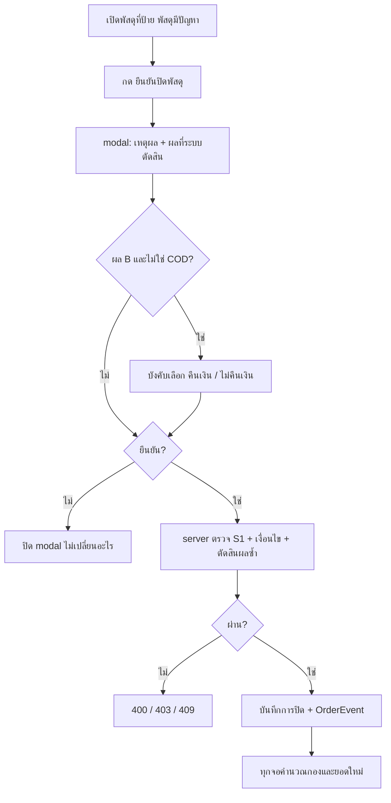

> **โมดูล:** 00085 - Seller Closes Problem Parcel
> **ประเภทเอกสาร:** Business Requirements Document (BRD) - NON-TECHNICAL
> **เวอร์ชัน:** 0.2
> **วันที่จัดทำ:** 2026-10-26
> **สถานะ:** Review — มติ user ครบ (PRD หัวข้อ 11)
> **เจ้าของเอกสาร:** BA

# BRD: ปิดพัสดุมีปัญหาโดยร้าน

---

## 1. บทนำ

### 1.1 วัตถุประสงค์
- อธิบายความต้องการของ "ยืนยันปิดพัสดุ" สำหรับพัสดุในกอง "พัสดุมีปัญหา"
- กำหนดเงื่อนไขการปิด กฎการตัดสินช่วงที่หาย กองปลายทาง และผลทางการเงิน
- ทุกเกณฑ์ต้องตรวจได้ และชี้จุดที่บังคับใช้

### 1.2 ขอบเขต

**Input**
- การกดปิดพร้อมเหตุผล (รหัส และข้อความเมื่อเลือก "อื่น ๆ")
- คำตอบเรื่องคืนเงิน (ถามเฉพาะผล B ที่ไม่ใช่ COD)
- ประวัติพัสดุที่มีอยู่: `deliveredAt`, `ShipmentEvent`, `Order.status`

**Output**
- พัสดุที่ถูกปิด: ผล, เหตุผล, basis, คำตอบคืนเงิน, ผู้ปิด, เวลา
- กองใหม่ "ส่งไม่สำเร็จ"
- ยอดขายและต้นทุนที่ปรับแล้ว
- OrderEvent ของการปิดและเลิกปิด

**ระบบที่เกี่ยวข้อง:** iShip (00022) · Flash ตรง (00084) · ยอดขายและกำไร · แชทและกล่องแชท · หน้าผู้ซื้อ `/o/[token]`

### 1.3 ผู้ใช้

| กลุ่ม | สิทธิ์ |
|---|---|
| ผู้มีสิทธิ์ S1 (จัดการพัสดุ) — OWNER, MANAGER, CHAT ตาม `shop-permissions.ts:37` | ปิด / เลิกปิด (มติ Q4) |
| บทบาทอื่น | ดูอย่างเดียว |
| ผู้ซื้อ | เห็นสถานะที่ตรงกับกองใหม่ ไม่มีสิทธิ์ปิด |

---

## 2. Functional Requirements

### FR-PC-01: ปุ่ม "ยืนยันปิดพัสดุ"

> ในฐานะคนดูแลพัสดุ ฉันต้องการเห็นปุ่มปิดทันทีที่เปิดพัสดุที่มีปัญหา

- [ ] ปุ่มอยู่ในกล่องเตือนสีแดง "พัสดุมีปัญหาระหว่างทาง" ของ `ShipmentStatusView.tsx` และแสดงเมื่อพัสดุอยู่กอง PROBLEM
  - เงื่อนไขแสดงต้องเรียกฟังก์ชันตัดสินกลาง ห้ามเขียนเงื่อนไขซ้ำ
  - เทสแดงเมื่อ: เงื่อนไขเหลือแค่ `carrierStatus==='issue'` ⇒ ใบที่ค้างเหนียว (`progress` + `problemAt`) ต้องยังมีปุ่ม
- [ ] ไม่แสดงปุ่มเมื่อ: ไม่อยู่กอง PROBLEM · ปิดแล้ว · พัสดุขากลับ · dry-run · ออเดอร์ CANCELLED/RETURNED/DRAFTED · `fulfillmentMode ≠ SHIPPED` · ไม่มีสิทธิ์ S1
- [ ] แชทและหน้าคำสั่งซื้อได้ปุ่มเดียวกันจากการแก้จุดเดียว (ยืนยันรายชื่อผู้ใช้ component ใน SRS)
- [ ] "ยกเลิกพัสดุ" ยังอยู่ใน ⋮ ตามเดิม

### FR-PC-02: modal เหตุผลและผล

> ในฐานะคนดูแลพัสดุ ฉันต้องการเห็นผลต่อยอดขายก่อนยืนยัน

- [ ] ตัวเลือกเหตุผล: ไฟไหม้ / ของหาย / สินค้าเสียหาย / อื่น ๆ
- [ ] "อื่น ๆ" ต้องพิมพ์ 5–200 ตัวอักษร ไม่งั้นปุ่มยืนยันกดไม่ได้และ API ตอบ 400
- [ ] modal แสดงผลที่ระบบตัดสินพร้อมหลักฐาน
  - ผล A: "ไม่พบประวัติว่าส่งถึงผู้รับ — จะบันทึกเป็น ส่งไม่สำเร็จ ไม่นับเป็นยอดขาย ค่าส่งขาไปยังนับเป็นต้นทุน"
  - ผล B + COD: "พบว่าส่งถึงผู้รับเมื่อ <วันเวลา> — จะบันทึกเป็น ส่งสำเร็จ (คืนไม่สำเร็จ) · ใบเก็บเงินปลายทางไม่นับเป็นยอดขาย"
  - ผล B + ไม่ใช่ COD: แสดงผลเดียวกัน และ**บังคับเลือก** "คืนเงินลูกค้าแล้ว/จะคืน" (ไม่นับยอดขาย) หรือ "ไม่คืนเงิน" (นับยอดขาย)
- [ ] ไม่พบหลักฐานส่งถึงและไม่มี event เลย ⇒ แสดงหมายเหตุ "ประวัติขนส่งอาจไม่ครบ"
- [ ] ใช้ Swal + `pacesToast` และไม่มี emoji (HR9, HR12)

### FR-PC-03: ตัดสินช่วงที่หาย

- [ ] "เคยส่งถึงผู้รับ" เป็นจริงเมื่อเข้าข้อใดข้อหนึ่ง
  1. `deliveredAt` ไม่ว่าง
  2. มี `ShipmentEvent` สถานะ `delivered` หรือ `payment_success`
  3. `Order.status = CONFIRMED`
  - เทสแดงเมื่อ: มี event delivered แต่ `deliveredAt` ว่าง แล้วไม่ได้ผล B
- [ ] server คำนวณผลซ้ำตอนยืนยัน ไม่ใช้ค่าจาก client
- [ ] เก็บ basis: `DELIVERED_AT` / `EVENT` / `ORDER_CONFIRMED` / `NONE`

### FR-PC-04: บันทึกการปิด

- [ ] เพิ่มคอลัมน์ nullable บน `OrderShipment`: เวลาปิด, ผู้ปิด, เหตุผล (รหัส + ข้อความ), ผล (A/B), basis, ร้านคืนเงินไหม (null เมื่อไม่ได้ถาม)
- [ ] ปิดซ้ำ ⇒ 409 ใช้ conditional update ที่ WHERE ยังไม่ปิด
- [ ] เขียน OrderEvent `PARCEL_PROBLEM_CLOSED` (ต้อง migration ขยาย `OrderEvent_type_check` — HR15)
- [ ] ไม่เปลี่ยน `Order.status`, `cancelInitiator`, Trust Score
  - เทสแดงเมื่อ: ปิดแล้ว `Order.status` ไม่เท่าเดิม
- [ ] ตอบ 409 เมื่อ: ไม่อยู่กอง PROBLEM · ออเดอร์ CANCELLED/RETURNED/DRAFTED · พัสดุขากลับ · dry-run · ร้านบริการ
- [ ] ตอบ 400 เมื่อ: ผล B ไม่ใช่ COD แต่ไม่ได้ส่งคำตอบคืนเงินมา

### FR-PC-05: ปลายทางของกอง

- [ ] ผล A ⇒ `deriveShippingStage` คืนกองใหม่ (key ตั้งใน SRS) ป้ายเขียนว่า "ส่งไม่สำเร็จ" เป็นงานจบ
- [ ] ผล B ⇒ งานจบ ป้ายเขียนว่า "ส่งสำเร็จ · คืนไม่สำเร็จ" และไม่เข้ากอง "รอเงิน COD"
- [ ] กองใหม่ไม่อยู่ใน `SHIPPING_STAGE_LABEL` แต่อยู่ใน `STAGE_BADGE_OVERRIDE`, `ALL_SHIPPING_STAGES` และ `SHIPMENT_STAGE_DOT_INDEX` เพื่อให้ `tsc` บังคับ
- [ ] สาขา "ปิดแล้ว" อยู่เหนือสาขา RETURNED และ PROBLEM ใน `deriveShippingStage`
- [ ] ฉบับ SQL `buildShippingStageSql` ให้ผลเท่าฉบับ TS ทุกกรณี
  - เทส parity ต้องมี 3 เคส: ปิด A · ปิด B · ปิดแล้วแต่สถานะขนส่งขยับต่อ

### FR-PC-06: ทุกจอตอบตรงกัน

- [ ] เพิ่มพารามิเตอร์บังคับให้ `holdsParcelProblem` (`iship/status.ts:713`) และ `buildProblemHoldSql` (`order-stage-sql.ts:105`)
  - ถ้าปิดแล้ว ⇒ คืน false แม้ `carrierStatus='issue'`
- [ ] ผู้ใช้ SQL ทั้ง 3 จุดไม่นับใบที่ปิดแล้ว
  - `order-stage-sql.ts:141`
  - `order-stage.service.ts:135`
  - `chat.service.ts:280` (ตัวกรอง `state=problem`)
- [ ] ผู้เรียก `deriveShippingStage` / `deriveOrderStage` ทุกจุดส่งค่าการปิดเข้าไป เป็น field บังคับให้ `tsc` ไล่ (รายชื่อเต็มอยู่ใน SRS)
- [ ] ป้ายแถวแชทไม่ขึ้น "พัสดุมีปัญหา" กับใบที่ปิดแล้ว
- [ ] ชิป "พัสดุมีปัญหา" ที่ /orders และกล่องแชทลดลงทันทีหลังปิด และเท่ากับจำนวนแถวในรายการ
- [ ] หน้าผู้ซื้อไม่ค้างข้อความแดง "พัสดุมีปัญหา — ติดต่อร้าน" (`order-stage.ts:465-471`)

### FR-PC-07: การเงิน — ใบที่ "ไม่นับเป็นยอดขาย"

ใบที่ไม่นับเป็นยอดขาย = ผล A ทั้งหมด · ผล B ที่เป็น COD · ผล B ที่ร้านเลือกคืนเงิน

- [ ] `countsAsRevenue` / `countsAsRevenueFor` / `revenueOrderWhere` (`order-revenue.ts:43,64,155`) คืน false แม้ `Order.status = CONFIRMED`
  - เทสแดงเมื่อ: ใบผล A + CONFIRMED ยังถูกนับเป็นยอดขาย
- [ ] ชีต /sales (`getSalesSeries`): ใบเหล่านี้ไม่เพิ่ม values / confirmed / unconfirmed / cogs / orderCounts แต่**ยังเพิ่ม** shippingValues
  - แถวต้องไม่ถูกตัดที่ `where` บรรทัด `dashboard.service.ts:332`
- [ ] ค่าส่งของใบเหล่านี้ = ราคาขนส่ง **ไม่รวม `codFee`**
  - เทสแดงเมื่อ: COD 360 ค่าส่ง 30 codFee 7.70 ⇒ ออเดอร์ต้องได้ −30 ไม่ใช่ −37.70
- [ ] จุดอื่นที่อ่านยอดขายต้องไม่นับใบเหล่านี้: `pnl.service.ts:154,163`, `dashboard.service.ts:876`, `soldItemsWindowWhere`, `countsAsSoldFor`, `receivable.service`
- [ ] P&L ร้านขายของใช้กติกาเดิม ไม่เพิ่มค่าส่งขาไป (มติ Q5)

### FR-PC-08: การเงิน — ผล B ที่โอนเงินและไม่คืนเงิน

- [ ] นับเป็นยอดขายตามปกติ แม้ `carrierStatus` ปัจจุบันเป็น `issue` (ซึ่งไม่อยู่ใน `REVENUE_CARRIER_STATUSES` ที่ `order-revenue.ts:26-33`)
- [ ] การปิดไม่สร้าง/ปิดแถว `OrderReturn` เอง

### FR-PC-09: สถานะขนส่งหลังปิด

- [ ] หลังปิดแล้ว ตัวเขียน `carrierStatus` ทุกทางไม่เปลี่ยนกองและเงิน
  - iShip webhook · poll · `getTraces`
  - Flash `flash-status.service.ts`
  - เทส integration: ยิง issue / progress / delivered / return หลังปิด แล้วกองต้องไม่เปลี่ยน
- [ ] ถ้าสถานะใหม่ขัดกับผลที่ปิด (ปิด A แล้วมี delivered/return* · ปิด B แล้วมี issue) ให้แสดงแถบเตือนพร้อมปุ่ม "เลิกปิด"

### FR-PC-10: สิทธิ์

- [ ] ประกาศ API ใหม่ใน `route-capabilities.ts` ด้วย capability `S1` (มติ Q4)
  - เทสแดงเมื่อ: บทบาทที่ไม่มี S1 เรียกแล้วได้ ≠ 403
- [ ] resolve ร้านจากแถวพัสดุ/ออเดอร์ ไม่ใช้ร้าน active ใน session (`permission-gate-follows-the-row.md`)
- [ ] ด่านจริงอยู่ที่ server ส่วน UI แค่ซ่อนปุ่ม

### FR-PC-11: เลิกปิด

- [ ] เลิกปิด = ล้างคอลัมน์การปิด พัสดุกลับไปตามสถานะขนส่ง (ถ้ายังติดปัญหาก็กลับกอง PROBLEM เพราะ `problemAt` ยังอยู่)
- [ ] เขียน OrderEvent `PARCEL_PROBLEM_REOPENED`
- [ ] เลิกปิดไม่ได้เมื่อออเดอร์เป็น CANCELLED/RETURNED
- [ ] ยอดขายกลับเป็นตามกติกาเดิมทันที (คำนวณสด)

### FR-PC-12: ประวัติ

- [ ] ไทม์ไลน์ออเดอร์ฝั่งร้านแสดงการปิด/เลิกปิด: ผู้ทำ, เวลา, เหตุผล, ผล, คำตอบคืนเงิน
- [ ] ไอคอนใช้ tabler

---

## 3. Business Flows

---

## 4. Use Case Scenarios

### Scenario 1: ของหายก่อนถึง (ตัวอย่าง user)
- **เงื่อนไข:** ออเดอร์ COD 360 ค่าส่ง 30 ส่งผ่าน Flash · ขนส่งแจ้ง "ปิดงาน พบปัญหา สินค้าเสียหาย" · ไม่มีหลักฐานส่งถึง
- **ขั้นตอน:** กดปิด → เลือก "สินค้าเสียหาย" → modal แจ้งว่าเป็น "ส่งไม่สำเร็จ" → ยืนยัน
- **ผล:**
  - ชิป "พัสดุมีปัญหา" ลดลง 1
  - /sales: ยอดขาย 0 ค่าส่ง 30 กำไร −30
  - ไทม์ไลน์มีเหตุการณ์ปิด

### Scenario 2: ส่งถึงแล้ว หายระหว่างตีกลับ (COD)
- **เงื่อนไข:** มี `deliveredAt` แล้วขนส่งแจ้ง `issue` ภายหลัง
- **ผล:** "ส่งสำเร็จ · คืนไม่สำเร็จ" · ไม่นับยอดขาย · ค่าส่งเป็นต้นทุน

### Scenario 3: ส่งถึงแล้ว หายระหว่างตีกลับ (โอนเงิน)
- modal บังคับเลือกคืนเงินหรือไม่
- คืนเงิน ⇒ ไม่นับยอดขาย
- ไม่คืนเงิน ⇒ นับยอดขายตามเดิม

### Scenario 4: ขนส่งตามเจอหลังปิด
- ปิดเป็นผล A แล้วต่อมาขนส่งส่ง `delivered` มา
- กองและเงินไม่เปลี่ยน แต่มีแถบเตือน
- ร้านกด "เลิกปิด" ⇒ กลับไปตามสถานะขนส่ง

---

## 5. ความต้องการด้านคุณภาพ

- **ความถูกต้อง**
  - นิยาม "ปิดแล้ว / ส่งไม่สำเร็จ / ไม่นับยอดขาย" มีที่เดียวทั้งระบบ (HR16)
  - ฉบับ TS และ SQL ผูกกันด้วยเทส parity
  - ผลถูกแช่แข็งตอนเขียน
- **ความเร็ว**
  - การตัดสินอ่านข้อมูลที่มีอยู่แล้ว ไม่ยิง API ขนส่ง
  - เส้นทางร้อน (/orders, กล่องแชท) ไม่ join `ShipmentEvent` ใช้แค่ตอนกดปิด
- **ความน่าเชื่อถือ:** ปิดซ้ำปลอดภัย (conditional update) · webhook ที่มาพร้อมกันไม่ทำให้สถานะเพี้ยน
- **ความปลอดภัย**
  - ตรวจสิทธิ์ที่ server ตามแถว
  - เหตุผลอิสระผ่าน Valibot (5–200)
  - migration แบบ additive (HR14/HR15)
- **การใช้งาน:** ผ่าน `safepay-ux` ก่อนทำ และ `/impeccable critique` + `clarify` หลังทำ (HR8) · ทดสอบ 3 จอ

---

## 6. Business Rules

| รหัส | กฎ |
|---|---|
| BR-PC-01 | ปิดได้เฉพาะพัสดุขาไปที่ active และอยู่กอง PROBLEM |
| BR-PC-02 | ออเดอร์ CANCELLED/RETURNED/DRAFTED หรือไม่ใช่ SHIPPED ปิดไม่ได้ |
| BR-PC-03 | ปิดซ้ำไม่ได้ · เลิกปิดแล้วปิดใหม่ได้ |
| BR-PC-04 | "อื่น ๆ" ต้องมีข้อความ 5–200 ตัวอักษร |
| BR-PC-05 | สิทธิ์ปิดและเลิกปิด = S1 |
| BR-PC-10 | เคยส่งถึง = `deliveredAt` หรือ event delivered/payment_success หรือ CONFIRMED |
| BR-PC-11 | เคยส่งถึง ⇒ ผล B · ไม่เคย ⇒ ผล A · ผู้ใช้เลือกผลเองไม่ได้ |
| BR-PC-20 | ผล A และผล B เป็นงานจบทั้งคู่ ไม่อยู่ในไทล์หรือชิปงานค้าง |
| BR-PC-21 | การปิดชนะสถานะขนส่งที่มาภายหลัง |
| BR-PC-30 | ไม่นับยอดขาย = ผล A · ผล B COD · ผล B ที่คืนเงิน ⇒ ยอดขาย 0 ต้นทุนสินค้า 0 ค่าส่งขาไปเป็นต้นทุน (ไม่รวม codFee) |
| BR-PC-31 | ผล B โอนเงิน ไม่คืนเงิน ⇒ นับยอดขายตามปกติ |
| BR-PC-32 | ไม่นับเงินเคลม · ไม่ลงต้นทุนของที่หายเป็นขาดทุน |
| BR-PC-33 | P&L ร้านขายของใช้กติกาเดิม (ไม่มีค่าส่งขาไป) |
| BR-PC-34 | ร้านบริการไม่เปิดใช้ใน v1 |
| BR-PC-40 | ทุกการปิด/เลิกปิดเขียน OrderEvent: ผู้ทำ เวลา เหตุผล ผล basis คำตอบคืนเงิน |
| BR-PC-41 | ไม่เปลี่ยน Order.status, cancelInitiator, Trust Score |

---

## 7. ข้อจำกัด

- ห้ามเปลี่ยน `Order.status` จากสถานะพัสดุหรือการปิด (BR-ISHIP-41)
- `OrderEvent_type_check` เป็น DB CHECK ⇒ ต้อง migration ก่อน
- `SHIPPING_STAGE_LABEL` ห้ามมีกองใหม่
- query หาพัสดุต้องระบุ direction (`ACTIVE_FORWARD_SHIPMENT`)
- ต้อง sync `docs/SRS.md` (HR11) และ AC ทุกข้อต้องมีเทสที่แดงเมื่อลบตัวบังคับ
