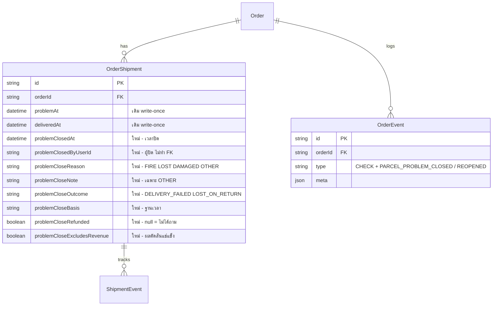

> **โมดูล:** 00085 — Seller Closes Problem Parcel
> **ประเภทเอกสาร:** DATABASE Design
> **เวอร์ชัน:** 1.0
> **วันที่จัดทำ:** 2026-10-26
> **สถานะ:** Draft
> **เจ้าของเอกสาร:** SA

# DATABASE: ร้านปิดพัสดุที่มีปัญหา

## 1. Overview

ฟีเจอร์เก็บ "ผลการปิด" ไว้บนแถว `OrderShipment` เดิม (ไม่เพิ่มตาราง) และเพิ่มชนิดเหตุการณ์ 2 ค่าใน `OrderEvent` สำหรับไทม์ไลน์ ทั้งหมด additive — ใบเก่า/ใบที่ยังไม่ปิดเป็น null ทั้งหมด

- **เอกสารออกแบบต้นทาง:** [[SDS]] §6, [[SRS]] §5
- **Store:** PostgreSQL 16 (Supabase) ผ่าน Prisma — `prisma/schema.prisma`
- **ORM / Migration:** Prisma Migrate (ไม่ใช้ Supabase migration, ไม่มี RLS — สิทธิ์อยู่ที่ `src/services/`)

## 2. ERD

## 3. Tables

### 3.1 `OrderShipment` (PostgreSQL) — เพิ่ม 8 คอลัมน์

| Column | Type | Null | Default | Key |
|--------|------|------|---------|-----|
| `problemClosedAt` | `timestamp(3)` (ตรงกับ `problemAt`) | YES | NULL | - |
| `problemClosedByUserId` | `text` | YES | NULL | - (ไม่ทำ FK ตามแบบ `doneByUserId`) |
| `problemCloseReason` | `varchar(16)` | YES | NULL | CHECK |
| `problemCloseNote` | `varchar(200)` | YES | NULL | - |
| `problemCloseOutcome` | `varchar(24)` | YES | NULL | CHECK |
| `problemCloseBasis` | `varchar(24)` | YES | NULL | CHECK |
| `problemCloseRefunded` | `boolean` | YES | NULL | - |
| `problemCloseExcludesRevenue` | `boolean` | YES | NULL | - |

**Constraints (ทุกตัว null ได้ — idempotent ผ่านเช็ค `pg_constraint`)**

| ชื่อ | เงื่อนไข |
|---|---|
| `OrderShipment_problem_close_coherent` | `problemClosedAt`, `problemCloseOutcome`, `problemCloseExcludesRevenue` เป็น null พร้อมกันทั้งสาม หรือไม่ null พร้อมกันทั้งสาม |
| `OrderShipment_problem_close_outcome_check` | outcome ∈ {DELIVERY_FAILED, LOST_ON_RETURN} |
| `OrderShipment_problem_close_reason_check` | reason ∈ {FIRE, LOST, DAMAGED, OTHER} |
| `OrderShipment_problem_close_basis_check` | basis ∈ {DELIVERED_AT, EVENT, ORDER_CONFIRMED, NONE} |

กฎที่ DB ไม่บังคับ (อยู่ที่ service/Valibot): `problemCloseNote` ต้องมี 5-200 ตัวเมื่อ reason = OTHER และเป็น null เมื่อเป็นเหตุผลอื่น

🛑 `problemCloseNote`, `problemClosedByUserId`, `problemCloseRefunded`, `problemCloseExcludesRevenue` ห้ามออกหน้า guest (`/o/{token}`)

### 3.2 `OrderEvent` (PostgreSQL) — ขยาย CHECK `OrderEvent_type_check`

จาก 33 ค่า เป็น 35 ค่า: เพิ่ม `PARCEL_PROBLEM_CLOSED`, `PARCEL_PROBLEM_REOPENED` (ต้องตรง `ORDER_EVENT_TYPES` ใน `src/lib/order-event.ts` เป๊ะ) ไม่มีคอลัมน์ใหม่ — รายละเอียดอยู่ใน `meta` (closeReason, closeNote, outcome, basis, refunded)

## 4. Indexes

ไม่เพิ่ม index — คอลัมน์ใหม่ไม่ถูกใช้เป็นตัวกรองหลัก การหาใบที่ปิดแล้วอ่านผ่าน `orderId` (มี `@@index([orderId])` เดิม) ก่อนค่อยดูคอลัมน์ ปรับเมื่อมีรายงานที่ scan ตาม `problemClosedAt` ตรง ๆ

## 5. Migration Plan

### 5.1 ลำดับ

| ลำดับ | ไฟล์ | หมายเหตุ |
|---|---|---|
| 1 | `20261026100000_00085_parcel_problem_close_columns` | ADD COLUMN IF NOT EXISTS ×8 + CHECK ×4, `SET LOCAL lock_timeout='5s'` |
| 2 | `20261026100100_00085_order_event_parcel_close_types` | DROP + ADD `OrderEvent_type_check` (NOT VALID แล้ว VALIDATE) guard ด้วย `position(... IN def)` รันซ้ำได้ |

ไม่มี backfill: ใบเก่า = null = ยังไม่ปิด

### 5.2 Rollback

- ลำดับ 2: คืน CHECK เป็น 33 ค่าเดิม — ทำได้เฉพาะเมื่อยังไม่มีแถว `OrderEvent` ชนิดใหม่ (ไม่งั้น ADD CONSTRAINT ล้ม ต้องตัดสินใจเรื่องแถวเหล่านั้นก่อน)
- ลำดับ 1: DROP CONSTRAINT ×4 แล้ว DROP COLUMN ×8 — เป็น destructive ทำลายผลการปิดที่บันทึกไว้ **ห้ามทำเว้นแต่ Controller สั่งชัด**; ก่อน rollback ให้ปิดฟีเจอร์ที่โค้ดฝั่งแอปก่อน (โค้ดเก่าไม่อ่านคอลัมน์ใหม่ จึง roll app กลับได้โดยไม่ต้อง rollback DB)

### 5.3 ผลกระทบ

- ADD COLUMN nullable ไม่มี default = metadata only ไม่ rewrite ตาราง; CHECK ที่เพิ่มใหม่ผ่านทันทีเพราะทุกแถวเป็น null
- `OrderEvent_type_check` ใช้ VALIDATE แยก ตารางใหญ่กว่าแต่ scan อย่างเดียว ไม่บล็อกเขียน
- push `main` = `prisma migrate deploy` บน prod ในตัว (HR15) — ต้องบอก user 3 ข้อก่อน; ถ้า migrate ล้ม deploy ไม่ขึ้น

## 6. Retention / ข้อควรระวัง

- **Retention:** ไม่มี job ลบ — ผลการปิดเป็นประวัติถาวรของใบพัสดุ
- **PII:** `problemCloseNote` เป็นข้อความอิสระจากร้าน (ห้ามมี PII ผู้ซื้อตามกฎ meta ของ `order-event.ts`); `problemClosedByUserId` เป็นตัวระบุพนักงาน — ทั้งคู่ไม่ออก guest
- **Performance:** ไม่มี hot row เพิ่ม; การปิดเป็น conditional update ต่อใบ
- **Consistency:** `problemCloseExcludesRevenue` แช่แข็ง ณ ตอนปิด (F2) — ห้ามคำนวณใหม่ย้อนหลังจาก event ที่เข้ามาทีหลัง

## 7. Traceability

| Table / คอลัมน์ | SDS | สถานะ |
|---|---|---|
| `OrderShipment.problemClose*` (8 คอลัมน์) | SDS §6 / SRS §5.1 | Draft |
| `OrderEvent_type_check` (+2 ค่า) | SDS §6 / SRS §5.2 | Draft |

## 8. สรุป

เพิ่มโครงสร้างข้อมูลแบบ additive 8 คอลัมน์ + CHECK 4 ตัว บน `OrderShipment` และขยาย CHECK ของ `OrderEvent` อีก 2 ชนิด ไม่มี backfill ไม่มี index ใหม่

**Open Questions:** ไม่มี
