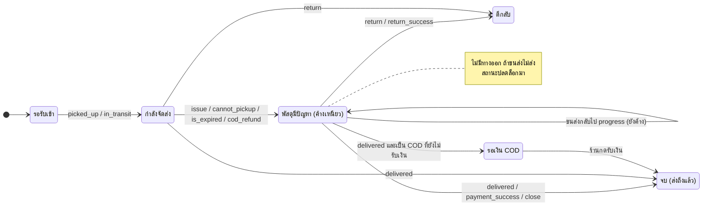
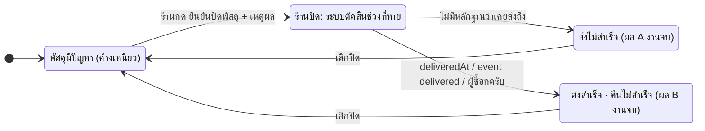
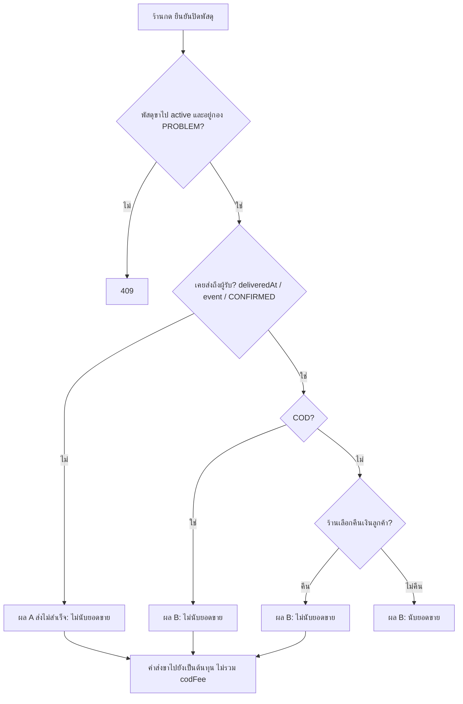

> **โมดูล:** 00085 - Seller Closes Problem Parcel
> **ประเภทเอกสาร:** Product Requirements Document (PRD)
> **เวอร์ชัน:** 0.2
> **วันที่จัดทำ:** 2026-10-26
> **สถานะ:** Review — มติ user 9 ข้อครบแล้ว (หัวข้อ 11) รออนุมัติเอกสาร
> **เจ้าของเอกสาร:** BA + PO + PM

# PRD: ปิดพัสดุมีปัญหาโดยร้าน

---

## Executive Summary

พัสดุที่ขนส่งแจ้งว่า "มีปัญหา" (ไฟไหม้ ของหาย สินค้าเสียหาย ฯลฯ) ค้างอยู่ในกอง "พัสดุมีปัญหา" ตลอดไป ด้วยเหตุผลสองข้อ
1. ขนส่งไม่ส่งสถานะอะไรมาล้างให้ เช่น Flash ที่ขึ้น "ปิดงาน — พบปัญหา สินค้าเสียหาย" ถูกแปลงเป็น `issue` ซึ่งไม่มีวันหลุด (`flash/status.ts:13-14` แมป state 4 และ 6 เป็น `issue`)
2. กองนี้ค้างเหนียวตั้งแต่ 2026-09-14 (`problemAt` ประทับครั้งเดียว ไม่ล้าง)

ผลคือป้ายแดง ตัวกรอง "พัสดุมีปัญหา N" และไทล์ใน Command Center นับใบที่ร้านทำอะไรต่อไม่ได้แล้ว ร้านแยกไม่ออกว่าใบไหนยังต้องตามขนส่ง

ฟีเจอร์นี้ให้ร้านกด **"ยืนยันปิดพัสดุ"** บนพัสดุที่อยู่ในกอง "พัสดุมีปัญหา"
- ร้านเลือกเหตุผลใน modal
- **ระบบตัดสินเองจากประวัติขนส่ง** ว่าของหายก่อนหรือหลังถึงผู้รับ และบอกผลก่อนร้านยืนยัน
- หายก่อนถึง ⇒ **"ส่งไม่สำเร็จ"** (งานจบ) ไม่นับเป็นยอดขาย แต่ค่าส่งขาไปยังเป็นต้นทุน
- หายหลังถึง (ระหว่างตีกลับ) ⇒ **"ส่งสำเร็จ (คืนไม่สำเร็จ)"** ยอดขายขึ้นกับวิธีชำระเงินและการคืนเงิน (หัวข้อ 3.4)

`Order.status` ไม่ถูกเปลี่ยน (BR-ISHIP-41) การปิดเป็นข้อเท็จจริงของพัสดุ และเก็บไว้บน `OrderShipment`

---

## 1. Business Goals & KPIs

### 1.1 เป้าหมายทางธุรกิจ

| เป้าหมาย | รายละเอียด |
|----------|-----------|
| **กอง "พัสดุมีปัญหา" มีแต่งานจริง** | ใบที่ร้านตัดสินแล้วต้องหลุดจากไทล์/ชิป/ป้ายแชทเหมือนกันทุกจอ (HR16) |
| **ตัวเลขการเงินตรงความจริง** | ไม่ได้เงิน = ไม่ใช่ยอดขาย · ค่าส่งที่จ่ายไปแล้วต้องไม่หายจากต้นทุน |
| **ร้านตัดสินเองได้ มีร่องรอยตรวจสอบ** | บันทึกว่าใครปิด เมื่อไร เพราะอะไร และระบบตัดสินช่วงที่หายจากหลักฐานข้อไหน |

### 1.2 ตัวชี้วัดความสำเร็จ (KPIs)

| KPI | คำอธิบาย | เป้าหมาย |
|-----|----------|---------|
| **ใบ PROBLEM ที่ค้าง > 30 วัน** | นับพัสดุขาไปที่อยู่กอง PROBLEM อายุจาก `problemAt` เกิน 30 วัน | ลดลงต่อเนื่องหลังเปิดใช้ |
| **ตัวเลขชิป = ตัวเลขรายการ** | ชิป "พัสดุมีปัญหา" ที่ /orders และกล่องแชทเท่ากับจำนวนแถวในรายการ | 100% (เทส parity) |
| **ความสอดคล้องของยอดขาย** | ใบที่ไม่นับเป็นยอดขายตามกติกาหัวข้อ 3.4 ไม่ปรากฏในยอดขายทุกจอ | 0 ใบหลุด |

---

## 2. User Personas (กลุ่มผู้ใช้งาน)

### 2.1 เจ้าของร้าน / ผู้ดูแล / แอดมินแชท (ผู้มีสิทธิ์จัดการพัสดุ S1)

**ข้อมูลพื้นฐาน:** ร้านขายของที่ส่งผ่าน iShip หรือ Flash Express ตรง (00084)

**เป้าหมาย:** ปิดเรื่องพัสดุที่ขนส่งทำหายหรือเสียหาย ให้ตัวเลขร้านสะท้อนความจริง

**ความต้องการ:**
- ปุ่มปิดที่เห็นทันทีเมื่อเปิดใบที่มีปัญหา
- รู้ก่อนยืนยันว่าระบบจะลงบัญชีออเดอร์นี้เป็นอะไร

**จุดปวด:**
- ใบที่ของหายไปแล้วค้างแดงตลอดกาล ดึงความสนใจจากใบที่ยังต้องตามจริง
- ยอดขายของใบที่ไม่เคยได้เงินยังค้างอยู่ในชีต

> สิทธิ์: **ทุกคนที่จัดการพัสดุได้ (S1)** ปิดและเลิกปิดได้ — มติ user 2026-10-26 (Q4) ทุกการกระทำมีชื่อผู้ทำใน OrderEvent

---

## 3. Business Requirements

### 3.1 ทางเข้า "ยืนยันปิดพัสดุ"

**ความต้องการ:**
- เปิดพัสดุที่อยู่กอง "พัสดุมีปัญหา" แล้วเห็นปุ่ม "ยืนยันปิดพัสดุ" ทันที ไม่ซ่อนในเมนู ⋮
- ใช้ได้ทั้งจากแผงพัสดุในแชทและหน้าคำสั่งซื้อฝั่งร้าน (component ร่วม `ShipmentStatusView.tsx`)
- กดแล้วเปิด modal ให้เลือกเหตุผล และแสดงผลที่ระบบตัดสิน

**Business Rules:**
- แสดงเฉพาะพัสดุขาไปที่ active และอยู่กอง PROBLEM ตามนิยามเดียวกับไทล์
- พัสดุที่ปิดแล้วไม่มีปุ่มนี้อีก มีแต่ป้ายบอกว่าปิดแล้ว และทางเลือก "เลิกปิด"

**เหตุผล:**
- ปุ่มวางในกล่องแจ้งเตือนสีแดง เพราะเป็นจุดที่ร้านกำลังอ่านปัญหาอยู่
- การปิดถอนคืนได้ จึงไม่ขัด `docs/conventions/seller-action-placement.md` ที่ให้การกระทำที่ถอนคืนไม่ได้อยู่ใน ⋮
- ปุ่ม "ยกเลิกพัสดุ" ยังอยู่ใน ⋮ ตามเดิม

### 3.2 ระบบตัดสินช่วงที่หาย

ร้านไม่ต้องเลือกเอง ระบบไล่หลักฐานตามลำดับนี้

| ลำดับ | หลักฐาน "เคยส่งถึงผู้รับ" | แหล่ง |
|---|---|---|
| 1 | `OrderShipment.deliveredAt IS NOT NULL` | write-once ตอน `delivered`/`payment_success` (`iship.service.ts:2126-2131`, `flash-status.service.ts:181`) |
| 2 | มี `ShipmentEvent.status` ∈ `delivered`, `payment_success` | `DELIVERED_CARRIER_STATUSES` (`iship/status.ts:101`) |
| 3 | `Order.status = CONFIRMED` เพราะผู้ซื้อกดรับของเอง | `BUYER_CONFIRMED` |

- มีหลักฐานข้อใดข้อหนึ่ง ⇒ ผล **B "ส่งสำเร็จ (คืนไม่สำเร็จ)"** ไม่มีสักข้อ ⇒ ผล **A "ส่งไม่สำเร็จ"**
- server คำนวณผลซ้ำตอนกดยืนยัน ห้ามเชื่อค่าที่ client ส่งมา (`docs/conventions/value-fate-decided-at-write-site.md`)
- เก็บหลักฐานที่ใช้ตัดสิน (basis) ไว้คู่กับผล

**เหตุผลที่ใช้หลายหลักฐาน**
- เส้นทาง `getTraces` ไม่ประทับ `deliveredAt` (`iship.service.ts:1985-1990`)
- พัสดุ active 64% ไม่มี event เลย (prod 2026-08-24, `schema.prisma:2749-2751`)

### 3.3 ปลายทางของกองพัสดุ

- ผล A ⇒ ออกจาก "พัสดุมีปัญหา" ไปเป็น **"ส่งไม่สำเร็จ"** เป็นงานจบ ไม่อยู่ในไทล์/ตัวกรอง/ชิปงานค้าง แต่ยังเห็นในประวัติ การ์ด และหน้ารายละเอียด
- ผล B ⇒ ออกจาก "พัสดุมีปัญหา" ไปเป็นงานจบเช่นกัน พร้อมป้าย "ส่งสำเร็จ · คืนไม่สำเร็จ"
- ไม่ใช้กอง "ตีกลับ" (RETURNED) เพราะยังเป็นงานค้าง (มติ user ข้อ 1)
- กองใหม่ห้ามอยู่ใน `SHIPPING_STAGE_LABEL` เพราะ key ของมันใช้วาลิเดต `?stage=` (`order-stage.ts:421-428`) ป้ายให้อยู่ใน `STAGE_BADGE_OVERRIDE` แบบ DONE
- ผล B ไม่ส่งไปกอง "รอเงิน COD" เพราะใบ COD ผล B ไม่นับเป็นยอดขาย (หัวข้อ 3.4)

### 3.4 ผลทางการเงิน (มติ user 2026-10-26)

| ผล | เงื่อนไข | ยอดขาย | ต้นทุนสินค้า | ค่าส่งขาไป |
|---|---|---|---|---|
| **A ส่งไม่สำเร็จ** | ทุกวิธีชำระ | **ไม่นับ** | ไม่นับ | **นับเป็นต้นทุน** (ไม่รวม codFee) |
| **B คืนไม่สำเร็จ** | **COD** | **ไม่นับ** (ลูกค้าไม่รับ = ไม่จ่าย) | ไม่นับ | นับเป็นต้นทุน (ไม่รวม codFee) |
| **B คืนไม่สำเร็จ** | โอนเงิน — ร้านเลือก **คืนเงินลูกค้า** | **ไม่นับ** | ไม่นับ | นับเป็นต้นทุน |
| **B คืนไม่สำเร็จ** | โอนเงิน — ร้านเลือก **ไม่คืนเงิน** | **นับ** | นับ | นับ (ตามเดิม) |

ตัวอย่างของ user: COD ยอด 360 ค่าส่ง 30 หายก่อนถึง ⇒ ยอดขาย 0 ต้นทุน 30 ⇒ ออเดอร์ **−30**

**Business Rules:**
- ใบที่ "ไม่นับ" ไม่บวกค่าธรรมเนียม COD (`codFee`) เพราะไม่ได้เก็บเงินปลายทางจริง ⇒ −30 ไม่ใช่ −37.70 (`resolveOutboundShippingCost` วันนี้บวก codFee เสมอที่ `shipping-cost.ts:36,40,43`)
- ต้นทุนสินค้าที่สูญหายไม่ลงเป็นขาดทุน (มติ Q3)
- เงินเคลมจากขนส่งอยู่นอกขอบเขต
- หน้า /expenses (P&L) ของร้านขายของ **ใช้กติกาเดิม** คือไม่นับค่าส่งขาไปเป็นค่าใช้จ่าย (มติ 2026-10-02 ที่ `pnl.service.ts:237-238`; มติ Q5) ⇒ P&L เห็นแค่ยอดขายที่หายไป ส่วน −30 เห็นที่ /sales
- "คืนเงิน / ไม่คืนเงิน" เป็นคำถามใน modal **เฉพาะผล B ที่ไม่ใช่ COD** และบังคับตอบ
- **ทำไมไม่ใช้ Order.status:**
  - `CANCELLED` ถูกตัดตั้งแต่ `where` ของ `getSalesSeries` (`dashboard.service.ts:332`) ทำให้ค่าส่งหายไปด้วย และ `cancelInitiator` ผูกกับอัตราความสำเร็จสาธารณะ (`schema.prisma:789-792`)
  - `RETURNED` แปลว่าคืนของครบทั้งใบของ 00056
  - ⇒ เก็บเป็นข้อเท็จจริงบน `OrderShipment`

### 3.5 ทนต่อสถานะขนส่งที่มาหลังปิด

- หลังปิดแล้ว webhook / poll / รีเฟรชไทม์ไลน์ที่ส่งสถานะใหม่มา (`issue`, `progress`, `delivered`, `return`) ต้องไม่ดึงพัสดุกลับเข้ากอง PROBLEM และไม่เปลี่ยนผลการปิด
- การปิดเก็บในคอลัมน์แยกจาก `carrierStatus` / `problemAt` ตัวเขียนเดิมจึงไม่ทับ
- สถานะใหม่ที่ขัดกับการปิด (ปิด A แล้วมี `delivered`) ⇒ แสดงแถบเตือนพร้อม "เลิกปิด" ระบบไม่พลิกเงินหรือกองเอง

### 3.6 สิทธิ์ ร่องรอย และการย้อนกลับ

- สิทธิ์ = S1 (ทุกบทบาทที่จัดการพัสดุได้ — มติ Q4)
- OrderEvent บันทึกผู้ปิด เวลา เหตุผล ผล หลักฐาน และคำตอบเรื่องคืนเงิน
- "เลิกปิด" ทำได้ และบันทึกเป็นเหตุการณ์แยก

---

## 4. Business Rules & Constraints

### 4.1 กฎหลัก

| กฎ | คำอธิบาย |
|----|----------|
| **ปิดได้เฉพาะพัสดุขาไปในกอง PROBLEM** | `status='CREATED'`, `isDryRun=false`, `direction='FORWARD'` (`ACTIVE_FORWARD_SHIPMENT`, `shipment-direction.ts:39-43`) และ `holdsParcelProblem()` เป็นจริงโดยยังไม่นับการปิด |
| **ไม่ปิดซ้ำ** | ใบที่ปิดแล้วกดปิดอีก ⇒ 409 |
| **ไม่ปิดเมื่อออเดอร์จบแล้ว** | `Order.status` ∈ CANCELLED, RETURNED, DRAFTED หรือ `fulfillmentMode ≠ SHIPPED` ⇒ ไม่แสดงปุ่ม และ API ตอบ 409 |
| **ไม่แตะ Order.status** | ไม่เปลี่ยน BR-ISHIP-41, Trust Score, สิทธิ์รีวิว และ `cancelInitiator` (มติ Q3) |
| **SSOT เดียว** | ทุกจอและทุก SQL ตัดสินว่า "ปิดแล้ว" ผ่านฟังก์ชันเดียว (ต่อยอดจาก `holdsParcelProblem`) |
| **ร้านบริการ** | ร้านที่ `usesServiceFinanceRules` ใช้กติกาเงินอีกชุด (`order-revenue.ts:89-97`) v1 ไม่เปิดให้ใช้ |

### 4.2 ข้อจำกัด

| ข้อจำกัด | รายละเอียด |
|---------|-----------|
| **ใบส่งเอง (`ShipmentTracking`) นอกขอบเขต** | ไม่มีกอง PROBLEM (00080) |
| **พัสดุขากลับของใบคืน 00056 นอกขอบเขต** | มติ Q1: v1 ครอบเฉพาะพัสดุขาไป |
| **Flash direct (00084) อยู่ในขอบเขต** | ใช้ `OrderShipment` ร่วมกัน (`provider='FLASH'`) และประทับ `problemAt`/`deliveredAt` เหมือนกัน |

### 4.3 เหตุผลการปิด

| รหัส | ข้อความ | ที่มา |
|---|---|---|
| `FIRE` | ไฟไหม้ | user |
| `LOST` | ของหาย | user |
| `DAMAGED` | สินค้าเสียหาย | ข้อความไทม์ไลน์ Flash ในภาพ user |
| `OTHER` | อื่น ๆ | user — ต้องพิมพ์ 5–200 ตัวอักษร |

---

## 5. Out of Scope

| หัวข้อ | คำอธิบาย |
|--------|----------|
| เงินเคลมจากขนส่ง | ไม่บันทึก ไม่คำนวณ |
| ต้นทุนสินค้าที่สูญหาย | ไม่ลงเป็นขาดทุน (Q3) |
| ใบส่งเอง · พัสดุขากลับของใบคืน 00056 | Q1 |
| การคืนเงินลูกค้าจริง (โอนกลับ) | ร้านทำเองนอกระบบ ระบบแค่บันทึกว่าคืนแล้ว |
| Trust Score / อัตราความสำเร็จสาธารณะ | ไม่แตะ (Q3) |
| ค่าส่งขาไปใน P&L ร้านขายของ | ตามกติกาเดิม (Q5) |
| ร้านบริการ | v1 ไม่เปิด |
| กองงานใหม่ใน Command Center | "ส่งไม่สำเร็จ" ไม่ใช่งานค้าง |

---

## 6. Risks & Mitigation

| ความเสี่ยง | ผลกระทบ | ระดับ | แนวทางแก้ |
|-----------|---------|-------|----------|
| ร้านปิดใบที่ขนส่งยังตามอยู่ แล้วของถึงจริง | ยอดขายหาย | สูง | modal บอกผลชัด · เลิกปิดได้ · เตือนเมื่อขนส่งแจ้งสถานะใหม่หลังปิด |
| ประวัติขนส่งไม่ครบ ระบบตัดสิน A ทั้งที่ถึงแล้ว | ยอดขายถูกตัดผิด | กลาง | ใช้หลักฐานหลายข้อ · modal แสดงหลักฐาน · เก็บ basis |
| ใช้การปิดเพื่อ "ล้างยอด" | กำไรเพี้ยน | กลาง | ปิดได้เฉพาะใบที่ขนส่งแจ้งปัญหาจริง · มีชื่อผู้ทำใน OrderEvent |
| นิยามกอง PROBLEM มีผู้ใช้กระจาย (`problemAt` 82 จุด ใน 30 ไฟล์) | ชิปกับรายการไม่ตรงกัน | สูง | เพิ่ม arg บังคับที่ SSOT ให้ `tsc` ไล่ผู้เรียก · เทส parity TS↔SQL |
| `OrderEvent_type_check` เป็น DB CHECK | เขียน event ใหม่ไม่ได้ | — | ทำ migration additive (HR15) |
| ยอดขายมีหลายสูตร | เลขไม่ตรงข้ามหน้า | สูง | แก้ SSOT `order-revenue.ts` แล้วไล่ผู้เรียกทุกตัว (BRD §2.4) |

---

## 7. Glossary

| คำศัพท์ | ความหมาย |
|---------|----------|
| **ค้างเหนียว** | ใบที่เคยมีปัญหา (`problemAt` ไม่ว่าง) อยู่กอง PROBLEM จนกว่าจะเจอสถานะปลดล็อก |
| **ปิดพัสดุ** | ร้านยืนยันว่าเรื่องนี้จบ เก็บบนพัสดุ ไม่เปลี่ยน Order.status |
| **ผล A ส่งไม่สำเร็จ** | ของไม่เคยถึงผู้รับ |
| **ผล B ส่งสำเร็จ (คืนไม่สำเร็จ)** | ของเคยถึงผู้รับ แล้วหายระหว่างตีกลับ |
| **basis** | หลักฐานที่ใช้ตัดสินช่วงที่หาย: DELIVERED_AT / EVENT / ORDER_CONFIRMED / NONE |
| **ไม่นับเป็นยอดขาย** | ยอดขาย = 0 ต้นทุนสินค้า = 0 ค่าส่งขาไป (ไม่รวม codFee) ยังเป็นต้นทุน |

---

## 8. Success Metrics

| ตัวชี้วัด | ค่าที่คาดหวัง | วิธีวัด |
|----------|---------------|--------|
| ตัวนับ = รายการ | ชิปไม่นับใบที่ปิดแล้ว ทั้ง /orders และกล่องแชท | เทส parity + ตรวจมือ |
| ยอดขายใบ "ไม่นับ" = 0 ทุกจอ | /sales, P&L, แดชบอร์ด, ยอดค้างรับ | เทสฟังก์ชันกลาง + mutation |
| ตัวอย่าง user | COD 360 ค่าส่ง 30 ⇒ −30 | เทส |
| webhook หลังปิดไม่ย้อนกอง | 0 ใบกลับเข้า PROBLEM | เทส integration |

---

## 9. Dependencies & Assumptions

**Dependencies:**
- `order-stage.ts`, `order-stage-sql.ts`, `iship/status.ts` — SSOT ของกอง
- `OrderShipment` — ใช้ร่วมกันทั้ง iShip และ Flash
- `order-revenue.ts`, `shipping-cost.ts` — SSOT ของเงิน
- `order-event.ts` + DB CHECK
- `shop-permissions.ts` (S1), `route-capabilities.ts`
- `ShipmentStatusView.tsx`

**Assumptions:**
- A1 การปิดเก็บเป็นคอลัมน์ใหม่บน `OrderShipment` ทุกคอลัมน์ nullable (additive)
- A2 ผลการตัดสินและคำตอบคืนเงินถูกบันทึกตอนกดปิด ไม่คำนวณใหม่ภายหลัง
- A3 ร้านบริการได้ 409 ใน v1
- A4 สถานะที่ขนส่งส่งมาหลังปิดไม่เปลี่ยนกองหรือเงิน แต่ UI แสดงเตือน
- A5 ป้ายในแถวแชท (`deriveOrderStage`) แสดง "ส่งไม่สำเร็จ" 3 วันแล้วหาย ตามหลักเดียวกับ "จัดส่งสำเร็จ"
- A6 หน้าผู้ซื้อ `/o/[token]` ต้องไม่ค้างข้อความ "พัสดุมีปัญหา — ติดต่อร้าน" หลังร้านปิด ข้อความใหม่ให้ UX กำหนด

---

## 10. Appendix

### 10.1 กองพัสดุขาไป — ก่อนมี 00085

### 10.2 หลังมี 00085

### 10.3 การตัดสินผลและเงิน

---

## 11. มติ user (2026-10-26)

| # | คำถาม | มติ |
|---|---|---|
| 1 | กองปลายทาง | ป้ายใหม่ "ส่งไม่สำเร็จ" เป็นงานจบ ไม่ใช้กองตีกลับ |
| 2 | ยอดขายของผล A | ไม่นับ แต่ค่าส่งเป็นต้นทุน ("COD 360 ค่าส่ง 30 = −30") |
| 3 | ตัดสินช่วงที่หาย | ระบบดูจากประวัติขนส่งเอง |
| Q1 | "หายหลังถึงตอนคืน" หมายถึงอะไร | พัสดุขาไปใบเดิม (ไม่รวมพัสดุคืน 00056) |
| Q2 | ยอดขายของผล B | COD ไม่นับ (ลูกค้าไม่รับ = ไม่จ่าย) · โอนเงินให้ร้านเลือก คืนเงิน ⇒ ไม่นับ ไม่คืน ⇒ นับ |
| Q3 | ผล A: ต้นทุนของหาย · codFee · Trust | ไม่ลงต้นทุนของ · ไม่บวก codFee · ไม่แตะ Trust Score/อัตราสำเร็จ |
| Q4 | สิทธิ์ | ทุกคนที่จัดการพัสดุได้ (S1) |
| Q5 | P&L /expenses | ใช้กติกาเดิม (ไม่มีค่าส่งขาไป) |
