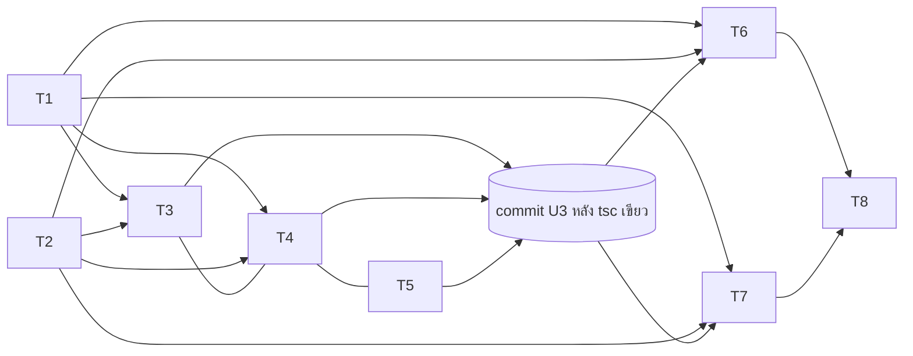

# 00085 — ข้อค้นพบจาก planner (PRD/BRD ไม่ตรงโค้ด) + แผนงาน

| # | ข้อค้นพบ | ผลต่อดีไซน์ |
|---|---|---|
| F1 | PRD A6 อ้าง `order-stage.ts:465-471` เป็นข้อความผู้ซื้อ "พัสดุมีปัญหา — ติดต่อร้าน" แต่บรรทัดนั้นเป็น docblock ของ `resolveOrderStatusBadge`. ข้อความจริงอยู่ที่ `src/lib/iship/status.ts:470` (`NOTICE_OF.issue.buyer`) แสดงผ่าน `describeProgress(...,'buyer')` ที่ `ParcelTimeline.tsx:88` | แก้ที่ `describeProgress` จุดเดียว: เพิ่มพารามิเตอร์บังคับ `parcelClose` (ผู้เรียก 6 จุด) |
| F2 | Prisma `where` เขียน regex COD ไม่ได้ (`COD_PAYMENT_PATTERN='COD\|ปลายทาง\|เก็บเงิน'` ที่ `order-display.ts:28`). สูตรใน SDS ที่เสนอ "outcome=A หรือ paymentMethod COD หรือ refunded=true" เขียนเป็น `where` ไม่ได้ | แช่แข็งผลตอนกดปิดเป็นคอลัมน์ `problemCloseExcludesRevenue Boolean?` ตาม PRD A2 และ `value-fate-decided-at-write-site` |
| F3 | `requireGeneralShop` (`shop-api-guard.ts:126`) คืน **403 `NOT_ELIGIBLE`** ให้ร้านที่ไม่ใช่ ONLINE_SALES ก่อนถึง service. ร้านบริการจึงไม่มีทางได้ 409 ผ่าน route | BRD "ร้านบริการ 409" ทำที่ชั้น service เป็นด่านสำรอง (เทสที่ service) ส่วน route ได้ 403 ซึ่งถูกกว่า |
| F4 | BRD FR-PC-09 "ปิด B แล้วมี issue ⇒ เตือน" ผิดตรรกะ เพราะ B คือ delivered แล้วหายตอนตีกลับ สถานะ `issue` เป็นสภาพปกติของ B | เสนอกฎขัดแย้งใหม่ใน TFR-009 (ต้องให้ user รับรอง) |
| F5 | `receivable.service.ts:184-187` ใช้เฉพาะ `serviceRevenueOrderWhere` (ร้านบริการ) ซึ่งไม่เปิดฟีเจอร์นี้. ยอด COD ค้างมาจาก stage `AWAITING_COD` (`dashboard.service.ts:586`) ซึ่งแก้ผ่าน stage อยู่แล้ว | `receivable.service` **ไม่ต้องแก้** แต่ต้องมีเทสยืนยัน |
| F6 | `countsAsSoldFor` (`order-revenue.ts:229`) ของร้านขายของคือ `status==='CONFIRMED'` ล้วน. ผู้เรียกทั้ง 3 หน้า (`products/page.tsx:108`, `products/[id]/page.tsx:73,80`, `categories/page.tsx:89`) พิมพ์ `(o: any)` ⇒ `tsc` ไล่ field ใหม่ให้ไม่ได้ | ต้องแก้ query ให้ include shipments และมีเทสแดงคุม (ห้ามหวัง tsc) |
| F7 | `resolveOrderStatusBadge` ข้าม `CONFIRMED` (`order-stage.ts:485`) ⇒ ใบผล A ที่ `Order.status=CONFIRMED` จะโชว์ป้ายสถานะเดิม แต่เงินถูกตัด | เสนอคงกฎเดิม (CONFIRMED ชนะป้าย) แล้วบอกใน `OrderProfitCard` และแผงพัสดุ (UX ตัดสินคำ) |
| F8 | `agent-performance-sql.ts:60` (`revenueOrderSql`) เป็นสูตรยอดขายฉบับ SQL ที่ BRD ไม่ได้ลิสต์ ใช้ที่ `agent-performance.service.ts:246` | ต้องเพิ่ม `AND NOT EXISTS(...)` และมีเทส parity กับ `revenueOrderWhere` |
| F9 | `order-view-by-level.ts:31-34` (`NO_MONEY_SHIPMENT_KEYS`) เป็น allow-list ของบทบาทไม่เห็นเงิน ถ้าไม่เพิ่มคีย์ปิด บทบาทนั้นจะเห็น stage คนละกองกับคนอื่น | เพิ่มเฉพาะ `problemClosedAt`, `problemCloseOutcome` (สถานะ ไม่ใช่เงิน) ห้ามเพิ่ม `problemCloseExcludesRevenue`/`problemCloseRefunded` |
| F10 | `product-sales-series.service.ts` และ `lib/product-sales-month.ts` ประกาศว่าใช้เกณฑ์ของตัวเอง "ไม่ใช่ revenueOrderWhere" | **ต้อง Explore:** สองไฟล์นี้นับใบที่ปิดแล้วเป็นของขายออกหรือไม่ เกณฑ์ของ user (ยอดขาย 0 ทุกจอ) ครอบหรือไม่ |

# แผนงาน

| # | target path | theme source path | scope | atomic-commit unit |
|---|---|---|---|---|
| T1 | `/Users/craftman/Projects/safepay-sales-fix/prisma/schema.prisma` · `prisma/migrations/20261026100000_00085_parcel_problem_close_columns/migration.sql` · `prisma/migrations/20261026100100_00085_order_event_parcel_close_types/migration.sql` · `src/lib/order-event.ts` · `src/lib/order-event.test.ts` | N/A (no UI) | คอลัมน์ 8 ตัว + CHECK + OrderEvent 2 ชนิด (DB CHECK คู่กับ `ORDER_EVENT_TYPES`). dispatch `safepay-database` ก่อน. HR14/15 | **U1** |
| T2 | `src/lib/parcel-close.ts` (ใหม่) · `src/lib/__tests__/parcel-close.test.ts` (ใหม่) · `src/lib/validations.ts` | N/A (no UI) | pure SSOT: `decideLossPhase`, `canCloseParcelProblem`, `parcelCloseExcludesRevenue`, `excludedFromRevenueByParcelClose`, `hasParcelCloseConflict`, `PARCEL_CLOSE_META`, ค่าคงที่ outcome/basis/reason, `ParcelCloseBodySchema` | **U2** |
| T3 | `src/lib/iship/status.ts` · `src/lib/order-stage.ts` · `src/lib/order-stage-sql.ts` · `src/lib/chat-order-progress.ts` · `src/lib/buyer-next-action.ts` · `src/lib/line/order-status-reply.ts` · `src/lib/order-shipment-view.ts` · `src/lib/iship/context.ts` · `src/lib/order-view-by-level.ts` · เทส `order-stage.test.ts`, `__tests__/order-stage-sql.test.ts`, `chat-problem-filter.test.ts` | N/A (no UI) | แกนกอง: arg บังคับ `holdsParcelProblem`/`buildProblemHoldSql`/`describeProgress`, key `DELIVERY_FAILED`, `isActionableShippingStage`, SQL คู่, parity 3 เคส | **U3** (tsc แดงจนครบ T3+T4+T5) |
| T4 | `src/services/{iship,order,order-list,order-stage,chat,chat-thread-messages,dashboard (เฉพาะ stage/select),order-return,line-rich-menu-reply}.service.ts` · `src/app/(paces)/seller/(chat)/inbox/[conversationId]/page.tsx` · `src/app/(paces)/seller/(dashboard)/orders/page.tsx` · `orders/[token]/page.tsx` · `src/app/(marketing)/o/[token]/guest-order-data.ts` | N/A (no UI ใหม่ — ร้อยข้อมูล) | เพิ่ม select/LATERAL/input ตาม SDS §3.2 (ผู้ซื้อได้เฉพาะ outcome) | **U3** |
| T5 | `ShipmentStatusView.tsx` (เฉพาะ arg ที่ 4) · `(chat)/_components/{ShipmentStepper,OrderCardView}.tsx` · `inbox/[conversationId]/components/CustomerPanel.tsx` · `_shared/useSellerChatThread.ts` · `orders/[token]/components/{ShippingCard,ReturnPanel}.tsx` · `orders/components/{MiniShipmentTimeline,ShipmentHoverCard}.tsx` · `o/[token]/{ParcelTimeline,GuestOrderView,OrderDetailMobile,NextActionCard,NextActionShipment}.tsx` | Base เดิมของแต่ละไฟล์ (ไม่เพิ่มหน้าใหม่; แค่ plumb prop) | `describeProgress` arg 4 + props ผ่านทาง; ยังไม่มีปุ่ม | **U3** |
| T6 | `src/lib/order-revenue.ts` · `src/lib/shipping-cost.ts` · `src/lib/agent-performance-sql.ts` · `src/lib/line-report/detail-snapshot-rows.ts` · `src/services/{dashboard,pnl,customer-directory,agent-performance}.service.ts` · `dashboard/page.tsx` · `orders/[token]/page.tsx` (query ส่วนเงิน) · `products/page.tsx` · `products/[id]/page.tsx` · `categories/page.tsx` · เทส `order-revenue.test.ts`, `service-revenue.test.ts` + เทสใหม่เงิน/parity | N/A (no UI) ยกเว้นข้อความ `OrderProfitCard` (ส่งเข้า UX) | สูตรยอดขาย/ค่าส่ง/`getSalesSeries`/ผู้เรียกทั้งหมด. **ต้อง Explore** F10 ก่อนเริ่ม | **U4** |
| T7 | `src/services/parcel-close.service.ts` (ใหม่) · `src/app/api/seller/shipments/[id]/problem-close/route.ts` (ใหม่) · `src/lib/route-capabilities.ts` · เทส service/route | N/A (no UI) | GET/POST/DELETE ตาม API.md, `ParcelCloseError` + `mapParcelCloseError` ครบทุก code | **U5** |
| T8 | `src/components/safepay/iship/ShipmentStatusView.tsx` (ปุ่ม+modal+แถบ) · host 3 จุด `ShipmentPanel.tsx`/`ShipmentDraftPanel.tsx`/`flash/FlashPanel.tsx` (ส่ง `canManageParcel`) · ข้อความผู้ซื้อ/`OrderProfitCard` | `theme/paces/Admin/TS/src/app/(admin)/ui/modals` และ `…/ui/alerts` (ผ่าน `pacesConfirm*` ของ `src/lib/paces-swal.ts`) + Base in-app `ShipmentStatusView.tsx` กล่อง notice `:773-786` | UI ปุ่ม/modal/แถบ/เลิกปิด. `safepay-ux` ก่อน; `/impeccable critique`+`clarify` หลัง; ภาพ 3 จอ; browser QA | **U6** |

หลังจบ T7: `safepay-docs` sync `docs/SRS.md` (data model/API/enum/auth/validation — HR11) และ Controller เขียน retro + state snapshot

**Dependency**

**Batch (≤3 พร้อมกัน, ไฟล์ไม่ชน)**
- **B1:** T1 ∥ T2 (ไฟล์แยก; T1 `safepay-database`, Controller apply migration บนฐาน local ด้วย URL ปักหมุด localhost)
- **B2:** T3 ∥ T4 ∥ T5 (ล็อกลายเซ็นตาม SRS/SDS ก่อน; dev ไม่คอมมิตเอง; Controller รัน `tsc` ไม่ incremental แล้วคอมมิต U3 ก้อนเดียว). `dashboard.service.ts` อยู่ T4 (ส่วน stage/select) แล้ว T6 แก้ส่วนเงินต่อ — จึง **T6 ห้ามเริ่มก่อน U3**
- **B3:** T6 ∥ T7 (ไฟล์ไม่ชนกัน: T7 แตะแค่ service/route/capabilities ใหม่)
- **B4:** T8 (ต้องรอ T7 + T5; แก้ `ShipmentStatusView.tsx` ซ้ำหลัง T5 จึงต้องต่อคิว)

**ด่านก่อน push** (memory): marker `[blocker]`/theme-guard/`tests/`/tsc ไม่ incremental · รันเทส DB ของ services ก่อน push (CI ข้ามเงียบ) · HR15 บอก user 3 ข้อก่อน push `main`

**ตัดสินข้อ "ต้องผ่านขั้น UX" (ขั้น ① `stage:plan`):** **ใช่** — งานแตะ `src/components/safepay/iship/ShipmentStatusView.tsx` และ `src/components/**` อื่น (HR8 ไม่มีข้อยกเว้น) · `src/app/(paces)/seller/(chat)/_components/*` · `src/app/(paces)/seller/(dashboard)/orders/**/components/*` · `src/app/(marketing)/o/[token]/*.tsx` (ผู้ซื้อ — ข้อความใหม่แทน notice เดิม)

=== DEEP-HANDOFF ===
ขั้น: ① stage:plan → ส่งต่อ Controller
ต้องผ่านขั้น UX: ใช่ — path ที่ใช้ตัดสิน: `/Users/craftman/Projects/safepay-sales-fix/src/components/safepay/iship/ShipmentStatusView.tsx`, `/Users/craftman/Projects/safepay-sales-fix/src/app/(paces)/seller/(chat)/_components/ShipmentStepper.tsx`, `…/orders/components/MiniShipmentTimeline.tsx`, `…/orders/components/ShipmentHoverCard.tsx`, `…/orders/[token]/components/ShippingCard.tsx`, `/Users/craftman/Projects/safepay-sales-fix/src/app/(marketing)/o/[token]/ParcelTimeline.tsx`
Batch ถัดไป: B1 = T1 ∥ T2
ต้องให้ user ตอบก่อน dispatch T3: SRS §10 ข้อ 1–4 · และ Explore F10 ก่อน T6
=== END ===

ข้อที่ไม่ได้ตรวจ/ความเสี่ยง:
- ไม่ได้เปิดอ่านเต็ม `iship.service.ts` (ตัวเขียน carrier 1101–2460) และ `flash-*.service.ts` — ข้ออ้าง "ไม่แตะคอลัมน์ปิด" ยืนยันจากรายการ call-site และคอลัมน์ที่เขียนเท่านั้น จึงต้องมีเทส I-17
- ไม่ได้ไล่ select ของ `order.service.ts` แต่ละช่วง (2110/2539/2769/2931) ทีละฟิลด์ ตัวเลขบรรทัดมาจาก grep
- ยังไม่ได้ตรวจ `product-sales-series.service.ts`, `product-sales-month.ts` และข้อความตอบ LINE ของผล A (F10 + `order-status-reply.ts:43`) — เป็นงาน Explore ก่อน T6/T3
- กฎ conflict (TFR-009), การลง `shippingConfirmedValues`, และป้ายผล B เป็นข้อเสนอของผม ยังไม่ผ่าน user
- ต้นทุนของ `ShippingStageInput.parcelClose` บังคับคือผู้เรียกประมาณ 25 ไฟล์ เปลี่ยนใน commit เดียว (U3) ถ้า tsc แดงค้างต้องย้อนทั้งก้อน

Sources: ไม่มี (วิเคราะห์จากโค้ดและเอกสารในรีโป)