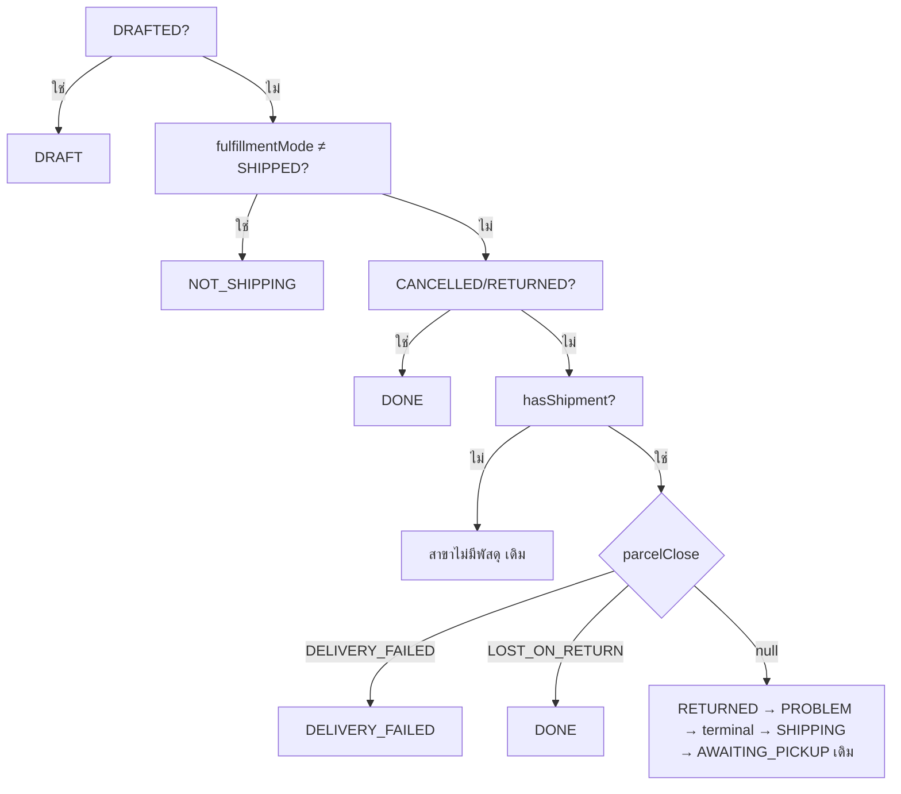

> **โมดูล:** 00085 · **ประเภท:** Software Design Specification · **เวอร์ชัน:** 1.0 · **วันที่:** 2026-10-26 · **เจ้าของ:** SA

# SDS: ปิดพัสดุมีปัญหาโดยร้าน

## 1. การตัดสินใจเชิงออกแบบ (TD)
| TD | ตัดสินใจ | เหตุผล |
|---|---|---|
| TD-1 | ผล A = key ใหม่ `DELIVERY_FAILED` · ผล B = `DONE` + ป้ายรอง | `!== 'DONE'` 5 ไซต์ถูกต้องอัตโนมัติสำหรับ B; A ใช้ predicate กลาง |
| TD-2 | แช่แข็ง `problemCloseExcludesRevenue` | regex COD เขียนใน Prisma `where` ไม่ได้ (F2) |
| TD-3 | route เป็นกลางผู้ให้บริการ: `/api/seller/shipments/[id]/problem-close` | การปิดเป็นข้อเท็จจริงบน `OrderShipment` ร่วม iShip/Flash; ไม่ต้องทำซ้ำใต้ `/iship` `/flash`; UI ใช้ `ishipUrl()` ต่อ `?shopId=` เหมือน `handleCancel` (`ShipmentStatusView.tsx:281`) |
| TD-4 | `describeProgress` รับ `parcelClose` เป็นอาร์กิวเมนต์ที่ 4 บังคับ | ผู้เรียก 6 จุดถูก tsc ไล่; แก้ข้อความผู้ซื้อ (F1) และฝั่งร้านพร้อมกัน |
| TD-5 | `holdsParcelProblem` / `buildProblemHoldSql` / `ShippingStageInput` / `OrderStageInput` รับค่าปิดแบบบังคับ | กันจอใดจอหนึ่งลืม → กองคนละกอง (บทเรียน 2026-09-14) |
| TD-6 | ค่าส่งไม่รวม codFee ผ่าน `dropCodFee` บังคับใน `resolveOutboundShippingCost` | แก้จุดเดียว ผู้เรียก 2 จุดถูกไล่ |

## 2. ลำดับสาขา `deriveShippingStage` (หลังแก้)

จุดแก้: `order-stage.ts` แทรกก่อนบรรทัด 283 (ก่อน `isReturnedCarrierStatus`) · ใน `deriveOrderStage` แทรกก่อนบรรทัด 639: `LOST/DELIVERY_FAILED` ⇒ ตัด `age>DELIVERED_VISIBLE_MS` ⇒ return null, key = `DELIVERY_FAILED` (A) หรือ `DELIVERED` (B) · `problemOrderCount>0` ยังชนะ (ใบที่ปิดไม่ถูกนับอยู่แล้วเพราะ SQL กรอง)
`statusAt` ของ `enrichWithOrderStage` เปลี่ยนเป็น `COALESCE(s."problemClosedAt", s."carrierStatusAt", o."updatedAt")` เพื่อให้ "3 วัน" นับจากเวลาปิด

## 3. ผู้เรียกที่ต้องแก้ (grep จริง) — SSOT ของแผนงาน

### 3.1 แกนกอง/ป้าย (`src/lib`)
| ไฟล์:บรรทัด | แก้ |
|---|---|
| `lib/iship/status.ts:713` | `holdsParcelProblem` +arg 3 |
| `lib/iship/status.ts:465-471, 516-585` | `describeProgress` +arg 4; ปิดแล้ว ⇒ `notice` เปลี่ยน (ผล A: `lastLabel`/`lastIcon` จาก `FORWARD_OUTCOME.failed`) ข้อความจาก `PARCEL_CLOSE_META` |
| `lib/order-stage.ts:36,62` | `OrderStageKey`+`ORDER_STAGE_META` +`DELIVERY_FAILED` |
| `:99,166,184,325,351,380` | key · DOT_INDEX · Input · ALL_STAGES · LABEL Exclude · BADGE_OVERRIDE |
| `:294,657` | เรียก `holdsParcelProblem` ใหม่ |
| `:502-562` | `OrderStageInput` +`parcelClose` (บังคับ) +`problemClosedAt` สำหรับ statusAt |
| ใหม่ใน `order-stage.ts` | `isActionableShippingStage(stage)` |
| `lib/order-stage-sql.ts:38-69,105-112,136-151` | ตาม SRS TFR-005 |
| `lib/chat-order-progress.ts:46-69,77,107` | input +parcelClose; ไซต์ `!== 'DONE'` → predicate; `STAGE_CHIP_CLS` Exclude |
| `lib/buyer-next-action.ts:107-135` | +`parcelClose` ในอาร์กิวเมนต์; `delivered` ใช้ predicate; ขั้น A ไม่ใช่ "ส่งถึงแล้ว" |
| `lib/line/order-status-reply.ts:13,30,43` | `OrderStatusCandidate` ได้ field ผ่าน `ShippingStageInput`; `!== 'DONE'` → predicate. ต้อง Explore: ข้อความตอบ LINE ของ A (ให้ UX) |
| `lib/order-shipment-view.ts:24-90` | +`parcelClose` ใน payload ผู้ซื้อ (เฉพาะ outcome) |
| `lib/iship/context.ts:84-170` | `ShipmentViewJson` +`problemClose: ParcelCloseViewJson\|null`; `ShipmentViewDates`/`toShipmentViewJson` |
| `lib/order-view-by-level.ts:31-34` | +`problemClosedAt`,`problemCloseOutcome` (F9) |
| `lib/order-event.ts` | TFR-012 |

### 3.2 ผู้ select/ประกอบ input (ต้องเพิ่ม `problemClosedAt`, `problemCloseOutcome`, `problemCloseExcludesRevenue` ตามที่ใช้)
| ไฟล์:บรรทัด | หมายเหตุ |
|---|---|
| `services/iship.service.ts:133,466,528` | type + `SHIPMENT_SELECT` ⇒ `ShipmentViewJson` |
| `services/order.service.ts:2110` (guest) · `2539` (list) · `2769,2818` (ข้อมูลการ์ด) · `2931,2949,2956` (`getShippingStageCounts`) | `2914-2960` ใช้ predicate แทน Exclude |
| `services/order-list.service.ts:69-102` | `STAGE_COLUMNS.problemCloseOutcome:'s."problemCloseOutcome"'` + LATERAL select |
| `services/order-stage.service.ts:72,124,135,157,167,198` | LATERAL `psh`/`sh` + `buildProblemHoldSql(...,'ps."problemClosedAt"')` + row type |
| `services/chat.service.ts:267,280` | LATERAL +`problemClosedAt` + arg 3 |
| `services/chat-thread-messages.service.ts:138,154,180` | select + input |
| `services/dashboard.service.ts:55-71,364,863` | `StageRow`/`toShippingStageInput`/select (money ส่วนอยู่ T6) |
| `services/order-return.service.ts:59,156,263` + `ReturnPanel.tsx:1138-1148` | forward shipment ของใบคืน |
| `services/line-rich-menu-reply.service.ts:94-108` | select + input |
| `app/(paces)/seller/(chat)/inbox/[conversationId]/page.tsx:643,707,739` | select + props |
| `app/(paces)/seller/(dashboard)/orders/page.tsx:255-264,389,410` | input + `describeProgress` props |
| `app/(paces)/seller/(dashboard)/orders/[token]/page.tsx:277,442,476-488` | input + panel |
| `app/(marketing)/o/[token]/guest-order-data.ts:86,216,339-347` | **เฉพาะ outcome** ห้ามส่ง note/by/refunded (PII) |
| `GuestOrderView.tsx:87-96` · `OrderDetailMobile.tsx:187,1167-1175` · `NextActionCard.tsx:46,127` · `NextActionShipment.tsx:27,45-62` | props ผ่านทาง |

### 3.3 ผู้เรียก `describeProgress` (TD-4) — 6 จุด
`ShipmentStatusView.tsx:189` · `(chat)/_components/ShipmentStepper.tsx:43` · `orders/[token]/components/ShippingCard.tsx:115` · `orders/components/MiniShipmentTimeline.tsx:151` · `orders/components/ShipmentHoverCard.tsx:167` · `(marketing)/o/[token]/ParcelTimeline.tsx:88`
ผู้เรียก `ShipmentStatusView` 3 จุด (ได้ปุ่มพร้อมกัน): `ShipmentPanel.tsx:93` · `ShipmentDraftPanel.tsx:652` · `flash/FlashPanel.tsx:99`
props ฝั่งแชท: `OrderCardView.tsx:50,115-122,254-261` · `CustomerPanel.tsx:131,402,569` · `useSellerChatThread.ts:123-132`

### 3.4 ผู้เรียกสูตรเงิน
| ไฟล์:บรรทัด | แก้ |
|---|---|
| `lib/order-revenue.ts:43-58` | `revenueOrderWhere` +`NOT` +สาขา OR "ปิดแล้ว ไม่คืนเงิน" |
| `:64-86,155-160` | `countsAsRevenue`/`...For` +field บังคับ |
| `:135-138,210-213` | derive จาก `revenueOrderWhere` (ไม่ต้องแก้เอง แต่เทสคุม) |
| `:229-239` | `countsAsSoldFor` +`shipments` — F6 |
| ใหม่ | `excludedFromRevenueByParcelClose` |
| `lib/shipping-cost.ts:30-45` | +`dropCodFee` |
| `lib/agent-performance-sql.ts:60-76` + `agent-performance.service.ts:246` | `AND NOT EXISTS(...)` + สาขา OR (F8) |
| `lib/line-report/detail-snapshot-rows.ts:35,48,87` | type ของ shipments +field |
| `services/pnl.service.ts:105-136,154,163` | `where` ได้ผลจาก `revenueWindowWhere`; `:129` ส่ง `dropCodFee:false` (ใบที่ถูกตัดออกก่อนถึงตรงนี้แล้ว); `SERVICE_ORDER_SELECT`/`ORDER_SELECT` shipments +field |
| `services/cost-coverage.service.ts:39` | ได้ผลอัตโนมัติ (เทสคุม) |
| `services/dashboard.service.ts:332,354-369,470-588,846-876` | ดู §4 |
| `services/customer-directory.service.ts:93,111` | select +field |
| `app/(paces)/seller/(dashboard)/dashboard/page.tsx:544-545` | `rawOrders` select +field |
| `app/(paces)/seller/(dashboard)/orders/[token]/page.tsx:340-346` | ผ่าน `getOrderForShop`; ป้าย `OrderProfitCard` ใบที่ปิด |
| `products/page.tsx:108` · `products/[id]/page.tsx:73,80` · `categories/page.tsx:89` | include shipments (F6) |
| `services/receivable.service.ts` | **ไม่แก้** (F5) |
| `services/product-sales-series.service.ts` · `lib/product-sales-month.ts` | ต้อง Explore (F10) |

## 4. `getSalesSeries` — คงแถว ศูนย์ยอด/ต้นทุน คงค่าส่ง
ที่ `dashboard.service.ts:470-590` หลังคำนวณ `adj`:
```
const excluded = excludedFromRevenueByParcelClose(r)        // ใหม่
const amt = excluded ? 0 : (noShow ? … : netOfReturns(…))   // :473
```
- แถวไม่ถูกตัดที่ `where` (`:332` ไม่แก้ — ซึ่งยังคงใบ CONFIRMED/SHIPPED ไว้ให้ผ่าน)
- `values/total/prevTotal/last14*` ใช้ `amt` ⇒ 0 · `orderCounts[idx]` ข้ามเมื่อ `excluded` · `items` ว่าง ⇒ `rowCogs=0` ไม่ตั้ง `hasMissingCost`
- ค่าส่ง (`:559-575`): `resolveOutboundShippingCost({…, dropCodFee: excluded})` ⇒ ยังบวก `shippingValues`
- `shippingConfirmedValues` (`:581`): เปลี่ยนเงื่อนไขเป็น `if (isRevenue || excluded)` สำหรับค่าส่ง เพื่อให้กำไรยืนยันแล้วของวันนั้นเป็น −30 (คำถามข้อ 3 ใน SRS §10)
- `deriveShippingStage(toShippingStageInput(r))` (`:586`) ได้ `parcelClose` จาก T4 ⇒ ใบ B-COD ไม่ตกกอง `AWAITING_COD`

## 5. UI
- **ปุ่มและกล่อง:** ใน `ShipmentStatusView.tsx:773-786` (กล่อง notice แดง) เมื่อ `canCloseParcelProblem(...).ok && canManageParcel` เพิ่มปุ่ม "ยืนยันปิดพัสดุ" (`btn` Paces, ไอคอน tabler `package-off`, ไม่มี emoji) ปุ่ม "ยกเลิกพัสดุ" ยังอยู่ใน ⋮ (`menuOpen` `:169`)
- **Modal:** ใช้ Swal ผ่าน `src/lib/paces-swal.ts` ตัวห่อของโปรเจกต์ — `pacesConfirmAsync` (`:116`, มี `showLoaderOnConfirm`+`preConfirm` ใช้เป็นสปินเนอร์ตอนยิง POST) เป็นฐาน และ HTML ภายในเลือกเหตุผล/ช่องโน้ต/คำถามคืนเงินแบบ `pacesConfirmWithReason` (`:197`) · ผลสำเร็จ/ล้มเหลวด้วย `pacesToast` (HR9) ห้าม `react-toastify`
- **ลำดับใน modal:** (1) GET preview แสดงผล+หลักฐาน+วันที่ถึง (2) ผล B ที่ไม่ใช่ COD ⇒ ปุ่มเลือกคืน/ไม่คืนเป็นบังคับ ปุ่มยืนยันกดไม่ได้จนตอบ (3) OTHER ⇒ ช่องข้อความ 5–200 (4) ไม่มี event เลย ⇒ หมายเหตุ "ประวัติขนส่งอาจไม่ครบ"
- **แถบหลังปิด:** แทนปุ่มด้วยแถบ "ปิดแล้ว · <ผล> · <เหตุผล> · <เวลา>" + ปุ่ม "เลิกปิด" (`pacesConfirm.question`) · แถบเตือนขัดกันตาม TFR-009
- **ผู้ซื้อ:** `ParcelTimeline` ได้ notice ใหม่จาก `describeProgress(...,'buyer')` ไม่มีข้อความแดงเดิม; คำให้ `safepay-ux` กำหนด
- ต้องผ่าน `safepay-ux` ก่อน (HR8) + `/impeccable critique` + `clarify` หลัง + ภาพ 3 จอ · Base: `ShipmentStatusView.tsx` (ใส่บรรทัด `Base:` ในคอมมิต — HR3)

## 6. Migration
ไฟล์ล่าสุดที่แก้ `OrderEvent_type_check` คือ `prisma/migrations/20261018100300_order_event_manual_dispatch_undone/migration.sql` (ใช้รูปแบบนี้; รายการ 33 ค่า)
1. `20261026100000_00085_parcel_problem_close_columns` — `ALTER TABLE "OrderShipment" ADD COLUMN …` ×8 (IF NOT EXISTS) + CHECK ใหม่ (ตารางไม่มีแถวที่ละเมิด จึง `NOT VALID` แล้ว `VALIDATE`):
   - `OrderShipment_problem_close_coherent`: `("problemClosedAt" IS NULL) = ("problemCloseOutcome" IS NULL)` ∧ `("problemClosedAt" IS NULL) = ("problemCloseExcludesRevenue" IS NULL)`
   - `…_outcome_check`: outcome ∈ {DELIVERY_FAILED, LOST_ON_RETURN} หรือ null
2. `20261026100100_00085_order_event_parcel_close_types` — คัดจากไฟล์ข้างบนเปลี่ยน guard เป็น `position('PARCEL_PROBLEM_CLOSED' IN def)=0` ต่อท้าย `'PARCEL_PROBLEM_CLOSED','PARCEL_PROBLEM_REOPENED'` · fallback list = 33 ค่าเดิม + 2 = 35 · คง `SET LOCAL lock_timeout='5s'` และการตรวจ `matched*2<>quote_count`
- ไม่ backfill · ไม่มี index เพิ่ม · `safepay-database` dispatch ก่อน · HR14: คำสั่ง apply/shadow ต้องปักหมุด `localhost` ในคำสั่ง · HR15: บอก user 3 ข้อก่อน push `main`

## 7. Error handling ข้ามไฟล์ (บังคับ enumerate) — ดู [[API]] §4
## 8. ลำดับ implement — ดู แผนงาน (ท้ายคำตอบ)
