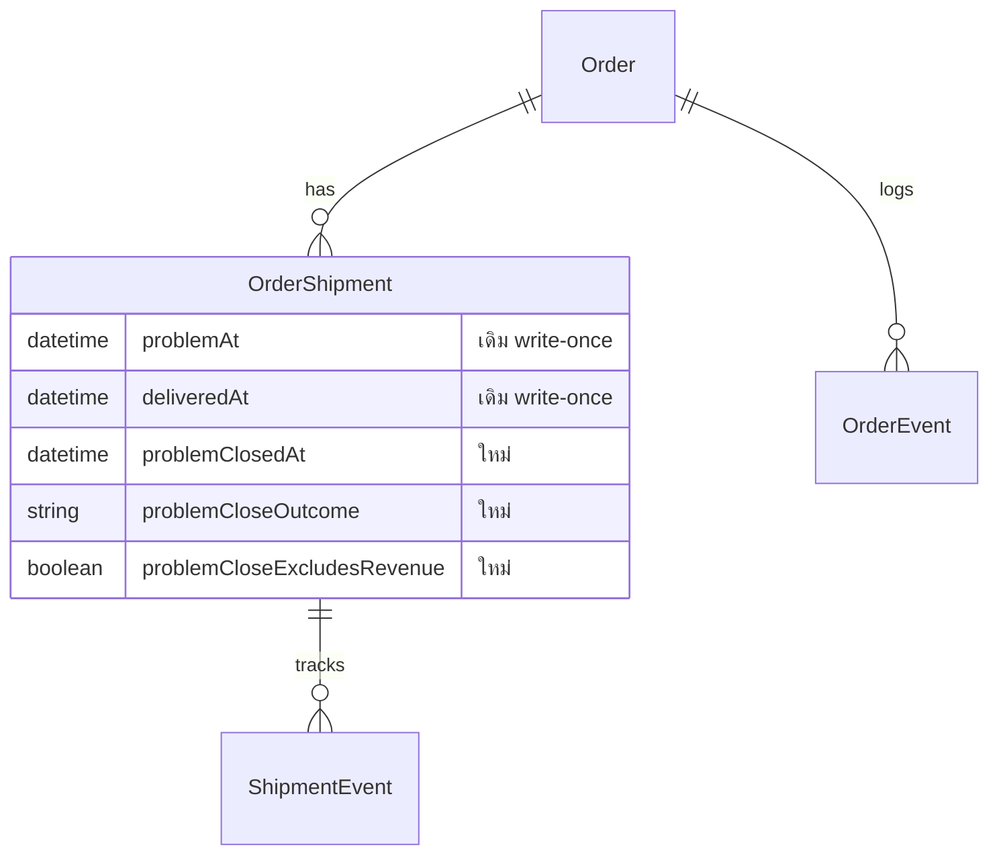

> **โมดูล:** 00085 - Seller Closes Problem Parcel
> **ประเภทเอกสาร:** SRS (TECHNICAL) · **เวอร์ชัน:** 1.0 · **วันที่:** 2026-10-26
> **สถานะ:** Draft — เขียนจาก PRD/BRD v0.2 (อนุมัติ 2026-10-26) + โค้ดปัจจุบัน ยังไม่ implement
> **เจ้าของเอกสาร:** SA

# SRS: ปิดพัสดุมีปัญหาโดยร้าน

## 1. บทนำ
### 1.1 วัตถุประสงค์
กำหนดข้อกำหนดเชิงเทคนิคของ "ยืนยันปิดพัสดุ" สำหรับพัสดุขาไปในกอง PROBLEM (iShip + Flash) ให้ DEV/QA

### 1.2 ขอบเขตเชิงระบบ
- **ในขอบเขต:** คอลัมน์ใหม่บน `OrderShipment` · OrderEvent 2 ชนิด · SSOT ใหม่ `src/lib/parcel-close.ts` · `deriveShippingStage`/`deriveOrderStage`/สูตร SQL · ผู้เรียกทุกจุด · สูตรยอดขาย/ค่าส่ง · route/service ปิด-เลิกปิด · UI `ShipmentStatusView` · หน้าผู้ซื้อ
- **นอกขอบเขต:** ใบส่งเอง (`ShipmentTracking`) · พัสดุขากลับ 00056 · เงินเคลมขนส่ง · ร้านบริการ · Trust Score · P&L ค่าส่งขาไปของร้านขายของ (Q5)

### 1.3 อ้างอิง
| เอกสาร | ความสัมพันธ์ |
|---|---|
| [[PRD]] · [[BRD]] | FR-PC-01..12 · BR-PC-01..41 · มติ Q1–Q5 |
| `docs/SRS.md` | §6 data model · §7 API · §8 enum · §9 สิทธิ์ (ต้อง sync — HR11) |
| 00080 SRS | แบบอย่าง "คำนวณ ไม่ใช่ค่า Order.status" และ conditional update |

### 1.4 นิยาม
| คำ | ความหมาย |
|---|---|
| **ปิดแล้ว** | `OrderShipment.problemClosedAt IS NOT NULL` บนพัสดุขาไป active |
| **outcome** | `DELIVERY_FAILED` (ผล A) · `LOST_ON_RETURN` (ผล B) |
| **basis** | `DELIVERED_AT` · `EVENT` · `ORDER_CONFIRMED` · `NONE` |
| **ไม่นับยอดขาย** | `problemCloseExcludesRevenue = true` (แช่แข็งตอนปิด) |

## 2. สถาปัตยกรรม
```mermaid
flowchart LR
  UI[ShipmentStatusView<br/>3 ผู้เรียก] -->|GET/POST/DELETE| R[/api/seller/shipments/id/problem-close/]
  R --> G[requireGeneralShop cap S1]
  R --> S[parcel-close.service]
  S --> P[parcel-close.ts pure SSOT]
  S --> DB[(OrderShipment + OrderEvent)]
  DB --> ST[order-stage.ts + order-stage-sql.ts]
  DB --> RV[order-revenue.ts + shipping-cost.ts]
  ST --> V[/orders · แชท · Command Center · /o/token]
  RV --> M[/sales · P&L · แดชบอร์ด · agent perf]
```

### 2.1 ชื่อ key กองและเหตุผลการเลือก
| ผล | ShippingStageKey | OrderStageKey | ป้าย |
|---|---|---|---|
| A | **`DELIVERY_FAILED`** (ใหม่) | `DELIVERY_FAILED` (ใหม่ คงแสดง 3 วัน แล้วหาย — A5) | `STAGE_BADGE_OVERRIDE.DELIVERY_FAILED` "ส่งไม่สำเร็จ" · ห้ามอยู่ใน `SHIPPING_STAGE_LABEL` |
| B | **`DONE`** (ของเดิม) | `DELIVERED` (ของเดิม) | ป้ายรอง "ส่งสำเร็จ · คืนไม่สำเร็จ" จาก `PARCEL_CLOSE_META` |

**เหตุผล:** ไซต์เดิมที่เช็ค `!== 'DONE'` เพื่อแปลว่า "งานค้าง" มี 5 จุด (`chat-order-progress.ts:69,107` · `line/order-status-reply.ts:30,43` · `buyer-next-action.ts:135` · `order.service.ts:2914,2936,2960`). ผล B ต้องจบงานเหมือน DONE จึงใช้ DONE ได้เลยโดยไม่ต้องแก้ไซต์ไหน ส่วนผล A มี key ใหม่ตามที่ BRD FR-PC-05 กำหนด ⇒ เพิ่ม predicate กลาง `isActionableShippingStage(stage)` ใน `order-stage.ts` แล้วให้ 5 ไซต์ข้างต้นเรียกตัวเดียว (HR16)

## 3. ข้อกำหนดเชิงเทคนิค

### TFR-001 ปุ่มปิด — เงื่อนไขแสดงอยู่ที่ฟังก์ชันกลาง (BRD FR-PC-01)
- ใหม่ `canCloseParcelProblem(f)` ใน `src/lib/parcel-close.ts` (pure) รับ `{shipment:{status,isDryRun,direction,carrierStatus,problemAt,problemClosedAt}, order:{status,fulfillmentMode,vertical}}` คืน `{ok:true}` หรือ `{ok:false, code}`
- `ok` เมื่อ: `status='CREATED'` ∧ `!isDryRun` ∧ `direction='FORWARD'` ∧ `problemClosedAt==null` ∧ `holdsParcelProblem(carrierStatus, problemAt, false)` ∧ order.status ∉ {CANCELLED,RETURNED,DRAFTED} ∧ `fulfillmentMode==='SHIPPED'` ∧ `!usesServiceFinanceRules(vertical)`
- `code`: `NOT_FORWARD` · `NOT_ACTIVE` · `ALREADY_CLOSED` · `NOT_IN_PROBLEM` · `ORDER_FINISHED` · `NOT_SHIPPED_MODE` · `SERVICE_SHOP_UNSUPPORTED`
- UI อ่านจากตัวนี้ตัวเดียว (+ prop `canManageParcel` จาก S1) · service เรียกซ้ำอีกครั้งตอนเขียน
- **เทสแดงเมื่อ:** ลดเงื่อนไขเหลือ `carrierStatus==='issue'` ⇒ ใบ `progress`+`problemAt` ต้องยังปิดได้

### TFR-002 ตัดสินช่วงที่หาย (FR-PC-03)
- `decideLossPhase({deliveredAt, hasDeliveredEvent, orderStatus}) → {outcome, basis}` pure ลำดับหลักฐาน: `deliveredAt!=null`→`LOST_ON_RETURN/DELIVERED_AT` · `hasDeliveredEvent`→`.../EVENT` · `orderStatus==='CONFIRMED'`→`.../ORDER_CONFIRMED` · ไม่มี→`DELIVERY_FAILED/NONE`
- `hasDeliveredEvent` = มี `ShipmentEvent.status ∈ DELIVERED_CARRIER_STATUSES` (`iship/status.ts:101`) ของ `shipmentId` นั้น. query เฉพาะตอน GET preview/POST (ห้ามอยู่ใน hot path `/orders`/แชท)
- server คำนวณซ้ำตอน POST ทุกครั้ง client ส่งได้แค่ `expectedOutcome` เป็นโทเค็นกัน race: ไม่ตรง ⇒ 409 `OUTCOME_CHANGED` พร้อม preview ใหม่ (ไม่ใช้ค่านั้นตัดสินเงิน)

### TFR-003 บันทึกการปิด (FR-PC-04)
- `closeParcelProblem({shopId,userId,shipmentId,reason,note,refunded,expectedOutcome})` ใน `src/services/parcel-close.service.ts`
- ลำดับ: (1) อ่านพัสดุ+ออเดอร์ **จากแถว** แล้วเทียบ `shipment.shopId===guard.shopId` ไม่ตรง ⇒ `NOT_FOUND` (2) `canCloseParcelProblem` (3) `decideLossPhase` (4) `needsRefundAnswer = outcome==='LOST_ON_RETURN' && !isCODPayment(order.paymentMethod)` ⇒ ไม่มี `refunded` ⇒ 400 `REFUND_ANSWER_REQUIRED` ; ถ้าไม่ต้องตอบ แต่ client ส่งมา ⇒ **ทิ้ง** เก็บ null (5) `excludes = parcelCloseExcludesRevenue(outcome, isCod, refunded)` (6) `$transaction`: `updateMany({where:{id, status:'CREATED', isDryRun:false, direction:'FORWARD', problemClosedAt:null, carrierStatus: <ค่าที่อ่านมา>, problemAt: <ค่าที่อ่านมา>}, data:{…8 คอลัมน์}})` แล้ว `recordOrderEvent(tx,{type:'PARCEL_PROBLEM_CLOSED',…})` (7) count=0 ⇒ อ่านใหม่แล้วจัดประเภท `ALREADY_CLOSED`/`NOT_IN_PROBLEM`
- `parcelCloseExcludesRevenue = outcome==='DELIVERY_FAILED' || isCod || refunded===true`
- ห้ามแตะ `Order.status`, `cancelInitiator`, Trust Score, `OrderReturn`
- **เทสแดงเมื่อ:** หลังปิด `Order.status` ≠ เดิม · ปิดซ้ำพร้อมกัน 2 คำขอไม่ได้ผู้ชนะ 1 / 409 หนึ่ง

### TFR-004 กองและป้าย (FR-PC-05)
- `ShippingStageKey` += `DELIVERY_FAILED` · เพิ่มใน `ALL_SHIPPING_STAGES` (`order-stage.ts:325`) · `SHIPMENT_STAGE_DOT_INDEX.DELIVERY_FAILED = 2` (ห้าม 4 = แถบเขียวครบ) · `STAGE_BADGE_OVERRIDE.DELIVERY_FAILED` · `Exclude<…>` ของ `SHIPPING_STAGE_LABEL` เพิ่ม `'DELIVERY_FAILED'`
- `ShippingStageInput` += `parcelClose: ParcelCloseOutcome | null` **บังคับ** (บรรทัด 184-221)
- `deriveShippingStage` ในบล็อก `if (o.hasShipment)` (เริ่ม 268) วางเป็นสาขาแรก **เหนือ** `isReturnedCarrierStatus` (283):
  `parcelClose==='DELIVERY_FAILED'→'DELIVERY_FAILED'` · `parcelClose==='LOST_ON_RETURN'→'DONE'`
  (ใต้ DRAFTED / `fulfillmentMode` / CANCELLED|RETURNED ที่คืน DONE อยู่แล้ว)
- `holdsParcelProblem(code, problemAt, parcelClosed: boolean)` **พารามิเตอร์ที่ 3 บังคับ** (`iship/status.ts:713`): `if (parcelClosed) return false` เป็นบรรทัดแรก

### TFR-005 ฉบับ SQL (FR-PC-05/06)
- `buildProblemHoldSql(carrierStatus, problemAt, problemClosedAt)` (`order-stage-sql.ts:105`) ขึ้นต้น `(${problemClosedAt} IS NULL AND (…เดิม…))`
- `StageSqlColumns` += `problemCloseOutcome: string` · ใน `CASE hasShipment` เพิ่ม 2 WHEN ก่อน RETURNED (บรรทัด 138): `outcome='DELIVERY_FAILED'→'DELIVERY_FAILED'` · `outcome='LOST_ON_RETURN'→'DONE'` (ค่า literal มาจากค่าคงที่ใน `parcel-close.ts` ผ่าน `lit()` ห้ามพิมพ์เอง)
- CHECK ในฐานบังคับ `problemClosedAt` null ⇔ `problemCloseOutcome` null จึงใช้ outcome เป็นตัวแทนได้

### TFR-006 ทุกจอตอบตรงกัน (FR-PC-06) — รายชื่อผู้เรียกเต็ม ดู SDS §3

### TFR-007 การเงิน (FR-PC-07/08)
- `revenueOrderWhere` เติม `NOT:{shipments:{some:{...ACTIVE_FORWARD_SHIPMENT, problemCloseExcludesRevenue:true}}}` (`order-revenue.ts:43`) ⇒ `revenueWindowWhere` · `soldItemsWindowWhere` · P&L · cost-coverage ได้ผลตาม
- `countsAsRevenue` (`:64`) ต้อง false เมื่อ `excludedFromRevenueByParcelClose(order)` แม้ `status==='CONFIRMED'`. ฟิลด์ `shipments[].problemCloseExcludesRevenue` เป็น **required** (tsc ไล่ผู้เรียก)
- `excludedFromRevenueByParcelClose(order)` = `shipments.some(s => s.status==='CREATED' && !s.isDryRun && s.direction==='FORWARD' && s.problemCloseExcludesRevenue===true)`
- ผล B + โอนเงิน + ไม่คืนเงิน ⇒ `excludes=false` ⇒ นับยอดขายแม้ `carrierStatus='issue'` (ไม่อยู่ใน `REVENUE_CARRIER_STATUSES` `order-revenue.ts:26`) ⇒ **`countsAsRevenue` และ `revenueOrderWhere` ต้องมีสาขา OR ใหม่:** `shipments.some({ACTIVE_FORWARD, problemCloseExcludesRevenue:false})` เพื่อให้ใบ SHIPPED ที่ปิดแบบไม่คืนเงินยังนับ (ใบ CONFIRMED นับอยู่แล้ว)
- `resolveOutboundShippingCost` รับ `dropCodFee: boolean` **บังคับ** ⇒ `amount = price (+manual)` ไม่บวก codFee (`shipping-cost.ts:36,40,43`)
- ตัวอย่างบังคับ: COD 360 · ค่าส่ง 30 · codFee 7.70 · ผล A ⇒ ยอด 0 · ต้นทุนสินค้า 0 · ค่าส่ง **30** ⇒ ออเดอร์ **−30**
- ใบ "ไม่นับ" ไม่เป็นต้นทุนสินค้าสูญหายและไม่รวมเงินเคลม (Q3)

### TFR-008 สถานะขนส่งหลังปิด (FR-PC-09)
- ตัวเขียน carrier ทุกตัว (`iship.service.ts` update/updateMany ที่ 1101–2460 · `flash-status.service.ts:146-213` · `flash-shipment.service.ts` · `flash-ops.service.ts`) เขียนเฉพาะคอลัมน์ carrier/วันที่ write-once ⇒ **ไม่แตะคอลัมน์ปิด** (ยืนยันจากรายการ call-site; ต้องมีเทส source-grep กันตัวเขียนใดใส่ key `problemClose*`)
- ปิดแล้วกองไม่ขยับเพราะสาขา "ปิดแล้ว" อยู่เหนือทุกสาขาพัสดุ

### TFR-009 แถบเตือนเมื่อสถานะขัดกับการปิด (เสนอใหม่ — แก้ F4)
`hasParcelCloseConflict({outcome, carrierStatus, carrierStatusAt, closedAt})` pure: `carrierStatusAt <= closedAt` ⇒ false (ยังไม่มีข้อมูลใหม่)
- A: ขัดเมื่อสถานะใหม่ ∈ `DELIVERED_CARRIER_STATUSES ∪ RETURNED_CARRIER_STATUSES ∪ IN_TRANSIT_CARRIER_STATUSES`
- B: ขัดเมื่อสถานะใหม่ = `return_success` (ของถึงร้านทั้งที่ปิดว่าหาย) · `issue` ไม่ขัด
- แสดงแถบ + ปุ่ม "เลิกปิด" ระบบไม่พลิกเงินหรือกองเอง · **รอ user รับรองกฎนี้**

### TFR-010 สิทธิ์ (FR-PC-10)
- route ทั้ง 3 เมธอดใช้ `requireGeneralShop({cap:'S1', shopId: readIShipShopIdFromQuery(request)})` แล้ว service ตรวจ `shipment.shopId === guard.shopId` (resolve จากแถว — `permission-gate-follows-the-row`)
- ประกาศใน `route-capabilities.ts` (ใกล้บรรทัด 419): `'src/app/api/seller/shipments/[id]/problem-close/route.ts': { GET:'S1', POST:'S1', DELETE:'S1', status:'DECLARED' }`
- UI prop `canManageParcel?: boolean` ค่าตั้งต้น **false** (ปิดไว้ก่อน) ผู้เรียกส่งค่าจาก `can(effRoles,'S1')` ฝั่ง server

### TFR-011 เลิกปิด (FR-PC-11)
`reopenParcelProblem(...)`: `updateMany({where:{id, problemClosedAt:{not:null}, status:'CREATED', direction:'FORWARD'}, data:{ทุกคอลัมน์ปิด=null}})` + event `PARCEL_PROBLEM_REOPENED` ใน tx เดียว · order CANCELLED/RETURNED ⇒ 409 `ORDER_FINISHED` · ไม่ได้ปิดอยู่ ⇒ 409 `NOT_CLOSED` · ยอดคำนวณสดทันที (ไม่มี cache)

### TFR-012 ประวัติ (FR-PC-12)
`ORDER_EVENT_TYPES` += `PARCEL_PROBLEM_CLOSED`, `PARCEL_PROBLEM_REOPENED` · `ORDER_EVENT_META` (neutral ทั้งคู่ — เขียวสงวน BUYER_CONFIRMED; ไอคอน tabler `package-off` / `arrow-back-up`) · `OrderEventMeta` += `closeReason?`, `closeNote?`, `basis?`, `refunded?` (ใช้ `outcome` ที่มีอยู่) · `describeOrderEvent` เติมบรรทัดรอง · **`closeNote` ห้ามไปฝั่งผู้ซื้อ**

## 4. API — ดู [[API]]

## 5. ข้อมูล
### 5.1 คอลัมน์ใหม่ `OrderShipment` (ทุกตัว nullable — additive)
| คอลัมน์ | ชนิด | ความหมาย |
|---|---|---|
| `problemClosedAt` | `DateTime?` | เวลาปิด (ตัวบอกว่าปิดแล้ว) |
| `problemClosedByUserId` | `String?` | ผู้ปิด (ไม่ทำ FK — ตามแบบ `doneByUserId`) |
| `problemCloseReason` | `String? @db.VarChar(16)` | FIRE/LOST/DAMAGED/OTHER |
| `problemCloseNote` | `String? @db.VarChar(200)` | เฉพาะ OTHER (5–200) |
| `problemCloseOutcome` | `String? @db.VarChar(24)` | DELIVERY_FAILED / LOST_ON_RETURN |
| `problemCloseBasis` | `String? @db.VarChar(24)` | DELIVERED_AT/EVENT/ORDER_CONFIRMED/NONE |
| `problemCloseRefunded` | `Boolean?` | null = ไม่ได้ถาม |
| `problemCloseExcludesRevenue` | `Boolean?` | ผลตัดสินแช่แข็ง (F2) |



### 5.2 Migration (HR14/HR15 — ดู SDS §6)
2 ไฟล์ additive ไม่มี backfill (ใบเก่า = null = ไม่ปิด) · push `main` = deploy migrate บน prod ในตัว ต้องบอก user 3 ข้อก่อน (HR15)

## 6. NFR
| ด้าน | ข้อกำหนด |
|---|---|
| Performance | ไม่ join `ShipmentEvent` ใน `/orders`/แชท/แดชบอร์ด; เพิ่มคอลัมน์เข้า LATERAL/select เดิมเท่านั้น (ไม่เพิ่ม query) |
| Consistency | ฉบับ TS กับ SQL ผูกด้วยเทส parity; นิยาม "ปิดแล้ว/ไม่นับ" มีที่เดียว |
| Security | ตรวจ S1 ที่ server ตามแถว; `closeNote`/`closedByUserId`/`refunded` ไม่ออกฝั่ง guest |
| Observability | ทุกปิด/เลิกปิดมี OrderEvent พร้อมผู้ทำ |

## 7. ข้อจำกัดและสมมติฐาน
- ห้ามเปลี่ยน `Order.status` (BR-ISHIP-41) · `SHIPPING_STAGE_LABEL` ห้ามมีกองใหม่ · query พัสดุต้องใช้ `ACTIVE_FORWARD_SHIPMENT`
- แช่แข็ง `problemCloseExcludesRevenue` ตอนปิด: ถ้าร้านแก้ `paymentMethod` ภายหลัง ค่าไม่ตาม (เหมือน `PAYMENT_METHOD_SYNCED`) — ทางแก้คือเลิกปิดแล้วปิดใหม่
- ล้างคอลัมน์ปิดตอนพัสดุ → CANCELLED ไม่ทำ: ทุก query กรอง ACTIVE อยู่แล้ว

## 8. ความเสี่ยง
| ความเสี่ยง | แนวทางลด |
|---|---|
| ตัวนับ/รายการไม่ตรง | arg บังคับให้ tsc ไล่ + เทส parity (TestCase T-PAR) |
| `countsAsSoldFor` ผู้เรียก any-typed | แก้ query + เทสแดงคุม (F6) |
| ผู้ซื้อเห็นข้อความเดิม | `describeProgress` พารามิเตอร์บังคับ 6 จุด |
| ตัวเขียน carrier ในอนาคตทับคอลัมน์ปิด | เทส source-grep |

## 9. Traceability
| BRD | TFR | Component |
|---|---|---|
| FR-PC-01 | 001, 010 | parcel-close.ts · ShipmentStatusView |
| FR-PC-02 | 002, 003 | API preview + modal |
| FR-PC-03 | 002 | decideLossPhase |
| FR-PC-04 | 003 | parcel-close.service |
| FR-PC-05 | 004, 005 | order-stage.ts · order-stage-sql.ts |
| FR-PC-06 | 004–006 | ผู้เรียกทั้งหมด |
| FR-PC-07/08 | 007 | order-revenue.ts · shipping-cost.ts · dashboard.service |
| FR-PC-09 | 008, 009 | ตัวเขียน carrier · แถบเตือน |
| FR-PC-10 | 010 | route-capabilities |
| FR-PC-11 | 011 | reopen |
| FR-PC-12 | 012 | order-event.ts |

## 10. คำถามที่ต้องให้ user ตัดสิน
1. กฎ "สถานะขัดการปิด" (TFR-009) ตามข้อเสนอหรือไม่
2. ใบผล A ที่ `Order.status=CONFIRMED`: คงป้ายสถานะเดิม (F7) หรือให้ปิดชนะ
3. ค่าส่งของใบ "ไม่นับ" ลง `shippingConfirmedValues` ด้วย (ให้กำไรยืนยันแล้วเป็น −30) — เสนอใช่
4. ชิปแถวแชทผล B ใช้ "จัดส่งสำเร็จ" ร่วมกับ DELIVERED หรือแยกป้าย

### 10.1 มติ Controller (2026-10-26 — user สั่ง "ลุย" ข้าม micro-approval; ทั้ง 4 ข้อไม่เปลี่ยนนิยามเงินที่ user ตัดสินแล้ว)
1. TFR-009 ใช้ตามข้อเสนอ (เป็นแค่แถบเตือน ไม่เปลี่ยนเงิน/กอง)
2. ใบผล A ที่ `Order.status=CONFIRMED`: ป้ายสถานะออเดอร์คงเดิม (F7) — ป้ายกองพัสดุ/แผงพัสดุ/ชิปแถวแชทเป็นคนบอก "ส่งไม่สำเร็จ" และ `OrderProfitCard` บอกว่าไม่นับยอดขาย
3. ใช่ — ค่าส่งของใบ "ไม่นับ" ลง `shippingConfirmedValues` (กำไรยืนยันแล้ว −30 ตรงตัวอย่าง user)
4. ชิปแถวแชทผล B ใช้ "จัดส่งสำเร็จ" ร่วมกับ DELIVERED · แผงพัสดุแสดงป้ายรอง "ส่งสำเร็จ · คืนไม่สำเร็จ"
5. F10 (`product-sales-series.service.ts`, `lib/product-sales-month.ts`) — developer T6 ต้อง Explore และทำให้ใบ "ไม่นับ" ไม่เป็นของขายออก ถ้าเกณฑ์ไฟล์นั้นตั้งใจต่าง ให้รายงานก่อนแก้
