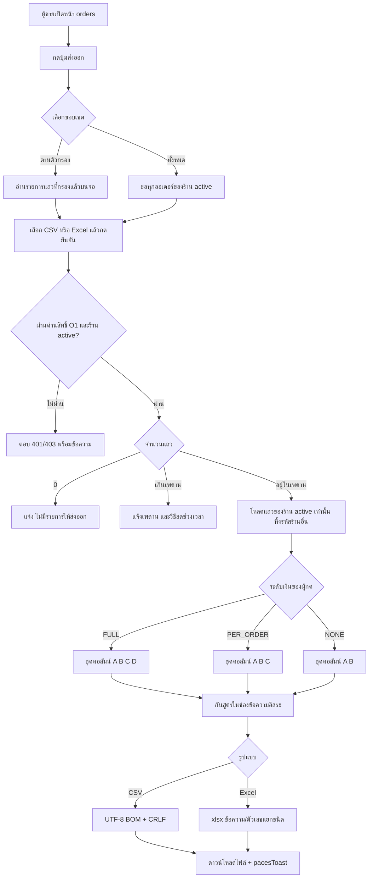
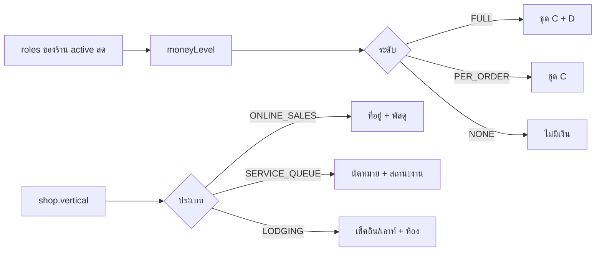

> **โมดูล:** 00086 - Seller Order Export (ส่งออกรายการคำสั่งซื้อเป็น CSV / Excel จากหน้า /orders)
> **ประเภทเอกสาร:** Business Requirements Document (BRD) - NON-TECHNICAL
> **เวอร์ชัน:** 0.1
> **วันที่จัดทำ:** 2026-10-29
> **สถานะ:** Approved 2026-10-29 — ดู "มติรอบ 2" ท้ายเอกสาร (แทนที่ข้อที่ขัด)
> **เจ้าของเอกสาร:** BA (ดู [[Feature-Docs-Ownership]])

# BRD: ส่งออกรายการคำสั่งซื้อของผู้ขาย (Seller Order Export) (Business Requirements Document)

> AC ที่มี `[บังคับ: … | เทสแดงเมื่อ: …]` ชี้จุดบังคับที่ตั้งเป้าไว้ (คอนเวนชัน rule-must-be-enforced-not-described) — SRS/SDS ต้องยืนยันชื่อไฟล์จริงตอนออกแบบ

---

## 1. บทนำ

### 1.1 วัตถุประสงค์ของเอกสาร

1. อธิบายความต้องการหลักของการส่งออกคำสั่งซื้อจากหน้า `/orders` เป็น CSV/Excel ใน 2 โหมด (ตามตัวกรอง / ทั้งหมด)
2. กำหนดคอลัมน์ในไฟล์ แยกชุดที่ทุกคนเห็นกับชุดเฉพาะเจ้าของ
3. กำหนดเงื่อนไขสิทธิ์ ความปลอดภัยของไฟล์ ขอบเขตร้าน และการรับมือข้อมูลจำนวนมาก พร้อมเกณฑ์ที่ทดสอบได้
4. สร้างความเข้าใจร่วมกันระหว่างทีมธุรกิจและทีมพัฒนา ก่อนทำ SRS

### 1.2 ขอบเขตของระบบ

**ส่งออกคำสั่งซื้อ (Seller Order Export)** คือความสามารถบนหน้า `/orders` ฝั่งผู้ขายที่สร้างไฟล์ตาราง (1 ออเดอร์ = 1 แถว) ของร้านที่กำลังใช้งาน ตามขอบเขตที่ผู้ใช้เลือก

**เข้าสู่ระบบ (Input):**
- ขอบเขต: ตามตัวกรอง (ชุดแถวที่เห็นบนจอ) หรือ ทั้งหมด
- รูปแบบ: CSV หรือ Excel (.xlsx)
- ตัวตนผู้ใช้ ร้านที่ใช้งานอยู่ และบทบาท (มาจาก session ไม่ใช่จากฝั่งผู้ใช้)

**ออกจากระบบ (Output):**
- ไฟล์ดาวน์โหลด 1 ไฟล์
- ข้อความแจ้งผล (สำเร็จ / ไม่มีแถว / เกินเพดาน / ผิดพลาด)

**ระบบที่เกี่ยวข้อง:**
- หน้า orders (ตัวกรอง ค้นหา ตาราง/การ์ด) · สิทธิ์ร้าน (00071) · การแสดงข้อมูลลูกค้าฝั่งผู้ขาย (00058) · ตัวคำนวณกำไร/ยอดรับ · export สต็อก (ท่าเดียวกัน)

### 1.3 กลุ่มผู้ใช้งาน

| กลุ่มผู้ใช้ | บทบาท | สิทธิ์การใช้งาน |
|-----------|--------|----------------|
| **เจ้าของร้าน** | OWNER | ส่งออกได้ทั้ง 2 โหมด · ไฟล์มีคอลัมน์การเงินเต็ม (ต้นทุน กำไร) |
| **ผู้จัดการ / แอดมินแชท / ฝ่ายบิล** | MANAGER, CHAT, BILLING | ส่งออกได้ทั้ง 2 โหมด · ไฟล์มียอดรายใบ ไม่มีต้นทุน/กำไร |
| **ช่างเทคนิค** | TECHNICIAN | ส่งออกได้ทั้ง 2 โหมด · ไฟล์ไม่มีตัวเลขเงินเลย |
| **ผู้ใช้ที่ไม่มีสิทธิ์เห็นหน้า orders** | — | ไม่เห็นปุ่ม และเรียกจุดส่งออกตรงไม่ได้ |

> บทบาทหนึ่งคนถือได้หลายบทบาท ระดับเงินคือสูงสุดของทุกบทบาท (BR-RP-03 ของ 00071 — `moneyLevel`)

---

## 2. ความต้องการหลัก (Functional Requirements)

### 2.1 การเริ่มส่งออกและขอบเขตของชุดข้อมูล

#### FR-EXP-01: ปุ่มส่งออกบนหน้า orders พร้อมเลือกขอบเขตและรูปแบบ

**User Story:**
> ในฐานะผู้ขาย ฉันต้องการปุ่มส่งออกบนหน้า orders ที่ให้เลือกขอบเขตและรูปแบบไฟล์ เพื่อเอาข้อมูลไปใช้ต่อได้โดยไม่ต้องคัดลอกทีละใบ

**Acceptance Criteria:**
- [ ] มีปุ่ม "ส่งออก" บนหน้า orders ทั้งมุมมองตารางและมุมมองการ์ด (มือถือ) ซึ่งใช้ชุดตัวกรองเดียวกัน [บังคับ: คอมโพเนนต์ปุ่มเดียวที่ถูกเรียกจากทั้งสองมุมมอง | เทสแดงเมื่อ: ถอดปุ่มออกจากมุมมองใดมุมมองหนึ่ง]
- [ ] ผู้ใช้เลือกได้ 2 อย่าง: ขอบเขต (ตามตัวกรอง / ทั้งหมด) และรูปแบบ (CSV / Excel) ก่อนเริ่มดาวน์โหลด
- [ ] ตัวเลือกขอบเขตแต่ละอันแสดงจำนวนใบที่จะออก (ตามตัวกรอง = จำนวนที่เห็นบนจอทุกหน้า · ทั้งหมด = จำนวนทั้งร้าน)
- [ ] ไม่มีตัวกรองใดใช้อยู่ → ตัวเลือก "ตามตัวกรอง" ไม่แสดงหรือปิดใช้ พร้อมเหตุผลสั้น ๆ เพื่อไม่ให้เข้าใจว่าต่างจาก "ทั้งหมด"
- [ ] ผู้ใช้ที่ไม่มีสิทธิ์ O1 ไม่เห็นปุ่ม และเรียกจุดส่งออกตรงต้องได้ 403 [บังคับ: ด่านสิทธิ์ของ route ใหม่ + ประกาศใน `route-capabilities.ts` | เทสแดงเมื่อ: route ไม่ประกาศ capability หรือไม่เรียก gate]
- [ ] ระหว่างสร้างไฟล์ ปุ่มกดซ้ำไม่ได้ และมีสถานะกำลังสร้าง เสร็จแล้วแจ้งผ่าน `pacesToast` (ไม่ใช้ toast อื่นใน `(paces)/**`)

**Business Flow:**
1. ผู้ขายเปิดหน้า orders ตั้งตัวกรองตามต้องการ (หรือไม่ตั้ง)
2. กด "ส่งออก" เลือกขอบเขต เลือกรูปแบบ กดยืนยัน
3. ระบบสร้างไฟล์ ดาวน์โหลดเริ่มเอง

#### FR-EXP-02: โหมด "ตามตัวกรอง" ได้ชุดแถวเดียวกับจอ

**User Story:**
> ในฐานะผู้ขาย ฉันต้องการให้ไฟล์ตามตัวกรองมีออเดอร์ชุดเดียวกับที่ฉันเห็นบนจอ เพื่อส่งตัวเลขที่ตรงกับที่ดูอยู่

**Acceptance Criteria:**
- [ ] ชุดแถวครอบคลุมตัวกรองทุกแกนที่หน้า orders มีจริง (ดูตาราง §2.1.1) และคำค้น ทั้งแบบที่อยู่ใน URL และแบบที่เป็นสถานะบนจอ
- [ ] ออกครบทุกหน้า ไม่ใช่เฉพาะหน้าที่แสดงอยู่ (หน้ารายการแบ่งหน้าฝั่งจอ)
- [ ] ลำดับแถวในไฟล์ = ลำดับที่เห็นบนจอ
- [ ] จำนวนแถวในไฟล์ = ตัวเลขที่แสดงบนตัวเลือกก่อนกด
- [ ] ตัวกรองเปลี่ยนระหว่างเปิดเมนูส่งออกกับกดยืนยัน → ใช้ชุดตัวกรอง ณ ตอนกดยืนยัน และตัวเลขต้องอัปเดต
- [ ] ชุดแถวต้องไม่ได้มาจากเกณฑ์ที่เขียนขึ้นใหม่ที่เซิร์ฟเวอร์ซึ่งเป็นสำเนาของตัวกรองบนจอ — ใช้ผลลัพธ์ของตัวกรองบนจอจริง [บังคับ: ปุ่มอ่านรายการแถวที่กรองแล้วจากตัวกรองชุดเดียวกับที่ render จอ | เทสแดงเมื่อ: เพิ่ม/เปลี่ยนตัวกรองแกนหนึ่งแล้วไฟล์ไม่ตรงจอ — เทสเทียบ `publicToken` จอ vs ไฟล์ ต่อแกน]

##### 2.1.1 ตัวกรองที่หน้า orders มีจริง (ยืนยันจากโค้ด)

| แกน | ที่มา | ใช้กับร้าน |
|-----|-------|-----------|
| สถานะการขาย (`all`, PENDING, SHIPPED, CONFIRMED, CANCELLED ฯลฯ) | สถานะบนจอ + `?status=` เริ่มต้น | ทุกประเภท (ชื่อป้ายผันตามประเภทกิจการ) |
| ประเภทออเดอร์ (`orderType`) | สถานะบนจอ | ทุกประเภท |
| ช่วงเวลา: ทั้งหมด / วันนี้ / 7 วัน / 30 วัน / ปีนี้ / วันเจาะจง | `lib/order-date-filter.ts` (`matchesOrderDateFilter`) ตัดวันตามปฏิทินไทย | ทุกประเภท |
| คำค้น (ชื่อ เบอร์ เลขออเดอร์ สินค้า ฯลฯ) | `lib/order-search.ts` (`searchOrders`) + `?q=` | ทุกประเภท |
| กองสถานะพัสดุ `?stage=` | `lib/order-stage.ts` | ONLINE_SALES |
| วิธีส่งมอบ `?fulfillment=` (จัดส่ง/นัดรับ) | `OrdersList.tsx` | ONLINE_SALES |
| สถานะนัดหมาย `?appt=` (รวม "ไม่มีนัด") | `lib/appointment-stage.ts` | SERVICE_QUEUE |
| นัดวันนี้ `?apptDay=` | `lib/appointment-day.ts` | SERVICE_QUEUE |
| ขั้นงานบริการ `?work=` | `lib/service-work-stage.ts` | SERVICE_QUEUE |

> ตัวกรองของหน้าทำงานฝั่ง client ทั้งหมด (หน้าดึงออเดอร์ทั้งร้านมาก่อนแล้วกรองบนจอ) — ดูผลต่อการออกแบบใน §7.2

#### FR-EXP-03: โหมด "ทั้งหมด" ได้ทุกออเดอร์ของร้าน

**User Story:**
> ในฐานะผู้ขาย ฉันต้องการส่งออกทุกออเดอร์ของร้านโดยไม่ต้องล้างตัวกรองก่อน เพื่อสำรองหรือส่งให้นักบัญชี

**Acceptance Criteria:**
- [ ] ได้ทุกออเดอร์ของร้านที่ใช้งานอยู่ แม้จะมีตัวกรองหรือคำค้นอยู่ รวมตัวกรองที่มาจากลิงก์ (`?stage=`, `?appt=`, `?apptDay=`, `?work=`, `?fulfillment=`)
- [ ] ชุดแถวเท่ากับรายการ "ทั้งหมด" ที่หน้า orders แสดงโดยไม่มีตัวกรอง ซึ่งรวมทุกสถานะ รวมร่างและยกเลิก (ดู OQ-3)
- [ ] ไม่รับรหัสร้านจากฝั่งผู้ใช้ [บังคับ: ร้านมาจาก session ใน route | เทสแดงเมื่อ: ส่ง `shopId` ของร้านอื่นแล้วไฟล์มีข้อมูลร้านนั้น]
- [ ] เกินเพดานแถว → ไม่สร้างไฟล์ แจ้งข้อความตาม FR-EXP-14

### 2.2 เนื้อหาของไฟล์

#### FR-EXP-04: 1 ออเดอร์ 1 แถว รายการสินค้ารวมช่องเดียว

**User Story:**
> ในฐานะผู้ขาย ฉันต้องการไฟล์ที่หนึ่งแถวคือหนึ่งออเดอร์ เพื่อนับและรวมยอดต่อใบได้ตรง ๆ

**Acceptance Criteria:**
- [ ] จำนวนแถวข้อมูล = จำนวนออเดอร์ที่เลือก (ไม่นับแถวหัวตาราง) ไม่มีแถวซ้ำของออเดอร์เดียว ไม่ว่าจะมีกี่รายการสินค้า
- [ ] ช่อง "รายการสินค้า" = `ชื่อ × จำนวน` ต่อรายการ คั่นด้วย `; ` ตามลำดับรายการในออเดอร์ (`OrderItem.name`, `OrderItem.qty`) · ช่อง "จำนวนชิ้นรวม" = ผลรวม `qty`
- [ ] ออเดอร์ที่ไม่มีรายการสินค้า (เช่น ร่างจากแชท) ได้ช่องรายการว่าง ไม่ error
- [ ] ชื่อสินค้าที่มี `;` `"` หรือขึ้นบรรทัดใหม่ ไม่ทำให้แถวเพี้ยน [บังคับ: ตัวสร้าง CSV escape + ตัวสร้าง xlsx เขียนเป็นเซลล์ข้อความ | เทสแดงเมื่อ: ชื่อสินค้ามีอักขระเหล่านั้นแล้วจำนวนแถวหลังอ่านกลับไม่เท่าเดิม]

#### FR-EXP-05: ชุดคอลัมน์ตามระดับสิทธิ์เงิน

**User Story:**
> ในฐานะเจ้าของร้าน ฉันต้องการให้ต้นทุนและกำไรออกเฉพาะไฟล์ของฉัน เพื่อไม่ให้ทีมงานเห็นตัวเลขที่ฉันไม่ได้ให้เห็น

**คอลัมน์ชุด A: ทุกคนที่เห็นหน้า orders (ทุกระดับเงิน)**

| คอลัมน์ในไฟล์ | ที่มา (`prisma/schema.prisma`) | หมายเหตุ |
|---------------|-------------------------------|----------|
| เลขที่ออเดอร์ | `Order.orderNo` (ว่าง → `Order.shortCode`) | `orderNo` nullable |
| วันที่สร้าง | `Order.createdAt` | เวลาไทย รูปแบบ `formatDateTime` |
| สถานะ | `Order.status` → ป้ายไทยจาก `ORDER_STATUS_META` (ผันตามประเภทกิจการ) | ใช้ป้ายเดียวกับจอ |
| ประเภทออเดอร์ | `Order.type` | |
| ช่องทางขาย | `Order.salesChannel` | ข้อความอิสระ — ต้องกันสูตร |
| ชื่อลูกค้า | `Order.buyerName` / ชื่อบัญชี ผ่าน `resolveOrderBuyerNameForShop` | ใช้ตัวเดียวกับจอ |
| เบอร์โทรลูกค้า | `Order.buyerContact` | เต็ม ไม่ปิดบัง (มติข้อ 4) |
| รายการสินค้า | `OrderItem.name`, `OrderItem.qty` | FR-EXP-04 |
| จำนวนชิ้นรวม | ผลรวม `OrderItem.qty` | |

**ชุด B: เพิ่มตามประเภทกิจการ** — ดู FR-EXP-06

**ชุด C: เงินรายใบ — ระดับ `PER_ORDER` และ `FULL` (ไม่มีให้ `NONE`)**

| คอลัมน์ในไฟล์ | ที่มา | หมายเหตุ |
|---------------|-------|----------|
| ยอดรวม | `Order.totalAmount` | ตัวเลขเดียวกับที่จอแสดงเป็น "ยอด" |
| วิธีชำระ | `Order.paymentMethod` | |
| สถานะการชำระ | ป้ายจาก `lib/order-display.ts` (ตัวเดียวกับจอ) | |
| วันที่ได้รับเงิน | `Order.codReceivedAt` หรือ `Order.paymentConfirmedAt` | ว่างถ้ายังไม่ได้ |
| ยอดรับแล้ว / ค้างชำระ | `OrderPayment` ผ่าน `computeOrderMoney` | **เฉพาะร้านบริการ** (ร้านขายของไม่มีแถวเงินรายใบ) |

**ชุด D: การเงินเต็ม — ระดับ `FULL` (เจ้าของเท่านั้น)**

| คอลัมน์ในไฟล์ | ที่มา | หมายเหตุ |
|---------------|-------|----------|
| ต้นทุนรวม | ผลรวม `OrderItem.cost × qty` ผ่านตัวคำนวณเดิม (`order-profit` / `order-return`) | รายการที่ `cost = null` ถูกข้าม ไม่นับเป็น 0 |
| กำไร | `computeOrderProfit(...).amount` | ฟังก์ชันเดียวกับการ์ดกำไรในหน้ารายละเอียดออเดอร์ |
| ต้นทุนไม่ครบ | `computeOrderProfit(...).hasMissingCost` | "ใช่" / ว่าง — กำไรของแถวนี้เป็นเพดานบน |

**Acceptance Criteria:**
- [ ] ระดับ `NONE` (ช่างเทคนิค): ไฟล์ไม่มีคอลัมน์ชุด C และ D และไม่มีตัวเลขเงินใดในคอลัมน์อื่น
- [ ] ระดับ `PER_ORDER`: มีชุด A + B + C ไม่มีชุด D
- [ ] ระดับ `FULL`: มีทุกชุด
- [ ] ผู้กดที่ไม่ใช่ `FULL` → ต้นทุน (`OrderItem.cost`) ไม่ถูกดึงจากฐานเลย และไม่เรียกตัวคำนวณกำไร [บังคับ: เลือกคอลัมน์ตามผล `moneyLevel(roles)` ที่เซิร์ฟเวอร์ ท่าเดียวกับ `can(roles, 'P3')` ใน export สต็อก | เทสแดงเมื่อ: ถอดเงื่อนไขแล้วไฟล์ของ MANAGER มีคอลัมน์ต้นทุน — เทสต่อบทบาททั้ง 5 + mutation]
- [ ] ระดับเงินคำนวณสดจาก membership ของร้านที่ใช้งาน ณ ตอนกด (ไม่ใช้บทบาทค้างใน token) [บังคับ: `requireShopCapability` ได้ `roles` สดแล้ว `moneyLevel(roles)` | เทสแดงเมื่อ: เปลี่ยนบทบาทในฐานแล้วไฟล์ยังมีคอลัมน์เดิม]
- [ ] ตัวเลขกำไร/ต้นทุน/ยอดรวมของแถวใดแถวหนึ่ง = ตัวเลขเดียวกับหน้ารายละเอียดออเดอร์ใบนั้น (เทสเทียบอย่างน้อย 1 ใบมีคืนสินค้า 1 ใบต้นทุนไม่ครบ)

#### FR-EXP-06: ชุดคอลัมน์ตามประเภทกิจการ (vertical)

**User Story:**
> ในฐานะผู้ขาย ฉันต้องการเห็นคอลัมน์ที่เกี่ยวกับกิจการของฉันเท่านั้น เพื่อไม่ต้องเจอคอลัมน์พัสดุในร้านบริการ หรือคอลัมน์นัดหมายในร้านขายของ

**คอลัมน์ชุด B**

| ประเภทร้าน | คอลัมน์เพิ่ม | ที่มา |
|-----------|--------------|-------|
| **ONLINE_SALES** | ที่อยู่จัดส่ง (รวมบรรทัดเดียว) · จังหวัด · รหัสไปรษณีย์ | `Order.shippingAddress` (JSON: line1, subdistrict, district, province, postcode) |
| | วิธีส่งมอบ | `Order.fulfillmentMode` (ป้าย จัดส่ง/นัดรับ) |
| | ขนส่ง · เลขพัสดุ | `OrderShipment` (iShip) หรือ `ShipmentTracking` (ส่งเอง) — ลำดับเดียวกับที่หน้าจอใช้ |
| | สถานะพัสดุ | `deriveShippingStage` (ป้ายเดียวกับกองบนจอ) |
| **SERVICE_QUEUE** | วัน-เวลานัด (เริ่ม–สิ้นสุด) | `Order.serviceStart`, `Order.serviceEnd` |
| | ทรัพยากร/ช่าง | `ServiceResource` ผ่าน `Order.serviceResourceId` |
| | สถานะงาน | `resolveServiceStatusBadge` (ป้ายเดียวกับจอ) |
| | ปิดงานเมื่อ | `Order.serviceClosedAt` |
| **LODGING** | วันเข้าพัก · วันออก | `Order.checkIn`, `Order.checkOut` |
| | ห้อง | `Room` ผ่าน `Order.roomId` |

**Acceptance Criteria:**
- [ ] ร้านที่ไม่ใช่ ONLINE_SALES ไม่มีคอลัมน์ที่อยู่/พัสดุในไฟล์ และข้อมูลนั้นไม่ถูกดึงมาเลย (หน้า orders ไม่ส่งข้อมูลนี้ให้ร้านเหล่านี้อยู่แล้ว เหตุผลเดียวกับ 00036) [บังคับ: ชุดคอลัมน์ตัดสินจาก `shop.vertical` ที่เซิร์ฟเวอร์ | เทสแดงเมื่อ: ร้าน SERVICE_QUEUE ที่มีออเดอร์เก่ามีที่อยู่ตกค้างแล้วไฟล์มีที่อยู่]
- [ ] คอลัมน์ "สถานะ" ผันตามประเภทกิจการเหมือนจอ (ผ่าน `resolveOrderVocab`)
- [ ] หัวคอลัมน์ที่ใช้คำเรียก "คำสั่งซื้อ/งานบริการ/การจอง" ผันตาม `resolveOrderVocab(vertical).noun`
- [ ] ชุดคอลัมน์เป็นของร้านที่ใช้งานอยู่ ผู้ใช้หลายร้านสลับร้านแล้วไฟล์เปลี่ยนชุดตามร้านนั้น

#### FR-EXP-07: ข้อมูลลูกค้าออกเต็ม เท่ากับที่ผู้ขายเห็นบนหน้า orders

**User Story:**
> ในฐานะผู้ขาย ฉันต้องการเบอร์และที่อยู่ลูกค้าเต็มในไฟล์ เพื่อใช้ติดต่อและจัดส่งต่อได้

**Acceptance Criteria:**
- [ ] เบอร์โทรในไฟล์ = ค่าที่ `sellerContactDisplay` คืน ไม่มีการปิดบัง
- [ ] ที่อยู่จัดส่งออกครบทุกส่วนที่หน้า orders แสดง (ONLINE_SALES เท่านั้น ตาม FR-EXP-06)
- [ ] ไม่ผ่านฟังก์ชัน mask ใด ๆ ของฝั่งผู้ซื้อ/แอดมิน [บังคับ: ตัวสร้างแถวเรียก `sellerContactDisplay` เท่านั้น | เทสแดงเมื่อ: เบอร์ในไฟล์ไม่ตรงกับ `buyerContact` ในฐาน]

### 2.3 รูปแบบไฟล์

#### FR-EXP-08: ไฟล์ CSV

**User Story:**
> ในฐานะผู้ขาย ฉันต้องการไฟล์ CSV ที่เปิดใน Excel แล้วภาษาไทยไม่เพี้ยน เพื่อใช้งานได้ทันที

**Acceptance Criteria:**
- [ ] UTF-8 พร้อม BOM นำหน้า (ท่าเดียวกับ `stringifyCsv` ใน `lib/csv.ts`) ภาษาไทยเปิดใน Excel ไม่เพี้ยน
- [ ] แถวแรกเป็นหัวคอลัมน์ภาษาไทย · ตัวคั่น `,` · ขึ้นบรรทัดใหม่ `\r\n` · ช่องที่มี `,` `"` หรือบรรทัดใหม่ถูกครอบด้วย `"` และ `"` ถูกเขียนเป็น `""`
- [ ] `Content-Type: text/csv; charset=utf-8` และ `Content-Disposition: attachment`
- [ ] ตัวเลขเงินเขียนเป็นเลขล้วน ไม่มีสัญลักษณ์สกุลเงิน ไม่มีตัวคั่นหลักพัน ทศนิยม 2 ตำแหน่ง
- [ ] อ่านไฟล์กลับด้วย `parseCsv` ได้จำนวนแถว/คอลัมน์ตรงกับที่เขียน (เทส round-trip ชุดเล็ก — `parseCsv` ตัดที่ 501 แถว)

#### FR-EXP-09: ไฟล์ Excel (.xlsx)

**User Story:**
> ในฐานะผู้ขาย ฉันต้องการไฟล์ Excel ที่เบอร์โทรไม่ถูกตัดเลข 0 และตัวเลขรวมยอดได้ เพื่อใช้ทำรายงานต่อ

**Acceptance Criteria:**
- [ ] เป็นไฟล์ `.xlsx` ที่ Excel และ Google Sheets เปิดได้ ไม่ขึ้นเตือนไฟล์เสีย
- [ ] เบอร์โทร รหัสไปรษณีย์ เลขพัสดุ เลขที่ออเดอร์ เป็นเซลล์ข้อความ (ไม่ตัด 0 นำหน้า ไม่แปลงเป็นรูปแบบวิทยาศาสตร์)
- [ ] ยอดเงิน ต้นทุน กำไร เป็นเซลล์ตัวเลข ใช้ SUM ได้
- [ ] วันที่ต้องไม่เพี้ยนวันเมื่อเปิดต่างเขตเวลา (ชนิดเซลล์ SRS ตัดสิน)
- [ ] ชุดแถว/คอลัมน์/ลำดับ เท่ากับ CSV ของเงื่อนไขเดียวกันทุกประการ [บังคับ: ตัวสร้างแถวชุดเดียวป้อนทั้ง CSV และ xlsx | เทสแดงเมื่อ: เปลี่ยนคอลัมน์ในตัวสร้างแล้วสองรูปแบบไม่ตรงกัน]
- [ ] (ควรมี) แผ่นที่ 2 "ข้อมูลการส่งออก": ชื่อร้าน · เวลาที่ส่งออก · ขอบเขต · เงื่อนไขตัวกรองที่ใช้ · จำนวนใบ — CSV ไม่มี

#### FR-EXP-10: กันสูตรในไฟล์ (Formula Injection)

**User Story:**
> ในฐานะผู้ขาย ฉันต้องการให้ไฟล์ปลอดภัยเมื่อเปิดใน Excel แม้ลูกค้าพิมพ์ชื่อหรือที่อยู่เป็นสูตร เพื่อไม่ให้เครื่องของฉันถูกสั่งงาน

**Acceptance Criteria:**
- [ ] ค่าข้อความอิสระที่ขึ้นต้นด้วย `=` `+` `-` `@` หรืออักขระ Tab / CR ถูกกันสูตร (นำหน้าด้วย `'`) ทั้ง CSV และ xlsx
- [ ] ครอบคลุมช่องข้อความที่คนพิมพ์ได้ทุกช่อง: ชื่อลูกค้า ที่อยู่ ชื่อสินค้า ช่องทางขาย เลขพัสดุที่คีย์เอง ชื่อทรัพยากร
- [ ] ไม่ครอบช่องตัวเลขเงิน: ค่าติดลบ (เช่น กำไร -120.00) ต้องยังเป็นเลข
- [ ] เบอร์โทรที่ขึ้นต้นด้วย `+` ถูกกัน ทำให้มี `'` นำหน้า — ยอมรับผลนี้ (OQ-4)
- [ ] ชุดทดสอบ 4 ค่า (`=1+1`, `+1`, `-1`, `@SUM(A1)`) ในชื่อลูกค้า ออกเป็นข้อความ ไม่ใช่สูตร [บังคับ: ฟังก์ชันกันสูตรเรียกในตัวสร้างแถวกับทุกช่องข้อความอิสระ — `stringifyCsv` กลางไม่กันสูตรให้ | เทสแดงเมื่อ: เอาการเรียกกันสูตรออกจากช่องใดช่องหนึ่ง (mutation)]

#### FR-EXP-11: ชื่อไฟล์

**User Story:**
> ในฐานะผู้ขาย ฉันต้องการชื่อไฟล์ที่บอกวันที่และเรียงตามวันในโฟลเดอร์ได้ เพื่อหาไฟล์เก่าเจอ

**Acceptance Criteria:**
- [ ] ชื่อไฟล์ตามท่าเดียวกับ export สต็อก: `deep-orders-export-<ร้าน>-<ปีพ.ศ.เดือนวัน ติดกัน>.<csv|xlsx>` โดยวันที่มาจาก `formatDateStampBE(new Date())`
- [ ] ห้ามใช้ `formatDate` ตัด `-` ทำชื่อไฟล์ (บทเรียน export สต็อก: ได้ `01102569` ที่เรียงข้ามเดือนไม่ได้)
- [ ] โหมดตามตัวกรองมีคำบอกในชื่อ (เช่น `-filtered`) เพื่อแยกจากโหมดทั้งหมด
- [ ] ชื่อไฟล์ไม่ประกอบจากค่าที่ผู้ใช้พิมพ์โดยไม่ผ่านการล้าง — ใช้รหัสร้านหรือ slug

### 2.4 สิทธิ์และขอบเขตร้าน

#### FR-EXP-12: ผูกร้านที่ใช้งานอยู่เท่านั้น

**User Story:**
> ในฐานะเจ้าของหลายร้าน ฉันต้องการให้ไฟล์มีเฉพาะร้านที่ฉันเลือกอยู่ เพื่อไม่ให้ข้อมูลสองร้านปนกัน

**Acceptance Criteria:**
- [ ] ร้านที่ใช้ส่งออกมาจาก session ที่เซิร์ฟเวอร์ ไม่รับรหัสร้านจากฝั่งผู้ใช้ [บังคับ: `requireShopCapability(session, 'O1')` แล้วใช้ `gate.active.shop` เหมือน export สต็อก | เทสแดงเมื่อ: ส่ง `shopId` ร้านอื่นแล้วได้ข้อมูลร้านนั้น]
- [ ] รายการออเดอร์ที่ฝั่งผู้ใช้ส่งมา (โหมดตามตัวกรอง) ถูกกรองด้วยร้านที่ใช้งานซ้ำที่เซิร์ฟเวอร์ รหัสที่ไม่ใช่ของร้านนี้ถูกทิ้ง ไม่ปรากฏในไฟล์ [บังคับ: เงื่อนไข `shopId` ในคำสั่งโหลดแถว | เทสแดงเมื่อ: ใส่รหัสออเดอร์ของร้านอื่นปนมาแล้วมีแถวนั้นในไฟล์]
- [ ] สลับร้านแล้วกดส่งออก ไฟล์เป็นของร้านใหม่
- [ ] ไม่มี session → 401 · ไม่มีสิทธิ์ O1 → 403 พร้อมข้อความเหตุผล (`forbiddenRoleResponse`)

#### FR-EXP-13: ตัดข้อมูลที่ไม่มีสิทธิ์ที่แหล่งข้อมูล

**User Story:**
> ในฐานะเจ้าของร้าน ฉันต้องการให้ข้อมูลเงินที่ฉันไม่ได้ให้ทีมงานเห็นไม่ถูกดึงมาเลย เพื่อกันรั่วแม้โค้ดส่วนแสดงผลผิดพลาด

**Acceptance Criteria:**
- [ ] ผู้กดระดับ `NONE` ไม่มีตัวเลขเงินในข้อมูลที่ประกอบไฟล์ ไม่ใช่เพียงคอลัมน์ว่าง [บังคับ: ตัวสร้างแถวรับระดับเงินเป็นพารามิเตอร์ **ไม่มีค่าตั้งต้นที่เปิด** (ลืมส่ง = ปิด) ตามคอนเวนชัน permission-gate-follows-the-row | เทสแดงเมื่อ: เรียกตัวสร้างโดยไม่ส่งระดับเงินแล้วได้คอลัมน์เงินออกมา]
- [ ] ไม่ใช้ธง `staffCanViewFinance` — ไม่มีผลแล้วตาม 00071 P1

### 2.5 ข้อมูลจำนวนมากและกรณีขอบ

#### FR-EXP-14: เพดานจำนวนแถวและข้อความเมื่อเกิน

**User Story:**
> ในฐานะผู้ขายที่มีออเดอร์จำนวนมาก ฉันต้องการรู้ชัดว่าส่งออกครั้งเดียวได้เท่าไร และต้องทำอย่างไรถ้าเกิน เพื่อไม่เจอไฟล์ขาดหรือหน้าค้าง

**Acceptance Criteria:**
- [ ] เพดานต่อไฟล์เสนอ **5,000 ใบ** (OQ-1) กำหนดเป็นค่าคงที่ที่เดียว
- [ ] จำนวนที่จะออกเกินเพดาน → ไม่สร้างไฟล์ ปุ่มยืนยันถูกปิดพร้อมข้อความบอกจำนวนที่เลือก เพดาน และวิธีแก้ ("ลดช่วงเวลาที่เลือก แล้วส่งออกแยกเป็นหลายไฟล์")
- [ ] ตรวจเพดานที่เซิร์ฟเวอร์ด้วย ไม่พึ่งตัวเลขที่ฝั่งผู้ใช้ส่งมาอย่างเดียว [บังคับ: เงื่อนไขนับแถวใน route ก่อนสร้างไฟล์ | เทสแดงเมื่อ: ส่ง 5,001 รหัสแล้วได้ไฟล์]
- [ ] ไฟล์ที่เพดาน 5,000 ใบต้องอยู่ในขีดจำกัดคำตอบของแพลตฟอร์ม (≈4.5 MB) ทั้ง CSV และ xlsx — ยืนยันด้วยชุดข้อมูลทดสอบ 5,000 ใบที่มีหลายรายการสินค้า
- [ ] ข้อความเมื่อโหมด "ทั้งหมด" เกินเพดาน แนะนำให้ใช้ตัวกรองช่วงเวลาแล้วใช้โหมดตามตัวกรองแทน

#### FR-EXP-15: ผลลัพธ์ 0 แถว

**Acceptance Criteria:**
- [ ] โหมดตามตัวกรองแล้วไม่เหลือแถว → ปุ่มยืนยันถูกปิด มีข้อความ "ไม่มีรายการให้ส่งออก" ไม่ดาวน์โหลดไฟล์ว่าง
- [ ] ร้านที่ยังไม่มีออเดอร์เลือก "ทั้งหมด" → ข้อความเดียวกัน
- [ ] ถ้าเซิร์ฟเวอร์พบ 0 แถว (เช่นออเดอร์ถูกลบระหว่างทาง) ตอบข้อความ ไม่ตอบไฟล์ที่มีแต่หัวตาราง

#### FR-EXP-16: สถานะระหว่างทำงานและข้อผิดพลาด

**Acceptance Criteria:**
- [ ] ระหว่างสร้างไฟล์ ปุ่มแสดงสถานะกำลังทำงานและกดซ้ำไม่ได้
- [ ] สำเร็จ → ดาวน์โหลดเริ่มเอง และแจ้ง `pacesToast` พร้อมจำนวนใบ
- [ ] ล้มเหลว (เครือข่าย หมดเวลา เซิร์ฟเวอร์ผิดพลาด) → แจ้ง `pacesToast` ข้อความภาษาไทยอ่านรู้เรื่อง และกดลองใหม่ได้
- [ ] ไม่มี emoji ในข้อความและปุ่ม ใช้ไอคอนจริงเท่านั้น (HR12)

#### FR-EXP-17 (ควรมี — ขึ้นกับ OQ-5): บันทึกเหตุการณ์ส่งออกและจำกัดความถี่

**User Story:**
> ในฐานะเจ้าของร้าน ฉันต้องการรู้ว่าใครส่งออกข้อมูลลูกค้าเมื่อไร เพื่อตรวจสอบย้อนหลังได้

**Acceptance Criteria:**
- [ ] บันทึก: ผู้กด · ร้าน · เวลา · ขอบเขต · รูปแบบ · จำนวนใบ (ไม่เก็บเนื้อไฟล์)
- [ ] จำกัดความถี่ต่อผู้ใช้ (เสนอ 10 ครั้ง/5 นาที) เกินแล้วตอบ 429 ข้อความภาษาไทย
- [ ] อยู่ในขอบเขตก็ต่อเมื่อ user อนุมัติ OQ-5 (อาจต้องมีตาราง/migration → safepay-database, HR15)

---

## 3. Acceptance Criteria สรุป

### 3.1 ชุดแถวและขอบเขต
- ✅ ส่งออกตามตัวกรองได้แถวเดียวกันและลำดับเดียวกับรายการบนจอ ครบทุกหน้า
- ✅ ส่งออกทั้งหมดได้ทุกออเดอร์ของร้านที่ใช้งานอยู่ ไม่สนตัวกรอง
- ✅ 1 ออเดอร์ = 1 แถว รายการสินค้ารวมช่องเดียว

### 3.2 สิทธิ์และข้อมูลเงิน
- ✅ เจ้าของ: ไฟล์มีต้นทุน กำไร และธงต้นทุนไม่ครบ
- ✅ ผู้จัดการ/แอดมินแชท/ฝ่ายบิล: มียอดและสถานะชำระ ไม่มีต้นทุน/กำไร และต้นทุนไม่ถูกดึงจากฐาน
- ✅ ช่างเทคนิค: ไม่มีตัวเลขเงินใดเลย

### 3.3 ไฟล์
- ✅ CSV ภาษาไทยไม่เพี้ยน (BOM) · xlsx เบอร์โทรไม่ถูกตัดเลข 0
- ✅ ค่าที่ขึ้นต้นด้วย `=` `+` `-` `@` ในช่องข้อความอิสระไม่ถูกคิดเป็นสูตร
- ✅ ชื่อไฟล์มีวันที่ปีพ.ศ. เรียงตามวันได้

### 3.4 ความปลอดภัยและขอบเขตร้าน
- ✅ ไฟล์มีเฉพาะร้านที่ใช้งานอยู่ รหัสออเดอร์ร้านอื่นที่ปนมาถูกทิ้ง

### 3.5 กรณีขอบ
- ✅ เกินเพดาน / ไม่มีแถว / ผิดพลาด ได้ข้อความภาษาไทยที่บอกทางแก้ ไม่ได้ไฟล์ขาด ไฟล์ว่าง หรือ error ดิบ

---

## 4. Business Flows (กระบวนการทำงาน)

### 4.1 Flow หลัก: ส่งออกจากหน้า orders

### 4.2 การตัดสินชุดคอลัมน์

---

## 5. Use Case Scenarios (สถานการณ์การใช้งานจริง)

### Scenario 1: เจ้าของส่งออกตามตัวกรอง (Best Case)

**ผู้เกี่ยวข้อง:** เจ้าของร้านขายของออนไลน์
**เงื่อนไขเริ่มต้น:** ร้านมี 2,310 ออเดอร์ ตั้งตัวกรอง "30 วันที่ผ่านมา" + "COD" เหลือ 128 ใบ
**ขั้นตอน:** กด "ส่งออก" เลือก "ตามตัวกรอง (128 ใบ)" และ Excel แล้วยืนยัน
**ผลลัพธ์:** ได้ไฟล์ 128 แถว ตรงกับจอ มีต้นทุน กำไร และธงต้นทุนไม่ครบ เบอร์โทรเป็นข้อความ

### Scenario 2: ฝ่ายบิลส่งออกทั้งหมด

**ผู้เกี่ยวข้อง:** BILLING
**เงื่อนไขเริ่มต้น:** ตั้งคำค้นค้างอยู่หน้าจอ
**ขั้นตอน:** เลือก "ทั้งหมด (2,310 ใบ)" และ CSV
**ผลลัพธ์:** ได้ 2,310 แถว ไม่สนคำค้น มียอดและสถานะชำระ ไม่มีต้นทุน/กำไร

### Scenario 3: ช่างเทคนิคในร้านบริการ

**ผู้เกี่ยวข้อง:** TECHNICIAN
**ขั้นตอน:** กด "ส่งออก" เลือก "ตามตัวกรอง" (นัดวันนี้)
**ผลลัพธ์:** ไฟล์มีลูกค้า นัด ทรัพยากร สถานะงาน ไม่มีตัวเลขเงิน ไม่มีคอลัมน์ที่อยู่/พัสดุ

### Scenario 4: ร้านใหญ่เกินเพดาน

**ผู้เกี่ยวข้อง:** เจ้าของร้านที่มี 12,000 ออเดอร์
**ขั้นตอน:** เลือก "ทั้งหมด"
**ผลลัพธ์:** ระบบไม่สร้างไฟล์ แจ้งว่าเกิน 5,000 ใบ แนะนำให้เลือกช่วงเวลาแล้วใช้ "ตามตัวกรอง" ทีละช่วง

### Scenario 5: ลูกค้าตั้งชื่อเป็นสูตร

**ผู้เกี่ยวข้อง:** ผู้ขาย (ลูกค้าตั้งชื่อ `=HYPERLINK("http://…")`)
**ผลลัพธ์:** ชื่อลูกค้าในไฟล์ขึ้นต้นด้วย `'` เปิดใน Excel เห็นเป็นข้อความ ไม่รันสูตร

---

## 6. ความต้องการด้านคุณภาพ (Quality Requirements)

### 6.1 ความถูกต้องของข้อมูล
- ชุดแถวตามตัวกรอง = รายการบนจอ (FR-EXP-02) · ตัวเลขเงินรายใบเท่ากับหน้ารายละเอียดออเดอร์ (FR-EXP-05)
- ศัพท์ธุรกิจ (ยอด ต้นทุน กำไร ยอดรับ ค้างชำระ) ใช้นิยามเดิมผ่านตัวคำนวณเดิม ห้ามนิยามใหม่ (HR16)
- วันที่/เวลาทั้งหมดเป็นเวลาไทย

### 6.2 ความรวดเร็ว
- ร้านที่มีออเดอร์ไม่เกินเพดาน: p75 จากกดถึงได้ไฟล์ ภายใน 10 วินาที (วัดจริงก่อนปรับ)
- ต้องวัดเวลาและขนาดไฟล์ที่เพดานก่อนขึ้น prod
- การโหลดแถวต้องไม่วนคำสั่งทีละแถว (ไม่ N+1)

### 6.3 ความน่าเชื่อถือ
- การส่งออกเป็นการอ่านอย่างเดียว ไม่แก้ข้อมูลในฐาน กดซ้ำได้ปลอดภัย
- ข้อผิดพลาดทุกกรณีมีข้อความภาษาไทย ไม่ขึ้น stack trace

### 6.4 ความปลอดภัย
- ด่านสิทธิ์ O1 ที่ route ทุกครั้ง ไม่พึ่งการซ่อนปุ่ม · route ประกาศ capability ใน `route-capabilities.ts`
- ร้านมาจาก session · รหัสที่ฝั่งผู้ใช้ส่งมาถูกกรองด้วยร้านซ้ำ
- คอลัมน์เงินตัดที่แหล่งข้อมูลตามระดับเงิน · พารามิเตอร์ระดับเงินไม่มีค่าตั้งต้นที่เปิด
- กันสูตรในช่องข้อความอิสระ
- ตอบ `Cache-Control: no-store` (ไฟล์มี PII)
- เบอร์/ที่อยู่เต็มเป็นมติ user (ข้อ 4) · บันทึกการส่งออกเป็นข้อเสนอ (FR-EXP-17)

### 6.5 ความสะดวกในการใช้งาน (Usability)
- ปุ่มและเมนูใช้ภาษาไทย ไอคอนจริง ไม่มี emoji
- ตัวเลือกขอบเขตแสดงจำนวนใบเสมอ
- ทำงานบนมือถือและเดสก์ท็อป ใช้ component ของ Paces (ผ่าน `safepay-ux` ก่อนทำ UI ตาม HR8 · ห้าม arbitrary Tailwind ตาม HR7)
- การดาวน์โหลดบนมือถือ/แอป WebView ต้องทดสอบจริง

---

## 7. ข้อจำกัด (Constraints)

### 7.1 ข้อจำกัดทางธุรกิจ
- สองโหมดและสองรูปแบบเท่านั้น ไม่เพิ่มโหมดเลือกแถว/คอลัมน์/ส่งตามเวลา
- ผูกร้านที่ใช้งานอยู่ตัวเดียว
- ไม่แก้ตัวกรอง/สิทธิ์เดิมของหน้า orders

### 7.2 ข้อจำกัดทางเทคนิค
- **ตัวกรองหน้า orders อยู่ฝั่ง client ทั้งหมด** (`orders/page.tsx` เรียก `getOrdersByShop(shop.id, undefined, …)` ดึงทั้งร้าน แล้ว `OrdersList.tsx`/`OrdersTable.tsx` กรองบนจอ) ดังนั้น "ตามตัวกรอง" ใช้ query เดิมของหน้าตรง ๆ ไม่ได้ · ทางที่แนะนำ: ปุ่มอ่านรายการ `publicToken` ของแถวที่กรองแล้ว (ตามลำดับจอ) ส่งให้ route แล้ว route โหลดแถวซ้ำโดยกรองด้วยร้าน active · ทางที่ไม่แนะนำ: เขียนตัวกรองซ้ำที่เซิร์ฟเวอร์ (เสี่ยงกรองไม่ตรงจอ — HR16) · SRS ตัดสินขั้นสุดท้าย
- ตารางเดสก์ท็อปมีตัวกรองสถานะ/ประเภท/ช่วงเวลาในตารางเอง (tanstack) ส่วนมุมมองการ์ดใช้ตัวกรองใน `OrdersList` — SRS ต้องระบุว่าอ่านรายการที่กรองแล้วจากจุดไหนในแต่ละมุมมอง และมีเทสว่าสองมุมมองให้ชุดเดียวกัน (sibling-surface-parity)
- ขีดจำกัดคำตอบของ Vercel Function (≈4.5 MB) และเวลา timeout · รายการรหัสขาเข้าที่เพดาน 5,000 ใบ ≈ 180 KB
- **ไม่มีไลบรารีเขียน .xlsx ในโปรเจกต์** ต้องเพิ่ม dependency — เลือกใน SRS (ใบอนุญาต ขนาด การทำงานบน Vercel)
- `stringifyCsv` กลางใน `lib/csv.ts` ไม่กันสูตร และใช้ร่วมกับ export สต็อก — ฟีเจอร์นี้กันสูตรที่ชั้นตัวสร้างแถวของตัวเอง
- route ใหม่ต้องประกาศ capability ใน `src/lib/route-capabilities.ts` และใช้บทบาทสดจาก membership
- แตะ API ใหม่ → sync `docs/SRS.md` (HR11)

---

## 8. กฎทางธุรกิจ (Business Rules)

### 8.1 กฎของชุดข้อมูล
- BR-EXP-01: "ตามตัวกรอง" = ชุดแถวและลำดับเดียวกับรายการบนจอ
- BR-EXP-02: "ทั้งหมด" = ทุกออเดอร์ของร้านที่ใช้งานอยู่ ไม่สนตัวกรองใด ๆ
- BR-EXP-03: 1 ออเดอร์ = 1 แถว
- BR-EXP-04: เกินเพดานแถว = ไม่สร้างไฟล์ ไม่ตัดทอนเงียบ ๆ

### 8.2 กฎของสิทธิ์และข้อมูล
- BR-EXP-05: ใครเห็นหน้า orders (O1) ส่งออกได้
- BR-EXP-06: คอลัมน์เงินตาม `moneyLevel`: FULL = ชุด C+D · PER_ORDER = ชุด C · NONE = ไม่มี
- BR-EXP-07: ต้นทุน/กำไรของเจ้าของเท่านั้น และต้องไม่ถูกดึงมาสำหรับบทบาทอื่น
- BR-EXP-08: ข้อมูลลูกค้าเต็มเท่ากับที่ผู้ขายเห็นบนหน้า orders
- BR-EXP-09: ร้านอื่นนอกจากร้านที่ใช้งานอยู่ไม่ปรากฏในไฟล์
- BR-EXP-10: ชุดคอลัมน์ตามประเภทกิจการ ร้านที่ไม่ใช่ ONLINE_SALES ไม่มีที่อยู่/พัสดุ

### 8.3 กฎของไฟล์
- BR-EXP-11: ช่องข้อความอิสระต้องกันสูตร ช่องตัวเลขเงินไม่กัน
- BR-EXP-12: CSV เป็น UTF-8 มี BOM · xlsx เก็บเบอร์/รหัส/เลขพัสดุเป็นข้อความ
- BR-EXP-13: วันที่/เวลาเป็นเวลาไทย · ชื่อไฟล์ใช้ปีพ.ศ. ติดกัน
- BR-EXP-14: กำไรที่ต้นทุนไม่ครบต้องมีธงในแถว

### 8.4 กรณีขอบที่ตัดสินแล้ว
- ช่วงวันที่ข้ามเดือน/ปี: หน้า orders ไม่มีช่วงวันที่กำหนดเอง (มีเฉพาะ วันนี้/7 วัน/30 วัน/ปีนี้/วันเจาะจง) ไฟล์ตามผลของจอ ไม่คำนวณช่วงใหม่ · โหมดทั้งหมดไม่จำกัดช่วง
- ออเดอร์ที่ไม่มีรายการสินค้า/ไม่มีเบอร์/ไม่มีที่อยู่: ช่องว่าง ไม่ใส่ค่าสมมติ
- ออเดอร์ที่ถูกยกเลิก: ออกตามสถานะที่จอแสดง พร้อมป้ายสถานะ

---

## 9. อภิธานศัพท์ (Glossary)

| คำศัพท์ | ความหมาย |
|---------|----------|
| **ส่งออกตามตัวกรอง** | ส่งออกชุดแถวเดียวกับรายการที่เห็นบนหน้า orders ขณะกด |
| **ส่งออกทั้งหมด** | ส่งออกทุกออเดอร์ของร้านที่ใช้งานอยู่ ไม่สนตัวกรอง |
| **moneyLevel** | ระดับสิทธิ์เงิน FULL / PER_ORDER / NONE จาก `lib/shop-permissions.ts` |
| **ชุดคอลัมน์ A/B/C/D** | พื้นฐาน / ตามประเภทกิจการ / เงินรายใบ / การเงินเต็ม (§2.2) |
| **ต้นทุนไม่ครบ** | มีรายการในออเดอร์ที่ `OrderItem.cost` เป็นว่าง กำไรของแถวจึงเป็นเพดานบน |
| **กันสูตร** | นำหน้าค่าที่ขึ้นต้นด้วย `=` `+` `-` `@` ด้วย `'` ให้เป็นข้อความ |
| **เพดานแถว** | จำนวนออเดอร์สูงสุดต่อไฟล์ (เสนอ 5,000) |
| **active shop** | ร้านที่ผู้ใช้เลือกอยู่ตอนนี้ |
| **BOM** | เครื่องหมายต้นไฟล์ UTF-8 ที่ทำให้ Excel อ่านภาษาไทยถูก |

---

## 10. สรุป

**จุดเด่นของระบบ:**
- ส่งออกได้ 2 โหมด (ตามตัวกรอง / ทั้งหมด) และ 2 รูปแบบ (CSV / Excel) จากหน้า orders
- ชุดแถวตรงกับจอ ชุดคอลัมน์ตามสิทธิ์เงินและประเภทกิจการ
- ต้นทุน/กำไรออกเฉพาะเจ้าของ และไม่ถูกดึงมาสำหรับบทบาทอื่น
- ไฟล์ปลอดภัย: กันสูตร ภาษาไทยไม่เพี้ยน ผูกร้านเดียว

**ผลลัพธ์ที่คาดหวัง:**
- ผู้ขายเอาข้อมูลคำสั่งซื้อไปทำรายงานและส่งต่อได้เอง
- ไฟล์ตามตัวกรองตรงจอ 100% ในชุดเทส · ไฟล์ของบทบาทที่ไม่ใช่เจ้าของมีคอลัมน์ต้นทุน/กำไร 0 กรณี

---

**หมายเหตุ:**
สำหรับความต้องการทางธุรกิจระดับภาพรวม/personas/KPI/Open Questions ดู [[PRD]] ของโมดูลนี้
สำหรับ technical specification (architecture/API/data/NFR) ดู [[SRS]] ของโมดูลนี้

---

## มติรอบ 2 (2026-10-29) — แทนที่ข้อที่ขัดในเอกสารนี้

user เลือกทาง 3 หลังเห็นไฟล์ตัวอย่าง (`docs/mockups/00086-order-export-sample.xlsx`) และสั่ง implement:

| เรื่อง | มติ |
|---|---|
| ใครส่งออกได้ | **เจ้าของร้านเท่านั้น** (capability `P3`) — ปุ่มไม่แสดงให้บทบาทอื่น · route ตอบ 403 · แทนที่มติข้อ 3 เดิม ("ทุกคนที่เห็นหน้า orders") |
| คอลัมน์ | ได้ **ทุกคอลัมน์** ไม่มีชุดตามระดับเงิน (FR-EXP-05 ชุด C/D และ FR-EXP-13 ไม่ใช้แล้ว) — รายการจริงอยู่ที่ `exportColumns()` ใน `src/lib/order-export.ts` |
| คอลัมน์เงินที่เพิ่ม (user ขอ "ละเอียด ต้นทุน ค่าจัดส่ง") | ยอดสินค้า · ส่วนลด · VAT · ยอดเก็บปลายทาง · ยอดคืนเงินลูกค้า · ต้นทุนสินค้า · ค่าส่ง (ขนส่งคิด) · ค่าธรรมเนียม COD · รวมค่าส่งขาไป · ที่มาค่าส่ง · ค่าส่งคืนสินค้า · กำไรขั้นต้น · กำไรหลังหักค่าส่ง |
| นิยามกำไร (HR16) | กำไรขั้นต้น = `computeOrderProfit` เงื่อนไขเดียวกับการ์ดกำไรหน้ารายละเอียดออเดอร์ (ใบไม่นับยอดขาย = ว่าง) · กำไรหลังหักค่าส่ง = กำไรขั้นต้น − `resolveOutboundShippingCost` = `SALES_PROFIT_FORMULA` ของ /sales คิดรายใบ · ค่าส่งคืนแสดงแยก ไม่หัก (ตาม /sales) |
| OQ-1 เพดาน | 5,000 ใบ |
| OQ-3 ร่าง/โหมดทดสอบ | ออกตามจอ |
| OQ-4 เลข 0 ใน CSV | ตามเสนอ (xlsx เก็บเป็นข้อความ) |
| OQ-5 บันทึก/จำกัดความถี่ | **ไม่ทำรอบนี้** (ต้องมี migration) — FR-EXP-17 ตัดออก |
| OQ-6 ไลบรารี | `exceljs` |
| OQ-8/9 | ตามเสนอ (ไม่ใส่หมายเหตุภายใน · ไม่ทำส่งออกเฉพาะแถวที่ติ๊ก) |
