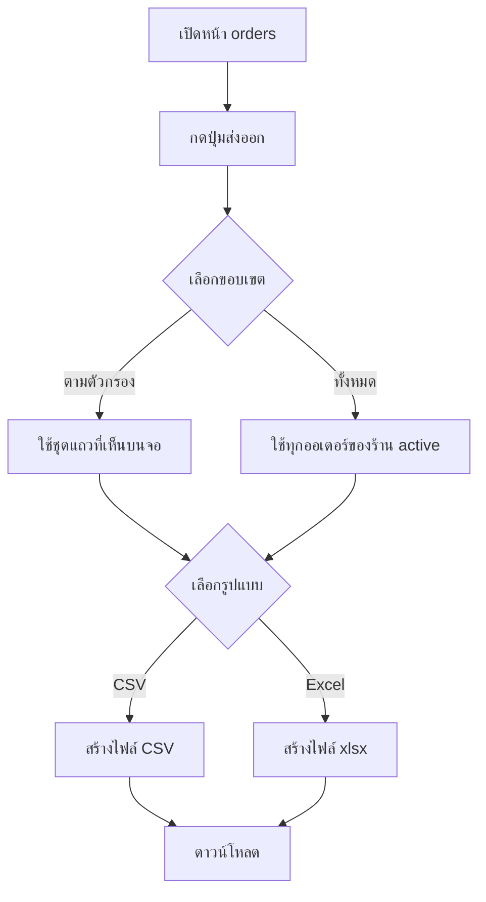

> **โมดูล:** 00086 - Seller Order Export (ส่งออกรายการคำสั่งซื้อเป็นไฟล์ CSV / Excel จากหน้า /orders ฝั่งผู้ขาย)
> **ประเภทเอกสาร:** Product Requirements Document (PRD)
> **เวอร์ชัน:** 0.1
> **วันที่จัดทำ:** 2026-10-29
> **สถานะ:** Approved 2026-10-29 — ดู "มติรอบ 2" ท้ายเอกสาร (แทนที่ข้อที่ขัด)
> **เจ้าของเอกสาร:** BA + PO + PM (ดู [[Feature-Docs-Ownership]])
> **ที่มา:** คำขอ user 2026-10-29 ("เพิ่มระบบ export order ในหน้า /orders … มีทั้ง export จากที่ filter หรือ export all") + มติ user 5 ข้อ (§3.1) + สำรวจโค้ด: `orders/page.tsx`, `OrdersList.tsx`, `lib/order-date-filter.ts`, `lib/order-search.ts`, `lib/shop-permissions.ts`, `lib/csv.ts`, `api/inventory/csv/export/route.ts`

# PRD: ส่งออกรายการคำสั่งซื้อของผู้ขาย (Seller Order Export)

---

## Executive Summary

ผู้ขายใช้หน้า `/orders` ดู ค้นหา และกรองคำสั่งซื้อได้ แต่ **เอาข้อมูลออกจากระบบไม่ได้** เวลาร้านต้องส่งยอดให้นักบัญชี ทำรายงานของตัวเอง กระทบยอดกับธนาคารหรือขนส่ง หรือสำรองข้อมูล ต้องจดหรือคัดลอกทีละใบ ฟีเจอร์นี้เพิ่มปุ่ม "ส่งออก" บนหน้า `/orders` ให้ผู้ขายดาวน์โหลดรายการเป็นไฟล์ **CSV** หรือ **Excel (.xlsx)** ตามที่เลือก

มี 2 โหมด
1. **ส่งออกตามตัวกรอง** ได้ออเดอร์ชุดเดียวกับที่เห็นบนจอ รวมสถานะ ประเภท ช่วงเวลา คำค้น และกองงานที่ถูกเลือกอยู่
2. **ส่งออกทั้งหมด** ได้ทุกออเดอร์ของร้านที่กำลังใช้งาน ไม่สนตัวกรอง

หนึ่งออเดอร์เป็นหนึ่งแถว รายการสินค้ารวมเป็นข้อความช่องเดียว ทุกคนที่เปิดหน้า orders ได้กดส่งออกได้ แต่ **คอลัมน์เงินตามสิทธิ์เดิมของระบบ** คือต้นทุน กำไร และการเงินเต็มออกเฉพาะเจ้าของร้าน (กฎ 00071) ข้อมูลลูกค้า (เบอร์ ที่อยู่) ออกเต็มเท่ากับที่ผู้ขายเห็นบนหน้านี้ (00058)

ผลทางธุรกิจ: ผู้ขายเอาข้อมูลไปทำงานต่อได้เอง ลดงานคีย์ซ้ำและการถามทีมงาน โดยไม่เปิดช่องให้ข้อมูลเงินหรือข้อมูลร้านอื่นรั่ว

---

## 1. Business Goals & KPIs

### 1.1 เป้าหมายทางธุรกิจ

| เป้าหมาย | รายละเอียด |
|----------|-----------|
| **เอาข้อมูลคำสั่งซื้อออกจากระบบได้เอง** | ผู้ขายดาวน์โหลดคำสั่งซื้อเป็นไฟล์ที่เปิดต่อใน Excel/Google Sheets ได้ทันที ภาษาไทยไม่เพี้ยน |
| **ได้ "ที่เห็น" ตามที่เห็น** | โหมดตามตัวกรองต้องได้ชุดแถวเดียวกับรายการบนจอ ไม่ใช่ชุดที่ระบบเดาเอง |
| **สิทธิ์เงินไม่รั่วผ่านไฟล์** | ไฟล์ที่ออกให้บทบาทที่ไม่ใช่เจ้าของต้องไม่มีต้นทุน/กำไร ไม่ใช่แค่ซ่อนหัวคอลัมน์ |
| **ไม่ข้ามร้าน** | เจ้าของหลายร้านส่งออกได้เฉพาะร้านที่เลือกอยู่ ณ ตอนนั้น |
| **ไฟล์ปลอดภัยเมื่อเปิดด้วยโปรแกรมตาราง** | ค่าที่ลูกค้าพิมพ์เข้ามา (ชื่อ ที่อยู่ หมายเหตุ) ต้องไม่ถูกตีความเป็นสูตรเมื่อเปิดใน Excel |

### 1.2 ตัวชี้วัดความสำเร็จ (KPIs)

| KPI | คำอธิบาย | เป้าหมาย |
|-----|----------|---------|
| **จำนวนครั้งส่งออกต่อร้านที่ใช้งาน/เดือน** | นับเหตุการณ์ส่งออกสำเร็จ แยกโหมด/รูปแบบ | ตั้ง baseline 30 วันแรก (ไม่ตั้งเป้าตัวเลขล่วงหน้า) |
| **อัตราส่งออกล้มเหลว** | ส่งออกที่จบด้วย error ÷ ส่งออกทั้งหมด | ต่ำกว่า 2% |
| **ไฟล์ที่ไม่ตรงจอ** | จำนวนกรณีที่ส่งออกตามตัวกรองแล้วแถวไม่ตรงกับรายการบนจอ | 0 ในชุดเทสเทียบ |
| **คอลัมน์ต้องห้ามในไฟล์ของบทบาทที่ไม่ใช่เจ้าของ** | ไฟล์ของ MANAGER/CHAT/BILLING/TECHNICIAN ที่มีคอลัมน์ต้นทุน/กำไร | 0 |
| **เวลาจากกดถึงได้ไฟล์ (p75)** | ร้านที่มีออเดอร์ไม่เกินเพดาน | ภายใน 10 วินาที (ตั้งเป้าเริ่มต้น ปรับเมื่อวัดจริง) |

---

## 2. User Personas (กลุ่มผู้ใช้งาน)

### 2.1 เจ้าของร้าน (OWNER)

**ข้อมูลพื้นฐาน:**
- ผู้ขายที่เปิดร้านใน Deep ทุกประเภท (ขายของออนไลน์ บริการ/คิวงาน ที่พัก) อาจเป็นเจ้าของหลายร้าน
- เห็นการเงินเต็ม (ต้นทุน กำไร) ตามกฎ 00071

**เป้าหมาย:**
- ปิดงบรายเดือน ส่งข้อมูลให้นักบัญชี ดูกำไรรายใบในตารางของตัวเอง

**ความต้องการ:**
- ไฟล์ที่มียอด ต้นทุน กำไรต่อใบ เปิดใน Excel แล้วใช้ต่อได้เลย

**จุดปวด (Pain Points):**
- ต้องจดหรือคัดลอกทีละใบ ไม่มีวิธีเอาข้อมูลออก

### 2.2 ผู้จัดการ / แอดมินแชท / ฝ่ายบิล (MANAGER, CHAT, BILLING)

**ข้อมูลพื้นฐาน:**
- ทีมงานที่ได้รับสิทธิ์เห็นหน้า orders และเห็นยอดเงินรายใบ แต่ไม่เห็นต้นทุนและกำไร

**เป้าหมาย:**
- กระทบยอดรับเงิน/COD ทำรายการส่งของ ติดตามลูกค้า

**ความต้องการ:**
- ไฟล์ที่มีข้อมูลลูกค้า ยอด สถานะ เลขพัสดุ โดยไม่เห็นต้นทุนและกำไรของร้าน

**จุดปวด (Pain Points):**
- ต้องขอเจ้าของร้านส่งรายการให้ทุกครั้ง

### 2.3 ช่างเทคนิค (TECHNICIAN)

**ข้อมูลพื้นฐาน:**
- เห็นหน้า orders แต่ระบบตัดข้อมูลเงินออกทั้งหมดอยู่แล้ว (S-15 ของ 00071)

**เป้าหมาย:**
- ดูงานที่ต้องทำ ลูกค้า นัดหมาย

**ความต้องการ:**
- ไฟล์ที่ไม่มีตัวเลขเงินใด ๆ เลย

**จุดปวด (Pain Points):**
- ไม่มีรายการงานที่เอาไปพิมพ์หรือแชร์ในทีมได้

---

## 3. Business Requirements

### 3.1 มติของ user (ตอบแล้ว 2026-10-29 — ห้ามเปลี่ยนโดยไม่ถาม)

| # | มติ |
|---|-----|
| 1 | รูปแบบไฟล์ **ทั้ง CSV และ Excel (.xlsx)** ผู้ใช้เลือกตอนกดส่งออก |
| 2 | **1 ออเดอร์ = 1 แถว** รายการสินค้ารวมเป็นข้อความในช่องเดียว |
| 3 | สิทธิ์ **ทุกคนที่เห็นหน้า orders กดส่งออกได้** แต่คอลัมน์ต้นทุน/กำไร/การเงินเต็มออกเฉพาะเจ้าของร้าน (กฎ 00071) |
| 4 | ข้อมูลลูกค้า (เบอร์/ที่อยู่) **เต็ม ไม่ปิดบัง** เหมือนที่ผู้ขายเห็นในหน้า orders (00058) |
| 5 | สองโหมด: ส่งออกตามตัวกรองที่ใช้อยู่ · ส่งออกทั้งหมด |

### 3.2 การเริ่มส่งออกและขอบเขตของชุดข้อมูล

**ความต้องการ:**
- หน้า `/orders` มีปุ่มส่งออกที่ให้เลือก (ก) ขอบเขต: ตามตัวกรอง / ทั้งหมด (ข) รูปแบบ: CSV / Excel
- โหมดตามตัวกรองต้องแสดงจำนวนใบที่จะออก ก่อนกดยืนยัน
- โหมดทั้งหมดต้องแสดงจำนวนทั้งร้านก่อนกดยืนยัน

**Business Rules:**
- "ตามตัวกรอง" = ชุดเดียวกับรายการที่เห็นบนจอทุกประการ ครอบคลุมตัวกรองทุกแกนของหน้า (สถานะ ประเภท ช่วงเวลา กองพัสดุ/นัดหมาย/วิธีส่งมอบ/ขั้นงาน คำค้น) และออกทุกหน้า ไม่ใช่เฉพาะหน้าที่แสดงอยู่ (หน้ารายการแบ่งหน้าฝั่งจอ)
- "ทั้งหมด" = ทุกออเดอร์ของร้านที่ใช้งานอยู่ ไม่สนตัวกรองใด ๆ รวมตัวกรองที่มาจากลิงก์ (`?stage=`, `?appt=` ฯลฯ)
- ไม่มีตัวกรองใช้อยู่ = สองโหมดให้ชุดเดียวกัน UI ต้องไม่ทำให้ผู้ใช้เข้าใจผิดว่าต่างกัน

**เหตุผล:**
- ผู้ขายต้องการ "ที่เห็นตรงหน้า" เพื่อส่งต่อชุดย่อย (เช่น เฉพาะเดือนนี้ เฉพาะ COD) และ "ทั้งหมด" เพื่อสำรอง/ส่งนักบัญชี

### 3.3 เนื้อหาของไฟล์

**ความต้องการ:**
- 1 ออเดอร์ = 1 แถว รายการสินค้า (ชื่อ × จำนวน) รวมในช่องเดียวคั่นด้วยตัวคั่นที่อ่านออก
- ชุดคอลัมน์ขึ้นกับ (ก) ระดับสิทธิ์เงินของผู้กด (ข) ประเภทกิจการของร้าน (ONLINE_SALES / SERVICE_QUEUE / LODGING) ตาม BRD §2.2
- ข้อมูลลูกค้าออกเต็ม เหมือนที่ผู้ขายเห็นบนหน้า orders
- หัวคอลัมน์เป็นภาษาไทย ศัพท์ธุรกิจใช้ตามนิยามเดิมของระบบ ไม่นิยามใหม่

**Business Rules:**
- ระดับสิทธิ์เงินใช้ `moneyLevel(roles)` จาก `src/lib/shop-permissions.ts` ตัวเดียว: `FULL` (เจ้าของ) เห็นต้นทุน/กำไร · `PER_ORDER` (ผู้จัดการ/แอดมินแชท/ฝ่ายบิล) เห็นยอดและการชำระรายใบ ไม่เห็นต้นทุน/กำไร · `NONE` (ช่างเทคนิค) ไม่เห็นตัวเลขเงินใดเลย
- คอลัมน์ที่ผู้กดไม่มีสิทธิ์ **ต้องไม่ถูกดึงจากฐานข้อมูลเลย** ไม่ใช่ดึงมาแล้วซ่อน
- นิยามยอด/ต้นทุน/กำไรใช้ตัวคำนวณเดิม (`computeOrderProfit` ใน `src/lib/order-profit.ts` ตัวเดียวกับการ์ดกำไรในหน้ารายละเอียดออเดอร์, `computeOrderMoney` สำหรับยอดรับ/ค้างของร้านบริการ) ห้ามคำนวณใหม่ในฟีเจอร์นี้
- ต้นทุนไม่ครบ (บางรายการยังไม่ตั้งต้นทุน) ต้องมีธงบอกในแถว เพราะกำไรที่ได้เป็นเพดานบน ไม่ใช่กำไรจริง

**เหตุผล:**
- ไฟล์ถูกส่งต่อได้ ถ้าตัวเลขเงินหลุดไปกับบทบาทที่ไม่มีสิทธิ์ ซ่อนทีหลังไม่ได้ผล

### 3.4 รูปแบบไฟล์และความปลอดภัยของไฟล์

**ความต้องการ:**
- CSV เปิดใน Excel แล้วภาษาไทยไม่เพี้ยน
- Excel (.xlsx) ตัวเลขเป็นตัวเลข ข้อความเป็นข้อความ
- ค่าที่เริ่มด้วย `=` `+` `-` `@` (และตัวอักขระควบคุมที่ Excel ตีความเป็นสูตร) ในช่องข้อความอิสระ ต้องไม่ถูกตีความเป็นสูตร
- ชื่อไฟล์มีวันที่ ตามท่าเดียวกับ export สต็อก (`formatDateStampBE`)

**Business Rules:**
- ช่องข้อความที่ลูกค้าหรือพนักงานพิมพ์เองทุกช่อง (ชื่อ ที่อยู่ ชื่อสินค้าที่พิมพ์เอง ช่องทาง เลขพัสดุที่คีย์เอง) ผ่านการกันสูตร
- ช่องตัวเลขเงินไม่ผ่านการกันสูตร (ค่าติดลบต้องยังเป็นเลขติดลบ)

**เหตุผล:**
- ลูกค้าพิมพ์ชื่อหรือที่อยู่เป็นสูตรได้ ร้านเปิดไฟล์แล้วสูตรทำงาน = ช่องโหว่ฝั่งเครื่องร้าน

### 3.5 ขอบเขตร้านและการรองรับข้อมูลจำนวนมาก

**ความต้องการ:**
- ส่งออกได้เฉพาะร้านที่กำลังใช้งานอยู่ (active shop) เจ้าของหลายร้านสลับร้านแล้วไฟล์เปลี่ยนตามร้านนั้น
- ร้านที่มีออเดอร์มากเกินเพดานของระบบ ต้องได้ข้อความบอกวิธีแก้ ไม่ใช่ไฟล์ขาดหรือหน้าค้าง
- ส่งออกแล้วไม่มีแถวเลย ต้องบอกผู้ใช้ ไม่ดาวน์โหลดไฟล์ว่างเงียบ ๆ

**Business Rules:**
- ห้ามรับรหัสร้านจากฝั่งผู้ใช้ ร้านมาจาก session เท่านั้น
- เพดานแถวต่อไฟล์เสนอ 5,000 ใบ (ดู BRD FR-EXP-14 / OQ-1)

**เหตุผล:**
- ข้อจำกัดคำตอบของ Vercel Function (≈4.5 MB ต่อคำตอบ) และเวลา timeout

---

## 4. Business Rules & Constraints

### 4.1 กฎทางธุรกิจหลัก

| กฎ | คำอธิบาย |
|----|----------|
| **ชุดแถว = ชุดบนจอ** | โหมดตามตัวกรองต้องใช้ผลของตัวกรองชุดเดียวกับหน้าจอ (`order-date-filter`, `order-search`, ตัวกรองสถานะ/ประเภท/กอง) ห้ามมีชุดเกณฑ์ที่สอง |
| **สิทธิ์เงินตามระดับเดียวของระบบ** | `moneyLevel()` ใน `shop-permissions.ts` เป็นตัวตัดสินเดียว |
| **ตัดที่แหล่งข้อมูล** | บทบาทที่ไม่มีสิทธิ์ไม่ได้รับข้อมูลเงินนั้นมาตั้งแต่ขั้น query |
| **ลูกค้าเต็ม** | เบอร์/ที่อยู่ออกค่าจริงเท่ากับที่หน้า orders ฝั่งผู้ขายแสดง (`sellerContactDisplay`) ไม่ปิดบัง |
| **กิจการประเภทอื่น ไม่ได้ข้อมูลที่ไม่เกี่ยว** | ร้านที่ไม่ใช่ ONLINE_SALES ไม่มีคอลัมน์ที่อยู่/พัสดุ (เหมือนที่หน้า orders ไม่ส่งข้อมูลนั้นเลย) |

### 4.2 ข้อจำกัดทางธุรกิจ

| ข้อจำกัด | รายละเอียด |
|---------|-----------|
| **เพดานต่อไฟล์** | ตามเพดานแถว (เสนอ 5,000 ใบ) เกินแล้วต้องแคบตัวกรองหรือแบ่งช่วงวันที่ |
| **เฉพาะฝั่งผู้ขาย** | ไม่มีการส่งออกในฝั่งผู้ซื้อ/แอดมิน |
| **เวลาแสดงเป็นเวลาไทย** | ทุกวันที่/เวลาในไฟล์ใช้ปฏิทินไทย (Asia/Bangkok) ตามนโยบายวันที่ของระบบ |

### 4.3 สิ่งที่ฟีเจอร์นี้ไม่เปลี่ยน

ไม่เปลี่ยนตัวกรอง/ค้นหาเดิมของหน้า orders ไม่เปลี่ยนสิทธิ์ของหน้า orders ไม่แตะข้อมูลในฐาน (อ่านอย่างเดียว) ไม่แตะ Trust Score

---

## 5. Out of Scope (นอกขอบเขต)

| หัวข้อ | คำอธิบาย |
|--------|----------|
| **ส่งออกเฉพาะแถวที่ติ๊กเลือก** | ตารางมีการเลือกแถวสำหรับ bulk action อยู่แล้ว แต่ user ขอแค่ 2 โหมด (ตามตัวกรอง/ทั้งหมด) — OQ-9 |
| **หนึ่งรายการสินค้าต่อหนึ่งแถว** | มติข้อ 2 = 1 ออเดอร์ 1 แถว |
| **ส่งออกตามกำหนดเวลา / ส่งไฟล์เข้าอีเมล / LINE** | ฟีเจอร์นี้ดาวน์โหลดทันทีเท่านั้น |
| **ส่งออกข้ามหลายร้านในไฟล์เดียว** | ผูกร้าน active ตัวเดียว |
| **เลือกคอลัมน์เอง / เทมเพลตคอลัมน์** | ชุดคอลัมน์ตายตัวตามสิทธิ์และประเภทกิจการ |
| **ส่งออกรายงานรวม (ยอดขาย กำไรขาดทุน)** | มีหน้ารายงานของมันเอง ไม่ใช่รายการรายใบ |
| **Import ออเดอร์จากไฟล์** | ทิศทางตรงข้าม |
| **ส่งออกรูปสลิป รูปสินค้า ไฟล์แนบ** | ไฟล์ตารางเท่านั้น |
| **ส่งออกฝั่งแอป Deep-App ผู้ซื้อ** | ไม่เกี่ยว |
| **แก้ `stringifyCsv` กลางให้กันสูตรทุกที่** | export สต็อกเดิมใช้ตัวเดียวกัน — ฟีเจอร์นี้กันสูตรเฉพาะของตัวเอง |

---

## 6. Risks & Mitigation (ความเสี่ยงและแนวทางแก้ไข)

### 6.1 ความเสี่ยงทางธุรกิจ

| ความเสี่ยง | ผลกระทบ | ระดับความรุนแรง | แนวทางแก้ไข |
|-----------|---------|-----------------|-------------|
| **ต้นทุน/กำไรหลุดไปกับไฟล์ของบทบาทที่ไม่ใช่เจ้าของ** | ร้านเสียความลับทางการค้า | สูง | ตัดที่ query (ไม่ดึงเลย) + เทส mutation: ถอดเงื่อนไขแล้วเทสแดง |
| **ข้อมูลลูกค้าเต็มถูกส่งต่อออกนอกระบบ** | PII รั่วจากเครื่องร้าน | กลาง | เป็นมติ user (ข้อ 4) · เสนอบันทึกเหตุการณ์ส่งออก (ใคร/เมื่อไร/กี่ใบ) และจำกัดความถี่ — OQ-5 |
| **ไฟล์ไม่ตรงจอ** | ผู้ขายส่งตัวเลขผิดให้นักบัญชี | สูง | ชุดแถวมาจากรายการบนจอ (BRD FR-EXP-02) + เทสเทียบ |
| **ข้อมูลร้านอื่นปนมา** | ข้ามร้านรั่ว | สูง | ร้านจาก session · รายการที่ client ส่งมาถูกกรองด้วยร้านซ้ำที่เซิร์ฟเวอร์ |
| **สูตรแฝงในช่องข้อความ** | Excel รันสูตรบนเครื่องร้าน | กลาง | กันสูตรทุกช่องข้อความอิสระ (BRD FR-EXP-10) |
| **ผู้ใช้เข้าใจว่า "ตามตัวกรอง" หมายถึงหน้าที่เห็น** | ได้ไม่ครบ | กลาง | แสดงจำนวนใบที่จะออกก่อนยืนยัน |

### 6.2 ความเสี่ยงทางเทคนิค

| ความเสี่ยง | ผลกระทบ | แนวทางแก้ไข |
|-----------|---------|-------------|
| **ตัวกรองหน้า orders อยู่ฝั่ง client ทั้งหมด** (`getOrdersByShop` ดึงทั้งร้าน ไม่มี filter ฝั่งเซิร์ฟเวอร์) | ใช้ query เดิมของหน้าไม่ได้ ถ้าเขียนตัวกรองซ้ำบนเซิร์ฟเวอร์อาจกรองไม่ตรงกัน (HR16) | ให้ client ส่งรายการ `publicToken` ของแถวที่กรองแล้ว เซิร์ฟเวอร์โหลดซ้ำเฉพาะร้าน active (SRS ตัดสินขั้นสุดท้าย) |
| **ไม่มีไลบรารีเขียน .xlsx ในโปรเจกต์** | ต้องเพิ่ม dependency | เลือกในขั้น SRS ตรวจขนาด/ใบอนุญาต/การทำงานบน Vercel — OQ-6 |
| **ขีดจำกัดคำตอบ/เวลาของ Vercel Function** | ไฟล์ใหญ่เกินตอบไม่ได้ | เพดานแถว + ข้อความแนะนำ |
| **หน้า orders ดึงออเดอร์ทั้งร้านไม่แบ่งหน้าอยู่แล้ว** | ร้านใหญ่โหลดหนักอยู่ก่อน | ฟีเจอร์นี้ไม่แก้ และไม่เพิ่มภาระให้หน้า |
| **Excel ตัดเลข 0 หน้าเบอร์โทร/รหัสไปรษณีย์เมื่อเปิด CSV ด้วยดับเบิลคลิก** | เบอร์ 0812345678 เห็นเป็น 812345678 | .xlsx เก็บเป็นข้อความ · CSV เก็บค่าจริงตามมาตรฐาน CSV และ UI แนะนำ Excel — OQ-4 |

---

## 7. Glossary (อภิธานศัพท์)

| คำศัพท์ | ความหมาย |
|---------|----------|
| **ส่งออกตามตัวกรอง** | ส่งออกชุดแถวเดียวกับรายการที่เห็นบนหน้า orders ณ ขณะกด |
| **ส่งออกทั้งหมด** | ส่งออกทุกออเดอร์ของร้านที่ใช้งานอยู่ ไม่สนตัวกรอง |
| **ระดับสิทธิ์เงิน (moneyLevel)** | `FULL` / `PER_ORDER` / `NONE` ตาม `src/lib/shop-permissions.ts` |
| **การเงินเต็ม** | ต้นทุน กำไร ที่เห็นเฉพาะเจ้าของร้าน (00071) |
| **เพดานแถว** | จำนวนออเดอร์สูงสุดต่อหนึ่งไฟล์ |
| **กันสูตร** | การทำให้ค่าที่ขึ้นต้นด้วย `=` `+` `-` `@` ไม่ถูกโปรแกรมตารางตีความเป็นสูตร |
| **active shop** | ร้านที่ผู้ใช้เลือกอยู่ตอนนี้ (ผู้ใช้เป็นเจ้าของ/ทีมงานหลายร้านได้) |
| **ร่าง (DRAFTED)** | ออเดอร์ที่ระบบสร้างจากแชทแต่ยังไม่ยืนยัน ยอดเป็น 0 (00061) |

---

## 8. Success Metrics (ตัวชี้วัดความสำเร็จ)

| ตัวชี้วัด | ค่าที่คาดหวัง | วิธีวัด |
|----------|---------------|--------|
| **ไฟล์ตามตัวกรองตรงกับจอ** | 100% ในชุดเทส (ทุกแกนตัวกรอง + คำค้น) | เทสเทียบจำนวนและลำดับ `publicToken` ของจอกับไฟล์ |
| **คอลัมน์ต้องห้ามในไฟล์บทบาทที่ไม่ใช่เจ้าของ** | 0 | เทสต่อบทบาททั้ง 5 + mutation |
| **ภาษาไทยอ่านได้ใน Excel** | เปิด CSV แล้วไม่เพี้ยน | เทสไบต์ BOM + เปิดจริง 1 ครั้งตอน QA |
| **ไม่มีสูตรหลุด** | 0 เซลล์ข้อความอิสระที่ขึ้นต้นด้วย `=+-@` โดยไม่ถูกกัน | เทสค่าทดสอบ 4 ตัวอักษร |
| **การใช้งาน** | มีร้านใช้ส่งออกอย่างน้อย 1 ครั้งภายใน 30 วันหลังขึ้น prod | นับเหตุการณ์ส่งออก (ถ้าอนุมัติบันทึก — OQ-5) |

---

## 9. Dependencies & Assumptions

### 9.1 สิ่งที่ต้องพึ่งพา (Dependencies)

| ระบบ/ส่วนประกอบ | ความสัมพันธ์ |
|-----------------|-------------|
| **หน้า orders ฝั่งผู้ขาย** (`orders/page.tsx`, `OrdersList.tsx`, `OrdersTable.tsx`) | จุดวางปุ่ม และแหล่งของ "ชุดแถวตามตัวกรอง" |
| **`lib/order-date-filter.ts`, `lib/order-search.ts`** | ตัวกรองช่วงเวลาและคำค้น — SSOT ของจอ |
| **`lib/shop-permissions.ts` (`moneyLevel`, `can`)** | ตัดสินคอลัมน์เงิน (00071) |
| **`lib/seller-contact-display.ts`** | ข้อมูลลูกค้าเต็มฝั่งผู้ขาย (00058) |
| **`lib/order-profit.ts`, `lib/order-payment.ts`** | นิยามกำไร/ยอดรับ/ค้างชำระ |
| **`lib/csv.ts`, `lib/format-date.ts`** | สร้าง CSV (BOM) และวันที่/ชื่อไฟล์ไทย |
| **`lib/route-capabilities.ts`** | route ใหม่ต้องประกาศ capability (00071 P3) |

### 9.2 สมมติฐาน (Assumptions)

- ทุกคนที่ผ่านด่าน O1 ของหน้า orders ส่งออกได้ (ตามมติข้อ 3) ไม่มีสิทธิ์ส่งออกแยกต่างหาก
- ช่างเทคนิคส่งออกได้ แต่ไฟล์ไม่มีตัวเลขเงิน (ตามกฎ S-15 ที่หน้า orders ใช้อยู่แล้ว) — OQ-2
- รูปแบบหน้า orders เดิม (ตัวกรองฝั่ง client) ไม่เปลี่ยนในรอบนี้
- ผู้ใช้เปิดไฟล์ด้วย Excel หรือ Google Sheets เป็นหลัก

---

## 10. Appendix

### 10.1 ตัวอย่าง User Journey

**Scenario: เจ้าของร้านส่งยอด COD เดือนตุลาคมให้นักบัญชี**

1. เจ้าของเปิด `/orders` ตั้งตัวกรองวิธีชำระและช่วงเวลา
2. กดปุ่ม "ส่งออก" เลือก "ตามตัวกรอง (128 ใบ)" และรูปแบบ Excel
3. ระบบดาวน์โหลดไฟล์ชื่อมีวันที่ แถวตรงกับที่เห็นบนจอ รวมคอลัมน์ต้นทุนและกำไร
4. นักบัญชีเปิดใน Excel ภาษาไทยปกติ เบอร์โทรเป็นข้อความ

**Scenario: ฝ่ายบิลส่งออกทั้งหมดไว้กระทบยอด**

1. ฝ่ายบิลกด "ส่งออก" เลือก "ทั้งหมด (2,310 ใบ)" รูปแบบ CSV
2. ไฟล์มียอดและสถานะชำระแต่ **ไม่มี** ต้นทุน/กำไร

### 10.2 ตัวอย่างความต่างของไฟล์ตามบทบาท

| บทบาท | ระดับเงิน | คอลัมน์เงินในไฟล์ |
|-------|-----------|--------------------|
| OWNER | FULL | ยอดรวม วิธีชำระ สถานะชำระ ต้นทุนรวม กำไร ธง "ต้นทุนไม่ครบ" |
| MANAGER / CHAT / BILLING | PER_ORDER | ยอดรวม วิธีชำระ สถานะชำระ |
| TECHNICIAN | NONE | ไม่มี |

---

## 11. Open Questions (รอ user ตัดสินก่อนล็อก BRD)

| # | คำถาม | ข้อเสนอ |
|---|-------|---------|
| OQ-1 | เพดานแถวต่อไฟล์ | 5,000 ใบ (กันเพดานคำตอบ ≈4.5 MB) เกินแล้วให้แบ่งตามช่วงเวลา |
| OQ-2 | ช่างเทคนิคส่งออกได้ไหม | ได้ แต่ไฟล์ไม่มีตัวเลขเงินเลย (ตาม S-15) |
| OQ-3 | ใบร่าง (DRAFTED) และใบโหมดทดสอบ อยู่ในไฟล์ไหม | ตามจอ — ยืนยันจากโค้ดแล้วว่า `getOrdersByShop` ไม่กรองทั้งสองแบบ หน้า orders จึงแสดงอยู่ ไฟล์ออกตามจอพร้อมป้ายสถานะ |
| OQ-4 | เลข 0 นำหน้าเบอร์ใน CSV เมื่อดับเบิลคลิกเปิดใน Excel | CSV เก็บค่าจริง แนะนำให้ใช้ Excel ถ้าจะเปิดด้วย Excel · เบอร์ขึ้นต้น `+` จะมี `'` นำหน้าจากการกันสูตร |
| OQ-5 | บันทึกเหตุการณ์ส่งออก + จำกัดความถี่ | เอา (ใคร/เมื่อไร/กี่ใบ ไม่เก็บเนื้อไฟล์ · 10 ครั้ง/5 นาที) — อาจต้องมี migration (HR15) |
| OQ-6 | เพิ่มไลบรารี .xlsx | เพิ่ม (มติข้อ 1 ต้องการ Excel) — เลือกตัวใน SRS |
| OQ-7 | "กำไร" ในไฟล์ | ใช้ `computeOrderProfit` ตัวเดียวกับการ์ดกำไรหน้ารายละเอียดออเดอร์ (ยืนยันแล้วว่าการ์ดนั้นเรียกฟังก์ชันนี้ · ไม่หักค่าส่ง) |
| OQ-8 | หมายเหตุภายใน (`Order.internalNote`) | ไม่ใส่ (หน้า orders ไม่แสดง) |
| OQ-9 | ส่งออกเฉพาะแถวที่ติ๊กเลือก | ไม่ทำรอบนี้ |

---

**หมายเหตุ:**
เอกสารนี้เป็นการบันทึกความต้องการทางธุรกิจ (Business Requirements) โดยไม่มีรายละเอียดทางเทคนิค
สำหรับ Functional Requirements / User Story / Acceptance Criteria ดู [[BRD]] ของโมดูลนี้
สำหรับ technical specification ดู [[SRS]] ของโมดูลนี้

---

## มติรอบ 2 (2026-10-29) — แทนที่ข้อที่ขัดในเอกสารนี้

user เลือกทาง 3 หลังเห็นไฟล์ตัวอย่าง (`docs/mockups/00086-order-export-sample.xlsx`) และสั่ง implement:

| เรื่อง | มติ |
|---|---|
| ใครส่งออกได้ | **เจ้าของร้านเท่านั้น** (capability `P3`) — ปุ่มไม่แสดงให้บทบาทอื่น · route ตอบ 403 · แทนที่มติข้อ 3 เดิม ("ทุกคนที่เห็นหน้า orders") |
| คอลัมน์ | ได้ **ทุกคอลัมน์** ไม่มีชุดตามระดับเงิน (FR-EXP-05 ชุด C/D และ FR-EXP-13 ไม่ใช้แล้ว) — รายการจริงอยู่ที่ `exportColumns()` ใน `src/lib/order-export.ts` |
| คอลัมน์เงินที่เพิ่ม (user ขอ "ละเอียด ต้นทุน ค่าจัดส่ง") | ยอดสินค้า · ส่วนลด · VAT · ยอดเก็บปลายทาง · ยอดคืนเงินลูกค้า · ต้นทุนสินค้า · ค่าส่ง (ขนส่งคิด) · ค่าธรรมเนียม COD · รวมค่าส่งขาไป · ที่มาค่าส่ง · ค่าส่งคืนสินค้า · กำไรขั้นต้น · กำไรหลังหักค่าส่ง |
| นิยามกำไร (HR16) | กำไรขั้นต้น = `computeOrderProfit` เงื่อนไขเดียวกับการ์ดกำไรหน้ารายละเอียดออเดอร์ (ใบไม่นับยอดขาย = ว่าง) · กำไรหลังหักค่าส่ง = กำไรขั้นต้น − `resolveOutboundShippingCost` = `SALES_PROFIT_FORMULA` ของ /sales คิดรายใบ · ค่าส่งคืนแสดงแยก ไม่หัก (ตาม /sales) |
| OQ-1 เพดาน | 5,000 ใบ |
| OQ-3 ร่าง/โหมดทดสอบ | ออกตามจอ |
| OQ-4 เลข 0 ใน CSV | ตามเสนอ (xlsx เก็บเป็นข้อความ) |
| OQ-5 บันทึก/จำกัดความถี่ | **ไม่ทำรอบนี้** (ต้องมี migration) — FR-EXP-17 ตัดออก |
| OQ-6 ไลบรารี | `exceljs` |
| OQ-8/9 | ตามเสนอ (ไม่ใส่หมายเหตุภายใน · ไม่ทำส่งออกเฉพาะแถวที่ติ๊ก) |
