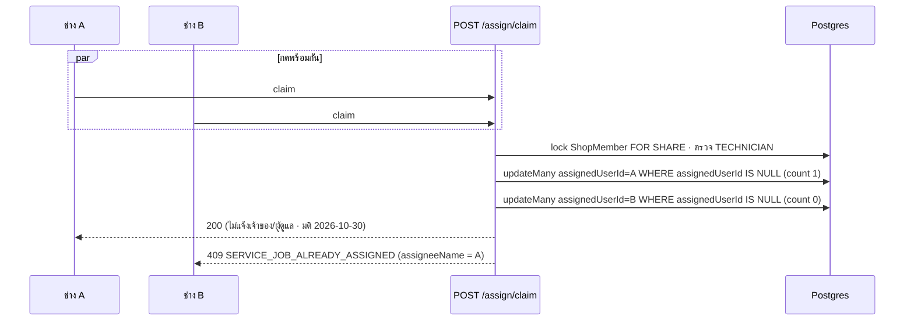
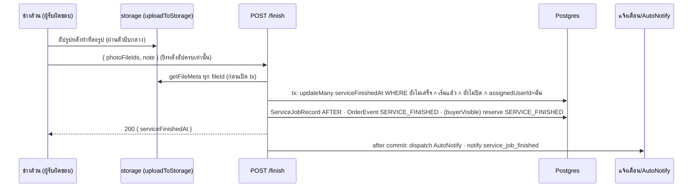

> **โมดูล:** 00086 — Service Staff Workflow
> **ประเภทเอกสาร:** API Contract
> **เวอร์ชัน:** 1.1
> **วันที่จัดทำ:** 2026-10-27 · sync กับโค้ด 2026-10-29 · มติ UX 2026-10-30 (แจ้งเตือนเหลือทำเสร็จ/ปิดงาน · การ์ดปิดงานติ๊กอัตโนมัติเมื่อเพิ่มฝ่ายช่าง — สัญญา API อื่นไม่เปลี่ยน)
> **สถานะ:** As-built — P1+P2+P3 ลงโค้ดครบบน branch `feat/00086-service-staff-workflow` (**ยังไม่ commit · ยังไม่ merge**) · ทุกข้อในเอกสารนี้ตรวจกับโค้ดใน working tree แล้ว

# API Contract: งานพนักงานร้านบริการ

## 1. Overview
| รายการ | ค่า |
|---|---|
| Endpoint ใหม่ | 8 ไฟล์: `orders/[token]/finish` · `orders/[token]/assign` · `orders/[token]/assign/claim` · `shops/current/service-staff` · `shops/current/service-job-photo-settings` · `shops/current/appointments/carry-over` · `expenses/mine` · `expenses/mine/[id]` |
| Endpoint เปลี่ยน | members PATCH/DELETE · `business/shops/[shopId]/transfer` · invite-links · invites · `POST /api/orders` · appointment PATCH · start · close · outcome · `appointments/day` (payload) · `GET /api/expenses` · `GET /api/notifications` · `POST /api/notifications/read` · `GET /api/app/notifications` |
| ขอบเขต | ร้าน `SERVICE_QUEUE` เท่านั้น — ร้านอื่น: ฟิลด์ใหม่ถูกละ / 403 `FEATURE_NOT_AVAILABLE` / รายการว่าง ตามที่ระบุรายข้อ · พฤติกรรมเดิมไม่เปลี่ยน |
| Response header | route งานบริการใช้ `jsonNoStore` (`Cache-Control: no-store`) · `/api/expenses/mine/**` ใส่ `private, no-store` |

> 🛑 **path รับงาน = `POST /api/orders/[token]/assign/claim`** — `/api/orders/[token]/claim` เป็น OTP claim ของผู้ซื้อ (feature 00015 · คลาส BUYER) อยู่แล้ว ใช้ซ้ำไม่ได้

## 2. Authentication
- NextAuth session (เว็บ seller / แอปผู้ขาย WebView) · ร้าน = ร้าน active หรือ `?shopId=` — รองรับที่ `start` · `finish` · `assign` · `assign/claim` · `close` · `outcome` · `service-staff` (กดจากกล่องแชทรวมหลายร้าน · ระบุแล้วไม่ถอยไปร้าน active · ไม่ใช่สมาชิกร้านนั้น = 403)
- ด่านบทบาท: `requireShopCapability(session, '<cap>', { shopId })` (literal ตรงทะเบียน `src/lib/route-capabilities.ts`)
- ด่านรายคน: `memberCanCloseJob(shop, roles, flags)` / `memberCanRecordStaffExpense(shop, role, flags)` (`src/lib/shop-permissions.ts`) อ่าน `gate.active.{canCloseJob,canRecordExpense}` ที่ดึงสดจาก `ShopMember` ทุกคำขอ (ไม่อยู่ใน JWT)
- ด่าน "ช่างล้วน" (`isTechnicianOnly(roles)` = มีแต่ `TECHNICIAN`): `serviceJobActorBlock` ตัดสินที่ service ทั้งก่อนเปิด tx และซ้ำใน `WHERE` ของ `updateMany` (มอบงานใหม่แทรก = ไม่เขียน)
- ผู้กระทำ/ผู้สร้าง/เวลา = session + server เสมอ (ไม่รับจาก body)

## 3. Endpoint List
| Method | Path | Cap / ด่าน | ใหม่/เปลี่ยน | FR |
|---|---|---|---|---|
| PATCH | `/api/business/shops/[shopId]/members/[memberId]` | T2 | เปลี่ยน: flags · response + `unassignedJobCount` | FR-004, FR-007, FR-017 |
| DELETE | `/api/business/shops/[shopId]/members/[memberId]` | T2 | เปลี่ยน: response + `unassignedJobCount` | FR-007 |
| POST | `/api/business/shops/[shopId]/transfer` | (เดิม) | เปลี่ยน: response + `unassignedJobCount` · ล้าง flag ผู้รับโอน | FR-007 |
| POST / GET | `/api/shops/current/invite-links` | T2 | เปลี่ยน: flags | FR-004, FR-017 |
| POST | `/api/business/shops/[shopId]/invites` | T2 | เปลี่ยน: flags | FR-004 |
| POST | `/api/orders` | O2s | เปลี่ยน: `arrivalMode`, `assignedUserId` | FR-001, FR-003, FR-007 |
| PATCH | `/api/orders/[token]/appointment` | O3 | เปลี่ยน: `arrivalMode` | FR-002 |
| POST | `/api/orders/[token]/start` | O4 + ด่านช่างล้วน | เปลี่ยน: รูป + บันทึก | FR-009 |
| POST | `/api/orders/[token]/finish` | O4 + ด่านช่างล้วน | **ใหม่** | FR-010 |
| POST · DELETE | `/api/orders/[token]/assign` | O2s | **ใหม่** | FR-007 |
| POST | `/api/orders/[token]/assign/claim` | O4 + ถือ `TECHNICIAN` | **ใหม่** | FR-007 |
| POST | `/api/orders/[token]/close` | O4 + `memberCanCloseJob` (+ ด่านช่างล้วนใน service) | เปลี่ยน: ด่าน | FR-005, FR-011 |
| POST | `/api/orders/[token]/appointment/outcome` | O4 + `memberCanCloseJob` (+ ด่านช่างล้วนใน service) | เปลี่ยน: ด่าน | FR-005 |
| GET | `/api/shops/current/service-staff` | O2s | **ใหม่** | FR-007 |
| PATCH | `/api/shops/current/service-job-photo-settings` | Q2 | **ใหม่** | FR-013 |
| GET | `/api/shops/current/appointments/carry-over` | Q1 | **ใหม่** | FR-008 |
| GET | `/api/shops/current/appointments/day` | Q1 | เปลี่ยน: แถว + `assignee`, `serviceStartedAt`, `serviceFinishedAt`, `serviceClosedAt`, `arrivalMode` | FR-002, FR-008 |
| GET · POST | `/api/expenses/mine` | คลาส MEMBER + `resolveStaffExpenseAccess` | **ใหม่** | FR-018, FR-020 |
| PATCH · DELETE | `/api/expenses/mine/[id]` | คลาส MEMBER + `resolveStaffExpenseAccess` + เจ้าของแถว | **ใหม่** | FR-018, FR-020 |
| GET | `/api/expenses` | F1 | เปลี่ยน: `createdByName` | FR-019 |
| GET | `/api/notifications` · POST `/api/notifications/read` · GET `/api/app/notifications` | SELF | เปลี่ยน: ขอบเขตร้าน/ส่วนตัว (§4.15) | FR-014, FR-020 |

ไม่เปลี่ยน: `GET/DELETE /api/orders/[token]/close` (O4 / O6) · `POST /api/orders/[token]/cancel` (O6) · `POST /api/orders/[token]/confirm` (ผู้ซื้อ · 00082 — ปิดงานให้เสมอ ไม่ผ่านด่านใหม่ ไม่ส่งแจ้งเตือน `service_job_*`) · `PATCH/DELETE /api/expenses/[id]` (F2) · `/api/expenses/report` (F1)

## 4. Endpoint Detail

### 4.1 `PATCH /api/business/shops/[shopId]/members/[memberId]`
**Request** (อย่างน้อย 1 ฟิลด์):
```json
{ "role": "ADMIN", "roles": ["TECHNICIAN"], "canCloseJob": true, "canRecordExpense": false }
```
**Response 200:** `{ "role": "ADMIN", "roles": ["TECHNICIAN"], "canCloseJob": true, "canRecordExpense": false, "unassignedJobCount": 0 }`
- `roles` มี `MANAGER` ⇒ server เก็บ `canCloseJob = true` เสมอ (การ์ดล็อก)
- ผลเป็น `role = "OWNER"` ⇒ server เขียน flag ทั้งสอง = false (CHECK `ShopMember_flags_admin_only_check`)
- ไม่ส่ง flag ⇒ คงค่าเดิม (ตรวจเฉพาะ flag ที่ส่งมา) · มีผลกับคำขอถัดไปของพนักงานทันที
- (มติ 2026-10-30 · UI เท่านั้น) หน้าเลือกบทบาทติ๊ก `canCloseJob` ให้เมื่อกด **เพิ่ม** `TECHNICIAN` (`flagsAfterRoleToggle`) แล้วส่งค่าใน body ตามปกติ · server ไม่ตั้งค่าเอง (default ยัง false · ไม่ส่ง = false/คงเดิม)
- `unassignedJobCount` (00086 P3): ร้านบริการ — ถ้าผลคือ **ไม่ได้ถือ `TECHNICIAN` แล้ว** (ถอดบทบาท / เลื่อนเป็นเจ้าของ) งานบริการที่ยังเปิดซึ่งมอบให้คนนี้กลับเป็น "ยังไม่มีคนรับ" ใน tx เดียวกัน + event `SERVICE_UNASSIGNED meta {reason:'ROLE_REMOVED'}` · UI ต่อท้าย toast `… · งานที่ยังไม่ปิด {n} งานกลับเป็น "ยังไม่มีคนรับ"` เมื่อ n > 0 (`withUnassignedJobsNote`) · ร้านอื่น = 0

| HTTP | error | เมื่อ |
|---|---|---|
| 400 | `INVALID_INPUT` | body ไม่ผ่าน schema |
| 400 | `STAFF_FLAGS_NOT_AVAILABLE` | ร้านไม่ใช่ `SERVICE_QUEUE` และส่ง flag = true |
| 400 | `CLOSE_JOB_NEEDS_START_ROLE` | `canCloseJob = true` แต่ชุดบทบาทไม่มี `CHAT`/`TECHNICIAN`/`MANAGER` (เช่น เปิดบิลอย่างเดียว) |
| 403 | `NOT_OWNER` | ไม่ใช่เจ้าของ (T2 · รหัสเดิม) |
| 4xx | รหัสเดิมของ `memberErrorResponse` | กติกา BR-MR เดิม |

### 4.1b `DELETE /api/business/shops/[shopId]/members/[memberId]` · `POST /api/business/shops/[shopId]/transfer`
- DELETE → **200** `{ "status": "REMOVED", "unassignedJobCount": n }` — งานเปิดของคนที่ถูกลบกลับเป็น "ยังไม่มีคนรับ" + `SERVICE_UNASSIGNED meta {reason:'MEMBER_REMOVED'}` (tx เดียวกับการลบ)
- transfer → **200** `{ "status": "TRANSFERRED", "unassignedJobCount": n }` — ผู้รับโอนกลายเป็นเจ้าของ: ล้าง flag ทั้งสอง + ปลดงาน `reason:'ROLE_REMOVED'`
- ปิดบัญชี (`deleteAccount`) / reclaim บัญชีค้าง (`POST /api/account/link/reclaim`): ปลดงานเปิดที่มอบให้ผู้ใช้นั้น **ทุกร้านบริการ** (`unassignUserOpenJobsEverywhere` · `reason:'MEMBER_REMOVED'`) — ไม่มี field ใหม่ใน response
- ใบที่ปิดแล้ว/ยกเลิก/คืน คงชื่อเดิมไว้เป็นประวัติ · ไม่แตะ `serviceStartedAt`/`serviceFinishedAt`/`ServiceJobRecord`

### 4.2 `POST /api/shops/current/invite-links` · `POST /api/business/shops/[shopId]/invites`
**Request เพิ่ม:** `canCloseJob?: boolean` · `canRecordExpense?: boolean` (ไม่ส่ง = false)
**Response:** เดิม · `GET invite-links` แต่ละลิงก์เพิ่ม `canCloseJob`, `canRecordExpense`
- ผู้รับลิงก์ (`POST /api/i/[slug]/accept`) / ผู้รับคำเชิญ (`POST /api/invites/[inviteId]/accept`) ได้ flag ตามที่ตั้งไว้ (สัญญาของสอง route นี้ไม่เปลี่ยน)
- error เพิ่ม: 400 `STAFF_FLAGS_NOT_AVAILABLE` · 400 `CLOSE_JOB_NEEDS_START_ROLE` (กติกาเดียวกับ §4.1)

### 4.3 `POST /api/orders` (ส่วนที่เปลี่ยน)
**Request เพิ่ม** (ร้านบริการ `vertical = SERVICE_QUEUE`):
```json
{
  "arrivalMode": "BOOKED",
  "appointment": { "resourceId": "res_1", "start": "2026-10-28T03:00:00.000Z", "end": "2026-10-28T04:00:00.000Z", "depositAmount": "500.00" },
  "assignedUserId": "user_tech_1"
}
```
```json
{
  "arrivalMode": "WALK_IN",
  "appointment": { "resourceId": "res_1" },
  "assignedUserId": null
}
```
- `arrivalMode` บังคับเฉพาะ **ร้านบริการ + ส่ง `appointment` มา** · ไม่ส่งนัดและไม่ส่ง `arrivalMode` = ใบ "ยังไม่ระบุเวลา" แบบเดิม (`arrivalMode` = null)
- `BOOKED`: `appointment.resourceId/start/end` บังคับ · ร้าน `appointmentGranularity = TIME` ส่งนัดทั้งวัน (ไม่มีเวลา) = `ARRIVAL_BOOKED_NEEDS_TIME` · ร้านรายวัน (`DAY`) ส่งนัดทั้งวันได้ตามเดิม · จองแจ้ง `SERVICE_BOOKED` เดิม
- `WALK_IN`: `appointment.resourceId` บังคับ · `durationMin` ไม่บังคับ (1–1440 · ฟอร์มของระบบไม่ส่งแล้ว — server ใช้ `ServiceResource.durationMinutes` ของคิว → ไม่มีก็ค่ามาตรฐานผ่าน `walkInWindow`) · `start/end/depositAmount` ที่ส่งมา **ถูกละ** · server ตั้ง `serviceStart = now` (ปัดวินาที) · ไม่เก็บมัดจำ (`depositAmount` = null) · **ไม่จองข้อความอัตโนมัติใด ๆ** (ทั้ง `SERVICE_BOOKED` และ `ORDER_SUMMARY`)
- มี `resourceId` แต่ `durationMin` ผิดรูป = 400 `Invalid input` (ไม่ใช่ `ARRIVAL_WALK_IN_NEEDS_QUEUE` — แยกกันโดยตั้งใจ)
- ค่า `arrivalMode` นอกชุด `BOOKED|WALK_IN` (ร้านบริการ) → 400 `Invalid input`
- `assignedUserId` ไม่บังคับ (`string | null`) · ต้องเป็นสมาชิกร้านที่บทบาทที่มีผลถือ `TECHNICIAN` (ตรวจใน tx ด้วย `resolveTechnicianAssignee` + ล็อกแถวสมาชิก `FOR SHARE`) · ไม่ผ่าน = ทั้งใบ rollback · บันทึก `SERVICE_ASSIGNED meta {assigneeNameSnapshot}` · **ไม่ส่งแจ้งเตือน** (FR-014 ไม่มีเหตุการณ์ "มอบงาน")
- ร้านอื่น (ขายของ/ที่พัก): `arrivalMode` · `walkIn` · `assignedUserId` ถูกละเงียบ ๆ เก็บ `arrivalMode` = null (พฤติกรรมเดิม)

**Response 201:** แถว Order เดิม + `arrivalMode` (ค่าที่บันทึกจริง)

| HTTP | error | เมื่อ |
|---|---|---|
| 400 | `ARRIVAL_MODE_REQUIRED` (message "เลือกว่าลูกค้าจองล่วงหน้าหรือมาหน้าร้าน") | ร้านบริการส่ง `appointment` แต่ไม่ส่ง `arrivalMode` |
| 400 | `ARRIVAL_BOOKED_NEEDS_TIME` (message "เลือกวันและเวลานัด") | `BOOKED` ขาด resourceId/start/end · หรือร้าน TIME ส่งนัดทั้งวัน |
| 400 | `ARRIVAL_WALK_IN_NEEDS_QUEUE` (message "เลือกคิวงาน") | `WALK_IN` ขาด resourceId |
| 400 | `ASSIGNEE_NOT_TECHNICIAN` | ผู้รับผิดชอบไม่ใช่สมาชิกฝ่ายช่างของร้าน |
| 400 | `Invalid input` | `arrivalMode`/`assignedUserId`/`durationMin` ผิดรูป |
| 409 | `APPOINTMENT_SLOT_FULL` (รหัสเดิม) | คิวเต็ม |
| 403 | `FORBIDDEN_ROLE` | ไม่มี O2s (เดิม) |

### 4.4 `PATCH /api/orders/[token]/appointment` (ส่วนที่เปลี่ยน)
**Request เพิ่ม:** `arrivalMode?: "WALK_IN" | "BOOKED"`
- ใบที่ยังไม่ระบุเวลา (ไม่มี `serviceStart`): ส่ง `WALK_IN` → `WALK_IN` (ไม่จองแจ้ง `SERVICE_BOOKED` แม้เวลาอยู่ในอนาคต · ทาง "เริ่มงานเลย" ในแชทส่งค่านี้) · ไม่ส่ง → `BOOKED`
- ใบที่มีเวลาอยู่แล้ว (เลื่อนนัด): คอลัมน์ไม่ถูกแตะ (`current ?? input ?? 'BOOKED'`) — รวมใบเก่าที่ `arrivalMode` = null (จอใช้ `arrivalModeOf` สูตรเดิม)
- **Response:** `appointment` เดิม + `arrivalMode`

### 4.5 `POST /api/orders/[token]/start` (ส่วนที่เปลี่ยน)
**Request** (body ไม่บังคับ — ไม่ส่ง/ว่าง = พฤติกรรมเดิม):
```json
{ "photoFileIds": ["shops/abc/img_1.jpg", "shops/abc/img_2.jpg"], "note": "ไฟหน้าซ้ายเหลือง" }
```
- `photoFileIds`: ≤10 (schema) · แต่ละตัว 1–300 ตัวอักษร · fileId จาก `uploadToStorage({ purpose: 'IMAGE' })` (ผ่านตัวบีบรูปกลาง — ห้ามส่งตัวไฟล์ผ่าน route) · fileId ซ้ำนับครั้งเดียว
- `note`: trim · ≤1000 ตัวอักษร · ว่าง/ช่องว่างล้วน = ไม่มีบันทึก
- ไม่มีรูปและไม่มีบันทึก = ไม่สร้าง `ServiceJobRecord` และ `SERVICE_STARTED` ไม่มี meta (ประวัติแบบเดิมเป๊ะ)
- เริ่มไปแล้ว → คืน `alreadyStarted: true` **ก่อน** ตรวจรูป (กดซ้ำ/รีเทรย์หลังเน็ตหลุดไม่ได้ 400) · ผู้แพ้การกดพร้อมกันได้ `alreadyStarted` และรูปของผู้แพ้ไม่ถูกบันทึก (ยอมรับ · บันทึกครั้งเดียวต่อขั้น)
- หลัง commit: AutoNotify `SERVICE_STARTED` เดิม · **ไม่แจ้งเจ้าของ/ผู้ดูแล** (มติ 2026-10-30 · เดิม `service_job_started` · §4.15)
**Response 200:** `{ "serviceStartedAt": "…", "alreadyStarted": false }` (เดิม)

| HTTP | error | เมื่อ |
|---|---|---|
| 400 | `VALIDATION_ERROR` | body ไม่ใช่ JSON / ผิดรูป / เกิน 10 รูป / note เกิน 1000 |
| 400 | `SERVICE_JOB_PHOTO_REQUIRED` | ร้านตั้ง `REQUIRED` และไม่มีรูป |
| 400 | `SERVICE_JOB_PHOTOS_DISABLED` | ร้านตั้ง `NONE` แต่ส่งรูป |
| 400 | `SERVICE_JOB_PHOTO_MISSING` | fileId ไม่มีอยู่ใน storage (`getFileMeta` = null · อัปไม่ครบ) |
| 400 | `SERVICE_JOB_TOO_MANY_PHOTOS` | ด่านชั้น service (เกิน 10 หลังตัดซ้ำ) — ผ่าน route ปกติจะติด `VALIDATION_ERROR` ก่อน |
| 403 | `FORBIDDEN_ROLE` | ไม่มี O4 (เดิม) |
| 403 | `FEATURE_NOT_AVAILABLE` | ร้านไม่ใช่บริการ |
| 403 | `SERVICE_JOB_NOT_ASSIGNEE` (+ `assigneeName`) | ช่างล้วน · งานเป็นของคนอื่น — message "งานนี้เป็นของ {ชื่อ} · เริ่มงานได้เฉพาะผู้รับผิดชอบ" |
| 409 | `SERVICE_JOB_UNASSIGNED` | ช่างล้วน · งานยังไม่มีคนรับ — "กด "รับงานนี้" ก่อนเริ่มงาน" |
| 409 | `SERVICE_JOB_ALREADY_CLOSED` / `SERVICE_JOB_NOT_STARTABLE` / `APPOINTMENT_NOT_STARTED` | เดิม |
| 404 | `SERVICE_JOB_NOT_FOUND` | ไม่พบใบในร้านนี้ |

### 4.6 `POST /api/orders/[token]/finish` (ใหม่)
**Request:** เหมือน §4.5 (`photoFileIds?`, `note?` · "ทำอะไรไปบ้าง") → `ServiceJobRecord` phase `AFTER`
**Response 200:** `{ "serviceFinishedAt": "2026-10-27T08:15:00.000Z", "alreadyFinished": false }`
- ไม่แตะเงิน/`Order.status`/`serviceClosedAt` — ยอดขาย/กำไร (00073/00078) ยังนับตอนปิดงาน · กดซ้ำคืนเวลาเดิม `alreadyFinished: true`
- event `SERVICE_FINISHED` (meta `{photoCount?, hasNote?}`) · แจ้งเจ้าของ/ผู้ดูแล `service_job_finished`
- AutoNotify `SERVICE_FINISHED` ถึงลูกค้า **เฉพาะร้านที่เปิด `serviceJobPhotosBuyerVisible` และ mode ≠ `NONE`** — ไม่มีสวิตช์ของตัวเอง (PRD §10.2 · `IMPLICIT_KINDS`) · ใช้ ledger/ด่านส่งเดิมทั้งหมด

| HTTP | error | เมื่อ |
|---|---|---|
| 400 | (ชุดรูปเดียวกับ §4.5) | — |
| 403 | `FORBIDDEN_ROLE` · `SERVICE_JOB_NOT_ASSIGNEE` | ไม่มี O4 · ช่างล้วนไม่ใช่ผู้รับผิดชอบ (message "…ทำเสร็จได้เฉพาะผู้รับผิดชอบ") |
| 403 | `FEATURE_NOT_AVAILABLE` | ร้านไม่ใช่บริการ |
| 404 | `SERVICE_JOB_NOT_FOUND` | ไม่พบใบในร้านนี้ |
| 409 | `SERVICE_JOB_NOT_STARTED` | ยังไม่กดเริ่มงาน |
| 409 | `SERVICE_JOB_ALREADY_CLOSED` | ปิดแล้ว |
| 409 | `SERVICE_JOB_NOT_STARTABLE` | ยกเลิก/คืน/ร่าง |
| 409 | `SERVICE_JOB_UNASSIGNED` | ช่างล้วน · ไม่มีผู้รับผิดชอบ |

### 4.7 `POST /api/orders/[token]/assign` · `DELETE /api/orders/[token]/assign` (ใหม่)
**POST Request:** `{ "userId": "user_tech_1" }` (1–100 ตัวอักษร) → **200** `{ "assignedUserId": "user_tech_1", "assigneeName": "ช่างนิด" }`
- event `SERVICE_ASSIGNED meta {assigneeNameSnapshot, previousAssigneeNameSnapshot?}` · มอบคนเดิมซ้ำ = no-op ไม่บันทึกประวัติ · มอบใหม่ได้แม้เริ่มงานแล้ว (ก่อนปิดเท่านั้น) · **ไม่ส่งแจ้งเตือน**
- ตรึงคนเดิมใน `WHERE` · แพ้คนกดแทรก = อ่านใหม่แล้วลองอีก 1 ครั้ง
**DELETE** (ไม่มี body) → **200** `{ "assignedUserId": null }` · event `SERVICE_UNASSIGNED meta {reason:'MANUAL', previousAssigneeNameSnapshot?}` · ไม่มีผู้รับผิดชอบอยู่แล้ว = no-op

| HTTP | error | เมื่อ |
|---|---|---|
| 400 | `VALIDATION_ERROR` / `ASSIGNEE_NOT_TECHNICIAN` | body ผิด / ผู้ถูกมอบไม่ถือ TECHNICIAN |
| 403 | `FORBIDDEN_ROLE` | ไม่มี O2s (รวมช่างล้วน — ช่างใช้ `assign/claim`) |
| 403 | `FEATURE_NOT_AVAILABLE` | ร้านไม่ใช่บริการ |
| 404 | `SERVICE_JOB_NOT_FOUND` | — |
| 409 | `SERVICE_JOB_ALREADY_CLOSED` | ปิดงานแล้ว / ยกเลิก / คืน / ร่าง |

### 4.8 `POST /api/orders/[token]/assign/claim` (ใหม่)
**Request:** ไม่มี body · **Response 200:** `{ "assignedUserId": "<ฉัน>" }` · event `SERVICE_CLAIMED meta {assigneeNameSnapshot}` · **ไม่แจ้งเจ้าของ/ผู้ดูแล** (มติ 2026-10-30 · เดิม `service_job_claimed` · ยังขึ้นในประวัติงาน)
- ด่าน: O4 + ctx.roles ถือ `TECHNICIAN` (`canClaimServiceJob` — ตอบเร็วที่ route) แล้วตัดสินจริงจากแถวสมาชิกใน DB ที่ล็อก `FOR SHARE` (บทบาทถูกถอดระหว่างทาง = ปฏิเสธ)
- `updateMany WHERE assignedUserId IS NULL` — ผู้แพ้การกดพร้อมกันได้ 409 พร้อมชื่อผู้ชนะ · กดซ้ำโดยคนเดิม = 200 เงียบ (ไม่บันทึก/ไม่แจ้งซ้ำ)

| HTTP | error | เมื่อ |
|---|---|---|
| 403 | `FORBIDDEN_ROLE` | ไม่มี O4 |
| 403 | `SERVICE_JOB_CLAIM_TECHNICIAN_ONLY` | ไม่ได้ถือบทบาท `TECHNICIAN` (รวมเจ้าของที่ไม่ถือช่าง) |
| 403 | `FEATURE_NOT_AVAILABLE` | ร้านไม่ใช่บริการ |
| 404 | `SERVICE_JOB_NOT_FOUND` | — |
| 409 | `SERVICE_JOB_ALREADY_ASSIGNED` (+ `assigneeName`) | มีคนรับแล้ว (รวมแพ้การกดพร้อมกัน) — "มีคนรับงานนี้แล้ว · {ชื่อ}" |
| 409 | `SERVICE_JOB_ALREADY_CLOSED` | ปิด/ยกเลิก/คืน/ร่าง |

### 4.9 `POST /api/orders/[token]/close` · `POST /api/orders/[token]/appointment/outcome` (ด่านใหม่)
Request/Response เดิม · ลำดับด่าน: `requireShopCapability('O4')` → `memberCanCloseJob(ctx.active.shop, ctx.roles, ctx.active)` (ร้านอื่น = `can(roles,'O4')` เดิม) → `closeServiceJob({ actorRoles })`:
- ช่างล้วน: ต้องเป็นผู้รับผิดชอบ **และ** ทำเสร็จแล้ว (ตรวจซ้ำใน `WHERE`) · บทบาทอื่นที่ปิดได้ ปิดก่อนเริ่ม/ก่อนทำเสร็จได้ (FR-010)
- **ไม่มาตามนัด (`NO_SHOW`) หลังเริ่มงานแล้ว = 409** ทุกบทบาท ทั้งสอง route (เริ่มงาน = ลูกค้ามาแล้ว · มติ 2026-10-29) · ตรวจซ้ำใน `WHERE serviceStartedAt IS NULL` · UI ซ่อนตัวเลือกนี้ในชีตปิดงานทุกจอเมื่อเริ่มแล้ว
- หลัง commit แจ้งเจ้าของ/ผู้ดูแล `service_job_closed` (ตัดคนกด)

| HTTP | error | เมื่อ |
|---|---|---|
| 403 | `FORBIDDEN_ROLE` | ไม่มี O4 **หรือ** ไม่ผ่าน `memberCanCloseJob` (ตอบแชท/ช่างที่ไม่ติ๊ก · เปิดบิล) |
| 403 | `SERVICE_JOB_NOT_ASSIGNEE` | ช่างล้วนปิดงานของคนอื่น |
| 409 | `SERVICE_JOB_UNASSIGNED` | ช่างล้วน · งานไม่มีผู้รับผิดชอบ |
| 409 | `SERVICE_JOB_NOT_FINISHED` | ช่างล้วนยังไม่กดทำเสร็จ — "กด "ทำเสร็จแล้ว" ก่อนปิดงาน" |
| 409 | `SERVICE_JOB_NO_SHOW_AFTER_START` | บันทึก "ไม่มาตามนัด" กับงานที่เริ่มแล้ว |
| 4xx อื่น | เดิม | O5 เงิน · O6 คืนมัดจำ · ปิดซ้ำ ฯลฯ |

### 4.10 `GET /api/shops/current/service-staff` (ใหม่)
`?shopId=` ไม่บังคับ (ฟอร์มสร้างงานในกล่องแชทรวมหลายร้าน)
**Response 200:** `{ "staff": [{ "userId": "u1", "displayName": "ช่างนิด" }] }` — สมาชิกที่บทบาทที่มีผลจริงถือ `TECHNICIAN` เรียงชื่อ (locale th) · ไม่มีเบอร์/อีเมล · ร้านอื่น → `{ "staff": [] }` (ไม่ใช่ 403 — ฟอร์มซ่อนส่วนนี้เมื่อว่าง)

**(มติ 2026-10-30 · ร้านช่างเยอะ)** `?from=<ISO>&to=<ISO>` ไม่บังคับ + `&exclude=<publicToken>` ไม่บังคับ — แนบ `load` ต่อคน:
`{ "staff": [{ "userId": "u1", "displayName": "นิด", "load": { "dayJobs": 2, "clash": { "start": "…Z", "end": "…Z" } } }] }`
- `dayJobs` = งานที่มอบให้คนนี้ในวัน (ปฏิทินไทย) ของ `from` · ไม่ใช่ร่าง/ยกเลิก/คืน · ไม่นับ `exclude`
- `clash` = งานที่ยังไม่จบ (ยังไม่ทำเสร็จ · ยังไม่ปิด · ไม่ใช่ NO_SHOW/COMPLETED) ที่ซ้อน `[from, to)` ตัวแรกตามเวลา · ว่าง = `null`
- ช่วงผิดรูป / `to ≤ from` / กว้างเกิน 2 วัน ⇒ ไม่แนบ `load` (รายชื่อแบบเดิม · ไม่ใช่ 400) · `load` ไม่มีข้อมูลลูกค้า
- เพิ่ม 1 query (`order.findMany` ตาม `assignedUserId IN` ช่างของร้าน ในวันนั้น) — ไม่ส่งช่วง = ไม่มี query เพิ่ม

### 4.11 `PATCH /api/shops/current/service-job-photo-settings` (ใหม่)
**Request:** `{ "mode"?: "REQUIRED" | "OPTIONAL" | "NONE", "buyerVisible"?: boolean }` — ต้องมีอย่างน้อยหนึ่งฟิลด์
**Response 200:** `{ "mode": "OPTIONAL", "buyerVisible": false }` · `mode = NONE` ⇒ `buyerVisible` ถูกบังคับเป็น false (CHECK `Shop_serviceJobPhoto_check` เป็นด่านที่สอง)
- UI: ใต้สวิตช์ "ลูกค้าเห็นรูปและบันทึก" มี hint "เมื่อช่างกด ทำเสร็จแล้ว ระบบส่งข้อความพร้อมลิงก์ดูรูปให้ลูกค้า" (มติ 2026-10-29)

| HTTP | error | เมื่อ |
|---|---|---|
| 400 | `VALIDATION_ERROR` | ค่าผิด / ไม่มีฟิลด์ |
| 403 | `FORBIDDEN_ROLE` | ไม่มี Q2 (ตอบแชท/เปิดบิล/ช่าง) |
| 403 | `FEATURE_NOT_AVAILABLE` | ร้านไม่ใช่บริการ |

### 4.11b `GET /api/shops/current/appointments/carry-over` (ใหม่ · หน้า "งานของฉัน")
ไม่มี query (ผูกกับผู้เรียก — `userId` จาก session เท่านั้น) · Q1
**Response 200:** `{ "items": DayItem[], "unscheduled": DayItem[] }` — แถวทรงเดียวกับ `appointments/day` ผ่านตัวตัดเงิน/ห้องแชทเดียวกัน (`toAppointmentDayPayload` — ช่างไม่ได้คีย์เงิน · ไม่มี H1 = `conversationId: null`)
- `items` = "ค้างจากวันก่อน": มอบให้ฉัน ∧ เริ่มแล้ว ∧ ยังไม่ทำเสร็จ ∧ ยังไม่ปิด ∧ นัดเริ่มและจบก่อนวันนี้ (เวลาไทย) · เรียงเก่า→ใหม่
- `unscheduled` = "ยังไม่ระบุเวลา": มอบให้ฉัน ∧ ไม่มี `serviceStart` ∧ ยังไม่ปิด (`start`/`end` = null)
- ร้านไม่ใช่บริการ → 403 `FEATURE_NOT_AVAILABLE`

### 4.12 `GET /api/expenses/mine` · `POST /api/expenses/mine` (ใหม่)
- ด่าน `resolveStaffExpenseAccess` = ร้านบริการ ∧ `role = ADMIN` ∧ `canRecordExpense` (อ่านแถวสมาชิกสด) · เจ้าของได้ 403 โดยตั้งใจ (ใช้ `/api/expenses` F1/F2)
- **GET** `?start&end` (ISO `YYYY-MM-DD` · ต้องมาคู่กัน) → **200** แถวของ `createdByUserId = ฉัน` ในร้าน active เท่านั้น · **ไม่มี** ยอดรวม/สรุปหมวด
- **POST** `CreateExpenseSchema` เดิม `{ category, amount, expenseDate?, note? }` → **201** แถวที่สร้าง · หลังตอบ (`after()`) แจ้งเจ้าของ `staff_expense` "{ชื่อ} บันทึกค่าใช้จ่าย ฿{จำนวน} · {หมวด}"

### 4.13 `PATCH /api/expenses/mine/[id]` · `DELETE /api/expenses/mine/[id]` (ใหม่)
- `updateMany`/`deleteMany` WHERE `{ id, shopId, createdByUserId: ฉัน }` · count 0 → 404 · PATCH ใช้ `UpdateExpenseSchema` เดิม → 200 · DELETE → 200 · แจ้งเจ้าของ ("แก้ไขค่าใช้จ่าย" / "ลบค่าใช้จ่าย")

| HTTP | error | เมื่อ (§4.12–4.13) |
|---|---|---|
| 400 | `Invalid input` (รูปเดิมของ 00016) | body/query ไม่ผ่าน |
| 401 | `Unauthorized` | ไม่ล็อกอิน |
| 403 | `FORBIDDEN_ROLE` | ไม่ติ๊ก `canRecordExpense` / ร้านไม่ใช่บริการ / เจ้าของ |
| 404 | `Not found` | รายการของคนอื่น / ร้านอื่น / ไม่มีจริง (ไม่บอกว่ามีอยู่) |
| 409 | `NO_SHOP` | ผู้ใช้ไม่มีร้าน active — แยกจาก 404 โดยตั้งใจ (โมดัลฝั่งพนักงานถือ 404 `Not found` = "ลบไปแล้ว") |

### 4.14 `GET /api/expenses` (ส่วนที่เปลี่ยน · เจ้าของ)
แต่ละแถวเพิ่ม `createdByUserId` (มีอยู่แล้ว) + `createdByName: string | null` (จาก `serializeExpense`) · หน้าแสดง "บันทึกโดย {ชื่อ}" เมื่อผู้บันทึก ≠ ผู้ดู · ด่าน F1 เดิม

### 4.15 การแจ้งเตือน (ผลข้างเคียง ไม่ใช่ endpoint ใหม่)
| เหตุการณ์ | ผู้รับ (อ่านแถวสมาชิกสดตอนส่ง) | `Notification.kind` / `refId` | push `data` |
|---|---|---|---|
| ทำเสร็จ · ปิดงาน (มติ 2026-10-30 — รับงาน/เริ่มงานไม่แจ้งแล้ว) | เจ้าของ (`Shop.userId` ∪ `ShopMember role=OWNER`) ∪ ผู้ดูแล (`role=ADMIN` ∧ `roles ∋ MANAGER`) − คนกด | `service_job_finished` · `service_job_closed` / `publicToken` (แถวเก่า `service_job_claimed` · `service_job_started` ยังอ่าน/แสดงได้) | `{ type: 'service-job', url: '/orders/{token}', shopId }` |
| พนักงานสร้าง/แก้/ลบค่าใช้จ่าย | **เจ้าของเท่านั้น** − คนกด | `staff_expense` / expense id | `{ type: 'staff-expense', url: '/expenses', shopId }` |

- ด่านเหตุการณ์: `SERVICE_JOB_NOTIFY_EVENTS` = `FINISHED` · `CLOSED` / `shouldNotifyServiceJob` (`service-job-notify.service.ts`) — `CLAIMED`/`STARTED` ไม่เขียนแถว ไม่ push (ยังมี `OrderEvent` ในไทม์ไลน์)
- ข้อความงาน (FR-014): title = `"{ชื่อพนักงาน} {ทำเสร็จ · รอปิดงาน|ปิดงาน}"` (แถวเก่า: รับงาน/เริ่มงาน) · body = `"{บริการแรก} · {ชื่อลูกค้า}"` · push บรรทัดแรก = ชื่อร้าน · ส่งทุกครั้งไม่ว่าใครกด (กติกา "ไม่ส่งถึงคนกด" ครอบเจ้าของที่กดเอง) · มอบงาน/ลูกค้ายืนยัน (00082) **ไม่ส่ง**
- ยิงด้วย `runAfterResponse`/`after()` หลัง commit · ห้าม throw (แจ้งเตือนพัง ≠ งานหลักพัง) · ทุกแถวผูก `Notification.shopId`
- **กติกาการอ่าน (read = write audience):** แถวที่มี `shopId` เห็นได้เฉพาะเมื่อ "ตอนนี้" ยังเป็นเจ้าของร้านนั้น · `service_job_*` ผู้ดูแลปัจจุบันเห็นด้วย · `staff_expense` เจ้าของเท่านั้น · ถูกลดสิทธิ์/ออกจากร้าน = ไม่เห็นแถวเดิม (relation filter ในคำสั่งเดียว)
- `GET /api/notifications`: โดเมน seller = แถวส่วนตัว (`shopId` null) + แถวร้านที่ยังมีสิทธิ์ (ทุกร้าน · dropdown แสดงชื่อร้าน + สลับร้านก่อนเปิด) · โดเมนผู้ซื้อ = แถวส่วนตัวเท่านั้น (`personalOnly`) · `GET /api/app/notifications` (แอปผู้ซื้อ) = `shopId: null` เท่านั้น
- `POST /api/notifications/read` "อ่านทั้งหมด": body `shopId?` แคบลงเฉพาะร้านนั้น (หน้า `/notifications` ของร้าน) · ขอบเขตเดียวกับที่ผู้ใช้เห็นจริง (ไม่แตะแถวที่ซ่อนอยู่)
- หน้า `/notifications` ฝั่งร้าน (`seller-notification-feed.service`): รวม activity + `Notification` ของร้าน active · **ตัดซ้ำ:** activity `SERVICE_CLOSED` ของงานที่มีแถว `service_job_closed` ในชุดแล้ว เหลือแถวแจ้งเตือนตัวเดียว · แถวเริ่ม (เก่า)/ทำเสร็จมีรูปย่อรูปแรกของ `ServiceJobRecord` (BEFORE/AFTER) ดึงตอนอ่าน (ไม่มีในกระดิ่ง)

### 4.16 หน้า `/o/[token]` (ผู้ซื้อ · ไม่ใช่ API แต่เป็นสัญญา payload)
prop `serviceJobPhotos?: { records: { phase: 'BEFORE'|'AFTER'; note: string|null; photoUrls: string[]; thumbUrls: (string|null)[]; createdAtIso: string }[]; afterPending: boolean }`
- มีคีย์เฉพาะ `buyerSeesServiceJobPhotos(shop)` = ร้านบริการ ∧ `serviceJobPhotosBuyerVisible` ∧ mode ≠ `NONE` — ตัดสิน **ก่อน query** (ไม่เข้าเงื่อนไข = ไม่ query ไม่มีคีย์ใน flight payload) · ไม่มีแถว/แถวว่าง = ไม่มีคีย์
- select allow-list `phase, note, fileIds, createdAt` · **ไม่มีชื่อพนักงานใด ๆ** (ไม่มีผู้รับผิดชอบ ไม่มีผู้บันทึก — มติ user 2026-10-27)
- `afterPending` = โหมด `REQUIRED` ∧ ยังไม่ทำเสร็จ ∧ ยังไม่ปิด ∧ ไม่ยกเลิก (คำสัญญา "ร้านจะส่งรูปหลังทำ" พูดเฉพาะเมื่อจริง)
- ป้ายสถานะฝั่งลูกค้าไม่เปลี่ยน (ไม่เห็น "กำลังให้บริการ"/"ทำเสร็จ · รอปิดงาน" ขั้นภายในร้าน)
- ⚠️ ข้อจำกัดที่ยอมรับ: URL รูปเปิดได้ด้วย URL ตรง (storage key ทางเดิม · OOS-7) · server ตรวจได้แค่ว่า fileId "มีอยู่จริง" ไม่ได้ตรวจว่า "ใครอัปโหลด" (ระบบไม่มีบันทึกเจ้าของไฟล์ purpose IMAGE) — fileId เป็น uuid เดาไม่ได้ · ยอมรับ 2026-10-29

## 5. Error Code Table
| code | HTTP | ความหมาย |
|---|---|---|
| `FORBIDDEN_ROLE` | 403 | ไม่มี capability หรือไม่ผ่านด่านรายคน |
| `STAFF_FLAGS_NOT_AVAILABLE` | 400 | ตั้งค่าติ๊กในร้านที่ไม่ใช่บริการ |
| `CLOSE_JOB_NEEDS_START_ROLE` | 400 | ติ๊กปิดงานให้คนที่ไม่มีบทบาทเริ่มงาน |
| `ARRIVAL_MODE_REQUIRED` | 400 | งานบริการที่มีนัดไม่ระบุแบบการมา |
| `ARRIVAL_BOOKED_NEEDS_TIME` | 400 | จองล่วงหน้าไม่มีคิว/วัน/เวลา |
| `ARRIVAL_WALK_IN_NEEDS_QUEUE` | 400 | หน้าร้านไม่เลือกคิว |
| `ASSIGNEE_NOT_TECHNICIAN` | 400 | ผู้รับผิดชอบไม่ใช่ฝ่ายช่างของร้าน |
| `SERVICE_JOB_PHOTO_REQUIRED` | 400 | ร้านบังคับรูป |
| `SERVICE_JOB_PHOTOS_DISABLED` | 400 | ร้านไม่ใช้รูป |
| `SERVICE_JOB_PHOTO_MISSING` | 400 | fileId ไม่มีจริง |
| `SERVICE_JOB_TOO_MANY_PHOTOS` | 400 | เกิน 10 รูป (ด่าน service) |
| `SERVICE_JOB_NOT_ASSIGNEE` (+`assigneeName`) | 403 | ช่างล้วนทำงานของคนอื่น |
| `SERVICE_JOB_CLAIM_TECHNICIAN_ONLY` | 403 | รับงานได้เฉพาะฝ่ายช่าง |
| `SERVICE_JOB_UNASSIGNED` | 409 | ช่างล้วนต้องรับงานก่อน |
| `SERVICE_JOB_ALREADY_ASSIGNED` (+`assigneeName`) | 409 | มีคนรับแล้ว |
| `SERVICE_JOB_NOT_STARTED` | 409 | ทำเสร็จก่อนเริ่ม |
| `SERVICE_JOB_NOT_FINISHED` | 409 | ช่างล้วนปิดก่อนทำเสร็จ |
| `SERVICE_JOB_NO_SHOW_AFTER_START` | 409 | บันทึกไม่มาตามนัดกับงานที่เริ่มแล้ว |
| `SERVICE_JOB_ALREADY_CLOSED` · `SERVICE_JOB_NOT_STARTABLE` · `SERVICE_JOB_NOT_FOUND` · `FEATURE_NOT_AVAILABLE` | 409 · 409 · 404 · 403 | เดิม |

ข้อความไทยทุกรหัสอยู่ที่ `SERVICE_JOB_ERROR_MESSAGE` (`src/lib/service-job.ts`) · สองรหัสที่มีชื่อคนใช้ `serviceJobErrorMessage()` เติมชื่อ · map HTTP ที่ `serviceJobErrorResponse` (`src/lib/service-job-api.ts`) ที่เดียว

## 6. Sequence




## 7. Traceability
| Endpoint | BRD | TC |
|---|---|---|
| members PATCH/DELETE · transfer · invite-links · invites | FR-004, FR-006, FR-007, FR-017 | TC-010..016 |
| POST /api/orders · PATCH appointment | FR-001..003, FR-007 | TC-020..030, TC-050 |
| start | FR-009 | TC-070..077 |
| finish | FR-010 | TC-080..085 |
| assign · assign/claim · service-staff | FR-007 | TC-050..057 · TC-138 |
| close · outcome | FR-005, FR-011 | TC-040..049, TC-086 |
| carry-over · day | FR-008 | TC-060..063 |
| service-job-photo-settings | FR-013 | TC-100..103 |
| expenses/mine/** · expenses GET | FR-018..020 | TC-140..162 |
| แจ้งเตือน | FR-014, FR-020 | TC-110..114, TC-160..162 |
| /o/[token] | FR-015 | TC-120..124 |

## 8. สรุป (Summary)
endpoint ใหม่ 8 ไฟล์ · เปลี่ยนแบบ additive (ไม่ส่งฟิลด์ใหม่ = พฤติกรรมเดิม ยกเว้นงานบริการที่มีนัดต้องระบุแบบการมา) · ด่านปิดงานเพิ่มที่ close/outcome · ช่างล้วนจำกัดงานของตัวเองที่ service · ไม่มาตามนัดหลังเริ่มงาน = 409 · ค่าใช้จ่ายพนักงานแยก endpoint กรองระดับแถว · แจ้งเตือนงานเฉพาะทำเสร็จ/ปิดงาน (มติ 2026-10-30 · kind รับงาน/เริ่มงานคงไว้อ่านแถวเก่า) + `staff_expense` ผูกร้าน · ร้านอื่นไม่เปลี่ยน
