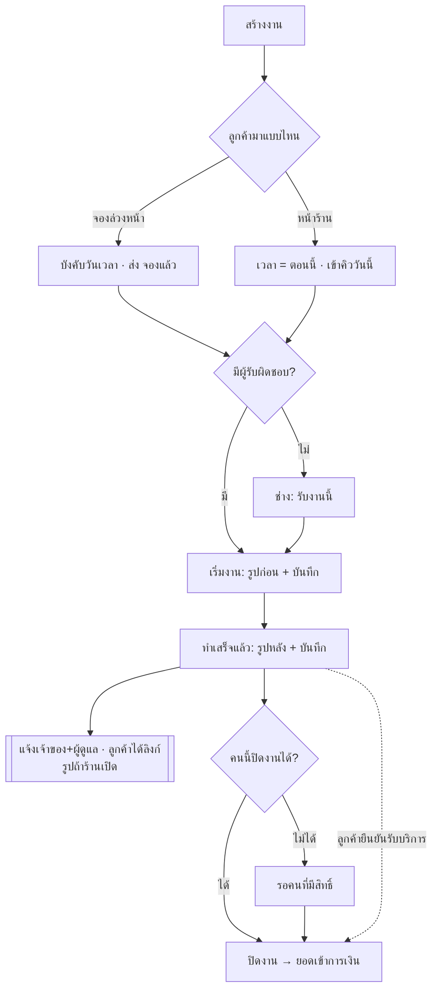
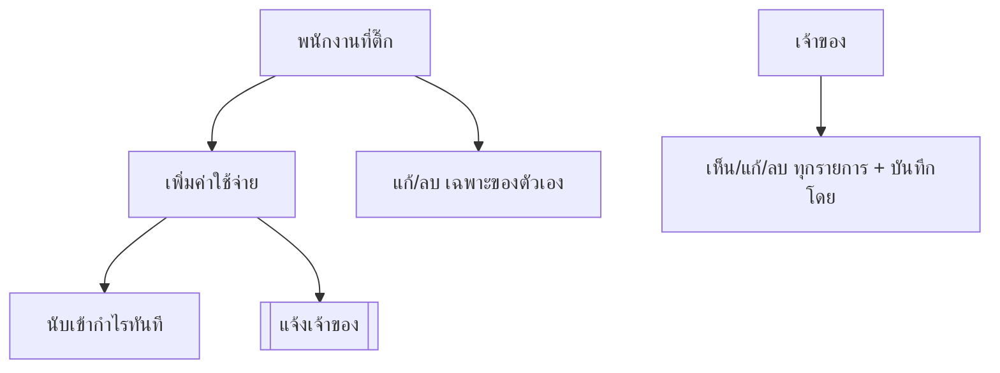

> **โมดูล:** 00086 — Service Staff Workflow
> **ประเภทเอกสาร:** Business Requirements Document (BRD) - NON-TECHNICAL
> **เวอร์ชัน:** 1.0
> **วันที่จัดทำ:** 2026-10-27
> **สถานะ:** Approved — user อนุมัติ 2026-10-27 (PR เดียว · หัวหน้ารับทราบแล้ว) · เพิ่มเกณฑ์จากมติ 2026-10-27..30 (ทำเครื่องหมาย "มติ" · 2026-10-30 = ปรับ UX 6 ข้อ) · โค้ดครบบน branch ยังไม่ merge
> **เจ้าของเอกสาร:** BA
> **ต้นแบบ:** https://claude.ai/artifact/YX6sm8BVzrthy8sqgArkWv (v8)

# BRD: งานพนักงานร้านบริการ (Business Requirements Document)

---

## 1. บทนำ

### 1.1 วัตถุประสงค์ของเอกสาร

เอกสารนี้มีวัตถุประสงค์เพื่อ:
1. กำหนดความต้องการ 4 ข้อของร้านบริการ: แบบการมา · ปิดงานได้รายคน · มุมมองช่าง · บันทึกค่าใช้จ่ายรายคน
2. กำหนดขอบเขต: ร้านบริการ (`SERVICE_QUEUE`) เท่านั้น
3. กำหนดเกณฑ์ยอมรับที่ทดสอบได้ (ตรงกับเคสทดสอบในต้นแบบ 34 เคส)
4. เป็นข้อตกลงร่วมก่อนลงโค้ด

### 1.2 ขอบเขตของระบบ

**งานพนักงานร้านบริการ** คือ ชุดความสามารถที่ทำให้ร้านบริการรู้ว่าลูกค้ามาแบบไหน ใครรับผิดชอบงาน ทำอะไรไปเมื่อไร (พร้อมรูป) ใครปิดงานได้ และใครบันทึกค่าใช้จ่ายได้

**Input:** งานบริการใหม่ · การกดของพนักงาน (รับ/เริ่ม/ทำเสร็จ/ปิด) · รูปและบันทึก · ค่าติ๊กรายคน · รายการค่าใช้จ่าย
**Output:** งานที่มีแบบการมา ผู้รับผิดชอบ ประวัติพร้อมรูป · แจ้งเตือนถึงเจ้าของ/ผู้ดูแล · ข้อความถึงลูกค้า · ค่าใช้จ่ายที่นับเข้ากำไร
**ระบบที่เกี่ยวข้อง:** 00071 บทบาท · 00073/00078/00082 งานบริการ · 00016 ค่าใช้จ่าย · ระบบอัปโหลดกลาง · แอปผู้ขาย (push)

### 1.3 กลุ่มผู้ใช้งาน

| กลุ่มผู้ใช้ | บทบาท | สิทธิ์ที่เกี่ยวกับฟีเจอร์นี้ |
|-----------|--------|----------------|
| **เจ้าของร้าน** | OWNER | ทุกอย่าง · ตั้งค่าการ์ดติ๊ก · ตั้งค่ารูป · เห็น/ลบค่าใช้จ่ายทุกรายการ · รับแจ้งเตือน |
| **ผู้ดูแล** | MANAGER | สร้าง · มอบงาน · เริ่ม/ทำเสร็จ/ปิดงาน (ได้เสมอ) · ตั้งค่ารูป · รับแจ้งเตือน |
| **ตอบแชท** | CHAT | สร้าง · มอบงาน · เริ่ม/ทำเสร็จ · ปิดงานถ้าติ๊ก |
| **เปิดบิล** | BILLING | สร้าง · มอบงาน · เริ่ม/ปิดไม่ได้ |
| **ฝ่ายช่าง** | TECHNICIAN | รับงาน · เริ่ม/ทำเสร็จงานของตัวเอง · ปิดงานถ้าติ๊ก · ไม่เห็นเงิน |
| **พนักงานที่ติ๊ก "บันทึกค่าใช้จ่ายได้"** | บทบาทใดก็ได้ | สร้าง/แก้/ลบค่าใช้จ่ายของตัวเอง |
| **ลูกค้า** | — | เห็นรูปก่อน-หลังถ้าร้านเปิด |

---

## 2. ความต้องการหลัก (Functional Requirements)

### 2.1 ข้อ 1 — แบบการมา

#### FR-001: เลือกแบบการมาตอนสร้างงาน
**User Story:**
> ในฐานะพนักงานหน้าร้าน ฉันต้องการเลือก "จองล่วงหน้า" หรือ "หน้าร้าน" ตอนสร้างงาน เพื่อไม่ต้องกรอกนัดให้ลูกค้าที่อยู่หน้าร้านแล้ว

**Acceptance Criteria:**
- [ ] หน้าสร้างงานบริการ (มือถือ + เดสก์ท็อป + สร้างจากแชท) มีตัวเลือก "ลูกค้ามาแบบไหน" 2 ตัว · ค่าเริ่ม = จองล่วงหน้า
- [ ] **จองล่วงหน้า:** บังคับประเภทงาน + วันที่ + เวลา · ไม่ครบ → บันทึกไม่ได้ ขึ้น "เลือกวันและเวลานัด" (บังคับทั้งหน้าจอและ API)
- [ ] **หน้าร้าน:** ไม่มีช่องวันเวลา · มี "เข้าคิวงานไหน" · เวลาเริ่ม = เวลาบันทึก (server กำหนด) · ไม่เก็บมัดจำ
- [ ] งานหน้าร้านป้าย "รอเริ่มงาน" (ฝั่งร้าน) + ป้ายแบบการมา "หน้าร้าน" · ขึ้นตารางงานวันนี้
- [ ] (มติ 2026-10-30) ป้ายฝั่งร้านของงานหน้าร้านที่ยังไม่เริ่ม = "รอเริ่มงาน" (เดิม "รับงานแล้ว" ชนกับปุ่ม "รับงานนี้") · ตรงกันทุกจุดฝั่งร้าน: การ์ดงาน · รายการแชท (แทน "นัด {วันที่}") · การ์ดออเดอร์ในแชท · แถบสถานะในแชท (+ "กำลังให้บริการ" / "ทำเสร็จ · รอปิดงาน") · ออเดอร์ล่าสุดหน้าแรก · รายชื่อลูกค้า · ฝั่งลูกค้ายัง "รับงานแล้ว" และไม่เห็นขั้นภายในร้าน
- [ ] ปุ่มสร้างจากตารางงานเปิดที่ "จองล่วงหน้า" พร้อมวันที่ของช่องนั้น
- [ ] สร้างจากแชทได้ทั้ง 2 แบบ · ชื่อลูกค้าเติมให้
- [ ] ลำดับหน้าสร้างงาน (ร้านบริการ · ต้นแบบ v13): ลูกค้า → วันที่สั่งซื้อ → ลูกค้ามาแบบไหน → รายการ → วันเข้าใช้บริการ/เข้าคิววันนี้ → ผู้รับผิดชอบ → เพิ่มเติม (ช่องทางการขาย · การชำระเงิน · ส่วนลด · VAT · หมายเหตุ) · ทุกช่องเดิมอยู่ครบ ค่าเริ่มเดิม · ร้านประเภทอื่นฟอร์มเดิม
- [ ] แบบการมาเป็นช่องแยกจากช่องทางการขาย · สร้างจากแชทช่องทางล็อกตามห้องแชท · การ์ดงานในตารางงานขึ้นชื่อช่องทางเฉพาะงานที่มาจากแชท

#### FR-002: เก็บและแสดงแบบการมา
**Acceptance Criteria:**
- [ ] แบบการมาเก็บไว้กับงาน (ไม่คำนวณจากเวลาอีก) · ป้ายทุกจุด (หน้างาน · การ์ดตารางรายวัน · แถบในแชท) อ่านจากค่าที่เก็บ
- [ ] คำบนป้าย: "จองล่วงหน้า" / "หน้าร้าน" / "ยังไม่ระบุเวลา"
- [ ] ใบเก่า: ใส่ค่าจากสูตรเดิม (เวลานัด − เวลาสร้าง > 30 นาที = จอง · ≤ 30 = หน้าร้าน · ไม่มีเวลา = ยังไม่ระบุ) — ป้ายใบเก่าไม่เปลี่ยนความหมาย
- [ ] ใบที่ยังไม่ระบุเวลา: ปุ่ม "เริ่มงานเลย" ในแชทยังใช้ได้ · กดแล้วเป็น "หน้าร้าน"

#### FR-003: ข้อความถึงลูกค้าตอนสร้าง
**Acceptance Criteria:**
- [ ] จองล่วงหน้า → ส่ง "จองแล้ว" (SERVICE_BOOKED) เหมือนเดิม
- [ ] หน้าร้าน → ไม่ส่ง "จองแล้ว"

### 2.2 ข้อ 2 — ปิดงานได้รายคน

#### FR-004: การ์ดติ๊ก "ปิดงานได้"
**User Story:**
> ในฐานะเจ้าของร้าน ฉันต้องการติ๊กว่าพนักงานคนไหนปิดงานได้ เพื่อให้ยอดเข้าการเงินผ่านคนที่ไว้ใจเท่านั้น

**Acceptance Criteria:**
- [ ] หน้า "แก้ไขบทบาท" และ "ลิงก์เชิญพนักงาน" มีการ์ด "ปิดงานได้" ต่อจากบทบาท 4 ใบ หน้าตาเดียวกัน (ร้านบริการเท่านั้น)
- [ ] เลือกผู้ดูแล → การ์ดติ๊กไว้และล็อก ("ผู้ดูแลปิดงานได้อยู่แล้ว")
- [ ] ไม่มีบทบาทที่เริ่มงานได้ (เช่น เปิดบิลอย่างเดียว) → ติ๊กไม่ได้ + "ใช้คู่กับ ตอบแชท หรือ ฝ่ายช่าง"
- [ ] บันทึกแล้วมีผลทันที (ไม่ต้องเข้าระบบใหม่) · รายชื่อพนักงานแสดงชิป "ปิดงานได้"
- [ ] ลิงก์เชิญ: ค่าติ๊กติดไปกับคนที่เข้าผ่านลิงก์
- [ ] (มติ 2026-10-30) กดเพิ่มการ์ด "ฝ่ายช่าง" → "ปิดงานได้" ติ๊กให้อัตโนมัติ · ติ๊กออกเองได้ · แก้บทบาทอื่นของคนที่เป็นช่างอยู่แล้วไม่ติ๊กกลับ · ผู้ดูแลยังติ๊กและล็อก · ใช้ทั้งลิงก์เชิญและแก้ไขบทบาท

#### FR-005: กั้นทุกทางที่ปิดงานได้
**Acceptance Criteria:**
- [ ] คนไม่มีสิทธิ์: ไม่เห็นปุ่ม "ปิดงาน" ใน หน้างาน · ตารางงาน (การ์ดรายวัน) · แชท
- [ ] API ปิดงาน และ API บันทึกผลเข้ารับบริการ ปฏิเสธ (403) คนไม่มีสิทธิ์ — มีเทสทั้ง 2 ทาง
- [ ] "เริ่มงาน" ยังทำได้ตามบทบาทเดิม (แยกจากปิดงาน)
- [ ] ลูกค้ายืนยันรับบริการ = ปิดให้เสมอ (00082 ไม่เปลี่ยน)
- [ ] เปิดงานอีกครั้ง / ยกเลิก / คืนเงิน ไม่เปลี่ยน (เจ้าของ + ผู้ดูแล)

#### FR-006: ค่าเริ่มของคนเดิม
**Acceptance Criteria:**
- [ ] พนักงานร้านบริการที่มีตอบแชทหรือฝ่ายช่างอยู่ก่อนขึ้นระบบ = ติ๊ก "ปิดงานได้" ไว้ (ปิดได้เหมือนเดิม)
- [ ] คนเข้าใหม่ / ลิงก์เชิญใหม่ = ไม่ติ๊ก (เจ้าของเลือก · ค่าในฐานข้อมูลยัง false) — ยกเว้นในหน้าเลือกบทบาท การกดเพิ่ม "ฝ่ายช่าง" ติ๊กให้ก่อน (FR-004 มติ 2026-10-30)

### 2.3 ข้อ 3 — มุมมองช่าง

#### FR-007: ผู้รับผิดชอบงาน
**User Story:**
> ในฐานะพนักงานหน้าร้าน ฉันต้องการมอบงานให้ช่าง และในฐานะช่าง ฉันต้องการรับงานที่ยังไม่มีคนรับ

**Acceptance Criteria:**
- [ ] หน้าสร้างงานมี "ผู้รับผิดชอบ" (ไม่บังคับ) เลือกจากพนักงานฝ่ายช่าง
- [ ] หน้างานแสดงผู้รับผิดชอบ · คนที่แก้งานได้ (เจ้าของ ผู้ดูแล ตอบแชท เปิดบิล) กด "มอบงาน/เปลี่ยน" ได้ ก่อนปิดงาน
- [ ] งานที่ยังไม่มีคนรับ: ช่างเห็นปุ่ม "รับงานนี้" → เป็นผู้รับผิดชอบ
- [ ] ประวัติงานบันทึก "มอบงานให้ …" / "รับงานนี้" พร้อมชื่อคนกดและเวลา
- [ ] (มติ 2026-10-29) คนที่ไม่ได้เป็นช่างแล้ว — ถูกลบออกจากร้าน · ถูกถอดบทบาทฝ่ายช่าง · ถูกเลื่อน/รับโอนเป็นเจ้าของ · ปิดบัญชี — งานที่ยังไม่ปิดของเขากลับเป็น "ยังไม่มีคนรับ" ทันที · ประวัติบอกเหตุ ("ถูกนำออกจากร้าน" / "ไม่ได้เป็นช่างแล้ว") · หน้าจัดการพนักงานบอกจำนวนงานที่กลับเป็น "ยังไม่มีคนรับ" · งานที่ปิดแล้วคงชื่อเดิม

#### FR-008: งานของฉันวันนี้
**Acceptance Criteria:**
- [ ] ช่างล้วน หน้าหลักแสดง "งานของฉันวันนี้ · N งาน" (เฉพาะงานที่ตัวเองรับผิดชอบ) + "ยังไม่มีคนรับ · N งาน"
- [ ] แท็บล่างช่างล้วน: หน้าหลัก · งานของฉัน · ตารางงาน · หน้า "งานของฉัน" มีตัวกรอง งานของฉัน/ทั้งร้าน
- [ ] ตารางงานและแถวงานแสดงชื่อผู้รับผิดชอบ หรือ "ยังไม่มีคนรับ"
- [ ] (มติ 2026-10-27) หน้า "งานของฉัน" ตัวกรอง "งานของฉัน": กลุ่ม **"ค้างจากวันก่อน"** บนสุด = งานของฉันที่เริ่มแล้วแต่ยังไม่ทำเสร็จ/ไม่ปิด และนัดก่อนวันนี้ · ต่อด้วย **"ยังไม่ระบุเวลา"** = งานของฉันที่ไม่มีเวลานัดและยังไม่ปิด · ไม่มีงาน = ไม่แสดงหัวกลุ่ม · ร้านประเภทอื่นเปิดหน้านี้ = ไปหน้ารายการงาน

#### FR-009: เริ่มงานพร้อมรูปก่อนทำ + บันทึก
**Acceptance Criteria:**
- [ ] กด "เริ่มงาน" เปิดแผ่น: รูปก่อนทำ (ถ่ายจากกล้อง/เลือกรูป หลายรูปได้) + "บันทึกก่อนเริ่ม" (ไม่บังคับ)
- [ ] ร้านตั้ง "บังคับ" → ไม่มีรูปกดเริ่มไม่ได้ · "ไม่บังคับ" → ข้ามได้ · "ไม่ใช้รูป" → ไม่มีช่องรูป (บันทึกข้อความได้)
- [ ] ช่างล้วนเริ่มได้เฉพาะงานที่ตัวเองรับผิดชอบ (งานของคนอื่น → "งานนี้เป็นของ …") · งานไม่มีคนรับ → ต้องรับก่อน
- [ ] บันทึกเวลาเริ่ม + ชื่อคนเริ่ม + รูป + บันทึก ลงประวัติงาน · ป้ายสถานะ "กำลังให้บริการ"
- [ ] แจ้งลูกค้าว่าเริ่มงาน (SERVICE_STARTED) เหมือนเดิม
- [ ] ปุ่มเริ่มงานยังขึ้นเมื่อถึงเวลานัด (กติกาเดิม)

#### FR-010: ขั้น "ทำเสร็จแล้ว"
**Acceptance Criteria:**
- [ ] งานที่เริ่มแล้วมีปุ่ม "ทำเสร็จแล้ว" → แผ่นรูปหลังทำ + "ทำอะไรไปบ้าง" · กติการูปเดียวกับ FR-009
- [ ] บันทึกเวลาเสร็จ + ชื่อ + รูป + บันทึก · ป้าย "ทำเสร็จ · รอปิดงาน"
- [ ] "ทำเสร็จ" ไม่เปลี่ยนเงินและไม่ใช่การปิดงาน (ยอดยังเข้าตอนปิดงานตาม 00073)
- [ ] เจ้าของ/ผู้ดูแล/ตอบแชทที่ปิดได้ ปิดงานที่ยังไม่กดทำเสร็จได้ (ข้ามขั้นได้)

#### FR-011: ปิดงานตามสิทธิ์
**Acceptance Criteria:**
- [ ] คนที่ปิดได้ (FR-004/005) เห็น "ปิดงาน" หลังทำเสร็จ · ช่างล้วนปิดได้เฉพาะงานของตัวเอง
- [ ] แผ่นปิดงานของคนที่ไม่มีสิทธิ์รับเงิน: ไม่มีส่วนเงิน + "ยอดที่เหลือให้เจ้าของร้านหรือฝ่ายเปิดบิลบันทึก"
- [ ] (มติ 2026-10-30) ช่างเจ้าของงานที่ไม่มีสิทธิ์ปิด → "ส่งงานแล้ว · รอเจ้าของร้านหรือผู้มีสิทธิ์ปิดงาน" (ไอคอนวงกลมติ๊กถูก) · คนอื่นที่ไม่มีสิทธิ์ (เช่น ตอบแชท) → "ทำเสร็จแล้ว · รอเจ้าของร้านหรือคนที่มีสิทธิ์ปิดงาน" (ไอคอนกุญแจ)
- [ ] (มติ 2026-10-29) งานที่เริ่มแล้ว บันทึก "ไม่มาตามนัด" ไม่ได้ (เริ่มงาน = ลูกค้ามาแล้ว) — ไม่มีตัวเลือกนี้ในแผ่นปิดงานทุกจอ และระบบปฏิเสธถ้าส่งมา

#### FR-012: รูปก่อน-หลังและบันทึกในหน้างาน
**Acceptance Criteria:**
- [ ] หน้างาน (ทุกบทบาทที่เห็นงาน รวมช่าง) มีการ์ด "รูปก่อน-หลัง" (หรือ "บันทึกงาน" ถ้าไม่ใช้รูป) · บอกว่า "ลูกค้าเห็น" / "เห็นเฉพาะในร้าน"
- [ ] ประวัติงานแสดงรูปย่อ + บันทึก ที่ขั้นเริ่มและทำเสร็จ
- [ ] ช่างยังไม่เห็นเงินทุกจุด (รูป/บันทึกเพิ่มเข้า allow-list เท่านั้น)

#### FR-013: ตั้งค่ารูปก่อน-หลังระดับร้าน
**Acceptance Criteria:**
- [ ] หน้า "ประเภทงาน" มีการ์ด "รูปก่อน-หลังงาน": บังคับ / ไม่บังคับ / ไม่ใช้รูป + สวิตช์ "ลูกค้าเห็นรูปและบันทึก" (ปิดเองเมื่อ "ไม่ใช้รูป")
- [ ] ตั้งได้: เจ้าของ + ผู้ดูแล · ค่าเริ่มร้านใหม่/ร้านเดิม = **ไม่บังคับ + ลูกค้าไม่เห็น** (มติ user 2026-10-27 · ร้านเลือกเปลี่ยนเอง)

#### FR-014: แจ้งเตือนเมื่อช่างทำเสร็จ/ปิดงาน
**User Story:**
> ในฐานะเจ้าของร้าน ฉันต้องการได้แจ้งเตือนเมื่อช่างทำเสร็จหรือปิดงาน โดยบอกชื่อช่างและลูกค้า

**Acceptance Criteria:**
- [ ] (มติ 2026-10-30) เหตุการณ์: ทำเสร็จ · ปิดงาน เท่านั้น · รับงาน/เริ่มงานไม่แจ้งแล้ว (ยังขึ้นในประวัติงาน · แจ้งเตือนรับงาน/เริ่มงานเก่ายังเปิดอ่านได้)
- [ ] ผู้รับ: เจ้าของ + ผู้ดูแลของร้าน · ไม่ส่งถึงคนที่กดเอง
- [ ] ช่องทาง: หน้า "การแจ้งเตือน" (กระดิ่ง) + push แอปผู้ขาย
- [ ] ข้อความ: "{ชื่อช่าง} {สิ่งที่ทำ} · {บริการ} · {ชื่อลูกค้า}" + รูปย่อ (ถ้ามี) + ปุ่ม "ดูรายละเอียด" ไปหน้างาน
- [ ] ระบบตอนนี้ของหน้าแจ้งเตือน (สร้างงาน/ลูกค้ายืนยัน/ปิดงาน) ยังอยู่ · งานที่มีแจ้งเตือน "ปิดงาน" ของพนักงานแล้ว ไม่ขึ้นรายการ "ปิดงาน" แบบเดิมซ้ำ
- [ ] ผู้ดูแลที่ถูกถอดสิทธิ์/ออกจากร้านแล้ว ไม่เห็นแจ้งเตือนเดิมของร้านนั้นอีก · มอบงาน และลูกค้ายืนยันรับบริการ ไม่ส่งแจ้งเตือนใหม่

#### FR-015: ลูกค้าเห็นรูปก่อน-หลัง
**Acceptance Criteria:**
- [ ] ร้านเปิด "ลูกค้าเห็นรูปและบันทึก": หน้างานบริการของลูกค้า (`/o/{token}`) มีการ์ด "รูปจากร้าน" ก่อนทำ/หลังทำ + เวลา + บันทึก
- [ ] ร้านปิด / ไม่ใช้รูป → ไม่แสดง
- [ ] (มติ 2026-10-27) หน้าลูกค้าไม่แสดงชื่อช่าง/พนักงานใด ๆ
- [ ] ทำเสร็จ + ร้านเปิด → ส่งข้อความอัตโนมัติ "ทำเสร็จแล้ว ดูรูปก่อน-หลังได้ที่ลิงก์งานบริการ" (ตามกติกาส่งอัตโนมัติเดิม)

#### FR-016: แถบเมนูล่าง ปุ่ม + กลาง
**Acceptance Criteria:**
- [ ] ร้านบริการ บทบาทที่สร้างงานได้: 4 แท็บ + ปุ่ม + ตรงกลางเสมอ (เติมจาก แชท · ร้านค้า · ตารางงาน · ลูกค้า ตามสิทธิ์)
- [ ] เจ้าของ/ผู้ดูแล = หน้าหลัก · บริการ · + · แชท · ร้านค้า (เหมือนเดิม) · ตอบแชท = … · แชท · ตารางงาน · เปิดบิล = … · ตารางงาน · ลูกค้า
- [ ] ร้านประเภทอื่นไม่เปลี่ยน
- [ ] (มติ 2026-10-30) หน้าแรกช่างล้วน (ร้านบริการ): คงตัวนับ + ทางลัด · จอใหญ่การ์ดงานวันนี้อยู่แถวแรกก่อน · ตัวนับงานชื่อ "งานทั้งร้าน" · กิจกรรมล่าสุดที่ลิงก์ไปหน้าที่ช่างเปิดไม่ได้เป็นข้อความเฉย ๆ · ไม่มีกิจกรรม = ไม่มีปุ่ม "สร้างงานบริการ" · ไม่มีทางลัด "ร้านค้า" · เจ้าของ/บทบาทอื่น/ร้านประเภทอื่นเหมือนเดิม
- [ ] (มติ 2026-10-30) ช่างล้วนของร้านบริการไม่เห็นการ์ดแพ็กเกจร้านค้า (แถบข้างจอใหญ่ + ชิปแพ็กเกจบนมือถือ) · พนักงานอื่นยังเห็น (มติ 2026-07-29)

### 2.4 ข้อ 4 — บันทึกค่าใช้จ่ายรายคน

#### FR-017: การ์ดติ๊ก "บันทึกค่าใช้จ่ายได้"
**Acceptance Criteria:**
- [ ] การ์ดใบที่ 6 ในแก้ไขบทบาท + ลิงก์เชิญ (ร้านบริการ) · ทุกบทบาทติ๊กได้ · ค่าเริ่ม = ไม่ติ๊ก
- [ ] รายชื่อพนักงานแสดงชิป "บันทึกค่าใช้จ่ายได้"

#### FR-018: พนักงานบันทึก/แก้/ลบค่าใช้จ่ายของตัวเอง
**User Story:**
> ในฐานะพนักงานที่ได้รับสิทธิ์ ฉันต้องการบันทึกค่าใช้จ่ายหน้างานเอง โดยไม่ต้องรอเจ้าของ

**Acceptance Criteria:**
- [ ] หน้าหลักมีการ์ด "ค่าใช้จ่ายที่ฉันบันทึก" + "เพิ่มค่าใช้จ่าย" → หน้าค่าใช้จ่ายแบบพนักงาน
- [ ] ฟอร์มเดิม: จำนวนเงิน (>0) · หมวดหมู่ 7 แบบ · วันที่เกิดค่าใช้จ่าย · หมายเหตุ
- [ ] เห็นเฉพาะรายการที่ตัวเองสร้าง · แตะรายการ → แก้ไข / ลบ (ยืนยันก่อนลบ)
- [ ] ไม่เห็น: รายการคนอื่น · ยอดรวม · กำไร · รายงาน · แยกหมวด
- [ ] API กรองระดับแถว: GET/PATCH/DELETE รายการของคนอื่น = ไม่พบ/ปฏิเสธ (มีเทส)

#### FR-019: เจ้าของเห็นและจัดการทุกรายการ
**Acceptance Criteria:**
- [ ] หน้าค่าใช้จ่ายเจ้าของเหมือนเดิม + รายการที่พนักงานบันทึกแสดง "บันทึกโดย {ชื่อ}"
- [ ] เจ้าของแก้/ลบได้ทุกรายการ
- [ ] ค่าใช้จ่ายของพนักงานนับเข้ากำไรทันที (รายงานยอดขายและกำไร · P&L)

#### FR-020: แจ้งเจ้าของเมื่อพนักงานบันทึก/แก้/ลบ
**Acceptance Criteria:**
- [ ] "{ชื่อ} บันทึกค่าใช้จ่าย ฿{จำนวน} · {หมวด}" (แก้ไข/ลบ ใช้คำตามจริง) → เจ้าของ (กระดิ่ง + push)

---

## 3. Acceptance Criteria สรุป

### 3.1 ร้านบริการ
- ✅ ทุก FR ข้างบนทำงานเฉพาะร้าน `SERVICE_QUEUE`

### 3.2 ร้านประเภทอื่น
- ✅ หน้าเลือกบทบาท 4 การ์ดเหมือนเดิม · สิทธิ์ปิดงาน/ค่าใช้จ่ายเหมือนเดิม · แถบล่างเหมือนเดิม · หน้าสร้างออเดอร์เหมือนเดิม — มีเทสยืนยัน

### 3.3 ความปลอดภัย
- ✅ ทุกสิทธิ์ใหม่บังคับที่ server · ไม่มีทางปิดงานที่ไม่ผ่านด่าน · ค่าใช้จ่ายกรองตามแถว

---

## 4. Business Flows

### 4.1 Flow หลัก: งานบริการ 1 ใบ

### 4.2 Flow: ค่าใช้จ่ายของพนักงาน

---

## 5. Use Case Scenarios

### Scenario 1: ลูกค้าเข้าหน้าร้าน ช่างไม่มีสิทธิ์ปิด
**ผู้เกี่ยวข้อง:** ฝ้าย (ตอบแชท) · ช่างเอ (ฝ่ายช่าง ไม่ติ๊ก) · เจ้าของ
**ขั้นตอน:** ฝ้ายสร้าง "หน้าร้าน" มอบช่างเอ (ป้าย "รอเริ่มงาน") → ช่างเอเริ่ม (รูป 2) → ทำเสร็จ (รูป 2) → เห็น "ส่งงานแล้ว · รอเจ้าของร้านหรือผู้มีสิทธิ์ปิดงาน" → เจ้าของได้แจ้งเตือน 1 ครั้ง (ทำเสร็จ · เริ่มงานไม่แจ้ง) → เจ้าของปิดงาน + รับเงิน (คนกดเองไม่ได้แจ้งเตือน · ผู้ดูแลได้แจ้งเตือนปิดงาน)
**ผลลัพธ์:** ยอดเข้าการเงินวันที่เจ้าของปิด · ประวัติมีชื่อ/เวลา/รูปครบ

### Scenario 2: จองล่วงหน้า งานยังไม่มีคนรับ
**ขั้นตอน:** เจ้าของสร้าง "จองล่วงหน้า" ไม่เลือกช่าง → ช่างนิดเห็นใน "ยังไม่มีคนรับ" → รับงาน → เริ่ม → ทำเสร็จ → ช่างนิด (ติ๊กปิดงานได้) ปิดงาน (ไม่มีส่วนเงิน)
**ผลลัพธ์:** เจ้าของได้แจ้งเตือน 2 ครั้ง (ทำเสร็จ + ปิดงาน · รับงาน/เริ่มงานไม่แจ้ง) · ยอดค้างให้เจ้าของ/เปิดบิลรับ

### Scenario 3: พนักงานบันทึกค่าใช้จ่าย
**ขั้นตอน:** แนน (เปิดบิล + ติ๊กค่าใช้จ่าย) เพิ่ม "ค่าโฆษณา ฿500" → แก้เป็น ฿650 → เจ้าของได้แจ้งเตือน → เจ้าของเห็น "บันทึกโดย แนน"
**ผลลัพธ์:** กำไรวันนั้นลด ฿650 ทันที · แนนไม่เห็นค่าเช่าของเจ้าของ

### Scenario 4: ร้านนวด (ไม่ใช้รูป)
**ขั้นตอน:** ร้านตั้ง "ไม่ใช้รูป" → หมอนวดเริ่มงาน → แผ่นมีแค่บันทึก → ทำเสร็จด้วยบันทึก
**ผลลัพธ์:** การ์ด "บันทึกงาน" ในหน้างาน · ลูกค้าไม่เห็นอะไรเพิ่ม

---

## 6. ความต้องการด้านคุณภาพ

### 6.1 ความถูกต้องของข้อมูล
- ชื่อคนกดและเวลาในประวัติต้องตรงกับคนที่ login จริง (ไม่ใช่ค่าที่ client ส่งมา)
- ค่าใช้จ่ายของพนักงานต้องนับเข้ากำไรนิยามเดียวกับของเจ้าของ (HR16)

### 6.2 ความรวดเร็ว
- รูปบีบก่อนอัปโหลด (ตัวบีบกลาง) · แผ่นเริ่มงานใช้งานได้ในเน็ตมือถือ

### 6.3 ความน่าเชื่อถือ
- กดเริ่ม/ทำเสร็จ/ปิด/รับงานซ้ำพร้อมกัน → บันทึกครั้งเดียว
- รูปอัปโหลดไม่ครบ → ยังไม่เปลี่ยนสถานะงาน

### 6.4 ความปลอดภัย
- ทุกสิทธิ์ใหม่บังคับที่ API · ค่าใช้จ่ายกรองด้วยผู้สร้างระดับแถว · ช่างไม่เห็นเงินทุก payload

### 6.5 ความสะดวกในการใช้งาน
- หน้าตาตามแอปผู้ขายเดิม (Paces) · การ์ดติ๊กหน้าตาเดียวกับบทบาท · ปุ่ม ≥ 44px

---

## 7. ข้อจำกัด

### 7.1 ข้อจำกัดทางธุรกิจ
- ร้านบริการเท่านั้น · ไม่แตะรายงานกลุ่ม LINE · ไม่ยุบ/เพิ่มบทบาท
### 7.2 ข้อจำกัดทางเทคนิค
- มี migration (HR15) · ไฟล์รูปใช้ทางเก็บไฟล์เดิม (เปิดได้ถ้ารู้ลิงก์ — มติ user)

---

## 8. กฎทางธุรกิจ

### 8.1 กฎปิดงาน
- ปิดได้ = เจ้าของ ∨ ผู้ดูแล ∨ (มีบทบาทที่เริ่มงานได้ ∧ ติ๊ก "ปิดงานได้") · ช่างล้วนต้องเป็นผู้รับผิดชอบงานนั้นด้วย
- ลูกค้ายืนยัน = ปิดให้เสมอ

### 8.2 กฎเริ่ม/ทำเสร็จ
- เริ่ม/ทำเสร็จได้ = บทบาทที่เริ่มงานได้ (O4 เดิม) · ช่างล้วนเฉพาะงานของตัวเอง
- รูปตามการตั้งค่าร้าน

### 8.3 กฎค่าใช้จ่าย
- เจ้าของ: ทุกรายการ · พนักงานที่ติ๊ก: สร้าง + แก้/ลบของตัวเอง · นับเข้ากำไรทันที

### 8.4 กฎแจ้งเตือน
- งานช่าง (ทำเสร็จ · ปิดงาน เท่านั้น — มติ 2026-10-30) → เจ้าของ + ผู้ดูแล · ค่าใช้จ่ายพนักงาน → เจ้าของ · ไม่แจ้งคนที่กดเอง

---

## 9. อภิธานศัพท์
ดู [[PRD]] §7

---

## 10. สรุป

**จุดเด่นของระบบ:** รู้ว่าใครทำอะไรเมื่อไรพร้อมรูป · เจ้าของคุมคนปิดงานและคนบันทึกค่าใช้จ่ายด้วยการติ๊กรายคน · งานหน้าร้านสร้างเร็ว · ร้านอื่นไม่กระทบ

**ผลลัพธ์ที่คาดหวัง:** งานที่เริ่มแล้วมีผู้รับผิดชอบ ≥ 90% · ปิดงานโดยคนไม่มีสิทธิ์ = 0 · ข้อพิพาทมีรูปอ้างอิง

---

**หมายเหตุ:** ภาพรวม/personas/KPI ดู [[PRD]] · technical spec (SRS/SDS/API/DATABASE/TestCase) เขียนหลัง PRD + BRD อนุมัติ
