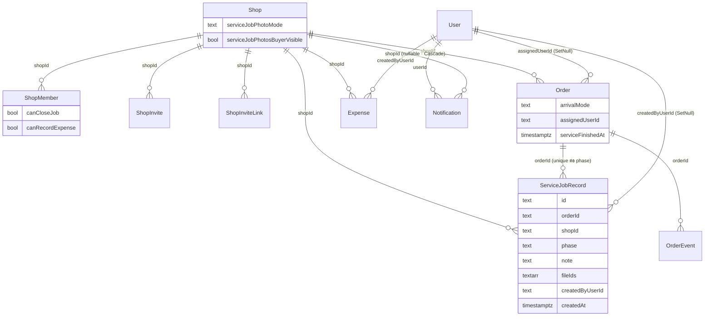

> **โมดูล:** 00086 — Service Staff Workflow
> **ประเภทเอกสาร:** DATABASE
> **เวอร์ชัน:** 1.1
> **วันที่จัดทำ:** 2026-10-27 · sync กับโค้ด 2026-10-29
> **สถานะ:** As-built — migration 11 โฟลเดอร์อยู่บน branch `feat/00086-service-staff-workflow` (**ยังไม่ commit · ยังไม่ merge**) · ⚠️ **4 ตัวแรก (100000 · 100100 · 100150 · 100200) ขึ้น prod ไปแล้วโดยไม่ตั้งใจ 2026-10-27** (§5.0) · อีก 7 ตัวยังไม่ขึ้น prod

# DATABASE: งานพนักงานร้านบริการ

## 1. Overview
Postgres (Supabase prod / local docker 5434) · additive ล้วน (ไม่มี DROP COLUMN/TABLE · ไม่ลบข้อมูล) · migration **11 ตัว** · HR15: merge `main` = `prisma migrate deploy` บน prod อัตโนมัติ — **ก่อน push ต้องแจ้ง user 3 ข้อ** (prod ไม่ต้องสั่งเอง · local ต้อง apply เอง · migrate ล้ม = deploy ไม่ขึ้น) · CHECK ทั้งหมดเป็น unmanaged SQL ⇒ **ห้าม `prisma db pull` / `migrate dev` กับฐานแชร์ (HR13/14)** · 🛑 ห้ามแก้ไฟล์ 4 ตัวที่อยู่บน prod แล้ว (checksum ตรึงใน `_prisma_migrations`)

| รายการ | ค่า |
|---|---|
| ตารางใหม่ | `ServiceJobRecord` |
| คอลัมน์ใหม่ (10) | `ShopMember`/`ShopInvite`/`ShopInviteLink` × (`canCloseJob`, `canRecordExpense`) · `Order` × (`arrivalMode`, `assignedUserId`, `serviceFinishedAt`) · `Shop` × (`serviceJobPhotoMode`, `serviceJobPhotosBuyerVisible`) · `Notification.shopId` |
| CHECK ใหม่ | `ShopMember_flags_admin_only_check` · `Order_arrivalMode_check` · `Order_serviceFinished_requires_started` · `Shop_serviceJobPhoto_check` · `ServiceJobRecord_phase_check` · `ServiceJobRecord_fileIds_max` · `ServiceJobRecord_note_len` |
| CHECK ขยาย | `OrderEvent_type_check` (35 → 39) · `AutoNotifySwitch_kind_check` · `AutoNotifyTemplate_kind_check` · `AutoNotifyLedger_kind_check` (5 → 6) |
| FK ใหม่ | `Order_assignedUserId_fkey` (User · SetNull) · `Notification_shopId_fkey` (Shop · Cascade · NOT VALID) · `ServiceJobRecord_{orderId,shopId,createdByUserId}_fkey` |
| Index ใหม่ | `Order_assignedUserId_serviceStart_idx` · `Expense_shopId_createdBy_expenseDate_idx` · `Notification_userId_shopId_createdAt_idx` · `ServiceJobRecord_orderId_phase_key` (unique) · `ServiceJobRecord_createdByUserId_idx` |
| Backfill | ค่าติ๊กปิดงานของพนักงานเดิม (100000) · แบบการมาของใบเก่า (100200 + รอบซ้ำ 100220) · ล้างธงค้างบนแถว OWNER (100210) — ทุกตัวกั้น `vertical = 'SERVICE_QUEUE'` หรือแถวผิดกติกาเท่านั้น |

### 1.1 มติการออกแบบ
1. `Order.arrivalMode` TEXT `'BOOKED'|'WALK_IN'` · NULL = ยังไม่ระบุเวลา (ร้านบริการ) / ไม่เกี่ยว (ร้านอื่น) · CHECK `arrivalMode IS NULL OR (IN (...) AND serviceStart IS NOT NULL)` · `resolveArrivalMode` เหลือเป็น fallback เมื่อ NULL ∧ มี `serviceStart` · หัวไฟล์ `arrival-mode.ts` ต้องแก้ · ป้าย WALK_IN → "หน้าร้าน" · ทางที่เริ่มงานใบที่ไม่มีเวลา ("เริ่มงานเลย") ต้องเขียน `serviceStart` + `arrivalMode='WALK_IN'` พร้อมกัน
2. ค่าติ๊กรายคน = boolean `canCloseJob`, `canRecordExpense` (default false) บน `ShopMember`, `ShopInvite`, `ShopInviteLink` · **ไม่ใส่ใน `roles[]`** (CHECK จำกัด 1..4 และจะรั่วเข้า `can()`/`moneyLevel()`) · ด่านอยู่ที่ `shop-permissions.ts`: ปิดงาน = OWNER ∨ MANAGER ∨ (canCloseJob ∧ (CHAT ∨ TECHNICIAN)) · flag ไม่มีผลนอก `SERVICE_QUEUE` · รับคำเชิญ + รับลิงก์ต้องคัดลอก flag ทั้งสอง
3. `Order.assignedUserId` → `User` `onDelete SetNull` (ไม่ผูก `ShopMember`) · ปลดผู้รับผิดชอบของงานที่ยังเปิด (`serviceClosedAt IS NULL AND status NOT IN ('CANCELLED','RETURNED')`) ในทรานแซกชันเดียวกับการเปลี่ยนสมาชิก + `OrderEvent SERVICE_UNASSIGNED meta {reason, previousAssigneeNameSnapshot}` (`unassignMemberOpenJobs` · `service-job.service.ts`) ทุกทางที่คนหมดสิทธิ์เป็นช่าง: ลบสมาชิก (`MEMBER_REMOVED`) · ถอดบทบาท `TECHNICIAN` / เลื่อนเป็นเจ้าของ (`ROLE_REMOVED` · `changeMemberRole`) · รับโอนร้าน (`ROLE_REMOVED` · `transferShopOwnership`) · ปิดบัญชี / reclaim บัญชีค้าง (`unassignUserOpenJobsEverywhere` ทุกร้านบริการ · `MEMBER_REMOVED`) · ใบที่ปิดแล้วคงชื่อเดิม · ไม่แตะ `serviceStartedAt`/`serviceFinishedAt`/`ServiceJobRecord` · มอบ/รับงานล็อกแถวสมาชิก `FOR SHARE` ก่อนอ่านบทบาท (กันแข่งกับการถอดบทบาท) · รับงาน = `updateMany WHERE assignedUserId IS NULL` · index `(assignedUserId, serviceStart)`
4. `Order.serviceFinishedAt` timestamptz(3) เขียนครั้งเดียว (`WHERE serviceFinishedAt IS NULL`) · CHECK finished ⇒ started · `reopenServiceJob` ไม่ล้าง · ปิดงานโดยไม่ผ่านทำเสร็จได้
5. ตารางใหม่ `ServiceJobRecord` 1 แถวต่อ (ใบ, ขั้น) · `note` ≤1000 · `fileIds text[]` ≤10 (key เดียวกับ `ChatMessage.imageUrl` / `CustomerFile.fileId`) · `@@unique(orderId, phase)` · insert ในทรานแซกชันเดียวกับการตั้ง `serviceStartedAt`/`serviceFinishedAt` · บันทึก **ไม่อยู่ใน `OrderEvent.meta`** (กติกา PII `order-event.ts:182-186`)
6. `Shop.serviceJobPhotoMode` TEXT default `'OPTIONAL'` (`REQUIRED|OPTIONAL|NONE`) + `Shop.serviceJobPhotosBuyerVisible` bool default false · CHECK `NONE ⇒ ไม่ให้ลูกค้าเห็น` · ไม่ใส่ใน `reportSettings`
7. `OrderEvent` +`SERVICE_ASSIGNED`, `SERVICE_CLAIMED`, `SERVICE_UNASSIGNED`, `SERVICE_FINISHED` (35 → 39) · meta คีย์: `assigneeNameSnapshot`, `previousAssigneeNameSnapshot`, `photoCount`, `hasNote`, `reason` · `reason` ∈ `MANUAL` | `MEMBER_REMOVED` | `ROLE_REMOVED` · AutoNotify kind `SERVICE_FINISHED` เข้า CHECK ของ Switch/Template/Ledger + `KINDS_BY_VERTICAL.SERVICE_QUEUE` · **ไม่มีสวิตช์ของตัวเอง** (`IMPLICIT_KINDS` — ไม่ขึ้นแถวในหน้าตั้งค่าส่งอัตโนมัติ) · ส่งเมื่อ `serviceJobPhotosBuyerVisible` ∧ mode ≠ `NONE` (PRD §10.2 ชนะแบบเดิมที่ต้องเปิดสวิตช์ด้วย)
8. แจ้งเจ้าของ/ผู้ดูแล: ใช้ตาราง `Notification` + `pushToUsers` · kind `service_job_claimed|started|finished|closed` (refId = `publicToken`) — เขียนใหม่เฉพาะ `finished|closed` ตั้งแต่มติ 2026-10-30 (claimed/started คงอ่านได้สำหรับแถวเก่า) / `staff_expense` (refId = expense id) · **เพิ่มคอลัมน์ `Notification.shopId`** (FK Shop Cascade · NULL = แจ้งเตือนระดับบัญชีแบบเดิม · ไม่ backfill) — มติ user 2026-10-27 (แสดงชื่อร้าน + กดแล้วสลับร้าน) · ไม่ derive จาก `activity.service` (ไม่มีสถานะอ่านรายคน · ตัดคนกดไม่ได้ · ไม่มี push) · ผู้อ่านต้องตรงกับผู้รับตอนเขียน (§6)
9. `Expense.createdByUserId` มีอยู่แล้ว (NOT NULL) · เพิ่ม index `(shopId, createdByUserId, expenseDate)`

## 2. ERD


## 3. Tables

### 3.0 Prisma diff
```prisma
// Shop
  serviceJobPhotoMode          String  @default("OPTIONAL")
  serviceJobPhotosBuyerVisible Boolean @default(false)
  serviceJobRecords            ServiceJobRecord[]
// Order (ต่อจาก serviceStartedAt)
  arrivalMode       String?
  serviceFinishedAt DateTime? @db.Timestamptz(3)
  assignedUserId    String?
  assignedUser      User?     @relation("AssignedServiceOrders", fields: [assignedUserId], references: [id], onDelete: SetNull)
  serviceJobRecords ServiceJobRecord[]
  @@index([assignedUserId, serviceStart], map: "Order_assignedUserId_serviceStart_idx")
// ShopMember / ShopInvite / ShopInviteLink
  canCloseJob      Boolean @default(false)
  canRecordExpense Boolean @default(false)
// Expense
  @@index([shopId, createdByUserId, expenseDate], map: "Expense_shopId_createdBy_expenseDate_idx")
// Notification
  shopId String?
  shop   Shop?   @relation("ShopNotifications", fields: [shopId], references: [id], onDelete: Cascade)
  @@index([userId, shopId, createdAt])
// Shop (relation กลับ)
  notifications Notification[] @relation("ShopNotifications")
// User
  assignedServiceOrders Order[]            @relation("AssignedServiceOrders")
  serviceJobRecords     ServiceJobRecord[] @relation("ServiceJobRecordCreatedBy")

model ServiceJobRecord {
  id              String   @id @default(uuid())
  orderId         String
  shopId          String
  phase           String   // BEFORE|AFTER
  note            String?  @db.Text
  fileIds         String[] @default([])
  createdByUserId String?
  createdAt       DateTime @default(now()) @db.Timestamptz(3)
  order     Order @relation(fields: [orderId], references: [id], onDelete: Cascade)
  shop      Shop  @relation(fields: [shopId], references: [id], onDelete: Cascade)
  createdBy User? @relation("ServiceJobRecordCreatedBy", fields: [createdByUserId], references: [id], onDelete: SetNull)
  @@unique([orderId, phase])
  @@index([createdByUserId])
}
```
comment ใน schema ที่ต้องแก้คู่: จำนวนชนิด `OrderEvent` (→ 39) · `Notification.kind` (+`service_job_claimed|started|finished|closed`, `staff_expense`) · `Expense.createdByUserId` ("owner หรือ admin ที่ staffCanViewFinance=true" → "เจ้าของ หรือพนักงานที่ติ๊ก canRecordExpense")

### 3.1 `ShopMember` · `ShopInvite` · `ShopInviteLink` (Postgres)
| คอลัมน์ | ชนิด | กติกา |
|---|---|---|
| `canCloseJob` | boolean NOT NULL default false | ปิดงานได้ (ร้านบริการ) · MANAGER ถือว่า true เสมอที่ด่าน |
| `canRecordExpense` | boolean NOT NULL default false | บันทึกค่าใช้จ่ายของตัวเองได้ |
CHECK `ShopMember_flags_admin_only_check`: `role = 'ADMIN' OR (NOT canCloseJob AND NOT canRecordExpense)` ⇒ ทุกการเขียน `role='OWNER'` (`changeMemberRole`, `transferShopOwnership` `shop-member.service.ts:184`) ต้องเขียน flag = false คู่กัน

### 3.2 `Order`
| คอลัมน์ | ชนิด | กติกา |
|---|---|---|
| `arrivalMode` | text NULL | `BOOKED`/`WALK_IN` · ต้องมี `serviceStart` · เขียนตอนสร้าง / ตั้งนัดครั้งแรก / "เริ่มงานเลย" · เลื่อนนัดไม่เปลี่ยน |
| `assignedUserId` | text NULL FK `User` SetNull | ผู้รับผิดชอบ |
| `serviceFinishedAt` | timestamptz(3) NULL | เวลา "ทำเสร็จ" · เขียนครั้งเดียว · ต้องมี `serviceStartedAt` |
ผู้กดเริ่ม/ทำเสร็จ/มอบ/รับอยู่ที่ `OrderEvent.actorUserId` (แบบเดียวกับ `serviceStartedAt` ของ 00078)

### 3.3 `Shop`
| คอลัมน์ | ชนิด | กติกา |
|---|---|---|
| `serviceJobPhotoMode` | text NOT NULL default `'OPTIONAL'` | `REQUIRED`/`OPTIONAL`/`NONE` |
| `serviceJobPhotosBuyerVisible` | boolean NOT NULL default false | `NONE` ⇒ false (CHECK) |
ค่าเริ่มของทุกร้าน (เดิม + ใหม่) = ไม่บังคับ + ลูกค้าไม่เห็น (มติ user 2026-10-27) — DEFAULT ของ ADD COLUMN ให้ผลนี้กับแถวเดิมทันที ไม่ต้อง UPDATE · ร้านอื่นได้ค่าเดียวกันแต่ไม่มีผู้อ่าน

### 3.4 `ServiceJobRecord` (ใหม่)
| คอลัมน์ | ชนิด | กติกา |
|---|---|---|
| `id` | text PK | uuid (Prisma) |
| `orderId` | text NOT NULL FK `Order` Cascade | |
| `shopId` | text NOT NULL FK `Shop` Cascade | denormalize เพื่อ scope query |
| `phase` | text NOT NULL | CHECK `IN ('BEFORE','AFTER')` |
| `note` | text NULL | CHECK `NULL OR char_length BETWEEN 1 AND 1000` |
| `fileIds` | text[] NOT NULL default `'{}'` | CHECK `cardinality ≤ 10` · storage key (ไม่ใช่ URL) |
| `createdByUserId` | text NULL FK `User` SetNull | ผู้กด (จาก session) |
| `createdAt` | timestamptz(3) NOT NULL default now | |
unique `(orderId, phase)` = กดซ้ำไม่ได้แถวที่สอง

### 3.5 `OrderEvent` / `AutoNotify*`
- `OrderEvent.type` +4 (ดู §1.1 ข้อ 7) · meta ห้ามมีบันทึก/PII
- `AutoNotifySwitch.kind` · `AutoNotifyTemplate.kind` · `AutoNotifyLedger.kind` + `SERVICE_FINISHED` (รายการปัจจุบันตรวจแล้ว: `('ORDER_SUMMARY','TRACKING','SERVICE_BOOKED','SERVICE_STARTED','SERVICE_CLOSED')` — `20261017100100_auto_notify_settings/migration.sql:27,42` · `20261017100200_auto_notify_ledger/migration.sql:21`)

### 3.6 `Expense` · `Notification`
- `Expense`: ไม่เพิ่มคอลัมน์ · index ใหม่ · query ของพนักงานบังคับ `createdByUserId`
- `Notification`: + `shopId TEXT NULL` FK `Shop` ON DELETE CASCADE (NOT VALID — คอลัมน์ใหม่ทุกแถว NULL) + index `(userId, shopId, createdAt)` · kind ใหม่ 5 ค่า (String ไม่มี CHECK): `service_job_claimed` · `service_job_started` · `service_job_finished` · `service_job_closed` · `staff_expense` · แถวที่มี `shopId` อ่านได้เฉพาะเจ้าของปัจจุบันของร้าน (`service_job_*` ผู้ดูแลปัจจุบันด้วย) — relation filter ใน `notification.service.ts` (`visibleShopRow`) · กระดิ่งโดเมนผู้ซื้อ/แอปผู้ซื้อเห็นเฉพาะ `shopId IS NULL`

## 4. Indexes
| ชื่อ | ตาราง | คอลัมน์ | ใช้ที่ |
|---|---|---|---|
| `Order_assignedUserId_serviceStart_idx` | Order | `(assignedUserId, serviceStart)` | "งานของฉัน" (carry-over · ยังไม่ระบุเวลา) · ปลดผู้รับผิดชอบตอนลบสมาชิก/ถอดบทบาท |
| `Notification_userId_shopId_createdAt_idx` | Notification | `(userId, shopId, createdAt)` | หน้า `/notifications` ของร้าน · อ่านทั้งหมดรายร้าน |
| `Expense_shopId_createdBy_expenseDate_idx` | Expense | `(shopId, createdByUserId, expenseDate)` | `GET /api/expenses/mine` |
| `ServiceJobRecord_orderId_phase_key` (unique) | ServiceJobRecord | `(orderId, phase)` | อ่านตามใบ + กันซ้ำ |
| `ServiceJobRecord_createdByUserId_idx` | ServiceJobRecord | `(createdByUserId)` | FK SetNull ตอนลบผู้ใช้ |

## 5. Migration Plan

### 5.0 สถานะจริงของ 11 โฟลเดอร์ (2026-10-29)
| โฟลเดอร์ | เนื้อหา | prod |
|---|---|---|
| `20261027100000_00086_member_permission_flags` | flag 6 คอลัมน์ + CHECK `ShopMember_flags_admin_only_check` + backfill `canCloseJob` | ⚠️ **ขึ้นแล้ว 2026-10-27** |
| `20261027100100_00086_expense_creator_idx` | index Expense | ⚠️ **ขึ้นแล้ว** |
| `20261027100150_00086_notification_shop` | `Notification.shopId` + FK NOT VALID + index | ⚠️ **ขึ้นแล้ว** |
| `20261027100200_00086_order_arrival_mode` | `Order.arrivalMode` + backfill + CHECK | ⚠️ **ขึ้นแล้ว** |
| `20261027100210_00086_member_flags_check_reapply` | ใส่ CHECK flag ซ้ำ (NOT VALID) → ล้างธงค้างบนแถว OWNER → VALIDATE | ยังไม่ขึ้น |
| `20261027100220_00086_arrival_mode_backfill_gap` | backfill `arrivalMode` รอบซ้ำ (UPDATE เดียวกับ 100200 ทุกตัวอักษร) สำหรับใบที่ตกช่องระหว่างสอง deploy | ยังไม่ขึ้น |
| `20261027100300_00086_service_job_assignee_finish` | `assignedUserId` + FK + index · `serviceFinishedAt` + CHECK | ยังไม่ขึ้น |
| `20261027100400_00086_service_job_record` | ตาราง `ServiceJobRecord` | ยังไม่ขึ้น |
| `20261027100500_00086_shop_service_photo_settings` | 2 คอลัมน์ Shop + CHECK | ยังไม่ขึ้น |
| `20261027100600_00086_order_event_staff_types` | `OrderEvent_type_check` 35 → 39 | ยังไม่ขึ้น |
| `20261027100700_00086_auto_notify_service_finished` | AutoNotify CHECK ×3 + `SERVICE_FINISHED` | ยังไม่ขึ้น |

**เหตุการณ์ 2026-10-27 (prod-migrate-incident-00086):** subagent ใช้ `env $E npx prisma migrate deploy` ใต้ zsh — ตัวแปรไม่ถูก word-split ⇒ `DIRECT_URL` ไม่ถูก override ⇒ Prisma อ่าน `.env` (Supabase prod) ⇒ 4 โฟลเดอร์แรกขึ้น prod ก่อน merge (รวม backfill `canCloseJob` + `arrivalMode` บนข้อมูลจริง) · ผลและการรับมือ:
- **CHECK `ShopMember_flags_admin_only_check` บน prod:** โค้ดเก่าบน prod (`changeMemberRole`/`transferShopOwnership`) เลื่อนสมาชิกเป็น OWNER โดยไม่ล้าง flag ⇒ ถ้ามี flag ติดอยู่จะชน CHECK → 500 · **มติ user: ปล่อย CHECK บน prod ไว้ตามเดิม (ไม่ DROP)** จน merge 00086 · `100210` เขียนให้ปลอดภัยทั้งกรณีที่ CHECK ยังอยู่หรือถูกถอด (DROP IF EXISTS → ADD NOT VALID → UPDATE ล้างธงบนแถว OWNER → VALIDATE · รันซ้ำได้) — ⚠️ comment หัวไฟล์ `100210` เขียนว่า "ถอด constraint ออกจาก prod ด้วยมือชั่วคราว (user อนุมัติ)" ขัดกับมตินี้ ดูข้อขัดแย้งในรายงาน docs 2026-10-29
- **ช่องโหว่ arrivalMode:** ใบร้านบริการที่ได้เวลานัดหลัง 100200 รันบน prod จนถึง deploy 00086 จริงมี `serviceStart` แต่ `arrivalMode` = NULL ⇒ `100220` เติมซ้ำด้วยสูตรเดิม (เฉพาะ `arrivalMode IS NULL` — ไม่ทับค่าที่ร้านเลือก) · ฐานที่ไม่ตกช่อง = 0 แถว
- กฎที่ได้: ทุกคำสั่ง prisma/vitest ต้องปักหมุด `DATABASE_URL=… DIRECT_URL=…` localhost:5434 ในคำสั่งตรง ๆ (ห้ามผ่านตัวแปร) และเห็น `Datasource … localhost:5434` ก่อนเชื่อผล

### 5.1 ลำดับการ Migrate
ลำดับตามเฟสใน PR เดียว (P1 → P2 → P3) · 🛑 **ห้าม re-stamp/แก้ 4 โฟลเดอร์ที่อยู่บน prod แล้ว** · ตัวที่ยังไม่ขึ้น (100210+) re-stamp ได้ถ้า `main` มี migration ใหม่กว่าแต่ต้องคงลำดับหลัง 100200 (ล่าสุดตอนเขียน: `20261026100100_00085_order_event_parcel_close_types`)

**P1 `20261027100000_00086_member_permission_flags`**
```sql
SET LOCAL lock_timeout = '5s';
ALTER TABLE "ShopMember"     ADD COLUMN IF NOT EXISTS "canCloseJob" BOOLEAN NOT NULL DEFAULT false, ADD COLUMN IF NOT EXISTS "canRecordExpense" BOOLEAN NOT NULL DEFAULT false;
ALTER TABLE "ShopInvite"     ADD COLUMN IF NOT EXISTS "canCloseJob" BOOLEAN NOT NULL DEFAULT false, ADD COLUMN IF NOT EXISTS "canRecordExpense" BOOLEAN NOT NULL DEFAULT false;
ALTER TABLE "ShopInviteLink" ADD COLUMN IF NOT EXISTS "canCloseJob" BOOLEAN NOT NULL DEFAULT false, ADD COLUMN IF NOT EXISTS "canRecordExpense" BOOLEAN NOT NULL DEFAULT false;
ALTER TABLE "ShopMember" DROP CONSTRAINT IF EXISTS "ShopMember_flags_admin_only_check";
ALTER TABLE "ShopMember" ADD CONSTRAINT "ShopMember_flags_admin_only_check" CHECK ("role" = 'ADMIN' OR (NOT "canCloseJob" AND NOT "canRecordExpense")) NOT VALID;
ALTER TABLE "ShopMember" VALIDATE CONSTRAINT "ShopMember_flags_admin_only_check";
-- backfill (FR-006): พนักงานเดิมของร้านบริการที่มีตอบแชท/ฝ่ายช่าง = ติ๊กปิดงานได้
UPDATE "ShopMember" m SET "canCloseJob" = true FROM "Shop" s
WHERE s."id" = m."shopId" AND s."vertical" = 'SERVICE_QUEUE' AND m."role" = 'ADMIN'
  AND m."roles" && ARRAY['CHAT','TECHNICIAN']::text[] AND m."canCloseJob" = false;
```
คำเชิญ/ลิงก์ที่ค้าง **ไม่ backfill** (คนใหม่เริ่มที่ไม่ติ๊ก ตาม PRD) · ร้านอื่นไม่ถูกแตะ

**P1 `20261027100100_00086_expense_creator_idx`**
```sql
CREATE INDEX IF NOT EXISTS "Expense_shopId_createdBy_expenseDate_idx" ON "Expense" ("shopId", "createdByUserId", "expenseDate");
```

**P2 `20261027100200_00086_order_arrival_mode`**
```sql
SET LOCAL lock_timeout = '5s';
ALTER TABLE "Order" ADD COLUMN IF NOT EXISTS "arrivalMode" TEXT;
-- backfill (FR-002): สูตรเดียวกับ resolveArrivalMode (src/lib/arrival-mode.ts:88) — ทางเดียว ไม่ใช้ abs
UPDATE "Order" o SET "arrivalMode" = CASE WHEN o."serviceStart" - (o."createdAt" AT TIME ZONE 'UTC') > interval '30 minutes' THEN 'BOOKED' ELSE 'WALK_IN' END
FROM "Shop" s WHERE s."id" = o."shopId" AND s."vertical" = 'SERVICE_QUEUE' AND o."serviceStart" IS NOT NULL AND o."arrivalMode" IS NULL;
ALTER TABLE "Order" DROP CONSTRAINT IF EXISTS "Order_arrivalMode_check";
ALTER TABLE "Order" ADD CONSTRAINT "Order_arrivalMode_check" CHECK ("arrivalMode" IS NULL OR ("arrivalMode" IN ('BOOKED','WALK_IN') AND "serviceStart" IS NOT NULL)) NOT VALID;
ALTER TABLE "Order" VALIDATE CONSTRAINT "Order_arrivalMode_check";
```
ยืนยันชนิดคอลัมน์แล้ว: `Order.createdAt` = `DateTime @default(now())` (timestamp ไม่มีโซน เก็บ UTC) · `Order.serviceStart` = `@db.Timestamptz(3)` ⇒ `createdAt AT TIME ZONE 'UTC'` ได้ timestamptz ถูกต้อง · ใบไม่มี `serviceStart` คง NULL (= "ยังไม่ระบุเวลา")

**P1 `20261027100150_00086_notification_shop`** (ขึ้น prod แล้ว)
```sql
SET LOCAL lock_timeout = '5s';
ALTER TABLE "Notification" ADD COLUMN IF NOT EXISTS "shopId" TEXT;
-- DO block: ถ้ายังไม่มี Notification_shopId_fkey → ADD FOREIGN KEY ("shopId") REFERENCES "Shop"("id") ON DELETE CASCADE ON UPDATE CASCADE NOT VALID
CREATE INDEX IF NOT EXISTS "Notification_userId_shopId_createdAt_idx" ON "Notification" ("userId", "shopId", "createdAt");
```
แถวเดิมทั้งหมดคง NULL (ระดับบัญชี) · ไม่มี VALIDATE (ไม่จำเป็น — แถวเดิม NULL ทั้งหมด)

**P2 `20261027100210_00086_member_flags_check_reapply`** (หลัง incident · ยังไม่ขึ้น)
```sql
ALTER TABLE "ShopMember" DROP CONSTRAINT IF EXISTS "ShopMember_flags_admin_only_check";
ALTER TABLE "ShopMember" ADD CONSTRAINT "ShopMember_flags_admin_only_check" CHECK ("role" = 'ADMIN' OR (NOT "canCloseJob" AND NOT "canRecordExpense")) NOT VALID;
UPDATE "ShopMember" SET "canCloseJob" = false, "canRecordExpense" = false WHERE "role" = 'OWNER' AND ("canCloseJob" OR "canRecordExpense");
ALTER TABLE "ShopMember" VALIDATE CONSTRAINT "ShopMember_flags_admin_only_check";
```
ลำดับ NOT VALID → UPDATE → VALIDATE: ไม่มีแถวผิดเกิดใหม่แทรกระหว่างล้างกับตรวจ · ล้างธงบนแถว OWNER ไม่เปลี่ยนสิทธิ์ใคร (เจ้าของทำได้ทุกอย่างอยู่แล้ว)

**P2 `20261027100220_00086_arrival_mode_backfill_gap`** (หลัง incident · ยังไม่ขึ้น) — UPDATE ชุดเดียวกับ 100200 ทุกตัวอักษร (เทส `arrival-mode-backfill-gap.test.ts` เทียบให้) · 🛑 ห้ามรันมือซ้ำหลังขึ้นจริง

**P3 `20261027100300_00086_service_job_assignee_finish`**
```sql
SET LOCAL lock_timeout = '5s';
ALTER TABLE "Order" ADD COLUMN IF NOT EXISTS "assignedUserId" TEXT, ADD COLUMN IF NOT EXISTS "serviceFinishedAt" TIMESTAMPTZ(3);
-- DO block: ถ้ายังไม่มี Order_assignedUserId_fkey → ADD FOREIGN KEY → User ON DELETE SET NULL ON UPDATE CASCADE NOT VALID
ALTER TABLE "Order" VALIDATE CONSTRAINT "Order_assignedUserId_fkey";  -- คอลัมน์ใหม่ NULL ทั้งหมด = สแกนเร็ว
CREATE INDEX IF NOT EXISTS "Order_assignedUserId_serviceStart_idx" ON "Order" ("assignedUserId", "serviceStart");
ALTER TABLE "Order" DROP CONSTRAINT IF EXISTS "Order_serviceFinished_requires_started";
ALTER TABLE "Order" ADD CONSTRAINT "Order_serviceFinished_requires_started" CHECK ("serviceFinishedAt" IS NULL OR "serviceStartedAt" IS NOT NULL) NOT VALID;
ALTER TABLE "Order" VALIDATE CONSTRAINT "Order_serviceFinished_requires_started";
```

**P3 `20261027100400_00086_service_job_record`**
```sql
CREATE TABLE IF NOT EXISTS "ServiceJobRecord" (
  "id" TEXT PRIMARY KEY, "orderId" TEXT NOT NULL, "shopId" TEXT NOT NULL, "phase" TEXT NOT NULL,
  "note" TEXT, "fileIds" TEXT[] NOT NULL DEFAULT '{}'::text[], "createdByUserId" TEXT,
  "createdAt" TIMESTAMPTZ(3) NOT NULL DEFAULT CURRENT_TIMESTAMP,
  CONSTRAINT "ServiceJobRecord_phase_check" CHECK ("phase" IN ('BEFORE','AFTER')),
  CONSTRAINT "ServiceJobRecord_fileIds_max" CHECK (cardinality("fileIds") <= 10),
  CONSTRAINT "ServiceJobRecord_note_len" CHECK ("note" IS NULL OR char_length("note") BETWEEN 1 AND 1000),
  CONSTRAINT "ServiceJobRecord_orderId_fkey" FOREIGN KEY ("orderId") REFERENCES "Order"("id") ON DELETE CASCADE ON UPDATE CASCADE,
  CONSTRAINT "ServiceJobRecord_shopId_fkey" FOREIGN KEY ("shopId") REFERENCES "Shop"("id") ON DELETE CASCADE ON UPDATE CASCADE,
  CONSTRAINT "ServiceJobRecord_createdByUserId_fkey" FOREIGN KEY ("createdByUserId") REFERENCES "User"("id") ON DELETE SET NULL ON UPDATE CASCADE
);
CREATE UNIQUE INDEX IF NOT EXISTS "ServiceJobRecord_orderId_phase_key" ON "ServiceJobRecord" ("orderId","phase");
CREATE INDEX IF NOT EXISTS "ServiceJobRecord_createdByUserId_idx" ON "ServiceJobRecord" ("createdByUserId");
```

**P3 `20261027100500_00086_shop_service_photo_settings`**
```sql
ALTER TABLE "Shop" ADD COLUMN IF NOT EXISTS "serviceJobPhotoMode" TEXT NOT NULL DEFAULT 'OPTIONAL', ADD COLUMN IF NOT EXISTS "serviceJobPhotosBuyerVisible" BOOLEAN NOT NULL DEFAULT false;
ALTER TABLE "Shop" DROP CONSTRAINT IF EXISTS "Shop_serviceJobPhoto_check";
ALTER TABLE "Shop" ADD CONSTRAINT "Shop_serviceJobPhoto_check" CHECK ("serviceJobPhotoMode" IN ('REQUIRED','OPTIONAL','NONE') AND ("serviceJobPhotoMode" <> 'NONE' OR NOT "serviceJobPhotosBuyerVisible")) NOT VALID;
ALTER TABLE "Shop" VALIDATE CONSTRAINT "Shop_serviceJobPhoto_check";
```

**P3 `20261027100600_00086_order_event_staff_types`**
คัดลอกแบบแผนของ `20261026100100_00085_order_event_parcel_close_types` ทุกตัวอักษร (`SET LOCAL lock_timeout` · DO block · อ่านนิยามเดิมจาก `pg_get_constraintdef` · regex เก็บค่าเดิม · ตัวกันจำนวนเครื่องหมายคำพูดไม่ครบ = ล้มเสียงดัง) · ตัวข้าม: `position('SERVICE_FINISHED' IN def) = 0` · ต่อท้าย `'SERVICE_ASSIGNED','SERVICE_CLAIMED','SERVICE_UNASSIGNED','SERVICE_FINISHED'` → 39 ค่า · ห้าม hardcode รายการทับ

**P3 `20261027100700_00086_auto_notify_service_finished`**
สำหรับ `AutoNotifySwitch_kind_check`, `AutoNotifyTemplate_kind_check`, `AutoNotifyLedger_kind_check` ทีละตัว: DO block มีตัวกัน — ถ้านิยามยังไม่มี `'SERVICE_FINISHED'` → `DROP` → `ADD CHECK ("kind" IN ('ORDER_SUMMARY','TRACKING','SERVICE_BOOKED','SERVICE_STARTED','SERVICE_CLOSED','SERVICE_FINISHED')) NOT VALID` → `VALIDATE` (ตรวจรายการปัจจุบันซ้ำก่อนเขียนจริง — §3.5)

### 5.2 Rollback
- additive ล้วน · ไม่มี down migration อัตโนมัติ
- **ห้ามหด CHECK ของ `OrderEvent`/`AutoNotify*` หลังมีแถวชนิดใหม่แล้ว** (VALIDATE จะล้ม/ข้อมูลจริงผิดกติกา)
- **ห้ามรัน UPDATE backfill ค่าติ๊กซ้ำหลังขึ้นระบบ** — จะติ๊กทับคนที่เจ้าของเพิ่งเอาออก
- ถอยก่อนมีข้อมูลจริง (เฉพาะ 7 ตัวที่ยังไม่ขึ้น prod): `DROP TABLE "ServiceJobRecord"` · `DROP CONSTRAINT` `Order_serviceFinished_requires_started` / `Shop_serviceJobPhoto_check` / `Order_assignedUserId_fkey` · `DROP INDEX` `Order_assignedUserId_serviceStart_idx` · `DROP COLUMN` 4 ตัว (`Order.assignedUserId`, `Order.serviceFinishedAt`, `Shop` ×2) — 4 ตัวที่ขึ้น prod แล้วมีข้อมูลจริง (backfill) ถอยเป็น destructive ต้องให้ Controller ถาม user

### 5.3 ผลกระทบ (Impact)
- ร้านบริการ: ตอบแชท/ฝ่ายช่างเดิมปิดงานได้เหมือนเดิม (ติ๊กให้) · ป้ายใบเก่าความหมายเท่าเดิม (สูตรเดียวกัน) · รูป = ไม่บังคับ + ลูกค้าไม่เห็น
- ร้านอื่น: ได้คอลัมน์ default แต่ไม่ถูก backfill และไม่มีผู้อ่าน
- lock: ADD COLUMN NOT NULL DEFAULT (ค่าคงที่) บน PG16 ไม่ rewrite ตาราง · `lock_timeout 5s` กันค้าง
- backfill 100000/100200 รันบน prod ไปแล้ว (incident §5.0) · 100210/100220 แตะเฉพาะแถวผิดกติกา/ตกช่อง (หลักสิบ–ร้อย)
- 🛑 **ก่อน merge ต้องนับแถว `Order` บน prod** (`SELECT count(*) FROM "Order"`) — `100300` สร้าง `Order_assignedUserId_serviceStart_idx` ด้วย `CREATE INDEX` ธรรมดาในทรานแซกชันของ migrate deploy (ใช้ CONCURRENTLY ไม่ได้) ⇒ ล็อกการเขียน `Order` ระหว่างสร้าง · ตารางใหญ่ = Controller ตัดสินแยก index ไปสร้างนอก migrate · `lock_timeout 5s` ทำให้ล้มแทนค้าง (ล้ม = deploy ไม่ขึ้น ลองใหม่ได้)

### 5.4 เทสที่ต้องแก้/เพิ่ม
- `src/lib/__tests__/auto-notify-db-constraint.test.ts:38-50` — needle ของ ledger ต้องเปลี่ยนเป็น `'AutoNotifyLedger_kind_check'` (วันนี้รวม migration ที่พูดถึง `'AutoNotifyLedger_reason_check'` ที่ `:44` ซึ่งจะไม่เจอไฟล์ใหม่)
- `src/lib/auto-notify/__tests__/variables.test.ts:23` · `values.test.ts:96` วนตาม `AUTO_NOTIFY_KINDS` → เพิ่ม `SERVICE_FINISHED`
- `src/lib/order-event.test.ts:22` · `src/services/__tests__/order-event-instrumentation.test.ts:58` วนตาม `ORDER_EVENT_TYPES` → `ORDER_EVENT_META` ต้องมีป้าย 4 ชนิดใหม่ · comment จำนวนใน schema.prisma → 39
- `src/lib/__tests__/shop-roles-db-constraint.test.ts` — เพิ่มเคส `ShopMember_flags_admin_only_check`
- เทส DB ใหม่ (local 5434 · ฐานต้องมี CHECK จริง): `Order_arrivalMode_check` · finished ⇒ started · `Shop_serviceJobPhoto_check` · `ServiceJobRecord` unique/จำนวนรูป/ความยาวบันทึก · backfill ไม่แตะร้านอื่น (รันไฟล์ migration ในทรานแซกชันแล้วย้อน แบบ 00082 TC-015)

## 6. Retention / ข้อควรระวัง
- รูปเก็บเป็น storage key ทางเดิม (เปิดได้ถ้ารู้ key — มติ user · OOS-7) · ลบใบ = ลบแถว record (Cascade) แต่ไม่ลบไฟล์ใน storage
- `ServiceJobRecord.shopId` ต้องตรงกับ `Order.shopId` — บังคับที่ service (ไม่มี composite FK)
- ทุกจุดที่สร้าง/รับสมาชิกต้องคัดลอก flag (มีเทส) · ทุกจุดที่ตั้ง `role='OWNER'` ต้องล้าง flag
- ~~ข้อค้าง `Notification` ไม่มี `shopId`~~ — **ปิดแล้ว** (migration 100150 · มติ user 2026-10-27) · ผู้อ่านต้องตรงกับผู้รับตอนเขียน: แถวร้านเห็นได้เฉพาะเจ้าของปัจจุบัน (`service_job_*` + ผู้ดูแลปัจจุบัน) · ลบร้าน = ลบแจ้งเตือนของร้าน (Cascade)
- รูปงาน: server ตรวจได้แค่ว่า fileId มีอยู่ใน storage ไม่ได้ตรวจว่าใครอัปโหลด (ระบบไม่มีบันทึกเจ้าของไฟล์ purpose IMAGE) — ข้อจำกัดที่ยอมรับ 2026-10-29 · fileId เป็น uuid เดาไม่ได้

## 7. Traceability
| BRD | ส่วน |
|---|---|
| FR-001/002/003 | §3.2 `arrivalMode` · §5.1 P2 |
| FR-004/006/017 | §3.1 · §5.1 P1 |
| FR-007/008 | §3.2 `assignedUserId` · §1.1 ข้อ 3 (ปลดงาน) · §4 |
| FR-009/010/012 | §3.2 `serviceFinishedAt` · §3.4 |
| FR-013/015 | §3.3 · §3.5 AutoNotify |
| FR-014/020 | §3.6 Notification · §5.1 `100150` |
| FR-018/019 | §3.6 Expense · §4 |

## 8. สรุป (Summary)
migration additive 11 ตัว (4 ตัวแรกอยู่บน prod แล้วจาก incident 2026-10-27 · 100210/100220 ซ่อมผลของ incident) · ตารางใหม่ 1 · คอลัมน์ใหม่ 10 · CHECK ใหม่ 7 + ขยาย 4 · backfill กั้นร้านบริการ/แถวผิดกติกา · ก่อน merge นับแถว Order บน prod (index ใหม่) · rollback ได้เฉพาะก่อนมีข้อมูลจริง และห้ามหด CHECK ชนิดเหตุการณ์
