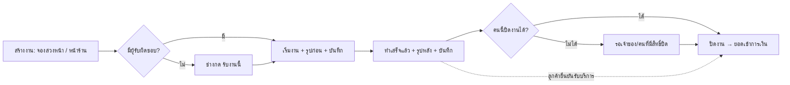

> **โมดูล:** 00086 — Service Staff Workflow
> **ประเภทเอกสาร:** Product Requirements Document (PRD)
> **เวอร์ชัน:** 1.0
> **วันที่จัดทำ:** 2026-10-27
> **สถานะ:** Approved — user อนุมัติ 2026-10-27 (PR เดียว · หัวหน้ารับทราบแล้ว) · โค้ด P1+P2+P3 ครบบน branch 2026-10-29 (ยังไม่ commit · ยังไม่ merge) · มติเพิ่มเติมดู §10.2 (ล่าสุด 2026-10-30: ปรับ UX 6 ข้อ)
> **เจ้าของเอกสาร:** BA + PO + PM
> **ต้นแบบที่ตกลงแล้ว:** https://claude.ai/artifact/YX6sm8BVzrthy8sqgArkWv (v8 · 2026-10-27)

# PRD: งานพนักงานร้านบริการ

---

## Executive Summary

ร้านบริการ (vertical `SERVICE_QUEUE` เท่านั้น) มีพนักงานหลายหน้าที่ — หน้าร้าน แอดมิน ช่าง — แต่ระบบวันนี้ยังไม่รู้ว่าลูกค้า "จองมา" หรือ "เดินเข้าหน้าร้าน", ไม่รู้ว่างานไหนเป็นของช่างคนไหน, ไม่เก็บรูป/บันทึกตอนเริ่มและตอนทำเสร็จ, ไม่แจ้งเจ้าของเมื่อช่างทำงาน และให้ทุกคนที่เริ่มงานได้ปิดงานได้หมด (ยอดเข้าการเงินร้านทันทีที่ปิด) · อีกทั้งค่าใช้จ่ายของร้านบันทึกได้แค่เจ้าของคนเดียว

ฟีเจอร์นี้เพิ่ม 4 เรื่องตามต้นแบบที่ user อนุมัติ:
1. **ตอนสร้างงาน เลือก "จองล่วงหน้า" หรือ "หน้าร้าน"**
2. **"ปิดงานได้" เป็นการ์ดติ๊กรายคน** ในหน้าเลือกบทบาท (หน้าตาเดียวกับบทบาท)
3. **มุมมองช่าง:** งานของฉันวันนี้ · มอบงาน/รับงาน · เริ่มงานพร้อมรูป+บันทึก · ขั้นใหม่ "ทำเสร็จแล้ว" พร้อมรูป+บันทึก · แจ้งเตือนทุกขั้นบอกชื่อช่างและลูกค้า · ปิดงานเฉพาะคนที่มีสิทธิ์ (ไม่มีสิทธิ์ = จบที่ทำเสร็จ)
4. **"บันทึกค่าใช้จ่ายได้" เป็นการ์ดติ๊กรายคน** — พนักงานสร้าง/แก้/ลบได้เฉพาะรายการของตัวเอง · เจ้าของเห็นและลบได้ทุกรายการ

บทบาทหลักคง 4 บทบาทเดิมของ 00071 (ผู้ดูแล · ตอบแชท · เปิดบิล · ฝ่ายช่าง) ไม่ยุบ ไม่เพิ่ม — เพิ่มแค่การ์ดติ๊ก 2 ใบ

---

## 1. Business Goals & KPIs

### 1.1 เป้าหมายทางธุรกิจ

| เป้าหมาย | รายละเอียด |
|----------|-----------|
| **เจ้าของรู้ว่าใครทำอะไร เมื่อไร** | ทุกขั้นของงาน (รับ/เริ่ม/ทำเสร็จ/ปิด) มีชื่อคนทำ เวลา รูป และบันทึก · แจ้งเจ้าของทันทีเมื่อทำเสร็จ/ปิดงาน (มติ 2026-10-30) |
| **ยอดเข้าการเงินถูกคนปิด** | ปิดงานได้เฉพาะคนที่เจ้าของไว้ใจ — ช่างที่ไม่มีสิทธิ์ทำงานจบที่ "ทำเสร็จ" |
| **หลักฐานก่อน-หลังลดข้อพิพาท** | รูปก่อนทำ/หลังทำผูกกับงาน ลูกค้าเห็นได้ถ้าร้านเปิด |
| **ช่างเห็นงานของตัวเอง** | ไม่ต้องไล่ดูตารางทั้งร้าน |
| **งานหน้าร้านไม่ต้องกรอกนัด** | ลูกค้าอยู่หน้าร้าน = เข้าคิววันนี้ทันที |
| **ค่าใช้จ่ายหน้างานบันทึกได้ทันที** | พนักงานที่ได้รับสิทธิ์บันทึกค่าใช้จ่ายเองได้ โดยไม่เห็นกำไรร้าน |

### 1.2 ตัวชี้วัดความสำเร็จ (KPIs)

| KPI | คำอธิบาย | เป้าหมาย |
|-----|----------|---------|
| **งานที่มีรูปก่อนทำ** | งานที่เริ่มแล้วมีรูปก่อนทำ ÷ งานที่เริ่มแล้ว (ร้านที่ตั้ง "บังคับ") | 100% |
| **งานที่มีผู้รับผิดชอบ** | งานที่เริ่มแล้วมีผู้รับผิดชอบ ÷ งานที่เริ่มแล้ว | ≥ 90% ภายใน 1 เดือน |
| **ปิดงานโดยคนไม่มีสิทธิ์** | จำนวนครั้งที่ API ยอมให้คนไม่มีสิทธิ์ปิด | 0 |
| **เวลาสร้างงานหน้าร้าน** | กด + ถึงบันทึก | สั้นกว่าเดิม (ไม่ต้องเลือกวันเวลา) |

---

## 2. User Personas (กลุ่มผู้ใช้งาน)

### 2.1 เจ้าของร้านบริการ
**ข้อมูลพื้นฐาน:** เช่น BT Premium (ร้านแต่งรถ) มีหลายสาขา · พนักงาน 3–10 คน
**เป้าหมาย:** รู้ว่างานเดินไปถึงไหน ใครทำ · ยอดเงินถูกต้อง
**ความต้องการ:** แจ้งเตือนเมื่อช่างทำงาน · เลือกได้ว่าใครปิดงานได้ · เลือกได้ว่าใครบันทึกค่าใช้จ่ายได้
**จุดปวด:** ไม่รู้ว่าช่างคนไหนทำงานไหน · ช่างกดปิดงานเอง (ยอดเข้าการเงินก่อนเจ้าของตรวจ) · ไม่มีรูปก่อน-หลังตอนลูกค้าโต้แย้ง · ต้องบันทึกค่าใช้จ่ายเองทุกรายการ

### 2.2 ช่าง (บทบาท "ฝ่ายช่าง")
**ข้อมูลพื้นฐาน:** ใช้มือถือหน้างาน · ไม่เห็นราคาและแชท (00071)
**เป้าหมาย:** เห็นงานของตัวเองวันนี้ · บันทึกงานเร็ว
**ความต้องการ:** "งานของฉันวันนี้" · ถ่ายรูปจากกล้องตอนเริ่ม/เสร็จ · รับงานที่ยังไม่มีคนรับ
**จุดปวด:** หน้า "งานวันนี้" เป็นงานทั้งร้าน ปนกัน

### 2.3 พนักงานหน้าร้าน / แอดมิน (ตอบแชท · เปิดบิล)
**ข้อมูลพื้นฐาน:** รับลูกค้าหน้าร้าน ตอบแชท เปิดบิล
**เป้าหมาย:** สร้างงานหน้าร้านเร็ว · มอบงานให้ช่าง
**ความต้องการ:** ตัวเลือก "หน้าร้าน" ที่ไม่ต้องกรอกวันเวลา · เลือกผู้รับผิดชอบตอนสร้าง · บันทึกค่าใช้จ่ายหน้างาน (ถ้าได้รับสิทธิ์)
**จุดปวด:** งานหน้าร้านต้องกรอกนัดเหมือนงานจอง หรือไม่กรอกแล้วงานไม่ขึ้นตาราง

### 2.4 ลูกค้าของร้านบริการ
**ความต้องการ:** เห็นรูปก่อน-หลังของงานตัวเอง (ถ้าร้านเปิดให้เห็น)

---

## 3. Business Requirements

### 3.1 ข้อ 1 — แบบการมาของลูกค้า: "จองล่วงหน้า" / "หน้าร้าน"

**ความต้องการ:**
- หน้าสร้างงานบริการมีตัวเลือก "ลูกค้ามาแบบไหน": **จองล่วงหน้า** (นัดวันและเวลา) หรือ **หน้าร้าน** (ลูกค้าอยู่ที่ร้านตอนนี้)
- หน้าร้าน = ไม่ต้องเลือกวันเวลา · เลือกแค่ "เข้าคิวงานไหน" · เวลาเริ่ม = ตอนบันทึก · ไม่เก็บมัดจำ · ขึ้นตารางงานวันนี้ทันที
- จองล่วงหน้า = บังคับวันและเวลานัด (เดิมไม่บังคับ)
- ป้ายบนงาน: "จองล่วงหน้า" / "หน้าร้าน" (เดิมป้าย walk-in เขียน "เดินเข้ามา" — เปลี่ยนเป็น "หน้าร้าน")

**Business Rules:**
- แบบการมาเลือกตอนสร้างและเก็บไว้กับงาน (เดิมคำนวณเอาจาก เวลานัด − เวลาสร้าง)
- ใบเก่าใส่ค่าให้จากสูตรเดิม · ใบเก่าที่ยังไม่มีเวลา = "ยังไม่ระบุเวลา" และปุ่ม "เริ่มงานเลย" ในแชทยังใช้ได้กับใบเหล่านั้น
- งานหน้าร้านไม่ส่งข้อความ "จองแล้ว" ถึงลูกค้า

**เหตุผล:** งานหน้าร้านเป็นงานส่วนใหญ่ของร้านแต่งรถ — บังคับกรอกนัดทำให้ช้า และไม่กรอกก็ไม่ขึ้นตาราง

### 3.2 ข้อ 2 — การ์ดติ๊ก "ปิดงานได้" รายคน

**ความต้องการ:**
- หน้าเลือกบทบาท (แก้ไขบทบาท + ลิงก์เชิญ) เพิ่มการ์ดติ๊ก "ปิดงานได้" ต่อท้ายบทบาท 4 ใบ หน้าตาเดียวกัน · ติ๊ก = ปิดงานได้ · ไม่ติ๊ก = ปิดงานไม่ได้
- รายชื่อพนักงานแสดงชิป "ปิดงานได้"

**Business Rules:**
- ปิดงานได้ = เจ้าของ · ผู้ดูแล (ได้เสมอ การ์ดติ๊กไว้และล็อก) · ตอบแชท/ฝ่ายช่างที่ติ๊ก
- เปิดบิลอย่างเดียวติ๊กไม่ได้ (เริ่มงานไม่ได้) — แสดงเหตุผล "ใช้คู่กับ ตอบแชท หรือ ฝ่ายช่าง"
- **"เริ่มงาน" แยกจาก "ปิดงาน"** — ไม่ติ๊กแล้วยังเริ่มงาน/ทำเสร็จได้
- **ทุกทางที่ปิดงานได้ต้องกั้นสิทธิ์เดียวกัน:** ปุ่มในหน้างาน · ปุ่มในตารางงาน · ปุ่มในแชท · API ปิดงาน · API บันทึกผลเข้ารับบริการ
- ลูกค้ายืนยันรับบริการ = ระบบปิดงานให้เสมอ (00082) ไม่ผ่านด่านนี้
- **คนที่มีอยู่เดิม:** ตอบแชท/ฝ่ายช่างทุกคนได้ติ๊กไว้ให้ก่อน (พฤติกรรมเหมือนเดิม) · คนเข้าใหม่ = ไม่ติ๊ก (ค่าในฐานข้อมูลยังเป็น false)
- **กดเพิ่มการ์ด "ฝ่ายช่าง" = ติ๊ก "ปิดงานได้" ให้อัตโนมัติ** (มติ 2026-10-30) · ติ๊กออกเองได้ · แก้บทบาทอื่นของคนที่เป็นช่างอยู่แล้วไม่ติ๊กกลับให้ · ผู้ดูแลยังติ๊กและล็อกเหมือนเดิม · ใช้ทั้งลิงก์เชิญและแก้ไขบทบาท
- เปลี่ยนแล้วมีผลทันที ไม่ต้องเข้าระบบใหม่

**เหตุผล:** ปิดงาน = ยอดเข้าการเงินร้าน เจ้าของต้องเลือกได้ว่าใครทำได้

### 3.3 ข้อ 3 — มุมมองช่าง

**ความต้องการ:**
- **ผู้รับผิดชอบงาน:** เลือกตอนสร้าง (ไม่บังคับ) · เปลี่ยนได้ในหน้างาน · งานที่ยังไม่มีคนรับ ช่างกด "รับงานนี้" เองได้
- **ร้านที่มีช่างเยอะ (มติ 2026-10-30 · prototype v14):** ช่างไม่เกิน 6 คน = ปุ่มชื่อเรียงกันแบบเดิม · เกิน 6 คน = ช่องเดียวแตะแล้วเปิดรายชื่อพร้อมช่องค้นชื่อ · แต่ละคนบอก "ว่างช่วงนี้" หรือ "ติดงาน 15:30–17:30" ตามวันเวลาของงาน + "วันนี้ N งาน" · คนว่างขึ้นก่อน · ช่องที่เลือกไว้ก็บอกว่าว่าง/ติดงาน — ใช้ทั้งตอนสร้างงานและปุ่ม "มอบงาน/เปลี่ยน" ในหน้างาน
- **หน้าแรกของช่าง:** "งานของฉันวันนี้" + "ยังไม่มีคนรับ" · แท็บล่าง: หน้าหลัก · งานของฉัน · ตารางงาน
- **หน้าแรกของช่างล้วน (ร้านบริการ · มติ 2026-10-30):** คงตัวนับ + ทางลัด แต่ปรับให้เหมาะกับช่าง — จอใหญ่การ์ดงานวันนี้ขึ้นแถวแรกก่อน · ตัวนับงานใช้ชื่อ "งานทั้งร้าน" · กิจกรรมล่าสุดที่ลิงก์ไปหน้าที่ช่างเปิดไม่ได้แสดงเป็นข้อความเฉย ๆ · ไม่มีกิจกรรม = ไม่มีปุ่ม "สร้างงานบริการ" · ตัดทางลัด "ร้านค้า" (บันทึกไม่ได้) · **ซ่อนการ์ดแพ็กเกจร้านค้า** (แถบข้างจอใหญ่ + ชิปแพ็กเกจบนมือถือ) — พนักงานอื่นยังเห็นตามมติ 2026-07-29 · เจ้าของ/บทบาทอื่น/ร้านประเภทอื่นเหมือนเดิม
- **ป้ายงานหน้าร้านที่ยังไม่เริ่ม (ฝั่งร้าน) = "รอเริ่มงาน"** (มติ 2026-10-30 · เดิม "รับงานแล้ว" ชนกับปุ่ม "รับงานนี้" ของช่าง) · ใช้ตรงกันทุกจุด: การ์ดงาน · รายการแชท · การ์ดออเดอร์ในแชท · แถบสถานะในแชท (เพิ่ม "กำลังให้บริการ" / "ทำเสร็จ · รอปิดงาน") · ออเดอร์ล่าสุดหน้าแรก · รายชื่อลูกค้า · ฝั่งลูกค้ายังเห็น "รับงานแล้ว" และไม่เห็นขั้นภายในร้าน
- **เริ่มงาน:** แผ่นถ่ายรูปก่อนทำ + บันทึก · บันทึกเวลาและชื่อคนเริ่ม
- **ขั้นใหม่ "ทำเสร็จแล้ว":** ถ่ายรูปหลังทำ + "ทำอะไรไปบ้าง" · งานขึ้นป้าย "ทำเสร็จ · รอปิดงาน"
- **ปิดงาน:** คนที่มีสิทธิ์เห็นปุ่ม (ช่างไม่มีส่วนรับเงิน) · ช่างเจ้าของงานที่ไม่มีสิทธิ์ = เห็น "ส่งงานแล้ว · รอเจ้าของร้านหรือผู้มีสิทธิ์ปิดงาน" แล้วจบ (มติ 2026-10-30) · คนอื่นที่ไม่มีสิทธิ์ (เช่น ตอบแชท) = "ทำเสร็จแล้ว · รอเจ้าของร้านหรือคนที่มีสิทธิ์ปิดงาน"
- **ประวัติงาน:** รับงาน / มอบงาน / เริ่มงาน / ทำเสร็จ / ปิดงาน พร้อมชื่อคน เวลา รูปย่อ บันทึก
- **แจ้งเตือน:** เมื่อ **ทำเสร็จแล้ว** และ **ปิดงาน** → เจ้าของ + ผู้ดูแล (มติ 2026-10-30: รับงาน/เริ่มงานไม่แจ้งแล้ว — ยังขึ้นในประวัติงาน) (กระดิ่งในหน้าแจ้งเตือน + push แอปผู้ขาย) · ข้อความบอก ชื่อช่าง · สิ่งที่ทำ · บริการ · ลูกค้า (+ รูปย่อ)
- **ตั้งค่ารูปก่อน-หลังระดับร้าน:** บังคับ (≥1 รูป) / ไม่บังคับ / ไม่ใช้รูป (บันทึกข้อความอย่างเดียว) + "ลูกค้าเห็นรูปและบันทึก" เปิด/ปิด
- **ลูกค้า:** หน้างานบริการของลูกค้าแสดง "รูปจากร้าน" ก่อน-หลัง + บันทึก (ถ้าร้านเปิด) · เมื่อทำเสร็จ ส่งข้อความอัตโนมัติ "ทำเสร็จแล้ว ดูรูปก่อน-หลังได้ที่ลิงก์" (ถ้าร้านเปิด)
- **ปุ่ม + กลางแถบล่าง:** บทบาทที่สร้างงานได้มีเมนู 4 ช่อง + ปุ่ม + ตรงกลางเสมอ (เติมด้วยเมนูที่มีสิทธิ์)

**Business Rules:**
- ช่างเริ่ม/ทำเสร็จได้เฉพาะงานที่ตัวเองรับผิดชอบ (หรือรับก่อนแล้วค่อยเริ่ม) · คนที่ไม่ใช่ช่างล้วน (เจ้าของ/ผู้ดูแล/ตอบแชท) ทำแทนได้
- "ทำเสร็จ" เป็น **เวลา** ไม่ใช่สถานะใบ (ยึดมติ 00073: เริ่มงาน = ฟิลด์เวลา)
- ช่างยังไม่เห็นเงิน (00071 allow-list) — รูปและบันทึกเพิ่มเข้า allow-list
- ชื่อบทบาท "ฝ่ายช่าง" คงเดิม · คำเรียกคนในแจ้งเตือนใช้ "ช่าง"
- รูปผ่านตัวบีบรูปกลาง (`uploadToStorage` → image-compress)
- ไฟล์รูปใช้ทางเก็บไฟล์เดิมของระบบ (มติ user: คงแบบเดิม)

**เหตุผล:** เจ้าของต้องการหลักฐานและการติดตามงานรายคน · ช่างต้องการรายการงานของตัวเอง

### 3.4 ข้อ 4 — การ์ดติ๊ก "บันทึกค่าใช้จ่ายได้" รายคน

**ความต้องการ:**
- การ์ดติ๊กใบที่ 6 "บันทึกค่าใช้จ่ายได้" ในหน้าเลือกบทบาท (แก้ไขบทบาท + ลิงก์เชิญ) หน้าตาเดียวกัน
- พนักงานที่ติ๊ก: การ์ด "ค่าใช้จ่ายที่ฉันบันทึก" ที่หน้าหลัก → หน้าค่าใช้จ่ายแบบพนักงาน
- ฟอร์มเดิมของระบบ: จำนวนเงิน · หมวดหมู่ 7 แบบ · วันที่เกิดค่าใช้จ่าย · หมายเหตุ
- เจ้าของ: รายการที่พนักงานบันทึกแสดง "บันทึกโดย …"

**Business Rules:**
- พนักงาน: **สร้าง · แก้ · ลบ ได้เฉพาะรายการที่ตัวเองสร้าง** · ไม่เห็นรายการคนอื่น · ไม่เห็นยอดรวม กำไร รายงาน
- เจ้าของ: เห็น แก้ ลบได้ทุกรายการ
- ค่าใช้จ่ายของพนักงาน **นับเข้ากำไรทันที** (ไม่มีขั้นอนุมัติ)
- พนักงานสร้าง/แก้/ลบ → แจ้งเจ้าของ
- ทุกบทบาทติ๊กได้ (ไม่ต้องคู่บทบาทใด) · ไม่ติ๊ก = ไม่มีทางเข้า

**เหตุผล:** ค่าใช้จ่ายหน้างานเกิดกับพนักงาน — ให้บันทึกได้โดยไม่เปิดเผยกำไรร้าน

---

## 4. Business Rules & Constraints

### 4.1 กฎทางธุรกิจหลัก

| กฎ | คำอธิบาย |
|----|----------|
| **ร้านบริการเท่านั้น** | ทุกการเปลี่ยนกั้นด้วย vertical `SERVICE_QUEUE` · ร้านประเภทอื่นต้องเหมือนเดิมทุกอย่าง (มีเทสยืนยัน) |
| **บทบาทหลักไม่เปลี่ยน** | 4 บทบาทของ 00071 คงเดิม · การ์ดติ๊ก 2 ใบเป็นค่ารายคนเพิ่ม |
| **ปิดงาน = ยอดเข้าการเงิน** | กติกา 00073 เดิม (นับยอดตามวันปิดงาน) ไม่เปลี่ยน |
| **สิทธิ์กั้นที่ server** | หน้าจอซ่อนปุ่มอย่างเดียวไม่พอ — API ต้องปฏิเสธ · ค่าใช้จ่ายกรองระดับแถว |
| **ลูกค้ายืนยัน = ปิดให้เสมอ** | 00082 ไม่กระทบ |

### 4.2 ข้อจำกัดทางธุรกิจ

| ข้อจำกัด | รายละเอียด |
|---------|-----------|
| **ไม่แตะรายงานกลุ่ม LINE** | 00070 / `/lr` / `src/lib/line*` (หัวหน้าดูแล) |
| **มี migration** | เพิ่มคอลัมน์ + แก้ CHECK ชนิดเหตุการณ์ (HR15: push main = migrate prod) |
| **ปุ่ม "เริ่มงาน" ขึ้นเมื่อถึงเวลานัด** | กติกาเดิมคงไว้ (งานหน้าร้านถึงเวลาทันที) |

### 4.3 ลำดับงานภายใน PR เดียว (มติ user 2026-10-27: PR เดียว)

| เฟส | เนื้อหา | เหตุผล |
|-----|--------|--------|
| P1 | ข้อ 2 + ข้อ 4 (การ์ดติ๊ก 2 ใบ + กั้นสิทธิ์ + ค่าใช้จ่ายพนักงาน) | เล็กสุด ปิดช่องโหว่ปิดงานก่อน |
| P2 | ข้อ 1 (แบบการมา) | แยกอิสระ |
| P3 | ข้อ 3 (ผู้รับผิดชอบ · รูป · ทำเสร็จ · แจ้งเตือน · หน้าลูกค้า · แถบล่าง) | ใหญ่สุด มีตารางใหม่ |

ทั้ง 3 ชุดอยู่ใน PR เดียว (ลำดับ batch ตามตาราง) · ไม่ commit จนกว่า user รีวิวโค้ด

---

## 5. Out of Scope (นอกขอบเขต)

| หัวข้อ | คำอธิบาย |
|--------|----------|
| **ร้านประเภทอื่น** | ร้านขายของ / ที่พัก / Personal ไม่เปลี่ยน |
| **ยุบ/เพิ่มบทบาท** | คง 4 บทบาท (มติ user 2026-10-27) |
| **เปลี่ยนชื่อ "ฝ่ายช่าง"** | คงเดิม |
| **ส่งรูปเป็นชุดเข้าแชท** | 00079 เสนอไว้ — รอบนี้ลูกค้าดูรูปผ่านลิงก์หน้างานเท่านั้น |
| **ขั้นอนุมัติค่าใช้จ่าย** | นับทันที (มติ user) |
| **เห็นเฉพาะงานตัวเอง / ซ่อนเบอร์ลูกค้า** | ตัดออกจากต้นแบบแล้ว — ช่างยังเห็นงานทั้งร้านและเบอร์ลูกค้าเหมือนเดิม |
| **ไฟล์รูปแบบเข้ารหัส/หมดอายุ** | คงทางเก็บไฟล์เดิม (มติ user) |
| **รายงานกลุ่ม LINE** | ไม่แตะ |

---

## 6. Risks & Mitigation

### 6.1 ความเสี่ยงทางธุรกิจ

| ความเสี่ยง | ผลกระทบ | ระดับ | แนวทางแก้ไข |
|-----------|---------|------|-------------|
| ช่างที่เคยปิดงานได้ ปิดไม่ได้หลังขึ้นระบบ | งานค้าง "รอปิดงาน" | กลาง | migration ติ๊กให้คนเดิมทุกคน |
| ร้านบังคับรูปแต่ช่างไม่สะดวกถ่าย | เริ่มงานไม่ได้ | กลาง | ร้านเลือก "ไม่บังคับ" / "ไม่ใช้รูป" ได้ |
| รูปลูกค้าเปิดได้ถ้ารู้ลิงก์ | ความเป็นส่วนตัว | กลาง | มติ user คงแบบเดิม · ร้านปิด "ลูกค้าเห็นรูป" ได้ · ร้านนวดค่าเริ่ม "ไม่ใช้รูป" |
| พนักงานบันทึกค่าใช้จ่ายผิด | กำไรเพี้ยน | กลาง | เจ้าของเห็น "บันทึกโดย" + แจ้งเตือนทุกครั้ง + ลบได้ |

### 6.2 ความเสี่ยงทางเทคนิค

| ความเสี่ยง | ผลกระทบ | แนวทางแก้ไข |
|-----------|---------|-------------|
| ลืมกั้นทางปิดงานทางใดทางหนึ่ง | คนไม่มีสิทธิ์ปิดได้ | เทส API ทุกทาง (close / outcome) + เทส inventory ของ route-capabilities |
| แยก canStart/canClose ไม่ครบ | ปุ่มเริ่มงานหาย | เทส ServiceJobCard ทั้ง 2 ค่า |
| CHECK constraint ชนิดเหตุการณ์ | insert ล้ม | migration แก้ CHECK + เทส DB |
| แตะไฟล์ของหัวหน้า (00071 / หน้า seller) | ชนกับงานคนอื่น | PR เล็กตามเฟส + กั้นร้านบริการ + rebase ตาม HR17 |

---

## 7. Glossary

| คำศัพท์ | ความหมาย |
|---------|----------|
| **จองล่วงหน้า** | งานที่มีวันเวลานัด |
| **หน้าร้าน** | ลูกค้าอยู่ที่ร้านตอนสร้าง · เข้าคิววันนี้ทันที |
| **ผู้รับผิดชอบ** | พนักงานที่ถืองานนี้ |
| **ทำเสร็จ** | ช่างบันทึกว่างานเสร็จ (เวลา + รูปหลัง + บันทึก) — ยังไม่ใช่การปิดงาน |
| **ปิดงาน** | บันทึกผล + ยอดเข้าการเงินร้าน (00073) |
| **การ์ดติ๊กรายคน** | ช่องติ๊กในหน้าเลือกบทบาทที่มีผลกับคนนั้นคนเดียว |

---

## 8. Success Metrics

| ตัวชี้วัด | ค่าที่คาดหวัง | วิธีวัด |
|----------|---------------|--------|
| ร้านนำร่องใช้ "หน้าร้าน" | ≥ 50% ของงานใหม่ | นับ arrivalMode |
| งานที่มีผู้รับผิดชอบ | ≥ 90% | นับงานที่เริ่มแล้ว |
| ข้อร้องเรียน "ไม่รู้ใครทำ" | ลดลง | ถามเจ้าของร้านนำร่อง |

---

## 9. Dependencies & Assumptions

### 9.1 Dependencies

| ระบบ/ส่วนประกอบ | ความสัมพันธ์ |
|-----------------|-------------|
| **00071 บทบาท** | ตารางสิทธิ์ · ตัวเลือกบทบาท · ลิงก์เชิญ |
| **00073 / 00078 / 00082 งานบริการ** | เริ่มงาน · ปิดงาน · แจ้งลูกค้าอัตโนมัติ · ลูกค้ายืนยันปิดงาน |
| **00016 ค่าใช้จ่าย** | ฟอร์ม · หมวดหมู่ · รายงานกำไร |
| **ระบบอัปโหลดกลาง** | บีบรูป + เก็บไฟล์ |
| **แอปผู้ขาย (deep-seller-app)** | รับ push |

### 9.2 Assumptions
- ช่างใช้มือถือที่มีกล้อง · แอปผู้ขายมีสิทธิ์กล้องแล้ว (มีอยู่ — แนบรูปในแชท)
- เจ้าของ 1 คนต่อร้านตามเดิม (เจ้าของหลัก)

---

## 10. Appendix

### 10.1 User Journey: ลูกค้าเข้าหน้าร้าน (BT Premium)

1. ฝ้าย (ตอบแชท) กด + → "หน้าร้าน" → เลือกช่องซ่อม 1 · บริการ · ผู้รับผิดชอบ "ช่างนิด" → บันทึก
2. ช่างนิดเห็นงานใน "งานของฉันวันนี้" → เริ่มงาน → ถ่ายรูปโคมไฟ 2 รูป + บันทึก (ไม่แจ้งเจ้าของ — มติ 2026-10-30 · เห็นในประวัติงาน)
3. ช่างนิดทำเสร็จ → ถ่ายรูปหลังทำ + บันทึก → ป้าย "ทำเสร็จ · รอปิดงาน" → แจ้งเตือนเจ้าของ · ลูกค้าได้ลิงก์ดูรูป
4. ช่างนิดไม่ได้ติ๊ก "ปิดงานได้" → งานของช่างจบ · เจ้าของ/ฝ้ายกดปิดงาน + รับเงิน

### 10.2 มติ user ที่ใช้ในเอกสารนี้

| วันที่ | มติ |
|---|---|
| 2026-10-23 | 3 ข้อแรกจากทีม (สร้างงานจอง/หน้าร้าน · ปิดงานได้ · มุมมองช่าง) |
| 2026-10-26 | "ปิดงานได้" = การ์ดติ๊กแบบเดียวกับบทบาท · ตัดสวิตช์รายคนอื่นออก · ร้านบริการเท่านั้น |
| 2026-10-26 | เพิ่มข้อ 4 บันทึกค่าใช้จ่าย · นับทันที · พนักงานแก้/ลบได้เฉพาะของตัวเอง · เจ้าของลบได้หมด |
| 2026-10-27 | คง 4 บทบาท · คนเดิมติ๊กปิดงานให้ · ชื่อ "ฝ่ายช่าง" คงเดิม · ตั้งค่ารูป 3 แบบ · ไฟล์รูปแบบเดิม · ลงโค้ดตามต้นแบบ v8 |
| 2026-10-27 | ค่าเริ่มตั้งค่ารูปของทุกร้านบริการ (เดิม + ใหม่) = **ไม่บังคับ + ลูกค้าไม่เห็น** — ร้านเปลี่ยนเองที่ "ประเภทงาน" (ต้นแบบที่ค่าเริ่มต่างตามประเภทร้านเป็นแค่ตัวอย่าง ระบบจริงไม่รู้ประเภทธุรกิจ) |
| 2026-10-27 | แบบการมา = ช่องใหม่ แยกจากช่องทางการขาย (ช่องทางการขายตอบ "ติดต่อมาทางไหน" · แบบการมาตอบ "จองไว้หรืออยู่ที่ร้าน") · การ์ดงานขึ้นชื่อช่องทางเฉพาะงานที่มาจากแชท (ไม่ขึ้น "หน้าร้าน" ซ้ำ) |
| 2026-10-27 | หน้าสร้างงาน (ร้านบริการ) ตามต้นแบบ v13: ลูกค้า → วันที่สั่งซื้อ → ลูกค้ามาแบบไหน → รายการ → วันเข้าใช้บริการ/เข้าคิววันนี้ → ผู้รับผิดชอบ → เพิ่มเติม (ช่องทางการขาย · การชำระเงิน · ส่วนลด · VAT · หมายเหตุ) · ของเดิมอยู่ครบ ไม่ซ่อน ค่าเริ่มเดิม (หน้าร้าน · เงินสด) · ร้านประเภทอื่นฟอร์มเดิม |
| 2026-10-27 | แจ้งเตือนเพิ่มช่องร้าน (แสดงชื่อสาขา · กดแล้วสลับร้าน) · ข้อความ "ทำเสร็จ ดูรูปได้ที่ลิงก์" ส่งเมื่อร้านเปิด "ลูกค้าเห็นรูป" (ไม่ต้องเปิดสวิตช์แยก) · หน้าตารางงานของร้านบริการแสดงแถบเมนูล่าง |
| 2026-10-27 | หน้าลูกค้า `/o/{token}` **ไม่แสดงชื่อช่าง/พนักงาน** — ลูกค้าเห็นแค่สถานะ + รูป/บันทึกเมื่อร้านเปิด "ลูกค้าเห็นรูป" |
| 2026-10-27 | หน้า "งานของฉัน" มีกลุ่ม **"ค้างจากวันก่อน"** บนสุด (งานที่มอบให้ฉัน เริ่มแล้ว ยังไม่ทำเสร็จ/ไม่ปิด นัดก่อนวันนี้) · ไม่มีงานค้าง = ไม่แสดงกลุ่ม · ต่อมาเพิ่มกลุ่ม **"ยังไม่ระบุเวลา"** (งานของฉันที่ไม่มีเวลานัด) ต่อจากกลุ่มค้าง |
| 2026-10-27 | migration 4 ตัวแรกของ 00086 ขึ้น prod ก่อน merge โดยไม่ตั้งใจ — **ปล่อย CHECK `ShopMember_flags_admin_only_check` บน prod ไว้ตามเดิม (ไม่ DROP)** · ไฟล์ใหม่ 100210/100220 ซ่อมตอน merge · ก่อน merge นับแถว Order บน prod (index ใหม่) |
| 2026-10-29 | **ถอดบทบาทฝ่ายช่าง** (แก้บทบาท · เลื่อนเป็นเจ้าของ · รับโอนร้าน) = งานที่ยังไม่ปิดของคนนั้นกลับเป็น "ยังไม่มีคนรับ" เหมือนลบสมาชิก · ประวัติบอก "ไม่ได้เป็นช่างแล้ว" (ไม่ใช่ "ถูกนำออกจากร้าน") · toast บอกจำนวนงานที่ถูกปลด · ปิดบัญชีก็ปลดเช่นกัน |
| 2026-10-29 | **"ไม่มาตามนัด" หลังเริ่มงานแล้วทำไม่ได้** (เริ่มงาน = ลูกค้ามาแล้ว) — ซ่อนในชีตปิดงานทุกจอ + server ปฏิเสธ 409 |
| 2026-10-29 | ลำดับการ์ดหน้างานของเจ้าของ (มือถือ) **คงแบบเดิม** — วางการ์ดงาน/รูปตามช่องเดิมของการ์ด "งานนี้" · ใส่ hint ใต้สวิตช์ "ลูกค้าเห็นรูปและบันทึก" ว่าระบบจะส่งข้อความพร้อมลิงก์ดูรูปเมื่อช่างกดทำเสร็จ · ช่องแนบรูปไม่บังคับเปิดกล้อง (เลือกจากคลังได้) |
| 2026-10-29 | ข้อจำกัดที่ยอมรับ: ไฟล์รูปเปิดได้ด้วย URL ตรง (ทางเดิม) และระบบไม่ตรวจว่าใครเป็นคนอัปโหลดรูปที่แนบ (ไม่มีบันทึกเจ้าของไฟล์) |
| 2026-10-30 | ป้ายฝั่งร้านของงานหน้าร้านที่ยังไม่เริ่ม = **"รอเริ่มงาน"** (เดิม "รับงานแล้ว" ชนกับปุ่ม "รับงานนี้") · ใช้ทุกจุดฝั่งร้าน (การ์ดงาน · รายการ/การ์ด/แถบสถานะในแชท · ออเดอร์ล่าสุด · รายชื่อลูกค้า) · ฝั่งลูกค้าคง "รับงานแล้ว" |
| 2026-10-30 | ช่างเจ้าของงานที่ทำเสร็จแต่ปิดไม่ได้ เห็น **"ส่งงานแล้ว · รอเจ้าของร้านหรือผู้มีสิทธิ์ปิดงาน"** (แทนข้อความ "คุณไม่มีสิทธิ์ปิดงาน…") · คนอื่นที่ไม่มีสิทธิ์คงข้อความเดิม |
| 2026-10-30 | หน้าแรกช่างล้วน (ร้านบริการ) คงตัวนับ + ทางลัด แต่: การ์ดงานวันนี้ขึ้นก่อน (จอใหญ่) · ตัวนับชื่อ "งานทั้งร้าน" · ลิงก์กิจกรรมที่เปิดไม่ได้เป็นข้อความ · ไม่มีปุ่มสร้างงาน · ตัดทางลัด "ร้านค้า" |
| 2026-10-30 | ซ่อนการ์ดแพ็กเกจร้านค้าสำหรับช่างล้วนของร้านบริการ (แถบข้าง + ชิปมือถือ) · พนักงานอื่นยังเห็น (มติ 2026-07-29 คงเดิม) |
| 2026-10-30 | แจ้งเตือนเจ้าของ/ผู้ดูแล **เหลือ "ทำเสร็จแล้ว" กับ "ปิดงาน"** · รับงาน/เริ่มงานไม่แจ้ง (ยังอยู่ในประวัติงาน · แจ้งเตือนเก่ายังอ่านได้) |
| 2026-10-30 | กดเพิ่มการ์ด "ฝ่ายช่าง" = ติ๊ก "ปิดงานได้" ให้อัตโนมัติ (ติ๊กออกได้ · แก้บทบาทอื่นไม่ติ๊กกลับ · ผู้ดูแลล็อกเหมือนเดิม · ค่าในฐานข้อมูลยัง false) |

---

**หมายเหตุ:** FR / User Story / Acceptance Criteria ดู [[BRD]] · technical spec (SRS/SDS/API/DATABASE/TestCase) เขียนหลัง PRD + BRD ได้รับอนุมัติ
