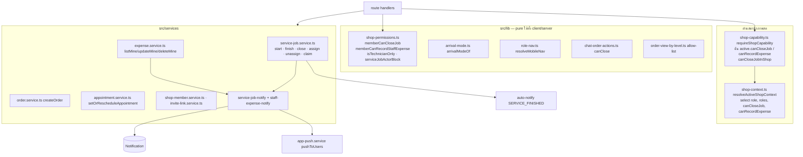
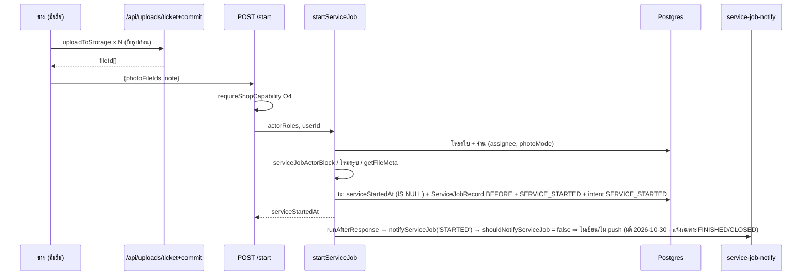

> **โมดูล:** 00086 — Service Staff Workflow
> **ประเภทเอกสาร:** System Design Spec (SDS)
> **เวอร์ชัน:** 1.0
> **วันที่จัดทำ:** 2026-10-27
> **สถานะ:** As-built (sync 2026-10-29 · ปรับตามมติ UX 2026-10-30 ดู §3.18) — P1+P2+P3 ลงโค้ดครบบน branch `feat/00086-service-staff-workflow` (ยังไม่ commit · ยังไม่ merge) · ส่วนที่โค้ดจริงต่างจากแบบเดิมสรุปที่ §3.18 · สัญญา API ตรงโค้ด = [[API]] v1.1

# SDS: งานพนักงานร้านบริการ

## 1. บทนำ & References

### 1.1 วัตถุประสงค์
ออกแบบการต่อ 4 เรื่อง (แบบการมา · ปิดงานได้รายคน · มุมมองช่าง · ค่าใช้จ่ายพนักงาน) เข้ากับโค้ดเดิมของ 00071/00073/00078/00082/00016 โดยมีด่านสิทธิ์จุดเดียว และไม่เปลี่ยนพฤติกรรมของร้านประเภทอื่น

### 1.2 ขอบเขตการออกแบบ
ด่านสิทธิ์รายคน · การอ่านค่าติ๊กสด · route/service งานบริการ (start/finish/close/outcome/assign/claim) · ทางสร้างงานทุกทาง · การ์ด/ปุ่มในหน้างาน ตารางงาน แชท · แจ้งเตือน · หน้า `/o/[token]` · แถบล่าง · ค่าใช้จ่ายพนักงาน · ลบสมาชิก

### 1.3 เอกสารอ้างอิง
[[PRD]] · [[BRD]] · [[SRS]] · [[API]] · [[DATABASE]] · `docs/scope/2026-10-27-00086-scope-baseline.md`

## 2. Architecture Overview

### 2.1 มุมมองสถาปัตยกรรม


### 2.2 มุมมองการ Deploy (ถ้าจำเป็น)
ไม่เปลี่ยน · migration 8 ตัวรันตอน merge (HR15) · แอปผู้ขายเป็น WebView — ไม่ต้อง build native (OOS-14) · สิทธิ์กล้องในแอปมีแล้ว (แนบรูปในแชท)

## 3. Component Design

### 3.1 ด่านสิทธิ์กลาง (pure · `src/lib/shop-permissions.ts`)
```ts
export type StaffFlags = { canCloseJob?: boolean; canRecordExpense?: boolean }   // undefined = false

/** ช่างล้วน — นิยามเดียวกับแท็บ "งาน" ใน role-nav.ts */
export function isTechnicianOnly(roles: readonly ShopRole[]): boolean

/** ด่านปิดงาน (close + outcome + ปุ่มทุกจุด) */
export function memberCanCloseJob(
  shop: { vertical: string; kind?: string }, roles: readonly ShopRole[], flags?: StaffFlags,
): boolean
//  ไม่ใช่ร้านบริการ (canUseAppointments) → can(roles,'O4')   (ร้านอื่นเท่าเดิม · ไม่อ่าน flag) — เช็ก vertical ก่อนเสมอ
//  OWNER ∨ MANAGER → true
//  else flags?.canCloseJob === true ∧ (CHAT ∈ roles ∨ TECHNICIAN ∈ roles)

/** ด่านค่าใช้จ่าย "ของพนักงาน" — เจ้าของไม่ผ่านทางนี้ (ใช้ F1/F2 เดิม) */
export function memberCanRecordStaffExpense(shop, role: string, flags?: StaffFlags): boolean
//  ไม่ใช่ร้านบริการ → false · else role === 'ADMIN' ∧ flags?.canRecordExpense === true

/** สถานะการ์ด "ปิดงานได้" ในฟอร์มสมาชิก */
export function closeJobFlagState(roles: readonly string[]): 'LOCKED_ON' | 'DISABLED' | 'EDITABLE'

/** ช่างล้วนทำกับใบนี้ได้ไหม (start/finish/close) — null = ได้ */
export function serviceJobActorBlock(
  roles, order: { assignedUserId: string | null }, userId: string,
): null | 'UNASSIGNED' | 'NOT_ASSIGNEE'
```
- 🛑 **ห้ามใช้ชื่อ `canCloseServiceJob`** — มีอยู่แล้วที่ `src/lib/service-status.ts:136` (เช็กสถานะใบ: ยังไม่ปิด ∧ PENDING/CONFIRMED/SHIPPED) ถูก import ใน `service-job.service.ts:15` และ `ServiceJobCard.tsx:27` · สองความหมายนี้ต้องใช้ร่วมกัน (สิทธิ์ ∧ สถานะ) จึงห้ามชื่อชน
- พารามิเตอร์ `flags` เป็น optional แต่ **ค่าที่ไม่ได้ส่ง = false** (fail-closed · permission-gate-follows-the-row) — ลืมส่ง = ปิดงาน/บันทึกไม่ได้ ไม่ใช่เปิดกว้าง
- ตัวตัดสินประเภทร้านใช้ `canUseAppointments` (ตัวเดียวกับที่ `effectiveRoles` ใช้ตัด BILLING) ไม่ใช่ `usesServiceFinanceRules` — ผลเท่ากัน (`=== 'SERVICE_QUEUE'`) แต่ไม่ผูกสิทธิ์กับโดเมนเงิน
- ตัวช่วย async ใน `src/lib/shop-capability.ts`: `canCloseJobInShop(shopId, userId)` (1 query · กฎสมาชิกเดียวกับ `canAccessShopWith`) สำหรับจุดที่รู้ shopId จากแถว (เธรดแชทข้ามร้าน)
- เทส: ตาราง vertical × บทบาท 1-4 ตัว × flag (mutation: ถอดเงื่อนไข vertical / ถอด `CHAT ∨ TECHNICIAN` ต้องแดง)

### 3.2 อ่านค่าติ๊กสด (มีผลคำขอถัดไป ไม่ต้องเข้าระบบใหม่ · FR-004)
- `resolveActiveShopContext` (`src/lib/shop-context.ts`) select `{ role, roles }` → เพิ่ม `canCloseJob, canRecordExpense` · คืนเป็นฟิลด์ระดับบนของ context (PERSONAL = false ทั้งคู่)
- `ActiveShop` เพิ่ม `canCloseJob?`, `canRecordExpense?` (ค่าดิบ) · `requireShopCapability` คืน `active` เดิม ⇒ route ส่ง `gate.active` เป็น `flags` ให้ตัวตัดสิน · `canAccessShopWith`/`listAccessibleShopIds` select ชุดเดียวกัน (`MEMBER_SELECT`)
- `canAccessShopWith` / `userIdsHoldingCap` ไม่ต้องรู้ flag
- ไม่เก็บ flag ใน JWT/session (`session.activeShopRoles` แสดงผลเท่านั้น — กติกาเดิมของ 00071)

### 3.3 ตัวเลือกบทบาท (`StaffRolePicker` + `src/lib/shop-role-picker.ts`)
- prop ใหม่บังคับ `flagsAvailable: boolean` (= `vertical === 'SERVICE_QUEUE'` · ไม่มีค่าตั้งต้น) + `flags` / `onFlagsChange`
- สถานะการ์ดใช้ `closeJobFlagState(selected)` จาก `shop-permissions.ts` (MANAGER → LOCKED_ON "ผู้ดูแลปิดงานได้อยู่แล้ว" · มี CHAT/TECHNICIAN → EDITABLE · อื่น → DISABLED "ใช้คู่กับ ตอบแชท หรือ ฝ่ายช่าง") · copy การ์ด + การปรับค่าตามสถานะ (DISABLED ⇒ false · LOCKED_ON ⇒ true) อยู่ที่ `shop-role-picker.ts`
- (มติ 2026-10-30) `flagsAfterRoleToggle(prevRoles, nextRoles, flags)` (`shop-role-picker.ts`): บทบาท `TECHNICIAN` **ถูกเพิ่ม** (ไม่อยู่ใน prev แต่อยู่ใน next) ⇒ `canCloseJob = true` · กรณีอื่นคงค่าเดิม (แก้บทบาทอื่นของคนที่ถือ TECHNICIAN อยู่แล้วไม่ติ๊กกลับ · ติ๊กออกได้) แล้วปรับตามสถานะการ์ดเหมือนเดิม (MANAGER ⇒ LOCKED_ON) · `StaffRolePicker` เรียกตอนสลับการ์ดบทบาท จึงมีผลทั้ง `InviteLinkModal` และ `MemberRolesEditor` · default DB ยัง false
- การ์ดใบที่ 5/6 ใช้โครง `<label>` เดียวกับการ์ดบทบาท (`StaffRolePicker.tsx:50-71`) · ผู้ใช้: `MemberRolesEditor.tsx` · `InviteLinkModal.tsx`
- ร้านอื่น: `flagsAvailable=false` ⇒ ไม่ render การ์ด 5/6 (4 การ์ดเหมือนเดิม · เทส)
- รายชื่อพนักงาน: ชิป "ปิดงานได้" / "บันทึกค่าใช้จ่ายได้" จาก `listMembers` (`shop-member.service.ts:206`)

### 3.4 สมาชิก/คำเชิญ (server)
| จุด | การเปลี่ยน |
|---|---|
| `ChangeMemberRoleSchema` (`validations.ts:2420`) | + `canCloseJob?`, `canRecordExpense?` · `v.check` "ต้องส่งอย่างน้อย 1 ฟิลด์" ขยายให้รวม flag |
| `changeMemberRole` (`shop-member.service.ts:138`) | validate flag ด้วยกติกาเดียวกับ `normalizeFlags` (server ไม่ยอม flag ขัดบทบาท → 400) · **เลื่อนเป็น OWNER ⇒ เขียน flag=false** (CHECK `ShopMember_flags_admin_only_check`) |
| `transferShopOwnership` (`shop-member.service.ts:184`) | `data: { role:'OWNER', roles:[], canCloseJob:false, canRecordExpense:false }` |
| `inviteShopMember` (`:46`) · `createInviteLink` (`invite-link.service.ts:68`) | เขียน flag ที่ส่งมา (ร้านอื่น = บังคับ false) |
| `acceptShopInvite` (`:79`) · `acceptInviteLink` (`invite-link.service.ts:185`) | `create` ของ `upsert` คัดลอก flag ทั้งสอง |
| `removeShopMember` (`:112-118`) | ดู §3.11 |

### 3.5 ทางสร้างงานทุกทางที่ต้องตั้ง `arrivalMode` (inventory · ตรวจจากโค้ดจริง)
ตัวเขียน `Order.serviceStart` มี **2 ตัวเท่านั้น** (`allocateSeat` ถูกเรียกจาก `attachAppointmentInTx` `appointment.service.ts:346` และ `setOrRescheduleAppointment` `:285`) · ไม่มีทางไหนล้าง `serviceStart` เป็น null

| # | ทางเข้า | ปลายทาง | ค่าที่ตั้ง |
|---|---|---|---|
| 1 | ฟอร์มสร้างงานมือถือ `(fullscreen)/orders/new` | `OrderCreateForm.tsx:912` → `POST /api/orders` → `createOrder` | ตัวเลือก "ลูกค้ามาแบบไหน" (ค่าเริ่ม `BOOKED`) |
| 2 | ฟอร์มสร้างงานเดสก์ท็อป `(dashboard)/orders/new` | เดียวกับ #1 | เดียวกัน |
| 3 | สร้างจากแชท (แบบร่าง) | `DraftOrderProvider` → `OrderCreateForm` → `POST /api/orders` | ทั้ง 2 แบบ · ชื่อลูกค้าเติมจากเธรด (เดิม) |
| 4 | ปุ่มสร้างจากช่องในตารางงาน | `/orders/new` + วันที่ของช่อง | `BOOKED` + วันที่ช่อง |
| 5 | "เริ่มงานเลย" (ใบยังไม่ระบุเวลา) | `StartWalkInSheet.tsx:170` → `PATCH /api/orders/[token]/appointment` | ส่ง `arrivalMode:'WALK_IN'` |
| 6 | ตั้งนัดครั้งแรกจากหน้างาน (ใบยังไม่ระบุเวลา) | `RescheduleAppointmentSheet.tsx` → PATCH เดียวกัน | ไม่ส่ง ⇒ `BOOKED` |
| 7 | เลื่อนนัด | PATCH เดียวกัน | ไม่เปลี่ยน (`arrivalMode` มีค่าแล้ว) |
| — | ลูกค้าจองเอง | **ไม่มี** สำหรับร้านบริการ (ฝั่งลูกค้ามีแค่ `appointment/confirm`, `reschedule-request`) | — |
| — | `booking.service` (ที่พัก) · `auto-order-detect` (ONLINE_SALES — `order.service.ts:1041`) · ประมูล | ไม่มีนัดบริการ | ไม่แตะ |
| — | แก้ไขใบ `PATCH /api/orders/[token]` | ไม่มีบล็อกนัด | ไม่รับ `arrivalMode` |

`createOrder` (`order.service.ts:317`):
- parse `arrivalMode` แยกจาก `CreateOrderSchema` (แบบเดียวกับ `appointment` ที่ `api/orders/route.ts:113-135`) — schema ก้อนนั้นถูกใช้ซ้ำโดย PATCH แก้ไข จึงไม่เพิ่มฟิลด์ลงไป
- ร้านบริการ (`vertical = SERVICE_QUEUE`): `arrivalMode` บังคับเมื่อส่งนัดมา (ไม่มีนัด + ไม่ส่ง = null แบบเดิม) · `WALK_IN` ⇒ `walkInWindow(keyedInAt, durationMin ?? resource.durationMinutes)` (start/end/มัดจำจาก client ถูกละ) · `appointmentDeposit` = undefined (NULL) · ไม่เรียก `reserveAutoNotifyIntent` เลย · `BOOKED` ⇒ ต้องมี resourceId/start/end · ร้าน `appointmentGranularity = TIME` ห้ามนัดทั้งวัน · เขียน `arrivalMode` ใน `attachAppointmentInTx` หลัง `allocateSeat` (CHECK ต้องมี serviceStart) · ร้านอื่นละทิ้ง (NULL)
- `tx.order.create` เขียน `arrivalMode` · หลัง `attachAppointmentInTx` (`:788`) เขียน `assignedUserId` + `OrderEvent SERVICE_ASSIGNED` ถ้าส่งมา
- `reserveAutoNotifyIntent` kind (`:803`): `arrivalMode === 'BOOKED' ? 'SERVICE_BOOKED' : 'ORDER_SUMMARY'` (ร้านบริการไม่มี `ORDER_SUMMARY` ใน `KINDS_BY_VERTICAL` ⇒ ไม่ส่ง = FR-003)

`setOrRescheduleAppointment` (`appointment.service.ts:228`): select `arrivalMode` เพิ่ม · `update.data.arrivalMode = current.arrivalMode ?? (input.arrivalMode ?? 'BOOKED')` · `SetAppointmentSchema` + `arrivalMode?: 'WALK_IN'`

### 3.6 ป้ายแบบการมา (`src/lib/arrival-mode.ts`)
- เพิ่ม `arrivalModeOf(o: { arrivalMode: string|null; serviceStart; createdAt }): ArrivalMode` — ค่าที่เก็บก่อน · null + มี `serviceStart` ⇒ `resolveArrivalMode` (fallback สำหรับร้านที่เปลี่ยน vertical ทีหลัง) · null + ไม่มี ⇒ `UNSCHEDULED`
- จุดแสดง 3 จุดเปลี่ยนมาเรียก `arrivalModeOf`: `AppointmentCard.tsx:94` · `OrderProgressBar.tsx:310` · `AppointmentDayCard.tsx:203` (payload `appointments/day` + `types.ts:39` ต้องส่ง `arrivalMode`)
- `ARRIVAL_MODE_META.WALK_IN.label` "เดินเข้ามา" → "หน้าร้าน" · hint ปรับ · หัวไฟล์ "ทำไม derive ไม่ใช่เพิ่มคอลัมน์" (`:8-13`) ต้องเขียนใหม่ให้ตรงมติ 00086 (ค่าเลือกตอนสร้าง = ความจริงของเจ้าของ ไม่ใช่ธงอนุมาน)

### 3.7 ServiceJobCard — แยก canStart / canFinish / canClose
วันนี้ `canClose = can(viewerRoles,'O4')` (`orders/[token]/page.tsx:644`, `TechnicianOrderDetail.tsx:153`) คุมทั้งปุ่มเริ่ม (`ServiceJobCard.tsx:169,172`) และปุ่มปิด (`:186`)

| prop ใหม่ | ค่า (คำนวณที่หน้า RSC) |
|---|---|
| `canStart` | `can(roles,'O4') && serviceJobActorBlock(roles, order, userId) === null` |
| `canFinish` | เท่า `canStart` |
| `canClose` | `memberCanCloseJob(shop, roles, active) && serviceJobActorBlock(...) === null && (!isTechnicianOnly(roles) \|\| order.serviceFinishedAt != null)` |
| `canAssign` | `can(roles,'O2s')` |
| `canClaim` | `can(roles,'O4') && roles.includes('TECHNICIAN') && order.assignedUserId == null` |
| `photoMode` · `photosBuyerVisible` | จากแถวร้าน |

- แผ่นเริ่มงาน/ทำเสร็จ (ใหม่ · `ServiceJobPhotoSheet`): ถ่าย/เลือกหลายรูป → `uploadToStorage({purpose:'IMAGE'})` ทีละรูป (ผ่านตัวบีบกลาง) → ครบทุกรูปแล้วจึงยิง start/finish (อัปไม่ครบ = ไม่ยิง = สถานะไม่เปลี่ยน)
- ไม่มีสิทธิ์ปิดหลังทำเสร็จ: ข้อความ FR-011 ตรงตัวอักษร (มติ 2026-10-30) — ช่างล้วนผู้รับผิดชอบ = "ส่งงานแล้ว · รอเจ้าของร้านหรือผู้มีสิทธิ์ปิดงาน" (ไอคอน circle-check) · คนอื่นที่ไม่มีสิทธิ์ (เช่น ตอบแชท) = "ทำเสร็จแล้ว · รอเจ้าของร้านหรือคนที่มีสิทธิ์ปิดงาน" (ไอคอน lock)
- แผ่นปิดงานของผู้ไม่มี O5: ไม่มีส่วนเงิน + "ยอดที่เหลือให้เจ้าของร้านหรือฝ่ายเปิดบิลบันทึก" (เดิมซ่อนส่วนเงินด้วย `money` ที่ไม่ถูกส่งอยู่แล้ว)

### 3.8 AppointmentDayCard / ตารางงาน
- `AppointmentBoardCaps` (`AppointmentBoardCaps.tsx:15-26`) เพิ่ม `canClose: boolean` · `viewerUserId: string | null` · `technicianOnly: boolean` (CLOSED = false/null/false)
- `queues/page.tsx:64-71` คำนวณ `canClose: memberCanCloseJob(shop, viewerRoles, gate.active)`
- การ์ด: ปุ่มปิด (SERVED/NO_SHOW → `openClose`) แสดงเมื่อ `canClose && (!technicianOnly || item.assignee?.userId === viewerUserId && item.finishedAt)` · แสดงชื่อผู้รับผิดชอบหรือ "ยังไม่มีคนรับ" · ชิปแบบการมาใช้ `arrivalModeOf`
- payload `GET /api/shops/current/appointments/day` เพิ่ม `assignee {userId, displayName} | null` · `arrivalMode` · `finishedAt` (ผ่าน `toNoMoneyOrder` สำหรับช่าง)

### 3.9 แชท
- `ChatOrderContext` (`chat-order-actions.ts:38`) + `canClose: boolean` (บังคับ) · `MARK_SERVED` push เฉพาะ `canClose` (`:125`)
- ผู้เรียก: `OrderProgressBar.tsx:314` · `CustomerPanel.tsx:382` · `OrderDetailClient.tsx:341` (ใช้แค่ `RECORD_PAYMENT` แต่ต้องส่งค่าเพื่อให้ tsc ผ่าน)
- ค่า `canClose` ของผู้ดู: chat layout (RSC) คำนวณ `memberCanCloseJob` ของร้าน active ส่งผ่าน context เดียวกับบทบาทที่มีอยู่ · เธรดข้ามร้าน (`?shopId=`) — server ยังตัดสินเองที่ route
- `START_WALK_IN` (O3 ไม่ใช่ O4) ไม่เปลี่ยนด่าน · ส่ง `arrivalMode:'WALK_IN'`

### 3.10 service-job.service.ts
| ฟังก์ชัน | การเปลี่ยน |
|---|---|
| `startServiceJob(args + {photoFileIds?, note?, actorRoles})` | โหลด `assignedUserId` + ค่ารูปของร้าน · `serviceJobActorBlock` · ตรวจโหมดรูป · ตรวจ fileId ด้วย `getFileMeta` ก่อนเปิด tx · ใน tx: `updateMany` เดิม → `serviceJobRecord.create(BEFORE)` (เมื่อมีรูปหรือบันทึก) → `SERVICE_STARTED meta {photoCount, hasNote}` → auto-notify เดิม · หลัง commit เรียก `notifyServiceJob('STARTED')` แต่ด่าน `shouldNotifyServiceJob` ตัดทิ้ง (มติ 2026-10-30 · ไม่แจ้ง) |
| `finishServiceJob` **ใหม่** | โครงเดียวกัน · `updateMany WHERE serviceFinishedAt IS NULL ∧ serviceStartedAt IS NOT NULL ∧ serviceClosedAt IS NULL` · record AFTER · `SERVICE_FINISHED` · auto-notify `SERVICE_FINISHED` เฉพาะ `serviceJobPhotosBuyerVisible` · alert |
| `closeServiceJob` | args + `actorRoles` (บังคับ · ไม่มีค่าตั้งต้น) · ช่างล้วน (`isTechnicianOnly`): ต้องเป็นผู้รับผิดชอบ + ทำเสร็จแล้ว (ซ้ำใน `WHERE`) · `NO_SHOW` หลังเริ่มงาน → `ServiceJobNoShowAfterStartError` 409 (ทุกบทบาท · ซ้ำใน `WHERE serviceStartedAt IS NULL`) · หลัง commit `notifyServiceJob('CLOSED')` · ด่าน flag อยู่ที่ route |
| `assignServiceJob` / `unassignServiceJob` / `claimServiceJob` **ใหม่** | `assertShopCanUseAppointments` · ตรวจผู้ถูกมอบถือ TECHNICIAN (`effectiveRoles`) · `updateMany` มีเงื่อนไข · event + `assigneeNameSnapshot` · claim → `CLAIMED` ถูกด่าน `shouldNotifyServiceJob` ตัด (มติ 2026-10-30 · ไม่แจ้ง) |
| `reopenServiceJob` | ไม่ล้าง `serviceFinishedAt` / `assignedUserId` |
| `settleServiceJobOnBuyerConfirm` (00082) | **ไม่แตะ** |

error ใหม่ใน `src/lib/service-job.ts` + map ใน `serviceJobErrorResponse`: `ServiceJobNotAssigneeError` 403 · `ServiceJobClaimTechnicianOnlyError` 403 · `ServiceJobUnassignedError` 409 · `ServiceJobNotStartedError` 409 · `ServiceJobNotFinishedError` 409 · `ServiceJobAlreadyAssignedError` 409 · `ServiceJobNoShowAfterStartError` 409 · `ServiceJobPhotoRequiredError` 400 · `ServiceJobPhotosDisabledError` 400 · `ServiceJobPhotoMissingError` 400 · `ServiceJobTooManyPhotosError` 400 · `AssigneeNotTechnicianError` 400 · ข้อความไทยรวมที่ `SERVICE_JOB_ERROR_MESSAGE` + `serviceJobErrorMessage()` (เติมชื่อคน)

### 3.11 ลบสมาชิก (`removeShopMember`)
ในทรานแซกชันเดียวกับ `tx.shopMember.delete` (`shop-member.service.ts:118`):
```
open = order.findMany({ shopId, assignedUserId: target.userId, serviceClosedAt: null, status: { not: 'CANCELLED' } })
order.updateMany({ id in open, assignedUserId: target.userId } → assignedUserId = null)
recordOrderEvent ทีละใบ SERVICE_UNASSIGNED meta { previousAssigneeNameSnapshot, reason: 'MEMBER_REMOVED' }
```
ใบที่ปิดแล้วคงชื่อเดิม (ประวัติ) · `onDelete SetNull` ครอบกรณีลบบัญชีผู้ใช้

**as-built (ขยายจากแบบเดิม · มติ user 2026-10-29):** ตัวกลาง `unassignMemberOpenJobs(tx, {shopId, userId, actorUserId, reason})` (`status NOT IN (CANCELLED, RETURNED)`) คืนจำนวนงานที่ปลด · ผู้เรียก: `removeShopMember` (`MEMBER_REMOVED`) · `changeMemberRole` เมื่อ `mustUnassignOpenJobs(shop, plan)` = ไม่ถือ TECHNICIAN แล้ว (`ROLE_REMOVED`) · `transferShopOwnership` ผู้รับโอน (`ROLE_REMOVED`) · `deleteAccount` + reclaim บัญชีค้าง → `unassignUserOpenJobsEverywhere` (หาร้านจากตัวงาน · ร้านบริการเท่านั้น · เรียก **หลัง** `shopMember.deleteMany`) · route คืน `unassignedJobCount` → `withUnassignedJobsNote` ต่อท้าย toast · ประวัติ `ROLE_REMOVED` = "{ชื่อ} ไม่ได้เป็นช่างแล้ว" · มอบ/รับงานล็อก `ShopMember FOR SHARE` (`lockMemberRow`) ก่อนอ่านบทบาท ⇒ ไม่มีลำดับไหนเหลืองานค้างชื่อคนที่ไม่ใช่ช่าง

### 3.12 แจ้งเตือน (แบบเดิม — as-built ดูท้ายหัวข้อ)
- ผู้รับ: งาน = ผู้ถือ `O6` (เจ้าของ+ผู้ดูแล) · ค่าใช้จ่าย = ผู้ถือ `F1` (เจ้าของ) · **ตัด actorUserId** · ใช้ `userIdsHoldingCap` (`chat-scope.ts:237`) — ต้องขยายชนิดพารามิเตอร์จาก `ChatCap` (`:34` = H1/H2/H3/X2/X3) เป็น `Capability`
- เขียน `Notification` (`createMany`) kind `service_job` (refId = `publicToken`) / `staff_expense` (refId = expense id) · title = ชื่อร้าน · body = ข้อความ FR-014/FR-020
- push: `pushToUsers(ids, title, body, { type: 'service-job', url: '/orders/{token}' })` / `{ type: 'staff-expense', url: '/expenses' }` · รูปย่อ (ถ้ามี) ใส่ใน Notification body ไม่ได้ → หน้า feed ดึงรูปแรกของ record ตาม refId
- เรียกด้วย `runAfterResponse` หลัง commit · try/catch log ไม่ throw
- 🛑 ไม่ derive จาก `activity.service` (ไม่มีสถานะอ่านรายคน · ตัดคนกดไม่ได้ · ไม่มี push) — มติ DB design ข้อ 8

**as-built:** แยกเป็น 2 service — `service-job-notify.service.ts` (`notifyServiceJob` · kind แยกตามเหตุการณ์ `service_job_finished|closed` — **มติ 2026-10-30:** ด่าน `SERVICE_JOB_NOTIFY_EVENTS = {FINISHED, CLOSED}` / `shouldNotifyServiceJob` ⇒ รับงาน/เริ่มงานไม่เขียนแถว/ไม่ push แล้ว (ยังอยู่ในไทม์ไลน์ผ่าน `OrderEvent`) · kind `service_job_claimed|started` คงไว้ให้อ่านแถวเก่า · ผู้รับ = เจ้าของ ∪ ผู้ดูแล (`ADMIN ∧ roles ∋ MANAGER`) query ตรงจากแถวสมาชิก ไม่ใช้ `userIdsHoldingCap`) และ `staff-expense-notify.service.ts` (`staff_expense` · เจ้าของเท่านั้น) · title = "{ชื่อพนักงาน} {กริยา}" · body = "{บริการ} · {ลูกค้า}" · push บรรทัดแรก = ชื่อร้าน · data มี `shopId` · ทุกแถวผูก `Notification.shopId` (คอลัมน์ใหม่ · TD-007 ปิดแล้ว) · การอ่าน (`notification.service.ts` `visibleShopRow`) = ผู้รับตอนเขียนเสมอ · หน้า `/notifications` = `seller-notification-feed.service.ts` (รวม activity + Notification ร้าน active · ตัด activity `SERVICE_CLOSED` ที่ซ้ำแถว `service_job_closed` · รูปย่อจาก `ServiceJobRecord`) · กระดิ่ง `NotificationDropdownPeople` แสดงชื่อร้าน + สลับร้านก่อนเปิดลิงก์ (ไม่มีรูปย่อ)

### 3.13 หน้า `/o/[token]` (ผู้ซื้อ)
- `page.tsx` (`src/app/(marketing)/o/[token]/page.tsx`) — ร้านบริการ ∧ `shop.serviceJobPhotosBuyerVisible` ∧ `serviceJobPhotoMode ≠ 'NONE'` ⇒ query `serviceJobRecord.findMany({ orderId })` select `phase, note, fileIds, createdAt` (ไม่ select `createdByUserId`) → prop `serviceJobPhotos = { records: [{phase, note, photoUrls, thumbUrls, createdAtIso}], afterPending }` (`buyer-service-job-photos.ts`) · ไม่เข้าเงื่อนไข = ไม่ query ไม่มีคีย์ · **ไม่มีชื่อพนักงาน/ผู้รับผิดชอบ** (มติ user 2026-10-27)
- การ์ด "รูปจากร้าน" (`ServiceJobPhotosCard.tsx`) ใน `OrderDetailMobile` (Vuexy) แสดงเฉพาะมุมมองที่ปลดล็อกแล้ว (ระดับเดียวกับ `AppointmentCard` ฝั่งลูกค้า) · รูปพังแสดงช่องว่างทีละใบ · ป้ายสถานะลูกค้าไม่เปลี่ยน

### 3.14 allow-list ของช่าง (`src/lib/order-view-by-level.ts`)
- `NO_MONEY_ORDER_KEYS` + `arrivalMode`, `assignedUserId`, `serviceFinishedAt`
- `toNoMoneyOrder`: ลูก `assignedUser` → pick `['id','displayName']` · `serviceJobRecords` → pick `['phase','note','fileIds','createdAt']` + `createdBy.displayName`
- `NO_MONEY_FORBIDDEN_KEYS` ไม่ต้องแก้ (ไม่มีคีย์เงินใหม่) · เทส `order-view-by-level.test.ts` + `technician-no-money.*.test.ts` ขยาย

### 3.15 แถบล่าง (`src/lib/role-nav.ts` `resolveMobileNav` · `:200-243`)
```
ร้านไม่ใช่ SERVICE_QUEUE → ตรรกะเดิมทุกบรรทัด (return ก่อน)
ช่างล้วน → [home, mine(/my-jobs), queues(/queues)] · fab = null
อื่น ๆ → base = [home, orders]
         candidates = [chat(H1), shop(T1), queues(Q1), customers(C1)]
         เติมจาก candidates ตามสิทธิ์จนครบ 4 แท็บ
         fab = P2 ? speedDial : (O2|O2s ? direct : null)
```
ผล: เจ้าของ/ผู้ดูแล = home · orders · chat · shop (เท่าเดิม) · ตอบแชท = home · orders · chat · queues · เปิดบิล = home · orders · queues · customers · `NavTab.key` + `'mine' | 'queues' | 'customers'` · `bottomNavHiddenPages` ไม่เปลี่ยน

### 3.16 หน้าใหม่ฝั่งร้าน + ทะเบียน
| ไฟล์ | ทะเบียน `route-capabilities.ts` |
|---|---|
| `(dashboard)/my-jobs/page.tsx` | `{ page: 'Q1' }` · ร้านอื่น → redirect `/orders` |
| `(dashboard)/expenses/mine/page.tsx` | `{ class: 'MEMBER', reason: … }` · ผู้มี F1 (เจ้าของ) → redirect `/expenses` |
| `api/orders/[token]/finish/route.ts` | `{ POST: 'O4' }` |
| `api/orders/[token]/assign/route.ts` | `{ POST: 'O2s', DELETE: 'O2s' }` |
| `api/orders/[token]/assign/claim/route.ts` | `{ POST: 'O4' }` (+ ถือ TECHNICIAN ใน route/service · ไม่ใช่ `[token]/claim` ของผู้ซื้อ 00015) |
| `api/shops/current/appointments/carry-over/route.ts` | `{ GET: 'Q1' }` |
| `api/shops/current/service-staff/route.ts` | `{ GET: 'O2s' }` |
| `api/shops/current/service-job-photo-settings/route.ts` | `{ PATCH: 'Q2' }` |
| `api/expenses/mine/route.ts` · `…/mine/[id]/route.ts` | `{ class: 'MEMBER', reason: … }` (เรียก `requireActiveShop` ได้ตาม `CLASS_ALLOWED.MEMBER`) |

### 3.17 หน้าหลัก (`/dashboard`) ร้านบริการ
- ช่างล้วน: การ์ด "งานของฉันวันนี้ · N งาน" (`assignedUserId = me ∧ serviceStart ∈ วันนี้`) + "ยังไม่มีคนรับ · N งาน"
- ผู้ติ๊ก `canRecordExpense`: การ์ด "ค่าใช้จ่ายที่ฉันบันทึก" + "เพิ่มค่าใช้จ่าย" (ไม่มียอดรวม)
- (มติ 2026-10-30) ช่างล้วนร้านบริการ (`isServiceTechnicianOnly` · `role-nav.ts`) คงตัวนับ + ทางลัด แต่ `homeBlocks` (`dashboard-money.ts`) ตั้ง flag: `shopWideJobLabels` (ตัวนับ/การ์ดสถิติชื่อ "งานทั้งร้าน") · `activityLinksByPage` (กิจกรรมที่ลิงก์ไปหน้าที่บทบาทเปิดไม่ได้ = ข้อความ · ว่างไม่มี CTA "สร้างงานบริการ") · `shopPackage` = false · จอใหญ่การ์ดงานวันนี้ขึ้นแถวแรก · ทางลัดตัด `technicianUnusableShortcutSlugs` ("ร้านค้า" `seller:shop` ต้อง T1 จึงบันทึกได้)
- (มติ 2026-10-30) การ์ดแพ็กเกจร้านค้า: `showsShopPackage` (`role-nav.ts`) = false สำหรับช่างล้วนร้านบริการ ⇒ ซ่อนการ์ดแถบข้าง (`layout.tsx` `showPackageCard`) + ชิปแพ็กเกจบน hero มือถือ · พนักงานอื่นยังเห็น (มติ 2026-07-29)
- (มติ 2026-10-30) ป้ายงาน: `SERVICE_STATUS_META.WALK_IN.seller` = "รอเริ่มงาน" (ฝั่งลูกค้า "รับงานแล้ว") + คำศัพท์บริการ `stageOrderedLabel` (`seller-menu.ts`) · `chat-service-progress.ts` + ขั้น `IN_SERVICE` / `FINISHED_AWAITING_CLOSE` · ชิปรายการแชท `serviceProgressFace` (`order-stage.ts` · `order-stage.service.ts` select `arrivalMode/createdAt/serviceStartedAt/serviceFinishedAt`) งานหน้าร้าน = "รอเริ่มงาน" แทน "นัด {วันที่}" · `OrderCardView` (ฝั่งร้าน) · ออเดอร์ล่าสุดหน้าแรก · รายชื่อลูกค้า ส่งเวลาเริ่ม/เสร็จ ⇒ ขั้นตรงการ์ดงาน · ลูกค้าไม่เห็นขั้นภายใน
- (มติ 2026-10-30 · ร้านช่างเยอะ · prototype v14) `src/lib/assignee-load.ts`: `ASSIGNEE_CHIPS_MAX = 6` · `usesAssigneeSearch` · `matchesStaffQuery` · `sortStaffByAvailability` (ว่างก่อน → งานน้อยก่อน · sort เสถียร) · `parseLoadWindow` (≤ 2 วัน) · `staffQuery` · `loadDayBounds` (ปฏิทินไทย) · `computeStaffLoad` (server) · `assigneeFormWindow` (สูตรเดียวกับ `onSubmit` · หน้าร้าน = `walkInWindow`) · `listServiceStaff(shopId, {window, excludeToken}?)` เพิ่ม 1 query เฉพาะเมื่อส่งช่วง · `AssigneeSheet` รับได้สองโหมด (`orderToken` = บันทึกทันที · `onSelect` + `shopId` = เลือกค่าในฟอร์ม) + `window` · `AssigneePicker` เกิน 6 คน = ช่องเดียวเปิดชีต · `ServiceJobCard` รับ `endISO` (ส่งช่วงเข้าชีต)

### 3.18 ส่วนที่ as-built ต่างจากแบบเดิม (sync 2026-10-29)
| เรื่อง | แบบเดิม | โค้ดจริง |
|---|---|---|
| path รับงาน | `/api/orders/[token]/claim` | `/api/orders/[token]/assign/claim` (ชนกับ OTP claim ของผู้ซื้อ 00015) |
| แจ้งเตือน | `staff-alert.service.ts` · kind `service_job` · ผู้ถือ O6 | `service-job-notify` + `staff-expense-notify` · 4 kind `service_job_*` · เจ้าของ ∪ ผู้ดูแล − คนกด · `Notification.shopId` ใหม่ |
| ไม่มาตามนัดหลังเริ่ม | ไม่ได้กำหนด | ซ่อนใน UI ทุกจอ + 409 `SERVICE_JOB_NO_SHOW_AFTER_START` |
| ปลดผู้รับผิดชอบ | ลบสมาชิกเท่านั้น | + ถอดบทบาทช่าง · เลื่อน/รับโอนเป็นเจ้าของ · ปิดบัญชี · คืน `unassignedJobCount` |
| หน้า "งานของฉัน" | วันนี้ · page `O1` · `?scope=` | page `Q1` · ตัวกรองเป็น state · + กลุ่ม "ค้างจากวันก่อน" / "ยังไม่ระบุเวลา" จาก `GET …/appointments/carry-over` |
| หน้าค่าใช้จ่ายพนักงาน | `/my-expenses` | `/expenses/mine` |
| AutoNotify `SERVICE_FINISHED` | สวิตช์เปิด ∧ buyerVisible | ไม่มีสวิตช์ (`IMPLICIT_KINDS`) · ส่งเมื่อ buyerVisible ∧ mode ≠ NONE |
| payload `/o/[token]` | `[{phase, at, note, fileIds}]` | `{records:[{phase, note, photoUrls, thumbUrls, createdAtIso}], afterPending}` |
| `GET /api/expenses` | `createdBy {id, displayName}` | `createdByName` |
| ช่องแนบรูป | `capture="environment"` | ไม่ใส่ `capture` (เลือกจากคลังได้ · FR-009) — ยังไม่ทดสอบใน WebView แอปผู้ขาย |
| ลำดับการ์ดหน้างานเจ้าของ (มือถือ) | ตามต้นแบบ | คงลำดับเดิม (มติ 2026-10-29) |
| ตรวจไฟล์รูป | fileId ต้องมีจริง | มีจริงเท่านั้น — ไม่ตรวจผู้อัปโหลด (ไม่มีบันทึกเจ้าของไฟล์ · ยอมรับ) |
| ป้ายงานหน้าร้านยังไม่เริ่ม (ฝั่งร้าน) | "รับงานแล้ว" | "รอเริ่มงาน" ทุกจุดฝั่งร้าน (การ์ดงาน · ชิป/การ์ด/แถบในแชท · ออเดอร์ล่าสุด · รายชื่อลูกค้า) · ลูกค้าคง "รับงานแล้ว" (มติ 2026-10-30) |
| ข้อความช่างปิดไม่ได้ | "…— คุณไม่มีสิทธิ์ปิดงาน งานของคุณจบที่ขั้นนี้" | "ส่งงานแล้ว · รอเจ้าของร้านหรือผู้มีสิทธิ์ปิดงาน" (มติ 2026-10-30) |
| หน้าแรกช่างล้วน | การ์ดงานของฉัน + ยังไม่มีคนรับ | + การ์ดงานวันนี้ขึ้นก่อน · "งานทั้งร้าน" · ลิงก์กิจกรรมตามสิทธิ์หน้า · ไม่มี CTA สร้างงาน · ตัดทางลัด "ร้านค้า" · ซ่อนการ์ดแพ็กเกจ (มติ 2026-10-30) |
| เหตุการณ์ที่แจ้งเจ้าของ/ผู้ดูแล | รับงาน · เริ่ม · ทำเสร็จ · ปิดงาน | ทำเสร็จ · ปิดงาน เท่านั้น (`shouldNotifyServiceJob` · มติ 2026-10-30) |
| การ์ด "ปิดงานได้" ตอนเพิ่มฝ่ายช่าง | ไม่ติ๊ก | ติ๊กให้อัตโนมัติ (`flagsAfterRoleToggle` · ติ๊กออกได้ · มติ 2026-10-30) |

## 4. Data Flow

### 4.1 Flow หลัก: ช่างเริ่มงานพร้อมรูป (ร้านตั้ง REQUIRED)


### 4.2 Flow กรณีล้มเหลว / ชดเชย
- อัปโหลดรูปไม่ครบ → client ไม่ยิง start/finish · fileId หายจาก storage → 400 ก่อนเปิด tx
- คำสั่งใน tx ล้ม → ย้อนทั้งหมด (ไม่มีเวลา ไม่มี record ไม่มี event)
- แจ้งเตือน/push ล้ม → log อย่างเดียว (งานสำเร็จแล้ว)
- กดซ้ำ/สองเครื่อง → ผู้แพ้ `updateMany` ได้ `alreadyStarted/alreadyFinished: true` · รับงานแพ้ → 409 พร้อมชื่อผู้รับ

## 5. Integration Points
| จุด | ผล |
|---|---|
| รายงานยอดขายและกำไร (00078) / P&L (00016) | "ทำเสร็จ" ไม่แตะ `serviceClosedAt` ⇒ ยอดไม่ขยับ · ค่าใช้จ่ายพนักงานเข้าทันทีเพราะ query ไม่กรองผู้สร้าง |
| 00082 ลูกค้ายืนยัน | ไม่ผ่านด่านใหม่ · ปิดใบที่ช่างยังไม่กดทำเสร็จได้ตามเดิม |
| AutoNotify (00078) | +1 ชนิด `SERVICE_FINISHED` · ต้องเปิดสวิตช์ในหน้าตั้งค่า · กั้นด้วย `serviceJobPhotosBuyerVisible` ทั้งตอนจองและตอนส่ง (`eligibility.ts`) |
| หน้า `/notifications` ฝั่งร้าน | ปัจจุบันอ่าน `getRecentActivity` เท่านั้น (`notifications/page.tsx:23,53`) — ต้องรวม `listNotifications(userId, kinds:[service_job, staff_expense])` เข้า feed (TD-007) |
| แอปผู้ขาย | รับ push ผ่าน `pushToUsers` เดิม · แตะแล้วเปิด `url` |
| รายงานกลุ่ม LINE | ไม่แตะ (OOS-8) |

## 6. Technical Decisions

### TD-001: ค่าติ๊กเป็นคอลัมน์ boolean ไม่ใช่บทบาทใน `roles[]`
`roles[]` มี CHECK 1..4 ค่าในชุด และไหลเข้า `can()`/`moneyLevel()`/`userIdsHoldingCap` ทั้งระบบ — ใส่ค่าใหม่ = กระทบทุกจอและทะเบียน capability · คอลัมน์แยกจำกัดผลไว้ที่ด่านใหม่ 2 ตัว

### TD-002: ด่านปิดงานเป็น "ชั้นที่สอง" หลัง O4 ไม่ใช่ capability ใหม่
`route-capability-inventory.test.ts` ต้องการ literal cap ต่อเมธอด และ capability ตัดสินจากบทบาทล้วน · คง `O4` ในทะเบียน (`route-capabilities.ts:315,325`) แล้วเรียก `memberCanCloseJob` ต่อทันทีใน handler · ช่างล้วน (ผู้รับผิดชอบ/ทำเสร็จแล้ว) ตรวจใน service เพราะต้องอ่านแถว

### TD-003: ค่าใช้จ่ายพนักงานเป็น endpoint แยก `/api/expenses/mine/**`
ไม่ขยาย `/api/expenses` เดิม: เดิมเป็น F1/F2 (เจ้าของ) และทะเบียนบังคับ literal cap — ทำให้รองรับพนักงานต้องลดด่านของ endpoint เจ้าของ · แยก endpoint = ด่านเจ้าของคงเดิม 100% และ query ของพนักงานผูก `createdByUserId` ตั้งแต่ where แรก (ไม่มีทางหลุดเป็นรายการทั้งร้าน)

### TD-004: ช่างล้วนปิดงานได้เฉพาะหลังทำเสร็จ
baseline (Assumptions) ระบุว่า "ปิดข้ามขั้นทำเสร็จ" ใช้กับเจ้าของ/ผู้ดูแล/ตอบแชทที่ปิดได้ · ช่างล้วนต้องผ่านทำเสร็จ (มีรูปหลังทำตามโหมดร้าน) ก่อน — server บังคับ 409 `SERVICE_JOB_NOT_FINISHED`

### TD-005: คำ "หน้าร้าน" ชนกับช่องทางขาย `STOREFRONT`
`SALES_CHANNEL_LABELS.STOREFRONT = 'หน้าร้าน'` (`orders/components/data.ts:254`, `SalesChannelBadge.tsx:32`, `order-options.ts:25`) และการ์ดตารางงานแสดงช่องทางข้างชิปแบบการมา (`AppointmentDayCard.tsx:219-224` · ฟอร์มค่าเริ่ม = STOREFRONT) ⇒ งานหน้าร้านส่วนใหญ่จะขึ้น "หน้าร้าน" สองครั้งบนการ์ดเดียว · **ข้อเสนอ:** คงคำ "หน้าร้าน" ตาม PRD และไม่แสดงบรรทัดช่องทางเมื่อช่องทาง = STOREFRONT ∧ แบบการมา = WALK_IN — **ตัดสินแล้ว (PRD §10.2 · 2026-10-27):** การ์ดงานแสดงช่องทางเฉพาะงานที่มาจากแชท หรือ `salesChannel` ไม่ว่างและ ≠ `STOREFRONT` · ร้านบริการไม่มี fallback "ไม่ระบุช่องทาง"

### TD-006: บันทึก (note) อยู่ใน `ServiceJobRecord` ไม่อยู่ใน `OrderEvent.meta`
`order-event.ts:182-186` ห้ามคีย์ที่อาจมี PII ลูกค้าใน meta (หน้า paces เห็นใน flight payload) · บันทึกช่างเป็นข้อความอิสระ จึงเก็บตารางแยกที่คุมการอ่านได้ (ช่าง/ร้าน/ผู้ซื้อตามสวิตช์)

### TD-007: แจ้งเตือนใช้ตาราง `Notification` + รวมเข้าหน้า `/notifications` ฝั่งร้าน
ตาราง `Notification` มีสถานะอ่านรายคนและเป็นที่เดียวที่ตัดคนกดเองได้ · แต่หน้า `/notifications` ฝั่งร้านวันนี้อ่าน `getRecentActivity` (feed คำนวณ) ไม่ใช่ตารางนี้ (กระดิ่งที่อ่านตารางนี้มีแค่ฝั่งผู้ซื้อ `NotificationsDropdown`/`/m/notifications`) ⇒ ต้องแก้หน้า `/notifications` ให้รวมสองแหล่ง เรียงเวลา · `Notification` ไม่มี `shopId` ⇒ ผู้ใช้ที่อยู่หลายร้านเห็นของทุกร้าน — title ใส่ชื่อร้าน · ลิงก์ `/orders/{token}` เปิดด้วยร้าน active → ~~ค้างตัดสิน~~ **ปิดแล้ว (มติ user 2026-10-27):** เพิ่ม `Notification.shopId` (migration `20261027100150`) + กระดิ่งแสดงชื่อร้านและสลับร้านก่อนเปิด · หน้า `/notifications` รวมสองแหล่งแล้ว (`seller-notification-feed.service.ts`)

### TD-008: WALK_IN ใช้เวลาจาก server
start = `walkInWindow(now)` (ปัดวินาที) ⇒ `serviceStart ≤ now` · ค่า start/end/มัดจำจาก client ถูกละ · ได้ "ถึงเวลาเริ่มงานทันที" ตามกติกาปุ่มเริ่มเดิม (`ServiceJobCard` `notStarted`)

### TD-009: มอบงานใช้ O2s
ผู้มอบตาม BRD = เจ้าของ ผู้ดูแล ตอบแชท เปิดบิล = ชุด `O2s` พอดี (`shop-permissions.ts:30`) และเป็นชุดเดียวกับคนที่เลือกผู้รับผิดชอบตอนสร้างได้ · ไม่ใช้ O3 เพราะ O3 ของเปิดบิลมีเงื่อนไข "บิลยังไม่ชำระ" (D-6) ซึ่ง BRD ไม่ได้กำหนดให้การมอบงาน

### TD-010: ใบร้านบริการที่ไม่ใช่บริการไม่มีแบบการมา
บังคับ `arrivalMode` เฉพาะ `type = 'SERVICE'` · ใบขายของในร้านบริการเดินทางเดิม — **สมมติฐาน รอ user ยืนยัน** · as-built: route บังคับเมื่อ "ร้านบริการ ∧ ส่ง `appointment`" (มติ P2 controller) — ใบไม่มีนัดเดินทางเดิม (null) โดยไม่ดู `type`

## 7. Traceability
| BRD | S-id | ออกแบบ |
|---|---|---|
| FR-001/002/003 | S-2, S-3 | §3.5 · §3.6 · TD-005 · TD-008 · TD-010 |
| FR-004/006/017 | S-4, S-1 | §3.2 · §3.3 · §3.4 · TD-001 |
| FR-005/011 | S-5, S-9 | §3.1 · §3.7 · §3.8 · §3.9 · TD-002 · TD-004 |
| FR-007 | S-6 | §3.10 · §3.11 · TD-009 |
| FR-008/016 | S-7, S-14 | §3.15 · §3.16 · §3.17 |
| FR-009/010 | S-8, S-9 | §3.7 · §3.10 · §4.1 |
| FR-012 | S-10 | §3.14 · TD-006 |
| FR-013 | S-11 | §3.16 · [[API]] |
| FR-014/020 | S-12, S-17 | §3.12 · TD-007 |
| FR-015 | S-13 | §3.13 |
| FR-018/019 | S-15, S-16 | §3.16 · TD-003 |
| BRD §3.2 ร้านอื่น | S-18 | §3.1 · §3.3 · §3.15 (return ก่อน) |

## 8. สรุป (Summary)
ด่านสิทธิ์ pure ตัวเดียว (`memberCanCloseJob` / `memberCanRecordStaffExpense` / `closeJobFlagState`) + อ่าน flag สดจาก query สมาชิกเดิม · ทางเขียนเวลานัดมีแค่ 2 ตัวจึงครอบแบบการมาได้ครบ · ขั้นใหม่และผู้รับผิดชอบอยู่ใน `service-job.service.ts` ทรานแซกชันเดียว · ค่าใช้จ่ายพนักงานแยก endpoint · TD-005 และ TD-007 ตัดสินแล้ว · TD-010 ลงโค้ดเป็น "บังคับเมื่อมีนัด" · ส่วนที่ต่างจากแบบเดิมดู §3.18
