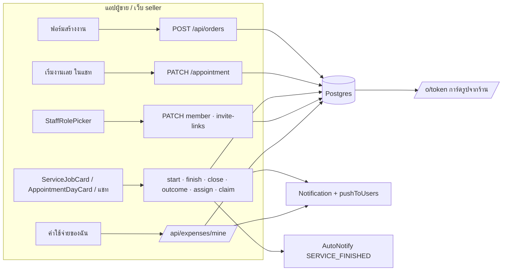
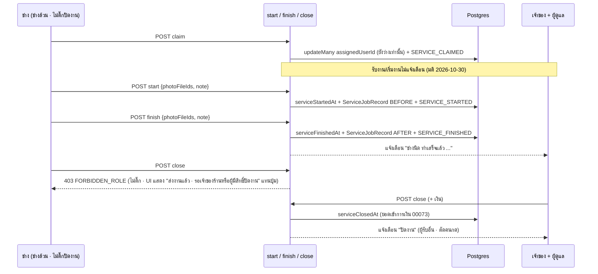
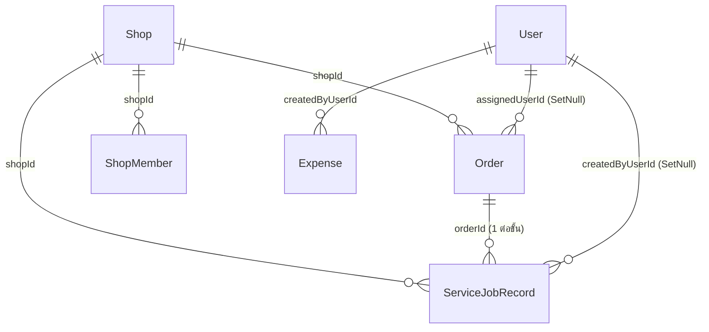

> **โมดูล:** 00086 — Service Staff Workflow
> **ประเภทเอกสาร:** Software Requirements Specification (SRS) - TECHNICAL
> **เวอร์ชัน:** 1.1
> **วันที่จัดทำ:** 2026-10-27 · sync กับโค้ด 2026-10-29 · ปรับตามมติ UX 2026-10-30 (ป้าย "รอเริ่มงาน" · ข้อความช่างส่งงาน · หน้าแรกช่าง · ซ่อนแพ็กเกจ · แจ้งเตือนเหลือทำเสร็จ/ปิดงาน · ติ๊กปิดงานอัตโนมัติเมื่อเพิ่มฝ่ายช่าง)
> **สถานะ:** As-built — P1+P2+P3 ลงโค้ดครบบน branch `feat/00086-service-staff-workflow` (ยังไม่ commit · ยังไม่ merge) · สัญญา API ฉบับตรงโค้ด = [[API]] v1.1 · ฐานข้อมูล = [[DATABASE]] v1.1 (migration 11 ตัว · 4 ตัวขึ้น prod แล้วจาก incident 2026-10-27)
> **เจ้าของเอกสาร:** SA

# SRS: งานพนักงานร้านบริการ (Software Requirements Specification — Technical)

---

## 1. บทนำ (Introduction)

### 1.1 วัตถุประสงค์ของเอกสาร
แปลง BRD 00086 (FR-001..FR-020) และ scope baseline (S-1..S-18) เป็นข้อกำหนดเชิงเทคนิคที่ DEV/QA ใช้ลงโค้ดและเขียนเทส · ทุก TFR ย้อนกลับไปหา FR และ S-id ได้ (§9)

### 1.2 ขอบเขตเชิงระบบ (System Scope)
- **ในขอบเขต (ร้าน `SERVICE_QUEUE` เท่านั้น):**
  - ค่าติ๊กรายคน `canCloseJob` / `canRecordExpense` บน `ShopMember` · `ShopInvite` · `ShopInviteLink` + ตัวเลือกบทบาท (`StaffRolePicker`)
  - ด่านปิดงานทุกทาง: `POST /api/orders/[token]/close` · `POST /api/orders/[token]/appointment/outcome` · ปุ่มใน `ServiceJobCard` · `AppointmentDayCard` · ปุ่ม `MARK_SERVED` ในแชท
  - แบบการมา `Order.arrivalMode` (สร้างงาน · "เริ่มงานเลย" · ตั้งนัดครั้งแรก) + ป้าย
  - ผู้รับผิดชอบ `Order.assignedUserId` (มอบ/เปลี่ยน/เอาออก/รับงาน) · ขั้นใหม่ "ทำเสร็จแล้ว" `Order.serviceFinishedAt` · รูป+บันทึก `ServiceJobRecord`
  - ตั้งค่ารูประดับร้าน `Shop.serviceJobPhotoMode` / `Shop.serviceJobPhotosBuyerVisible` · การ์ดรูปบน `/o/[token]` · ข้อความอัตโนมัติ `SERVICE_FINISHED`
  - แจ้งเตือนเจ้าของ/ผู้ดูแล (ตาราง `Notification` + `pushToUsers`)
  - หน้า/แถบล่างของช่าง · แถบล่างปุ่ม + กลาง (ร้านบริการ)
  - ค่าใช้จ่ายของพนักงาน (endpoint ใหม่ใต้ `/api/expenses/mine`) + "บันทึกโดย" ฝั่งเจ้าของ
- **นอกขอบเขต:** ร้าน `ONLINE_SALES`/`LODGING`/Personal (ต้องไม่เปลี่ยนแม้แต่จุดเดียว — มีเทส) · รายงานกลุ่ม LINE (`src/lib/line*`, `/lr`, 00070) · เปลี่ยนนิยามบทบาท 4 ตัวของ 00071 · ทางลูกค้ายืนยัน = ปิดงาน (00082) · สิทธิ์เปิดงานอีกครั้ง/ยกเลิก/คืนเงิน · native ใน deep-seller-app/deep-app · ไฟล์รูปเข้ารหัส/หมดอายุ

### 1.3 เอกสารอ้างอิง (References)
| เอกสาร | ความสัมพันธ์ |
|--------|-------------|
| [[PRD]] · [[BRD]] ของโมดูลนี้ | ที่มาของ FR-001..FR-020 + AC |
| `docs/scope/2026-10-27-00086-scope-baseline.md` | S-1..S-18 · OOS-1..15 |
| `docs/20 - Features/00071 - Shop Member Roles & Permissions/BRD.md` §8.3 | ตารางสิทธิ์ capability (SSOT) |
| `docs/20 - Features/00073 - Service Four-Step Flow/` · `00078` · `00082` | ปิดงาน · เริ่มงาน · ส่งอัตโนมัติ · ลูกค้ายืนยันปิดงาน |
| `docs/20 - Features/00016 - Expense & Cost Tracking/` | ฟอร์ม/หมวด/รายงานกำไร |
| [[DATABASE]] (00086) | schema diff + migration 8 ตัว |

### 1.4 นิยามและตัวย่อ (Definitions & Acronyms)
| คำ/ตัวย่อ | ความหมายเชิงเทคนิค |
|-----------|----------|
| **ร้านบริการ** | `Shop.vertical = 'SERVICE_QUEUE'` (`canUseAppointments` / `usesServiceFinanceRules`) |
| **บทบาทที่เริ่มงานได้** | ถือ capability `O4` = `OWNER`/`MANAGER`/`CHAT`/`TECHNICIAN` (`src/lib/shop-permissions.ts:32`) |
| **ช่างล้วน** | ชุดบทบาทที่มีผลจริงไม่ว่างและทุกตัวเป็น `TECHNICIAN` (นิยามเดียวกับ `role-nav.ts` แท็บ "งาน") |
| **ปิดงานได้ (ด่านใหม่)** | `OWNER ∨ MANAGER ∨ (canCloseJob ∧ (CHAT ∨ TECHNICIAN))` · ช่างล้วนต้องเป็น `assignedUserId` ของใบนั้นด้วย |
| **ทำเสร็จ** | `Order.serviceFinishedAt` (เวลา ไม่ใช่สถานะใบ · ไม่แตะเงิน) |
| **บันทึกงาน** | แถว `ServiceJobRecord` 1 แถวต่อ (ใบ, ขั้น `BEFORE`/`AFTER`) = รูป ≤10 + บันทึก ≤1000 ตัวอักษร |
| **ติ๊ก (flag)** | คอลัมน์ boolean รายคน ไม่ใช่บทบาท — ไม่อยู่ใน `roles[]` จึงไม่ไหลเข้า `can()`/`moneyLevel()` |

---

## 2. ภาพรวมสถาปัตยกรรม (Architecture Overview)

### 2.1 บริบทระบบ (System Context)

### 2.2 องค์ประกอบหลัก (Components)
| องค์ประกอบ | ไฟล์ | หน้าที่ |
|---|---|---|
| ด่านสิทธิ์รายคน (pure) | `src/lib/shop-permissions.ts` (เพิ่ม `memberCanCloseJob` · `memberCanRecordStaffExpense` · `isTechnicianOnly` · `serviceJobActorBlock`) | กติกาเดียวทั้ง UI และ route — ห้ามตั้งชื่อ `canCloseServiceJob` เพราะชื่อนี้มีแล้วที่ `src/lib/service-status.ts:136` (เช็กสถานะใบ) |
| อ่านค่าติ๊กสด | `src/lib/shop-context.ts` `resolveActiveShopContext` (select `role, roles` → เพิ่ม `canCloseJob, canRecordExpense`) · `ActiveShop.canCloseJob/canRecordExpense` · `requireShopCapability` คืน `active` · `canCloseJobInShop(shopId,userId)` (`shop-capability.ts`) | มีผลกับคำขอถัดไปทันที ไม่ต้องเข้าระบบใหม่ |
| งานบริการ | `src/services/service-job.service.ts` (`startServiceJob` · `finishServiceJob` ใหม่ · `closeServiceJob` · `assignServiceJob` / `unassignServiceJob` / `claimServiceJob` ใหม่) | เขียนเวลา + `ServiceJobRecord` + `OrderEvent` ในทรานแซกชันเดียว |
| แจ้งเตือนพนักงาน | `src/services/service-job-notify.service.ts` + `staff-expense-notify.service.ts` (ใหม่ · ทุกแถวผูก `Notification.shopId`) → `Notification` + `pushToUsers` (`src/services/app-push.service.ts`) | ผู้รับ = เจ้าของ+ผู้ดูแล (งาน) / เจ้าของ (ค่าใช้จ่าย) ตัดคนกดเอง |
| แบบการมา | `src/lib/arrival-mode.ts` (`arrivalModeOf` อ่านค่าที่เก็บ · `resolveArrivalMode` เหลือเป็น fallback ภายในไฟล์) | ป้ายทุกจุด |
| ค่าใช้จ่ายพนักงาน | `src/app/api/expenses/mine/**` + `src/services/expense.service.ts` (where `createdByUserId`) | กรองระดับแถว |
| แถบล่าง | `src/lib/role-nav.ts` `resolveMobileNav` | ร้านบริการเท่านั้น |
| ไม่มีเงินสำหรับช่าง | `src/lib/order-view-by-level.ts` `NO_MONEY_ORDER_KEYS` | เพิ่มเฉพาะคีย์เวลา/ผู้รับผิดชอบ/บันทึกงาน |

### 2.3 มุมมองการ Deploy (Deployment View)
merge `main` → `prisma migrate deploy` บน prod อัตโนมัติ (HR15) · migration 8 ตัว ([[DATABASE]] §5) · ไม่มี env/cron ใหม่ · ไม่มี native build (push ใช้ pipeline เดิม)

---

## 3. ข้อกำหนดเชิงฟังก์ชันเชิงเทคนิค (Technical Functional Requirements)

### TFR-001: ค่าติ๊กรายคนบนสมาชิก/คำเชิญ/ลิงก์เชิญ (FR-004, FR-006, FR-017 · S-1, S-4)
- คอลัมน์ `canCloseJob`, `canRecordExpense` (boolean NOT NULL default false) บน `ShopMember`, `ShopInvite`, `ShopInviteLink`
- CHECK `ShopMember_flags_admin_only_check`: `role = 'ADMIN' OR (NOT canCloseJob AND NOT canRecordExpense)` ⇒ **ทุกจุดที่เขียน `role='OWNER'` ต้องเขียน flag = false คู่กัน** (`changeMemberRole` เมื่อเลื่อนเป็นเจ้าของ · `transferShopOwnership` `src/services/shop-member.service.ts:184`) มิฉะนั้น update ล้มด้วย CHECK
- ตั้ง/แก้: `PATCH /api/business/shops/[shopId]/members/[memberId]` (T2) · `POST /api/shops/current/invite-links` (T2) · `POST /api/business/shops/[shopId]/invites` (T2)
- validate ที่ server (ไม่ใช่แค่ UI): ร้านไม่ใช่ `SERVICE_QUEUE` และส่ง flag = true → 400 `STAFF_FLAGS_NOT_AVAILABLE` · `canCloseJob = true` แต่ชุดบทบาทไม่มี `CHAT`/`TECHNICIAN` และไม่ใช่ `MANAGER` → 400 `CLOSE_JOB_NEEDS_START_ROLE` · `MANAGER` อยู่ในชุด → เก็บ `canCloseJob = true` (การ์ดล็อกติ๊ก)
- รับคำเชิญ (`acceptShopInvite` `shop-member.service.ts:77-81`) และรับลิงก์ (`acceptInviteLink` `invite-link.service.ts:183-187`) ต้องคัดลอก flag ทั้งสองเข้า `create` ของ `upsert`
- `listMembers` / `listActiveInviteLinks` คืน flag สองตัว (ชิปในรายชื่อ)
- (มติ 2026-10-30) UI เลือกบทบาท: `flagsAfterRoleToggle` (`src/lib/shop-role-picker.ts`) ใช้ใน `StaffRolePicker` (ลิงก์เชิญ + แก้บทบาท) — **กดเพิ่ม** `TECHNICIAN` → `canCloseJob = true` · ติ๊กออกได้ · สลับบทบาทอื่นของคนที่ถือ `TECHNICIAN` อยู่แล้วไม่ติ๊กกลับ · `MANAGER` ยัง LOCKED_ON · default ใน DB ยัง false (server validate เท่าเดิม)

### TFR-002: ด่านปิดงานกลาง (FR-005, FR-011 · S-5)
- ฟังก์ชัน pure `memberCanCloseJob(shop, roles, flags)`:
  `OWNER ∨ MANAGER` → true · ร้านไม่ใช่ `SERVICE_QUEUE` → `can(roles,'O4')` (เท่าเดิม) · อื่น ๆ → `flags.canCloseJob ∧ (CHAT ∈ roles ∨ TECHNICIAN ∈ roles)`
- route `close` (POST) และ `appointment/outcome` (POST): คง `requireShopCapability('O4')` (ทะเบียน `route-capabilities.ts:315,325` ไม่เปลี่ยน) แล้วเรียก `memberCanCloseJob` ต่อทันที → false = 403 `FORBIDDEN_ROLE`
- ช่างล้วน: service ตรวจ `order.assignedUserId = actorUserId` (ไม่ตรง = 403 `SERVICE_JOB_NOT_ASSIGNEE`) และต้องกดทำเสร็จก่อน (`serviceFinishedAt IS NULL` → 409 `SERVICE_JOB_NOT_FINISHED`) — บทบาทอื่นที่ปิดได้ปิดข้ามขั้นได้ (FR-010)
- `GET close` (สถานะเงินให้ชีต) และ `DELETE close` (O6 เปิดงานอีกครั้ง) ไม่เปลี่ยน · `cancel`/คืนเงิน ไม่เปลี่ยน (OOS-11)
- `confirmOrder` → `settleServiceJobOnBuyerConfirm` (00082) **ไม่ผ่านด่านนี้** (OOS-10)
- (มติ 2026-10-30) UI ผู้ปิดไม่ได้หลังทำเสร็จ: ช่างล้วนที่เป็นผู้รับผิดชอบ = "ส่งงานแล้ว · รอเจ้าของร้านหรือผู้มีสิทธิ์ปิดงาน" (ไอคอน circle-check) · คนอื่นที่ไม่มีสิทธิ์ = "ทำเสร็จแล้ว · รอเจ้าของร้านหรือคนที่มีสิทธิ์ปิดงาน" (ไอคอน lock)
- (มติ 2026-10-29) `NO_SHOW` กับงานที่ `serviceStartedAt IS NOT NULL` → 409 `SERVICE_JOB_NO_SHOW_AFTER_START` ทุกบทบาท ทั้ง close และ outcome (ใน `closeServiceJob` + ซ้ำใน `WHERE`) · UI ทุกจอที่เปิด `ServiceCloseSheet` ส่ง `serviceStarted` (`isServiceJobStarted`) ให้ซ่อนตัวเลือก

### TFR-003: แยก "เริ่มงาน" กับ "ปิดงาน" ในทุกหน้าจอ (FR-005, FR-009 · S-5, S-8)
- `ServiceJobCard` วันนี้ใช้ prop `canClose = can(roles,'O4')` คุมทั้งปุ่มเริ่มและปุ่มปิด (`ServiceJobCard.tsx:169-186`; ผู้ส่ง `orders/[token]/page.tsx:644`, `TechnicianOrderDetail.tsx:153`) ⇒ แยกเป็น `canStart` (O4 + `serviceJobActorBlock` = null) · `canFinish` (เท่า `canStart`) · `canClose` (`memberCanCloseJob` + กติกาช่างล้วน) · `canAssign` (O2s) · `canClaim`
- `AppointmentBoardCaps` เพิ่ม `canClose` + `viewerUserId` + `technicianOnly` (ค่าตั้งต้น false) · `queues/page.tsx:64-71` คำนวณจากผู้ดู · `AppointmentDayCard` ซ่อน `openClose('SERVED'|'NO_SHOW')` เมื่อปิดไม่ได้
- `ChatOrderContext` เพิ่ม `canClose: boolean` (บังคับ) · `chatOrderActions` ใส่ `MARK_SERVED` เฉพาะ `canClose` · ผู้เรียก 3 จุด: `OrderProgressBar.tsx:314` · `CustomerPanel.tsx:382` · `OrderDetailClient.tsx:341`

### TFR-004: แบบการมา (FR-001, FR-002, FR-003 · S-1, S-2, S-3)
- `Order.arrivalMode` TEXT `BOOKED|WALK_IN|NULL` · CHECK `arrivalMode IS NULL OR (IN (...) AND serviceStart IS NOT NULL)`
- `POST /api/orders` (ร้านบริการ + `type = 'SERVICE'`): `arrivalMode` บังคับ
  - `BOOKED`: ต้องมี `appointment {resourceId,start,end}` ครบ ไม่ครบ → 400 `ARRIVAL_BOOKED_NEEDS_TIME` ข้อความ "เลือกวันและเวลานัด"
  - `WALK_IN`: ต้องมี `appointment.resourceId` · `start/end/depositAmount` ที่ส่งมาถูกละ · server คำนวณ `walkInWindow(now, durationMin)` (`src/lib/appointments.ts:412`) · ไม่เก็บมัดจำ (`depositAmount` = NULL)
  - จองเจตนาส่งอัตโนมัติ: `BOOKED` → `SERVICE_BOOKED` (เดิม) · `WALK_IN` → **ไม่จองเลย** (`createOrder`: `if (order.conversationId && arrivalMode !== 'WALK_IN')`) — ไม่พึ่ง `APPOINTMENT_NOT_FUTURE`
  - ร้านบริการไม่ส่งนัดและไม่ส่ง `arrivalMode` = ใบ "ยังไม่ระบุเวลา" (null) ตามเดิม · ส่งนัดแต่ไม่ส่ง `arrivalMode` = 400 `ARRIVAL_MODE_REQUIRED`
  - ร้านอื่น/ใบไม่ใช่บริการ: ส่ง `arrivalMode` มา = ถูกละ (ไม่ error · ไม่เขียนคอลัมน์)
- `PATCH /api/orders/[token]/appointment` (`setOrRescheduleAppointment`): body เพิ่ม `arrivalMode?: 'WALK_IN'` · ใบที่ `arrivalMode IS NULL` (ยังไม่ระบุเวลา) → ตั้งเป็นค่าที่ส่งมา หรือ `BOOKED` ถ้าไม่ส่ง · ใบที่มีค่าแล้ว → ไม่เปลี่ยน (เลื่อนนัดไม่เปลี่ยนแบบการมา) · `StartWalkInSheet.tsx:170-177` ส่ง `arrivalMode:'WALK_IN'`
- ป้าย: `arrivalModeOf(order) = order.arrivalMode ?? (serviceStart ? resolveArrivalMode(order) : 'UNSCHEDULED')` · `ARRIVAL_MODE_META.WALK_IN.label` "เดินเข้ามา" → "หน้าร้าน" · จุดแสดง: `AppointmentCard.tsx:94` · `OrderProgressBar.tsx:310` · `AppointmentDayCard.tsx:203`
- ป้ายสถานะงานหน้าร้าน (as-built): `resolveServiceStatus` รับ `arrivalMode` — `WALK_IN` ที่ยังไม่เริ่ม = ฝั่งร้าน **"รอเริ่มงาน"** (มติ 2026-10-30 · เดิม "รับงานแล้ว" ชนกับปุ่ม "รับงานนี้" · `SERVICE_STATUS_META.WALK_IN.seller` + คำศัพท์บริการ `stageOrderedLabel` ใน `seller-menu.ts`) / ฝั่งลูกค้า "รับงานแล้ว" (แทน "จองแล้ว" เท่านั้น) · คำขอเลื่อน/ยืนยันนัดจากลูกค้า **ชนะ** ป้ายแบบการมา · เริ่มแล้ว = "กำลังให้บริการ" (`IN_SERVICE`) · ทำเสร็จ = "ทำเสร็จ · รอปิดงาน" (`FINISHED_AWAITING_CLOSE`) ชนะป้ายนัด แต่แพ้ปิดงาน/ไม่มาตามนัด/ลูกค้ายืนยัน · การ์ดนัด (`appointmentStageBadge`) SCHEDULED + WALK_IN = "รอเริ่มงาน" · แถบสถานะในแชท (`chat-service-progress.ts`) เพิ่มขั้น `IN_SERVICE` "กำลังให้บริการ" + `FINISHED_AWAITING_CLOSE` "ทำเสร็จ · รอปิดงาน" · ชิปรายการแชท (`serviceProgressFace` ใน `order-stage.ts` · `order-stage.service.ts` select `arrivalMode/createdAt/serviceStartedAt/serviceFinishedAt`) งานหน้าร้าน = "รอเริ่มงาน" (แทน "นัด {วันที่}") + ขั้นกำลังทำ/ทำเสร็จ · การ์ดออเดอร์ในแชท (`OrderCardView` ฝั่งร้าน) · ออเดอร์ล่าสุดหน้าแรก · รายชื่อลูกค้า ส่งเวลาเริ่ม/เสร็จ ⇒ ป้ายตรงการ์ดงาน · ฝั่งลูกค้าไม่ส่ง started/finished ⇒ ไม่เห็นขั้นภายในร้าน · ชิปแบบการมา (`arrivalChipMeta`) ติดทั้ง "จองล่วงหน้า" และ "หน้าร้าน"

### TFR-005: ผู้รับผิดชอบ (FR-007 · S-6)
- `Order.assignedUserId` → `User` (`onDelete SetNull`) · index `(assignedUserId, serviceStart)`
- สร้างงาน: `assignedUserId?` ใน `POST /api/orders` (ร้านบริการ + บริการเท่านั้น)
- มอบ/เปลี่ยน: `POST /api/orders/[token]/assign` (O2s) · เอาออก: `DELETE …/assign` (O2s) · รับงาน: `POST /api/orders/[token]/assign/claim` (O4 + มี `TECHNICIAN` · path `[token]/claim` เป็น OTP claim ของผู้ซื้อ 00015)
- ผู้ถูกมอบ/ผู้รับต้องเป็นสมาชิกร้านที่บทบาทมีผลจริงมี `TECHNICIAN` → ไม่ใช่ 400 `ASSIGNEE_NOT_TECHNICIAN`
- งานปิดแล้ว/ยกเลิก → 409 · รับงานพร้อมกัน: `updateMany WHERE assignedUserId IS NULL AND serviceClosedAt IS NULL` count 0 → 409 `SERVICE_JOB_ALREADY_ASSIGNED` + `assigneeName`
- ปลดผู้รับผิดชอบ (`unassignMemberOpenJobs` · ทรานแซกชันเดียวกับการเปลี่ยนสมาชิก · งานที่ยังเปิด = `serviceClosedAt IS NULL ∧ status NOT IN (CANCELLED, RETURNED)`) + `OrderEvent SERVICE_UNASSIGNED meta {reason, previousAssigneeNameSnapshot}`: `removeShopMember` → `MEMBER_REMOVED` · `changeMemberRole` ที่ทำให้ไม่ถือ `TECHNICIAN` แล้ว (ถอดบทบาท/เลื่อนเป็นเจ้าของ) → `ROLE_REMOVED` · `transferShopOwnership` (ผู้รับโอน) → `ROLE_REMOVED` · `deleteAccount` / reclaim บัญชีค้าง → `unassignUserOpenJobsEverywhere` ทุกร้านบริการ `MEMBER_REMOVED` · response ของ members PATCH/DELETE + transfer คืน `unassignedJobCount` (UI ต่อท้าย toast)
- มอบ/รับงานล็อกแถวสมาชิก `FOR SHARE` ก่อนอ่านบทบาทจาก DB (`resolveTechnicianAssignee`) — กันแข่งกับการถอดบทบาท · มอบงาน (สร้าง/assign) และรับงาน (claim · มติ 2026-10-30) ไม่ส่งแจ้งเตือน
- (มติ 2026-10-30 · ร้านช่างเยอะ) ฟอร์มสร้าง: ช่าง ≤ 6 คน (`ASSIGNEE_CHIPS_MAX`) = ชิปแบบเดิม · เกิน = ช่องเดียว (ชื่อที่เลือก + ป้ายว่าง/ติดงานตามช่วงที่กรอก (`StaffLoadLine`) / "ยังไม่มีคนรับ" + จำนวนคน) แตะแล้วเปิด `AssigneeSheet` โหมดเลือก (ไม่ยิง API) · ชีต (ทั้งฟอร์มและหน้างาน) ช่างเกิน 6 คน = ช่องค้นชื่อ · มีช่วงเวลา = ป้าย "ว่างช่วงนี้ / ติดงาน HH:mm–HH:mm" + "วันนี้ N งาน" และคนว่างขึ้นก่อน (งานน้อยก่อน · เท่ากันคงลำดับชื่อ) · ช่วงเวลาฟอร์ม = สูตรเดียวกับตอนบันทึก (`assigneeFormWindow`) · หน้างาน = `serviceStart/End` (ไม่มีเวลา = ชื่ออย่างเดียว) · ข้อมูลจาก `service-staff ?from&to&exclude` (API §4.10) · ตรรกะทั้งหมดใน `src/lib/assignee-load.ts`

### TFR-006: เริ่มงานพร้อมรูป+บันทึก (FR-009 · S-8)
- `POST /api/orders/[token]/start` body (ไม่บังคับ — ไม่ส่ง = เท่าเดิมทุกประการ): `{ photoFileIds?: string[≤10], note?: string(1..1000) }`
- โหมดร้าน `REQUIRED` + ไม่มีรูป → 400 `SERVICE_JOB_PHOTO_REQUIRED` · `NONE` + มีรูป → 400 `SERVICE_JOB_PHOTOS_DISABLED` · fileId ไม่มีอยู่จริงใน storage → 400 `SERVICE_JOB_PHOTO_MISSING` (สถานะไม่เปลี่ยน)
- ช่างล้วน: ไม่มีผู้รับผิดชอบ → 409 `SERVICE_JOB_UNASSIGNED` · เป็นของคนอื่น → 403 `SERVICE_JOB_NOT_ASSIGNEE` (+ `assigneeName`) · บทบาทอื่นใน O4 ทำแทนได้
- ทรานแซกชันเดียว: `updateMany WHERE serviceStartedAt IS NULL` (เดิม) → `ServiceJobRecord(BEFORE)` (ถ้ามีรูปหรือบันทึก) → `OrderEvent SERVICE_STARTED meta {photoCount, hasNote}` → `SERVICE_STARTED` auto-notify (เดิม) · ไม่แจ้งเจ้าของ/ผู้ดูแล (มติ 2026-10-30 · เดิมแจ้งหลัง commit)
- กดซ้ำ/พร้อมกัน: คืน `alreadyStarted: true` (ก่อนตรวจรูป) ไม่เขียน record ซ้ำ (`@@unique(orderId, phase)`) · รูปของผู้แพ้ไม่ถูกบันทึก (ยอมรับ)
- fileId ตรวจด้วย `getFileMeta` ก่อนเปิด tx — ตรวจว่ามีไฟล์จริง ไม่ได้ตรวจว่าใครอัปโหลด (ไม่มีบันทึกเจ้าของไฟล์ purpose IMAGE · ข้อจำกัดที่ยอมรับ 2026-10-29) · เกิน 10 หลังตัดซ้ำ = 400 `SERVICE_JOB_TOO_MANY_PHOTOS` (route ติด `VALIDATION_ERROR` ก่อน)

### TFR-007: ขั้น "ทำเสร็จแล้ว" (FR-010 · S-9)
- `POST /api/orders/[token]/finish` (O4 · กติกาช่างล้วนเดียวกับ TFR-006 · กติการูปเดียวกับ TFR-006)
- เงื่อนไข: ร้านบริการ · เริ่มแล้ว (ไม่ใช่ → 409 `SERVICE_JOB_NOT_STARTED`) · ยังไม่ปิด (→ 409 `SERVICE_JOB_ALREADY_CLOSED`) · `updateMany WHERE serviceFinishedAt IS NULL` (write-once · ซ้ำ = `alreadyFinished: true`)
- ไม่แตะ `status`/`appointmentStatus`/เงิน/`serviceClosedAt` · `reopenServiceJob` ไม่ล้าง `serviceFinishedAt`
- event `SERVICE_FINISHED meta {photoCount, hasNote}` · auto-notify `SERVICE_FINISHED` เฉพาะ `serviceJobPhotosBuyerVisible = true` (TFR-010)

### TFR-008: บันทึกงานในหน้างาน + ประวัติ (FR-012 · S-10)
- `getOrderByToken` ฝั่งร้าน include `serviceJobRecords` (phase, note, fileIds, createdAt, createdBy displayName) + `assignedUser {id, displayName}`
- `NO_MONEY_ORDER_KEYS` เพิ่ม `arrivalMode`, `assignedUserId`, `serviceFinishedAt` · ลูกที่รู้จักเพิ่ม `assignedUser` (`id`,`displayName`) และ `serviceJobRecords` (`phase`,`note`,`fileIds`,`createdAt`,`createdBy.displayName`) — ไม่มีคีย์เงิน
- `describeOrderEvent` ของ 4 ชนิดใหม่ใช้ `actorNameSnapshot` + `assigneeNameSnapshot` · บันทึก (note) **ไม่อยู่ใน `OrderEvent.meta`** (กติกา `order-event.ts:182-186`) — ไทม์ไลน์ดึงจาก `ServiceJobRecord` ตามขั้น

### TFR-009: ตั้งค่ารูประดับร้าน (FR-013 · S-11)
- `Shop.serviceJobPhotoMode` (`REQUIRED|OPTIONAL|NONE`, default `OPTIONAL`) · `Shop.serviceJobPhotosBuyerVisible` (default false) · CHECK `NONE ⇒ NOT buyerVisible`
- `PATCH /api/shops/current/service-job-photo-settings` (Q2 = เจ้าของ+ผู้ดูแล) · ร้านไม่ใช่บริการ → 403 `FEATURE_NOT_AVAILABLE` (`assertShopCanUseAppointments` → `appointment-api.ts:28-35`) · เลือก `NONE` → server บังคับ `buyerVisible = false`
- หน้า `/settings/job-types` (page Q2 · `route-capabilities.ts:132`) แสดงการ์ดเฉพาะร้านบริการ

### TFR-010: ลูกค้าเห็นรูป + ข้อความเมื่อทำเสร็จ (FR-015 · S-13)
- `/o/[token]` (`src/app/(marketing)/o/[token]/page.tsx`): ส่ง prop `serviceJobPhotos` **เฉพาะ** ร้านบริการ ∧ `serviceJobPhotosBuyerVisible` ∧ mode ≠ `NONE` (`buyerSeesServiceJobPhotos` · ตัดสินก่อน query) — ไม่เข้าเงื่อนไข = ไม่มีคีย์ใน payload เลย · ข้อมูล: `{ records: [{ phase, note, photoUrls, thumbUrls, createdAtIso }], afterPending }` **ไม่มีชื่อพนักงาน** (มติ user 2026-10-27)
- AutoNotify ชนิดใหม่ `SERVICE_FINISHED`: เพิ่มใน `AUTO_NOTIFY_KINDS` (`ledger-constants.ts:5`) · `KINDS_BY_VERTICAL.SERVICE_QUEUE` (`kinds.ts:10`) · `AUTO_NOTIFY_KIND_ICON` · `autoNotifyKindLabel` ("เมื่อทำเสร็จ") · `defaults.ts` · `variables.ts` · `values.ts` · `eligibility.ts` (เพิ่ม input `photosBuyerVisible` + เหตุผล `PHOTOS_NOT_BUYER_VISIBLE` — ไม่ลง ledger) · CHECK 3 ตัว (Switch/Template/Ledger)
- **ไม่มีสวิตช์ของตัวเอง** (`IMPLICIT_KINDS = ['SERVICE_FINISHED']` · `switchableKindsForVertical` ตัดออก — ไม่ขึ้นแถวในหน้าตั้งค่า) · ส่งเมื่อร้านเปิด "ลูกค้าเห็นรูปและบันทึก" (PRD §10.2) · ยังต้องมีห้องแชท · ไม่ใช่ dry-run · ใช้ ledger/ด่านส่งเดิม

### TFR-011: แจ้งเตือนเจ้าของ/ผู้ดูแล (FR-014, FR-020 · S-12, S-17)
- เหตุการณ์งานที่แจ้ง (มติ 2026-10-30): `FINISHED` · `CLOSED` (ปิดผ่าน close/outcome โดยใครก็ได้) เท่านั้น — ด่าน `SERVICE_JOB_NOTIFY_EVENTS` / `shouldNotifyServiceJob` · `CLAIMED`/`STARTED` ไม่แจ้งแล้ว (ยังมี `OrderEvent` ในไทม์ไลน์) → เจ้าของ (`Shop.userId` ∪ `ShopMember role=OWNER`) ∪ ผู้ดูแล (`role=ADMIN ∧ roles ∋ MANAGER`) อ่านสดตอนส่ง **ตัดคนกดเอง** (`service-job-notify.service.ts`) · มอบงาน/ลูกค้ายืนยัน 00082 ไม่ส่ง
- ค่าใช้จ่าย: สร้าง/แก้/ลบ ผ่าน `/api/expenses/mine/**` → เจ้าของเท่านั้น ตัดคนกดเอง (`staff-expense-notify.service.ts`)
- ช่องทาง: แถว `Notification` ผูก `shopId` (kind ที่เขียนใหม่ `service_job_finished|closed` / `staff_expense` · `service_job_claimed|started` คงไว้ให้อ่านแถวเก่าได้) + `pushToUsers` data `{ type, url, shopId }` · ทำหลัง commit ด้วย `runAfterResponse`/`after()` · ล้ม = log ไม่ทำให้การกดล้ม
- การอ่าน = ผู้รับตอนเขียน: แถวร้านเห็นเฉพาะเจ้าของปัจจุบัน + (`service_job_*`) ผู้ดูแลปัจจุบัน · กระดิ่งโดเมนผู้ซื้อ/แอปผู้ซื้อเห็นเฉพาะแถวส่วนตัว · หน้า `/notifications` ร้าน รวม activity + Notification ของร้าน active และตัด activity `SERVICE_CLOSED` ที่ซ้ำกับแถว `service_job_closed` · แถวเริ่ม (เก่า)/ทำเสร็จมีรูปย่อ (ดึงตอนอ่าน)
- ข้อความ: `"{ชื่อ} {สิ่งที่ทำ} · {บริการ} · {ชื่อลูกค้า}"` (งาน) · `"{ชื่อ} บันทึกค่าใช้จ่าย ฿{จำนวน} · {หมวด}"` (แก้ไข/ลบ ใช้คำตามจริง)

### TFR-012: หน้าและแถบล่างของช่าง + ปุ่ม + กลาง (FR-008, FR-016 · S-7, S-14)
- หน้าใหม่ `/my-jobs` (page `Q1` · ร้านไม่ใช่บริการ → redirect `/orders`) · ตัวกรอง "งานของฉัน" (ของฉัน ∪ ยังไม่มีคนรับ) / "ทั้งร้าน" (state ฝั่ง client) · ข้อมูล `appointments/day` (วันนี้) + `appointments/carry-over` (`{items, unscheduled}`) · กลุ่มในตัวกรองงานของฉัน: "ค้างจากวันก่อน" → "ยังไม่ระบุเวลา" → วันนี้ → ปิดแล้ว (มติ 2026-10-27) · หน้าหลักช่างล้วน: การ์ด "งานของฉันวันนี้ · N" + "ยังไม่มีคนรับ · N"
- (มติ 2026-10-30) หน้าแรกช่างล้วนร้านบริการ (`isServiceTechnicianOnly` ใน `role-nav.ts` · flag `homeBlocks` ใน `dashboard-money.ts`): `shopWideJobLabels` → ตัวนับ/การ์ดสถิติชื่อ "งานทั้งร้าน" · `activityLinksByPage` → กิจกรรมที่ลิงก์ไปหน้าที่บทบาทเปิดไม่ได้เป็นข้อความ + ว่างไม่มี CTA "สร้างงานบริการ" · จอใหญ่การ์ดงานวันนี้อยู่แถวแรกก่อน · `technicianUnusableShortcutSlugs` ตัดทางลัด "ร้านค้า" (`seller:shop` ต้อง T1 จึงบันทึกได้) · `shopPackage` + `showsShopPackage` → ซ่อนการ์ดแพ็กเกจ (`layout.tsx` `showPackageCard`) และชิปแพ็กเกจบน hero มือถือ · เจ้าของ/บทบาทอื่น/ร้านอื่นเท่าเดิม (พนักงานอื่นยังเห็นแพ็กเกจ ตามมติ 2026-07-29)
- `resolveMobileNav` (ร้านบริการเท่านั้น): ช่างล้วน = หน้าหลัก · งานของฉัน (`/my-jobs`) · ตารางงาน (`/queues`) ไม่มี FAB · บทบาทที่ถือ `O2`/`O2s` = หน้าหลัก · บริการ · FAB · แล้วเติมจาก แชท(H1) · ร้านค้า(T1) · ตารางงาน(Q1) · ลูกค้า(C1) จนครบ 4 แท็บ · ร้านอื่นใช้ตรรกะเดิมทุกบรรทัด
- `NavTab.key` เพิ่ม `'mine' | 'queues' | 'customers'`

### TFR-013: ค่าใช้จ่ายของพนักงาน (FR-018, FR-019, FR-020 · S-15, S-16, S-17)
- endpoint ใหม่ `GET/POST /api/expenses/mine` · `PATCH/DELETE /api/expenses/mine/[id]` (คลาส `MEMBER` ในทะเบียน + ด่าน `memberCanRecordStaffExpense`) · ไม่ติ๊ก/ร้านไม่ใช่บริการ → 403 `FORBIDDEN_ROLE`
- ทุก query บังคับ `where { shopId, createdByUserId: session.userId }` · แถวของคนอื่น/ร้านอื่น → 404 `NOT_FOUND` (ไม่บอกว่ามีอยู่) · response ไม่มียอดรวม/สรุปหมวด
- endpoint เจ้าของ (`/api/expenses`, `/api/expenses/[id]`, `/api/expenses/report`) คงด่าน F1/F2 เดิม · ผลรายการเพิ่ม `createdByName` (+`createdByUserId` เดิม) เพื่อแสดง "บันทึกโดย"
- นับเข้ากำไรทันที: `listExpenses`/report/P&L ไม่กรองผู้สร้างอยู่แล้ว — ห้ามเพิ่มตัวกรอง (HR16 parity)

---

## 4. ข้อกำหนดส่วนต่อประสาน (Interface / API Specification)

### 4.1 API Endpoints
| Method | Path | Cap / คลาส | ใหม่/เปลี่ยน |
|---|---|---|---|
| PATCH | `/api/business/shops/[shopId]/members/[memberId]` | T2 | เปลี่ยน (flags) |
| POST/GET | `/api/shops/current/invite-links` | T2 | เปลี่ยน (flags) |
| POST/GET | `/api/business/shops/[shopId]/invites` | T2 | เปลี่ยน (flags) |
| POST | `/api/orders` | O2s | เปลี่ยน (`arrivalMode`, `assignedUserId`) |
| PATCH | `/api/orders/[token]/appointment` | O3 | เปลี่ยน (`arrivalMode`) |
| POST | `/api/orders/[token]/start` | O4 | เปลี่ยน (รูป+บันทึก · ช่างล้วน) |
| POST | `/api/orders/[token]/finish` | O4 | **ใหม่** |
| POST/DELETE | `/api/orders/[token]/assign` | O2s | **ใหม่** |
| POST | `/api/orders/[token]/assign/claim` | O4 + ถือ TECHNICIAN | **ใหม่** |
| GET | `/api/shops/current/appointments/carry-over` | Q1 | **ใหม่** (`{items, unscheduled}` ของผู้เรียก) |
| POST | `/api/orders/[token]/close` | O4 + ด่านใหม่ | เปลี่ยน (ด่าน) |
| POST | `/api/orders/[token]/appointment/outcome` | O4 + ด่านใหม่ | เปลี่ยน (ด่าน) |
| GET | `/api/shops/current/service-staff` | O2s | **ใหม่** (รายชื่อช่างให้ตัวเลือกผู้รับผิดชอบ) |
| PATCH | `/api/shops/current/service-job-photo-settings` | Q2 | **ใหม่** |
| GET/POST | `/api/expenses/mine` | MEMBER + flag | **ใหม่** |
| PATCH/DELETE | `/api/expenses/mine/[id]` | MEMBER + flag | **ใหม่** |
| GET | `/api/expenses` | F1 | เปลี่ยน (`createdByName`) |
| DELETE | members · POST transfer | T2 / เดิม | เปลี่ยน (`unassignedJobCount`) |

### 4.2 รายละเอียดต่อ Endpoint
ดู [[API]] §4

### 4.3 Events / Messaging
- `OrderEvent` +4 ชนิด: `SERVICE_ASSIGNED` · `SERVICE_CLAIMED` · `SERVICE_UNASSIGNED` · `SERVICE_FINISHED` (35 → 39) · meta คีย์ใหม่ `assigneeNameSnapshot` · `previousAssigneeNameSnapshot` · `photoCount` · `hasNote` · `reason` — ไม่มี PII ลูกค้า/บันทึก
- AutoNotify +1 ชนิด `SERVICE_FINISHED`
- `Notification.kind` +5: `service_job_claimed` · `service_job_started` · `service_job_finished` · `service_job_closed` · `staff_expense` (มติ 2026-10-30: เขียนใหม่เฉพาะ `finished`/`closed`/`staff_expense` · `claimed`/`started` อ่านได้สำหรับแถวเก่า) · push data `type` +2: `service-job` · `staff-expense`
- `SERVICE_UNASSIGNED.meta.reason` ∈ `MANUAL` · `MEMBER_REMOVED` · `ROLE_REMOVED`

### 4.4 Sequence ของ flow สำคัญ

---

## 5. ข้อกำหนดด้านข้อมูล (Data Requirements)

### 5.1 Data Model / Entities
| ตาราง | การเปลี่ยน |
|---|---|
| `ShopMember` · `ShopInvite` · `ShopInviteLink` | + `canCloseJob`, `canRecordExpense` |
| `Order` | + `arrivalMode`, `assignedUserId`, `serviceFinishedAt` |
| `Shop` | + `serviceJobPhotoMode`, `serviceJobPhotosBuyerVisible` |
| `ServiceJobRecord` | **ตารางใหม่** |
| `Expense` | + index `(shopId, createdByUserId, expenseDate)` |
| `OrderEvent` / `AutoNotify*` | ขยาย CHECK แบบ additive |

### 5.2 ความสัมพันธ์ (ERD)

### 5.3 Migration / Data Lifecycle
[[DATABASE]] §5 — 8 migration additive · backfill 2 ตัว (ติ๊กปิดงานให้ CHAT/TECHNICIAN เดิมของร้านบริการ · แบบการมาของใบเก่าตามสูตร 30 นาที) · ห้ามรัน backfill ค่าติ๊กซ้ำหลังขึ้นระบบ

---

## 6. ข้อกำหนดที่ไม่ใช่ฟังก์ชัน (Non-Functional Requirements)
| ด้าน | ข้อกำหนด |
|---|---|
| Security | ทุกสิทธิ์ใหม่บังคับที่ route/service · ชื่อคนกด/เวลา = session/server เท่านั้น · ค่าใช้จ่ายกรองแถวด้วย `createdByUserId` · payload ช่างผ่าน allow-list · payload ผู้ซื้อไม่มีรูป/บันทึกเมื่อร้านปิด |
| Consistency | เวลา + `ServiceJobRecord` + `OrderEvent` ในทรานแซกชันเดียว · แจ้งเตือนหลัง commit |
| Concurrency | เริ่ม/ทำเสร็จ/รับงาน = `updateMany` แบบมีเงื่อนไข "ยังว่าง" · `ServiceJobRecord @@unique(orderId, phase)` |
| Performance | อ่าน flag เพิ่ม 2 คอลัมน์ใน query สมาชิกเดิม (ไม่เพิ่ม query) · "งานของฉันวันนี้" ใช้ index `(assignedUserId, serviceStart)` · รูปบีบที่ client (`uploadToStorage` → `image-compress`) |
| Isolation | ทุกกิ่งใหม่กั้นด้วย `SERVICE_QUEUE` + เทสฝั่งร้านอื่น |
| Auditability | ประวัติงานมีผู้กด + เวลา + รูปย่อ + บันทึก |

---

## 7. ข้อจำกัดทางเทคนิคและการพึ่งพา (Technical Constraints & Dependencies)

### 7.1 ข้อจำกัดทางเทคนิค
- `route-capability-inventory.test.ts` บังคับ literal cap ต่อเมธอด — flag ไม่ใช่ cap จึงเป็น "ด่านชั้นที่สอง" หลัง `requireShopCapability` (close/outcome) หรือใช้คลาส `MEMBER` + ด่าน flag (expenses/mine)
- `userIdsHoldingCap` (`src/lib/chat-scope.ts:237`) รับแค่ `ChatCap = H1|H2|H3|X2|X3` (`chat-scope.ts:34`) — ต้องขยายชนิดพารามิเตอร์เป็น `Capability` ก่อนใช้กับ `O6`/`F1`
- `Order.createdAt` เป็น timestamp ไม่มีโซน (UTC) · `serviceStart` เป็น timestamptz ⇒ backfill ใช้ `createdAt AT TIME ZONE 'UTC'`
- CHECK เป็น unmanaged SQL → ห้าม `prisma db pull` / `migrate dev` กับฐานแชร์ (HR13/14)

### 7.2 การพึ่งพาภายนอก/ภายใน
`requireShopCapability` · `effectiveRoles` · `assertShopCanUseAppointments` · `allocateSeat`/`walkInWindow` · `recordOrderEvent` · `reserveAutoNotifyIntent`/`dispatchAutoNotify` · `pushToUsers` · `getFileMeta` (ตรวจ fileId) · `uploadToStorage` (purpose `IMAGE`)

### 7.3 สมมติฐานทางเทคนิค (Assumptions)
- ใบร้านบริการที่ `type ≠ 'SERVICE'` (ขายของอย่างเดียว) ไม่ต้องมีแบบการมา — **รอ user ยืนยัน** (BRD ไม่ได้พูดถึง)
- "ปิดงาน" ที่แจ้งเตือนรวมทุกคนที่กดปิด (ไม่ใช่เฉพาะบทบาทช่าง) ตัดคนกดเอง
- ~~หน้า `/notifications` ฝั่งร้านอ่านแค่ activity~~ — ทำแล้ว: `seller-notification-feed.service.ts` รวม activity + `Notification` ของร้าน active ([[SDS]] TD-007 ปิดแล้ว)

---

## 8. ความเสี่ยงเชิงสถาปัตยกรรม (Architectural Risks)
| ความเสี่ยง | การรับมือ |
|---|---|
| ลืมกั้นทางปิดงานทางใดทางหนึ่ง | ด่านกลางตัวเดียว + เทส API ทั้ง close/outcome × ทุกบทบาท × ติ๊ก/ไม่ติ๊ก + inventory test |
| CHECK flag ทำให้เลื่อนเป็นเจ้าของ/โอนร้านล้ม | เขียน flag=false คู่กับ `role='OWNER'` ทุกจุด + เทส |
| ทางสร้างงานบางทางไม่ตั้ง `arrivalMode` | inventory ใน [[SDS]] §5 (มีแค่ 2 ตัวเขียน `serviceStart`) + เทสทั้งสองทาง |
| ลบพนักงาน/ถอดบทบาทช่างแล้วงานค้างผู้รับผิดชอบที่ไม่ใช่ช่าง | ปลดใน tx เดียวกันทุกทาง (ลบ · แก้บทบาท · โอนร้าน · ปิดบัญชี) + event + ล็อกแถวสมาชิกตอนมอบ/รับ |
| migration ขึ้น prod ก่อน merge (incident 2026-10-27) | 100210 ใส่ CHECK flag ซ้ำ + ล้างธงค้าง · 100220 backfill arrivalMode ช่องโหว่ · ห้ามแก้ 4 ไฟล์ที่ขึ้นแล้ว ([[DATABASE]] §5.0) |
| คำ "หน้าร้าน" ซ้อนกับช่องทาง `STOREFRONT` "หน้าร้าน" | ดู [[SDS]] TD-005 (ต้องให้ user เคาะ) |

---

## 9. Traceability Matrix
| BRD | S-id | TFR | API ([[API]]) | TC ([[TestCase]]) |
|---|---|---|---|---|
| FR-001 | S-2 | TFR-004 | `POST /api/orders` | TC-020..026 |
| FR-002 | S-3, S-1 | TFR-004 | `PATCH …/appointment` | TC-027..030, TC-003 |
| FR-003 | S-2 | TFR-004 | `POST /api/orders` | TC-024, TC-025 |
| FR-004 | S-4 | TFR-001 | members PATCH · invite-links | TC-010..016 |
| FR-005 | S-5 | TFR-002, TFR-003 | close · outcome | TC-040..049 |
| FR-006 | S-1, S-4 | TFR-001 | — (migration) | TC-001, TC-002, TC-015 |
| FR-007 | S-6 | TFR-005 | assign · assign/claim · service-staff | TC-050..057 · TC-138 |
| FR-008 | S-7 | TFR-012 | carry-over · day | TC-060..063 |
| FR-009 | S-8 | TFR-006 | start | TC-070..077 |
| FR-010 | S-9 | TFR-007 | finish | TC-080..085 |
| FR-011 | S-5, S-9 | TFR-002, TFR-003 | close | TC-045, TC-046, TC-086 |
| FR-012 | S-10 | TFR-008 | GET order | TC-090..093 |
| FR-013 | S-11, S-1 | TFR-009 | photo-settings | TC-100..103, TC-004 |
| FR-014 | S-12 | TFR-011 | (ผลข้างเคียง) | TC-110..114 |
| FR-015 | S-13 | TFR-010 | `/o/[token]` | TC-120..124 |
| FR-016 | S-14 | TFR-012 | — | TC-130..133 |
| FR-017 | S-4 | TFR-001 | members PATCH · invite-links | TC-012, TC-013 |
| FR-018 | S-15 | TFR-013 | `/api/expenses/mine/**` | TC-140..147 |
| FR-019 | S-16 | TFR-013 | `/api/expenses` | TC-150..152 |
| FR-020 | S-17 | TFR-011, TFR-013 | (ผลข้างเคียง) | TC-160..162 |
| BRD §3.2 ร้านอื่น | S-18 | ทุก TFR | — | TC-170..176 |

### 9.1 Authorization Matrix (เฉพาะส่วนที่เปลี่ยน · ร้านบริการ)
| การกระทำ | เจ้าของ | ผู้ดูแล | ตอบแชท | เปิดบิล | ฝ่ายช่าง (ช่างล้วน) | พนักงานติ๊กค่าใช้จ่าย |
|---|---|---|---|---|---|---|
| ปิดงาน (close/outcome) | ✅ | ✅ | ติ๊ก `canCloseJob` | ❌ (ไม่มี O4) | ติ๊ก ∧ เป็นผู้รับผิดชอบ ∧ ทำเสร็จแล้ว | — |
| เริ่มงาน / ทำเสร็จ | ✅ | ✅ | ✅ | ❌ | เฉพาะงานของตัวเอง | — |
| มอบ/เปลี่ยน/เอาออกผู้รับผิดชอบ | ✅ | ✅ | ✅ | ✅ | ❌ | — |
| รับงาน (claim) | — (ต้องมีบทบาทช่าง) | ต้องถือ TECHNICIAN ด้วย | ต้องถือ TECHNICIAN ด้วย | ❌ | ✅ (งานที่ยังไม่มีคนรับ) | — |
| ตั้งค่ารูประดับร้าน | ✅ | ✅ | ❌ | ❌ | ❌ | — |
| ตั้งค่าติ๊กรายคน | ✅ (T2) | ❌ | ❌ | ❌ | ❌ | — |
| ค่าใช้จ่าย: สร้าง + แก้/ลบของตัวเอง | ✅ (ทุกรายการ) | ติ๊ก | ติ๊ก | ติ๊ก | ติ๊ก | ✅ |
| ค่าใช้จ่าย: เห็นรายการคนอื่น/ยอดรวม/กำไร | ✅ | ❌ | ❌ | ❌ | ❌ | ❌ |

ร้านประเภทอื่น: ทุกแถวเท่าเดิม (ค่าติ๊กไม่มีผล · ตัวเลือกบทบาท 4 การ์ด)

---

## 10. สรุป (Summary)
เพิ่มคอลัมน์บนตารางเดิม 5 ตาราง (รวม `Notification.shopId`) + ตารางใหม่ 1 ตัว · ด่านสิทธิ์รายคนเป็นฟังก์ชัน pure ตัวเดียวที่ทั้ง route และ UI ใช้ · endpoint ใหม่ 8 ไฟล์ (ดู [[API]] §1) · ทุกกิ่งกั้นร้านบริการ · ร้านอื่นและ 00082 ไม่กระทบ
