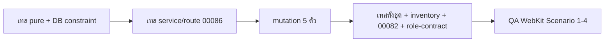

> **โมดูล:** 00086 — Service Staff Workflow
> **ประเภทเอกสาร:** Test Case
> **เวอร์ชัน:** 1.0
> **วันที่จัดทำ:** 2026-10-27
> **สถานะ:** As-built (sync 2026-10-29 · + มติ UX 2026-10-30: TC-017 · TC-022 · TC-031..033 · TC-086/087 · TC-110/111 · TC-134..136) — P1+P2+P3 ลงโค้ดครบ · ไฟล์เทสที่พิสูจน์แต่ละ FR อยู่ §3.1 (ชื่อไฟล์จริงต่างจากแผนเดิมใน §1) · browser QA P3 ทำแล้ว · ยังไม่ commit

# Test Case: งานพนักงานร้านบริการ

## 1. Overview
| รายการ | ค่า |
|---|---|
| เทส pure (ไม่มี DB) | `src/lib/__tests__/shop-permissions.*` · `shop-role-picker.test.ts` · `role-nav.test.ts` · `chat-order-actions` · `arrival-mode` · `order-view-by-level.test.ts` · auto-notify |
| เทส DB/service (Postgres localhost 5434) | ~~ไฟล์รวมตามแผนเดิม~~ — as-built แยกเป็นไฟล์ `*.db.test.ts` รายเรื่อง (ดู §3.1) |
| เทส route | `src/app/api/orders/__tests__/role-gates.route.test.ts` (close/outcome) · `service-job-steps.route.test.ts` (start/finish/assign/assign-claim) · `src/app/api/orders/route.test.ts` (arrivalMode/assignedUserId) · `roles.route.test.ts` (members PATCH) |
| ด่านเดิมที่ต้องเขียว | `route-capability-inventory.test.ts` · `technician-no-money.*` · `tests/services/service-buyer-confirm-00082.test.ts` (ไม่แก้) · `tests/integration/role-contract.test.ts` |
| วิธีรัน | override `DATABASE_URL` เป็น 5434 + `STORAGE_DRIVER=local` · ตรวจว่าฐาน local มี CHECK ครบก่อน (ไม่มี = ผ่านหลอก) |
| QA เบราว์เซอร์ | WebKit iPhone 14 Pro — Scenario 1–4 ของ BRD §5 |
| mutation (ขั้นต่ำ) | ถอดตัวกั้น vertical ใน `memberCanCloseJob` · ถอดด่านที่ outcome · ถอด where `createdByUserId` · ถอดตัวกั้น vertical ใน backfill · ถอดการคัดลอก flag ใน `acceptInviteLink` — ทุกตัวต้องทำให้เทสแดง |

## 2. Test Scenarios

### 2.1 Schema / migration (S-1)
| TC | ขั้นตอน | คาดหวัง | FR |
|---|---|---|---|
| TC-001 | รันไฟล์ P1 ในทรานแซกชันกับ: ร้านบริการ {CHAT, TECHNICIAN, BILLING, MANAGER+CHAT, OWNER} · ร้านขายของ {CHAT} · ลิงก์เชิญค้าง roles [TECHNICIAN] | ร้านบริการ: CHAT/TECHNICIAN/MANAGER+CHAT = `canCloseJob` true · BILLING/OWNER = false · ร้านขายของ = false · ลิงก์ค้าง = false · `canRecordExpense` ทุกคน false · รันรอบสองไม่เปลี่ยนอะไร | FR-006 |
| TC-002 | ADMIN flag true → update `role='OWNER'` โดยไม่ล้าง flag | ล้มด้วย `ShopMember_flags_admin_only_check` · `changeMemberRole`/`transferShopOwnership` (ล้าง flag) ผ่าน | FR-006 |
| TC-003 | รันไฟล์ P2: ใบบริการ นัด−สร้าง = 45 นาที / 10 นาที / −2 วัน (ย้อนหลัง) / ไม่มีนัด · ใบร้านขายของมีนัด | BOOKED / WALK_IN / WALK_IN / NULL · ร้านขายของ NULL · ผลตรงกับ `resolveArrivalMode` ทุกใบ | FR-002 |
| TC-004 | ร้านเดิม + ร้านใหม่หลัง P3 | `serviceJobPhotoMode='OPTIONAL'` · `serviceJobPhotosBuyerVisible=false` | FR-013 |
| TC-005 | insert `arrivalMode='WALK_IN'` บนใบไม่มี `serviceStart` · ค่า `'X'` | ล้ม `Order_arrivalMode_check` ทั้งคู่ | FR-002 |
| TC-006 | `serviceFinishedAt` โดยไม่มี `serviceStartedAt` | ล้ม `Order_serviceFinished_requires_started` | FR-010 |
| TC-007 | `Shop` mode `NONE` + buyerVisible true · mode `'ALWAYS'` | ล้ม `Shop_serviceJobPhoto_check` | FR-013 |
| TC-008 | `ServiceJobRecord` ซ้ำ (orderId, BEFORE) · 11 รูป · note ว่าง/1001 ตัว · phase `'MID'` | ล้มทุกกรณี (unique / fileIds_max / note_len / phase_check) | FR-009 |
| TC-009 | insert `OrderEvent` 4 ชนิดใหม่ · AutoNotify Switch/Template/Ledger kind `SERVICE_FINISHED` | ผ่าน CHECK ทั้งหมด (ฐาน local มี CHECK จริง) · `auto-notify-db-constraint.test.ts` ใช้ needle `AutoNotifyLedger_kind_check` แล้วเขียว · `order-event.test.ts:22` / `order-event-instrumentation.test.ts:58` เขียว (ป้ายครบ 39) | FR-010, FR-015 |

### 2.2 การ์ดติ๊กรายคน (S-4)
| TC | ขั้นตอน | คาดหวัง | FR |
|---|---|---|---|
| TC-010 | `StaffRolePicker` `flagsAvailable=true` | 6 การ์ด หน้าตาเดียวกับการ์ดบทบาท · ร้านอื่น (`false`) = 4 การ์ดเท่าเดิม | FR-004, S-18 |
| TC-011 | `closeJobFlagState`: [MANAGER] · [BILLING] · [CHAT] · [TECHNICIAN,BILLING] | LOCKED_ON "ผู้ดูแลปิดงานได้อยู่แล้ว" · DISABLED "ใช้คู่กับ ตอบแชท หรือ ฝ่ายช่าง" · EDITABLE · EDITABLE | FR-004 |
| TC-012 | การ์ด "บันทึกค่าใช้จ่ายได้" ทุกชุดบทบาท | ติ๊กได้ทุกบทบาท · ค่าเริ่มไม่ติ๊ก | FR-017 |
| TC-013 | PATCH member `{canRecordExpense:true}` → GET รายชื่อ | ชิป "บันทึกค่าใช้จ่ายได้" · ชิป "ปิดงานได้" ของคนที่ติ๊ก | FR-004, FR-017 |
| TC-014 | PATCH member BILLING ล้วน `{canCloseJob:true}` · ร้านขายของ `{canRecordExpense:true}` · ไม่ใช่เจ้าของเรียก | 400 `CLOSE_JOB_NEEDS_START_ROLE` · 400 `STAFF_FLAGS_NOT_AVAILABLE` · 403 `NOT_OWNER` | FR-004 |
| TC-015 | สร้างลิงก์เชิญ `{canCloseJob:true, canRecordExpense:true}` → ผู้ใช้ใหม่รับลิงก์ · คำเชิญเบอร์ → รับ · ลิงก์ไม่ส่ง flag → รับ | สมาชิกใหม่ได้ flag ตรงตามลิงก์/คำเชิญ · ไม่ส่ง = false | FR-004, FR-006 |
| TC-016 | ตอบแชทติ๊ก → POST close ได้ 200 → เจ้าของเอาติ๊กออก → POST close อีกใบ (session เดิม ไม่ login ใหม่) | 403 `FORBIDDEN_ROLE` ทันที | FR-004 |
| TC-017 | (มติ 2026-10-30) `flagsAfterRoleToggle` + `StaffRolePicker` (ลิงก์เชิญ + แก้บทบาท): กดเพิ่มการ์ด "ฝ่ายช่าง" จาก [] / [CHAT] → ติ๊กออก → เพิ่ม/ถอด BILLING ของคนที่เป็น TECHNICIAN ไม่ติ๊ก → เพิ่ม MANAGER | "ปิดงานได้" ติ๊กให้อัตโนมัติ · ติ๊กออกแล้วค่าเป็น false · แก้บทบาทอื่นไม่ติ๊กกลับ (คง false) · MANAGER = LOCKED_ON · ร้านอื่น (`flagsAvailable=false`) ไม่มีการ์ด · ค่าเริ่ม DB ยัง false | FR-004 |

### 2.3 แบบการมา (S-2, S-3)
| TC | ขั้นตอน | คาดหวัง | FR |
|---|---|---|---|
| TC-020 | POST /api/orders ร้านบริการ บริการ ไม่ส่ง `arrivalMode` | 400 `ARRIVAL_MODE_REQUIRED` | FR-001 |
| TC-021 | `BOOKED` ไม่มี start/end | 400 `ARRIVAL_BOOKED_NEEDS_TIME` "เลือกวันและเวลานัด" · UI ปุ่มบันทึกกดไม่ได้ | FR-001 |
| TC-022 | `WALK_IN` + resourceId + start ในอนาคต + depositAmount | `serviceStart` = เวลา server (ปัดวินาที) ไม่ใช่ค่าที่ส่ง · `depositAmount` NULL · ขึ้นตารางวันนี้ · ป้ายฝั่งร้าน "รอเริ่มงาน" (มติ 2026-10-30) / ฝั่งลูกค้า "รับงานแล้ว" + "หน้าร้าน" | FR-001 |
| TC-023 | `WALK_IN` ไม่มี resourceId | 400 `ARRIVAL_WALK_IN_NEEDS_QUEUE` | FR-001 |
| TC-024 | `BOOKED` นัดพรุ่งนี้ + มีห้องแชท + สวิตช์เปิด | แถว ledger `SERVICE_BOOKED` 1 แถว | FR-003 |
| TC-025 | `WALK_IN` + มีห้องแชท + สวิตช์ `SERVICE_BOOKED` เปิด | ไม่มีแถว ledger `SERVICE_BOOKED` | FR-003 |
| TC-026 | ร้านขายของส่ง `arrivalMode:'WALK_IN'` · ใบสินค้าในร้านบริการ | ถูกละ · `arrivalMode` NULL · พฤติกรรมเดิม | FR-001, S-18 |
| TC-027 | ใบเก่ายังไม่ระบุเวลา → "เริ่มงานเลย" (PATCH appointment `arrivalMode:'WALK_IN'`) | `serviceStart` ตั้ง + `arrivalMode='WALK_IN'` · ป้าย "หน้าร้าน" | FR-002 |
| TC-028 | ใบยังไม่ระบุเวลา → ตั้งนัดครั้งแรกไม่ส่ง arrivalMode · ใบ BOOKED → เลื่อนนัดพร้อมส่ง `WALK_IN` | BOOKED · BOOKED (ไม่เปลี่ยน) | FR-002 |
| TC-029 | grep `resolveArrivalMode(` ในจุดแสดงผล 3 จุด · grep "เดินเข้ามา" ใน `src/` ส่วนร้านบริการ | 0 · 0 (อยู่ใน `arrival-mode.ts` เท่านั้น) | FR-002 |
| TC-030 | `arrivalModeOf`: ค่าที่เก็บ BOOKED แต่สูตรให้ WALK_IN · null+มีนัด · null+ไม่มีนัด | BOOKED · ผลสูตร · UNSCHEDULED (mutation: สลับลำดับต้องแดง) | FR-002 |
| TC-031 | (มติ 2026-10-30) ป้ายฝั่งร้านทุกตัวใน `SERVICE_STATUS_META` + คำศัพท์บริการ `stageOrderedLabel` | ไม่มีป้ายฝั่งร้านตัวไหนมีคำ "รับงาน" · `WALK_IN.seller` = "รอเริ่มงาน" · `WALK_IN.buyer` = "รับงานแล้ว" | FR-002 |
| TC-032 | (มติ 2026-10-30) ชิปรายการแชท `serviceProgressFace` + แถบสถานะในแชท `chat-service-progress`: งานหน้าร้านยังไม่เริ่ม · เริ่มแล้ว · ทำเสร็จยังไม่ปิด · ปิดแล้ว · งานจอง | "รอเริ่มงาน" (ไม่ใช่ "นัด {วันที่}") · "กำลังให้บริการ" (`IN_SERVICE`) · "ทำเสร็จ · รอปิดงาน" (`FINISHED_AWAITING_CLOSE`) · หลุดจากงานค้าง · "นัด {วันที่}" เหมือนเดิม | FR-002 |
| TC-033 | (มติ 2026-10-30) การ์ดออเดอร์ในแชท (`OrderCardView` ฝั่งร้าน) · ออเดอร์ล่าสุดหน้าแรก · รายชื่อลูกค้า ของใบที่เริ่ม/ทำเสร็จแล้ว · มุมลูกค้าของใบเดียวกัน | ขั้นตรงกับการ์ดงาน (ส่ง `serviceStartedAt`/`serviceFinishedAt`) · ลูกค้าไม่เห็นขั้นภายในร้าน | FR-002 |

### 2.4 ด่านปิดงาน (S-5)
| TC | ขั้นตอน | คาดหวัง | FR |
|---|---|---|---|
| TC-040 | `memberCanCloseJob` ตารางเต็ม: vertical {SERVICE_QUEUE, ONLINE_SALES} × บทบาท {OWNER, MANAGER, CHAT, BILLING, TECHNICIAN, CHAT+BILLING, TECHNICIAN+BILLING} × flag {T,F} | ร้านบริการ: O/M true เสมอ · CHAT/TECH/ผสมที่มี CHAT หรือ TECH = ตาม flag · BILLING ล้วน false · ร้านขายของ = `can(roles,'O4')` ไม่สน flag | FR-005 |
| TC-041 | POST close × ทุกบทบาท × flag (ร้านบริการ · ใบที่เริ่มและทำเสร็จแล้ว · ช่างเป็นผู้รับผิดชอบ) | ผลตรง TC-040 · ไม่ผ่าน = 403 `FORBIDDEN_ROLE` และ `serviceClosedAt` ยัง NULL | FR-005 |
| TC-042 | POST appointment/outcome × ทุกบทบาท × flag | เหมือน TC-041 (ทางที่สองต้องกั้นด้วยด่านเดียวกัน) | FR-005 |
| TC-043 | ตอบแชท/ช่าง ไม่ติ๊ก → POST start | 200 (เริ่มงานยังได้ — แยกจากปิด) | FR-005 |
| TC-044 | `ServiceJobCard` render: (canStart true, canClose false) · (canStart false, canClose true) | ปุ่มเริ่มแสดง/ปุ่มปิดซ่อน · กลับกัน (mutation: ใช้ prop ตัวเดียวคุมทั้งคู่ต้องแดง) | FR-005 |
| TC-045 | ช่างล้วนติ๊ก ปิดงานของคนอื่น · ปิดงานตัวเองที่ยังไม่ทำเสร็จ | 403 `SERVICE_JOB_NOT_ASSIGNEE` · 409 `SERVICE_JOB_NOT_FINISHED` | FR-011 |
| TC-046 | ตอบแชทติ๊ก ปิดงานที่ยังไม่กดทำเสร็จ | 200 (ข้ามขั้นได้) | FR-010, FR-011 |
| TC-047 | `chatOrderActions({canClose:false, ...})` / `true` | ไม่มี `MARK_SERVED` / มี · `AppointmentDayCard` caps `canClose:false` ไม่มีปุ่มปิด | FR-005 |
| TC-048 | ลูกค้ายืนยันรับบริการ (ใบที่ไม่มีใครในร้านปิดได้) | ปิดให้ตาม 00082 · `service-buyer-confirm-00082.test.ts` เขียวโดยไม่แก้ไฟล์ | FR-005 |
| TC-049 | DELETE close (O6) · POST cancel (O6) ด้วยตอบแชทติ๊ก | 403 เท่าเดิม (สิทธิ์เปิดงานอีกครั้ง/ยกเลิกไม่เปลี่ยน) · `route-capability-inventory.test.ts` เขียว | FR-005 |

### 2.5 ผู้รับผิดชอบ (S-6)
| TC | ขั้นตอน | คาดหวัง | FR |
|---|---|---|---|
| TC-050 | POST /api/orders `assignedUserId` = ช่าง · = ตอบแชทล้วน | ตั้งค่า + event `SERVICE_ASSIGNED` · 400 `ASSIGNEE_NOT_TECHNICIAN` | FR-007 |
| TC-051 | POST assign ด้วย เจ้าของ/ผู้ดูแล/ตอบแชท/เปิดบิล · ช่างล้วน | 200 ×4 · 403 `FORBIDDEN_ROLE` | FR-007 |
| TC-052 | POST assign ใบปิดแล้ว · DELETE assign | 409 `SERVICE_JOB_ALREADY_CLOSED` · 200 + `SERVICE_UNASSIGNED meta.reason='MANUAL'` | FR-007 |
| TC-053 | ช่าง claim งานที่ยังไม่มีคนรับ | 200 · `SERVICE_CLAIMED` actor = ช่าง (จาก session) | FR-007 |
| TC-054 | ช่าง A และ B claim พร้อมกัน (`Promise.all`) | 1 คน 200 · อีกคน 409 `SERVICE_JOB_ALREADY_ASSIGNED` + ชื่อผู้รับ · event 1 แถว | FR-007 |
| TC-055 | ตอบแชทล้วน claim | 403 `SERVICE_JOB_CLAIM_TECHNICIAN_ONLY` | FR-007 |
| TC-056 | ลบช่างที่ถืองานเปิด 2 ใบ + งานปิดแล้ว 1 ใบ | 2 ใบเปิด `assignedUserId` NULL + `SERVICE_UNASSIGNED reason MEMBER_REMOVED` · ใบปิดแล้วคงเดิม · ร้านอื่นไม่ถูกแตะ | FR-007 |
| TC-057 | GET service-staff | เฉพาะสมาชิกที่ถือ TECHNICIAN · ไม่มีเบอร์/อีเมล | FR-007 |

### 2.6 มุมมองช่าง + แถบล่าง (S-7, S-14)
| TC | ขั้นตอน | คาดหวัง | FR |
|---|---|---|---|
| TC-060 | หน้าหลักช่างล้วน: งานวันนี้ของฉัน 2 · ของคนอื่น 1 · ไม่มีคนรับ 3 | "งานของฉันวันนี้ · 2 งาน" · "ยังไม่มีคนรับ · 3 งาน" | FR-008 |
| TC-061 | `/my-jobs?scope=all` ของช่าง | เห็นงานทั้งร้าน + เบอร์ลูกค้า (OOS-6) · ชื่อผู้รับผิดชอบ/"ยังไม่มีคนรับ" | FR-008 |
| TC-062 | payload `/my-jobs`, `appointments/day`, GET order ของช่าง | ไม่มีคีย์ใน `NO_MONEY_FORBIDDEN_KEYS` ทุกความลึก · มี `assignedUser`, `serviceFinishedAt`, `serviceJobRecords` | FR-008, FR-012 |
| TC-063 | ตารางงาน/แถวงานแสดงผู้รับผิดชอบ | ชื่อ หรือ "ยังไม่มีคนรับ" | FR-008 |
| TC-130 | `resolveMobileNav` ร้านบริการ: OWNER · MANAGER · CHAT · BILLING · TECHNICIAN · CHAT+TECHNICIAN | หน้าหลัก·บริการ·+·แชท·ร้านค้า (×2 เท่าเดิม) · หน้าหลัก·บริการ·+·แชท·ตารางงาน · หน้าหลัก·บริการ·+·ตารางงาน·ลูกค้า · หน้าหลัก·งานของฉัน·ตารางงาน (ไม่มี +) · 4 แท็บ + ปุ่ม + | FR-016 |
| TC-131 | ทุกชุดบทบาทเดียวกันในร้าน ONLINE_SALES / LODGING / Personal | ผลเท่า snapshot ก่อนแก้ทุกตัว | FR-016, S-18 |
| TC-132 | ทุก `href` ของแท็บใหม่ | `isRegisteredPage` = true · `canSeePage` ตรงกับบทบาท | FR-016 |
| TC-133 | FAB ของบทบาทที่สร้างงานได้ | อยู่กึ่งกลางเสมอ (`fabAfter = 2`) | FR-016 |
| TC-134 | (มติ 2026-10-30) `homeBlocks` ช่างล้วนร้านบริการ เทียบ เจ้าของ / ตอบแชท / ช่างร้านขายของ | ช่างล้วนร้านบริการ: `shopWideJobLabels` (ตัวนับ "งานทั้งร้าน") · `activityLinksByPage` (ลิงก์ที่เปิดไม่ได้เป็นข้อความ · ว่างไม่มี CTA "สร้างงานบริการ") · `shopPackage` = false · การ์ดงานวันนี้แถวแรก (จอใหญ่) · บทบาท/ร้านอื่นเท่าเดิม | FR-008, FR-016 |
| TC-135 | (มติ 2026-10-30) ทางลัดหน้าแรก + เมนูแถบข้างเดสก์ท็อปของช่างล้วนร้านบริการ (`technicianUnusableShortcutSlugs` · `applyCapabilityMenu` รับ `vertical`) | ไม่มี "ร้านค้า" (`seller:shop`) ทั้งทางลัดและเมนูแถบข้าง · ทางลัด/เมนูอื่นคงเดิม · เจ้าของ/ผู้ดูแล/ช่าง+ตอบแชท/ช่างร้านประเภทอื่นยังเห็น "ร้านค้า" (`src/lib/seller-menu.test.ts`) | FR-016 |
| TC-136 | (มติ 2026-10-30) `showsShopPackage` · การ์ดแพ็กเกจแถบข้าง (`showPackageCard`) + ชิปแพ็กเกจ hero มือถือ | ช่างล้วนร้านบริการ = ซ่อนทั้งสองจุด · ตอบแชท/เปิดบิล/ผู้ดูแล/เจ้าของ = เห็น (มติ 2026-07-29) · ร้านประเภทอื่นเท่าเดิม | FR-016 |
| TC-137 | (review/QA 2026-10-30) ป้ายนัดในรายการ `/orders` (การ์ดมือถือ + คอลัมน์ "นัดหมาย") · รายการวันของบอร์ด `/queues` จอกลาง · payload แชทของผู้ซื้อ | ป้ายตรงกับสถานะใบเดียวกัน (`appointment.badge` · `AppointmentDayRows serviceBadges` ← `listAppointments` เพิ่ม arrivalMode/createdAt/เวลาเริ่ม-เสร็จ-ปิด) · จองล่วงหน้ายัง "นัดแล้ว" ก่อนเริ่ม · ผู้ซื้อไม่ได้คีย์ `serviceStartedAt/serviceFinishedAt` ในการ์ดออเดอร์ของแชท (`getMessages().viewerIsBuyer` · `buyer-chat-no-internal-steps.test.ts` · `day-card-assignee.ui.test.tsx`) | FR-001, FR-008 |
| TC-138 | (มติ 2026-10-30 · ร้านช่างเยอะ) ฟอร์มสร้าง `AssigneePicker` · ชีต `AssigneeSheet` (ฟอร์ม + หน้างาน) · `service-staff ?from&to&exclude` | ≤ 6 คน = ชิปแบบเดิม · 7+ = ช่องเดียว "ยังไม่มีคนรับ · แตะเพื่อเลือกจาก N คน" / ชื่อที่เลือก + ป้ายว่าง/ติดงาน (ไม่มีช่วงเวลา = "แตะเพื่อเปลี่ยน" · ค่าค้างจากคน/ช่วงก่อนหน้าไม่แสดง) · ชีตมีช่องค้นชื่อ (ซ่อน "ยังไม่มีคนรับ" ระหว่างค้น · ไม่พบ = ข้อความ) · ป้าย "ว่างช่วงนี้ / ติดงาน HH:mm–HH:mm" + "วันนี้ N งาน" · คนว่างขึ้นก่อน · นับเฉพาะงานยังไม่จบเป็นการชน · ไม่นับงานที่กำลังมอบ/ยกเลิก/วันอื่น/ร้านอื่น · โหมดเลือกในฟอร์มไม่ยิง `/assign` · ช่วงผิดรูป = รายชื่อแบบเดิม (`assignee-load.test.ts` · `service-create-assignee.ui.test.tsx` · `service-job-photos-card.ui.test.tsx` · `service-job-steps.route.test.ts` · `service-job-tech.db.test.ts`) | FR-007 |

### 2.7 เริ่มงาน (S-8)
| TC | ขั้นตอน | คาดหวัง | FR |
|---|---|---|---|
| TC-070 | ร้าน REQUIRED ไม่ส่งรูป | 400 `SERVICE_JOB_PHOTO_REQUIRED` · `serviceStartedAt` NULL | FR-009 |
| TC-071 | ร้าน OPTIONAL ไม่ส่งอะไร | 200 · ไม่มีแถว record · event `photoCount:0, hasNote:false` | FR-009 |
| TC-072 | ร้าน NONE ส่งรูป · ส่งบันทึกอย่างเดียว | 400 `SERVICE_JOB_PHOTOS_DISABLED` · 200 + record มี note ไม่มีรูป | FR-009 |
| TC-073 | fileId 1 ใน 2 ไม่มีใน storage | 400 `SERVICE_JOB_PHOTO_MISSING` · สถานะไม่เปลี่ยน · ไม่มี record | FR-009 |
| TC-074 | ช่างล้วนเริ่มงานของคนอื่น · งานไม่มีคนรับ · เจ้าของ/ผู้ดูแล/ตอบแชทเริ่มแทน | 403 `SERVICE_JOB_NOT_ASSIGNEE` (+ชื่อ) · 409 `SERVICE_JOB_UNASSIGNED` · 200 | FR-009 |
| TC-075 | เริ่มสำเร็จ 2 รูป + บันทึก | record BEFORE 2 รูป · `createdByUserId` = session · event actor ถูกคน · ledger `SERVICE_STARTED` (เดิม) | FR-009 |
| TC-076 | กดเริ่มพร้อมกัน 2 คำขอ | `serviceStartedAt` เดียว · record 1 แถว · event 1 แถว · อีกคำขอ `alreadyStarted:true` | FR-009 |
| TC-077 | งานจองที่ยังไม่ถึงเวลานัด · งานหน้าร้าน | ปุ่มเริ่มซ่อน / 409 `APPOINTMENT_NOT_STARTED` · หน้าร้านเริ่มได้ทันที | FR-009 |

### 2.8 ทำเสร็จ (S-9)
| TC | ขั้นตอน | คาดหวัง | FR |
|---|---|---|---|
| TC-080 | finish ก่อน start | 409 `SERVICE_JOB_NOT_STARTED` | FR-010 |
| TC-081 | finish สำเร็จ | `serviceFinishedAt` ตั้ง · record AFTER · `SERVICE_FINISHED` · ป้าย "ทำเสร็จ · รอปิดงาน" · `status`/`appointmentStatus`/`serviceClosedAt` ไม่เปลี่ยน | FR-010 |
| TC-082 | ยอดรายงานยอดขายและกำไร (00078) ก่อน/หลัง finish | เท่ากัน · หลังปิดงานจึงเพิ่ม | FR-010 |
| TC-083 | finish ซ้ำพร้อมกัน | เวลาเดียว · record 1 แถว | FR-010 |
| TC-084 | reopen หลังปิด | `serviceFinishedAt` ไม่ถูกล้าง | FR-010 |
| TC-085 | กติการูปของ finish (REQUIRED/NONE) | เหมือน TC-070/072 | FR-010 |
| TC-086 | ช่างล้วนไม่ติ๊ก (ผู้รับผิดชอบ) หลังทำเสร็จ | ไม่มีปุ่มปิด · ข้อความ "ส่งงานแล้ว · รอเจ้าของร้านหรือผู้มีสิทธิ์ปิดงาน" ตรงตัวอักษร + ไอคอน circle-check (มติ 2026-10-30) · ช่างติ๊ก: แผ่นปิดไม่มีส่วนเงิน + "ยอดที่เหลือให้เจ้าของร้านหรือฝ่ายเปิดบิลบันทึก" | FR-011 |
| TC-087 | ตอบแชทไม่ติ๊ก (ไม่ใช่ช่าง) เปิดงานที่ทำเสร็จแล้ว | ไม่มีปุ่มปิด · ข้อความ "ทำเสร็จแล้ว · รอเจ้าของร้านหรือคนที่มีสิทธิ์ปิดงาน" + ไอคอน lock · ไม่มีคำ "คุณไม่มีสิทธิ์ปิดงาน" | FR-011 |

### 2.9 รูป/บันทึกในหน้างาน + ตั้งค่า (S-10, S-11)
| TC | ขั้นตอน | คาดหวัง | FR |
|---|---|---|---|
| TC-090 | หน้างานของทุกบทบาท (รวมช่าง) หลังเริ่ม+ทำเสร็จ | การ์ด "รูปก่อน-หลัง" + ป้าย "ลูกค้าเห็น"/"เห็นเฉพาะในร้าน" · โหมด NONE = "บันทึกงาน" | FR-012 |
| TC-091 | ไทม์ไลน์ | รับงาน/มอบงาน/เริ่ม/ทำเสร็จ/ปิด + ชื่อ + เวลา + รูปย่อ + บันทึก | FR-012 |
| TC-092 | `OrderEvent.meta` ของ 4 ชนิดใหม่ + `SERVICE_STARTED` | ไม่มีคีย์ `note`/ข้อความบันทึก/PII | FR-012 |
| TC-093 | fileId ชี้ไฟล์ที่ถูกลบ | รูปย่อแสดงตัวแทน หน้าไม่ล้ม | FR-012 |
| TC-100 | PATCH photo-settings ด้วย เจ้าของ/ผู้ดูแล · ตอบแชท/เปิดบิล/ช่าง | 200 · 403 `FORBIDDEN_ROLE` | FR-013 |
| TC-101 | PATCH `{mode:'NONE', buyerVisible:true}` | 200 `{mode:'NONE', buyerVisible:false}` | FR-013 |
| TC-102 | ร้านขายของเรียก | 403 `FEATURE_NOT_AVAILABLE` · หน้า `/settings/job-types` ไม่มีการ์ด | FR-013, S-18 |
| TC-103 | การ์ดในหน้า "ประเภทงาน" | สวิตช์ "ลูกค้าเห็นรูปและบันทึก" ปิดและล็อกเมื่อเลือก "ไม่ใช้รูป" | FR-013 |

### 2.10 แจ้งเตือน (S-12, S-17)
| TC | ขั้นตอน | คาดหวัง | FR |
|---|---|---|---|
| TC-110 | ช่าง claim/start/finish/close (ช่างติ๊ก) | (มติ 2026-10-30) `Notification kind service_job_{finished,closed}` ให้เจ้าของ + ผู้ดูแลทุกคน · claim/start ไม่มีแถว ไม่มี push (`shouldNotifyServiceJob` = false · ยังมี `OrderEvent` ในไทม์ไลน์) · ช่างไม่ได้ · ข้อความ "{ชื่อช่าง} {สิ่งที่ทำ} · {บริการ} · {ชื่อลูกค้า}" · `refId` = publicToken | FR-014 |
| TC-111 | ผู้ดูแลกดเริ่มเอง · ผู้ดูแลกดปิดงานเอง | เริ่ม: ไม่มีแจ้งเตือนถึงใครเลย (มติ 2026-10-30) · ปิดงาน: เจ้าของได้ · ผู้ดูแลคนนั้นไม่ได้ | FR-014 |
| TC-112 | `pushToUsers` ถูกเรียกด้วย data `{type:'service-job', url:'/orders/{token}'}` · ทำให้ push throw | การกดยัง 200 · สถานะงานบันทึกแล้ว | FR-014 |
| TC-113 | หน้า `/notifications` ฝั่งร้าน | รายการใหม่แสดงร่วมกับ feed เดิม (สร้างงาน/ลูกค้ายืนยัน/ปิดงาน) เรียงเวลา · ไม่ซ้ำ | FR-014 |
| TC-114 | มอบงาน (assign) | ไม่มีแจ้งเตือน (FR-014 ไม่รวมเหตุการณ์นี้) | FR-014 |
| TC-160 | พนักงานติ๊กสร้าง ฿500 ADVERTISING → แก้เป็น ฿650 → ลบ | เจ้าของได้ 3 แถว `staff_expense` คำ "บันทึก/แก้ไข/ลบค่าใช้จ่าย" · ผู้ดูแลไม่ได้ | FR-020 |
| TC-161 | เจ้าของสร้างค่าใช้จ่ายเอง (ผ่าน /api/expenses) | ไม่มีแจ้งเตือน | FR-020 |
| TC-162 | ข้อความ | ใช้ป้ายหมวดภาษาไทยจากตัวกลางของ 00016 · ไม่มีคำร้านขายของ | FR-020 |

### 2.11 ลูกค้าเห็นรูป (S-13)
| TC | ขั้นตอน | คาดหวัง | FR |
|---|---|---|---|
| TC-120 | ร้านเปิด buyerVisible · `/o/[token]` | การ์ด "รูปจากร้าน" ก่อนทำ/หลังทำ + เวลา + บันทึก · ไม่มีชื่อพนักงาน | FR-015 |
| TC-121 | ร้านปิด · โหมด NONE | ไม่มีการ์ด · RSC payload ไม่มีคีย์ `serviceJobPhotos`/fileId/บันทึกเลย | FR-015 |
| TC-122 | ทำเสร็จ + ร้านเปิด + สวิตช์ `SERVICE_FINISHED` เปิด + มีแชท | ledger `SERVICE_FINISHED` 1 แถว ข้อความ "ทำเสร็จแล้ว ดูรูปก่อน-หลังได้ที่ลิงก์งานบริการ" | FR-015 |
| TC-123 | ทำเสร็จ + ร้านปิด buyerVisible (สวิตช์เปิด) | ไม่ส่ง · eligibility `PHOTOS_NOT_VISIBLE` | FR-015 |
| TC-124 | `kindsForVertical('ONLINE_SALES')` / `LODGING` | ไม่มี `SERVICE_FINISHED` | FR-015, S-18 |

### 2.12 ค่าใช้จ่ายพนักงาน (S-15, S-16)
| TC | ขั้นตอน | คาดหวัง | FR |
|---|---|---|---|
| TC-140 | พนักงานไม่ติ๊ก · เจ้าของ GET/POST `/api/expenses/mine` | 403 `FORBIDDEN_ROLE` · หน้า `/expenses/mine` ไม่มีทางเข้า (การ์ดหน้าหลักไม่แสดง) | FR-018 |
| TC-141 | พนักงานติ๊ก POST ฿500 · amount 0 · หมวดนอก 7 ค่า | 201 `createdByUserId` = session · 400 · 400 | FR-018 |
| TC-142 | A และ B ติ๊ก · A GET mine | เห็นเฉพาะของ A · ไม่มียอดรวม/สรุปหมวด | FR-018 |
| TC-143 | A PATCH / DELETE รายการของ B · ของเจ้าของ · ของร้านอื่น | 404 ทุกกรณี · แถวไม่เปลี่ยน | FR-018 |
| TC-144 | A PATCH / DELETE ของตัวเอง | 200 | FR-018 |
| TC-145 | พนักงานติ๊ก GET `/api/expenses` · `/api/expenses/report` · PATCH `/api/expenses/[id]` | 403 (F1/F2 เท่าเดิม) | FR-018 |
| TC-146 | เจ้าของเอาติ๊กออก → A PATCH ของตัวเอง | 403 | FR-018 |
| TC-147 | ร้านขายของ ADMIN (flag true ไม่ได้อยู่แล้ว) เรียก `/api/expenses/mine` | 403 | FR-018, S-18 |
| TC-150 | เจ้าของ GET `/api/expenses` | มีรายการพนักงาน + `createdBy.displayName` · หน้าแสดง "บันทึกโดย {ชื่อ}" | FR-019 |
| TC-151 | เจ้าของ PATCH/DELETE รายการของพนักงาน | 200 | FR-019 |
| TC-152 | รายงานยอดขายและกำไร + P&L ก่อน/หลังพนักงานบันทึก ฿650 | กำไรลด ฿650 ทันที · ตัวเลขเท่ากับกรณีเจ้าของบันทึกเอง (HR16 parity) | FR-019 |

### 2.13 Regression ร้านอื่น + QA (S-18)
| TC | ขั้นตอน | คาดหวัง | FR |
|---|---|---|---|
| TC-170 | ร้าน ONLINE_SALES / LODGING / Personal: หน้าเลือกบทบาท | 4 การ์ด | BRD §3.2 |
| TC-171 | ร้านอื่น: สิทธิ์ทุก route ที่แตะ (ผ่าน `role-contract.test.ts`) | ผลเท่าก่อนแก้ | BRD §3.2 |
| TC-172 | ร้านอื่น: หน้าสร้างออเดอร์ | ไม่มีตัวเลือก "ลูกค้ามาแบบไหน"/"ผู้รับผิดชอบ" · body ที่ส่งเหมือนเดิม | BRD §3.2 |
| TC-173 | `git diff main --stat` | ไม่แตะ `src/lib/line*`, `/lr`, ไฟล์ 00070 | OOS-8 |
| TC-174 | grep emoji ใน diff UI · ปุ่มใหม่ทุกปุ่ม | 0 · สูง ≥ 44px (`min-h-11`) | S-18 |
| TC-175 | QA WebKit Scenario 1 (หน้าร้าน · ช่างไม่ติ๊ก) · 2 (จอง · รับงาน · ช่างติ๊กปิด) · 3 (ค่าใช้จ่าย) · 4 (ไม่ใช้รูป) ตาม BRD §5 | ผลลัพธ์ตาม BRD ทุกข้อ · ไม่มี console error | ทุก FR |
| TC-176 | `route-capability-inventory.test.ts` หลังเพิ่ม route/หน้าใหม่ | เขียว · ทุกไฟล์ใหม่มีรายการในทะเบียน | S-5 |

## 3. Traceability Matrix
| BRD | S-id | TC |
|---|---|---|
| FR-001 | S-2 | TC-020..023, TC-026 |
| FR-002 | S-3, S-1 | TC-003, TC-005, TC-027..033 |
| FR-003 | S-2 | TC-024, TC-025 |
| FR-004 | S-4 | TC-010, TC-011, TC-013..017 |
| FR-005 | S-5 | TC-040..044, TC-047..049 |
| FR-006 | S-1, S-4 | TC-001, TC-002, TC-015 |
| FR-007 | S-6 | TC-050..057 |
| FR-008 | S-7 | TC-060..063, TC-134 |
| FR-009 | S-8 | TC-008, TC-070..077 |
| FR-010 | S-9 | TC-006, TC-046, TC-080..085 |
| FR-011 | S-5, S-9 | TC-045, TC-046, TC-086, TC-087 |
| FR-012 | S-10 | TC-062, TC-090..093 |
| FR-013 | S-11, S-1 | TC-004, TC-007, TC-100..103 |
| FR-014 | S-12 | TC-110..114 |
| FR-015 | S-13 | TC-120..124 |
| FR-016 | S-14 | TC-130..136 |
| FR-017 | S-4 | TC-012, TC-013 |
| FR-018 | S-15 | TC-140..147 |
| FR-019 | S-16 | TC-150..152 |
| FR-020 | S-17 | TC-160..162 |
| BRD §3.2 / §6 | S-18 | TC-026, TC-102, TC-124, TC-131, TC-147, TC-170..176 |
| สองทางปิดงาน (close + outcome) | S-5 | TC-041, TC-042 |

### 3.1 ไฟล์เทสที่พิสูจน์แต่ละ FR (as-built · ไฟล์ใหม่ = **ตัวหนา**)
| FR | ไฟล์ |
|---|---|
| FR-001..003 แบบการมา | `src/lib/__tests__/arrival-mode.test.ts` · **`arrival-mode-backfill.db.test.ts`** · **`arrival-mode-backfill-gap.test.ts`** (100220 = UPDATE ชุดเดียวกับ 100200) · **`order-form-arrival.test.ts`** · `service-status.test.ts` · `appointment-day-view.test.ts` · **`src/services/__tests__/order-arrival-mode.db.test.ts`** · `src/app/api/orders/route.test.ts` · **`orders/new/__tests__/service-create-arrival.ui.test.tsx`** · **`service-create-arrival-desktop.ui.test.tsx`** · **`orders/__tests__/service-arrival-surfaces.ui.test.tsx`** · **`components/safepay/appointment-board/__tests__/day-card-arrival.ui.test.tsx`** |
| FR-004 · FR-006 · FR-017 ค่าติ๊กรายคน | `src/lib/shop-permissions.test.ts` · `src/lib/__tests__/shop-role-assignment.test.ts` · `shop-role-picker.test.ts` · `shop-roles-db-constraint.test.ts` · `shop-context.roles.test.ts` · `shop-capability.test.ts` · **`member-flags-backfill.db.test.ts`** · **`staff-flags-capability.db.test.ts`** · **`src/services/__tests__/staff-flags-accept.db.test.ts`** · `shop-member-roles.service.test.ts` · `invite-link.service.test.ts` · `src/app/api/business/shops/[shopId]/members/[memberId]/roles.route.test.ts` · **`src/components/paces/__tests__/StaffRolePicker.test.tsx`** |
| FR-005 · FR-011 ด่านปิดงาน | `src/app/api/orders/__tests__/role-gates.route.test.ts` (close + outcome × บทบาท × ติ๊ก) · **`src/lib/__tests__/service-job-buttons.test.ts`** · **`orders/[token]/components/__tests__/service-job-card-start-vs-close.test.tsx`** · `chat-order-actions.test.ts` · `chat-order-surfaces.test.ts` · `order-edit-and-payment-surfaces.test.ts` · `queues/__tests__/technician-caps.test.tsx` · `tests/services/service-job.test.ts` · `tests/services/service-buyer-confirm-00082.test.ts` (00082 ไม่ผ่านด่าน) |
| ไม่มาตามนัดหลังเริ่ม (มติ 2026-10-29) | **`src/services/__tests__/service-job-noshow-after-start.db.test.ts`** · **`src/lib/__tests__/service-close-started-surfaces.test.ts`** · **`appointment-board/__tests__/day-card-no-show-after-start.ui.test.tsx`** |
| FR-007 ผู้รับผิดชอบ + ปลดงาน | **`src/services/__tests__/service-job-tech.db.test.ts`** · **`src/app/api/orders/__tests__/service-job-steps.route.test.ts`** · **`order-form-assignee.test.ts`** · **`orders/new/__tests__/service-create-assignee.ui.test.tsx`** · **`appointment-board/__tests__/day-card-assignee.ui.test.tsx`** · `shop-member-roles.service.test.ts` (ROLE_REMOVED/MEMBER_REMOVED) · `account-deletion.service.test.ts` |
| FR-008 · FR-016 งานของฉัน + แถบล่าง | **`src/lib/__tests__/technician-jobs.test.ts`** · **`my-jobs/__tests__/my-jobs.page.test.tsx`** · **`dashboard/components/__tests__/today-jobs.ui.test.tsx`** · `src/i18n/__tests__/today-jobs.i18n.test.ts` · **`src/services/__tests__/service-job-payload-roles.db.test.ts`** (carry-over · ยังไม่ระบุเวลา · คีย์ใหม่ของ day) · `role-nav.test.ts` · `_shared/__tests__/SellerBottomNav.test.tsx` |
| FR-009 · FR-010 เริ่ม/ทำเสร็จพร้อมรูป | **`service-job-steps.route.test.ts`** · **`src/lib/__tests__/service-job-p3.db.test.ts`** (migration + CHECK + ServiceJobRecord) · `src/services/__tests__/service-job-start-00078.test.ts` · **`components/safepay/service-job/__tests__/service-job-photo-sheet.ui.test.tsx`** (ไม่มี `capture`) · `tests/services/service-after-close.test.ts` · `tests/services/finance-chart.test.ts` · `tests/services/service-revenue-reports.test.ts` · `dashboard-money.test.ts` (ทำเสร็จไม่ขยับเงิน) |
| FR-012 รูป/บันทึกในหน้างาน · ช่างไม่เห็นเงิน | **`service-job/__tests__/service-job-photos-card.ui.test.tsx`** · `src/lib/order-event.test.ts` · `order-view-by-level.test.ts` · `orders/__tests__/technician-no-money.{page,ui}.test.tsx` · `src/app/api/orders/__tests__/technician-no-money.route.test.ts` |
| FR-013 ตั้งค่ารูป | **`src/lib/__tests__/service-job-photo-settings.test.ts`** · **`settings/job-types/__tests__/service-job-photo-settings.ui.test.tsx`** |
| FR-014 แจ้งเตือนงาน | **`src/services/__tests__/service-job-notify.service.test.ts`** · **`notification-service-job-visibility.db.test.ts`** · **`notification-current-owner.db.test.ts`** · **`notification-personal-scope.db.test.ts`** · **`seller-notification-feed.test.ts`** (ตัดซ้ำปิดงาน) · **`src/lib/__tests__/shop-notification.test.ts`** · **`TopBar/components/__tests__/notification-deep-link.test.ts`** |
| FR-015 ลูกค้าเห็นรูป + SERVICE_FINISHED | **`src/app/(marketing)/o/[token]/__tests__/service-job-photos.page.test.tsx`** (ไม่มีชื่อพนักงาน · ไม่มีคีย์เมื่อปิด) · `src/lib/auto-notify/__tests__/{eligibility,values,variables}.test.ts` · `src/services/__tests__/auto-notify-config.test.ts` (ไม่มีแถวสวิตช์) · `src/lib/__tests__/auto-notify-db-constraint.test.ts` |
| FR-018..020 ค่าใช้จ่ายพนักงาน | **`src/services/__tests__/expense-staff.db.test.ts`** (กรองแถว + P&L parity) · **`expenses/mine/components/__tests__/staff-expense-ui.test.tsx`** · **`staff-expense-notify.service.test.ts`** · **`staff-expense-notify.db.test.ts`** |
| มติ UX 2026-10-30 | ป้าย "รอเริ่มงาน": `src/lib/__tests__/service-status.test.ts` (ไม่มีป้ายฝั่งร้านที่มีคำ "รับงาน") · `src/lib/__tests__/order-stage.test.ts` (`serviceProgressFace`) · `src/lib/__tests__/chat-service-progress.test.ts` · `orders/__tests__/service-arrival-surfaces.ui.test.tsx` · แจ้งเตือนเหลือทำเสร็จ/ปิดงาน: `src/services/__tests__/service-job-notify.service.test.ts` · ติ๊กปิดงานอัตโนมัติ: `src/lib/__tests__/shop-role-picker.test.ts` + `src/components/paces/__tests__/StaffRolePicker.test.tsx` · หน้าแรกช่าง + ซ่อนแพ็กเกจ: **`src/lib/__tests__/technician-home.test.ts`** · ทางลัด: `src/services/__tests__/shortcut-role.test.ts` |
| Regression / ทะเบียน | `tests/integration/role-contract.test.ts` · `route-capability-inventory.test.ts` · **`src/lib/__tests__/p3-critique-fixes.test.ts`** |

ช่องว่างที่รู้อยู่: แผ่นแนบรูปในแอปผู้ขาย (WebView iOS/Android) ยังไม่ได้ทดสอบบนเครื่องจริง · ไม่มีเทสยืนยัน "ผู้อัปโหลดไฟล์" (ไม่มีข้อมูลให้ตรวจ — ข้อจำกัดที่ยอมรับ)

## 4. Flow (ถ้ามี)

## 5. ผลล่าสุด
| วันที่ | ผล |
|---|---|
| 2026-10-27 | ยังไม่รัน — เอกสารออกแบบเคสก่อนลงโค้ด |
| 2026-10-29 | P1+P2+P3 ลงโค้ดครบ · เทสตาม §3.1 · browser QA P3 (มือถือ + เดสก์ท็อป · เจ้าของ/ผู้ดูแล/ช่าง · ร้านขายของ regression) ทำแล้ว · ผล full suite ล่าสุดให้ Controller ยืนยันก่อนรีวิว (เอกสารนี้ไม่บันทึกตัวเลข) · ค้าง: QA แผ่นแนบรูปใน WebView แอปผู้ขาย · `/impeccable critique` |
| 2026-10-30 | มติ UX 6 ข้อลงโค้ด (ป้าย "รอเริ่มงาน" · ข้อความช่างส่งงาน · หน้าแรกช่าง · ซ่อนแพ็กเกจ · แจ้งเตือนเหลือทำเสร็จ/ปิดงาน · ติ๊กปิดงานอัตโนมัติ) · เคสใหม่/แก้ TC-017 · TC-022 · TC-031..033 · TC-086/087 · TC-110/111 · TC-134..136 · ไฟล์เทสดู §3.1 แถว "มติ UX 2026-10-30" · เอกสารนี้ไม่บันทึกตัวเลข |

## 6. สรุป (Summary)
ครอบ FR-001..FR-020 และ S-1..S-18 · ทั้งสองทางปิดงาน (close + outcome) ทดสอบด่านเดียวกันทุกบทบาท × ติ๊ก · ฝั่งร้านอื่นยืนยันด้วยเทส snapshot/route contract · รวมการแก้เทส CHECK เดิม 5 จุดตาม [[DATABASE]] §5.4
