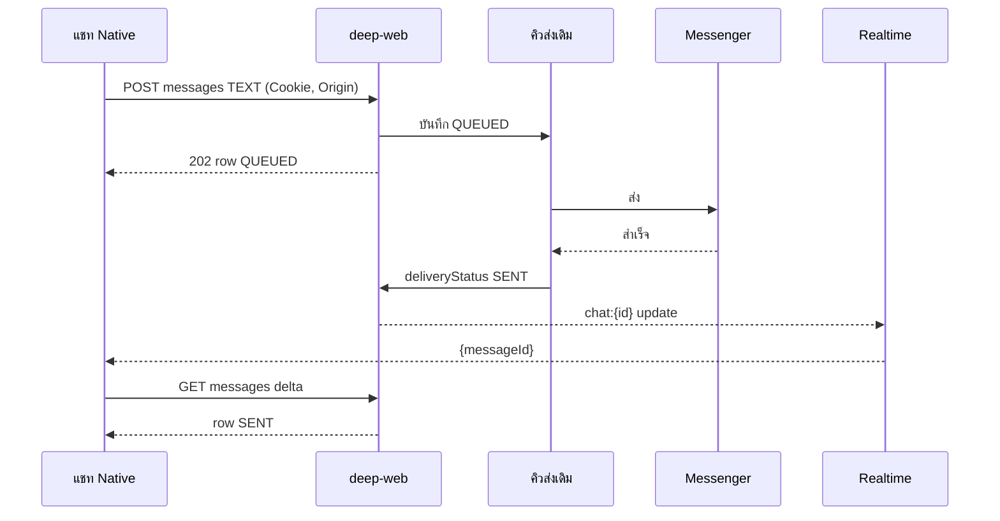

> **โมดูล:** 00088 — Seller Native Chat
> **ประเภทเอกสาร:** API Contract
> **เวอร์ชัน:** 1.0
> **วันที่จัดทำ:** 2026-10-31
> **สถานะ:** Approved — บันทึกสัญญาของ route **เดิม** (ไม่มี endpoint ใหม่) อ่านจากโค้ด main `8af2f40a`
> **เจ้าของเอกสาร:** SA (ดู [[Feature-Docs-Ownership]])

# API Contract: แชท Native ในแอปผู้ขาย

---

## 1. Overview

- **ไม่มี endpoint ใหม่** — เอกสารนี้บันทึกสัญญาของ route เดิมที่แชท Native เรียก เพื่อให้แอปเขียนตามได้ตรงและเทสสัญญาได้
- Base: `https://seller.deepthailand.app` · **host ต้องขึ้นต้น `seller.`** (route รายการ/ส่ง/อ่าน ตัดสินฝั่งผู้ขาย-ผู้ซื้อจาก host)
- วันที่ทุกตัวเป็น ISO string · header ตอบ `Cache-Control: private, no-store`
- Rate limit ที่ proxy ต่อ IP ต่อนาที: mutation 30 · GET 120 · `/api/uploads/*` mutation 300 · `GET /api/files/*` 600 → 429 `{error:'Rate limit exceeded'}` + `Retry-After: 60`

---

## 2. Authentication

| รายการ | ค่า |
|--------|-----|
| ล็อกอิน | คุกกี้ `__Secure-next-auth.session-token` (prod) ของ `seller.deepthailand.app` อ่านจาก WebView ผ่านโมดูล `deep-cookies` แนบเป็น `Cookie:` |
| CSRF | ทุก POST/PATCH/DELETE ต้องมี `Origin` ที่ hostname เป็น `deepthailand.app` หรือโดเมนย่อย → แอปส่ง `Origin: https://seller.deepthailand.app` · ไม่มี = 403 `{error:'CSRF check failed'}` |
| ไม่ล็อกอิน | 401 `{error:'unauthorized'}` (preferences: `'Unauthorized'`) |
| ไม่มีสิทธิ์ | 403 `{error:'FORBIDDEN_ROLE'}` |
| ร้าน | route รายการใช้ร้านที่ active (+ โหมดรวมร้าน `User.chatScopeMode`) · route ราย `{id}` หาร้านจากห้องเอง (เปิดห้องจากแจ้งเตือนได้โดยไม่ต้องสลับร้าน) |

---

## 3. Endpoint List

| # | Method | Path | Cap | เฟส |
|---|--------|------|-----|-----|
| 4.1 | GET | `/api/chat/conversations` | H1 | 1 |
| 4.2 | PATCH | `/api/chat/conversations/{id}` | H2 | 1 |
| 4.3 | GET | `/api/chat/conversations/{id}/messages` | H1 | 1 |
| 4.4 | POST | `/api/chat/conversations/{id}/messages` | H2 | 1 |
| 4.5 | POST · DELETE | `/api/chat/conversations/{id}/messages/{mid}` | H2 | 1 |
| 4.6 | POST | `/api/chat/conversations/{id}/read` | H1 | 1 |
| 4.7 | GET | `/api/chat/conversations/{id}/preview` | H1 | 1 |
| 4.8 | GET | `/api/chat/inbox-tab-counts` · `/api/chat/spam-unread` · `/api/chat/problem-count` | H1 | 1 |
| 4.9 | GET | `/api/chat/quick-messages?shopId=` | X2 | 1 |
| 4.10 | POST | `/api/uploads/ticket` → PUT → `/api/uploads/commit` | H2 | 1 |
| 4.11 | GET/PATCH | `/api/chat/preferences` · GET `/api/chat/groups` · `/api/chat/tags` · `/api/chat/shop-context` · `conversations/{id}/{crm,orders,library,follow-ups,memory,ai-suggest}` | X2/H1/H2 | 2 |
| 4.12 | * | `/api/chat/comments/**` | H1/H2 | 3 |

---

## 4. Endpoint Detail

### 4.1 `GET /api/chat/conversations`

**Query** (`ChatConversationsQuerySchema`): `cursor` · `take` 1–50 (20) · `channel` DEEP\|MESSENGER\|INSTAGRAM\|LINE · `shopChannelId` · `q` 1–200 · `status` open\|resolved\|all (ค่าเริ่ม open) · `customerLinked` all\|linked\|unlinked · `hidden=true` · `spam=true` · `chatGroupId` · `readState` unread\|read · `tags` CSV ≤20 · `shipment` none\|unprinted\|printed\|problem · `followUp` CSV late,upcoming,done · `shopId` (ตัวกรองภายใน scope) · `sort` LAST_MESSAGE\|LAST_CUSTOMER_MESSAGE · `usePref=1`

**Response 200**
```ts
{ items: ConversationRow[]; nextCursor: string | null; inboxSort: 'LAST_MESSAGE'|'LAST_CUSTOMER_MESSAGE'; preference?: InboxPreference }

type ConversationRow = {
  id: string; shopId: string; channel: 'DEEP'|'MESSENGER'|'INSTAGRAM'|'LINE'; shopChannelId: string|null
  lastMessageAt: string; lastMessagePreview: string|null; lastSenderRole: 'BUYER'|'SHOP'; lastInboundAt: string|null
  shopLastReadAt: string|null; externalReadAt: string|null; externalDeliveredAt: string|null
  isPinned: boolean; isHidden: boolean; resolvedAt: string|null; isSpam: boolean; alias: string|null; chatGroupId: string|null
  referralSource: 'ADS'|'SHORTLINK'|null; referralAdTitle: string|null; referralAdBody: string|null; referralAdPermalink: string|null; referralAdId: string|null; referralPhotoFileId: string|null
  autoReplyEnabled: boolean; autoReplyPausedUntil: string|null; handoffAt: string|null; metaAiHoldUntilMs: number|null
  counterparty: { displayName: string; avatar: string|null } | null
  contactTags: string[]; contactSalesStatus: 'UNSPECIFIED'|'INTERESTED'|'NOT_INTERESTED'
  unreadCount: number
  shop?: { id: string; name: string } | null          // เฉพาะเมื่อ scope มีหลายร้าน
  orderStage: { key: string; label: string; cls: string; icon: string; printCount?: number; problemCount?: number } | null
  lastMessageAutoReplyKind: string|null; lastMessageIsAiEnhanced: boolean; lastMessageIsSystem: boolean
  followUp: { open: number; late: number; urgent: { title: string; dueAt: string; allDay: boolean; late: boolean; more: number } | null }
  draftOrderCount: number
  threadAgents: { userId: string; name: string; avatar: string|null }[]
  // + คอลัมน์อื่นของ Conversation (แอปไม่ใช้) — ห้ามเก็บ/ใช้ replyToken*
}
```
- ลำดับ: ปักหมุดก่อน แล้ว `lastMessageAt` ใหม่ไปเก่า · `cursor` opaque (ส่งกลับตามที่ได้) · ไม่มีโหมด delta → refetch หน้า 1
- แถบโฆษณา: `referralSource==='ADS'` และ (`referralAdBody` หรือ `referralAdTitle` หรือ `referralAdId`)

### 4.2 `PATCH /api/chat/conversations/{id}`

**Body** (`ConversationPatchSchema`): `{ action: 'pin'|'unpin'|'hide'|'unhide'|'resolve'|'reopen'|'spam'|'unspam'|'set-group'; chatGroupId?: string|null }`
- `spam` ถอดปักหมุดด้วย · `resolve` ล้างการรับช่วงบอทด้วย
**Response 200** `{ ok: true }`

### 4.3 `GET /api/chat/conversations/{id}/messages`

**Query**: `cursor` · `take` 1–100 (30) · `afterSeq` int · `afterUpdatedAt` ISO · `sync='1'`
- หน้า: ใหม่→เก่า (`createdAt desc, seq desc`) · `nextCursor` = `"<ISO>|<seq>"` ของแถวเก่าสุด
- delta: `seq > afterSeq OR updatedAt > afterUpdatedAt` · `nextCursor=null` · แอปส่ง `afterUpdatedAt = asOf − 5s`, `take=100` · ได้ 100 = โหลดหน้า 1 ใหม่ · แถวเก่ามี `updatedAt` 1970 → ใช้ `max(createdAt, updatedAt)`
- `sync=1` เฉพาะเปิดห้องครั้งแรก (สั่ง backfill จาก Meta) · **ไม่ทำให้อ่านแล้ว** (ต้องเรียก 4.6)

**Response 200**
```ts
{ items: Message[]; nextCursor: string|null; asOf: string; externalReadAt: string|null; externalDeliveredAt: string|null }

type Message = {
  id: string; conversationId: string; seq: number; createdAt: string; updatedAt: string
  senderRole: 'BUYER'|'SHOP'; type: 'TEXT'|'IMAGE'|'VIDEO'|'AUDIO'|'FILE'|'PRODUCT'|'ORDER'|'AUTO_ORDER_RESULT'|'META_NOTICE'
  body: string|null; imageUrl: string|null /* fileId */; attachmentName: string|null; attachmentSize: number|null
  isSticker: boolean; imageWidth: number|null; imageHeight: number|null
  reactionEmoji: string|null; isDeleted: boolean; edited: boolean
  deliveryStatus: null|'QUEUED'|'SENT'|'FAILED'; failureReason: string|null
  sender: { name: string; avatar: string|null } | null
  replyTo: { id: string; body: string|null; senderRole: string; quotable: boolean; imageUrl: string|null } | null
  quotable: boolean
  productCard: { id: string; name: string; price: number; imageFileId: string|null; isActive: boolean } | null
  productCards: (Message['productCard'])[] | null
  orderCard: { token: string; orderNo: string; status: string; totalAmount: number; vertical: string; serviceStart: string|null; serviceEnd: string|null; appointmentStatus: string|null; arrivalMode: string|null; items: { name: string; qty: number; price: number; imageFileId: string|null }[]; shipment: { trackingNo: string|null; courierName: string|null; status: string|null } | null; /* … */ } | null
  autoReply: unknown | null
}
```

### 4.4 `POST /api/chat/conversations/{id}/messages`

**Body** (`SendChatMessageSchema`) — ทุก type รับ `body?` (≤2000) · `replyToMessageId?`

| type | ต้องมี | หมายเหตุ | เฟส |
|------|--------|---------|-----|
| TEXT | `body` | | 1 |
| IMAGE | `imageUrl` = fileId จาก commit | `attachmentName` `attachmentSize` | 1 |
| IMAGE_GRID | `imageFileIds` 2–24 | Messenger/IG เท่านั้น | 1 |
| STICKER | `stickerId` · `stickerImageUrl` (https) | Meta เท่านั้น | 1 |
| VIDEO · AUDIO · FILE | `imageUrl` = fileId | ตามช่องทางรองรับ | 2 |
| PRODUCT | `productRefId` หรือ `productRefIds` ≤36 | | 2 |
| ORDER · APPOINTMENT · TRACKING | `orderRefToken` | | 3 |

**Response**
- DEEP: `200` row (มี `sender` `quotable` · ไม่มี card) · Messenger/IG/LINE: `202` row `deliveryStatus:'QUEUED'` (ส่งจริงหลังตอบ ผลมาทาง realtime `update` + delta)
- IMAGE_GRID: `202 {ok:true, items: Row[]}` · PRODUCT หลายชุดส่งได้บางส่วน: `207 {error, sentMessages, totalMessages}`
- ไม่มี idempotency key → แอปห้ามส่งซ้ำเองตอน timeout (SRS TFR-005)
- จำกัดต่อผู้ใช้ 120/60 วินาที → 429

### 4.5 `POST · DELETE /api/chat/conversations/{id}/messages/{mid}`

- **POST** `{ emoji: string(1–8) | null }` → `{ ok: true, emoji }` · null = เอารีแอคออก
- **DELETE** = ยกเลิก **ข้อความที่ส่งไม่สำเร็จ** เท่านั้น (`deliveryStatus==='FAILED'` และ `senderRole==='SHOP'`) → `{ ok: true }` · ลบจริงจากฐาน → แอปต้องลบจากแคชเอง · **ไม่มี API ยกเลิกข้อความที่ส่งแล้ว** (เว็บก็ไม่มี)

### 4.6 `POST /api/chat/conversations/{id}/read`

ไม่มี body → `{ ok: true }` · ตั้ง `shopLastReadAt=now`

### 4.7 `GET /api/chat/conversations/{id}/preview`

→ `{ conversationId, senderName, senderAvatarUrl, preview, channel, channelName, lastMessageAt, shopId }` · ใช้หัวห้องเมื่อเปิดจากแจ้งเตือน

`shopId` (เพิ่ม 2026-11-01 · additive) = ร้านของเธรดที่ด่าน H1 resolve — แชท native เปิดห้องจากแจ้งเตือน/ลิงก์โดยไม่มีแถวรายการ ต้องรู้ร้าน (ประเภทร้าน → คำ/ปุ่มบริการ) · toast เว็บ (`ChatToastListener.tsx`) อ่านเฉพาะฟิลด์เดิม · เทส `preview/route.test.ts`

### 4.8 ตัวเลข

- `inbox-tab-counts` → `{ unread: number, unanswered: number }` (unanswered = ความคิดเห็น)
- `spam-unread` → `{ count }` · `problem-count` → `{ count }`

### 4.9 `GET /api/chat/quick-messages?shopId={thread.shopId}`

→ `{ items: { id, title, category: string|null, body, imageFileIds: string[], createdAt }[] }` · เรียงตามที่ร้านจัด · จัดหมวดฝั่งแอปจาก `category` (null = "ไม่มีหมวดหมู่") · ไม่มี X2 = 403 → ซ่อนปุ่ม

### 4.10 อัปโหลดรูป

1. `POST /api/uploads/ticket` `{ purpose:'CHAT', name, size, mime, conversationId }` → `201 { fileId, url, method:'PUT', headers, ticket, maxSize, expiresIn: 900 }`
2. `PUT url` ด้วย `headers` ที่ได้ (ไม่แนบคุกกี้/Origin) · 413 ใหญ่เกิน · 403 ticket หมดอายุ
3. `POST /api/uploads/commit` `{ ticket, name, mime }` → `201 { fileId, name, size, mime, kind }` (**fileId อาจเปลี่ยน** — ใช้ค่าจาก commit)
4. ส่งด้วย 4.4 · แสดงรูปที่ `/api/files/{fileId}`
- จำกัด: ไฟล์ ≤25MB · รูป IG 8MB · รูป LINE 10MB

### 4.11 เฟส 2 — สัญญาของ route เดิม (อ่านจากโค้ด 2026-10-31)

ทุก route: คุกกี้ session · mutation ต้องมี `Origin` โดเมน deepthailand.app · `[id]` ต้องเป็น uuid (400 "รหัสไม่ถูกต้อง") · ร้านหาจากห้อง (404 "ไม่พบบทสนทนานี้") · 403 `FORBIDDEN_ROLE` เมื่อบทบาทไม่มีสิทธิ์ (H1 อ่าน · H2 เขียน · X2 เครื่องมือ — OWNER/MANAGER/CHAT มีครบ · BILLING/TECHNICIAN ไม่มี)

**กล่องข้อความ**
| Route | สัญญา |
|---|---|
| `GET /api/chat/conversations` | ตัวกรองตาม `buildChatListParams` ของเว็บ (`inbox/components/chat-list-query.ts`) — แท็บ ทั้งหมด = `status=all` · ปิดงาน = `status=resolved` · สแปม = `spam=true` (+status=open ไม่ส่ง) · `hidden=true` · `readState` · `customerLinked` · `tags` CSV (OR) · `shipment` · `followUp` CSV · `chatGroupId` · `shopChannelId` · `sort=LAST_CUSTOMER_MESSAGE` · 🛑 ไม่ใช้ `usePref=1` (ค่า undefined ทับค่าที่บันทึก) |
| `GET/PATCH /api/chat/preferences` | GET → `{inboxSort, preference:{sort, filter, channelTab, pageFilter}}` · PATCH `{inboxSort, filter?, channelTab?, pageFilter?}` → ค่าที่เก็บจริง |
| `GET/POST /api/chat/groups` · `PATCH/DELETE /api/chat/groups/{id}` | `{items:[{id,name,sortOrder}]}` · POST `{name}` 1–40 → 201 (409 "มีกลุ่มชื่อนี้อยู่แล้ว" · สูงสุด 30) · DELETE → แชทกลับไป "ทั้งหมด" |
| `PATCH /api/chat/conversations/{id}` | `{action:'set-group', chatGroupId: uuid|null}` (+ pin/unpin/hide/unhide/resolve/reopen/spam/unspam) |
| `PATCH /api/chat/conversations/{id}/crm` | partial `{alias≤80, note≤2000, address≤500, salesStatus, tags[≤30 ตัวอักษร] (ชุดเต็ม), phones[≤20]}` · ห้อง DEEP เก็บได้แค่ alias |
| `GET /api/chat/tags` | `{tags:string[]}` |
| `GET /api/follow-ups/inbox-counts` · `GET /api/chat/problem-count` · `GET /api/chat/spam-unread` | `{late,upcoming,done}` · `{count}` · `{count}` |
| `PATCH /api/users/me` | `{chatScopeMode:'SINGLE'|'UNIFIED'}` (ร้านนี้/ร้านทั้งหมด — แสดงเมื่อ session `hasBusinessMembership`) |
| สลับร้าน | `POST /api/business/switch-context` + อัปเดต session ของ next-auth — **เฟส 2 ทำในหน้าเว็บทับ** (ต้องหมุนคุกกี้ session) |
| เสียงแชท | เว็บเก็บ localStorage `deep.chat.sound.muted` (+ `.{conversationId}` รายห้อง) · ปิดทั้งเครื่อง → `PATCH /api/seller/push-token {token, chatSoundMuted}` |

**แผงข้อมูลลูกค้า (แท็บ ข้อมูล · {คำสั่งซื้อ|งานบริการ|การจอง} · ติดตาม · ไฟล์ · โน้ต)**
| Route | สัญญา |
|---|---|
| `GET /crm` | `{alias, realName, external, note, address, salesStatus, tags, phones}` |
| `GET /orders?cursor=` | `{items:[{id,token,status,fulfillmentMode,totalAmount,createdAt,serviceStart,serviceEnd,arrivalMode,appointmentStatus,serviceClosedAt,depositAmount,items[],shipment}], nextCursor}` 20/หน้า |
| `GET /follow-ups` · `POST /follow-ups` | `{open[],recentDone[],openCount,lateCount,…}` · POST `{title 1–200, type?, date YYYY-MM-DD, time HH:mm|null, note?≤1000}` |
| `/api/follow-ups/{id}` | PATCH · DELETE · POST `/complete {outcome?}` · `/snooze {preset}` · `/reopen` |
| `GET /library?take=` | `{items:[{id,fileId,kind,fileName,fileSize,note,senderName,sentAt}], total, nextCursor}` · POST `{messageId}` เก็บเข้าคลัง · DELETE `?fileId=` |
| `GET/PUT /memory` | GET `{memory:{text,source,version,updatedAt,shared,previousText}|null, products[], canUseProducts, ai}` · PUT `{text≤800, expectedVersion|null}` (409 VERSION_CONFLICT) · `POST /memory/refresh` |
| `POST /interested-products` · `DELETE /interested-products/{rowId}` | `{productId}` (409 DUPLICATE · 422 LIMIT_REACHED สูงสุด 10) |

**ห้อง**
| Route | สัญญา |
|---|---|
| ข้อความ | เพิ่ม field: `productCards[]` · `orderCard{token,orderNo,status,totalAmount,vertical,serviceStart,serviceEnd,appointmentStatus,arrivalMode,depositAmount,items[],shipment{trackingNo,courierName,status}}` · `autoReply.matchedVia` · `attachmentName/Size` · `edited` |
| ส่งการ์ด | `{type:'PRODUCT', productRefId}` หรือ `{productRefIds:[≤36]}` (ต่อข้อความ: Messenger/IG 10 · LINE 12 · DEEP 1) · 207 = ส่งได้บางส่วน |
| ส่งไฟล์ | อัปโหลดสามขั้นเดิม แล้ว `{type:'IMAGE'|'VIDEO'|'AUDIO'|'FILE', imageUrl:fileId, attachmentName, attachmentSize, body:null}` ทีละไฟล์ · กติกาช่องทางตาม `src/lib/chat-attachment.ts` |
| สินค้า | `GET /api/products?sort=best&shopId=` (`id,name,price,images,shortDescription,isActive,stockQty,soldCount`) |
| AI | `GET /api/chat/ai-quota?shopId=` · `POST /ai-suggest {confirmUseCredit?}` → `{suggestions[], freeRemaining}` · 402 QUOTA_EXCEEDED/INSUFFICIENT_CREDIT · 🛑 iOS ห้ามมีปุ่มเติมเงิน/อัปเกรด (App Store 3.1.1) |

คำตามประเภทร้าน: `Shop.vertical` ของห้อง (`orderCard.vertical`) — ONLINE_SALES "คำสั่งซื้อ/ดูคำสั่งซื้อ" · SERVICE_QUEUE "งานบริการ/ดูรายละเอียดบริการ" · LODGING "บิลเข้าพัก/ดูบิลเข้าพัก" (แท็บ "การจอง") · ตัวเลือกสินค้า "สินค้า/บริการ" · "สั่งซื้อแล้ว N ชิ้น" / "ใช้บริการแล้ว N ครั้ง"

### 4.12 เฟส 3 — สัญญาของ route เดิม (อ่านจากโค้ด 2026-10-31)

**ความคิดเห็น** (Facebook เท่านั้นตอนนี้ — `COMMENT_CAPABLE_PROVIDERS=['MESSENGER']`)
| Route | สัญญา |
|---|---|
| `GET /api/chat/comments/list?q&channelId&state=ALL|UNANSWERED|BOT|HUMAN|EXPIRED&provider&skip` | 25/หน้า · `{comments[], counts{all,unanswered,botAnswered,humanAnswered,expired}, rawCount}` · skip ถัดไป = ผลรวม rawCount · `EXPIRED` ⊂ ยังไม่ตอบ |
| `GET /api/chat/comments/posts/{postId}` | `{post, channel, comments[]}` เก่า→ใหม่ · ต้นไม้จาก `parentExternalId` |
| `POST /api/chat/comments/{id}/reply` · `POST /api/chat/comments/posts/{postId}/comment` | `{message?≤8000, fileId?}` (อย่างน้อยหนึ่ง) → `{ok,id}` · 502 "Facebook ปฏิเสธ…" |
| `POST /api/chat/comments/{id}/private-reply` | `{message 1–1000}` → `{conversationId|null, sentAt}` · 409 `ALREADY_SENT` · `WINDOW_EXPIRED` (7 วัน) · `CHANNEL_NOT_ACTIVE` · `ALREADY_REPLIED_EXTERNALLY` (+conversationId) |
| `POST/DELETE /api/chat/comments/{id}/resolve` · `POST /api/chat/comments/resolve-expired {channelId?, provider?}` | ทำเครื่องหมาย/เลิก · ทั้งหมดที่หมดอายุ → `{resolved}` |

**สิทธิ์ปุ่มปิดงาน** — `GET /api/business/context` เพิ่ม `businesses[].canCloseJob: boolean` (2026-10-31 · additive · แสดงผลเท่านั้น) = `memberCanCloseJob(shop, effectiveRoles(...), member)` · ร้าน personal ไม่อยู่ใน `businesses` (เจ้าของ = ปิดได้เสมอ) · เทส `src/app/api/business/context/route.test.ts`

**สร้าง/แก้คำสั่งซื้อ-งานบริการ** — `POST /api/orders` · `PATCH /api/orders/{token}` (แก้ได้เมื่อ PENDING)
- body: `shopId` (ร้านของห้อง เสมอ) · `type` · `items[{productId?,name,qty≥1,price≥0}]` · `buyerContact` (มือถือ) · `buyerName` · `salesChannel` (ล็อกตามช่องทางห้อง) · `paymentMethod` · `discount` · `vatRate 0..1` · `vatAmount` · `shippingAddress?` (เมื่อต้องจัดส่ง) · `fulfillmentMode:'PICKUP'?` (ขายของเท่านั้น) · `appointment?` + `arrivalMode` (ร้านบริการ: WALK_IN = `{resourceId}` · BOOKED = `{resourceId,start,end,depositAmount:"0.00"}` — 🛑 ส่ง depositAmount เสมอ) · `assignedUserId?` · `conversationId`
- prefill: `GET /api/chat/conversations/{id}/customer-prefill` · ร้าน: `GET /api/chat/shop-context?shopId=` · ช่าง: `GET /api/shops/current/service-staff?shopId=`
- 201 → `publicToken` · error ภาษาไทยผ่าน `pickApiErrorMessage`
- ส่งเข้าแชท = ปุ่มแยก: `POST messages {type:'ORDER', orderRefToken}` (ถามก่อน "ส่ง{noun}นี้เข้าแชท?")

**ทำกับงาน** (ร้านบริการเท่านั้นมีเงิน/ปุ่ม — `chatOrderActions`)
| Route | สัญญา |
|---|---|
| `POST /api/orders/{token}/payments?shopId=` | `{kind:DEPOSIT|BALANCE, amount, method?:TRANSFER|CASH|OTHER, slipFileId?, note?≤500}` → `{paymentId, money}` (O5) · `GET` ประวัติ · `DELETE …/payments/{pid} {reason}` (O6) |
| `PATCH /api/orders/{token}/appointment?shopId=` | เริ่มงานหน้าร้าน `{resourceId,start,end,arrivalMode:'WALK_IN'}` · 409 `APPOINTMENT_SLOT_FULL` |
| `POST /api/orders/{token}/close?shopId=` | `{outcome:SERVED|NO_SHOW, payment:{amount,method}|null, deposit:KEEP|REFUND}` (O4) · `GET` → `{money}` |
| `POST /api/orders/{token}/cancel?shopId=` | `{reason}` (เหตุผลตามประเภทร้าน) |
| `GET /api/shops/current/service-resources?shopId=&activeOnly=1` | `{resources[{id,name,capacity,defaultDurationMin}]}` |

🛑 เงินคำนวณด้วยโค้ดเว็บ (`order-payment.ts` · `chat-order-actions.ts`) ผ่าน bundle เท่านั้น — ห้ามเขียนสูตรเอง

---

## 5. Error Code Table

| HTTP | `error` / `code` | ความหมาย | แอปทำ |
|------|------------------|---------|-------|
| 400 | `Invalid input` · ข้อความไทย (กรุณากรอกข้อความ ฯลฯ) | ข้อมูลผิด | แสดงข้อความ |
| 401 | `unauthorized` | ล็อกอินหมด | ถอยไปเว็บ |
| 403 | `FORBIDDEN_ROLE` | ไม่มีสิทธิ์ | หน้าไม่มีสิทธิ์ / ซ่อนปุ่ม |
| 403 | `CSRF check failed` | Origin ผิด | บั๊กแอป — log |
| 404 | `ไม่พบบทสนทนา` · `ไม่พบร้านที่กำลังใช้งาน` | ไม่พบ | กลับรายการ |
| 409 | `WINDOW_CLOSED` · `CHANNEL_NOT_ACTIVE` · `NO_TRACKING` · LINE `CONTACT_BLOCKED` `QUOTA_EXCEEDED` · ยกเลิกได้เฉพาะที่ส่งไม่สำเร็จ | กติกาช่องทาง | ข้อความแดงตาม server |
| 429 | `Rate limit exceeded` | ถี่เกิน | รอตาม `Retry-After` |
| 502 | `LINE_UNAVAILABLE` · Facebook ปฏิเสธ… | ช่องทางล่ม | ข้อความแดง + ลองใหม่ |
| 500 | ข้อความไทยทั่วไป | ผิดพลาด | ลองใหม่ |

---

## 6. Sequence (ถ้า flow ซับซ้อน)



---

## 7. Traceability

| API | SDS | SRS | BRD |
|-----|-----|-----|-----|
| 4.1 · 4.2 · 4.8 | inboxStore | TFR-004 | FR-006–009 |
| 4.3 · 4.4 · 4.5 · 4.6 · 4.7 | threadStore | TFR-005 | FR-010–013 |
| 4.9 | QuickMessagePanel | TFR-005 | FR-014 |
| 4.10 | uploader | TFR-006 | FR-014 |
| §2 | chatApi · deep-cookies | TFR-002 | FR-002 |

---

## 8. สรุป (Summary)

แชท Native ใช้ route เดิม 13 กลุ่ม (เฟส 1 = 10) ด้วยคุกกี้ล็อกอิน + Origin โดเมนผู้ขาย บน host `seller.` · ไม่มี endpoint ใหม่ · สัญญานี้ใช้เทียบในเทสสัญญาของแอป
