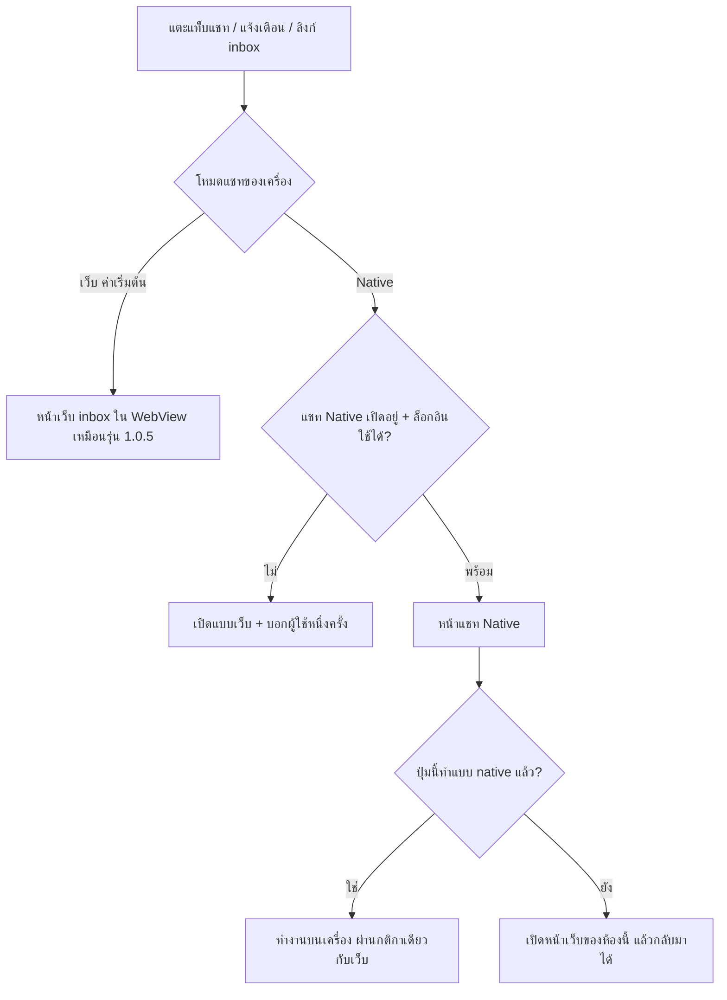
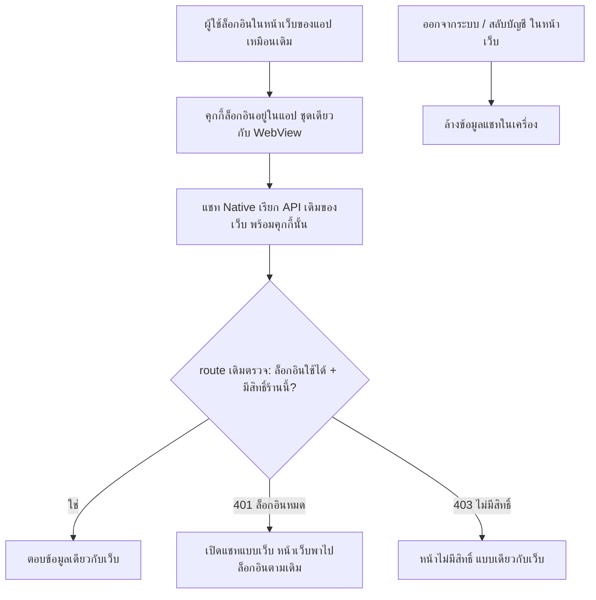
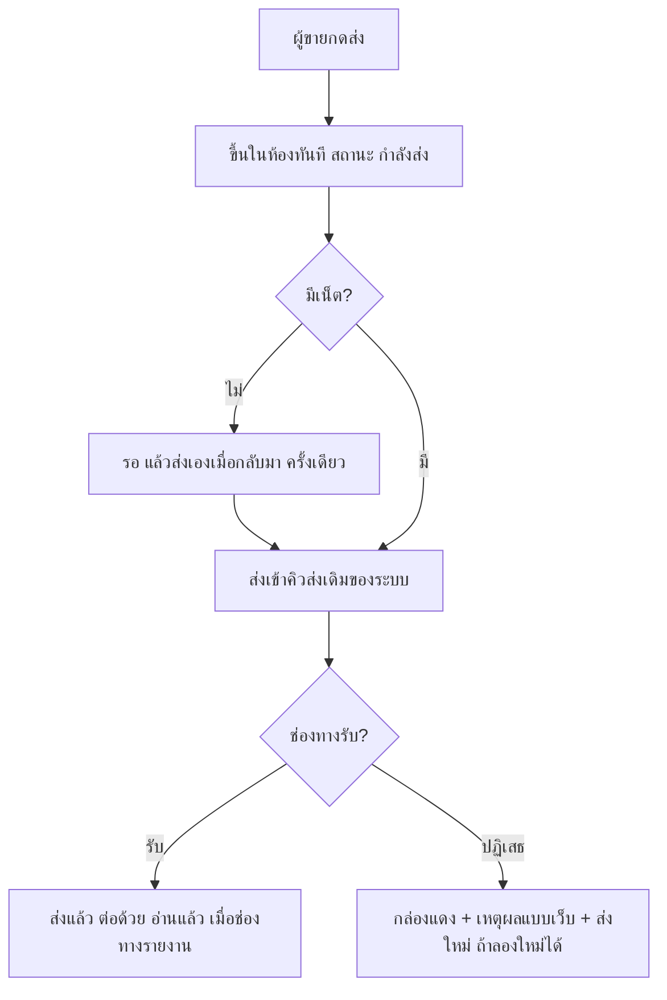

> **โมดูล:** 00088 — Seller Native Chat
> **ประเภทเอกสาร:** Business Requirements Document (BRD) - NON-TECHNICAL
> **เวอร์ชัน:** 1.0
> **วันที่จัดทำ:** 2026-10-31
> **สถานะ:** Approved — user อนุมัติ 2026-10-31 · แก้ FR-002 ตามมติ "ใช้ API เดิม + คุกกี้ล็อกอิน" วันเดียวกัน
> **เจ้าของเอกสาร:** BA
> **ต้นแบบ:** https://claude.ai/artifact/UJzMumreWxRNgwV7NCMeDb (v3)

# BRD: แชท Native ในแอปผู้ขาย (Business Requirements Document)

---

## 1. บทนำ

### 1.1 วัตถุประสงค์ของเอกสาร

เอกสารนี้มีวัตถุประสงค์เพื่อ:
1. กำหนดความต้องการของแชท Native ในแอปผู้ขาย ให้หน้าตาและการทำงานเหมือนแชทในเว็บ
2. กำหนดสวิตช์โหมดแชท (เว็บ = ค่าเริ่มต้น / Native = ทดลอง)
3. กำหนดข้อบังคับ **"ไม่กระทบเว็บ"** ให้ตรวจได้ทุกข้อ
4. กำหนดขอบเขตแต่ละเฟส และสิ่งที่ต้องผ่านก่อนปล่อย

### 1.2 ขอบเขตของระบบ

**แชท Native** คือ หน้ากล่องข้อความ ห้องแชท ข้อมูลลูกค้า และความคิดเห็น ที่สร้างในแอปผู้ขายเอง ใช้ข้อมูลและกติกาจากเซิร์ฟเวอร์ชุดเดียวกับแชทในเว็บ

**เข้าสู่ระบบ (Input):**
- การเลือกโหมดแชทของผู้ใช้ (ต่อเครื่อง)
- session ล็อกอินเดิมของผู้ใช้ในแอป (จากหน้าเว็บในแอป)
- ข้อมูลแชท ข้อความใหม่ สัญญาณ Realtime แจ้งเตือน จากระบบเดิม
- การกระทำของผู้ใช้ (พิมพ์ ส่ง รูป ปักหมุด ปิดงาน ฯลฯ)

**ออกจากระบบ (Output):**
- ข้อความที่ส่งออก (ผ่านคิวส่งเดิม) · การเปลี่ยนสถานะห้อง (ปักหมุด ปิดงาน ซ่อน สแปม อ่านแล้ว แท็ก กลุ่ม ฯลฯ) — เขียนลงที่เดียวกับเว็บ

**ระบบที่เกี่ยวข้อง:**
- แอปผู้ขาย `deep-seller-app` (หน้าจอ สวิตช์ การนำทาง)
- `deep-web` — API แชทเดิม (ไม่แก้) · แถว "ตั้งค่าแอป" ในหน้าบัญชี (เพิ่ม 1 จุด เห็นเฉพาะในแอป)
- Supabase Realtime · ระบบอัปโหลด · Expo Push

### 1.3 กลุ่มผู้ใช้งาน

| กลุ่มผู้ใช้ | บทบาท | สิทธิ์การใช้งาน |
|-----------|--------|----------------|
| **เจ้าของร้าน** | ตอบแชท จัดการทุกอย่าง | เท่ากับแชทเว็บ |
| **ผู้จัดการ** | ตอบแชท จัดการห้อง | เท่ากับแชทเว็บ |
| **ตอบแชท** | ตอบแชท | เท่ากับแชทเว็บ |
| **ฝ่ายช่าง · บัญชี** | — | เข้าแชทไม่ได้ (เหมือนเว็บ) — เห็นหน้า "ไม่มีสิทธิ์" แบบเดียวกัน |

---

## 2. ความต้องการหลัก (Functional Requirements)

### 2.1 แยกขาดจากเว็บ (ข้อบังคับ — ทุกเฟส)

#### FR-001: โหมดเว็บไม่เปลี่ยนแม้แต่น้อย

**User Story:**
> ในฐานะผู้ขายที่ไม่เปิดสวิตช์ ฉันต้องการใช้แชทเหมือนเดิมทุกอย่าง เพื่อไม่ต้องเรียนรู้หรือเจอปัญหาใหม่

**Acceptance Criteria:**
- [ ] ไม่มีไฟล์ใดใน `src/app/(paces)/**` (หน้าเว็บผู้ขาย) และ `src/app/(marketing)/**` ถูกแก้ในฟีเจอร์นี้ — **ยกเว้นข้อเดียว (user เลือก 2026-10-31):** แถว "ตั้งค่าแอป" ในหน้าบัญชีของเว็บ (`src/app/(paces)/seller/(dashboard)/account/`) — แสดงเฉพาะเมื่อแอปบอกว่ารองรับ (`__DEEP_NATIVE_FEATURES__` มี `app-settings`) · กดแล้วส่งคำสั่งใหม่ `deep:open-app-settings` · นอกแอปและแอปรุ่นเก่าไม่เห็นแถวนี้ · ไม่แก้ปุ่ม/ส่วนอื่นของหน้า
- [ ] ไม่มี route เดิมใต้ `src/app/api/chat/**`, `src/app/api/channels/**`, `src/app/api/uploads/**` ถูกแก้
- [ ] ไม่มี service/lib เดิมของแชทถูกเปลี่ยนพฤติกรรม — ถ้าต้องแยกฟังก์ชันออกมาใช้ร่วม ต้องเป็นการย้ายโค้ดแบบผลลัพธ์เท่าเดิม และเทสเดิมผ่านทั้งหมดโดยไม่แก้เทส
- [ ] ไม่มี migration · ไม่มีคอลัมน์/ตารางใหม่ในฐานข้อมูล
- [ ] ไม่มีการเปลี่ยน `proxy.ts` ที่กระทบเส้นทางเดิม (เพิ่มได้เฉพาะเส้นทางใหม่ของแอป)
- [ ] เทสทั้งชุดของ deep-web (`src/` + `tests/`) ผ่านเหมือนก่อนทำ
- [ ] แอปที่ตั้งเป็นโหมดเว็บ: เปิดแชทแล้วเห็นหน้าเว็บ `/inbox` เหมือนรุ่น 1.0.5 ทุกหน้า (เทียบภาพ)

#### FR-002: แอปเรียก API เดิมของเว็บด้วยล็อกอินเดิม (มติ user 2026-10-31)

**User Story:**
> ในฐานะทีม ฉันต้องการให้แอปใช้ API แชทชุดเดียวกับเว็บ ด้วยล็อกอินเดียวกับหน้าเว็บในแอป เพื่อกติกาและสิทธิ์เหมือนเว็บทุกอย่าง โดยไม่ต้องเพิ่มหรือแก้อะไรในเซิร์ฟเวอร์

**Acceptance Criteria:**
- [ ] แอปเรียก route เดิมของเว็บเท่านั้น (`/api/chat/**` · `/api/uploads/**` ฯลฯ) — **ไม่มี route ใหม่ ไม่มีระบบ token ใหม่ใน deep-web**
- [ ] ล็อกอินที่ใช้ = คุกกี้ล็อกอินของหน้าเว็บในแอป (ชุดเดียวกับ WebView) · แอปไม่มีหน้าล็อกอินของตัวเอง
- [ ] สิทธิ์ (H1 อ่าน · H2 ส่ง/แก้ · X2 จัดการ) ตรวจโดย route เดิมทุกครั้ง — แอปไม่ตัดสินสิทธิ์เอง
- [ ] คุกกี้ล็อกอินใช้ไม่ได้ (หมดอายุ/ออกจากระบบ/API ตอบ 401) → แอปเปิดแชทแบบเว็บแทน (หน้าเว็บพาไปล็อกอินตามเดิม)
- [ ] ปิดแชท Native ฉุกเฉินได้ด้วยอัปเดต OTA ของแอป (บังคับโหมดเว็บ) — ไม่ต้องแตะเซิร์ฟเวอร์ · ช่วงรอรีวิวสโตร์ทำ OTA ไม่ได้ ให้ผู้ใช้สลับเป็นเว็บเองได้เสมอ

### 2.2 สวิตช์โหมดแชท

#### FR-003: หน้า "ตั้งค่าแอป"

**User Story:**
> ในฐานะผู้ขาย ฉันต้องการหน้าตั้งค่าของแอป เพื่อเลือกโหมดแชทและจัดการเสียง/การแจ้งเตือนของเครื่อง

**Acceptance Criteria:**
- [ ] หน้าบัญชีของเว็บมีแถว "ตั้งค่าแอป" **เฉพาะเมื่อเปิดในแอปรุ่นที่รองรับ** · กดแล้วแอปเปิดหน้า "ตั้งค่าแอป" แบบ native
- [ ] เปิดหน้าบัญชีบนเบราว์เซอร์ หรือในแอปรุ่น 1.0.5 ลงไป = ไม่มีแถวนี้ หน้าเหมือนเดิมทุกตัวอักษร
- [ ] ปุ่มเดิม "เปิดการแจ้งเตือน" (`deep:open-settings`) ยังพาไปตั้งค่าแจ้งเตือนของเครื่องเหมือนเดิม
- [ ] หน้า "ตั้งค่าแอป" มี: โหมดแชท (เว็บ (ค่าเริ่มต้น) · Native ทดลอง) · เสียงแจ้งเตือนแชท (ฟังตัวอย่าง) · การแจ้งเตือนของเครื่อง (ไปหน้าตั้งค่าเครื่อง) · รุ่นแอป
- [ ] คำอธิบายใต้โหมด: "เปลี่ยนได้ตลอด · ไม่กระทบข้อมูลแชท · ค่านี้เก็บในเครื่องนี้"

#### FR-004: ค่าโหมดและผล

**User Story:**
> ในฐานะผู้ขาย ฉันต้องการเปลี่ยนโหมดแล้วมีผลทันที และถอยกลับได้ทุกเมื่อ เพื่อลองโดยไม่เสี่ยง

**Acceptance Criteria:**
- [ ] ติดตั้งใหม่/อัปเดตจากรุ่นเก่า = โหมดเว็บ
- [ ] เปลี่ยนโหมดแล้วมีผลทันที ไม่ต้องปิดแอป
- [ ] ค่าเก็บในเครื่อง ไม่ส่งขึ้นเซิร์ฟเวอร์ · ออกจากระบบไม่ล้างค่าโหมด
- [ ] โหมด Native แต่แชท Native ถูกปิดผ่านอัปเดตแอป หรือล็อกอินใช้ไม่ได้ → แอปเปิดแชทแบบเว็บแทนโดยอัตโนมัติ และบอกผู้ใช้หนึ่งครั้ง

#### FR-005: เส้นทางเข้าแชทตามโหมด

**User Story:**
> ในฐานะผู้ขาย ฉันต้องการแตะแชทจากที่ไหนก็ได้แล้วไปโหมดที่ฉันเลือก

**Acceptance Criteria:**
- [ ] โหมด Native: ลิงก์ `/inbox` และ `/inbox/{ห้อง}` จาก เมนูล่างของเว็บ · ปุ่มในหน้าเว็บ · แจ้งเตือน · deep link → เปิดหน้า native ของห้องนั้น
- [ ] โหมดเว็บ: ทุกทางเปิดหน้าเว็บเหมือนเดิม
- [ ] ออกจากแชท Native (ปุ่มกลับจากกล่องข้อความ · "กลับหน้าหลัก") → กลับหน้าเว็บที่มาก่อน

### 2.3 กล่องข้อความ (เฟส 1 · ส่วนที่ระบุเฟส 2)

#### FR-006: หัวกล่องข้อความและแท็บ

**User Story:**
> ในฐานะผู้ขาย ฉันต้องการหัวและแท็บแบบเดียวกับเว็บ เพื่อหาของเจอที่เดิม

**Acceptance Criteria:**
- [ ] โลโก้ Deep · ค้นหา "ค้นหาชื่อ ลูกค้า" (ค้นตามชื่อ/ข้อความ ผลเหมือนเว็บ) · ปุ่มเสียง (ปิด/เปิดเสียงแจ้งเตือนข้อความใหม่) · ปุ่มร้าน
- [ ] แท็บ "ข้อความ" / "ความคิดเห็น" พร้อมตัวเลข **กว้างเท่ากัน เต็มแถว ตัวหนังสืออยู่กลาง**
- [ ] ช่องทาง 5 ปุ่ม: ทั้งหมด · Deep · Messenger · Instagram · LINE
- [ ] แท็บย่อย ทั้งหมด / ปิดงาน / สแปม
- [ ] แถบ "คุณปิดแจ้งเตือนของร้านนี้อยู่" + ปุ่ม "เปิดแจ้งเตือน" แสดงเมื่อเงื่อนไขเดียวกับเว็บ
- [ ] (เฟส 2) ปุ่มร้าน: มุมมองกล่องข้อความ (ร้านทั้งหมด / ร้านนี้) · ร้านที่ใช้อยู่ · สลับบัญชี · กลับหน้าหลัก — เฟส 1 แสดงร้านที่ใช้อยู่ + กลับหน้าหลัก + ปุ่มที่เหลือเปิดหน้าเว็บ
- [ ] (เฟส 2) ตัวกรอง: เรียงลำดับ (ทุกข้อความ / ลูกค้าพิมพ์ล่าสุด) · แท็ก (เลือกได้หลายอัน) · การอ่าน (ทั้งหมด / ยังไม่อ่าน / อ่านแล้ว) · ลูกค้า (ทั้งหมด / ผูกลูกค้าแล้ว / ยังไม่ผูกลูกค้า) · ที่ซ่อนไว้ · ล้างตัวกรอง · บันทึกเป็นค่าเริ่ม · ใช้ตัวกรอง
- [ ] (เฟส 2) เมนูกลุ่ม: ทั้งหมด · กลุ่มของร้าน (ลบได้) · สร้างกลุ่มใหม่

#### FR-007: แถวในกล่องข้อความ

**User Story:**
> ในฐานะผู้ขาย ฉันต้องการเห็นข้อมูลสำคัญของแต่ละห้องในแถวเดียว เพื่อเลือกตอบห้องที่สำคัญก่อน

**Acceptance Criteria:**
- [ ] รูปโปรไฟล์ (วงม่วง) · เลขยังไม่อ่าน · ป้ายเพจ/ช่องทาง · ดาว + แถบเหลืองเมื่อปักหมุด · ชื่อ · ข้อความล่าสุด (ตัวหนาเมื่อยังไม่อ่าน) · เวลา
- [ ] ป้ายในแถวเหมือนเว็บ: สถานะการขาย · ad_id · สถานะงาน/ออเดอร์ · ติดตาม · แท็ก · ป้ายบอท
- [ ] ปักหมุดอยู่บนสุดเสมอ แล้วเรียงตามที่เลือก
- [ ] เลื่อนลงสุด = โหลดหน้าถัดไป · ดึงลง = โหลดใหม่
- [ ] ไม่พบผล: "ไม่พบบทสนทนาตามที่กรอง · ลองเปลี่ยนคำค้นหาหรือล้างตัวกรองแล้วลองใหม่" + ปุ่มล้างตัวกรอง

#### FR-008: ปัดแถว และกดค้างแถว

**User Story:**
> ในฐานะผู้ขาย ฉันต้องการจัดการห้องจากรายการได้เลย เพื่อไม่ต้องเข้าไปในห้อง

**Acceptance Criteria:**
- [ ] ปัดซ้าย: ปักหมุด (เหลือง) · ปิดงาน (เขียว) · ซ่อน (เทา) — ชุดเดียวกับเว็บบนมือถือ · กลับด้านคำเมื่อสถานะกลับ (เลิกปัก / เปิดใหม่ / เลิกซ่อน)
- [ ] กดค้าง: ฉากหลังเบลอ + แถวนั้นเด่น + แผ่นคำสั่ง: ปักหมุด · ปิดงาน · ซ่อน · สแปม (ไม่ใช่สแปม)
- [ ] (เฟส 2) ในแผ่นเดียวกัน: สถานะการขาย (ยังไม่ระบุ / สนใจ / ไม่สนใจ) · แท็ก (ลบ/เพิ่ม) · กลุ่ม · เสียงแจ้งเตือนของแชทนี้
- [ ] ทุกคำสั่งได้ผลเหมือนทำในเว็บ และเว็บเห็นผลทันที (ข้อมูลชุดเดียว)
- [ ] กดค้าง/ปัดมีการสั่นเบา ๆ (ถ้าเครื่องรองรับและเปิดไว้)

#### FR-009: ข้อความใหม่เด้งทันที

**User Story:**
> ในฐานะผู้ขาย ฉันต้องการเห็นแชทใหม่ทันทีโดยไม่ต้องรีเฟรช

**Acceptance Criteria:**
- [ ] ลูกค้าทักใหม่ → แถวขึ้นบนสุด ข้อความล่าสุด/เวลา/ตัวเลขอัปเดตภายใน 3 วินาที (ปกติ) · กรณีสัญญาณหลุด ไม่เกิน 20 วินาที (เท่าเว็บ)
- [ ] ตัวเลขบนแท็บ "ข้อความ" อัปเดตตาม

### 2.4 ห้องแชท

#### FR-010: หัวห้อง ชิป และแถบโฆษณา

**User Story:**
> ในฐานะผู้ขาย ฉันต้องการเห็นบริบทของห้อง (ช่องทาง งาน/ออเดอร์ เวลาที่ตอบได้ โฆษณา) ก่อนตอบ

**Acceptance Criteria:**
- [ ] หัว: กลับ · รูป + ป้ายช่องทาง · ชื่อ · ข้อมูลลูกค้า · ⋮
- [ ] ⋮: "เสียงแจ้งเตือนข้อความใหม่ · เฉพาะแชทนี้" (สวิตช์) · "เปิดห้องนี้ในหน้าเว็บ"
- [ ] ชิป "เกินเวลาที่ Meta ให้ตอบ" แสดงเมื่อเงื่อนไขเดียวกับเว็บ · กางแล้วขึ้นข้อความเต็ม + "ย่อ"
- [ ] แถบ "แชทนี้ตอบกลับจากโฆษณาของคุณ · ดูโฆษณา · ปิด" แสดงเมื่อห้องมาจากโฆษณา
- [ ] (เฟส 2) ชิปงาน/ออเดอร์: เลขที่ · สถานะ · ยอด · รอชำระ · วันนัด · กางแล้วมีปุ่ม รับเงินแล้ว · ปิดงาน · แก้ไขรายการ · ส่งสรุปนัด (เฟส 2 แสดง · ปุ่มทำงานเฟส 3 · ระหว่างนั้นเปิดหน้าเว็บ)

#### FR-011: แสดงข้อความ

**User Story:**
> ในฐานะผู้ขาย ฉันต้องการเห็นทุกข้อความเหมือนในเว็บ เพื่อไม่พลาดอะไร

**Acceptance Criteria:**
- [ ] เฟส 1: ข้อความ · รูป/อัลบั้ม (แตะดูเต็มจอ) · สติกเกอร์ · ข้อความจากระบบ · ข้อความที่ตอบกลับ (อ้างถึง + แตะไปข้อความต้นทาง) · รีแอค · เวลา (นาฬิกา + วัน/เวลา)
- [ ] เฟส 2: การ์ดสินค้า/บริการ · การ์ดออเดอร์/งานบริการ (หัวสีน้ำเงิน · รายการ · ยอดสุทธิ · สถานะ · ดูรายละเอียด) · วิดีโอ · เสียง · ไฟล์ · การ์ดนัด · เลขพัสดุ
- [ ] ชนิดที่แอปยังไม่รองรับ → กล่อง "ดูข้อความนี้ในหน้าเว็บ" (ไม่หายเงียบ)
- [ ] เลื่อนขึ้นสุด = โหลดข้อความเก่ากว่า

#### FR-012: ส่งข้อความและสถานะ

**User Story:**
> ในฐานะผู้ขาย ฉันต้องการรู้ว่าข้อความถึงลูกค้าหรือยัง และส่งใหม่ได้ถ้าไม่ผ่าน

**Acceptance Criteria:**
- [ ] พิมพ์ "พิมพ์ข้อความ หรือวางไฟล์ที่นี่..." · ปุ่ม "ส่ง" จางเมื่อว่าง
- [ ] ข้อความขึ้นทันทีพร้อม "กำลังส่ง" → "ส่งแล้ว" → "อ่านแล้ว" (ตามที่ช่องทางรายงาน)
- [ ] ส่งไม่สำเร็จ: กล่องแดง + เหตุผลแบบเดียวกับเว็บ + "ส่งใหม่" (แสดงเฉพาะเหตุผลที่ลองใหม่ได้ เหมือนเว็บ)
- [ ] ส่งผ่านคิวส่งเดิม — ไม่มีทางส่งซ้ำจากการกดหลายครั้ง/เน็ตกลับมา
- [ ] ติดกติกาช่องทาง (เช่น 24 ชม. Meta · โควตา LINE) → ข้อความแจ้งเหมือนเว็บ

#### FR-013: กดค้างข้อความ

**User Story:**
> ในฐานะผู้ขาย ฉันต้องการตอบกลับ รีแอค คัดลอก หรือยกเลิกข้อความที่ส่งไม่สำเร็จ จากข้อความนั้นตรง ๆ

**Acceptance Criteria:**
- [ ] กดค้าง: ฉากหลังเบลอ · แถบรีแอค 6 แบบ (หัวใจ ฮา ว้าว เศร้า โกรธ ถูกใจ) · รายการคำสั่ง
- [ ] คำสั่งตามชนิดข้อความ เหมือนเว็บ: ตอบกลับ · คัดลอก (ข้อความ) · ยกเลิกข้อความที่ส่งไม่สำเร็จ (เหมือนเว็บ — ข้อความที่ส่งถึงแล้วยกเลิกไม่ได้ทั้งเว็บและแอป) · (เฟส 2) สติกเกอร์ · บันทึกเข้าคลังลูกค้า · (เฟส 3) สร้างงานบริการ/ออเดอร์ · บันทึกรับเงิน
- [ ] ตอบกลับ: แถบ "ตอบกลับ: …" เหนือช่องพิมพ์ + ปุ่มยกเลิก

#### FR-014: แถบเครื่องมือ

**User Story:**
> ในฐานะผู้ขาย ฉันต้องการเครื่องมือเดียวกับเว็บใต้ห้องแชท

**Acceptance Criteria:**
- [ ] 7 ปุ่มลำดับเดียวกับเว็บ: ข้อความสำเร็จรูป · เลือกสินค้า/บริการ · แนบไฟล์ · อิโมจิ · AI ช่วยร่างคำตอบ · ตารางนัด · สร้างงานบริการ/ออเดอร์ (ชิดขวา สีน้ำเงิน)
- [ ] เฟส 1 — ข้อความสำเร็จรูป: แผงเหนือแถบ · หัว + เรียง + จัดการ (เปิดหน้าเว็บ) + ปิด · ค้นหา · หมวด · การ์ด 2 คอลัมน์ · แตะ = ใส่ในช่องพิมพ์
- [ ] เฟส 1 — แนบไฟล์: คลังรูป (เลือกได้หลายรูป ตามลำดับที่แตะ) · ถ่ายรูป · ไฟล์ (เฟส 2) · ช่องทางที่ไม่รองรับไฟล์ ปุ่มจางพร้อมเหตุผลเหมือนเว็บ
- [ ] เฟส 1 — อิโมจิ: แผ่นล่าง หน้ายิ้ม / ท่าทาง / หัวใจ / สติกเกอร์ · อิโมจิใส่ในช่องพิมพ์ · สติกเกอร์ส่งทันที
- [ ] เฟส 2 — เลือกสินค้า/บริการ: แผง · ค้นหา · การ์ด (รูป ชื่อ ราคา ใช้แล้ว N ครั้ง) · เลือกหลายรายการ · AI ช่วยร่าง: ตัวเลือกคำตอบ + โควตาวันนี้ + ขอคำแนะนำใหม่
- [ ] เฟส 3 — ตารางนัด: หน้าเต็ม "เลือกวันและเวลา" · สร้างงานบริการ/ออเดอร์: หน้าเต็มหัวสีน้ำเงิน (ฟอร์มเดียวกับเว็บ)
- [ ] ปุ่มที่ยังไม่ถึงเฟส → เปิดหน้าเว็บของห้องนี้ที่ส่วนนั้น

### 2.5 ข้อมูลลูกค้า (เฟส 2)

#### FR-015: แผงข้อมูลลูกค้า 5 แท็บ

**User Story:**
> ในฐานะผู้ขาย ฉันต้องการเห็นและแก้ข้อมูลลูกค้าจากในห้อง

**Acceptance Criteria:**
- [ ] หัว: รูป · ชื่อ · ป้ายเพจ/ช่องทาง
- [ ] แท็บ **ข้อมูล**: ความจำของแชทนี้ (+ เพิ่มความจำ) · สินค้าที่สนใจ (+ เพิ่ม) · แก้ไข · ชื่อจริง · สถานะการขาย · แท็ก · เบอร์ · ที่อยู่
- [ ] แท็บ **งานบริการ/ออเดอร์** (+ จำนวน): รายการ · สร้างใหม่ · ส่งเข้าแชท
- [ ] แท็บ **ติดตาม** (N): รายการ + เพิ่ม · ว่าง = "ยังไม่มีรายการติดตาม"
- [ ] แท็บ **ไฟล์**: คลังรูป/ไฟล์ของลูกค้า
- [ ] แท็บ **โน้ต**: แก้ไข · ว่าง = "ยังไม่มีโน้ต"
- [ ] เฟส 1: ปุ่มข้อมูลลูกค้าเปิดแผงของหน้าเว็บ

### 2.6 ความคิดเห็น (เฟส 3)

#### FR-016: กล่องความคิดเห็น

**User Story:**
> ในฐานะผู้ขาย ฉันต้องการตอบความคิดเห็นในโพสต์จากแอป

**Acceptance Criteria:**
- [ ] ช่องทาง · ตัวกรอง · ทั้งหมด / ยังไม่ตอบ (N) / หมดอายุ (N)
- [ ] แถว: รูปโพสต์ · ข้อความโพสต์ · ✓ ชื่อ: คอมเมนต์ · ป้าย (บอทตอบแล้ว ฯลฯ) · วันที่
- [ ] ตอบในโพสต์ · ตอบส่วนตัว (ภายใน 7 วัน)
- [ ] ก่อนเฟส 3: แท็บความคิดเห็นเปิดหน้าเว็บ `/inbox/comments`

### 2.7 แจ้งเตือน ความเร็ว เน็ตหลุด

#### FR-017: แจ้งเตือนเข้าห้อง

**User Story:**
> ในฐานะผู้ขาย ฉันต้องการแตะแจ้งเตือนแล้วเข้าห้องนั้นทันที

**Acceptance Criteria:**
- [ ] แอปปิดอยู่/อยู่เบื้องหลัง/เปิดอยู่ — แตะแจ้งเตือน → ห้องนั้นในโหมดที่เลือก
- [ ] เสียง/ปิดเสียงรายห้อง/รายเครื่องทำงานเหมือนเดิม (ไม่เปลี่ยนฝั่งส่ง)

#### FR-018: เปิดเร็ว + เก็บในเครื่อง

**Acceptance Criteria:**
- [ ] ห้องที่เคยเปิดในรอบใช้งานนี้ เปิดซ้ำเห็นข้อความทันที แล้วดึงเฉพาะส่วนที่เปลี่ยน
- [ ] ข้อมูลที่เก็บในเครื่องอยู่ในพื้นที่ของแอปเท่านั้น · ลบเมื่อออกจากระบบ/สลับบัญชี · ไม่เก็บถาวรข้ามการเปิดแอปใหม่ในเฟส 1

#### FR-019: เน็ตหลุด

**Acceptance Criteria:**
- [ ] แถบ "ไม่มีอินเทอร์เน็ต · แสดงข้อมูลล่าสุดที่เก็บในเครื่อง" (รายการ) / "ข้อความที่พิมพ์จะรอส่งเมื่อกลับมาออนไลน์" (ห้อง)
- [ ] ข้อความที่ส่งตอนหลุด แสดง "กำลังส่ง" แล้วส่งเองเมื่อกลับมา (ครั้งเดียว)

### 2.8 ทางสำรอง

#### FR-020: ของที่ยังไม่ native เปิดหน้าเว็บ

**Acceptance Criteria:**
- [ ] ทุกปุ่มที่ยังไม่ทำแบบ native เปิดหน้าเว็บของห้องนั้น (ตรงส่วนนั้นถ้าทำได้) ในแอป
- [ ] กลับจากหน้าเว็บ (ปัด/ปุ่มกลับ) มาที่ห้อง Native เดิม
- [ ] สิ่งที่ทำในหน้าเว็บ (เช่น สร้างออเดอร์) เห็นผลในห้อง Native ทันทีที่กลับมา

---

## 3. Acceptance Criteria สรุป

### 3.1 แยกขาดจากเว็บ

**เมื่อทำฟีเจอร์นี้เสร็จทุกเฟส:**
- ✅ หน้าเว็บ API เดิม ฐานข้อมูล ไม่เปลี่ยน (ตรวจด้วยรายการไฟล์ที่แก้ใน PR) — ยกเว้นแถว "ตั้งค่าแอป" ในหน้าบัญชีที่เห็นเฉพาะในแอปรุ่นที่รองรับ
- ✅ เทสเดิมของเว็บผ่านทั้งหมดโดยไม่แก้เทส
- ✅ ผู้ใช้โหมดเว็บไม่เห็นอะไรเปลี่ยน
- ✅ ปิดแชท Native (อัปเดตแอป) หรือล็อกอินใช้ไม่ได้ → แอปกลับไปใช้แชทเว็บเอง

### 3.2 โหมด Native

**เมื่อเปิดโหมด Native:**
- ✅ หน้าตา คำ ตำแหน่ง เหมือนเว็บ (ยกเว้นแท็บข้อความ/ความคิดเห็นเต็มแถว)
- ✅ ข้อมูล กติกา สิทธิ์ เหมือนเว็บ — ทำในแอปแล้วเว็บเห็นผล และกลับกัน
- ✅ ไม่มีปุ่มตาย · ข้อความไม่ส่งซ้ำ

---

## 4. Business Flows (กระบวนการทำงาน)

### 4.1 Flow หลัก: เปิดแชทตามโหมด

### 4.2 Flow: ล็อกอินและสิทธิ์ของแอป

### 4.3 Flow: ส่งข้อความ

---

## 5. Use Case Scenarios (สถานการณ์การใช้งานจริง)

### Scenario 1: ผู้ใช้ไม่เปิดสวิตช์

**ผู้เกี่ยวข้อง:** ผู้ขายทุกคน

**เงื่อนไขเริ่มต้น:**
- อัปเดตแอปเป็นรุ่นใหม่ ไม่ได้เข้าหน้าตั้งค่าแอป

**ขั้นตอน:**
1. เปิดแอป → แตะแชท

**ผลลัพธ์:**
- เห็นหน้าเว็บแชทเหมือนรุ่นก่อนทุกอย่าง

### Scenario 2: เปิด Native แล้วตอบลูกค้าพร้อมรูป

**ผู้เกี่ยวข้อง:** พนักงานตอบแชท

**เงื่อนไขเริ่มต้น:**
- โหมด Native · มีลูกค้า Messenger ทักมาภายใน 24 ชม.

**ขั้นตอน:**
1. แตะแจ้งเตือน → เข้าห้องทันที
2. แตะข้อความสำเร็จรูป "สนใจ" → แก้นิดหน่อย → ส่ง
3. แตะแนบไฟล์ → คลังรูป → เลือก 3 รูป → ส่ง
4. กดค้างข้อความลูกค้า → ถูกใจ
5. ปัดขอบจอกลับรายการ → ปัดแถวซ้าย → ปิดงาน

**ผลลัพธ์:**
- ลูกค้าได้ข้อความ + 3 รูป (บีบอัดแล้ว) · ห้องอยู่ในแท็บปิดงาน · เจ้าของที่เปิดเว็บเห็นผลเดียวกัน

### Scenario 3: ส่งไม่ผ่านเพราะเกิน 24 ชม.

**ผู้เกี่ยวข้อง:** เจ้าของร้าน

**เงื่อนไขเริ่มต้น:**
- ลูกค้าทักล่าสุดเกิน 24 ชม.

**ขั้นตอน:**
1. เปิดห้อง → เห็นชิป "เกินเวลาที่ Meta ให้ตอบ"
2. พิมพ์ส่ง

**ผลลัพธ์:**
- ข้อความเป็นกล่องแดง + เหตุผลจาก Meta (เหมือนเว็บ)

### Scenario 4: ใช้ปุ่มที่ยังไม่ native (เฟส 1)

**ผู้เกี่ยวข้อง:** เจ้าของร้าน

**ขั้นตอน:**
1. ในห้อง Native แตะ "สร้างงานบริการ"
2. แอปเปิดหน้าเว็บสร้างงานของห้องนี้ → บันทึก
3. ปัดกลับ

**ผลลัพธ์:**
- กลับมาที่ห้อง Native · การ์ดงานที่ส่งเข้าแชทขึ้นในห้องทันที

### Scenario 5: ปิดแชท Native ฉุกเฉิน

**ผู้เกี่ยวข้อง:** ทีม · ผู้ใช้โหมด Native

**ขั้นตอน:**
1. ทีมส่งอัปเดต OTA ที่บังคับโหมดเว็บ
2. ผู้ใช้โหมด Native แตะแชท

**ผลลัพธ์:**
- แอปเปิดแชทแบบเว็บแทน + บอกหนึ่งครั้ง · เว็บทำงานปกติ

---

## 6. ความต้องการด้านคุณภาพ (Quality Requirements)

### 6.1 ความถูกต้องของข้อมูล
- ตัวเลขยังไม่อ่าน ผลกรอง สถานะห้อง สถานะข้อความ ตรงกับเว็บเสมอ (มาจากเซิร์ฟเวอร์ชุดเดียว)
- ทำในแอปแล้วเว็บเห็นผล และกลับกัน ภายในรอบดึงข้อมูลถัดไป

### 6.2 ความรวดเร็ว
- เปิดห้องที่เคยเปิด ≤ 0.3 วินาที · ห้องใหม่ ≤ 1.5 วินาทีบนเน็ตปกติ
- เลื่อนรายการ/ข้อความลื่น ไม่กระตุกบนเครื่องรุ่นกลาง

### 6.3 ความน่าเชื่อถือ
- ไม่ส่งซ้ำ · ไม่ทำข้อความหาย · เน็ตหลุดแล้วกลับมาทำงานต่อได้
- ล็อกอินใช้ไม่ได้ / แชท Native ถูกปิด → ถอยไปแชทเว็บอัตโนมัติ

### 6.4 ความปลอดภัย
- สิทธิ์ตรวจโดย route เดิมของเว็บทุกครั้ง (ชุดเดียวกับเว็บ)
- คุกกี้ล็อกอินอยู่ในที่เก็บคุกกี้ของแอปเท่านั้น (เหมือน WebView วันนี้) · ไม่คัดลอกไปเก็บที่อื่น · ไม่ส่งไปโดเมนอื่นนอกจาก `seller.deepthailand.app`
- ออกจากระบบในหน้าเว็บ = คุกกี้หาย = แชท Native ใช้ไม่ได้ทันที
- ข้อมูลแชทในเครื่องอยู่ในพื้นที่แอปเท่านั้น ลบเมื่อออกจากระบบ
- ผ่านการตรวจความปลอดภัย (security review) ก่อน merge ฝั่งเซิร์ฟเวอร์

### 6.5 ความสะดวกในการใช้งาน (Usability)
- คำ/ปุ่ม/ตำแหน่งเหมือนเว็บ · เป้ากด ≥ 44 จุด · ฟอนต์ Anuphan · ไม่มี emoji เป็นไอคอน
- ปัดขอบจอกลับ (iPhone) · ปุ่มย้อนของเครื่อง (Android) · แป้นพิมพ์ไม่บังช่องพิมพ์
- รองรับขนาดตัวอักษรของเครื่อง และ "ลดการเคลื่อนไหว"

---

## 7. ข้อจำกัด (Constraints)

### 7.1 ข้อจำกัดทางธุรกิจ
- ค่าเริ่มต้น = เว็บ ตลอดฟีเจอร์นี้
- ต้องผ่านรีวิวสโตร์ · ช่วงรอรีวิว ห้าม deploy deep-web และห้าม `eas update`
- ปุ่ม/ข้อความเรื่องจ่ายเงินที่เว็บซ่อนในแอป iOS ต้องซ่อนเหมือนกัน (App Store 3.1.1)
- ฝั่งเซิร์ฟเวอร์เป็นโซนของหัวหน้า — ต้องผ่าน PR + review ของหัวหน้า

### 7.2 ข้อจำกัดทางเทคนิค
- ส่วนประกอบใหม่ของแอป (ที่เก็บค่า ตัวเลือกรูป Realtime) ต้องบิลด์ใหม่ OTA ไม่พอ
- แอปไม่มีหน้าล็อกอินของตัวเอง — ใช้คุกกี้ล็อกอินของหน้าเว็บในแอปเท่านั้น
- ด่านกันเรียกข้ามเว็บของ API เดิมไม่ผ่อน — แอปส่ง Origin ของโดเมนผู้ขาย (`https://seller.deepthailand.app`) ซึ่งด่านเดิมยอมรับอยู่แล้ว
- iPhone: ที่เก็บคุกกี้ของ WebView แยกจากของแอป ต้องอ่านคุกกี้จาก WebView มาแนบเอง · Android ใช้ร่วมกันอยู่แล้ว
- เครื่องขั้นต่ำตามแอปเดิม (iOS 16.4 · Android 7 / SDK 24)

---

## 8. กฎทางธุรกิจ (Business Rules)

### 8.1 กฎแยกขาดจากเว็บ
- ห้ามแก้หน้าเว็บ ห้ามแก้ route เดิม ห้าม migration ในฟีเจอร์นี้ — ยกเว้นแถว "ตั้งค่าแอป" ในหน้าบัญชี (เห็นเฉพาะในแอปรุ่นที่รองรับ) ตาม FR-003
- ของที่ใช้ร่วมได้ต้องเป็นการเรียกใช้ ไม่ใช่การแก้ — ถ้าจำเป็นต้องย้ายโค้ดเพื่อใช้ร่วม ผลลัพธ์ต้องเท่าเดิมและเทสเดิมผ่านโดยไม่แก้เทส
- PR ฝั่งเซิร์ฟเวอร์ต้องแนบรายการไฟล์ที่แก้ และยืนยันว่าไม่มีไฟล์ในกลุ่มห้ามแตะ

### 8.2 กฎความเหมือนเว็บ
- คำ ป้าย ลำดับเมนู เหมือนเว็บ (ยกเว้นแท็บข้อความ/ความคิดเห็นเต็มแถว)
- กติกา (กรอง เรียง สิทธิ์ ส่ง อ่าน เวลา Meta โควตา LINE ซ่อนเรื่องจ่ายเงิน) มาจากเซิร์ฟเวอร์เท่านั้น

### 8.3 กฎสวิตช์
- ค่าต่อเครื่อง · ค่าเริ่มต้นเว็บ · มีผลทันที · ถอยกลับได้ทุกเมื่อ
- แชท Native ถูกปิด หรือล็อกอินใช้ไม่ได้ = ใช้เว็บอัตโนมัติ

### 8.4 กฎการปล่อย
- ปล่อยทีละเฟส · แต่ละเฟสต้องผ่าน: เทสเว็บเดิมทั้งหมด · เทสแอป · ทดสอบบน iPhone + Android จริง · เทียบหน้าจอกับเว็บ · ตรวจความปลอดภัย (ฝั่งเซิร์ฟเวอร์)

---

## 9. อภิธานศัพท์ (Glossary)

| คำศัพท์ | ความหมาย |
|---------|----------|
| **โหมดเว็บ** | แชทแบบเดิม หน้าเว็บใน WebView ของแอป |
| **โหมด Native** | แชทที่สร้างในแอปเอง |
| **API เดิมของเว็บ** | route ที่หน้าเว็บแชทใช้อยู่ — แชท Native เรียกชุดเดียวกัน |
| **คุกกี้ล็อกอิน** | คุกกี้ session ของหน้าเว็บในแอป (อายุ 30 วัน ต่ออายุเมื่อใช้งาน) |
| **คิวส่ง** | ระบบเดิมที่ส่งข้อความออกช่องทาง และกันส่งซ้ำ |
| **H1 / H2 / X2** | สิทธิ์แชทเดิม: อ่าน / ส่ง-แก้ / จัดการ (เจ้าของ ผู้จัดการ ตอบแชท) |

---

## 10. สรุป

เอกสาร BRD นี้อธิบายความต้องการหลักของ **แชท Native ในแอปผู้ขาย** แบบไม่ใช่เทคนิค

**จุดเด่นของระบบ:**
- หน้าตาเหมือนแชทในเว็บทุกจุด แต่เร็วและลื่นแบบแอป
- เลือกเองได้ ค่าเริ่มต้นเป็นแบบเดิม ถอยกลับได้ทันที
- แยกขาดจากเว็บ: ไม่แก้ API เดิม ไม่มี migration · หน้าเว็บแตะจุดเดียว (แถว "ตั้งค่าแอป" ในหน้าบัญชี เห็นเฉพาะในแอปรุ่นที่รองรับ)

**ผลลัพธ์ที่คาดหวัง:**
- เปิดห้องแชทเร็วขึ้นจาก ~1–2 วินาที เหลือ ≤ 0.3 วินาที (ห้องที่เคยเปิด)
- ผู้ขายที่ลองใช้ ≥ 70% ยังใช้ต่อหลัง 7 วัน
- ไม่มีผลกระทบกับผู้ใช้โหมดเว็บ

---

**หมายเหตุ:**
สำหรับความต้องการทางธุรกิจระดับภาพรวม/personas/KPI ดู [[PRD]] ของโมดูลนี้
สำหรับ technical specification (architecture/API/data/NFR) ดู [[SRS]] ของโมดูลนี้ (เขียนหลัง PRD + BRD ผ่าน)
