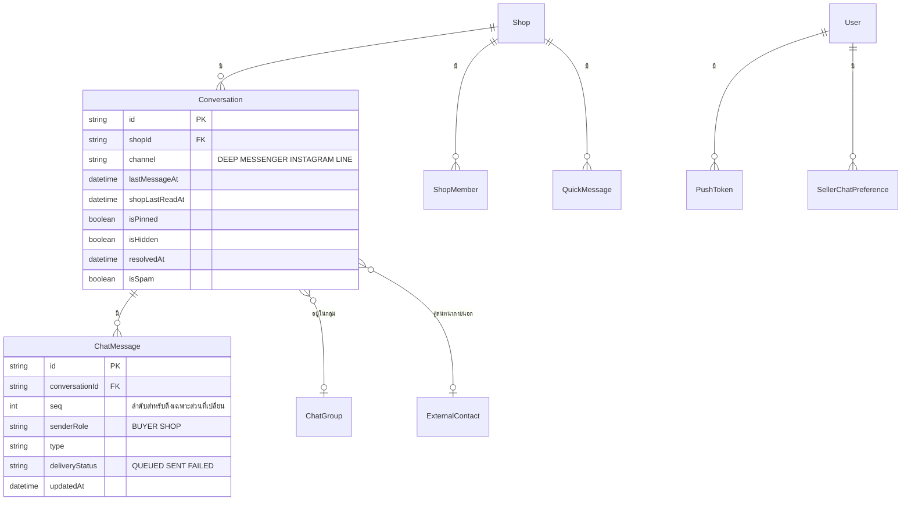

> **โมดูล:** 00088 — Seller Native Chat
> **ประเภทเอกสาร:** DATABASE Design
> **เวอร์ชัน:** 1.0
> **วันที่จัดทำ:** 2026-10-31
> **สถานะ:** Approved — ไม่มีการเปลี่ยนฐานข้อมูล (BRD FR-001)
> **เจ้าของเอกสาร:** SA (ดู [[Feature-Docs-Ownership]])

# DATABASE: แชท Native ในแอปผู้ขาย

---

## 1. Overview

ฟีเจอร์นี้ **ไม่เพิ่ม ไม่แก้ ไม่ลบ** ตาราง คอลัมน์ index constraint หรือ trigger ใด ๆ ในฐานข้อมูลของ deep-web (BRD FR-001 · 8.1)

- แชท Native อ่าน/เขียนผ่าน **API เดิมของเว็บ** เท่านั้น (SRS §4) — ทุกการเขียนลงตารางเดิมผ่านโค้ดเดิม
- ค่า "โหมดแชท" เก็บใน **เครื่องผู้ใช้** (AsyncStorage ของแอป) ไม่ใช่ฐานข้อมูล (BRD FR-004)
- ข้อมูลแชทที่แอปเก็บไว้ให้เปิดเร็ว อยู่ใน **หน่วยความจำของแอป** ระหว่างรอบใช้งาน (BRD FR-018) ไม่ใช่ฐานข้อมูล

| รายการ | ค่า |
|--------|-----|
| Migration ใหม่ | 0 |
| ตาราง/คอลัมน์ใหม่ | 0 |
| Index/constraint ใหม่ | 0 |
| Trigger/Realtime broadcast ใหม่ | 0 (ใช้ broadcast เดิม `chat:shop:{id}` · `chat:{id}`) |

---

## 2. ERD

ตารางเดิมที่แชท Native **อ่าน/เขียนทางอ้อม** ผ่าน API เดิม (แสดงเพื่ออ้างอิงเท่านั้น — ไม่มีการเปลี่ยนโครงสร้าง):

---

## 3. Tables

ไม่มีตารางใหม่ · ไม่มีการเปลี่ยนตารางเดิม · ดูโครงสร้างจริงที่ `prisma/schema.prisma` (Conversation · ChatMessage · ChatGroup · QuickMessage · SellerChatPreference · ExternalContact · PushToken)

### 3.1 ที่เก็บในเครื่อง (ไม่ใช่ฐานข้อมูล — บันทึกไว้เพื่อความครบ)

| คีย์ | ที่เก็บ | ค่า | อายุ |
|------|--------|-----|------|
| `deep.chatMode.v1` | AsyncStorage (แอปผู้ขาย) | `"web"` \| `"native"` | ถาวรจนเปลี่ยน/ลบแอป · ไม่ลบตอนออกจากระบบ |
| แคชข้อความ/รายการแชท | หน่วยความจำของแอป | ตามรูปแบบ API เดิม | หายเมื่อปิดแอป · ล้างเมื่อคุกกี้ล็อกอินหาย/สลับบัญชี |

---

## 4. Indexes

ไม่มี index ใหม่ · คำขอทั้งหมดใช้ query เดิมของเว็บ (index เดิมรองรับอยู่แล้ว) · ปริมาณคำขอต่อผู้ใช้ไม่มากกว่าเว็บ (รอบดึงซ้ำ 12/20 วินาทีเท่าเว็บ — SRS NFR)

---

## 5. Migration Plan

### 5.1 ลำดับการ Migrate

ไม่มี migration · deploy ฝั่ง deep-web ของฟีเจอร์นี้ (แถว "ตั้งค่าแอป") ไม่รัน `prisma migrate` ใด ๆ

### 5.2 Rollback

ไม่มีอะไรต้อง rollback ในฐานข้อมูล

### 5.3 ผลกระทบ (Impact)

ไม่มีผลต่อข้อมูลเดิม · ผู้ใช้โหมดเว็บและโหมด Native เขียนข้อมูลชุดเดียวกันผ่านโค้ดเดียวกัน

---

## 6. Retention / ข้อควรระวัง

- ห้ามเพิ่มตาราง/คอลัมน์เพื่อเก็บ "โหมดแชท" ฝั่งเซิร์ฟเวอร์ในฟีเจอร์นี้ (PRD §5 Out of Scope)
- ข้อมูลแชทในเครื่องเป็นข้อมูลส่วนบุคคล — อยู่ในหน่วยความจำแอปเท่านั้น ไม่เขียนลงไฟล์/AsyncStorage ในเฟส 1 (BRD FR-018)

---

## 7. Traceability

| เอกสาร | ข้อ | ความสัมพันธ์ |
|--------|-----|-------------|
| BRD | FR-001 | ไม่มี migration / ไม่แก้ตาราง |
| BRD | FR-004 | โหมดเก็บในเครื่อง |
| BRD | FR-018 | แคชในหน่วยความจำ |
| SDS | §2 · §6 TD-001 | ใช้ API เดิม = ใช้ตารางเดิมผ่านโค้ดเดิม |

---

## 8. สรุป (Summary)

ฐานข้อมูลไม่เปลี่ยน · ไม่มี migration · แชท Native ใช้ข้อมูลชุดเดียวกับเว็บผ่าน API เดิม · ค่าโหมดและแคชอยู่ในเครื่องผู้ใช้
