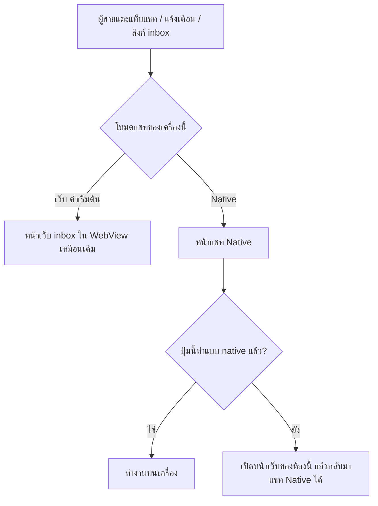

> **โมดูล:** 00088 — Seller Native Chat
> **ประเภทเอกสาร:** Product Requirements Document (PRD)
> **เวอร์ชัน:** 1.0
> **วันที่จัดทำ:** 2026-10-31
> **สถานะ:** Approved — user อนุมัติ 2026-10-31 · วิธีเรียกข้อมูล = API เดิม + คุกกี้ล็อกอิน (มติวันเดียวกัน)
> **เจ้าของเอกสาร:** BA + PO + PM
> **ต้นแบบที่ตกลงแล้ว:** https://claude.ai/artifact/UJzMumreWxRNgwV7NCMeDb (v3 · user อนุมัติหน้าตา 2026-10-31)
> **ขอบเขตโค้ด:** แอปผู้ขาย `deep-seller-app` (หลัก) + ช่อง API ใหม่สำหรับแอปใน `deep-web` (เพิ่มอย่างเดียว ไม่แก้ของเดิม)

# PRD: แชท Native ในแอปผู้ขาย

---

## Executive Summary

ทุกวันนี้แชทของผู้ขายในแอป Deep ผู้ขายคือ **หน้าเว็บ** (`seller.deepthailand.app/inbox`) ที่แสดงอยู่ใน WebView ทั้งแอปมีหน้าเดียวคือ WebView ผลคือทุกครั้งที่กดเข้าห้องแชทต้องโหลดหน้าเว็บใหม่ ("กำลังโหลด...") ปัดขอบจอกลับไม่ได้ แนบรูปผ่านช่องเลือกไฟล์ของเบราว์เซอร์ และกดค้าง/ปัดแถวไม่ลื่นเท่าแอปทั่วไป

ฟีเจอร์นี้เพิ่ม **แชทแบบ Native** ที่ทำงานบนเครื่อง หน้าตาและคำเหมือนแชทในเว็บทุกจุด (ลอกจากของจริง) โดย **ไม่แทนที่ของเดิม**:

1. **สวิตช์ "โหมดแชท"** ในหน้าตั้งค่าแอป — **เว็บ (ค่าเริ่มต้น)** หรือ **Native (ทดลอง)** · ผู้ใช้เปลี่ยนเองได้ตลอด
2. **โหมดเว็บ** = ทุกอย่างเหมือนเดิมทุกตัวอักษร (คนที่ไม่เปิดสวิตช์ไม่เห็นอะไรเปลี่ยน)
3. **โหมด Native** = กล่องข้อความ ห้องแชท ข้อมูลลูกค้า ความคิดเห็น ทำงานบนเครื่อง · ส่วนที่ยังไม่ทำแบบ native เปิดหน้าเว็บของห้องนั้นแทน (ไม่มีปุ่มกดแล้วไม่เกิดอะไร)
4. **ไม่กระทบเว็บ** — หน้าเว็บและ API เดิมไม่เปลี่ยน · แอปเรียก API เดิมของเว็บด้วยล็อกอินเดิม (ไม่มี API หรือ token ใหม่) · ข้อยกเว้นเดียว: แถว "ตั้งค่าแอป" ในหน้าบัญชี ที่เห็นเฉพาะในแอปรุ่นที่รองรับ

ส่งมอบเป็น 3 เฟส จนครบเท่าเว็บ

---

## 1. Business Goals & KPIs

### 1.1 เป้าหมายทางธุรกิจ

| เป้าหมาย | รายละเอียด |
|----------|-----------|
| **ตอบแชทเร็วขึ้น** | เปิดห้องทันทีไม่ต้องรอโหลดหน้าเว็บ — ผู้ขายตอบลูกค้าได้ไวขึ้น ปิดการขายได้มากขึ้น |
| **ใช้งานเหมือนแอปแชททั่วไป** | ปัดกลับ · กดค้าง · ปัดแถว · เลือกรูปหลายรูป · แป้นพิมพ์ไม่บังช่องพิมพ์ — ลดความรู้สึก "เป็นเว็บ" |
| **เปลี่ยนแบบไม่มีความเสี่ยง** | ของเดิมยังเป็นค่าเริ่มต้น · คนที่อยากลองเปิดเอง · มีปัญหากลับเป็นเว็บได้ทันทีโดยไม่ต้องอัปเดตแอป |
| **คุณค่าของแอปบนสโตร์** | ฟีเจอร์ native ที่ใช้งานจริงช่วยให้แอปมีเหตุผลตามแนวทาง App Store 4.2 (แอปไม่ใช่แค่เว็บห่อ) |

### 1.2 ตัวชี้วัดความสำเร็จ (KPIs)

| KPI | คำอธิบาย | เป้าหมาย |
|-----|----------|---------|
| **เวลาเปิดห้องแชท** | จากแตะแถวจนเห็นข้อความล่าสุด (ห้องที่เคยเปิด) | Native ≤ 0.3 วินาที (เว็บวันนี้ ~1–2 วินาที) |
| **อัตราเปิดใช้โหมด Native** | ผู้ขายที่เปิดสวิตช์ ÷ ผู้ขายที่ใช้แอป | ≥ 20% ใน 30 วันหลังเปิดเฟส 1 |
| **อัตรากลับไปโหมดเว็บ** | ผู้ที่เปิดแล้วปิดภายใน 7 วัน | ≤ 30% (เกินนี้ = มีปัญหาต้องดู) |
| **ข้อความส่งไม่สำเร็จ** | ข้อความ FAILED จากโหมด Native เทียบโหมดเว็บ | ไม่สูงกว่าโหมดเว็บ |
| **แอปปิดเอง (crash)** | crash ที่เกิดในหน้าแชท Native | 0 ในรอบรีวิวสโตร์ · < 0.5% ของ session หลังปล่อย |

---

## 2. User Personas (กลุ่มผู้ใช้งาน)

### 2.1 เจ้าของร้าน / ผู้จัดการ

**ข้อมูลพื้นฐาน:**
- ตอบแชทเองบนมือถือเป็นหลัก มีหลายร้านในบัญชีเดียว (สลับร้าน / รวมทุกร้าน)

**เป้าหมาย:**
- เห็นแชทใหม่ทันที ตอบเร็ว สร้างงาน/ออเดอร์ต่อจากแชทได้

**ความต้องการ:**
- เปิดห้องเร็ว · สลับร้านง่าย · เห็นสถานะงาน/ออเดอร์บนหัวห้อง

**จุดปวด (Pain Points):**
- กดเข้าห้องแล้วต้องรอ "กำลังโหลด..." ทุกครั้ง · ปัดกลับไม่ได้ · แนบรูปต้องผ่านช่องเลือกไฟล์

### 2.2 พนักงานตอบแชท (บทบาท "ตอบแชท")

**ข้อมูลพื้นฐาน:**
- ตอบแชทหลายสิบห้องต่อวัน ใช้ข้อความสำเร็จรูป / ส่งบริการ / ส่งรูปบ่อย

**เป้าหมาย:**
- ตอบให้ไว ไม่พลาดห้อง จัดการห้อง (ปิดงาน/ปักหมุด/สแปม) ได้คล่อง

**ความต้องการ:**
- ปัดแถว กดค้าง ข้อความสำเร็จรูป ส่งรูปหลายรูปพร้อมกัน

**จุดปวด (Pain Points):**
- ทำงานซ้ำ ๆ บนหน้าเว็บที่ตอบสนองช้ากว่าแอปแชททั่วไป

### 2.3 ผู้ใช้ที่ไม่อยากเปลี่ยน

**ข้อมูลพื้นฐาน:**
- คุ้นกับแชทเดิม ไม่สนใจของใหม่

**เป้าหมาย:**
- ใช้งานต่อเหมือนเดิม

**ความต้องการ:**
- ไม่มีอะไรเปลี่ยนถ้าไม่เปิดสวิตช์เอง

**จุดปวด (Pain Points):**
- กลัวของใหม่ทำให้ใช้งานไม่ได้ / หาปุ่มไม่เจอ

---

## 3. Business Requirements

### 3.1 สวิตช์โหมดแชท

**ความต้องการ:**
- หน้า **"ตั้งค่าแอป"** ใหม่ (ทางเข้า: หน้าบัญชี › ตั้งค่าแอป) มีหัวข้อ **"โหมดแชท"** 2 ตัวเลือก: **เว็บ (ค่าเริ่มต้น)** · **Native (ทดลอง)**
- หน้าเดียวกันรวม "เสียงแจ้งเตือนแชท (ฟังตัวอย่าง)" และ "การแจ้งเตือนของเครื่อง" ที่มีอยู่แล้ว

**Business Rules:**
- ค่าเริ่มต้นของทุกคน = **เว็บ**
- ค่านี้เป็นของ **เครื่อง** (เก็บในเครื่อง ไม่ส่งขึ้นเซิร์ฟเวอร์) — เครื่องอื่นของคนเดียวกันไม่เปลี่ยนตาม
- เปลี่ยนได้ตลอด มีผลทันที ไม่ต้องปิดเปิดแอป · ไม่กระทบข้อมูลแชท
- **ทางเข้า (user เลือก ก. 2026-10-31):** แถว "ตั้งค่าแอป" ในหน้าบัญชีของเว็บ (`src/app/(paces)/seller/(dashboard)/account/`) — แสดงเฉพาะเมื่อแอปบอกว่ารองรับ (`__DEEP_NATIVE_FEATURES__` มี `app-settings`) · กดแล้วส่งคำสั่งใหม่ `deep:open-app-settings` · นอกแอปและแอปรุ่นเก่าไม่เห็นแถวนี้ · ไม่แก้ปุ่ม/ส่วนอื่นของหน้า · ปุ่มเดิม "เปิดการแจ้งเตือน" (`deep:open-settings`) ไม่แตะ ยังพาไปตั้งค่าเครื่องเหมือนเดิม

**เหตุผล:**
- ให้คนที่อยากลองลองได้ โดยไม่บังคับทุกคน และถอยกลับได้ทันทีถ้ามีปัญหา

### 3.2 หน้าตาเหมือนแชทในเว็บ

**ความต้องการ:**
- แชท Native ใช้ **ธีม สี ไอคอน คำ และตำแหน่งเดียวกับแชทในเว็บบนมือถือ** ตามต้นแบบ v3 (ลอกจากหน้าจริง)
- ต่างจากเว็บ **จุดเดียว**: แท็บ "ข้อความ / ความคิดเห็น" กว้างเท่ากัน เต็มแถว อยู่กลาง (user สั่ง 2026-10-31)

**Business Rules:**
- ห้ามเปลี่ยนชื่อปุ่ม/คำ/ลำดับเมนูให้ต่างจากเว็บ (ยกเว้นจุดเดียวข้างบน) — ผู้ใช้สลับโหมดแล้วต้องหาของเจอที่เดิม
- ถ้าเว็บเปลี่ยนคำหรือเมนูภายหลัง แอปต้องตามในรอบถัดไป

**เหตุผล:**
- ผู้ใช้ไม่ต้องเรียนใหม่ · ทีมไม่ต้องดูแลสองแบบที่ต่างกัน

### 3.3 กล่องข้อความ

**ความต้องการ:**
- หัว: โลโก้ · ค้นหา "ค้นหาชื่อ ลูกค้า" · ปุ่มเสียง · ปุ่มร้าน (มุมมองกล่องข้อความ ร้านทั้งหมด/ร้านนี้ · สลับบัญชี · กลับหน้าหลัก)
- แท็บ ข้อความ / ความคิดเห็น พร้อมตัวเลข
- ช่องทาง 5 ปุ่ม: ทั้งหมด · Deep · Messenger · Instagram · LINE
- ตัวกรอง: เรียงลำดับ · แท็ก · การอ่าน · ลูกค้า · ที่ซ่อนไว้ · ล้างตัวกรอง · บันทึกเป็นค่าเริ่ม · ใช้ตัวกรอง
- แท็บย่อย ทั้งหมด / ปิดงาน / สแปม · เมนูกลุ่ม (เลือก/ลบ/สร้างกลุ่ม)
- แถบ "คุณปิดแจ้งเตือนของร้านนี้อยู่ · เปิดแจ้งเตือน"
- แถว: รูป + เลขยังไม่อ่าน + ป้ายเพจ/ช่องทาง · ดาวปักหมุด + แถบเหลือง · ชื่อ · ข้อความล่าสุด · ป้าย (สถานะการขาย · ad_id · สถานะงาน/ออเดอร์ · ติดตาม · แท็ก) · เวลา
- ปัดแถวซ้าย: ปักหมุด · ปิดงาน · ซ่อน
- กดค้างแถว: ปักหมุด · ปิดงาน · ซ่อน · สแปม · สถานะการขาย · แท็ก · กลุ่ม · เสียงแจ้งเตือนของแชทนี้
- ไม่พบผล: "ไม่พบบทสนทนาตามที่กรอง" + ล้างตัวกรอง
- ข้อความใหม่เด้งเข้ารายการทันที

**Business Rules:**
- กติกาการกรอง เรียง นับยังไม่อ่าน และการเห็นข้อมูลข้ามร้าน ใช้ของเซิร์ฟเวอร์ชุดเดียวกับเว็บ (ไม่คำนวณเองในแอป)
- สิทธิ์เหมือนเว็บ: บทบาทที่เข้าแชทเว็บไม่ได้ (ฝ่ายช่าง · บัญชี) ก็เข้าแชท Native ไม่ได้

**เหตุผล:**
- ผลลัพธ์ต้องเหมือนกันทุกอย่างไม่ว่าเปิดโหมดไหน

### 3.4 ห้องแชท

**ความต้องการ:**
- หัวห้อง: กลับ · รูป · ชื่อ · ข้อมูลลูกค้า · ⋮ (เสียงเฉพาะแชทนี้ · เปิดห้องนี้ในหน้าเว็บ)
- ชิปบนสุด: "เกินเวลาที่ Meta ให้ตอบ" (กางอ่านเหตุผล) · ชิปงานบริการ/ออเดอร์ (กางเห็นปุ่ม รับเงินแล้ว · ปิดงาน · แก้ไขรายการ · ส่งสรุปนัด)
- แถบ "แชทนี้ตอบกลับจากโฆษณาของคุณ · ดูโฆษณา · ปิด"
- ข้อความทุกชนิดที่เว็บแสดง: ข้อความ · รูป/อัลบั้ม · วิดีโอ · เสียง · ไฟล์ · สติกเกอร์ · การ์ดสินค้า/บริการ · การ์ดออเดอร์/งานบริการ · นัด · เลขพัสดุ · ข้อความจากระบบ · รีแอค · ข้อความที่ตอบกลับ
- สถานะข้อความของเรา: กำลังส่ง · ส่งแล้ว · อ่านแล้ว · ส่งไม่สำเร็จ + เหตุผล + "ส่งใหม่"
- กดค้างข้อความ: รีแอค 6 แบบ (หัวใจ ฮา ว้าว เศร้า โกรธ ถูกใจ) · ตอบกลับ · คัดลอก · สร้างงานบริการ/ออเดอร์ · บันทึกเข้าคลังลูกค้า · บันทึกรับเงิน · ยกเลิกข้อความที่ส่งไม่สำเร็จ (ตามชนิดข้อความ เหมือนเว็บ)
- แถบเครื่องมือ 7 ปุ่ม: ข้อความสำเร็จรูป · เลือกสินค้า/บริการ · แนบไฟล์ · อิโมจิ/สติกเกอร์ · AI ช่วยร่างคำตอบ · ตารางนัด · สร้างงานบริการ/ออเดอร์
- ช่องพิมพ์ "พิมพ์ข้อความ หรือวางไฟล์ที่นี่..." + ปุ่มส่ง

**Business Rules:**
- การส่งทุกชนิดผ่าน **คิวส่งของระบบเดิม** — ไม่ส่งซ้ำ ไม่ข้ามกติกาช่องทาง (เช่น 24 ชม. ของ Meta, โควตา LINE)
- รูปทุกรูปผ่าน **ตัวบีบอัดกลาง** เดียวกับเว็บก่อนอัปโหลด
- เปิดห้อง = นับว่าอ่านแล้ว เหมือนเว็บ

**เหตุผล:**
- ห้องแชทคือจุดที่ใช้บ่อยที่สุด ต้องเร็วและถูกต้องเท่าเว็บ

### 3.5 ข้อมูลลูกค้า (แผงข้างห้อง)

**ความต้องการ:**
- 5 แท็บเหมือนเว็บ: **ข้อมูล** (ความจำของแชทนี้ · สินค้าที่สนใจ · ชื่อจริง · สถานะการขาย · แท็ก · เบอร์ · ที่อยู่ · แก้ไข) · **งานบริการ/ออเดอร์** (รายการ + สร้างใหม่ + ส่งเข้าแชท) · **ติดตาม** · **ไฟล์** · **โน้ต**

**Business Rules:**
- ข้อมูลและสิทธิ์แก้ไขเหมือนเว็บ (เช่น ตัวเลขเงินเห็นเฉพาะคนที่เว็บให้เห็น)

**เหตุผล:**
- ตอบลูกค้าได้ถูกคนถูกเรื่องโดยไม่ต้องสลับไปหน้าอื่น

### 3.6 ความคิดเห็น (Facebook / Instagram)

**ความต้องการ:**
- แท็บความคิดเห็น: ช่องทาง · ตัวกรอง · ทั้งหมด / ยังไม่ตอบ / หมดอายุ · แถว (รูปโพสต์ · ข้อความโพสต์ · ชื่อ: คอมเมนต์ · ป้ายบอทตอบแล้ว)
- ตอบในโพสต์ · ตอบส่วนตัว (ภายใน 7 วันตามกติกา Facebook)

### 3.7 แจ้งเตือน ความเร็ว และเน็ตหลุด

**ความต้องการ:**
- แตะแจ้งเตือนแชท = เปิดห้องนั้น **ในโหมดที่ผู้ใช้เลือก** (Native เปิดหน้า native · เว็บเปิดหน้าเว็บเหมือนเดิม)
- ลิงก์ `/inbox…` จากที่อื่นในแอป (เมนูล่าง · ปุ่มในหน้าเว็บ · ลิงก์ภายนอก) ไปโหมดที่เลือกเช่นกัน
- ข้อความที่เคยเปิดเก็บไว้ในเครื่อง เปิดซ้ำเห็นทันที แล้วค่อยดึงส่วนที่เปลี่ยน
- เน็ตหลุด: แถบบอก "ไม่มีอินเทอร์เน็ต" · ข้อความที่พิมพ์รอส่งเองเมื่อกลับมา

**Business Rules:**
- ข้อมูลแชทที่เก็บในเครื่องลบทิ้งเมื่อออกจากระบบ หรือสลับบัญชี
- ห้ามเก็บข้อมูลลูกค้าในที่ที่แอปอื่นอ่านได้

### 3.8 ส่วนที่ยังไม่ทำแบบ Native (ระหว่างเฟส)

**ความต้องการ:**
- ปุ่มที่ยังไม่ทำแบบ native เปิด **หน้าเว็บของห้องนั้น** ในแอป แล้วปัด/กดกลับมาที่แชท Native ได้

**Business Rules:**
- ห้ามมีปุ่มที่กดแล้วไม่เกิดอะไร · ห้ามซ่อนความสามารถที่เว็บมี

**เหตุผล:**
- ปล่อยเฟส 1 ได้เร็ว โดยผู้ใช้ไม่เสียความสามารถใดเลย

### 3.9 การแบ่งเฟส

| เฟส | ส่งมอบ |
|-----|--------|
| **1** | ตั้งค่าแอป + สวิตช์ · กล่องข้อความ (ครบ §3.3 ยกเว้นตัวกรองละเอียด/กลุ่ม/สลับร้าน) · ห้องแชท: ข้อความ รูป สติกเกอร์ อิโมจิ ตอบกลับ รีแอค คัดลอก ยกเลิกข้อความที่ส่งไม่สำเร็จ สถานะส่ง ส่งใหม่ ข้อความสำเร็จรูป ชิปเกินเวลา Meta แถบโฆษณา เสียงเฉพาะแชทนี้ · แจ้งเตือนเข้าห้อง · เน็ตหลุด |
| **2** | ตัวกรองละเอียด · กลุ่ม · สลับร้าน/ร้านทั้งหมด · การ์ดสินค้า/บริการ + เลือกส่ง · การ์ดออเดอร์/งาน · AI ช่วยร่าง · ข้อมูลลูกค้า 5 แท็บ · เมนูกดค้าง (สถานะการขาย/แท็ก/กลุ่ม) · วิดีโอ/ไฟล์ |
| **3** | สร้างงานบริการ/ออเดอร์ · รับเงิน · ปิดงาน · แก้ไขรายการ · ส่งสรุปนัด · ปฏิทินนัด · พัสดุ · ความคิดเห็น + ตอบส่วนตัว |

---

## 4. Business Rules & Constraints

### 4.1 กฎทางธุรกิจหลัก

| กฎ | คำอธิบาย |
|----|----------|
| **ค่าเริ่มต้น = เว็บ** | ไม่มีใครถูกย้ายไป Native อัตโนมัติ |
| **ไม่กระทบเว็บ** | หน้าเว็บ API เดิม และพฤติกรรมของผู้ใช้โหมดเว็บไม่เปลี่ยน · ข้อยกเว้นเดียว: แถว "ตั้งค่าแอป" ในหน้าบัญชี (เห็นเฉพาะในแอปรุ่นที่รองรับ) |
| **ข้อมูลชุดเดียว** | ทุกอย่างอ่าน/เขียนผ่านเซิร์ฟเวอร์ด้วยกติกาเดียวกับเว็บ — แอปไม่มีกติกาธุรกิจของตัวเอง |
| **สิทธิ์ชุดเดียว** | ใครทำอะไรได้ในแชทเว็บ ทำได้เท่ากันใน Native — ไม่มากกว่า ไม่น้อยกว่า |
| **คำชุดเดียว** | คำ/ป้าย/ข้อความแจ้งเหมือนเว็บ (ยกเว้นแท็บข้อความ/ความคิดเห็น §3.2) |
| **ไม่มีปุ่มตาย** | ของที่ยังไม่ native เปิดหน้าเว็บแทน |

### 4.2 ข้อจำกัดทางธุรกิจ

| ข้อจำกัด | รายละเอียด |
|---------|-----------|
| **ต้องอัปเดตแอปจากสโตร์** | แชท Native ต้องใช้ส่วนประกอบใหม่ของแอป ส่งผ่าน OTA อย่างเดียวไม่ได้ ต้องบิลด์ใหม่และผ่านรีวิว App Store / Google Play |
| **ช่วงรอรีวิวสโตร์** | ห้าม deploy deep-web และห้าม `eas update` ตามกติกาเดิมของแอปผู้ขาย |
| **กติกา App Store 3.1.1** | ปุ่ม/ข้อความเรื่องจ่ายเงินที่เว็บซ่อนในแอป iOS ต้องซ่อนในแชท Native ด้วย |
| **กติกาช่องทาง** | 24 ชม. ของ Meta · ตอบส่วนตัว 7 วัน · โควตา LINE — เหมือนเว็บ |

### 4.3 ข้อยกเว้นกฎของแอปผู้ขาย

กฎข้อ 1 ของแอปผู้ขาย ("ห้ามทำหน้าเนื้อหาเป็น native") **ยกเว้นเฉพาะแชท** ตามมติ user 2026-10-31 · หน้าอื่นทั้งหมดยังเป็นเว็บเหมือนเดิม

---

## 5. Out of Scope (นอกขอบเขต)

| หัวข้อ | คำอธิบาย |
|--------|----------|
| **หน้าอื่นนอกจากแชท** | แดชบอร์ด ออเดอร์ สินค้า ตั้งค่าร้าน ฯลฯ ยังเป็นเว็บ |
| **เปลี่ยนแชทในเว็บ** | ไม่แก้หน้าเว็บ ไม่เปลี่ยนแท็บข้อความ/ความคิดเห็นของเว็บ |
| **แอปผู้ซื้อ (Deep)** | ไม่เกี่ยว |
| **ฟีเจอร์ใหม่ที่เว็บไม่มี** | เช่น อัดเสียง · สถานะกำลังพิมพ์ของลูกค้า — ไม่ทำในฟีเจอร์นี้ |
| **โต๊ะแชท 3D (Chat Desk)** | อยู่หน้าแดชบอร์ดเว็บ ไม่ใช่ส่วนของแชท |
| **ตั้งค่าโหมดผ่านเซิร์ฟเวอร์** | ไม่มีการบังคับโหมดจากหลังบ้านในฟีเจอร์นี้ |

---

## 6. Risks & Mitigation (ความเสี่ยงและแนวทางแก้ไข)

### 6.1 ความเสี่ยงทางธุรกิจ

| ความเสี่ยง | ผลกระทบ | ระดับความรุนแรง | แนวทางแก้ไข |
|-----------|---------|-----------------|-------------|
| **Native ไม่ครบเท่าเว็บ** | ผู้ใช้หาปุ่มไม่เจอ | กลาง | ของที่ยังไม่ทำเปิดหน้าเว็บแทน · ค่าเริ่มต้นเป็นเว็บ |
| **คำ/เมนูต่างจากเว็บไปเรื่อย ๆ** | สองโหมดไม่ตรงกัน | กลาง | กฎ "คำชุดเดียว" · เช็กลิสต์เทียบหน้าจอทุกรอบปล่อย |
| **รีวิวสโตร์ตีกลับ** | ปล่อยช้า | กลาง | ทดสอบบนเครื่องจริงก่อนส่ง · ซ่อนเรื่องจ่ายเงินตาม 3.1.1 · โน้ตรีวิวอธิบายโหมด |
| **ผู้ใช้ไม่รู้ว่ามีโหมดใหม่** | อัตราเปิดใช้ต่ำ | ต่ำ | แจ้งในหน้าตั้งค่าแอป (ป้าย "ใหม่") |

### 6.2 ความเสี่ยงทางเทคนิค

| ความเสี่ยง | ผลกระทบ | แนวทางแก้ไข |
|-----------|---------|-------------|
| **คุกกี้ล็อกอินบน iPhone ไม่ตรงกับ WebView** | แชท Native ใช้ล็อกอินเก่า/หลุด | อ่านคุกกี้จาก WebView ทุกครั้งที่เปิดแชท · ได้ 401 ให้ถอยไปเว็บ |
| **ข้อมูลแชทค้างหลังออกจากระบบ** | คนถัดไปเห็นแชทเก่า | ล้างข้อมูลในเครื่องเมื่อคุกกี้หาย/สลับบัญชี · ไม่เก็บข้ามการเปิดแอปใหม่ในเฟส 1 |
| **ข้อความเด้งไม่ทัน** | ตอบช้า | ใช้ Realtime ชุดเดียวกับเว็บ + ดึงซ้ำทุก 12–20 วินาทีเหมือนเว็บ |
| **ส่งซ้ำตอนเน็ตกลับมา** | ลูกค้าได้ข้อความซ้ำ | ใช้คิวส่งเดิมของระบบ (กันซ้ำที่เซิร์ฟเวอร์) |
| **ส่วนประกอบ native ไม่เข้ากับ Expo** | แอปปิดเองตอนเปิด | รัน `check:ios-prebuilds` · ทดสอบบนเครื่องจริงก่อนส่ง |

---

## 7. Glossary (อภิธานศัพท์)

| คำศัพท์ | ความหมาย |
|---------|----------|
| **โหมดเว็บ** | แชทแบบเดิม = หน้าเว็บ `seller.deepthailand.app/inbox` ใน WebView ของแอป |
| **โหมด Native** | แชทที่สร้างด้วยส่วนประกอบของแอปเอง ทำงานบนเครื่อง |
| **WebView** | กรอบในแอปที่แสดงหน้าเว็บ |
| **API เดิมของเว็บ** | route ที่แชทในเว็บใช้อยู่ — แชท Native เรียกชุดเดียวกันด้วยคุกกี้ล็อกอินเดิม |
| **OTA** | อัปเดตแอปแบบไม่ผ่านสโตร์ (ส่งได้เฉพาะโค้ด ไม่ได้ส่วนประกอบใหม่) |
| **คิวส่ง (outbox)** | ระบบเดิมที่ส่งข้อความออกไปยัง Messenger/IG/LINE/Deep และกันส่งซ้ำ |

---

## 8. Success Metrics (ตัวชี้วัดความสำเร็จ)

| ตัวชี้วัด | ค่าที่คาดหวัง | วิธีวัด |
|----------|---------------|--------|
| **เปิดห้องที่เคยเปิด** | ≤ 0.3 วินาที | วัดบนเครื่องจริง iPhone + Android รุ่นกลาง |
| **ผู้ใช้ Native ที่ยังใช้หลัง 7 วัน** | ≥ 70% | นับจากสถิติการเปิดหน้าแชท Native |
| **รายงานปัญหาจากโหมด Native** | ไม่มีเรื่องข้อมูลผิด/ส่งซ้ำ | รายงานจากผู้ใช้ + log ส่งไม่สำเร็จ |
| **โหมดเว็บไม่เปลี่ยน** | 0 การเปลี่ยนแปลงที่ผู้ใช้โหมดเว็บเห็น | เทสเดิมของเว็บผ่านทั้งหมด + เทียบหน้าจอ |

---

## 9. Dependencies & Assumptions

### 9.1 สิ่งที่ต้องพึ่งพา (Dependencies)

| ระบบ/ส่วนประกอบ | ความสัมพันธ์ |
|-----------------|-------------|
| **deep-web — API แชทเดิม (ไม่แก้)** | กติกา กรอง ส่ง อ่าน สิทธิ์ — แชท Native เรียกชุดเดียวกับเว็บ |
| **deep-web — หน้าบัญชี** | เพิ่มแถว "ตั้งค่าแอป" (เห็นเฉพาะในแอปรุ่นที่รองรับ) · หัวหน้า review |
| **Supabase Realtime** | สัญญาณข้อความใหม่ ชุดเดียวกับเว็บ |
| **ระบบอัปโหลด + ตัวบีบอัดกลาง** | ส่งรูปจากแอป |
| **Expo Push** | แจ้งเตือนเดิม (ไม่ต้องแก้ฝั่งส่ง) |
| **deep-seller-app** | หน้าจอ Native · สวิตช์ · การนำทาง |
| **App Store / Google Play** | รีวิวรุ่นใหม่ |

### 9.2 สมมติฐาน (Assumptions)

- ผู้ใช้ล็อกอินผ่านหน้าเว็บในแอปเหมือนเดิม แชท Native ใช้คุกกี้ล็อกอินชุดเดียวกัน (ไม่มีหน้าล็อกอิน native)
- รุ่นแอปที่มีแชท Native คือ 1.0.6 ขึ้นไป · รุ่นเก่ายังใช้แชทเว็บตามเดิม
- deep-web ไม่ต้องเพิ่ม API ใหม่ (มติ 2026-10-31) · แตะแค่แถว "ตั้งค่าแอป" ในหน้าบัญชี

---

## 10. Appendix

### 10.1 ตัวอย่าง User Journey

**Scenario: เปิดลองโหมด Native**

1. ผู้ขายเปิดแอป → ร้านค้า → ตั้งค่าแอป → โหมดแชท → เลือก "Native (ทดลอง)"
2. แตะแท็บแชท → เห็นกล่องข้อความหน้าตาเดิม (ป้าย NATIVE ไม่แสดงต่อผู้ใช้จริง)
3. แตะห้องลูกค้า → เห็นข้อความทันที → ปัดขอบจอกลับรายการ
4. ปัดแถวซ้าย → ปิดงาน · กดค้างอีกแถว → สแปม
5. มีลูกค้าทักใหม่ → แจ้งเตือนเด้ง → แตะ → เข้าห้องนั้นในแชท Native
6. ไม่ชอบ → กลับไปตั้งค่าแอป → เลือก "เว็บ" → ทุกอย่างกลับเป็นแบบเดิมทันที

### 10.2 มติที่ตกลงแล้ว

| วันที่ | มติ |
|--------|-----|
| 2026-10-31 | ทำแชท Native แยก ค่าเริ่ม = เว็บ · สลับได้ · ไม่กระทบเว็บ |
| 2026-10-31 | ยกเว้นกฎ "ห้ามหน้าเนื้อหา native" ของแอปผู้ขาย **เฉพาะแชท** |
| 2026-10-31 | แอปเรียก **API เดิมของเว็บ + คุกกี้ล็อกอินเดิม** — ไม่มี API/token ใหม่ใน deep-web (แทนแผนเดิมที่จะเพิ่มช่อง token) |
| 2026-10-31 | แบ่ง 3 เฟส · ของที่ยังไม่ native เปิดหน้าเว็บแทน |
| 2026-10-31 | สวิตช์อยู่ในหน้า "ตั้งค่าแอป" แบบ native · ทางเข้า = แถวในหน้าบัญชีของเว็บ เห็นเฉพาะในแอปรุ่นที่รองรับ (ทาง ก. §10.3) — แตะเว็บจุดเดียวนี้ |
| 2026-10-31 | หน้าตาตามต้นแบบ v3 (ลอกจากแชทจริง) · ต่างจากเว็บจุดเดียว: แท็บข้อความ/ความคิดเห็นกว้างเท่ากันเต็มแถว |

### 10.3 ทางเข้าหน้า "ตั้งค่าแอป" (user เลือก ก. 2026-10-31)

| ทาง | ทำอย่างไร | แตะเว็บไหม |
|-----|----------|-----------|
| **ก. แถว "ตั้งค่าแอป" ในหน้าบัญชีของเว็บ (แสดงเฉพาะในแอป) ✅ เลือก** | เพิ่มแถวเดียวในหน้าบัญชี โผล่เฉพาะเมื่อเปิดในแอป (ตรวจจาก UA เดิม) กดแล้วส่งคำสั่งใหม่ `deep:open-app-settings` · นอกแอปไม่เห็นอะไรเปลี่ยน | แตะ 1 จุด (เพิ่มอย่างเดียว · หัวหน้า review) |
| **ข. ทางเข้าฝั่งแอปล้วน** | แอปวางปุ่มลอยเล็ก ๆ ของตัวเอง หรือใช้หน้าตั้งค่าของ iOS (Android ไม่มีเทียบเท่า) | ไม่แตะ · แต่ปุ่มลอยทับหน้าเว็บ และหาไม่เจอง่าย |
| **ค. ใช้ปุ่มเดิม `deep:open-settings`** | เปลี่ยนให้เปิดหน้าตั้งค่าแอปแทนตั้งค่าเครื่อง | ไม่แตะโค้ดเว็บ · แต่ปุ่มเดิมเปลี่ยนพฤติกรรม และโผล่เฉพาะตอนปิดแจ้งเตือน — ไม่แนะนำ |

---

**หมายเหตุ:**
เอกสารนี้เป็นการบันทึกความต้องการทางธุรกิจ (Business Requirements) โดยไม่มีรายละเอียดทางเทคนิค
สำหรับ Functional Requirements / User Story / Acceptance Criteria ดู [[BRD]] ของโมดูลนี้
สำหรับ technical specification ดู [[SRS]] ของโมดูลนี้ (เขียนหลัง PRD + BRD ผ่าน)
