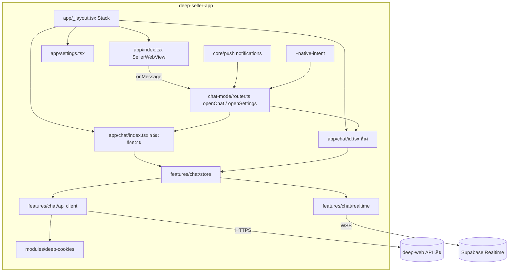
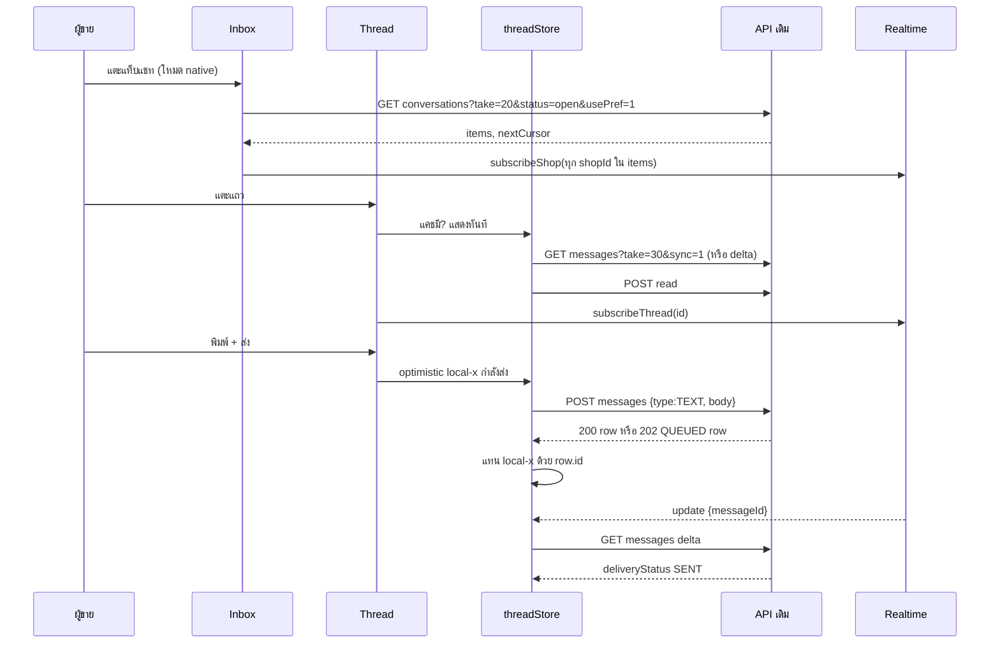
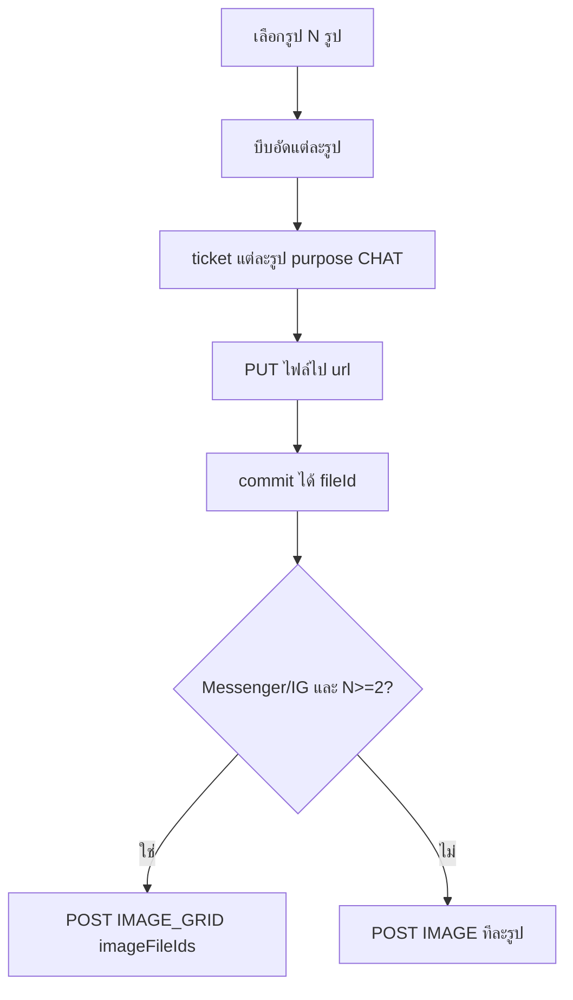
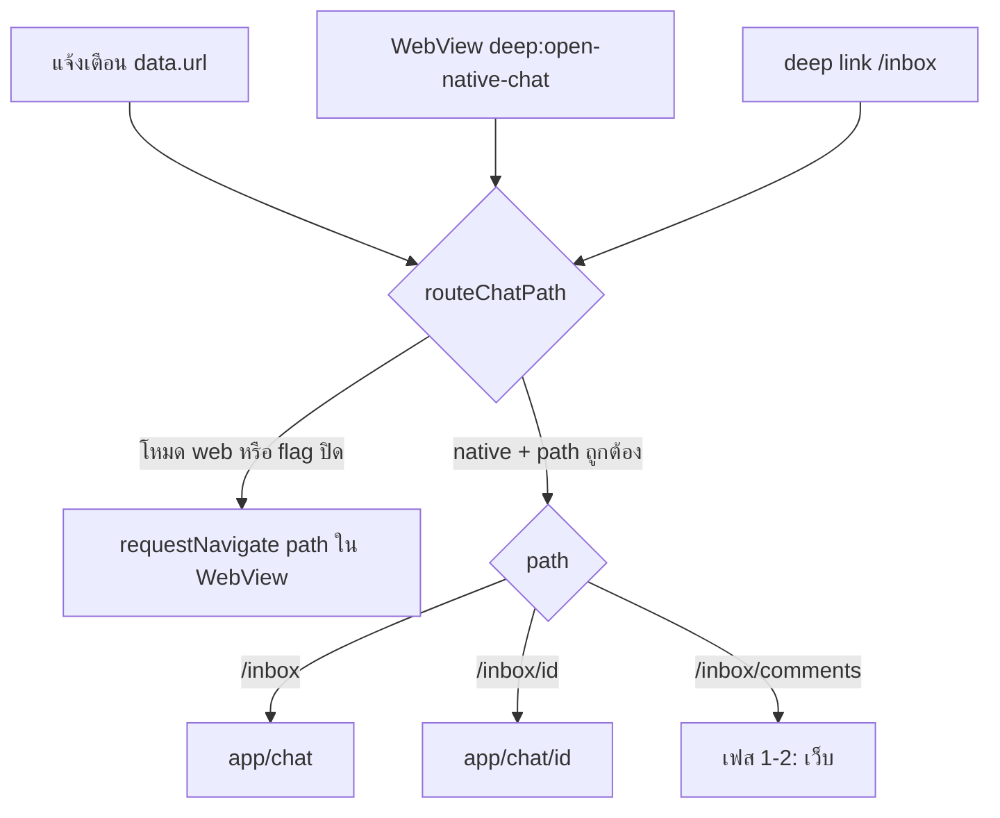

> **โมดูล:** 00088 — Seller Native Chat
> **ประเภทเอกสาร:** System Design Spec (SDS)
> **เวอร์ชัน:** 1.0
> **วันที่จัดทำ:** 2026-10-31
> **สถานะ:** Approved — ตาม SRS v1.0
> **เจ้าของเอกสาร:** SA (ดู [[Feature-Docs-Ownership]])

# SDS: แชท Native ในแอปผู้ขาย (System Design Spec)

---

## 1. บทนำ & References

### 1.1 วัตถุประสงค์

ออกแบบโครงสร้างโค้ดใน `deep-seller-app` และจุดเดียวใน `deep-web` ให้ได้ตาม [[SRS]] TFR-001 ถึง TFR-010

### 1.2 ขอบเขตการออกแบบ

- แอป: ไฟล์ใหม่ใต้ `app/chat/`, `app/settings.tsx`, `src/features/chat*`, `modules/deep-cookies/` และการต่อสายใน `SellerWebView.tsx`, `app/_layout.tsx`
- เว็บ: แถว "ตั้งค่าแอป" + ฟังก์ชันใน `native-bridge.ts`

### 1.3 เอกสารอ้างอิง

[[SRS]] · [[API]] · [[BRD]] · ต้นแบบ v3 · `deep-seller-app/.claude/skills/seller-webview/SKILL.md`

---

## 2. Architecture Overview

### 2.1 มุมมองสถาปัตยกรรม

### 2.2 มุมมองการ Deploy (ถ้าจำเป็น)

แอป 1.0.6 (บิลด์ใหม่) · deep-web PR เล็ก · ไม่มี migration

---

## 3. Component Design

| Component | ไฟล์ | หน้าที่ | หมายเหตุ |
|-----------|------|--------|---------|
| `chatMode` | `src/features/chat-mode/store.ts` | `getMode()` `setMode()` `useChatMode()` · AsyncStorage `deep.chatMode.v1` | ค่าเริ่ม `web` · `flags.NATIVE_CHAT_ENABLED` |
| `chatRoute` | `src/features/chat-mode/route.ts` + `src/features/chat/runtime.ts` + `src/features/chat/incoming.ts` | `decideChatRoute(mode, enabled, path)` (จุดตัดสินเดียว) · `openChatPath()` · `routeIncoming()` (แจ้งเตือน/deep link · cold start เข้าคิวจนโหลดโหมดเสร็จ) | ใช้ร่วมโดย WebView, push, deep link |
| `chat-intercept` | `src/features/webview/chat-intercept.ts` | สคริปต์ฉีด (string) จับ click `a[href]` + `history.pushState` ไป `/inbox` `/inbox/{uuid}` | ติดตั้งทุกหน้าแต่ **เงียบจนแอปเปิด flag** (window + sessionStorage — อยู่รอดการโหลดหน้าใหม่) · ไม่ดัก `replaceState` (Next hydrate ⇒ วน) · เทสด้วย vm |
| `deep-cookies` | `modules/deep-cookies/` (`expo-module.config.json`, `ios/DeepCookiesModule.swift`, `android/.../DeepCookiesModule.kt`, `index.ts`) | `getCookieHeader(url): Promise<string>` | iOS `WKWebsiteDataStore.default().httpCookieStore.getAllCookies` กรองโดเมน · Android `CookieManager.getInstance().getCookie(url)` |
| `chatApi` | `src/features/chat/api/client.ts` + `endpoints.ts` | `request(method, path, body)` แนบ Cookie/Origin · map error เป็น `ChatApiError{status, code, message}` | 401 → `onUnauthorized()` |
| `chatTypes` | `src/features/chat/api/types.ts` | type ของ row/message ตาม [[API]] | parse ทน: field หาย = null |
| `chatRealtime` | `src/features/chat/realtime/index.ts` | singleton Supabase client · `subscribeShop(id, cb)` `subscribeThread(id, cb)` refcount | กันจอยซ้ำ topic เดียว |
| `inboxStore` | `src/features/chat/store/inbox.ts` | state รายการต่อ (แท็บ · ช่องทาง · ค้นหา) · paging · optimistic action | refetch หน้า 1 เมื่อมีสัญญาณ |
| `threadStore` | `src/features/chat/store/thread.ts` | ข้อความต่อห้อง · watermark `maxSeq`/`asOf` · delta · optimistic send · คิวส่งออฟไลน์ | TTL 30 นาที |
| `uploader` | `src/features/chat/upload.ts` | บีบ → ticket → PUT → commit | profile 2048/0.85/≥300KB |
| UI กล่องข้อความ | `src/features/chat/ui/InboxScreen.tsx` + `ConversationItem.tsx` (route `app/chat/index.tsx`) | หัว · แท็บ · ช่องทาง · แท็บย่อย · แถบปิดแจ้งเตือน · แถว (ปัด/กดค้าง) · ว่าง/ผิดพลาด | แท็บข้อความ/ความคิดเห็นเต็มแถว |
| UI ห้อง | `src/features/chat/ui/ThreadScreen.tsx` + `MessageBubble.tsx` + `ComposerPanels.tsx` (route `app/chat/[id].tsx`) | หัว · ชิปหน้าต่าง Meta · แถบโฆษณา · ข้อความ (inverted) · กดค้าง · ตอบกลับ · 7 ปุ่ม · ช่องพิมพ์ · ข้อความสำเร็จรูป · อิโมจิ/สติกเกอร์ · แนบรูป · รูปเต็มจอ | ส่วนประกอบในชุดคิต `ui/kit.tsx` |
| หน้าเว็บทับ | `src/features/chat/ui/WebOverlayScreen.tsx` (route `app/chat/web.tsx`) | ปุ่ม/ส่วนที่ยังไม่ native → หน้าเว็บของห้องนั้นทับแชท Native · ปิด = กลับหน้าเดิม (FR-020) | UA แอปเดียวกับหน้าหลัก (กันปุ่มจ่ายเงินโผล่) · ไม่ฉีดตัวดักลิงก์ · ไม่ประกาศ features · โดเมนผู้ขายเท่านั้น |
| คำ/ชุดข้อมูลจากเว็บ | `src/features/chat/constants.ts` · `logic/send-failure.ts` (สำเนา `src/lib/chat-send-failure.ts`) · `logic/row-badges.ts` | รีแอค 6 · อิโมจิ 5 หมวด · สติกเกอร์ LINE 15 แพ็ก · เหตุผลส่งไม่สำเร็จ · ป้ายแถว | คนละรีโป — หัวไฟล์ระบุที่มา แก้เว็บต้องตามมาแก้ |
| UI ตั้งค่า | `app/settings.tsx` | โหมด · เสียง (bridge เดิม `sound-preview`) · ตั้งค่าเครื่อง (`Linking.openSettings`) · รุ่น | |
| เว็บ: แถวตั้งค่าแอป | `src/app/(paces)/seller/(dashboard)/account/components/AppSettingsRow.tsx` (ใหม่) + วางใน `account/page.tsx` | แสดงเมื่อ `hasNativeFeature('app-settings')` | `native-bridge.ts`: `hasNativeFeature`, `openNativeAppSettings` |

### 3.0 ส่วนประกอบเฟส 2 (2026-10-31)

| Component | ไฟล์ | หน้าที่ |
|-----------|------|--------|
| bundle กติกาเว็บ | `src/features/chat/vendor/web-chat-lib.js` (+ `.d.ts`) ← `scripts/vendor-web-chat-lib.mjs` · ทางเข้า `scripts/web-chat-lib.entry.ts` | esbuild ฟังก์ชันล้วนจาก deep-web `src/lib` (ป้ายสถานะ · คำตามประเภทร้าน · กติกาไฟล์แนบ · การ์ดสินค้าต่อข้อความ · ชิปงาน) ⇒ เท่าเว็บทุกตัวอักษร · เทส `web-sync.test.ts` สร้างใหม่แล้วเทียบ |
| ตัวกรอง/ค่าเริ่ม | `logic/inbox-query.ts` (สำเนา `chat-list-query.ts`) · `store/inbox.ts` · `ui/InboxFilterSheet.tsx` | ตัวกรองชุดเดียวกับเว็บ · ค่าเริ่มจาก `/api/chat/preferences` (ไม่ใช้ usePref) |
| คำสั่งแถว | `ui/RowActionsSheet.tsx` | ปัก/ปิดงาน/ซ่อน/สแปม + สถานะการขาย/แท็ก/กลุ่ม/เสียงแชทนี้ |
| เสียงแชท | `sound.ts` · `features/webview/web-bus.ts` | localStorage ของเว็บ (ค่าชุดเดียวกัน) + push token |
| การ์ด/ไฟล์ | `logic/cards.ts` · `ui/Cards.tsx` | การ์ดคำสั่งซื้อ/งานบริการ/สินค้า · ไฟล์แนบ (เปิดในหน้าเว็บทับ — ต้องล็อกอิน) · ชิปงานบนหัวห้อง |
| เครื่องมือห้อง | `ui/ProductPicker.tsx` · `ui/AiPanel.tsx` · `upload.ts` | เลือกสินค้า/บริการ 4 แบบ + หลายรายการ · AI ช่วยร่าง (iOS ไม่มีเติมเงิน) · วิดีโอ/ไฟล์ |
| แผงข้อมูลลูกค้า | `ui/CustomerPanelScreen.tsx` (route `app/chat/customer/[id].tsx`) · `logic/customer.ts` | 5 แท็บ — ความจำ/สินค้าที่สนใจ/ข้อมูล · ออเดอร์ · ติดตาม · ไฟล์ · โน้ต |
| คิวส่ง | `store/outbox.ts` | กันซ้ำ: ทีละอัน · กดซ้ำ 1.5 วิ · 207 ส่งเฉพาะที่เหลือ · 5xx/เน็ตหลุด = ไม่รู้ผล (TEXT เช็ค server · อื่น ๆ ถามก่อน) · ล้างเมื่อสลับบัญชี |
| ด่านซิงก์ (deep-web) | `src/lib/native-chat-sync/*` · `scripts/native-chat-sync-pin.ts` · เทส `native-chat-sync.test.ts` | HARD RULE 18 — แก้แชทเว็บแล้ว CI แดงจนกว่าจะแก้แอป/ยืนยัน |

### 3.0.1 ส่วนประกอบเฟส 3 (2026-10-31)

| Component | ไฟล์ (แอป) | หน้าที่ |
|-----------|------|--------|
| ความคิดเห็น | `ui/CommentsScreen.tsx` · `ui/CommentThreadScreen.tsx` · `ui/PrivateReplySheet.tsx` · `logic/comments.ts` · route `app/chat/comments/*` | รายการ (แท็บ ทั้งหมด/ยังไม่ตอบ/หมดอายุ · ช่องทาง · เพจ) · โพสต์ + คอมเมนต์เป็นต้นไม้ · ตอบสาธารณะ/คอมเมนต์ในนามเพจ · ทักแชทส่วนตัว (ครั้งเดียว · 7 วัน) · ทำเครื่องหมายจัดการแล้ว · `/inbox/comments` ไปหน้า native |
| การ์ดงาน + ปุ่ม | `ui/OrderActionCard.tsx` · `logic/order-actions.ts` | ชิปหัวห้อง (ร้านบริการ) + ท้ายการ์ดแผงลูกค้า — ปุ่มจาก `chatOrderActions` ของเว็บ · เงินจาก `computeOrderMoneyFromSerialized` |
| ชีตทำกับงาน | `ui/OrderSheets.tsx` | รับเงิน (+ประวัติ · ยกเลิกรายการ · สลิปจากรูปในแชท) · เริ่มงานเลย · ปิดงาน · ส่งสรุปนัด · เลือกเหตุผล (ยกเลิกใบ) |
| ฟอร์มสร้าง/แก้ | `ui/OrderFormScreen.tsx` (route `app/chat/order.tsx` · modal) · `logic/order-form.ts` | เท่า QuickForm ของเว็บ · shopId = ร้านของห้อง · เติมจากข้อความ (`parseOrderMessage`) |
| ตารางว่าง | `ui/AvailabilitySheet.tsx` · `logic/availability.ts` | ปฏิทินรวมทุกประเภทงาน · ยืนยัน = เปิดฟอร์มแบบจองล่วงหน้า |
| ติดตาม | `ui/CustomerPanelScreen.tsx` (FollowFormSheet · SnoozeCustomSheet) | แก้ไข · ผู้รับผิดชอบ · เลื่อนแบบเลือกเอง — ตรวจด้วย `follow-up-view.ts` ของเว็บ (bundle) |

### 3.1 ตารางแปลงสถานะชิปจาก `orderStage.key`

คำบนชิป = `label` จาก server ผ่าน `orderStageLabel()` (สำเนา `orderStageChipLabel`) · สี = อ่านคำใน `cls` ของเว็บ (`danger/warning/success/info/primary` → โทนเดียวกันของแอป · อื่น ๆ = เทา) — key ใหม่ฝั่งเว็บได้สีถูกโดยไม่ต้องแก้แอป

---

## 4. Data Flow

### 4.1 Flow หลัก: เปิดกล่องข้อความ → ห้อง → ส่ง

### 4.2 Flow: ส่งรูปหลายรูป

### 4.3 Flow: นำทางตามโหมด

### 4.4 Flow กรณีล้มเหลว / ชดเชย

| เหตุ | การจัดการ |
|------|----------|
| 401 / ไม่มีคุกกี้ | ล้างแคช · **พักแชท Native** (กันวน 401) · ปิดหน้า native · เปิด `/inbox` ใน WebView หลัก (เว็บพาไปล็อกอิน) · แจ้งครั้งเดียวต่อการเปิดแอป · คุกกี้ session เปลี่ยน (ล็อกอินใหม่) ⇒ กลับมาใช้ได้ |
| ปุ่ม/ข้อความที่ยังไม่ native | หน้าเว็บทับ `app/chat/web` (ห้ามกดแล้วเงียบ) |
| 403 FORBIDDEN_ROLE | หน้า "ไม่มีสิทธิ์" คำเดียวกับเว็บ |
| 409 WINDOW_CLOSED ฯลฯ | ข้อความแดง + เหตุผลจาก server |
| 429 | หน่วงตาม `Retry-After` · บอกผู้ใช้ |
| เครือข่ายหลุดระหว่างส่ง | ไม่ยิงซ้ำ · ตรวจ delta ก่อน (SRS TFR-005) |
| delta ครบ 100 | โหลดหน้า 1 ใหม่ |

---

## 5. Integration Points

| ระบบ | ทิศทาง | สัญญา | ข้อควรระวัง |
|------|--------|-------|-------------|
| deep-web API | แอป → เว็บ | [[API]] | host `seller.` · Origin · คุกกี้ |
| Supabase Realtime | เว็บ(trigger) → แอป | ช่อง public payload สัญญาณ | subscribe ครั้งเดียวต่อ topic |
| ที่เก็บไฟล์ | แอป → S3/Supabase | presigned PUT | ไม่แนบคุกกี้ |
| WebView ↔ native | สองทาง | `deep:open-app-settings` · `deep:open-native-chat` · `__DEEP_NATIVE_FEATURES__` | allow-list type · regex path |
| Expo Push | เว็บ → แอป | `data.url /inbox/{id}` | ไม่มี shopId — ห้องหา shop เองจาก route |

---

## 6. Technical Decisions

### TD-001: ใช้ API เดิม + คุกกี้ล็อกอิน (ไม่สร้าง API ใหม่)
- **ทางเลือก:** (ก) route ใหม่ + token (ข) API เดิม + คุกกี้
- **เลือก:** (ข) ตามมติ user 2026-10-31
- **เหตุผล:** deep-web ไม่ต้องแก้ · กติกา/สิทธิ์ชุดเดียว ไม่มีโค้ดซ้ำให้แตกต่าง · ด่าน CSRF เดิมยอมรับ Origin โดเมนผู้ขาย
- **ผลที่ยอมรับ:** ปิดฉุกเฉินผ่าน OTA ไม่ใช่เซิร์ฟเวอร์ · ข้อมูลที่ไม่มี API (ห้องเดียว สถานะช่องทาง) ต้องอนุมาน/ส่งต่อเว็บ

### TD-002: อ่านคุกกี้ด้วย Expo Module ของเราเอง
- **เหตุผล:** RN 0.86 New Architecture · ไลบรารีคุกกี้เดิมไม่รองรับ · โค้ดสั้น (2 ไฟล์ native)

### TD-003: จับลิงก์แชทด้วยสคริปต์ฉีด
- **เหตุผล:** Next.js นำทางฝั่ง client — `onShouldStartLoadWithRequest` ไม่เห็น · สคริปต์ฉีดจากแอปไม่ต้องแก้เว็บ · ติดตั้งทุกหน้าแต่ทำงานเฉพาะเมื่อ flag เปิด (โหมด native) ⇒ สลับโหมดได้ทันทีไม่ต้องโหลดหน้าใหม่ · โหมดเว็บไม่แตะคลิกใด ๆ

### TD-004: แคชในหน่วยความจำเท่านั้น (เฟส 1)
- **เหตุผล:** ข้อมูลส่วนบุคคล · เท่าเว็บ (`chat-message-store` ไม่เขียน localStorage) · พอสำหรับ "เปิดห้องเร็ว" ในรอบใช้งาน

### TD-006: ของที่ยังไม่ native = หน้าเว็บ "ทับ" ไม่ใช่สลับไปหน้าเว็บหลัก
- **เหตุผล:** FR-020 ต้องกลับมาที่ห้อง Native เดิมได้ · WebView ตัวที่สองใช้คุกกี้ชุดเดียวกัน (data store default)
- **ข้อควรระวัง:** ต้องใส่ UA แอป + คุกกี้ `deep_shell` เหมือนหน้าหลัก (เว็บใช้ซ่อนปุ่มจ่ายเงิน) · ห้ามฉีดตัวดักลิงก์

### TD-007: ล็อก `expo-image-manipulator` 57.0.7
- **เหตุผล:** ~57.0.21 แนบ xcframework ที่ต้องการสัญลักษณ์ที่ ExpoModulesCore 57.0.8 ไม่มี ⇒ iOS ปิดทันที (คลาสเดียวกับ 1.0.2 b13) · `check:ios-prebuilds` จับได้ก่อน build

### TD-008: เกิน 24 ชม. ของ Meta ใช้คำ "เกินเวลา" เสมอ (เฟส 1)
- **เหตุผล:** เว็บรู้ `canUseHumanAgent` จาก server component ตอนเรนเดอร์ — ไม่มี API ให้แอปอ่าน ⇒ แอปใช้คำที่เข้มกว่า (ไม่บอกว่าส่งได้ทั้งที่อาจไม่ได้) · ส่งจริงยังผ่าน server ตามกติกาเดิม

### TD-009: ปุ่มที่ต้องใช้สิทธิ์ — ซ่อนตามบทบาทจาก `/api/business/context` (เฟส 3)
เว็บได้ `canVoidPayment` (O6) / `canCloseJob` จาก SSR ซึ่งแอปเรียกไม่ได้ · แอปอ่านบทบาทต่อร้านจาก route เดิม แล้วตัดสินด้วย `can()` ของเว็บ (bundle):
ยกเลิกรายการรับเงิน/คืนมัดจำ = O6 (เจ้าของ/ผู้จัดการ) เท่าเว็บ · ไม่รู้บทบาท = ซ่อน · ปุ่มปิดงาน = `businesses[].canCloseJob` (user สั่ง 2026-10-31: เพิ่มฟิลด์นี้ใน `/api/business/context` คิดด้วย `memberCanCloseJob` ตัวเดียวกับหน้าแชทเว็บ ⇒ พนักงานแชท/ช่างที่ไม่ได้ติ๊ก "ปิดงานได้" ไม่เห็นปุ่ม เท่าเว็บ) · เว็บรุ่นที่ยังไม่ส่งฟิลด์ (แอปออกก่อนเว็บ deploy) = ถอยไปใช้ O4 · ด่านจริงยังเป็น `POST /api/orders/{token}/close`

### TD-010: ตารางว่างประเภทงาน เฉพาะห้องของร้านที่ใช้อยู่ (เฟส 3)
`/api/shops/current/appointments` อ่านร้านจาก session · ห้องของร้านอื่น (มุมมองร้านทั้งหมด) กดแล้วเปิดหน้าเว็บของห้องแทน — ไม่แสดงนัดของคนละร้าน

### TD-011: ชีตซ้อนชีตไม่ได้บน iOS ⇒ เลือกเหตุผลอยู่ในชีตเดียวกัน (เฟส 3)
Modal ซ้อน Modal ของ RN บน iOS ไม่ขึ้น · ยกเลิกรายการรับเงิน = สลับเนื้อในชีตรับเงินเป็นตัวเลือกเหตุผล

### TD-005: ไม่มี state library ใหม่
- **เหตุผล:** ใช้ React state + store แบบ subscribe เล็ก ๆ (`useSyncExternalStore`) · แอปตั้งใจไม่มี zustand/redux

---

## 7. Traceability

| SRS | Component/Flow |
|-----|----------------|
| TFR-001 | gate รายการไฟล์ใน PR · §5 |
| TFR-002 | `chatApi` · `deep-cookies` · TD-001/002 |
| TFR-003 | `chatMode` · `chatRouter` · `chat-intercept` · แถวเว็บ · §4.3 |
| TFR-004 | `inboxStore` · UI กล่องข้อความ · §3.1 |
| TFR-005 | `threadStore` · UI ห้อง · §4.1 |
| TFR-006 | `uploader` · §4.2 |
| TFR-007–009 | `threadStore` · §4 ล้มเหลว · `openWebFallback` |

---

## 8. สรุป (Summary)

โค้ดใหม่ทั้งหมดอยู่ในแอป แบ่งเป็น โหมด/นำทาง · ตัวเรียก API + โมดูลคุกกี้ · Realtime · store · UI · เว็บมีแถวเดียว · ไม่มี state library ใหม่ · ปิดได้ด้วย flag ผ่าน OTA
