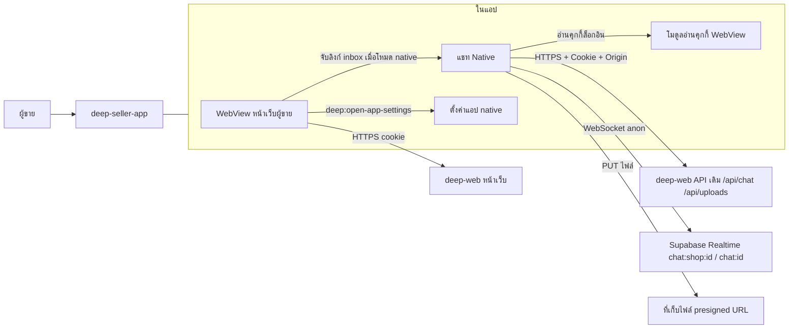
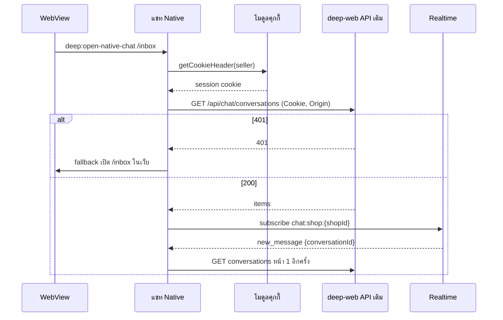
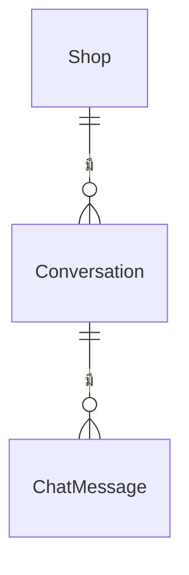

> **โมดูล:** 00088 — Seller Native Chat
> **ประเภทเอกสาร:** Software Requirements Specification (SRS) - TECHNICAL
> **เวอร์ชัน:** 1.0
> **วันที่จัดทำ:** 2026-10-31
> **สถานะ:** Approved — ตาม PRD/BRD ที่ user อนุมัติ 2026-10-31
> **เจ้าของเอกสาร:** SA (ดู [[Feature-Docs-Ownership]])

# SRS: แชท Native ในแอปผู้ขาย (Software Requirements Specification — Technical)

---

## 1. บทนำ (Introduction)

### 1.1 วัตถุประสงค์ของเอกสาร

กำหนดข้อกำหนดทางเทคนิคของแชท Native ใน `deep-seller-app` ที่เรียก **API เดิมของ deep-web** ด้วยคุกกี้ล็อกอินเดิม และสวิตช์โหมดแชทต่อเครื่อง — โดย deep-web เปลี่ยนจุดเดียว (แถว "ตั้งค่าแอป" ในหน้าบัญชี)

### 1.2 ขอบเขตเชิงระบบ (System Scope)

| ระบบ | สิ่งที่เปลี่ยน |
|------|---------------|
| `deep-seller-app` (Expo 57 · RN 0.86 · expo-router) | หน้าจอ native ใหม่ (ตั้งค่าแอป · กล่องข้อความ · ห้อง · แผงต่าง ๆ) · ตัวเรียก API · Realtime · การนำทางตามโหมด · โมดูล native อ่านคุกกี้ |
| `deep-web` | เพิ่มแถว "ตั้งค่าแอป" ในหน้าบัญชี (เห็นเฉพาะในแอปที่ประกาศ `app-settings`) · **ไม่แก้ API/route/service/schema** |
| Supabase Realtime | ใช้ช่อง broadcast เดิม (public) |

### 1.3 เอกสารอ้างอิง (References)

- [[PRD]] · [[BRD]] ของโมดูลนี้ · [[SDS]] · [[API]] · [[DATABASE]] · [[TestCase]]
- ต้นแบบ v3: https://claude.ai/artifact/UJzMumreWxRNgwV7NCMeDb
- โค้ดอ้างอิงเว็บ: `src/app/(paces)/seller/(chat)/**` · `src/app/api/chat/**` · `src/app/api/uploads/**` · `src/lib/chat-shop-realtime.ts` · `src/lib/csrf-origin.ts` · `src/proxy.ts` · `src/lib/native-bridge.ts`
- โค้ดอ้างอิงแอป: `src/features/webview/SellerWebView.tsx` · `src/core/push/*` · `app/_layout.tsx` · `.claude/skills/seller-webview/SKILL.md`

### 1.4 นิยามและตัวย่อ (Definitions & Acronyms)

| คำ | ความหมาย |
|----|----------|
| **โหมด** | `web` (ค่าเริ่มต้น) \| `native` — เก็บใน AsyncStorage คีย์ `deep.chatMode.v1` |
| **คุกกี้ล็อกอิน** | `__Secure-next-auth.session-token` (prod) ของ `seller.deepthailand.app` · อายุ 30 วัน |
| **H1/H2/X2** | capability แชทเดิม: อ่าน / ส่ง-แก้ / จัดการ |
| **delta** | ดึงเฉพาะข้อความที่เปลี่ยน (`afterSeq` + `afterUpdatedAt`) |
| **ทางสำรองเว็บ** | เปิด URL หน้าเว็บของส่วนนั้นใน WebView แล้วกลับมาหน้า native |

---

## 2. ภาพรวมสถาปัตยกรรม (Architecture Overview)

### 2.1 บริบทระบบ (System Context)

### 2.2 องค์ประกอบหลัก (Components)

| องค์ประกอบ | ที่อยู่ (แอป) | หน้าที่ |
|------------|---------------|--------|
| `chatMode` store | `src/features/chat-mode/` | อ่าน/เขียนโหมด · ปิดฉุกเฉิน (OTA flag) |
| `AppSettingsScreen` | `app/settings.tsx` | หน้าตั้งค่าแอป |
| `nativeCookies` module | `modules/deep-cookies/` (Expo module · Swift/Kotlin) | `getCookieHeader(url)` จากที่เก็บคุกกี้ของ WebView |
| `chatApi` client | `src/features/chat/api/` | เรียก API เดิม · แนบ Cookie/Origin · map error |
| `chatRealtime` | `src/features/chat/realtime/` | Supabase client · subscribe ครั้งเดียวต่อ topic |
| `chatStore` | `src/features/chat/store/` | แคชในหน่วยความจำ · watermark `seq/updatedAt` · optimistic send |
| หน้าจอ | `app/chat/index.tsx` · `app/chat/[id].tsx` · `src/features/chat/ui/*` | กล่องข้อความ · ห้อง · แผง · แผ่นล่าง |
| ตัวจับลิงก์ | `src/features/webview/chat-intercept.ts` | สคริปต์ฉีดจับ `/inbox*` (click + history) เมื่อโหมด native |
| แถว "ตั้งค่าแอป" (เว็บ) | `deep-web` `src/app/(paces)/seller/(dashboard)/account/` + `src/lib/native-bridge.ts` | แสดงเมื่อ `__DEEP_NATIVE_FEATURES__` มี `app-settings` · ส่ง `deep:open-app-settings` |

### 2.3 มุมมองการ Deploy (Deployment View)

- แอป: บิลด์ใหม่ 1.0.6 ผ่าน EAS → App Store / Play (มี native module ใหม่ OTA ไม่พอ) · หลังจากนั้นแก้ JS ผ่าน OTA ได้ (นอกช่วงรอรีวิว)
- deep-web: PR เล็ก (แถว "ตั้งค่าแอป") → merge → Vercel · ไม่มี migration
- ลำดับ: deep-web ขึ้นก่อนหรือพร้อมแอปได้ — แถวไม่แสดงจนกว่าแอปประกาศ `app-settings`

---

## 3. ข้อกำหนดเชิงฟังก์ชันเชิงเทคนิค (Technical Functional Requirements)

### TFR-001: แยกขาดจากเว็บ (trace BRD FR-001)
- PR ฝั่ง deep-web แก้ได้เฉพาะ: ไฟล์หน้าบัญชีที่วางแถว · `src/lib/native-bridge.ts` (เพิ่มฟังก์ชัน) · เทสของสองจุดนี้ · เอกสาร 00088
- gate: `git diff --name-only main` ต้องไม่มี `src/app/api/**` · `prisma/**` · `src/services/**` · `src/app/(paces)/seller/(chat)/**` · `src/proxy.ts`
- เทสเดิม `vitest run src/` + `tests/` ผ่านโดยไม่แก้ไฟล์เทสเดิม

### TFR-002: เรียก API เดิมด้วยคุกกี้ (trace BRD FR-002)
- base URL = `Constants.expoConfig.extra.sellerBaseUrl` (prod `https://seller.deepthailand.app`) — **host ต้องขึ้นต้น `seller.`** ไม่งั้น route ตีความเป็นฝั่งผู้ซื้อ
- ทุกคำขอ: `Cookie: <getCookieHeader(base)>` · `Origin: <base>` · `Accept: application/json` · `credentials: 'omit'` (กันคุกกี้ซ้ำจาก cookie jar ของ RN)
- คุกกี้ว่าง หรือได้ 401 → `chatMode.fallbackToWeb('auth')` แล้วเปิด `/inbox` ใน WebView
- ไม่เก็บคุกกี้ลงที่อื่น (AsyncStorage/ไฟล์/log) · ไม่แนบไปโดเมนอื่น

### TFR-003: สวิตช์โหมดและทางเข้า (trace FR-003, FR-004, FR-005)
- AsyncStorage `deep.chatMode.v1` ∈ `web|native` · ไม่มีค่า = `web`
- OTA kill-switch: ค่าคงที่ `NATIVE_CHAT_ENABLED` ใน `src/features/chat-mode/flags.ts` — `false` = บังคับ `web` และซ่อนตัวเลือก Native
- `__DEEP_NATIVE_FEATURES__` เพิ่ม `app-settings` · onMessage รับ `deep:open-app-settings` → `router.push('/settings')`
- โหมด native: ฉีดสคริปต์ `chat-intercept` ก่อนโหลดหน้า — จับ click บน `<a href="/inbox…">` (capture) + ห่อ `history.pushState/replaceState` เมื่อ path ขึ้นต้น `/inbox` → `preventDefault`/คืนค่าเดิม และ `postMessage({type:'deep:open-native-chat', path})` · native ตรวจ path ด้วย regex `^/inbox(/[0-9a-f-]{36})?(/comments)?$` ก่อนเปิด
- แจ้งเตือน (`data.url` `/inbox/{id}`) และ deep link `/inbox*` → ถ้า native ไป `app/chat/[id]` ไม่งั้นทางเดิม (pending-nav)

### TFR-004: กล่องข้อความ (trace FR-006–FR-009)
- `GET /api/chat/conversations?take=20&status=open|resolved&spam=true&channel=…&q=…&usePref=1` · cursor ตามที่ server ส่ง (opaque)
- แท็บย่อย: ทั้งหมด = `status=open` · ปิดงาน = `status=resolved` · สแปม = `spam=true` · ที่ซ่อนไว้ = `hidden=true`
- ตัวเลข: `GET /api/chat/inbox-tab-counts` (unread, unanswered) · `GET /api/chat/spam-unread`
- action: `PATCH /api/chat/conversations/{id}` `{action}` · optimistic แล้ว refetch หน้า 1
- อัปเดต: Realtime `chat:shop:{shopId}` (`new_message`, `shop_reply`) ทุก shopId ที่พบในรายการ → refetch หน้า 1 (debounce 400ms) · ดึงซ้ำทุก 20 วินาทีขณะจอเปิด · refetch เมื่อแอปกลับมาด้านหน้า
- สถานะชิปจาก `orderStage.key` (ไม่ใช้ `cls/icon` ของเว็บตรง ๆ — map เป็นสี/ไอคอนของแอป ตารางใน SDS)

### TFR-005: ห้องแชท (trace FR-010–FR-014)
- เปิดห้อง: `GET messages?take=30&sync=1` (ครั้งแรกของรอบ) แล้ว `POST read`
- เปิดจากแจ้งเตือน (ไม่มี row ในแคช): `GET /api/chat/conversations/{id}/preview` สำหรับชื่อ/รูป/ช่องทาง
- delta: ทุก 12 วินาที + เมื่อได้ `update` จาก `chat:{id}` → `afterSeq=maxSeq&afterUpdatedAt=asOf−5s&take=100` · ได้ครบ 100 = โหลดหน้า 1 ใหม่ · merge ด้วย `id`
- เวลา Meta 24 ชม.: `lastInboundAt` จาก row ถ้ามี ไม่งั้น `max(createdAt)` ของข้อความ `senderRole=BUYER` ที่โหลดอยู่ · ช่องทาง MESSENGER/INSTAGRAM เท่านั้น · สูตรเดียวกับ `src/lib/messaging-window.ts` (24 ชม.)
- แถบโฆษณา: แสดงเมื่อ row มี `referralSource==='ADS'` และมี body/title/adId · ไม่มี row = ไม่แสดง
- ส่ง: TEXT/IMAGE/STICKER(Meta) ตาม [[API]] §4.4 · optimistic `local-*` → แทนด้วย row จาก response · 202 = QUEUED แล้วรอ realtime/delta
- ไม่ส่งซ้ำอัตโนมัติ: เน็ตหลุดก่อนได้ response → ห้ามยิงซ้ำทันที · เมื่อกลับมา ดึง delta ก่อน ถ้ามีข้อความ SHOP body เดียวกันภายใน 2 นาที = ถือว่าส่งแล้ว
- รีแอค: `POST messages/{mid}` `{emoji|null}` · ยกเลิกข้อความที่ส่งไม่สำเร็จ: `DELETE messages/{mid}` แล้วลบออกจากแคชเอง (delta มองไม่เห็นการลบ)
- ข้อความสำเร็จรูป: `GET /api/chat/quick-messages?shopId={thread.shopId}` (X2 — ไม่มีสิทธิ์ = ซ่อนปุ่ม) · จัดหมวดจาก `category`
- อิโมจิ: ชุดเดียวกับเว็บ (`EmojiPicker` หมวด หน้ายิ้ม/ท่าทาง/หัวใจ…) · สติกเกอร์: ชุดเดียวกับเว็บ ส่งแบบ `STICKER` เฉพาะ Meta

### TFR-006: รูป (trace FR-014)
- `expo-image-picker` (เลือกหลายรูป `selectionLimit` 24 · ตามลำดับที่เลือก) + กล้อง
- บีบอัด: `expo-image-manipulator` ขอบยาวสุด 2048px · JPEG 0.85 · เฉพาะไฟล์ ≥300KB (เท่า `image-compress` profile `standard`) · gif ไม่บีบ
- อัปโหลด: `POST /api/uploads/ticket {purpose:'CHAT', name, size, mime, conversationId}` → `PUT url` (headers จาก ticket ไม่แนบคุกกี้) → `POST /api/uploads/commit {ticket,name,mime}` → ใช้ `fileId` ที่ commit คืน
- ส่ง: Messenger/IG และ ≥2 รูป = `IMAGE_GRID imageFileIds` · อื่น ๆ = `IMAGE` ทีละรูป
- แสดงรูป: `https://seller.deepthailand.app/api/files/{fileId}`

### TFR-007: เก็บในเครื่องและความปลอดภัยข้อมูล (trace FR-018, BRD 6.4)
- แคชในหน่วยความจำเท่านั้น (Map ต่อห้อง · TTL 30 นาที เท่าเว็บ `chat-message-store`) · ไม่เขียนลงดิสก์
- ล้างแคชเมื่อ: คุกกี้หาย/เปลี่ยนค่า (ตรวจทุกครั้งที่เปิดแชท) · ได้ 401 · ผู้ใช้สลับบัญชีในเว็บ (คุกกี้เปลี่ยน)

### TFR-008: เน็ตหลุด (trace FR-019)
- `@react-native-community/netinfo` · หลุด = แถบบอก · คิวส่งในหน่วยความจำ ส่งตามลำดับเมื่อกลับมา (ผ่านกฎไม่ส่งซ้ำ TFR-005)

### TFR-009: ทางสำรองเว็บ (trace FR-020)
- `openWebFallback(path)` → `router.push('/')` + `requestNavigate(path)` (กลไก pending-nav เดิม) · กลับมาด้วย back → ห้อง native เดิม · เมื่อกลับมา refetch ห้อง

### TFR-010: iOS App Store 3.1.1
- แชท Native ไม่มีปุ่ม/ข้อความเรื่องจ่ายเงินนอกแอปในเฟส 1–2 · เฟส 3 ใช้กติกาเดียวกับเว็บ (`hidePayments` = true เสมอในแอป iOS)

---

## 4. ข้อกำหนดส่วนต่อประสาน (Interface / API Specification)

### 4.1 API Endpoints

ทั้งหมดเป็น **route เดิม** — รายละเอียดเต็มใน [[API]]

| Method | Path | Cap | ใช้ทำ | เฟส |
|--------|------|-----|------|-----|
| GET | `/api/chat/conversations` | H1 | รายการ | 1 |
| PATCH | `/api/chat/conversations/{id}` | H2 | ปักหมุด/ปิดงาน/ซ่อน/สแปม/กลุ่ม | 1 (กลุ่ม 2) |
| GET | `/api/chat/conversations/{id}/messages` | H1 | ข้อความ + delta | 1 |
| POST | `/api/chat/conversations/{id}/messages` | H2 | ส่ง | 1 |
| POST/DELETE | `/api/chat/conversations/{id}/messages/{mid}` | H2 | รีแอค / ยกเลิกที่ส่งไม่สำเร็จ | 1 |
| POST | `/api/chat/conversations/{id}/read` | H1 | อ่านแล้ว | 1 |
| GET | `/api/chat/conversations/{id}/preview` | H1 | หัวห้องจากแจ้งเตือน | 1 |
| GET | `/api/chat/inbox-tab-counts` · `/api/chat/spam-unread` | H1 | ตัวเลข | 1 |
| GET | `/api/chat/quick-messages` | X2 | ข้อความสำเร็จรูป | 1 |
| POST | `/api/uploads/ticket` · `/api/uploads/commit` | H2 | อัปโหลดรูป | 1 |
| GET/PATCH | `/api/chat/preferences` | X2 | ตัวกรองที่บันทึก | 2 |
| GET | `/api/chat/groups` · `/api/chat/tags` · `/api/chat/shop-context` | X2/H1 | กลุ่ม แท็ก บริการ | 2 |
| GET/PATCH | `/api/chat/conversations/{id}/crm` · `orders` · `library` · `follow-ups` · `memory` | H1/H2/X2 | ข้อมูลลูกค้า | 2 |
| POST | `/api/chat/conversations/{id}/ai-suggest` | H2 | AI ช่วยร่าง | 2 |
| * | `/api/chat/comments/**` | H1/H2 | ความคิดเห็น | 3 |

### 4.2 รายละเอียดต่อ Endpoint

ดู [[API]] §4 (request/response/error ของทุก endpoint ที่ใช้)

### 4.3 Events / Messaging (ถ้ามี)

| ช่อง | event | payload | ใช้ทำ |
|------|-------|---------|------|
| `chat:shop:{shopId}` | `new_message` · `shop_reply` | `{conversationId}` | refetch รายการ |
| `chat:{conversationId}` | `update` | `{conversationId, messageId}` | ดึง delta ห้อง |
| WebView → native | `deep:open-app-settings` | — | เปิดตั้งค่าแอป |
| WebView → native | `deep:open-native-chat` | `{path}` | เปิดแชท native |

ช่อง Realtime เป็น public (anon key) — payload เป็นสัญญาณเท่านั้น · ห้ามใช้ payload เป็นเนื้อหา

### 4.4 Sequence ของ flow สำคัญ

---

## 5. ข้อกำหนดด้านข้อมูล (Data Requirements)

### 5.1 Data Model / Entities

ไม่มีการเปลี่ยน — ดู [[DATABASE]] · แอปใช้รูปแบบข้อมูลตาม response ของ API เดิม (type ใน [[API]])

### 5.2 ความสัมพันธ์ (ERD)

### 5.3 Migration / Data Lifecycle

ไม่มี migration · ค่าโหมดอยู่ AsyncStorage · แคชอยู่หน่วยความจำ (TFR-007)

---

## 6. ข้อกำหนดที่ไม่ใช่ฟังก์ชัน (Non-Functional Requirements)

| หมวด | ข้อกำหนด |
|------|---------|
| ความเร็ว | เปิดห้องที่มีแคช ≤ 300ms ถึงเฟรมแรก · ห้องใหม่ ≤ 1.5s (4G) · รายการ 60fps ด้วย `FlatList` (`getItemLayout` ไม่ได้ เพราะความสูงไม่คงที่ — ใช้ `windowSize` 7 · `removeClippedSubviews`) |
| ปริมาณคำขอ | ไม่เกินเว็บ: รายการ 20s · ห้อง 12s · หยุดดึงเมื่อแอปอยู่เบื้องหลัง · mutation ภายใต้ proxy 30/นาที/IP |
| ความน่าเชื่อถือ | 401 → เว็บ · error เครือข่าย → แถบบอก + ลองใหม่แบบ backoff (1,2,4,8s สูงสุด 30s) |
| ความปลอดภัย | คุกกี้อยู่ที่เก็บของระบบเท่านั้น · Origin คงที่ · regex ตรวจ path จาก WebView · ไม่ log body ข้อความ |
| Accessibility | เป้ากด ≥ 44pt · รองรับ Dynamic Type · `accessibilityLabel` ทุกไอคอน (คำเดียวกับ aria-label เว็บ) · reduce motion |
| ธีม | สี/ฟอนต์ตาม Paces (`#236dc9` · Anuphan) · โหมดสว่างเท่าเว็บ |

---

## 7. ข้อจำกัดทางเทคนิคและการพึ่งพา (Technical Constraints & Dependencies)

### 7.1 ข้อจำกัดทางเทคนิค
- RN 0.86 = New Architecture เท่านั้น → โมดูลคุกกี้เขียนเป็น Expo Module (ไม่ใช้ `@react-native-cookies/cookies` ที่ไม่รองรับ)
- iOS: WKWebView เก็บคุกกี้ใน `WKHTTPCookieStore` ไม่ sync กับ `NSHTTPCookieStorage` → ต้องอ่านผ่านโมดูล
- Android: RN networking ใช้ `CookieManager` ของ WebView ร่วม แต่ยังอ่านผ่านโมดูลเพื่อให้ทางเดียวกันทั้งสองระบบ
- หน้าเว็บนำทางแบบ client-side → `onShouldStartLoadWithRequest` ไม่ยิง → ต้องใช้สคริปต์ฉีด (TFR-003)
- ไม่มี API ห้องเดียว / scope ร้าน / สถานะช่องทาง (tokenInvalid, lineQuota) → แสดงเท่าที่มีข้อมูล · ส่วนที่ขาดดูได้จาก "เปิดห้องนี้ในหน้าเว็บ"

### 7.2 การพึ่งพาภายนอก/ภายใน

| แพ็กเกจใหม่ (แอป) | ใช้ทำ |
|-------------------|------|
| `@react-native-async-storage/async-storage` | ค่าโหมด |
| `@supabase/supabase-js` | Realtime |
| `expo-image-picker` · `expo-image-manipulator` | รูป |
| `expo-haptics` · `expo-clipboard` | สั่น · คัดลอก |
| `@react-native-community/netinfo` | เน็ตหลุด |
| `modules/deep-cookies` (local Expo module) | อ่านคุกกี้ |

### 7.3 สมมติฐานทางเทคนิค (Assumptions)
- `NEXT_PUBLIC_SUPABASE_URL` / `NEXT_PUBLIC_SUPABASE_ANON_KEY` ใส่ใน `app.config.ts` `extra` (เป็นค่าสาธารณะอยู่แล้วในหน้าเว็บ)
- route เดิมไม่เปลี่ยนรูปแบบ response ระหว่างพัฒนา — ถ้าเปลี่ยน ให้แอปปรับตาม (เทสสัญญาใน [[TestCase]])

---

## 8. ความเสี่ยงเชิงสถาปัตยกรรม (Architectural Risks)

| ความเสี่ยง | ผลกระทบ | แนวทาง |
|-----------|---------|--------|
| route เดิมเปลี่ยน response | แอปแสดงผิด | parse แบบทน (field ไม่มี = ค่าเริ่ม) · เทสสัญญากับ fixture จริง |
| คุกกี้ iOS เปลี่ยนชื่อ/แบ่งชิ้น (`.0/.1`) | 401 | โมดูลคืนคุกกี้ทุกตัวของโดเมนเป็น header เดียว |
| สคริปต์จับลิงก์ชนกับ Next router | เปิดซ้อน/ค้าง | จับเฉพาะ `/inbox*` · เทสบนเครื่องจริง · ปิดได้ด้วย flag |
| ไม่มี idempotency key | ส่งซ้ำตอนเน็ตแกว่ง | กฎ TFR-005 (ตรวจ delta ก่อนส่งซ้ำ) |
| ช่อง Realtime public | ใครรู้ id ฟังสัญญาณได้ | เหมือนเว็บวันนี้ · payload ไม่มีเนื้อหา · ไม่เพิ่มความเสี่ยงใหม่ |
| **พบระหว่างทำ:** `replyToken` ของ LINE หลุดใน response รายการ | ความปลอดภัยของเว็บเดิม | นอกขอบเขต (ห้ามแตะ API) · รายงานหัวหน้าแยก · แอปไม่ใช้/ไม่เก็บค่านี้ |

---

## 9. Traceability Matrix

| BRD | TFR | SDS | API | Test |
|-----|-----|-----|-----|------|
| FR-001 | TFR-001 | §2 TD-001 | — | TC-001–003 |
| FR-002 | TFR-002 | §3 chatApi · TD-002 | §2 | TC-004–006 |
| FR-003–005 | TFR-003 | §3 chatMode · §4.1 | — | TC-007–012 |
| FR-006–009 | TFR-004 | §3 Inbox | §4.1–4.3 · 4.8 | TC-013–020 |
| FR-010–014 | TFR-005 · 006 | §3 Thread · §4.2 | §4.4–4.7 · 4.9–4.10 | TC-021–034 |
| FR-015–016 | TFR-004/005 (เฟส 2–3) | §3 Customer · Comments | §4.11 | TC-040+ |
| FR-017–019 | TFR-003 · 007 · 008 | §4.3 | — | TC-035–039 |
| FR-020 | TFR-009 | §4.4 | — | TC-012 |

---

## 10. สรุป (Summary)

แชท Native เป็นส่วนของแอปทั้งหมด ใช้ API เดิมของ deep-web ด้วยคุกกี้ล็อกอินเดิม (Origin โดเมนผู้ขาย · host `seller.`) · deep-web เปลี่ยนจุดเดียว (แถว "ตั้งค่าแอป") · ไม่มี migration · ปิดได้ด้วย OTA · ข้อมูลที่ API เดิมไม่มีให้ (ห้องเดียว · สถานะช่องทาง) แสดงเท่าที่มีและส่งต่อหน้าเว็บ
