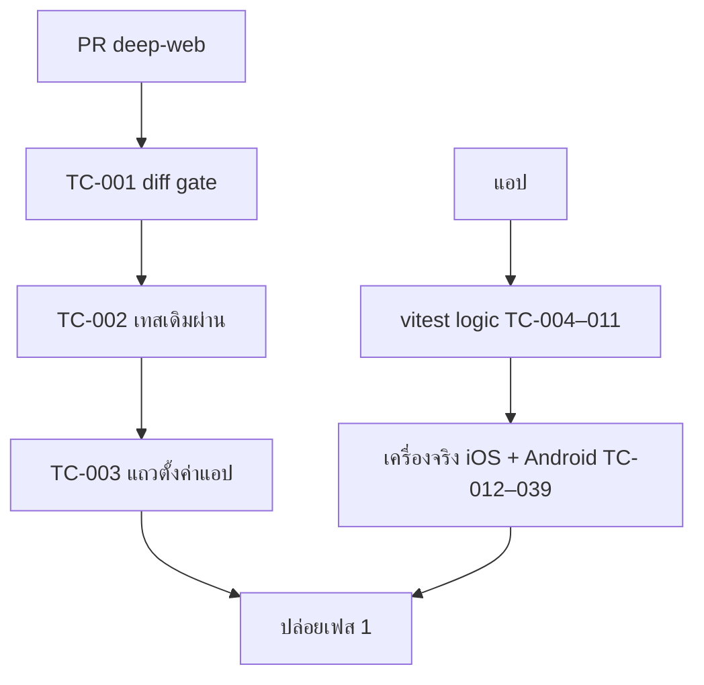

> **โมดูล:** 00088 — Seller Native Chat
> **ประเภทเอกสาร:** Test Case
> **เวอร์ชัน:** 1.0
> **วันที่จัดทำ:** 2026-10-31
> **สถานะ:** Approved — แผนทดสอบ (ผลจะเติมใน §5 ทุกเฟส)
> **เจ้าของเอกสาร:** QA (ดู [[Feature-Docs-Ownership]])

# Test Case: แชท Native ในแอปผู้ขาย

---

## 1. Overview

| ชั้น | เครื่องมือ | ที่ไหน |
|------|-----------|-------|
| deep-web (แถว "ตั้งค่าแอป" + gate ไม่กระทบ) | vitest (`src/`) + เทสทั้งชุด | deep-web |
| แอป logic (โหมด · router · intercept script · api client · store · uploader · parse) | vitest (node) | deep-seller-app `src/**/__tests__` |
| แอป UI | เทียบภาพกับต้นแบบ v3 / เว็บจริง | simulator + เครื่องจริง |
| End-to-end | เครื่องจริง iPhone + Android กับ prod/staging | ด้วยมือ ตามรายการนี้ |

ข้อมูลทดสอบ: ร้านทดสอบบนฐาน local (`deepth.local`) และร้าน `appreview` **ห้ามแตะ** (กติกา App Review)

---

## 2. Test Scenarios

### TC-001: deep-web ไม่มีไฟล์ต้องห้ามใน diff
- **ขั้นตอน:** `git diff --name-only origin/main...HEAD`
- **คาดหวัง:** ไม่มี `src/app/api/**` · `prisma/**` · `src/services/**` · `src/app/(paces)/seller/(chat)/**` · `src/proxy.ts`
- **trace:** FR-001

### TC-002: เทสเดิมของ deep-web ผ่านทั้งชุดโดยไม่แก้เทสเดิม
- **ขั้นตอน:** `vitest run src/` (จำลอง CI ไม่มี secret) + `tests/` บนฐาน local
- **คาดหวัง:** ผ่านทั้งหมด · `git diff` ไม่มีไฟล์เทสเดิมถูกแก้ · **trace:** FR-001

### TC-003: แถว "ตั้งค่าแอป" เห็นเฉพาะในแอปที่รองรับ
- **ขั้นตอน:** render หน้าบัญชี 3 แบบ: เบราว์เซอร์ · แอป 1.0.5 (`__DEEP_NATIVE_FEATURES__` ไม่มี `app-settings`) · แอป 1.0.6
- **คาดหวัง:** มีแถวเฉพาะแบบที่ 3 · กดแล้ว `postMessage({type:'deep:open-app-settings'})` · **[blocker]** · **trace:** FR-001, FR-003

### TC-004: แนบคุกกี้ + Origin ทุกคำขอ
- **ขั้นตอน:** unit test `chatApi.request` กับ fetch mock
- **คาดหวัง:** header `Cookie` = ค่าจากโมดูล · `Origin: https://seller.deepthailand.app` · `credentials:'omit'` · URL host ขึ้นต้น `seller.` · **trace:** FR-002

### TC-005: 401 → ถอยไปเว็บ
- **คาดหวัง:** ล้างแคช · เรียก fallback ครั้งเดียว · เปิด `/inbox` ใน WebView · **trace:** FR-002, FR-004

### TC-006: คุกกี้ว่าง → ไม่ยิงคำขอ ถอยไปเว็บทันที · **trace:** FR-002

### TC-007: ค่าเริ่มต้นโหมด = web (ติดตั้งใหม่ / อัปเดตจาก 1.0.5) · **[blocker]** · **trace:** FR-004
### TC-008: เปลี่ยนโหมดมีผลทันที ไม่ต้องปิดแอป · ออกจากระบบไม่ล้างค่าโหมด · **trace:** FR-004
### TC-009: flag `NATIVE_CHAT_ENABLED=false` → บังคับ web + ซ่อนตัวเลือก Native · **trace:** FR-002, FR-004
### TC-010: `routeChatPath` — web → WebView · native + `/inbox` → inbox · `/inbox/{uuid}` → ห้อง · path แปลก (`/inbox/../x`, `/inboxx`) → WebView · **[blocker]** · **trace:** FR-005
### TC-011: สคริปต์ intercept — จับ click `a[href^="/inbox"]` และ `history.pushState('/inbox/…')` · ไม่จับ `/orders` · ไม่ฉีดในโหมด web · **trace:** FR-005
### TC-012: ทางสำรองเว็บ — ปุ่มที่ยังไม่ native เปิดหน้าเว็บ แล้วกลับมาห้องเดิม · **trace:** FR-020

### TC-013: รายการ — หน้า 1 · เลื่อนลงโหลดหน้าถัดไปด้วย cursor เดิม · ปักหมุดอยู่บน · **trace:** FR-007
### TC-014: แท็บย่อย ทั้งหมด/ปิดงาน/สแปม → query `status=open` / `status=resolved` / `spam=true` · **trace:** FR-006
### TC-015: ช่องทาง 5 ปุ่ม → `channel=` ถูกค่า · ค้นหา → `q=` · ไม่พบ = หน้า "ไม่พบบทสนทนาตามที่กรอง" · **trace:** FR-006, FR-007
### TC-016: แท็บข้อความ/ความคิดเห็นกว้างเท่ากันเต็มแถว · ตัวเลขจาก `inbox-tab-counts` · **trace:** FR-006
### TC-017: ปัดซ้าย ปักหมุด/ปิดงาน/ซ่อน → PATCH action ถูก · คำกลับด้านเมื่อสถานะกลับ · **trace:** FR-008
### TC-018: กดค้าง → แผ่นคำสั่ง 4 ปุ่ม · สแปม → PATCH `spam` และห้องหายจากแท็บทั้งหมด · **trace:** FR-008
### TC-019: ทำในแอป → เปิดเว็บเห็นผลเดียวกัน (ปักหมุด/ปิดงาน/อ่านแล้ว) · **trace:** FR-008, BRD 6.1
### TC-020: ข้อความใหม่จากลูกค้า → แถวขึ้นบนภายใน 3 วินาที (Realtime) · ตัด Realtime → ภายใน 20 วินาที · **trace:** FR-009

### TC-021: เปิดห้อง → `GET messages?sync=1` + `POST read` · เปิดซ้ำในรอบเดียวกัน → แสดงจากแคชทันที แล้ว delta · **trace:** FR-011, FR-018
### TC-022: เปิดห้องจากแจ้งเตือน (แอปปิด/เบื้องหลัง/เปิด) → ห้องถูกห้อง · หัวจาก `/preview` · **trace:** FR-017
### TC-023: ชิปเกินเวลา Meta — ข้อความลูกค้าล่าสุด >24 ชม. (Messenger/IG) แสดง · LINE/Deep ไม่แสดง · **trace:** FR-010
### TC-024: แถบโฆษณาเมื่อ `referralSource=ADS` · ปิดได้ · **trace:** FR-010
### TC-025: แสดงข้อความ: ข้อความ · รูป/อัลบั้ม · สติกเกอร์ · ระบบ · ตอบกลับ · รีแอค · ชนิดที่ยังไม่รองรับ = กล่อง "ดูข้อความนี้ในหน้าเว็บ" · **trace:** FR-011
### TC-026: ส่ง TEXT ช่อง DEEP → 200 แทน optimistic · ช่อง Messenger → 202 QUEUED → SENT ผ่าน realtime/delta · **trace:** FR-012
### TC-027: ส่งไม่สำเร็จ (409 WINDOW_CLOSED) → กล่องแดง + เหตุผลจาก server · "ส่งใหม่" เฉพาะเหตุที่ลองใหม่ได้ · **trace:** FR-012
### TC-028: **ไม่ส่งซ้ำ** — ตัดเน็ตหลังกดส่งก่อนได้ response → กลับมา → ไม่มีข้อความซ้ำในห้อง (ตรวจในเว็บ) · **[blocker]** · **trace:** FR-012, FR-019
### TC-029: กดค้างข้อความ → รีแอค 6 แบบ → POST emoji · กดซ้ำ = เอาออก · **trace:** FR-013
### TC-030: ยกเลิกข้อความที่ส่งไม่สำเร็จ → DELETE → หายจากห้องทันที · ข้อความที่ส่งแล้วไม่มีปุ่มนี้ · **trace:** FR-013
### TC-031: ตอบกลับ → แถบ "ตอบกลับ: …" → ส่งพร้อม `replyToMessageId` · **trace:** FR-013
### TC-032: ข้อความสำเร็จรูป — หมวดจาก `category` · แตะใส่ช่องพิมพ์ · บทบาทตอบแชทที่ไม่มี X2 → ซ่อนปุ่ม (เหมือนเว็บ) · **trace:** FR-014
### TC-033: แนบรูป 3 รูป Messenger → บีบ (ขอบ ≤2048) → ticket/PUT/commit → `IMAGE_GRID` · ช่อง DEEP → `IMAGE` 3 ครั้ง · ใช้ fileId จาก commit · **trace:** FR-014
### TC-034: อิโมจิใส่ช่องพิมพ์ · สติกเกอร์ส่งทันที (Meta) · ช่องที่ไม่รองรับสติกเกอร์ไม่มีแท็บสติกเกอร์ · **trace:** FR-014
### TC-035: เน็ตหลุด → แถบบอกทั้งรายการและห้อง · ข้อความรอส่งแล้วส่งครั้งเดียวเมื่อกลับมา · **trace:** FR-019
### TC-036: ออกจากระบบในเว็บ → เปิดแชท Native = 401 → ไปหน้าล็อกอินเว็บ · ไม่มีข้อมูลเก่าค้าง · **trace:** FR-018, BRD 6.4
### TC-037: สลับบัญชีในเว็บ → แชท Native แสดงของบัญชีใหม่ ไม่ปนของเก่า · **trace:** FR-018
### TC-038: บทบาทฝ่ายช่าง/บัญชี → หน้าไม่มีสิทธิ์คำเดียวกับเว็บ · **trace:** BRD 1.3
### TC-039: iOS — ไม่มีปุ่ม/ข้อความเรื่องจ่ายเงินนอกแอปในแชท Native · **trace:** TFR-010

#### เฟส 2 (2026-10-31)

### TC-040: การ์ดคำสั่งซื้อ/งานบริการ/สินค้าในห้อง — คำตามประเภทร้าน (คำสั่งซื้อ · งานบริการ · บิลเข้าพัก) · ชิปสถานะ/การมา/วันนัด/มัดจำ ตรงเว็บ · ยอดเงินจากสตริง "0.00" ถูกต้อง · แตะ = หน้ารายละเอียด · **[blocker]** (`cards.test.ts`) · **trace:** FR-011
### TC-041: ไฟล์แนบ วิดีโอ/เสียง/เอกสาร — แสดงชื่อ/ขนาด · แตะเปิดได้ (ล็อกอินชุดเดียวกับ WebView) · ส่งได้ตามกติกาช่องทาง (LINE ไม่รับเอกสาร ฯลฯ ข้อความเดียวกับเว็บ) · **trace:** FR-011, FR-014
### TC-042: เลือกสินค้า/บริการ 4 แบบ (รูป · รายละเอียด · คงเหลือ · การ์ด) + เลือกหลายรายการ · คำนับ/ปุ่มจากฟังก์ชันเว็บ · **trace:** FR-014
### TC-043: **[blocker]** การ์ดหลายข้อความส่งได้บางส่วน (207) → ใบที่ออกแล้วไม่ส่งซ้ำ · "ส่งใหม่" ส่งเฉพาะที่เหลือ (`outbox.test.ts`) · **trace:** FR-012
### TC-044: **[blocker]** กันส่งซ้ำ — กดส่งสองทีเร็ว ๆ · เซิร์ฟเวอร์/เกตเวย์ล้ม (5xx) = "ไม่รู้ผล" ถามก่อนส่งซ้ำ · ข้อความถัดไปไม่ค้าง (`outbox.test.ts`) · **trace:** FR-012
### TC-045: AI ช่วยร่าง — โควตา "เหลือฟรีวันนี้ n/10" · หมดฟรี = ใช้เครดิต ฿1 (ถามก่อน) · ขอครั้งเดียวต่อการเปิดแผง · 🛑 iOS ไม่มีคำ/ลิงก์ "เติมเงิน/อัพเกรด" · **trace:** FR-014
### TC-046: ชิปงาน/ออเดอร์บนหัวห้อง — ใบที่ยังไม่จบงาน · หลายใบ "+N" · กาง = การ์ด + จัดการในหน้าเว็บ (`cards.test.ts`) · **trace:** FR-010
### TC-047: ตัวกรอง — เรียง · แท็ก (หลายอัน) · การอ่าน · ลูกค้า · ที่ซ่อนไว้ · ล้างตัวกรอง (คงแท็บ) · ดาว = บันทึกเป็นค่าเริ่ม · เปิดครั้งหน้าได้ชุดเดิม (`chat-logic.test.ts`) · **trace:** FR-006
### TC-048: **[blocker]** แท็บ "ทั้งหมด" = รวมห้องที่ปิดงาน (status=all) · ไม่ส่ง usePref (`chat-logic.test.ts`) · **trace:** FR-006
### TC-049: กลุ่ม — เลือก · สร้าง (≤40 ตัวอักษร) · ลบ (ถามก่อน · แชทกลับไป "ทั้งหมด") · โหมดร้านทั้งหมด = "เลือกช่องทางเพื่อดูกลุ่ม" · **trace:** FR-006
### TC-050: กดค้างแถว — ปักหมุด/ปิดงาน/ซ่อน (ถามก่อน)/สแปม + (ช่องทางภายนอก) สถานะการขาย · แท็ก · กลุ่ม · เสียงของแชทนี้ · เว็บเห็นผลทันที · **trace:** FR-008
### TC-051: ปุ่มเสียงบนหัว — ปิด/เปิดเสียงแจ้งเตือนแชท ค่าเดียวกับเว็บ (localStorage) + แจ้ง server ผ่าน push token · ไม่เด้งขอสิทธิ์ · **trace:** FR-006
### TC-052: มุมมอง ร้านทั้งหมด/ร้านนี้ (เฉพาะผู้มีธุรกิจ) · สลับบัญชีเปิดหน้าเว็บ · สลับบัญชีแล้วค่าเริ่ม/คิวส่งของบัญชีเดิมถูกล้าง (`outbox.test.ts`) · **trace:** FR-006
### TC-053: แผงข้อมูลลูกค้า 5 แท็บ — แท็บ 2 ชื่อตามประเภทร้าน · ความจำ (แก้ · ชนกัน 409 · อัปเดตตอนนี้) · สินค้าที่สนใจ (เพิ่ม/เอาออก ≤10) · ข้อมูลลูกค้า (ห้อง Deep แก้ได้แค่ชื่อในแชท) (`customer.test.ts`) · **trace:** FR-015
### TC-054: ติดตาม — เพิ่ม (วันตามปฏิทินไทย · เวลา/ทั้งวัน) · ทำแล้ว (ผล 4 แบบ) · เลื่อน 3 แบบ · ลบ (ถามก่อน) · เปิดกลับ (`customer.test.ts`) · **trace:** FR-015
### TC-055: ไฟล์ — คลังไฟล์ลูกค้า · กดค้างรูป/วิดีโอ/ไฟล์ในห้อง "เก็บเข้าคลัง" · "เอาออกจากคลัง" · โน้ต (ภายนอกเท่านั้น · ข้อความใต้โน้ตตาม AI) · **trace:** FR-013, FR-015
### TC-056: **[blocker]** แก้แชทเว็บแล้ว CI แดงจนกว่าจะแก้แชท Native (HR18 · `src/lib/__tests__/native-chat-sync.test.ts`) · แอปเทียบสำเนา/bundle กับเว็บ (`web-sync.test.ts`) · **trace:** ข้อกำหนด user 2026-10-31
#### เฟส 3 (2026-10-31)

### TC-057: **[blocker]** ความคิดเห็น — แท็บ "ความคิดเห็น" เปิดหน้า native · ลิงก์ `/inbox/comments` จากแจ้งเตือน/หน้าเว็บ ไปหน้า native เมื่อโหมด = native · โหมดเว็บไม่เปลี่ยน (`chat-mode` tests) · **trace:** FR-016
### TC-058: รายการความคิดเห็น — แท็บ ทั้งหมด/ยังไม่ตอบ/หมดอายุ (ตัวเลข 99+) · ช่องทาง · เพจ · ค้นหา · ชิปแถว (ยังไม่ตอบ · ทักแชทภายใน n · หมดเวลาทักแชท · บอทตอบแล้ว · จัดการแล้ว) · เลื่อนโหลดต่อ (skip = ผลรวม rawCount) · ว่าง 3 แบบ (`comments.test.ts`) · **trace:** FR-016
### TC-059: **[blocker]** ทักแชทส่วนตัว — ส่งได้ครั้งเดียว · ≤1,000 ตัว · พ้น 7 วัน (เทียบแบบ <) = ปุ่มหาย · 409 ALREADY_SENT / WINDOW_EXPIRED / CHANNEL_NOT_ACTIVE / ALREADY_REPLIED_EXTERNALLY ข้อความตามเว็บ · กดซ้ำไม่ส่งซ้ำ · สำเร็จ = เปิดห้องแชทได้ (`comments.test.ts`) · **trace:** FR-016
### TC-060: ตอบใต้คอมเมนต์ / คอมเมนต์ในนามเพจ (ข้อความ ≤8,000 หรือรูป) · ทำเครื่องหมายว่าจัดการแล้ว/เลิก · ทำเครื่องหมายที่หมดอายุทั้งหมด (ถามก่อน) · **trace:** FR-016
### TC-061: **[blocker]** เงินบนการ์ดงาน — คำนวณด้วยโค้ดเว็บ (bundle) · รายการที่ยกเลิกแล้วไม่นับ · ร้านขายของ/บ้านพักไม่มีปุ่มเงิน (`order-actions.test.ts`) · **trace:** BRD 2.3 (เฟส 3)
### TC-062: **[blocker]** ปุ่มบนการ์ดงาน — ลำดับ เริ่มงานเลย/แจ้งมัดจำ/รับเงินแล้ว/ปิดงาน · แก้ไขรายการ เฉพาะ PENDING · ส่งสรุปนัดไม่ซ้อนกับแจ้งมัดจำ · ยกเลิกแล้วไม่มีปุ่ม (`order-actions.test.ts`) · **trace:** BRD 2.3
### TC-063: รับเงิน — ค่าเริ่มตาม suggestedPayment · ยอด ≤0/เกินเพดาน = กดไม่ได้ · เกินยอดค้าง = เตือนแต่บันทึกได้ · ประวัติ · ยกเลิกรายการ (เลือกเหตุผล 5 แบบ · เฉพาะเจ้าของ/ผู้จัดการ) · กดค้างรูปสลิป "บันทึกรับเงิน" (มีใบค้างใบเดียวเท่านั้น) · **trace:** BRD 2.4
### TC-064: เริ่มงานเลย — ประเภทงาน (1 ประเภท = เลือกให้) · 30/60/90/120 นาที · เวลาเริ่ม = ตอนกด · คิวเต็ม/ประเภทงานถูกปิด ข้อความตามเว็บ · **trace:** BRD 2.3
### TC-065: ปิดงาน — ให้บริการแล้ว/ไม่มาตามนัด (เฉพาะมีนัดและยังไม่เริ่ม) · รับเงินที่เหลือ · ยอด ฿0 เตือน · ไม่มีสิทธิ์รับเงิน = ปิดได้แต่ไม่พูดเรื่องเงิน · เก็บ/คืนมัดจำ (คืน = เจ้าของ/ผู้จัดการ) · **trace:** BRD 2.3
### TC-066: ส่งสรุปนัด / ส่งเข้าแชท / ยกเลิกใบ — ตัวอย่างตรงกับที่ลูกค้าได้ · "วันและเวลา" ซ่อนไม่ได้ · จำบรรทัดที่ซ่อนต่อร้าน · ห้องปลายทาง · ส่งเข้าแชทถามก่อน · ยกเลิกต้องเลือกเหตุผลตามประเภทร้าน (`order-actions.test.ts`) · **trace:** BRD 2.3
### TC-067: **[blocker]** สร้าง/แก้งาน-ออเดอร์ — shopId = ร้านของห้อง · ช่องทางขายล็อกตามห้อง · เบอร์มือถือ · ที่อยู่เมื่อต้องจัดส่ง · ร้านบริการ หน้าร้าน (ส่งแค่ประเภทงาน) / จองล่วงหน้า (ส่ง depositAmount "0.00" เสมอ) · ผู้รับผิดชอบ · คำปุ่ม/แจ้งผลตามประเภทร้าน (เปิดบิลเข้าพัก) (`order-form.test.ts`) · **trace:** BRD 2.5
### TC-068: ตารางว่างประเภทงาน — เฉพาะร้านบริการที่มีประเภทงาน · จุด/เต็ม (รายวัน)/วันนี้ · เลือกเวลา (รายเวลา) · ยืนยัน = เปิดฟอร์มจองล่วงหน้าพร้อมวัน · โหลดนัดไม่ได้ยังเลือกวันได้ (`availability.test.ts`) · **trace:** BRD 2.5
### TC-069: ติดตาม — แก้ไข (ทำแล้ว = แก้ได้แค่หัวข้อ/โน้ต) · ผู้รับผิดชอบ (ร้านธุรกิจ) · เลื่อน "เลือกเอง" (ห้ามย้อนอดีต) · ข้อความ error ตามเว็บ (`order-actions.test.ts` · bundle follow-up-view) · **trace:** FR-015
### TC-070: **[blocker]** HR18 ครอบเฟส 3 — แก้ route คำสั่งซื้อ/นัด/ความคิดเห็น · ฟอร์มสร้างออเดอร์ · ไฟล์ที่ bundle ดึง แล้ว CI แดง (`native-chat-sync.test.ts`) · **trace:** ข้อกำหนด user 2026-10-31

---

## 3. Traceability Matrix

| BRD | TC |
|-----|----|
| FR-001 | 001 · 002 · 003 |
| FR-002 | 004 · 005 · 006 · 009 |
| FR-003 | 003 |
| FR-004 | 005 · 007 · 008 · 009 |
| FR-005 | 010 · 011 |
| FR-006–009 | 013–020 |
| FR-010–014 | 021–034 |
| FR-017–019 | 022 · 035 · 036 · 037 |
| FR-020 | 012 |

---

## 4. Flow (ถ้ามี)

---

## 5. ผลล่าสุด

| เฟส | วันที่ | ผล |
|-----|-------|----|
| เอกสาร | 2026-10-31 | แผนทดสอบพร้อม · ยังไม่มีผลรัน |

---

## 6. สรุป (Summary)

ทดสอบ 3 ชั้น: gate "ไม่กระทบเว็บ" (TC-001–003) · logic ของแอปด้วย vitest · ใช้งานจริงบนเครื่อง · ข้อ [blocker] ต้องผ่านก่อนปล่อยทุกเฟส: TC-003 · 007 · 010 · 028
