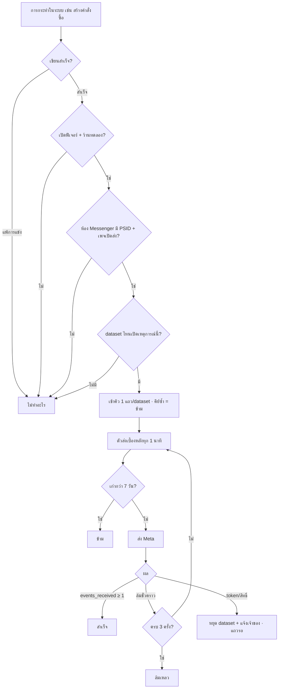
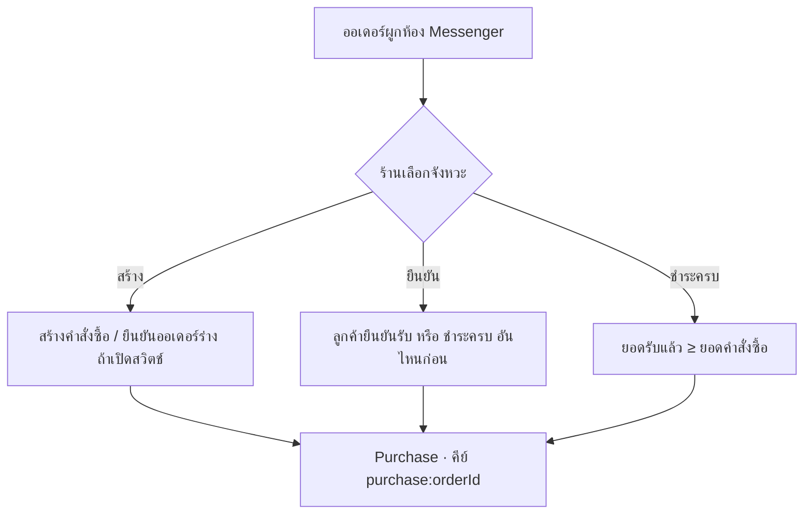

> **โมดูล:** 00089 - Meta Conversion API
> **ประเภทเอกสาร:** Business Requirements Document (BRD) - NON-TECHNICAL
> **เวอร์ชัน:** 0.1
> **วันที่จัดทำ:** 2026-11-11
> **สถานะ:** Approved 2026-11-11 (user "ลุยเลย" — รับข้อเสนอ Q1–Q5 ทั้งหมด)
> **เจ้าของเอกสาร:** BA (ดู [[Feature-Docs-Ownership]])

# BRD: ส่งยอดขายและเหตุการณ์จากแชท Messenger กลับไปให้ Meta

---

## 1. บทนำ

### 1.1 วัตถุประสงค์ของเอกสาร

1. กำหนดว่าเหตุการณ์ใดในระบบ Deep ส่งไป Meta เมื่อไร ด้วยยอดเท่าไร
2. กำหนดการตั้งค่าที่ร้านคุมเองได้ และขอบเขตร้านทดลอง
3. กำหนดกฎกันส่งซ้ำ การลองใหม่ และการหยุดส่ง
4. เป็นเกณฑ์รับงาน (Acceptance) ที่เทสต้องบังคับได้

### 1.2 ขอบเขตของระบบ

**ระบบส่งเหตุการณ์ไป Meta (CAPI)** คือส่วนที่รับเหตุการณ์ทางธุรกิจจากห้องแชท Messenger ของร้าน แล้วรายงานไปยัง dataset ที่ร้านเลือก

**Input:** เหตุการณ์คำสั่งซื้อ/การชำระ/จัดส่ง/คืนสินค้า/การ์ดในแชท/การติดแท็ก · การตั้งค่าของร้าน
**Output:** เหตุการณ์ใน Events Manager ของร้าน · บันทึกการส่งให้ร้านดู · การแจ้งเตือนเมื่อ token เสีย
**ระบบที่เกี่ยวข้อง:** 00018 แชท Facebook · ระบบคำสั่งซื้อ · การชำระเงิน · iShip / Flash / ส่งเอง · คืนสินค้า · 00083 แท็ก · 00061 ออเดอร์ร่าง

### 1.3 กลุ่มผู้ใช้งาน

| กลุ่มผู้ใช้ | บทบาท | สิทธิ์ |
|-----------|--------|-------|
| **เจ้าของร้าน (ร้านทดลอง)** | ตั้งค่า · ทดสอบ · ดูบันทึก | ทุกอย่างในหน้าตั้งค่า (Q1) |
| **พนักงานร้าน** | ไม่ใช้หน้าตั้งค่า | การกระทำปกติของเขา (สร้างออเดอร์/ติดแท็ก) เป็นตัวจุดเหตุการณ์ |
| **Developer / ทีม Deep** | กำหนดร้านทดลอง | ผ่านตัวแปรระบบ ไม่มี UI |

---

## 2. Functional Requirements

### 2.1 การเปิดฟีเจอร์และร้านทดลอง

#### FR-001: สวิตช์ระบบ + รายชื่อร้านทดลอง

**User Story:**
> ในฐานะ developer ฉันต้องการเปิดฟีเจอร์ให้เฉพาะร้านที่ฉันกำหนด เพื่อทดลองกับเพจของตัวเองก่อนเปิดทุกร้าน

**Acceptance Criteria:**
- [ ] ไม่ตั้งสวิตช์ระบบ = ปิดทุกร้าน (ไม่เห็นเมนู · API ตั้งค่าตอบปิด · ไม่มีเหตุการณ์เข้าคิว)
- [ ] ตั้งสวิตช์ + มีรายชื่อร้านทดลอง = เปิดเฉพาะร้านในรายชื่อ
- [ ] ตั้งสวิตช์ + ไม่มีรายชื่อ = เปิดทุกร้าน
- [ ] ร้านที่ถูกเอาออกจากรายชื่อ: แถวที่ค้างในคิวไม่ถูกส่ง

### 2.2 การเชื่อม dataset

#### FR-002: เปิด/ปิดการส่งต่อเพจ

**User Story:**
> ในฐานะเจ้าของร้าน ฉันต้องการเปิดการส่งเฉพาะเพจที่ยิงแอด เพื่อไม่ให้เพจอื่นส่งข้อมูลออกไป

**Acceptance Criteria:**
- [ ] หน้าตั้งค่าแสดงเฉพาะเพจ Messenger ที่เชื่อมกับร้านและยังใช้งานอยู่
- [ ] ปิดเพจ = ไม่มีเหตุการณ์ของเพจนั้นเข้าคิวใหม่ (แถวที่เข้าคิวแล้วยังส่งตามปกติ)
- [ ] เปิดครั้งแรก = ส่งเฉพาะเหตุการณ์ที่เกิดหลังจากนี้

#### FR-003: เพิ่ม dataset (สูงสุด 3 ต่อเพจ)

**User Story:**
> ในฐานะเจ้าของร้าน ฉันต้องการให้ระบบหา dataset ของเพจให้เอง หรือกรอก dataset ของฉันเอง เพื่อรวมข้อมูลกับ dataset ที่ใช้อยู่

**Acceptance Criteria:**
- [ ] ทางอัตโนมัติ: กด "ใช้ dataset ของเพจ" → ระบบได้ Dataset ID กลับมาและบันทึก (ถ้าเพจมีอยู่แล้ว ได้ตัวเดิม)
- [ ] ทางอัตโนมัติล้มเพราะ token เพจไม่มีสิทธิ์ → ข้อความบอกให้เชื่อมเพจใหม่ หรือใช้ทางกรอกเอง
- [ ] ทางกรอกเอง: Dataset ID ต้องเป็นตัวเลข · token ไม่ว่าง · เก็บแบบเข้ารหัส · หน้าจอแสดงแค่ "ตั้งไว้แล้ว"
- [ ] dataset ที่ 4 กดเพิ่มไม่ได้
- [ ] Dataset ID ซ้ำในเพจเดียวกันไม่ได้
- [ ] ลบ dataset แล้ว dataset อื่นคงตัวตนเดิม (คีย์กันซ้ำของมันไม่เปลี่ยน)

#### FR-004: ทดสอบการเชื่อม

**User Story:**
> ในฐานะเจ้าของร้าน ฉันต้องการกดทดสอบแล้วเห็นผลใน Events Manager เพื่อมั่นใจก่อนใช้จริง

**Acceptance Criteria:**
- [ ] มี Test Event Code → ส่ง Purchase ฿1 ด้วย PSID ของห้องแชทล่าสุดของเพจ → แสดง "ส่งสำเร็จ" เมื่อ Meta ตอบ `events_received ≥ 1`
- [ ] ไม่มี Test Event Code → ตรวจ token อย่างเดียว ไม่ส่งเหตุการณ์จริง
- [ ] เพจไม่มีห้องแชทเลย → บอกว่าต้องมีอย่างน้อย 1 ห้อง
- [ ] ผลการทดสอบไม่เข้าคิว ไม่ใช้คีย์กันซ้ำของเหตุการณ์จริง

### 2.3 การเลือกเหตุการณ์และตัวเลือก

#### FR-005: เปิด/ปิดเหตุการณ์ต่อ dataset

**Acceptance Criteria:**
- [ ] แต่ละ dataset มีรายการเหตุการณ์ 12 ตัวที่เลือกได้ (ไม่รวม PaymentSlipAttached — Q2) เปิดทีละตัว
- [ ] เหตุการณ์เกิด → เข้าคิว 1 แถวต่อ dataset ที่เปิดเหตุการณ์นั้น

#### FR-006: จังหวะ Purchase + ออเดอร์ร่าง

**Acceptance Criteria:**
- [ ] ตัวเลือก `สร้าง` / `ยืนยัน` / `ชำระครบ` (ค่าเริ่มต้น = สร้าง ตามความต้องการข้อ 1 ของ user)
- [ ] `ชำระครบ` = ยอดรับแล้ว ≥ ยอดคำสั่งซื้อ ตามตัวคำนวณการชำระกลาง · มัดจำบางส่วนไม่นับ
- [ ] `ยืนยัน` = ลูกค้า/ระบบยืนยันรับ หรือ ชำระครบ — อันไหนก่อน
- [ ] สวิตช์ "นับออเดอร์ร่างที่ยืนยันแล้ว" (ค่าเริ่มต้น = นับ) มีผลกับทั้ง Purchase (จังหวะสร้าง) และ OrderCreated
- [ ] Purchase ส่งครั้งเดียวต่อออเดอร์ต่อ dataset แม้เงื่อนไขเกิดซ้ำ (เช่น ชำระครบ → ยกเลิกการชำระ → ชำระครบอีกรอบ)
- [ ] เปลี่ยนจังหวะหลังจากออเดอร์ส่ง Purchase ไปแล้ว ไม่ทำให้ส่งซ้ำ

#### FR-007: วิธีคิดยอดและแนบสินค้า

**Acceptance Criteria:**
- [ ] ยอดสุทธิ = ยอดคำสั่งซื้อตัวเดียวกับที่หน้าคำสั่งซื้อแสดง (HR16)
- [ ] ไม่รวม VAT = ยอดสุทธิ − VAT ของคำสั่งซื้อ (ไม่มี VAT = เท่ายอดสุทธิ) · ไม่ติดลบ
- [ ] ไม่มีตัวเลือก "ไม่รวมค่าส่ง" ในรอบนี้ (PRD Q5)
- [ ] ยอดปัด 2 ตำแหน่ง · สกุลเงิน THB
- [ ] เปิดแนบสินค้า: แนบรายการ (ชื่อ · จำนวน · ราคาต่อหน่วย) + จำนวนชิ้น + เลขคำสั่งซื้อ · เกิน 100 รายการไม่แนบ
- [ ] ตัวเลือกนี้ตั้งครั้งเดียวมีผลทุก dataset ของเพจ

**Example:**
```
คำสั่งซื้อ: ยอดสุทธิ 1,070.00 (VAT 70.00)
ยอดสุทธิ → 1070.00 · ไม่รวม VAT → 1000.00
```
> ตัวเลขตัวอย่าง — ยอดสุทธิ/VAT อ่านจากคำสั่งซื้อตรง ๆ ไม่คำนวณใหม่

### 2.4 จุดเกิดเหตุการณ์

#### FR-008: เหตุการณ์จากคำสั่งซื้อ

**Acceptance Criteria (แต่ละข้อ = ครั้งเดียวต่อออเดอร์ต่อ dataset):**
- [ ] OrderCreated / Purchase(สร้าง): สร้างคำสั่งซื้อที่ผูกห้อง Messenger · และออเดอร์ร่างที่กดยืนยัน (ถ้าเปิดสวิตช์)
- [ ] AddPaymentInfo: แนบสลิปครั้งแรก (ลูกค้า หรือ ร้านบันทึกการชำระพร้อมสลิป)
- [ ] OrderShipped: ได้เลขพัสดุ/กดจัดส่งครั้งแรก ไม่ว่าทางส่งเอง · iShip · Flash
- [ ] OrderDelivered: ส่งถึง/ส่งสำเร็จ/ยืนยันรับอัตโนมัติ — ครั้งแรก
- [ ] OrderCanceled: ยกเลิกคำสั่งซื้อ (ไม่รวมการทิ้งออเดอร์ร่าง)
- [ ] OrderReturned: รับคืนครบทุกรายการ
- [ ] ออเดอร์ที่ไม่ผูกห้อง Messenger หรือห้องไม่มี PSID → ไม่เข้าคิว
- [ ] การกระทำที่แพ้การแข่งกัน (กดซ้ำพร้อมกัน) → ไม่เข้าคิว

#### FR-009: เหตุการณ์จากห้องแชท

**Acceptance Criteria:**
- [ ] InitiateCheckout: การ์ด/ลิงก์คำสั่งซื้อส่งถึง Meta สำเร็จ (ไม่ใช่แค่กดส่ง) · ครั้งเดียวต่อออเดอร์
- [ ] ViewContent: การ์ดสินค้าส่งสำเร็จ · ครั้งเดียวต่อห้อง ต่อสินค้า ต่อวัน (เวลาไทย) · ยอด = ราคาสินค้า
- [ ] CartAbandoned: การ์ดคำสั่งซื้อส่งสำเร็จแล้ว 24–72 ชม. และออเดอร์ยังรอ ไม่ได้ชำระเลย ไม่มีสลิป ไม่ยกเลิก → ส่งครั้งเดียวต่อการ์ด · เกิน 72 ชม. ไม่ส่ง

#### FR-010: กฎแท็ก → Lead

**User Story:**
> ในฐานะเจ้าของร้าน ฉันต้องการให้แท็ก "สนใจจริง" ส่ง QualifiedLead มูลค่า 200 บาท เพื่อให้ Meta หาคนแบบนี้เพิ่ม

**Acceptance Criteria:**
- [ ] ตั้งกฎได้ ≤ 20 กฎต่อเหตุการณ์ · เลือกแท็กจากแท็กของร้าน · ยอด 0–10,000,000 หรือเว้นว่าง
- [ ] ติดแท็กอัตโนมัติจากคำ (00083) และติดเอง ต่างก็จุดกฎได้ — นับเฉพาะแท็กที่ **เพิ่งติด** (มีอยู่แล้วไม่นับ)
- [ ] ห้อง + กฎเดียวกัน ส่งได้ไม่เกิน 1 ครั้งใน 30 วัน (นับทุกแถวที่เข้าคิวแล้ว รวมที่ส่งไม่สำเร็จ — คิวไม่มีสถานะยกเลิก)
- [ ] ลบแท็กที่ผูกกฎ → กฎนั้นถูกตัดทิ้งตอนบันทึกครั้งถัดไป ไม่ทำให้บันทึกตัวเลือกอื่นไม่ได้
- [ ] ส่งล้มเหลว/เข้าคิวไม่ได้ → การติดแท็กยังสำเร็จ

### 2.5 การส่งและบันทึก

#### FR-011: คิวส่ง + ลองใหม่

**Acceptance Criteria:**
- [ ] จุดเกิดแค่บันทึกลงคิว ไม่เรียก Meta ในคำขอของผู้ใช้
- [ ] ระบบส่งเบื้องหลังทุก 1 นาที · แถวเดียวไม่ถูกส่งพร้อมกันสองตัว
- [ ] ล้มชั่วคราว (เครือข่าย · 5xx · 429 · รหัสลิมิต) → ลองใหม่ หลัง 1 และ 5 นาที รวมไม่เกิน 3 ครั้ง → แล้ว "ล้มเหลว"
- [ ] Meta ตอบสำเร็จแต่ `events_received < 1` = ล้ม
- [ ] เวลาเหตุการณ์ไม่เลื่อนตอนลองใหม่ · ถึงรอบส่งแล้วเก่ากว่า 7 วัน → "ข้าม" พร้อมเหตุผล
- [ ] คำขอ/คำตอบล่าสุดเก็บไว้ในแถว (ไม่มี token) · ลบแถวเก่ากว่า 180 วัน

#### FR-012: หยุดเพจเมื่อ token เสีย

**Acceptance Criteria:**
- [ ] รหัสกลุ่ม token เสีย/ไม่มีสิทธิ์ (190, 102, 10, 200–299, "Missing Permission") → หยุดส่งทั้ง dataset นั้น · แถวค้างเป็น "รอ" · แจ้งเจ้าของร้าน 1 ครั้ง
- [ ] เชื่อมใหม่/แก้ token สำเร็จ → กลับมาส่งแถวที่ค้าง (ที่ยังไม่เกิน 7 วัน)

#### FR-013: บันทึกการส่ง

**Acceptance Criteria:**
- [ ] เจ้าของร้านดูรายการส่งย้อนหลังต่อเพจ: เวลา · เหตุการณ์ · dataset · ยอด · สถานะ (รอ/สำเร็จ/ล้มเหลว/ข้าม) · เหตุผล
- [ ] หน้ารายการเพจแสดงจำนวนที่ส่งสำเร็จ 7 วันล่าสุด

---

## 3. Acceptance Criteria สรุป

### 3.1 ความถูกต้อง
- ✅ ไม่มีเหตุการณ์ใดส่งซ้ำต่อ dataset (คีย์กันซ้ำบังคับในฐานข้อมูล)
- ✅ ยอดตรงกับหน้าคำสั่งซื้อตามวิธีที่เลือก
- ✅ ไม่มีข้อมูลลูกค้านอกจากรหัสเพจ + PSID ออกจากระบบ

### 3.2 ความปลอดภัยของการทดลอง
- ✅ ปิดสวิตช์ระบบ = ไม่มีอะไรเข้าคิว ไม่มีอะไรส่ง
- ✅ ร้านนอกรายชื่อทดลองไม่เห็นและไม่ส่ง

---

## 4. Business Flows

### 4.1 Flow หลัก: จากเหตุการณ์ถึง Meta



### 4.2 จังหวะ Purchase



---

## 5. Use Case Scenarios

### Scenario 1: ลูกค้าจากแอดซื้อและโอนครบ (Best Case)
**เงื่อนไขเริ่มต้น:** ร้านทดลอง · เพจเปิดส่ง · 1 dataset · Purchase = ชำระครบ · ยอดสุทธิ
**ขั้นตอน:** ลูกค้าทักจากแอด → พนักงานสร้างคำสั่งซื้อในห้อง (OrderCreated เข้าคิว ถ้าเปิด) → ส่งการ์ด (InitiateCheckout) → ลูกค้าแนบสลิป (AddPaymentInfo) → ร้านบันทึกรับเงินครบ (Purchase)
**ผลลัพธ์:** Events Manager เห็น 4 เหตุการณ์ Purchase มียอดสุทธิ

### Scenario 2: token หมดอายุกลางวัน
**ขั้นตอน:** ส่ง Purchase → Meta ตอบรหัส 190 → dataset หยุด แถวรอ → เจ้าของได้แจ้งเตือน → เชื่อมเพจใหม่ภายใน 2 วัน
**ผลลัพธ์:** แถวที่ค้างถูกส่งต่อ ไม่หาย ไม่ซ้ำ

### Scenario 3: กดยืนยันออเดอร์ร่าง โดยร้านปิดสวิตช์นับร่าง
**ผลลัพธ์:** ไม่มี OrderCreated / Purchase(สร้าง) — แต่ถ้าจังหวะ = ชำระครบ เมื่อชำระครบยังส่ง Purchase ตามปกติ

### Scenario 4: ออเดอร์สร้างจากหน้า /orders ไม่ผูกแชท
**ผลลัพธ์:** ไม่มีอะไรเข้าคิว

---

## 6. Quality Requirements

### 6.1 ความถูกต้องของข้อมูล
- ยอดคำนวณจากตัวคำนวณกลางตัวเดียว · คีย์กันซ้ำบังคับที่ฐานข้อมูล
### 6.2 ความรวดเร็ว
- การกระทำเดิม (สร้างออเดอร์/ติดแท็ก) ช้าลงไม่เกินการเขียน 1 แถว · p95 ถึง Meta ≤ 2 นาที
### 6.3 ความน่าเชื่อถือ
- ลองใหม่อัตโนมัติ · token เสียไม่ทำให้ข้อมูลหาย (ภายใน 7 วัน)
### 6.4 ความปลอดภัย
- token เข้ารหัส ไม่ส่งกลับหน้าจอ ไม่ log · ส่งออกแค่รหัสเพจ + PSID · หน้าตั้งค่าตามสิทธิ์ Q1 · ตรวจว่าเพจ/dataset/แท็กเป็นของร้านทุกครั้ง
### 6.5 ความสะดวกในการใช้งาน
- ตั้งได้จบในหน้าเดียวต่อเพจ · ปุ่มทดสอบให้ผลทันที · ข้อความผิดพลาดบอกว่าต้องทำอะไรต่อ

---

## 7. ข้อจำกัด

### 7.1 ทางธุรกิจ
- Messenger เท่านั้น · ไม่ส่งย้อนหลัง · Meta ไม่มีการถอนเหตุการณ์
### 7.2 ทางเทคนิค
- ทางอัตโนมัติต้องมีสิทธิ์ `page_events` ใน token เพจ (ช่วงทดลอง = บัญชีที่มีบทบาทในแอปเท่านั้น)
- Meta รับเหตุการณ์ไม่เกิน 7 วันย้อนหลัง · ระบบใช้เวลาไทยเท่านั้น

---

## 8. Business Rules

### 8.1 กันซ้ำ
- **BR-CAPI-01** หนึ่งคีย์ต่อหนึ่ง dataset: `purchase:<orderId>` · `order_created:<orderId>` · `initiate_checkout:<orderId>` · `add_payment_info:<orderId>` · `order_shipped:<orderId>` · `order_delivered:<orderId>` · `order_canceled:<orderId>` · `order_returned:<orderId>` · `view_content:<ห้อง>:<สินค้า>:<YYYY-MM-DD>` · `cart_abandoned:<ข้อความการ์ด>` · คีย์ไม่ซ้ำ **ต่อ dataset** (ไม่ใช่ต่อร้าน) — ลบ dataset ตัวไหนก็ไม่กระทบคีย์ของตัวอื่น จึงไม่ต้องต่อท้ายแบบ gochat
- **BR-CAPI-02** Lead กันซ้ำ 30 วันด้วยการตรวจแถวเดิม (ไม่ใช่คีย์)
- **BR-CAPI-03** เข้าคิวเฉพาะฝั่งที่เขียนสำเร็จ

### 8.2 การส่ง
- **BR-CAPI-04** action_source = business_messaging · messaging_channel = messenger · ข้อมูลลูกค้า = page_id + PSID เท่านั้น
- **BR-CAPI-05** ลองใหม่ 3 ครั้ง (1 → 5 นาที) · กลุ่มรหัสลองใหม่: 1, 2, 4, 17, 32, 341, 613, 80004, 5xx, 429, เชื่อมต่อไม่ได้
- **BR-CAPI-06** กลุ่มรหัสหยุด: 190, 102, 10, 200–299, "Missing Permission"
- **BR-CAPI-07** event_time = เวลาที่เกิด · > 7 วัน = ข้าม

### 8.3 การเปิดใช้
- **BR-CAPI-08** ปิดเป็นค่าเริ่มต้น · รายชื่อร้านทดลองกำหนดโดย developer
- **BR-CAPI-09** ตั้งค่าได้ตามสิทธิ์ Q1 (ข้อเสนอ: เจ้าของร้านเท่านั้น)

---

## 9. Glossary

| คำศัพท์ | ความหมาย |
|---------|----------|
| **แถวในคิว** | เหตุการณ์ 1 รายการที่รอส่งไป dataset 1 ตัว |
| **คีย์กันซ้ำ** | รหัสที่บอกว่าเหตุการณ์นี้เคยเข้าคิวแล้ว |
| **ฝั่งที่เขียนสำเร็จ** | เมื่อสองคนกดพร้อมกัน มีแค่หนึ่งคนที่เปลี่ยนสถานะได้จริง |

---

## 10. สรุป

**จุดเด่น:** ยอดขายจากแชทกลับไปถึงโฆษณา · ร้านเลือกเหตุการณ์/จังหวะ/ยอดเองได้ละเอียด · ใช้ token เพจที่เชื่อมอยู่แล้ว (ไม่ต้องกรอกเอง) · ทดลองกับร้านที่เลือกได้โดยไม่ต้องยื่น App Review
**ผลลัพธ์ที่คาดหวัง:** ร้านทดลองเห็น Purchase พร้อมยอดใน Ads Manager โดยไม่มีซ้ำ

---

**หมายเหตุ:** ภาพรวม/personas/KPI ดู [[PRD]] · technical spec ดู [[SRS]] (เขียนหลังอนุมัติ)
