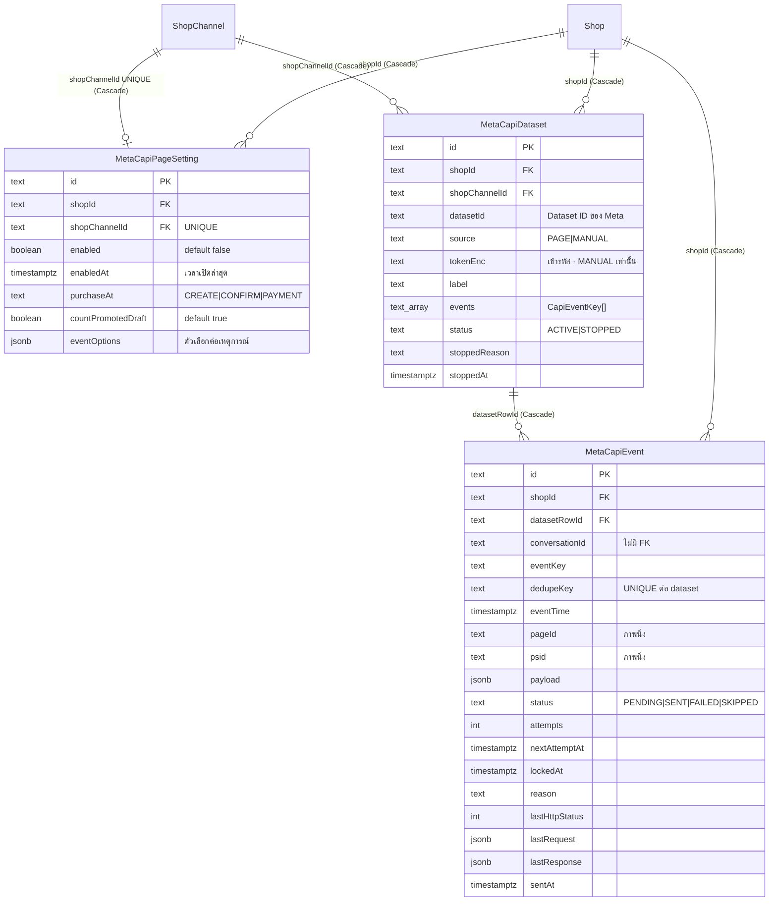

> **โมดูล:** 00089 - Meta Conversion API
> **ประเภทเอกสาร:** DATABASE Design
> **เวอร์ชัน:** 1.0
> **วันที่จัดทำ:** 2026-11-11
> **สถานะ:** Draft — เขียนจากโค้ดที่ implement แล้วบน working tree (ยังไม่ commit · ยังไม่ merge)
> **เจ้าของเอกสาร:** SA (ดู [[Feature-Docs-Ownership]])

# DATABASE: ส่งยอดขายและเหตุการณ์จากแชท Messenger กลับไปให้ Meta

> แหล่งความจริง = `prisma/schema.prisma` (model `MetaCapiPageSetting` · `MetaCapiDataset` · `MetaCapiEvent`) + migration `prisma/migrations/20261111100000_00089_meta_capi/migration.sql`

---

## 1. Overview

ฟีเจอร์นี้เพิ่ม **3 ตาราง** ใน PostgreSQL 16 (Supabase) ผ่าน Prisma ตัวเดียวกับระบบเดิม — ไม่มี store อื่น ไม่มี Redis/queue ภายนอก

| ตาราง | หน้าที่ | Component ใน SDS |
|---|---|---|
| `MetaCapiPageSetting` | ตั้งค่าส่งเหตุการณ์ต่อเพจ Messenger (1:1 กับ `ShopChannel`) | C-SET (settings service) · C-ENQ (อ่านตอนเข้าคิว) |
| `MetaCapiDataset` | dataset ปลายทางของเพจ (≤3 ต่อเพจ) + token ของทางกรอกเอง | C-SET · C-SWEEP |
| `MetaCapiEvent` | คิวส่ง (outbox) 1 แถว = 1 เหตุการณ์ → 1 dataset + บันทึกผลการส่ง | C-ENQ · C-SWEEP · C-LOG |

- **เอกสารออกแบบต้นทาง:** [[SDS]] ของโมดูลนี้
- **Store ที่เกี่ยวข้อง:** PostgreSQL 16 (Supabase prod · Docker local พอร์ต 5434) — ผ่าน `@/lib/prisma`
- **Engine / Charset:** PostgreSQL · UTF-8 · เวลาทุกคอลัมน์เป็น `TIMESTAMPTZ(3)` · id เป็น `TEXT` (uuid สร้างที่ Prisma `@default(uuid())`)
- **Enum:** ทุกค่าเก็บเป็น `TEXT` (convention ของโปรเจกต์) — 🛑 migration นี้ **ไม่มี CHECK constraint** ให้ค่า `status` / `source` / `purchaseAt` / `eventKey` / `events[]` : ความถูกต้องของค่าบังคับที่ service (`meta-capi-settings.service.ts`) และ Valibot เท่านั้น (ดู §6)

---

## 2. ERD

> `Conversation` ไม่อยู่ใน ERD โดยตั้งใจ — `MetaCapiEvent.conversationId` เป็นคอลัมน์ธรรมดาไม่มี FK (ห้องถูกลบภายหลังก็ยังส่งแถวที่ค้างได้ เพราะ `pageId`/`psid`/`payload`/`eventTime` เป็นภาพนิ่งตอนเข้าคิว)

---

## 3. Tables

### 3.1 `MetaCapiPageSetting` (PostgreSQL)

ตั้งค่าส่งเหตุการณ์ต่อเพจ 1 แถวต่อ `ShopChannel` — แถวถูกสร้างแบบ lazy ตอนร้านบันทึกครั้งแรก (`upsert`) · ไม่มีแถว = ปิด

| Column | Type | Null | Default | Key |
|---|---|---|---|---|
| `id` | `TEXT` | NO | uuid (Prisma) | PK |
| `shopId` | `TEXT` | NO | — | FK → `Shop.id` (Cascade) · IDX |
| `shopChannelId` | `TEXT` | NO | — | FK → `ShopChannel.id` (Cascade) · **UNIQUE** |
| `enabled` | `BOOLEAN` | NO | `false` | — |
| `enabledAt` | `TIMESTAMPTZ(3)` | YES | `NULL` | — |
| `purchaseAt` | `TEXT` | NO | `'CREATE'` | — |
| `countPromotedDraft` | `BOOLEAN` | NO | `true` | — |
| `eventOptions` | `JSONB` | NO | `'{}'` | — |
| `createdAt` | `TIMESTAMPTZ(3)` | NO | `CURRENT_TIMESTAMP` | — |
| `updatedAt` | `TIMESTAMPTZ(3)` | NO | (Prisma `@updatedAt`) | — |

**ความหมายของคอลัมน์ที่ต้องรู้**

| คอลัมน์ | กติกา (ยืนยันจาก `meta-capi-settings.service.ts::updateCapiPage` / `meta-capi.service.ts::resolveTarget`) |
|---|---|
| `enabledAt` | ตั้งเฉพาะตอน `enabled` เปลี่ยน false→true (บันทึกซ้ำขณะเปิดอยู่ไม่ขยับ · ปิดแล้วเปิดใหม่ = ตั้งใหม่) · เหตุการณ์ที่เกิด **ก่อน** `enabledAt` ไม่เข้าคิว (ไม่ส่งย้อนหลัง · PRD 4.1) · `NULL` = ไม่เคยเปิด (UI ใช้ถามยืนยันครั้งแรก) |
| `purchaseAt` | `CREATE` \| `CONFIRM` \| `PAYMENT` (FR-006) |
| `countPromotedDraft` | `true` = ออเดอร์ร่างที่ร้านกดยืนยัน นับเป็น "สร้างคำสั่งซื้อ" (ทั้ง OrderCreated และ Purchase จังหวะ CREATE) |
| `eventOptions` | `{ [CapiEventKey]: { valueMode?: "NET"\|"NO_VAT", sendContents?: boolean, rules?: { tagId: string, valueBaht?: number }[] } }` · **ระดับเพจ ใช้ร่วมทุก dataset** · `rules` มีได้เฉพาะ `LEAD_SUBMITTED` / `QUALIFIED_LEAD` · ตรวจ + ล้างให้เหลือเฉพาะฟิลด์ที่รู้จักก่อนเขียนทุกครั้ง (`sanitizeEventOptions`) · PUT แทนที่ทั้งก้อน (ไม่ merge) |

### 3.2 `MetaCapiDataset` (PostgreSQL)

dataset ปลายทาง ≤3 ต่อเพจ (เพดานบังคับที่ service ไม่ใช่ DB)

| Column | Type | Null | Default | Key |
|---|---|---|---|---|
| `id` | `TEXT` | NO | uuid | PK |
| `shopId` | `TEXT` | NO | — | FK → `Shop.id` (Cascade) · IDX |
| `shopChannelId` | `TEXT` | NO | — | FK → `ShopChannel.id` (Cascade) · UNIQUE (คู่กับ `datasetId`) |
| `datasetId` | `TEXT` | NO | — | UNIQUE (คู่กับ `shopChannelId`) |
| `source` | `TEXT` | NO | — | — |
| `tokenEnc` | `TEXT` | YES | `NULL` | — |
| `label` | `TEXT` | YES | `NULL` | — |
| `events` | `TEXT[]` | YES* | `ARRAY[]::TEXT[]` | — |
| `status` | `TEXT` | NO | `'ACTIVE'` | — |
| `stoppedReason` | `TEXT` | YES | `NULL` | — |
| `stoppedAt` | `TIMESTAMPTZ(3)` | YES | `NULL` | — |
| `createdAt` | `TIMESTAMPTZ(3)` | NO | `CURRENT_TIMESTAMP` | — |
| `updatedAt` | `TIMESTAMPTZ(3)` | NO | (Prisma `@updatedAt`) | — |

\* Prisma สร้าง `TEXT[] DEFAULT ARRAY[]::TEXT[]` โดยไม่มี `NOT NULL` (ตามที่ migration.sql เป็นจริง) — โค้ดอ่านเป็นอาร์เรย์เสมอ · ไม่เคยเขียน NULL

| คอลัมน์ | กติกา |
|---|---|
| `source` | `PAGE` = ใช้ token เพจ (`ShopChannel.accessTokenEnc` — ต้องมีสิทธิ์ `page_events`) · `MANUAL` = ร้านกรอก token เอง |
| `tokenEnc` | 🛑 เฉพาะ `MANUAL` · เข้ารหัสผ่าน `src/lib/token-crypto.ts` (`encryptToken`/`decryptToken`) · **ห้าม select ออกไปหา client · ห้าม log** — ทางออกทั้งหมดผ่าน `toPublic()` ที่แปลงเป็น `hasToken: boolean` |
| `events` | `CapiEventKey[]` ที่เปิดส่งเข้า dataset นี้ (12 ค่าที่เลือกได้ · ค่าตั้งต้นตอนสร้าง = `["PURCHASE"]`) |
| `status` | `ACTIVE` \| `STOPPED` · `STOPPED` เมื่อ Meta ตอบรหัสกลุ่ม token เสีย/ไม่มีสิทธิ์ (FR-012) · ตัวส่งไม่เลือกแถวของ dataset ที่ `STOPPED` |
| `stoppedReason` / `stoppedAt` | ข้อความ error จาก Meta (ตัด 300 ตัวอักษร) / เวลาที่หยุด · ล้างเป็น `NULL` เมื่อกลับ `ACTIVE` |
| 🛑 **ไม่มีคอลัมน์ `testEventCode`** | โดยตั้งใจ (Design-Spec D6): ถ้าเก็บรหัสไว้กับ dataset เหตุการณ์จริงจะพกรหัสไปด้วยและ Meta นับเป็นเหตุการณ์ทดสอบ — รหัสส่งมากับ request ของปุ่ม "ทดสอบ" แต่ละครั้งเท่านั้น |

### 3.3 `MetaCapiEvent` (PostgreSQL)

คิวส่ง (outbox) — 1 แถว = เหตุการณ์ 1 ตัว → dataset 1 ตัว

| Column | Type | Null | Default | Key |
|---|---|---|---|---|
| `id` | `TEXT` | NO | uuid | PK |
| `shopId` | `TEXT` | NO | — | FK → `Shop.id` (Cascade) · IDX (คู่ `createdAt`) |
| `datasetRowId` | `TEXT` | NO | — | FK → `MetaCapiDataset.id` (Cascade) · UNIQUE (คู่ `dedupeKey`) |
| `conversationId` | `TEXT` | YES | `NULL` | IDX (คู่ `eventKey`,`createdAt`) · **ไม่มี FK** |
| `eventKey` | `TEXT` | NO | — | — |
| `dedupeKey` | `TEXT` | NO | — | UNIQUE (คู่ `datasetRowId`) |
| `eventTime` | `TIMESTAMPTZ(3)` | NO | — | — |
| `pageId` | `TEXT` | NO | — | — |
| `psid` | `TEXT` | NO | — | — |
| `payload` | `JSONB` | NO | `'{}'` | — |
| `status` | `TEXT` | NO | `'PENDING'` | IDX (คู่ `nextAttemptAt`) |
| `attempts` | `INTEGER` | NO | `0` | — |
| `nextAttemptAt` | `TIMESTAMPTZ(3)` | NO | `CURRENT_TIMESTAMP` | IDX (คู่ `status`) |
| `lockedAt` | `TIMESTAMPTZ(3)` | YES | `NULL` | — |
| `reason` | `TEXT` | YES | `NULL` | — |
| `lastHttpStatus` | `INTEGER` | YES | `NULL` | — |
| `lastRequest` | `JSONB` | YES | `NULL` | — |
| `lastResponse` | `JSONB` | YES | `NULL` | — |
| `sentAt` | `TIMESTAMPTZ(3)` | YES | `NULL` | — |
| `createdAt` | `TIMESTAMPTZ(3)` | NO | `CURRENT_TIMESTAMP` | — |

| คอลัมน์ | กติกา |
|---|---|
| `eventKey` | `CapiEventKey` 12 ค่า (§ SRS 8.21) |
| `dedupeKey` | BR-CAPI-01: `purchase:<orderId>` · `order_created:<orderId>` · `initiate_checkout:<orderId>` · `add_payment_info:<orderId>` · `order_shipped:<orderId>` · `order_delivered:<orderId>` · `order_canceled:<orderId>` · `order_returned:<orderId>` · `view_content:<conversationId>:<productId>:<YYYY-MM-DD เวลาไทย>` · `cart_abandoned:<chatMessageId>` · Lead = `<event lower>:<conversationId>:<tagId>:<epoch ms>` (ต่อท้ายเวลา — ไม่ใช่คีย์กันซ้ำ; ความไม่ซ้ำ 30 วันตัดสินด้วยการตรวจแถวเดิม BR-CAPI-02) |
| `pageId` / `psid` / `eventTime` / `payload` | **ภาพนิ่งตอนเข้าคิว** — `eventTime` = เวลาที่เกิดเหตุการณ์ (ตอน enqueue) ไม่เลื่อนตอนลองใหม่ · `payload` = `{ value?, orderId?, items?: {id, quantity, price}[] }` |
| `status` | `PENDING` \| `SENT` \| `FAILED` \| `SKIPPED` |
| `reason` | `RETRYING` (รอลองใหม่) · `TOKEN_OR_PERMISSION` (dataset หยุด แถวรอ) · `MAX_ATTEMPTS` (ลองครบ 3 ครั้งแล้วยังชั่วคราว) · `REJECTED` (Meta ปฏิเสธถาวร / `events_received < 1`) · `TOO_OLD` (เก่ากว่า 7 วัน) · `NULL` เมื่อ `SENT` |
| `lockedAt` | จองแถวตอนส่ง (`updateMany WHERE id ∧ status='PENDING' ∧ lockedAt=<ค่าที่อ่านมา>`) · ล็อกค้างเกิน 3 นาที = ตัวส่งรอบถัดไปยึดต่อได้ |
| `lastRequest` / `lastResponse` | ครั้งล่าสุด ตัดเหลือ ≤4000 ตัวอักษร (เก็บเป็น `{truncated: "..."}` เมื่อเกิน) · **ไม่มี token** (token ส่งผ่าน header ไม่อยู่ใน body) |

---

## 4. Indexes

| Table | Columns | Type | Rationale (query pattern ที่รองรับ) |
|---|---|---|---|
| `MetaCapiPageSetting` | `(shopChannelId)` | UNIQUE | 1 เพจ 1 ตั้งค่า · `findUnique` ตอน `resolveTarget` ทุกครั้งที่เหตุการณ์เกิด |
| `MetaCapiPageSetting` | `(shopId)` | BTREE | ลิสต์ตั้งค่าตามร้าน · FK |
| `MetaCapiDataset` | `(shopChannelId, datasetId)` | UNIQUE | เพจเดียวห้ามมี Dataset ID ซ้ำ (P2002 → `DATASET_DUPLICATE`) |
| `MetaCapiDataset` | `(shopId)` | BTREE | FK · scope ตามร้าน |
| `MetaCapiEvent` | `(datasetRowId, dedupeKey)` | UNIQUE | **กันส่งซ้ำต่อ dataset (BR-CAPI-01)** — เป็นด่านจริงที่ฐานข้อมูล · `createMany({skipDuplicates:true})` = `ON CONFLICT DO NOTHING` · คีย์ไม่ซ้ำ **ต่อ dataset** จึงลบ dataset ตัวไหนก็ไม่กระทบตัวอื่น |
| `MetaCapiEvent` | `(status, nextAttemptAt)` | BTREE | ตัวส่งเลือกแถว `PENDING` ที่ถึงเวลา (`sweepMetaCapi`) |
| `MetaCapiEvent` | `(conversationId, eventKey, createdAt)` | BTREE | ด่าน 30 วันของ Lead: หาแถวเดิมของห้อง+เหตุการณ์ |
| `MetaCapiEvent` | `(shopId, createdAt)` | BTREE | หน้า "บันทึกการส่ง" (เรียงใหม่→เก่า) · นับ 7 วัน · purge 180 วัน |

> ⚠ `MetaCapiEvent` ไม่มี index บน `createdAt` เดี่ยว ๆ — `purgeOldMetaCapiEvents` ลบด้วย `createdAt < ...` โดยไม่กรองร้านใน production (เมื่อไม่ส่ง `shopIds`) จึงอาจสแกนทั้งตารางตอนตารางโต · ยังไม่ใช่ปัญหาที่ปริมาณปัจจุบัน (ดู §6 Performance)

---

## 5. Migration Plan

### 5.1 ลำดับการ Migrate

| ลำดับ | การเปลี่ยนแปลง | Store | หมายเหตุ |
|---|---|---|---|
| 1 | migration เดียว `20261111100000_00089_meta_capi` — `CREATE TABLE` 3 ตาราง (`MetaCapiPageSetting` → `MetaCapiDataset` → `MetaCapiEvent`) | PostgreSQL | additive ล้วน · ไม่แตะตารางเดิม · ไม่มี backfill |
| 2 | `CREATE UNIQUE INDEX` ×3 + `CREATE INDEX` ×4 | PostgreSQL | ตารางใหม่ว่าง ไม่มี lock ที่น่ากังวล |
| 3 | `ALTER TABLE ... ADD CONSTRAINT ... FOREIGN KEY` ×6 (ทุกตัว `ON DELETE CASCADE ON UPDATE CASCADE`) | PostgreSQL | อ้าง `Shop` · `ShopChannel` · `MetaCapiDataset` |

**ข้อควรรู้ก่อน merge (HR15):** push `main` = `prisma migrate deploy` บน prod ในตัว — prod ไม่ต้องสั่งเอง · **ฐาน local ต้อง apply เอง** · migrate ล้ม = deploy ไม่ขึ้น · ห้ามใช้ `migrate dev` / `db pull` / `migrate reset` กับฐานแชร์ (HR13/14) · Prisma schema ฝั่ง `Shop` และ `ShopChannel` เพิ่มฟิลด์ relation ฝั่ง Prisma เท่านั้น (ไม่มีคอลัมน์ใหม่บนสองตารางนี้)

### 5.2 Rollback

ฟีเจอร์ปิดอยู่เป็นค่าเริ่มต้น (`OPEN_META_CAPI` ไม่ตั้ง) — **ก่อนมีข้อมูลจริง** ย้อนด้วย `DROP TABLE "MetaCapiEvent"; DROP TABLE "MetaCapiDataset"; DROP TABLE "MetaCapiPageSetting";` (ตามลำดับนี้ เพราะ FK) · หลังมีข้อมูลจริง การ drop = ทำลายประวัติการส่งและ token ที่เข้ารหัสของร้าน → **ต้องถาม user ก่อน** · ทางถอยที่ปลอดภัยกว่าคือปิดด้วย env (ไม่ตั้ง `OPEN_META_CAPI`) โดยไม่แตะตาราง

### 5.3 ผลกระทบ (Impact)

- ไม่มี downtime · ไม่ล็อกตารางเดิม · service เดิมที่ไม่รู้จักตารางใหม่ไม่ได้รับผลกระทบ
- ผลข้างเคียงบน hot path: ทุกจุดเกิดเหตุการณ์ (สร้างออเดอร์ ฯลฯ) เพิ่มการอ่าน/เขียนตามนี้เฉพาะเมื่อฟีเจอร์เปิดสำหรับร้านนั้น — `resolveTarget` = 1 อ่าน `Conversation` + 1 อ่าน `MetaCapiPageSetting` ; เขียน = `createMany` ≤ (dataset × เหตุการณ์) แถว

---

## 6. Retention / ข้อควรระวัง

- **Data Retention:** แถว `MetaCapiEvent` เก่ากว่า **180 วัน** (ตาม `createdAt`) ถูกลบโดย `purgeOldMetaCapiEvents` ที่ cron `/api/cron/meta-capi` ทุกนาที · ตารางที่โตเร็วคือ `MetaCapiEvent` (≈ จำนวนเหตุการณ์ × dataset) · ตั้งค่า + dataset ไม่มี retention (ลบตามร้าน/เพจ/ผู้ใช้กด)
- **PII / ข้อมูลอ่อนไหว:**
  - `MetaCapiEvent.psid` + `pageId` = ตัวตนลูกค้าฝั่ง Meta (ไม่ใช่เบอร์/อีเมล/ชื่อ) · `lastRequest` มีสองค่านี้ด้วย
  - `MetaCapiDataset.tokenEnc` = access token ของร้าน เข้ารหัสที่ฐาน
  - หน้า "บันทึกการส่ง" / `GET log` **ไม่ select** `psid` · `lastRequest` · `lastResponse` (`listCapiLog` เลือกฟิลด์ชัด ๆ)
  - ไม่เก็บและไม่ส่งเบอร์/อีเมล/ชื่อลูกค้าไป Meta (BR-CAPI-04)
- **Performance:** แถวคิวเขียนต่อเหตุการณ์ ≤ dataset (≤3) แถว · ตัวส่งดึงรอบละ ≤100 แถว (`take: 100`) · `sweepCartAbandoned` ดึงการ์ดรอบละ ≤500 · `purgeOldMetaCapiEvents` ไม่มี index `createdAt` เดี่ยว (ดู §4)
- **Consistency:** แหล่งความจริงของ "เหตุการณ์ทางธุรกิจเกิดจริง" = ตารางเดิม (`Order` ฯลฯ) · คิวเป็นสำเนาเชิงเหตุการณ์ที่ **เข้าคิวหลัง commit ของธุรกิจ แยกธุรกรรม** (`enqueueOrderCapiAfterCommit`) — process ตายระหว่างสองจังหวะ = เหตุการณ์หาย 1 ตัว (ยอมรับโดยตั้งใจ ระบุใน comment ของโค้ด) · ลบ `ShopChannel` / `Shop` = ตั้งค่า + dataset + คิวหายตาม (Cascade) · ลบ dataset = แถวคิวของมันหายตาม
- **Orphan data:** `eventOptions.rules[].tagId` อ้างถึง `ShopTag.id` โดยไม่มี FK และ `deleteShopTag` ไม่ล้างกฎที่ผูก — ดู SRS ข้อ "ข้อขัดแย้ง/ข้อจำกัด" และ SDS §6 (TD-009)

---

## 7. Traceability

| Table | SDS Component / Decision | สถานะ |
|---|---|---|
| `MetaCapiPageSetting` | C-SET · C-ENQ (`resolveTarget`) · TD-003 (ตัวเลือกระดับเพจ) | Done |
| `MetaCapiDataset` | C-SET · C-SWEEP · TD-002 (token) · TD-004 (หยุดทั้ง dataset) | Done |
| `MetaCapiEvent` | C-ENQ · C-SWEEP · C-LOG · TD-001 (outbox + unique key) · TD-005 (ภาพนิ่ง) | Done |

---

## 8. สรุป (Summary)

เอกสาร DATABASE นี้กำหนด **โครงสร้างข้อมูล** ของ **ส่งยอดขายให้ Meta (00089)** — 3 ตาราง additive ในฐานเดียวกับระบบเดิม ให้ DEV/QA เข้าใจว่ากันซ้ำที่ `UNIQUE(datasetRowId, dedupeKey)` ไม่เก็บ Test Event Code และเก็บ token เฉพาะทางกรอกเองแบบเข้ารหัส

**Open Questions:**
- ควรเพิ่ม CHECK constraint ให้ `status` / `source` / `purchaseAt` ตามแบบ migration CHECK ที่ additive ของโปรเจกต์ (`docs/conventions/migration-check-constraint-additive.md`) หรือไม่ — ปัจจุบันบังคับที่ service อย่างเดียว
- ควรเพิ่ม index `MetaCapiEvent(createdAt)` เมื่อตารางโต เพื่อให้ purge ไม่สแกนทั้งตาราง
