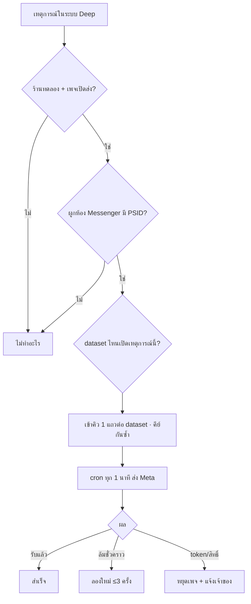

> **โมดูล:** 00089 - Meta Conversion API
> **ประเภทเอกสาร:** Product Requirements Document (PRD)
> **เวอร์ชัน:** 0.1
> **วันที่จัดทำ:** 2026-11-11
> **สถานะ:** Approved 2026-11-11 (user "ลุยเลย" — รับข้อเสนอ Q1–Q5 ทั้งหมด)
> **เจ้าของเอกสาร:** BA + PO + PM (ดู [[Feature-Docs-Ownership]])
> **อ้างอิงแนวทาง:** ระบบ gochat-v3 ที่ส่ง CAPI จริงอยู่แล้ว (ปรึกษา session gochat-main 2026-11-11) — ยกกฎ/กับดักมาใช้ ปรับแหล่งเหตุการณ์ให้เป็นของ Deep

# PRD: ส่งยอดขายและเหตุการณ์จากแชท Messenger กลับไปให้ Meta

---

## Executive Summary

ร้านค้าบน Deep ยิงโฆษณา "คลิกเพื่อส่งข้อความ" (Click-to-Messenger) แล้วปิดการขายในแชท แต่ Meta ไม่รู้เลยว่าแชทไหนกลายเป็นยอดขาย — Ads Manager จึงเห็นแค่ "จำนวนการเริ่มแชท" ไม่เห็นยอดซื้อ ปรับแคมเปญหายอดขายจริงไม่ได้

ฟีเจอร์นี้ส่งเหตุการณ์ทางธุรกิจ (สร้างคำสั่งซื้อ · ชำระครบ · จัดส่ง · ลูกค้ามีแนวโน้มซื้อ ฯลฯ) จากห้องแชท Messenger กลับไปที่ Meta ผ่าน **Conversions API for Business Messaging** โดยผูกกับตัวลูกค้าในแชท (PSID) — Meta จับคู่กลับไปยังโฆษณาที่ลูกค้าคลิกเข้ามาได้ ร้านเลือกเองได้ละเอียดว่าจะส่งเหตุการณ์ไหน · เข้า dataset ไหน · ส่งยอดแบบไหน · ส่งตอนไหน

รอบแรกเปิดเฉพาะ **ร้านทดลอง** ที่ developer กำหนด (ใช้สิทธิ์ `page_events` ระดับ Standard ซึ่งไม่ต้องผ่าน App Review สำหรับบัญชีที่มีบทบาทในแอป) แล้วค่อยเปิดทุกร้าน

---

## 1. Business Goals & KPIs

### 1.1 เป้าหมายทางธุรกิจ

| เป้าหมาย | รายละเอียด |
|----------|-----------|
| **โฆษณาของร้านเห็นยอดขายจริง** | Ads Manager แสดง Purchase + มูลค่า จากแชท ทำให้ร้านดู ROAS และให้ Meta optimize หายอดซื้อได้ |
| **ร้านคุมการรายงานเอง** | เลือกเหตุการณ์ · จังหวะ · วิธีคิดยอด · กฎแท็ก ได้เองโดยไม่ต้องให้ทีม Deep ตั้งให้ |
| **เหตุผลให้ร้านที่ยิงแอดใช้ Deep เป็นกล่องแชทหลัก** | ฟีเจอร์ที่ inbox ทั่วไปไม่มี และผูกกับระบบออเดอร์ของ Deep โดยตรง |

### 1.2 ตัวชี้วัดความสำเร็จ (KPIs)

| KPI | คำอธิบาย | เป้าหมาย |
|-----|----------|---------|
| **อัตราส่งสำเร็จ** | แถวในคิวที่ Meta ตอบ `events_received ≥ 1` ÷ แถวที่ถึงเวลาส่ง | ≥ 98% (ไม่นับเพจที่ token เสีย) |
| **ความหน่วง** | เวลาจากเหตุการณ์เกิด → ส่งสำเร็จ | p95 ≤ 2 นาที |
| **ร้านที่เปิดใช้** | ร้านที่มี dataset ส่งอย่างน้อย 1 ตัวและส่งสำเร็จใน 7 วัน | วัดหลังเปิดทุกร้าน |

---

## 2. User Personas

### 2.1 เจ้าของร้านที่ยิงโฆษณา Messenger

**ข้อมูลพื้นฐาน:** ขายของออนไลน์ เชื่อมเพจ Facebook เข้า Deep แล้ว ยิงแอด Click-to-Messenger เป็นประจำ
**เป้าหมาย:** รู้ว่าแอดตัวไหนได้ยอดขายจริง และให้ Meta หาลูกค้าที่ซื้อจริงมากขึ้น
**ความต้องการ:** ตั้งครั้งเดียวแล้วส่งเองอัตโนมัติ · เลือกได้ว่ายอดที่ส่งรวม VAT หรือไม่ · ทดสอบได้ก่อนใช้จริง
**Pain Points:** Ads Manager เห็นแต่ "การเริ่มแชท" · ตั้ง Pixel/CAPI เองต้องจ้าง dev

### 2.2 Developer / ทีม Deep (ช่วงทดลอง)

**เป้าหมาย:** ลองใช้กับเพจของตัวเองก่อนเปิดให้ร้านจริง โดยไม่ต้องยื่น App Review
**ความต้องการ:** กำหนดร้านทดลองได้ · ดูบันทึกการส่ง (request/response) เพื่อสืบปัญหา

---

## 3. Business Requirements

### 3.1 การเชื่อม dataset ต่อเพจ

**ความต้องการ:**
- เจ้าของร้านเปิด/ปิดการส่งได้ต่อเพจ Messenger ที่เชื่อมไว้
- เพจหนึ่งส่งเข้าได้สูงสุด **3 dataset** — ทางหลัก: ระบบหา/สร้าง dataset ของเพจให้อัตโนมัติด้วย token เพจที่เชื่อมอยู่ · ทางรอง: ร้านกรอก Dataset ID + access token เอง (จาก Events Manager)
- ปุ่มทดสอบต่อ dataset: มี Test Event Code → ส่ง Purchase ทดสอบ ฿1 ไปที่แท็บ Test Events · ไม่มี → ตรวจแค่ว่า token ใช้ได้

**Business Rules:**
- token ที่ร้านกรอกเก็บแบบเข้ารหัสเท่านั้น ไม่แสดงกลับ ไม่ log
- ลบ dataset ตัวใดแล้วตัวอื่น **คงตัวตนเดิม** (ไม่เลื่อนลำดับขึ้นแทน) — กัน Purchase ซ้ำ (บทเรียน gochat)

**เหตุผล:** ร้านบางรายมี dataset ของตัวเองที่ใช้กับเว็บอยู่แล้ว อยากรวมข้อมูลไว้ที่เดียว

### 3.2 เหตุการณ์ที่ส่งได้ (13 ตัวตาม gochat)

**ความต้องการ:** ร้านเลือกเปิด/ปิดได้ทีละเหตุการณ์ ต่อ dataset

| # | เหตุการณ์ | เกิดเมื่อ (ในระบบ Deep) | มียอด |
|---|-----------|------------------------|------|
| 1 | Purchase | ตามจังหวะที่ร้านเลือก (3.3) | ✓ |
| 2 | OrderCreated | สร้างคำสั่งซื้อ (รวม/ไม่รวมออเดอร์ร่างที่กดยืนยัน ตาม 3.3) | ✓ |
| 3 | InitiateCheckout | ส่งการ์ด/ลิงก์คำสั่งซื้อเข้าห้องแชทสำเร็จ | – |
| 4 | AddPaymentInfo | แนบสลิป (ลูกค้าแนบเอง หรือร้านบันทึกการชำระพร้อมสลิป) | ✓ |
| 5 | PaymentSlipAttached | ไม่มีจุดเกิดแยก — รวมอยู่ใน AddPaymentInfo (ซ่อนจาก UI แบบ gochat) | – |
| 6 | OrderShipped | ได้เลขพัสดุ / กด "จัดส่งแล้ว" (ส่งเอง · iShip · Flash) | ✓ |
| 7 | OrderDelivered | ขนส่งแจ้งส่งถึง หรือ ร้านกด "ส่งสำเร็จ" หรือ ยืนยันรับอัตโนมัติ — อันไหนก่อน | ✓ |
| 8 | OrderCanceled | ยกเลิกคำสั่งซื้อ | ✓ |
| 9 | OrderReturned | รับของคืนครบทุกรายการ | ✓ |
| 10 | ViewContent | ส่งการ์ดสินค้าเข้าห้องแชท (วันละครั้ง/ห้อง/สินค้า) | ✓ ราคาสินค้า |
| 11 | CartAbandoned | ส่งการ์ดคำสั่งซื้อไปแล้ว 24–72 ชม. ยังไม่ชำระ ไม่มีสลิป ไม่ยกเลิก | ✓ |
| 12 | LeadSubmitted | ติดแท็กที่ร้านผูกกฎไว้ (3.5) | ยอดตามกฎ |
| 13 | QualifiedLead | ติดแท็กที่ร้านผูกกฎไว้ (3.5) | ยอดตามกฎ |

**Business Rules:**
- ส่งได้เฉพาะเมื่อผูกกับห้องแชท **Messenger** ที่มีตัวตนลูกค้า (PSID) — ออเดอร์ที่สร้างนอกแชท/LINE/IG/หน้าร้าน **ไม่ส่ง** (มติ user 2026-11-11)
- แต่ละเหตุการณ์ส่ง **ครั้งเดียว** ต่อออเดอร์ (หรือต่อหน่วยที่ระบุในตาราง) ต่อ dataset
- เวลาเหตุการณ์ = เวลาที่เกิดจริงในระบบ · เก่ากว่า 7 วัน Meta ไม่รับ → ไม่ส่ง และบันทึกเหตุผล

### 3.3 จังหวะของ Purchase และออเดอร์ร่าง

**ความต้องการ:** ร้านเลือกต่อเพจ:
- **Purchase ส่งเมื่อ:** `สร้างคำสั่งซื้อ` · `ยืนยัน` (ลูกค้ายืนยันรับ หรือ ชำระครบ — อันไหนก่อน) · `ชำระครบ` (มัดจำบางส่วนไม่นับ)
- **นับออเดอร์ร่างที่ระบบตรวจจากแชทแล้วร้านกดยืนยันเป็นคำสั่งซื้อจริง** เป็น "สร้างคำสั่งซื้อ" หรือไม่ (มติ user 2026-11-11 ให้ร้านเลือกเอง · ค่าเริ่มต้น = นับ)

**Business Rules:** Purchase ส่งครั้งเดียวต่อออเดอร์ ไม่ว่าเงื่อนไขจะเกิดซ้ำกี่ครั้ง · ออเดอร์ร่างที่ยังไม่ยืนยันไม่ส่งอะไรเลย

### 3.4 วิธีคิดยอดและสินค้าที่แนบ

**ความต้องการ:** ต่อเหตุการณ์ที่มียอด ร้านเลือก:
- **ยอดที่ส่ง:** ยอดสุทธิของคำสั่งซื้อ · ไม่รวม VAT
- ⚠ ตัวเลือก "ไม่รวมค่าส่ง" แบบ gochat **ยังไม่มีในรอบนี้** — `Order` ไม่มีช่องค่าส่งที่เก็บจากลูกค้าแยกไว้ (มีแค่ `totalAmount` · `discount` · `vatAmount`) คิดเองไม่ได้โดยไม่สร้างนิยามใหม่ (HR16) — คำถามเปิด Q5
- **แนบรายการสินค้า** (ชื่อ/จำนวน/ราคา) หรือไม่

**Business Rules:** ยอดสุทธิใช้ **นิยามเดียวกับที่ระบบแสดงบนหน้าคำสั่งซื้อ** (HR16 — ห้ามคิดใหม่) · สกุลเงิน THB · ปัด 2 ตำแหน่ง · เกิน 100 รายการไม่แนบสินค้า · ตั้งค่านี้ใช้ร่วมทุก dataset ของเพจ

### 3.5 กฎแท็ก → Lead

**ความต้องการ:** ร้านตั้งกฎ "เมื่อห้องแชทถูกติดแท็ก X → ส่ง LeadSubmitted/QualifiedLead มูลค่า Y บาท (ไม่ระบุก็ได้)" — นับทั้งแท็กที่ติดอัตโนมัติจากคำ (00083) และที่พนักงานติดเอง

**Business Rules:** ≤ 20 กฎต่อเหตุการณ์ · ยอด ≤ 10 ล้านบาท · ห้องเดียวกัน กฎเดียวกัน ส่งไม่เกิน 1 ครั้งใน 30 วัน · การส่งล้มเหลวต้องไม่ทำให้การติดแท็กล้ม

### 3.6 ความทนทานและการแจ้งเตือน

**ความต้องการ:** เหตุการณ์เข้าคิวก่อนแล้วระบบส่งเบื้องหลัง · ล้มชั่วคราวลองใหม่สูงสุด 3 ครั้ง · token เสีย/ไม่มีสิทธิ์ → **หยุดส่งเฉพาะ dataset นั้น** (dataset อื่นของเพจส่งต่อ) แถวค้างรอ + แจ้งเจ้าของร้านให้เชื่อมใหม่ · เชื่อมเพจใหม่ = dataset แบบเพจกลับมาส่งเอง · ร้านดูบันทึกการส่งย้อนหลังได้ (สถานะ · เหตุผลที่ล้ม)

### 3.7 ร้านทดลอง (Pilot)

**ความต้องการ:** ฟีเจอร์ปิดเป็นค่าเริ่มต้น เปิดด้วยตัวแปรระบบ · ตั้งรายชื่อร้านทดลองได้ → เห็นเมนูและส่งได้เฉพาะร้านในรายชื่อ · ล้างรายชื่อ = เปิดทุกร้าน (แบบเดียวกับ Flash Express 00084)

**เหตุผล:** developer ทดสอบกับเพจตัวเองด้วยสิทธิ์ Standard ก่อน โดยไม่ต้องยื่น App Review

---

## 4. Business Rules & Constraints

### 4.1 กฎทางธุรกิจหลัก

| กฎ | คำอธิบาย |
|----|----------|
| **ส่งเฉพาะแชท Messenger** | ต้องมีห้องแชท Messenger + PSID ของลูกค้า ไม่ส่งเบอร์/อีเมล/ชื่อลูกค้าไป Meta |
| **ครั้งเดียวต่อหน่วย** | กันซ้ำด้วยคีย์ไม่ซ้ำต่อ dataset (เช่น `purchase:<orderId>`) |
| **ฝั่งที่เขียนสำเร็จเท่านั้น** | จุดที่ใช้การเขียนแบบมีเงื่อนไข ต้องเข้าคิวเฉพาะเมื่อเขียนสำเร็จ |
| **ไม่ย้อนหลัง** | ไม่ส่งเหตุการณ์ที่เกิดก่อนร้านเปิดการส่ง · ไม่ส่งเหตุการณ์ที่เก่ากว่า 7 วัน |
| **ออเดอร์ทดสอบ** | ออเดอร์ทดลอง (dry-run) ไม่ส่ง |

### 4.2 ข้อจำกัดทางธุรกิจ

| ข้อจำกัด | รายละเอียด |
|---------|-----------|
| **สิทธิ์ Meta** | ทางหลักต้องมี `page_events` ในแอปแชท Deep — ช่วงทดลองใช้ระดับ Standard (บัญชีที่มีบทบาทในแอปเท่านั้น) · เปิดทุกร้านต้องขอ Advanced (เอกสาร Meta: แอปที่มี `pages_messaging` Advanced อยู่แล้ว "should be automatically approved") |
| **Instagram** | ใช้สิทธิ์อีกตัว (`instagram_manage_events`) — นอกขอบเขตรอบนี้ |

---

## 5. Out of Scope

| หัวข้อ | คำอธิบาย |
|--------|----------|
| **Instagram / LINE / หน้าร้าน** | ไม่มี PSID ของ Messenger |
| **ส่งข้อมูลลูกค้าแบบแฮช (เบอร์/อีเมล)** | มติ user: ไม่ส่งออเดอร์ที่ไม่มี PSID |
| **Pixel บนหน้าเว็บ / dedup กับ Pixel** | ไม่มี Pixel ให้จับคู่ — ส่ง `event_id` (= คีย์กันซ้ำ) ไปด้วยเพื่อกันนับซ้ำกรณีส่งสำเร็จแต่บันทึกผลไม่ทันแล้วถูกส่งอีกรอบ |
| **รายงาน EMQ / ผลจับคู่จาก Ads Manager** | ไม่มี API ให้อ่านกลับ |
| **ส่งย้อนหลังออเดอร์เก่า** | ดู 4.1 |
| **ไอคอนสถานะการส่งบนการ์ดออเดอร์** | รอบถัดไป (คำถามเปิด Q4) |

---

## 6. Risks & Mitigation

### 6.1 ความเสี่ยงทางธุรกิจ

| ความเสี่ยง | ผลกระทบ | ระดับ | แนวทางแก้ไข |
|-----------|---------|------|-------------|
| **Purchase ซ้ำ** | ROAS เพี้ยน ร้านเสียความเชื่อมั่น | สูง | คีย์กันซ้ำในฐาน + เข้าคิวฝั่งที่เขียนสำเร็จเท่านั้น + เทสต่อจุดเกิด |
| **ยอดไม่ตรงหน้าออเดอร์** | ร้านสับสน | กลาง | ใช้ตัวคำนวณยอดกลางตัวเดียว (HR16) |
| **ขอ Advanced ไม่ผ่าน** | เปิดทุกร้านด้วยทางหลักไม่ได้ | กลาง | ทางรอง (ร้านกรอก dataset เอง) ใช้ได้เสมอโดยไม่ต้องใช้สิทธิ์แอป |

### 6.2 ความเสี่ยงทางเทคนิค

| ความเสี่ยง | ผลกระทบ | แนวทางแก้ไข |
|-----------|---------|-------------|
| **token เสียกลางทาง** | ส่งไม่ได้ทั้งเพจ | หยุดเพจ + แจ้งเจ้าของ + แถวรอ (ส่งต่อได้ถ้ายังไม่เกิน 7 วัน) |
| **Meta ตอบ 200 แต่ไม่รับ** | คิดว่าสำเร็จทั้งที่หาย | `events_received < 1` = ล้ม |
| **แท็กที่ติดเองเขียนทับทั้งชุด** | หาแท็กที่เพิ่งติดไม่เจอ | เทียบก่อน/หลังในจุดบันทึก |
| **ติดแท็ก/สร้างออเดอร์ช้าลง** | UX แย่ | จุดเกิดแค่บันทึกลงคิว ไม่เรียก Meta |

---

## 7. Glossary

| คำศัพท์ | ความหมาย |
|---------|----------|
| **CAPI** | Conversions API — ส่งเหตุการณ์จากเซิร์ฟเวอร์ไป Meta |
| **Dataset** | ที่เก็บเหตุการณ์ใน Events Manager (เดิมเรียก Pixel) |
| **PSID** | รหัสลูกค้าที่ผูกกับเพจ ได้จากแชท Messenger |
| **Test Event Code** | รหัสจาก Events Manager ทำให้เหตุการณ์ไปโผล่ที่แท็บทดสอบ ไม่นับเป็นข้อมูลจริง |
| **ร้านทดลอง** | ร้านที่อยู่ในรายชื่อ pilot เห็นฟีเจอร์ก่อนร้านอื่น |

---

## 8. Success Metrics

| ตัวชี้วัด | ค่าที่คาดหวัง | วิธีวัด |
|----------|---------------|--------|
| **Purchase ซ้ำ** | 0 | นับคีย์ซ้ำต่อ dataset ใน Events Manager เทียบบันทึกเรา |
| **ส่งสำเร็จ** | ≥ 98% | สถานะในคิว |
| **ร้านทดลองเห็นยอดใน Ads Manager** | เห็น Purchase ภายใน 1 วัน | ตรวจด้วยตา (developer) |

---

## 9. Dependencies & Assumptions

### 9.1 Dependencies

| ระบบ | ความสัมพันธ์ |
|------|-------------|
| **00018 Facebook Chat** | ห้องแชท · PSID · token เพจ |
| **ระบบคำสั่งซื้อ / การชำระ / จัดส่ง (iShip · Flash · ส่งเอง) / คืนสินค้า** | จุดเกิดเหตุการณ์ |
| **00083 แท็ก** | จุดเกิด Lead |
| **00061 ออเดอร์ร่างจากแชท** | ตัวเลือกนับออเดอร์ร่าง |
| **ระบบแจ้งเตือนร้าน** | แจ้ง token เสีย |

### 9.2 Assumptions

- เพจที่ร้านเชื่อมใหม่หลังเพิ่ม `page_events` ใน Configuration ของ Facebook Login for Business จะได้ token ที่มีสิทธิ์นี้ (เพจที่เชื่อมไว้ก่อนต้องเชื่อมใหม่)
- เขตเวลาร้าน = Asia/Bangkok (ระบบไม่มีค่าต่อร้าน)

---

## 10. Appendix

### 10.1 User Journey

**Scenario: ร้านทดลองเปิดส่ง Purchase**

1. Developer ใส่ shopId ในรายชื่อร้านทดลอง
2. เจ้าของร้านเข้า ตั้งค่า → Conversions API → เห็นเพจ Messenger ที่เชื่อมไว้
3. เปิดเพจ → ระบบหา dataset ของเพจให้อัตโนมัติ → ใส่ Test Event Code → กด "ทดสอบ" → เห็นใน Events Manager
4. เปิด Purchase เลือก "ส่งเมื่อชำระครบ" + "ยอดสุทธิ"
5. ลูกค้าทักจากแอด → พนักงานสร้างคำสั่งซื้อในแชท → ลูกค้าโอนครบ → ภายใน 1–2 นาที Purchase เข้า Meta

### 10.2 คำถามเปิด (ต้องตอบก่อน approved)

| # | คำถาม | ข้อเสนอ |
|---|-------|--------|
| Q1 | ใครตั้งค่าได้ | เจ้าของร้านเท่านั้น (ส่งยอดขายออกนอกระบบ = ข้อมูลการเงิน สอดคล้อง 00071) |
| Q2 | PaymentSlipAttached แยกจาก AddPaymentInfo ไหม | ไม่แยก — ซ่อนแบบ gochat |
| Q3 | ยกเลิก/คืนของหลังส่ง Purchase ไปแล้ว ต้องทำอะไรกับ Purchase | ไม่ถอน (Meta ไม่มีการถอน) — ส่ง OrderCanceled/OrderReturned ถ้าร้านเปิด |
| Q4 | ไอคอนสถานะการส่งบนการ์ดออเดอร์ | รอบถัดไป |
| Q5 | ต้องการ "ไม่รวมค่าส่ง" ไหม (ต้องเพิ่มช่องค่าส่งที่เก็บจากลูกค้าในคำสั่งซื้อก่อน) | ไม่ทำรอบนี้ |

---

**หมายเหตุ:** Functional Requirements / Acceptance Criteria ดู [[BRD]] · technical spec ดู [[SRS]] (เขียนหลัง PRD+BRD อนุมัติ)
