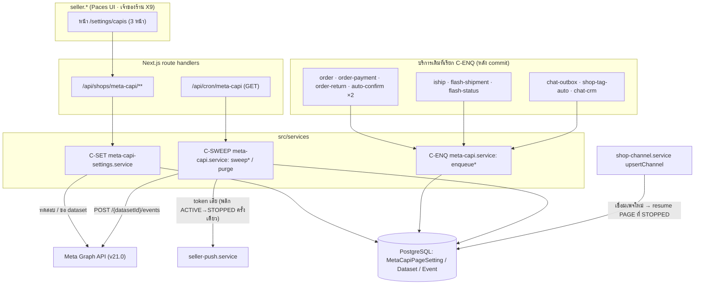
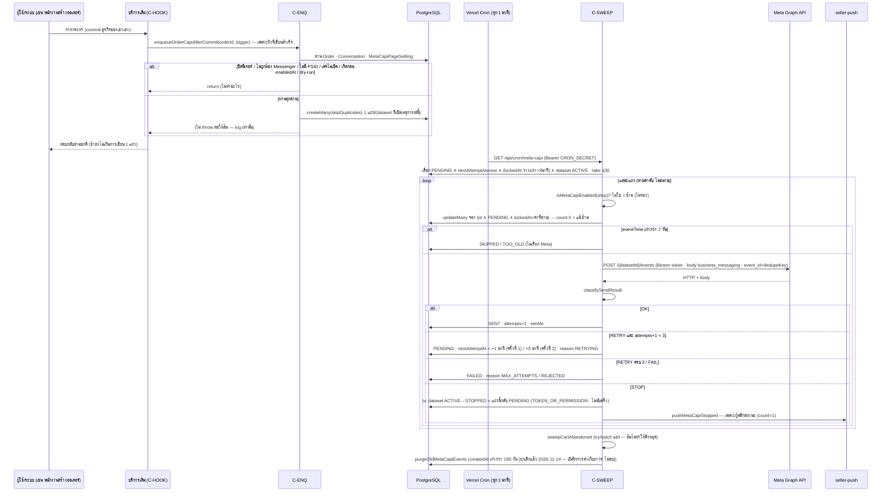
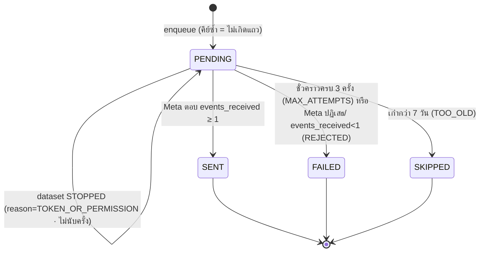
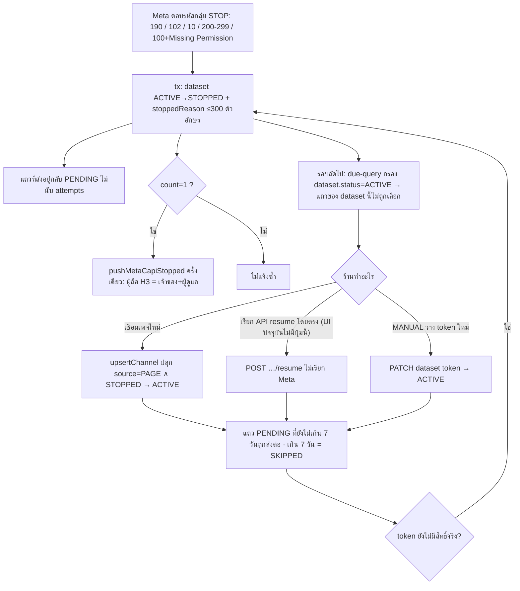
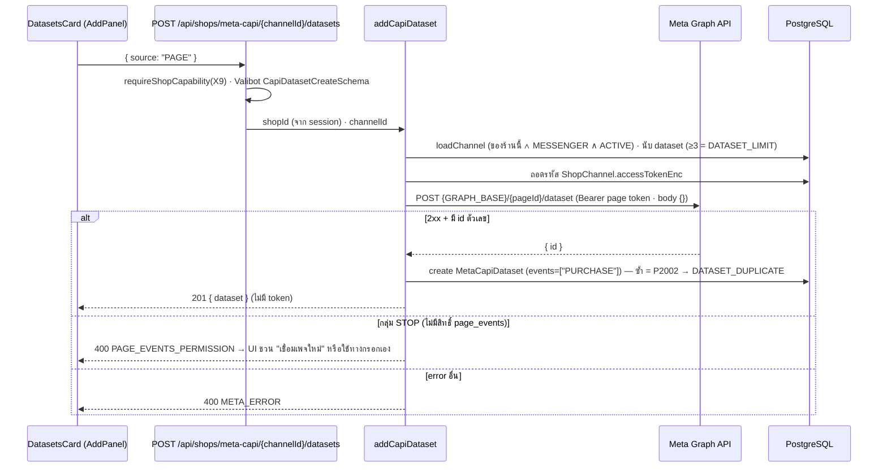

> **โมดูล:** 00089 - Meta Conversion API
> **ประเภทเอกสาร:** System Design Spec (SDS)
> **เวอร์ชัน:** 1.0
> **วันที่จัดทำ:** 2026-11-11
> **สถานะ:** Draft — เขียนจากโค้ดที่ implement แล้วบน working tree (ยังไม่ commit · ยังไม่ merge)
> **เจ้าของเอกสาร:** SA (ดู [[Feature-Docs-Ownership]])

# SDS: ส่งยอดขายและเหตุการณ์จากแชท Messenger กลับไปให้ Meta

---

## 1. บทนำ & References

### 1.1 วัตถุประสงค์

อธิบายว่าฟีเจอร์ 00089 ถูก **สร้างอย่างไร** ในโค้ดจริง: ใครเข้าคิว · ใครส่ง · ล้มแล้วทำอย่างไร · ใครแก้ตั้งค่า ผู้อ่านคือ DEV / QA / DevOps

### 1.2 ขอบเขตการออกแบบ

- **อยู่ในขอบเขต:** `src/lib/meta-capi/*` · `src/services/meta-capi.service.ts` · `src/services/meta-capi-settings.service.ts` · routes `/api/shops/meta-capi/**` + `/api/cron/meta-capi` · UI `settings/capis/**` · จุดเรียกเข้าคิวในบริการเดิม 13 ไฟล์ · migration `20261111100000_00089_meta_capi`
- **นอกขอบเขต:** Instagram / LINE / หน้าร้าน · ส่งข้อมูลลูกค้าแบบแฮช · Pixel · ไอคอนสถานะบนการ์ดออเดอร์ (PRD §5)
- **Stack:** Next.js 16 (App Router) + Prisma + PostgreSQL 16 (Supabase) บน Vercel · ไม่มี service/คิวภายนอกเพิ่ม

### 1.3 เอกสารอ้างอิง

| เอกสาร | ความสัมพันธ์ |
|---|---|
| [[SRS]] ของโมดูลนี้ | ข้อกำหนดเชิงเทคนิค (TFR) ที่ SDS นี้ realize |
| [[BRD]] / [[PRD]] | FR-001..013 · BR-CAPI-01..09 |
| `Design-Spec.md` | UX 3 หน้า + คำตัดสิน D1–D7 (D6 = ไม่เก็บ Test Event Code) |
| `docs/20 - Features/00084 - Flash Express Direct Integration/` | แบบเดียวกันของสวิตช์ระบบ + ร้านทดลอง (`gate.ts`) |
| `docs/20 - Features/00018 - Facebook Chat Integration/` | ห้องแชท · PSID · token เพจ (`ShopChannel.accessTokenEnc`) |

---

## 2. Architecture Overview

### 2.1 มุมมองสถาปัตยกรรม

สถาปัตยกรรมแบบ **transactional-outbox แบบเบา**: จุดเกิดเหตุการณ์ในบริการเดิม "แค่ INSERT ลงตาราง `MetaCapiEvent`" (ไม่เรียก Meta ในคำขอของผู้ใช้) แล้ว **cron ทุก 1 นาที** เป็นตัวส่งเดียวที่คุยกับ Meta · ตามชั้นเดิมของโปรเจกต์: Service layer (`src/services/`) แยกจาก API layer (`src/app/api/`) · ฟังก์ชันตัดสินล้วน (pure) อยู่ใน `src/lib/meta-capi/` เพื่อให้เทสได้ (`docs/conventions/ui-boolean-needs-a-testable-home`)

### 2.2 มุมมองการ Deploy

- **Runtime:** Vercel serverless (route handler ทั้งหมด) · ไม่มี worker ถาวร
- **ตัวส่ง:** Vercel Cron `vercel.json` → `{ "path": "/api/cron/meta-capi", "schedule": "* * * * *" }` (ทุก 1 นาที) · route `maxDuration = 60` · auth ด้วย `Authorization: Bearer ${CRON_SECRET}` (env ว่าง = ปฏิเสธทันที)
- **แยกจาก `chat-outbox` โดยตั้งใจ:** CAPI ล้ม/ช้าต้องไม่ดึงคิวแชทลงไปด้วย (comment ในไฟล์ route)
- **สวิตช์ระบบ:** env `OPEN_META_CAPI=1` (ไม่ตั้ง/ค่าอื่น = ปิดทุกร้าน) + `META_CAPI_PILOT_SHOP_IDS` (comma · ว่าง = ทุกร้านเมื่อเปิด) — อ่านผ่าน `isMetaCapiEnabled(shopId)` ตัวเดียว
- **Concurrency:** หลาย instance ของ cron ชนกันได้ — กันด้วยการ "จองแถว" แบบมีเงื่อนไขที่ฐาน (ดู §4.1)

---

## 3. Component Design

### 3.1 Components

| Component | หน้าที่ (Responsibility) | ไฟล์ · Dependency |
|---|---|---|
| **C-GATE** | ตัดสินว่าฟีเจอร์เปิดสำหรับร้านไหน (fail-closed) | `src/lib/meta-capi/gate.ts` · อ่าน env เท่านั้น |
| **C-EVENTS** | รายการ 12 เหตุการณ์ที่เลือกได้ + ชื่อ Meta + มียอดไหม + ต้นทาง (`SYSTEM`/`TAG_RULE`) | `src/lib/meta-capi/events.ts` |
| **C-TRIG** | map การกระทำ→เหตุการณ์ตาม `purchaseAt`/`countPromotedDraft` (pure) | `src/lib/meta-capi/triggers.ts` |
| **C-PAYLOAD** | คำนวณยอด (`orderValue`) + สร้าง body CAPI (`buildCapiBody`) (pure) | `src/lib/meta-capi/payload.ts` · `@/lib/round2` |
| **C-CLASSIFY** | แปลง HTTP+body ของ Meta เป็น `OK/RETRY/STOP/FAIL` (pure) | `src/lib/meta-capi/classify.ts` |
| **C-ENQ** | resolve ห้อง→(เพจ, PSID, ตั้งค่า) แล้ว `INSERT … skipDuplicates` ลงคิวต่อ dataset · ไม่ throw | `src/services/meta-capi.service.ts` (`enqueueOrderCapi[AfterCommit]` · `enqueueSentMessageCapi` · `enqueueTagLeadCapi`) → Prisma |
| **C-SWEEP** | ตัวส่งเดียว: เลือกแถวถึงเวลา → จอง → ส่ง Meta → บันทึกผล · `sweepCartAbandoned` · `purgeOldMetaCapiEvents` | `src/services/meta-capi.service.ts` → Prisma + `fetch` (Meta) + `token-crypto` + `seller-push` |
| **C-SET** | อ่าน/แก้ตั้งค่า · เพิ่ม/แก้/ลบ/resume dataset · ปุ่มทดสอบ · ลิสต์บันทึก — ทุกฟังก์ชันรับ `shopId` จาก session และตรวจว่าเพจเป็นของร้าน | `src/services/meta-capi-settings.service.ts` → Prisma + `fetch` (Meta) + `token-crypto` |
| **C-API** | route handlers · ด่านสิทธิ์ `requireShopCapability('X9')` + no-store + แปลง `CapiError`→HTTP | `src/app/api/shops/meta-capi/**` · `src/lib/meta-capi/route-helpers.ts` · `src/lib/validations.ts` (`Capi*Schema`) |
| **C-CRON** | ตัวกระตุ้นของ C-SWEEP (ส่ง → กวาด CartAbandoned → purge) | `src/app/api/cron/meta-capi/route.ts` |
| **C-UI** | 3 หน้า (รายการเพจ · รายละเอียด · บันทึกการส่ง) + ตัวตัดสินฝั่งจอ | `src/app/(paces)/seller/(dashboard)/settings/capis/**` · `src/lib/meta-capi/ui.ts` · `stats.ts` |
| **C-HOOK** | จุดเรียก C-ENQ ในบริการเดิม (ตาราง §3.2) | ไฟล์ละ 1–13 จุด |
| **C-NAV** | เมนู/ทางลัด/chip ที่เข้าหน้านี้ (ซ่อนเมื่อฟีเจอร์ปิดหรือไม่ใช่เจ้าของ) | `seller-menu.ts` (`applyMetaCapiMenu`) · `seller-menu-server.ts` · `role-nav.ts` · `ShopQuickLinks.tsx` · `ChannelsClient.tsx` |
| **C-NOTIFY** | push แจ้งเจ้าของเมื่อ dataset ถูกหยุด | `seller-push.service.ts::pushMetaCapiStopped` (type `channel-health` · url `/settings/capis`) |
| **C-RESUME** | ปลุก dataset แบบ PAGE ที่ `STOPPED` เมื่อเชื่อมเพจใหม่ | `shop-channel.service.ts::upsertChannel` (`metaCapiDataset.updateMany`) + `resumeCapiDataset` (ปุ่ม/API) |

### 3.2 จุดเกิดเหตุการณ์ (C-HOOK) — ยืนยันจากโค้ดด้วย grep `// 00089`

เรียกผ่าน `enqueueOrderCapiAfterCommit(orderId, trigger)` (try/catch ภายใน ไม่ throw) ยกเว้นระบุไว้

| Trigger | ฟังก์ชัน (ไฟล์) | เงื่อนไขของจุดเรียก |
|---|---|---|
| `CREATED` | `createOrder` (order.service) | หลัง commit + หลัง `removeTagsOnOrderCreated` |
| `DRAFT_PROMOTED` | `promoteDraftCore` (order.service · ผ่าน `promoteDraftToOrder` / `promoteAutoOrderDraft`) | หลัง commit |
| `CONFIRMED` | `confirmOrder` (order.service) | เฉพาะ `won` (ผู้ชนะ `updateMany`) |
| | `markManualDelivered` (order.service) | เฉพาะ `out.effects` (ผู้ชนะ `updateMany`) |
| | `settleCodFromCarrier` (order.service) | เฉพาะ `advanced.count > 0` |
| | `autoConfirmDelivered` / `autoConfirmPickup` | เฉพาะ `advanced.count > 0` |
| `FULLY_PAID` | `recordPayment` (order-payment.service) | เฉพาะ `money.fullyPaid` (มัดจำอย่างเดียวไม่ใช่) |
| | `setCodReceived` (order.service) | เมื่อไม่ใช่ `clear` |
| | `setPaymentConfirmed` (order.service) | ทุกครั้งที่กด (กดซ้ำ = คีย์กันซ้ำรับ) |
| | `settleCodFromCarrier` (order.service) | หลัง tx ปิดยอด COD ก่อนขยับสถานะ |
| `SLIP` | `recordPayment` (order-payment.service) | เฉพาะมี `slipFileId` |
| | `attachSlip` (order.service) | หลังแนบสลิป |
| `SHIPPED` | `shipOrder` · `updateShipmentTracking` · `markManualDispatched` (เฉพาะ `result.changed`) (order.service) | หลัง commit |
| | `dispatchShipment` (iship.service) | เฉพาะ `!dryRun` (เลขโหมดทดลอง = ปลอม) |
| | `advanceOrderOnCarrierMove` (iship.service) | เฉพาะ `r.count > 0` |
| | `linkShipment` · `advanceOrderIfDispatched` (iship.service) | ผูกพัสดุเดิม = มีเลขแล้ว |
| | `dispatchFlash` (flash-shipment.service) | เฉพาะ `!dryRun` — Flash ไม่ตั้ง `Order=SHIPPED` จึงจุดที่ได้เลขจริงคือจุดเกิด |
| | `resolveReviewShipment` · `linkFlashShipment` (flash-shipment.service) | หลัง commit |
| `DELIVERED` | `markManualDelivered` · `settleCodFromCarrier` · `autoConfirmDelivered` · `autoConfirmPickup` | คู่กับ `CONFIRMED` ข้างบน |
| | `handleStatusWebhook` (iship.service) | เฉพาะ `stamped.count > 0` (ประทับ `deliveredAt` ครั้งแรก) ∧ พัสดุขาไป |
| | `applyFlashRoutes` (flash-status.service) | เฉพาะ `firstDelivered` (write-once) ∧ ไม่ใช่ขาตีกลับ |
| `CANCELED` | `cancelOrder` (order.service) | หลัง commit (ไม่ผ่านการทิ้งออเดอร์ร่าง — ตัวนั้นไม่เรียก `cancelOrder`) |
| `RETURNED` | `receiveOrderReturn` (order-return.service) | เฉพาะ `becameReturned` (คืนครบ ∧ ออเดอร์ไม่ใช่ `CANCELLED`) |
| *(การ์ด)* `InitiateCheckout` / `ViewContent` | `deliverHead` (chat-outbox.service) → `enqueueSentMessageCapi(row.id)` | หลังปิดแถวข้อความเป็น `SENT` |
| *(แท็ก)* Lead | `applyKeywordTags` (shop-tag-auto.service) → `enqueueTagLeadCapi(conv, added)` | เฉพาะแท็กที่ติดจริง (`updateMany count===1`) |
| | `updateConversationCrm` (chat-crm.service) → `enqueueTagLeadCapi` | เทียบ `tagsBefore` เพื่อหาแท็กที่ **เพิ่งติด** |
| *(กวาด)* `CartAbandoned` | `sweepCartAbandoned` (cron) | การ์ดอายุ 24–72 ชม. |

---

## 4. Data Flow

### 4.1 Flow หลัก: จากเหตุการณ์ถึง Meta

### 4.2 วงจรชีวิตของแถวคิว

### 4.3 Flow กรณีล้มเหลว / ชดเชย

> การ "ปลุก" ไม่เรียก Meta เพื่อตรวจ — ถ้ายังไม่มีสิทธิ์ ตัวส่งจะหยุด dataset อีกครั้งเองที่แถวถัดไป (และ push อีก 1 ครั้งเพราะพลิก ACTIVE→STOPPED ใหม่)

### 4.4 Flow ตั้งค่า: เพิ่ม dataset ทางอัตโนมัติ (`source = PAGE`)

---

## 5. Integration Points

| จุดเชื่อม | ประเภท | Protocol / Contract | ความเสี่ยงเมื่อล่ม |
|---|---|---|---|
| **Meta Graph — ส่งเหตุการณ์** | 3rd-party | `POST {GRAPH_BASE}/{datasetId}/events` · `Authorization: Bearer` · JSON body `data[]` (+ `test_event_code` เฉพาะปุ่มทดสอบ) · `GRAPH_BASE = https://graph.facebook.com/v21.0` (`src/lib/facebook/constants.ts`) | ส่งไม่ได้ = แถวค้าง `PENDING`/ลองใหม่ ≤3 ครั้ง · ไม่กระทบธุรกิจหลัก |
| **Meta Graph — สร้าง/หา dataset ของเพจ** | 3rd-party | `POST {GRAPH_BASE}/{pageId}/dataset` body `{}` ด้วย token เพจ → `{ id }` | ร้านเพิ่ม dataset ทางอัตโนมัติไม่ได้ → ใช้ทางกรอกเองได้ |
| **Meta Graph — ตรวจ token** | 3rd-party | `GET {GRAPH_BASE}/{datasetId}?fields=id` (ปุ่มทดสอบแบบไม่มี Test Event Code) | ยืนยัน token ไม่ได้ → แสดง `unverified` ไม่ใช่ล้ม |
| **Vercel Cron** | internal platform | `GET /api/cron/meta-capi` ทุก 1 นาที · `Bearer CRON_SECRET` | cron ไม่ยิง = คิวไม่ถูกส่ง (แถวสะสม รอ ไม่หาย ภายใน 7 วัน) |
| **`ShopChannel.accessTokenEnc`** | internal | ถอดรหัสด้วย `token-crypto` (`CHANNEL_TOKEN_KEY`) | ถอดไม่ได้ = ตัวส่งจัดเป็นข้อผิดพลาดต่อเนื่อง → ไป `RETRY` (httpStatus 0) → `FAILED` หลัง 3 ครั้ง |
| **`seller-push.service`** | internal | `pushMetaCapiStopped({shopId, channelName})` → `pushToUsers(H3 holders, …, {type:'channel-health', url:'/settings/capis'})` · กลืน error | แจ้งเตือนไม่ถึง = เจ้าของไม่รู้ว่าหยุด (ยังเห็นป้ายในหน้า) |
| **`shop-channel.service`** | internal | `upsertChannel` ปลุก dataset `PAGE`/`STOPPED` ใน tx เดียวกับการเชื่อมใหม่ | — |
| **ระบบแท็ก (00083) / ออเดอร์ร่าง (00061)** | internal | `applyKeywordTags` / `updateConversationCrm` เรียก `enqueueTagLeadCapi` | ล้ม = ไม่ส่ง Lead แต่ติดแท็กสำเร็จ |

- **Timeout:** ไม่ได้ตั้ง `AbortSignal` ให้ `fetch` ทุกตัว (ตัวส่ง · ขอ dataset · ทดสอบ) — พึ่ง `maxDuration = 60` ของ route cron และ lock หมดอายุ 3 นาที (ดู §6 TD-007 · ความเสี่ยง)
- **Retry:** เฉพาะผลกลุ่ม `RETRY` (รหัส 1, 2, 4, 17, 32, 341, 613, 80004 · HTTP 429 · ≥500 · ต่อไม่ติด) → รอ 1 นาที แล้ว 5 นาที รวมไม่เกิน 3 ครั้ง · `2xx ∧ events_received<1` = `FAIL` ทันที (ไม่ลองใหม่)
- **Idempotency:** (1) ฝั่งเรา: `UNIQUE(datasetRowId, dedupeKey)` + `skipDuplicates` (2) ฝั่ง Meta: ส่ง `event_id = dedupeKey` ทุกเหตุการณ์จริง เพื่อให้การส่งซ้ำหลังระบบล่มกลางทาง (Meta รับแล้วแต่เรายังไม่ทันบันทึก) ถูกตัดซ้ำได้ — ปุ่มทดสอบไม่ใส่ `event_id`
- **สัญญา API เต็ม:** ดู `API.md`

---

## 6. Technical Decisions

### TD-001: ใช้ตาราง outbox ใน Postgres + unique key ที่ฐาน
- **ตัดสินใจ:** เหตุการณ์ → INSERT `MetaCapiEvent` (1 แถวต่อ dataset) · กันซ้ำด้วย `UNIQUE(datasetRowId, dedupeKey)` + `createMany({skipDuplicates:true})`
- **เหตุผล:** กันซ้ำต้องเป็นด่านที่ฐานข้อมูล (PRD: Purchase ซ้ำ = ความเสี่ยงสูง) · ไม่มีโครงสร้างคิวภายนอกในโปรเจกต์ · ใช้แบบเดียวกับ `chat-outbox`
- **ทางเลือกที่ตัดทิ้ง:** ยิง Meta ตรงในคำขอผู้ใช้ (ช้า + ล้มแล้วธุรกิจล้มตาม) · Redis/queue ภายนอก (เพิ่ม infra)
- **ผลกระทบ:** เหตุการณ์เข้าคิวเป็นรายแถวต่อ dataset · ลบ dataset ตัวใดไม่กระทบคีย์ของตัวอื่น

### TD-002: token — ทางเพจใช้ token เพจเดิม · ทางกรอกเองเก็บเข้ารหัส
- **ตัดสินใจ:** `source=PAGE` ไม่คัดลอก token (อ่าน `ShopChannel.accessTokenEnc` สดตอนส่ง) · `source=MANUAL` เก็บ `tokenEnc` ผ่าน `encryptToken`
- **เหตุผล:** token เพจหมุนเวียนตอนเชื่อมใหม่ — ไม่ถือสำเนา = ไม่ stale · ทางกรอกเองต้องไม่ผูกกับสิทธิ์แอป Deep (ใช้ได้เสมอแม้ยังไม่มี `page_events`)
- **ทางเลือกที่ตัดทิ้ง:** ถือ token เพจซ้ำต่อ dataset (stale ได้) · เก็บ token ดิบ (ผิดนโยบาย)
- **ผลกระทบ:** `tokenEnc` ห้ามออกจากไฟล์ settings service (ทางออกเดียว = `toPublic()` → `hasToken`) · ห้าม log

### TD-003: ตัวเลือกยอด/แนบสินค้า/กฎแท็ก = ระดับเพจ (JSONB `eventOptions`) ใช้ร่วมทุก dataset
- **ตัดสินใจ:** เก็บ `{valueMode, sendContents, rules}` ต่อเหตุการณ์ในแถวตั้งค่าของเพจ · เปิด/ปิดเหตุการณ์เป็นระดับ dataset (`events[]`)
- **เหตุผล:** ร้านตั้งครั้งเดียวมีผลทุก dataset (BRD FR-007) · ลดตารางลูก
- **ทางเลือกที่ตัดทิ้ง:** ตัวเลือกต่อ dataset (ซับซ้อน ร้านไม่ต้องการ) · ตารางลูกต่อเหตุการณ์
- **ผลกระทบ:** PUT แทนที่ทั้งก้อน → client ต้องส่งค่าล่าสุดทั้งก้อน (`DetailClient.changeOption`) · server ล้างให้เหลือเฉพาะฟิลด์ที่รู้จัก

### TD-004: token เสียหยุดทั้ง dataset แล้วเก็บแถวไว้ `PENDING`
- **ตัดสินใจ:** `STOP` → `dataset.status='STOPPED'` · แถวที่ชนกลับ `PENDING` (ไม่นับ attempts) · ตัวส่งกรอง `dataset.status='ACTIVE'` · ปลุกด้วย 3 ทาง (เชื่อมเพจใหม่ที่ `upsertChannel` · `POST …/resume` — มี API แต่ UI ปัจจุบันไม่เรียก · วาง token ใหม่ของทาง MANUAL)
- **เหตุผล:** token เสียแปลว่าทุกแถวของ dataset นี้จะล้ม — ยิงต่อเปลืองและเสี่ยงโดนจำกัดอัตรา · แถวไม่หาย (ส่งต่อได้ภายใน 7 วัน)
- **ทางเลือกที่ตัดทิ้ง:** ให้แถวล้มทีละแถวจน `FAILED` (ข้อมูลหายถาวร) · หยุดทั้งเพจ (dataset ตัวอื่น/token กรอกเองยังใช้ได้)
- **ผลกระทบ:** ⚠ PRD §3.6 เขียนว่า "หยุดส่งทั้งเพจ" แต่โค้ด/BRD FR-012 หยุด **ทีละ dataset** (ยึดโค้ด+BRD) · แจ้งเตือนยิงครั้งเดียวต่อการพลิก `ACTIVE→STOPPED` (`updateMany ... status:'ACTIVE'` count=1)

### TD-005: แถวคิวเก็บ "ภาพนิ่ง" ไม่มี FK ไปห้องแชท
- **ตัดสินใจ:** เก็บ `pageId`/`psid`/`eventTime`/`payload` ตอนเข้าคิว · `conversationId` ไม่มี FK
- **เหตุผล:** ห้อง/ออเดอร์เปลี่ยนหรือถูกลบทีหลังก็ยังส่งแถวที่ค้างได้ด้วยค่าที่ถูกต้อง ณ ตอนเกิด · `eventTime` ต้องไม่เลื่อนตอนลองใหม่
- **ทางเลือกที่ตัดทิ้ง:** อ่านค่าสดตอนส่ง (ยอดเปลี่ยนได้ · ห้องหาย)
- **ผลกระทบ:** ยอดที่ส่ง = ยอด ณ ตอนเข้าคิว (แก้ออเดอร์ทีหลังไม่ตามไป)

### TD-006: เข้าคิว "หลัง commit" ในธุรกรรมแยก และไม่ throw
- **ตัดสินใจ:** `enqueueOrderCapiAfterCommit` / `enqueueSentMessageCapi` / `enqueueTagLeadCapi` ห่อ try/catch (log แล้วทิ้ง) · เรียกเฉพาะฝั่งที่ชนะ conditional write
- **เหตุผล:** ส่ง Meta ไม่ได้ต้องไม่ทำให้สร้างออเดอร์/ติดแท็ก/ส่งแชทล้ม (PRD 3.5/3.6) · เข้าคิวเฉพาะผู้ชนะ = ไม่เกิดเหตุการณ์ซ้ำจากการกดซ้ำ (BR-CAPI-03)
- **ทางเลือกที่ตัดทิ้ง:** เข้าคิวใน tx เดียวกับธุรกิจ (`enqueueOrderCapi(db, …)` รองรับ tx แต่ **ไม่มีจุดเรียกไหนส่ง tx ในโค้ดปัจจุบัน** — ทุกจุดใช้ `AfterCommit`)
- **ผลกระทบ:** ⚠ shortcut ที่ระบุใน comment: process ตายระหว่าง commit กับเข้าคิว = เหตุการณ์หาย 1 ตัว (ยอมรับ เพราะ Meta ไม่ใช่บัญชีเงิน)

### TD-007: cron route แยก · ลำดับ ส่ง → กวาด CartAbandoned → purge
- **ตัดสินใจ:** route `/api/cron/meta-capi` แยกจาก `chat-outbox` · `sweepMetaCapi()` ก่อนเสมอ · `sweepCartAbandoned()` ใน try/catch แยก · `purgeOldMetaCapiEvents()` ท้ายสุด
- **เหตุผล:** ตัวกวาดที่ช้า/ล้มต้องไม่ทำให้การส่งคิวหยุด (แถวที่กวาดเพิ่งเข้าคิวจะส่งในรอบถัดไป)
- **ทางเลือกที่ตัดทิ้ง:** รวมกับ cron แชท (ผูกชะตา)
- **ผลกระทบ / ความเสี่ยงที่เหลือ:** ตัวส่งวนทีละแถว ไม่ขนาน และ `fetch` ไม่มี timeout — ถ้า Meta ช้ามาก รอบเดียวอาจชน `maxDuration 60` แถวที่จองค้างถูกยึดคืนได้หลัง 3 นาที (`STALE_LOCK_MS`)

### TD-008: สวิตช์ระบบ fail-closed + ซ่อนทุกชั้น
- **ตัดสินใจ:** `isMetaCapiEnabled(shopId)` = `OPEN_META_CAPI==="1"` ∧ (รายชื่อร้านทดลองว่าง ∨ shopId อยู่ในรายชื่อ) · ใช้ที่ C-ENQ (`resolveTarget`) · C-SWEEP (ข้ามแถวของร้านที่ออกจากรายชื่อ) · C-SET (`gate()` → `FEATURE_DISABLED`→404) · หน้า (`notFound()`) · เมนู (`applyMetaCapiMenu`)
- **เหตุผล:** deploy โดยไม่ตั้ง env ต้องไม่เปิดเอง · ร้านนอกรายชื่อต้องไม่รู้ว่าฟีเจอร์มี (แบบเดียวกับ Flash 00084)
- **ทางเลือกที่ตัดทิ้ง:** flag ในฐานข้อมูลต่อร้าน (ต้องมี UI แอดมิน)
- **ผลกระทบ:** เมนูซ่อน = แค่กันรก · ด่านจริงอยู่ที่หน้า/route

### TD-009: กฎแท็ก → Lead ผูกด้วย `tagId` · นับเฉพาะแท็กที่ "เพิ่งติด" · ด่าน 30 วันตรวจจากแถวเดิม
- **ตัดสินใจ:** caller เทียบแท็กก่อน/หลังเอง แล้วส่งเฉพาะชื่อแท็กที่เพิ่งติด (`addedTagNames`) → จับคู่กับ `ShopTag.nameKey` → หากฎใน `eventOptions[LEAD_*].rules` · ห้อง+เหตุการณ์+แท็กเดียวกันมีแถวเดิมใน 30 วัน (นับทุกสถานะ) = ไม่เข้าคิว · `dedupeKey` ต่อท้ายเวลา (ไม่ใช่คีย์กันซ้ำ)
- **เหตุผล:** ทางติดเอง (`updateConversationCrm`) เขียนทับทั้งชุด จึงต้องเทียบเอง (PRD 6.2)
- **ทางเลือกที่ตัดทิ้ง:** ส่งทุกครั้งที่ชุดแท็กเปลี่ยน (ส่งซ้ำ)
- **ผลกระทบ:** ⚠ ลบแท็กที่ผูกกฎ: กฎไม่จุดอีก (ค้นไม่เจอ `ShopTag`) แต่ **`deleteShopTag` ไม่ล้างกฎใน `eventOptions`** — `tagId` ค้างและการบันทึก `eventOptions` ครั้งถัดไป (ทุกการ PUT ที่ส่ง `eventOptions`) จะถูกปฏิเสธ `INVALID_INPUT "มีแท็กที่ไม่ใช่ของร้านนี้"` จนกว่าจะลบแถวกฎนั้นออก · ⚠ ด่าน 30 วันไม่มีสถานะ "ยกเลิก" ให้ยกเว้น (BRD FR-010 กล่าวถึง) — แถวสถานะใดก็นับ รวม `FAILED`/`SKIPPED` (ลบ dataset = แถวหาย = ผ่านด่านใหม่)

### TD-010: ไม่เก็บ Test Event Code
- **ตัดสินใจ:** รหัสอยู่ใน state ของแถว dataset บนหน้าจอ ส่งมากับ `POST …/test` แต่ละครั้ง · ไม่มีคอลัมน์ในฐาน (Design-Spec D6)
- **เหตุผล:** ถ้าเก็บ เหตุการณ์จริงจะพกรหัสไปแล้วถูกนับเป็นทดสอบ → ยอดจริงไม่ขึ้น Ads Manager โดยร้านไม่รู้ตัว
- **ผลกระทบ:** เทสบังคับ: เหตุการณ์จริงไม่มี `test_event_code` (`sweep.db.test` "dataset กรอกเอง…")

### TD-011: ส่ง `event_id = dedupeKey` ให้ Meta
- **ตัดสินใจ:** `buildCapiBody` ใส่ `event_id` เมื่อรับ `eventId` · ตัวส่งส่ง `dedupeKey` ของแถวเสมอ
- **เหตุผล:** กรณี Meta รับแล้วแต่ process ตายก่อนบันทึก `SENT` → รอบถัดไปส่งซ้ำ ให้ Meta ตัดซ้ำได้ (comment ใน `payload.ts` + เทส)
- **ผลกระทบ:** ⚠ ขัดกับ PRD §5 ที่เขียนว่า "Business Messaging ไม่ใช้ event_id ตัดซ้ำ" — โค้ดส่ง `event_id` จริง (ดู [[SRS]] §8 ข้อขัดแย้ง)

---

## 7. Traceability

| SRS Requirement | SDS Element | สถานะ |
|---|---|---|
| TFR-001 สวิตช์ระบบ + ร้านทดลอง | C-GATE · TD-008 · §2.2 | Done |
| TFR-002 ตั้งค่าเพจ + `enabledAt` | C-SET · §4.4 | Done |
| TFR-003 dataset (PAGE/MANUAL ≤3) | C-SET · TD-002 · Flow 4.4 | Done |
| TFR-004 ปุ่มทดสอบ | C-SET · TD-010 | Done |
| TFR-005 เลือกเหตุการณ์ต่อ dataset | C-EVENTS · C-ENQ (`insertRows`) | Done |
| TFR-006 จังหวะ Purchase + ร่าง | C-TRIG · §3.2 | Done |
| TFR-007 ยอด + แนบสินค้า | C-PAYLOAD · TD-003 | Done |
| TFR-008 เหตุการณ์จากออเดอร์ | C-HOOK §3.2 · TD-001 · TD-006 | Done (ดู TestCase: บางจุดไม่มีเทส) |
| TFR-009 เหตุการณ์จากห้องแชท | C-ENQ (`enqueueSentMessageCapi`/`sweepCartAbandoned`) | Done |
| TFR-010 กฎแท็ก → Lead | C-ENQ (`enqueueTagLeadCapi`) · TD-009 | Done (มีช่องโหว่ใน TD-009) |
| TFR-011 คิว + ลองใหม่ | C-SWEEP · Flow 4.1/4.2 · TD-007 · TD-011 | Done |
| TFR-012 หยุดเมื่อ token เสีย | C-SWEEP · C-NOTIFY · C-RESUME · TD-004 · Flow 4.3 | Done |
| TFR-013 บันทึกการส่ง | C-SET (`listCapiLog` · `listCapiPages`) · C-UI · `stats.ts` | Done |
| NFR ความปลอดภัย | C-API (X9 + no-store) · TD-002 | Done |
| NFR ความเร็ว (การกระทำเดิมช้าลง ≤ 1 เขียน) | TD-006 | Done |

---

## 8. สรุป (Summary)

SDS นี้อธิบาย **การออกแบบเชิงระบบ** ของ 00089: outbox ใน Postgres + unique key ที่ฐาน · cron ทุก 1 นาทีเป็นตัวส่งเดียว · หยุดทีละ dataset เมื่อ token เสีย · เข้าคิวหลัง commit แบบไม่ throw · สวิตช์ระบบ fail-closed

**ลำดับการ build (ที่ทำไปแล้ว):**
- migration 3 ตาราง → `src/lib/meta-capi/*` (pure + เทส) → `meta-capi.service` (enqueue/sweep/purge) → `meta-capi-settings.service` + routes → จุดเรียก 13 ไฟล์ → UI 3 หน้า → เมนู/ทางลัด

**Open Questions:**
- ควรเพิ่ม `AbortSignal.timeout` ให้ `fetch` ของตัวส่งหรือไม่ (ดู TD-007)
- ควรเก็บ `eventOptions.rules` ที่ผูกแท็กที่ถูกลบให้สะอาดตอน `deleteShopTag` หรือให้ `sanitizeEventOptions` ทิ้งกฎกำพร้าเงียบ ๆ แทนปฏิเสธ (TD-009)
