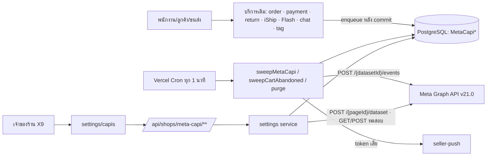
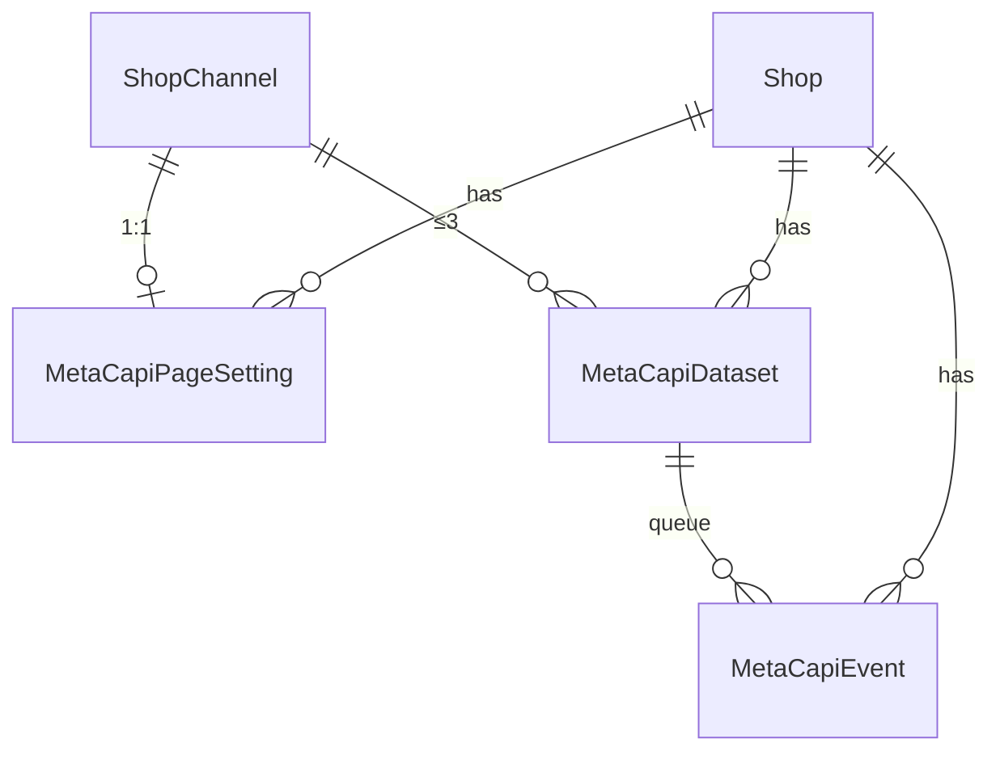

> **โมดูล:** 00089 - Meta Conversion API
> **ประเภทเอกสาร:** Software Requirements Specification (SRS) - TECHNICAL
> **เวอร์ชัน:** 1.0
> **วันที่จัดทำ:** 2026-11-11
> **สถานะ:** Draft — เขียนจากโค้ดที่ implement แล้วบน working tree (ยังไม่ commit · ยังไม่ merge)
> **เจ้าของเอกสาร:** SA (ดู [[Feature-Docs-Ownership]])

# SRS: ส่งยอดขายและเหตุการณ์จากแชท Messenger กลับไปให้ Meta (Software Requirements Specification — Technical)

---

## 1. บทนำ (Introduction)

### 1.1 วัตถุประสงค์ของเอกสาร

กำหนดข้อกำหนดเชิงเทคนิค ("ระบบทำอย่างไร") ของฟีเจอร์ 00089 ที่ trace กลับ FR-001..013 / BR-CAPI-01..09 ใน [[BRD]] ได้ · ผู้อ่าน: DEV / QA / DevOps · **ทุกข้อเขียนจากโค้ดที่อ่านจริง ไม่ใช่จากความจำ** — จุดที่โค้ดไม่ตรง PRD/BRD บันทึกไว้ใน §8.2

### 1.2 ขอบเขตเชิงระบบ (System Scope)

- **ในขอบเขต:** เข้าคิวเหตุการณ์จากห้องแชท **Messenger** ที่มี PSID → ส่ง Conversions API for Business Messaging → dataset ของร้าน · ตั้งค่า 3 หน้า (เจ้าของร้าน) · cron ส่ง/ลองใหม่/purge · แจ้งเตือนเมื่อ token เสีย
- **นอกขอบเขต:** Instagram/LINE/หน้าร้าน · ข้อมูลลูกค้าแฮช · Pixel · ส่งย้อนหลัง · ไอคอนสถานะบนการ์ดออเดอร์ · ตัวเลือก "ไม่รวมค่าส่ง"

### 1.3 เอกสารอ้างอิง

| เอกสาร | ความสัมพันธ์ |
|---|---|
| [[PRD]] | เป้าหมายธุรกิจ · Q1–Q5 |
| [[BRD]] | FR-001..013 · BR-CAPI-01..09 |
| [[SDS]] · [[API]] · [[DATABASE]] | การออกแบบ · สัญญา · โครงข้อมูล |
| `Design-Spec.md` | UX + D1–D7 |
| `docs/SRS.md` §3.4 · §5.5 · §6.78 · §7.20 · §7.35 · §8.21 · §9.17 · §10.24 | สำเนาที่ sync เข้า SRS รวมของระบบ (HR11) |

### 1.4 นิยามและตัวย่อ

| คำ/ตัวย่อ | ความหมายเชิงเทคนิค |
|---|---|
| **CAPI** | Conversions API for Business Messaging (`action_source = business_messaging`, `messaging_channel = messenger`) |
| **PSID** | `ExternalContact.externalUserId` ของห้อง Messenger |
| **dataset** | `MetaCapiDataset` 1 แถว ↔ Dataset ID ของ Meta · ≤3 ต่อเพจ |
| **outbox / แถวคิว** | `MetaCapiEvent` 1 แถว = เหตุการณ์ 1 ตัว → dataset 1 ตัว |
| **dedupeKey** | คีย์กันซ้ำ unique ต่อ dataset (BR-CAPI-01) |
| **X9** | capability ตั้งค่า CAPI = เจ้าของเท่านั้น |
| **ร้านทดลอง** | ร้านใน `META_CAPI_PILOT_SHOP_IDS` |
| **ผู้ชนะ** | ผู้ที่ conditional write (`updateMany` count>0) สำเร็จ — เข้าคิวเฉพาะฝั่งนี้ (BR-CAPI-03) |

---

## 2. ภาพรวมสถาปัตยกรรม (Architecture Overview)

### 2.1 บริบทระบบ (System Context)

### 2.2 องค์ประกอบหลัก (Components)

| Component | หน้าที่ | Submodule / Stack |
|---|---|---|
| **`src/lib/meta-capi/*`** | gate · events · triggers · payload · classify · ui · stats · route-helpers (ส่วนใหญ่ pure) | TypeScript |
| **`meta-capi.service.ts`** | enqueue (order/message/tag) · sweepCartAbandoned · sweepMetaCapi · purge | Prisma + fetch |
| **`meta-capi-settings.service.ts`** | อ่าน/แก้ตั้งค่า · dataset · ทดสอบ · log | Prisma + fetch |
| **routes** | `/api/shops/meta-capi/**` (9 เมธอด) · `/api/cron/meta-capi` | Next.js route handlers |
| **UI** | `settings/capis/**` 3 หน้า (Paces) | React 19 client + RSC |
| **จุดเรียกในบริการเดิม** | 13 ไฟล์ | ดู SDS §3.2 |

รายละเอียดเชิงออกแบบดู [[SDS]]

### 2.3 มุมมองการ Deploy (Deployment View)

Vercel serverless + Vercel Cron `* * * * *` → `/api/cron/meta-capi` · PostgreSQL 16 Supabase · ไม่มี worker/คิวภายนอก · env: `OPEN_META_CAPI` · `META_CAPI_PILOT_SHOP_IDS` · `CRON_SECRET` (+ `CHANNEL_TOKEN_KEY` เดิม) — ดู §7.4

---

## 3. ข้อกำหนดเชิงฟังก์ชันเชิงเทคนิค (Technical Functional Requirements)

### TFR-001: สวิตช์ระบบ + ร้านทดลอง
- **Trace to:** FR-001 · BR-CAPI-08
- **คำอธิบายเชิงเทคนิค:** `isMetaCapiEnabled(shopId?)` (`gate.ts`) = `process.env.OPEN_META_CAPI.trim() === "1"` ∧ (รายชื่อ `META_CAPI_PILOT_SHOP_IDS` (split `,` + trim + กรองว่าง) ว่าง ∨ `shopId` อยู่ในรายชื่อ) · ไม่ส่ง `shopId` ขณะมีรายชื่อ = ปิด · ใช้ที่: `resolveTarget` (enqueue) · `sweepMetaCapi` (ข้ามแถวของร้านที่ไม่ผ่าน — ไม่จอง) · `gate()` ในทุกฟังก์ชัน settings service (`FEATURE_DISABLED` → 404) · 3 หน้า (`notFound()`) · เมนู (`applyMetaCapiMenu`) · ทางลัด/chip
- **Precondition:** อ่าน env ทุกครั้งที่เรียก (ไม่ cache)
- **Postcondition:** ไม่ตั้ง env = ไม่มีแถวเข้าคิว · ไม่มีการเรียก Meta จาก settings · API ตอบ 404
- **Error / Edge cases:** ค่าอื่นที่ไม่ใช่ `"1"` (เช่น `true`) = ปิด · ร้านถูกเอาออกจากรายชื่อ = แถวค้าง `PENDING` ไม่ถูกส่ง (และไม่ถูกลบ) · `sweepCartAbandoned` ไม่เรียก gate ตรง แต่ `resolveTarget` กั้นก่อนเข้าคิว

### TFR-002: ตั้งค่าต่อเพจ
- **Trace to:** FR-002
- **คำอธิบายเชิงเทคนิค:** `updateCapiPage` → `loadChannel(shopId, channelId)` (`ShopChannel` ของร้านนี้ ∧ `provider='MESSENGER'` ∧ `status='ACTIVE'`) → upsert `MetaCapiPageSetting` (`@@unique shopChannelId`) · `enabledAt = now` เฉพาะเมื่อ `input.enabled === true ∧ !existing?.enabled` · `resolveTarget` ไม่เข้าคิวถ้า `!enabled ∨ !enabledAt ∨ enabledAt > at`
- **Postcondition:** เหตุการณ์ที่เกิดก่อน `enabledAt` ไม่เข้าคิว · ปิดเพจ = ไม่มีเหตุการณ์ใหม่เข้าคิว แต่ **แถวที่เข้าคิวแล้วยังถูกส่ง** (ตัวส่งไม่ตรวจ `setting.enabled`)
- **Error / Edge cases:** เพจ `TOKEN_INVALID`/`DISCONNECTED` = `NOT_FOUND` (ดู §8.2 ข้อ 6) · UI ปิดสวิตช์เมื่อ dataset=0 แต่ API เปิดได้

### TFR-003: dataset (PAGE / MANUAL ≤3)
- **Trace to:** FR-003
- **คำอธิบายเชิงเทคนิค:** `addCapiDataset` — นับ dataset ของเพจ ≥3 = `DATASET_LIMIT` (นับแล้วสร้างไม่ล็อก — shortcut ระบุใน comment) · `MANUAL`: `datasetId` ตรง `^\d{1,32}$` · token ไม่ว่าง ≤512 ไม่มีช่องว่าง → `encryptToken` → `tokenEnc` · `PAGE`: ถอดรหัส `ShopChannel.accessTokenEnc` → `POST {GRAPH_BASE}/{externalId}/dataset` body `{}` → `id` ตัวเลข ≤32 · ซ้ำ `(shopChannelId, datasetId)` → P2002 → `DATASET_DUPLICATE` · events ตั้งต้น `["PURCHASE"]`
- **Postcondition:** response ผ่าน `toPublic()` ไม่มี `tokenEnc` (มี `hasToken`)
- **Error / Edge cases:** Meta กลุ่ม STOP ขณะขอ dataset = `PAGE_EVENTS_PERMISSION` · อื่น = `META_ERROR` · ลบ dataset = แถวคิวหายตาม · dataset อื่นคงตัวตน (คีย์ unique ต่อ dataset)

### TFR-004: ปุ่มทดสอบ
- **Trace to:** FR-004
- **คำอธิบายเชิงเทคนิค:** `testCapiDataset` — **ไม่เข้าคิว/ไม่เขียน `MetaCapiEvent`** · มี `testEventCode` (≤64) → `PSID` จากห้อง Messenger ล่าสุดของเพจ (`lastMessageAt desc`) → `buildCapiBody({Purchase, value:1, testEventCode})` (ไม่ใส่ `event_id`) → `POST …/events` · ไม่มี → `GET …/{datasetId}?fields=id`
- **Postcondition:** `{ok, unverified?, eventsReceived?, message}` · Test Event Code ไม่ถูกเก็บ (Design-Spec D6)
- **Error / Edge cases:** มี code แต่ไม่มีห้อง = `NO_CONVERSATION` · ถอดรหัส token ไม่ได้ = `META_ERROR` · อ่านโหนดไม่ได้เพราะสิทธิ์อื่น (ไม่ใช่ 190/102) = `ok:true, unverified:true`

### TFR-005: เปิด/ปิดเหตุการณ์ต่อ dataset
- **Trace to:** FR-005
- **คำอธิบายเชิงเทคนิค:** `MetaCapiDataset.events: string[]` — ค่าต้องอยู่ใน `SELECTABLE_EVENTS` (12 ตัว = `CAPI_EVENTS` · ไม่มี PaymentSlipAttached) · `insertRows` ค้น dataset ของเพจที่ `events hasSome keys` แล้วสร้าง 1 แถวต่อ (dataset × เหตุการณ์ที่เปิด)
- **Postcondition:** เหตุการณ์ที่ dataset ไม่ได้เปิด = ไม่เข้าคิวของ dataset นั้น

### TFR-006: จังหวะ Purchase + ออเดอร์ร่าง
- **Trace to:** FR-006
- **คำอธิบายเชิงเทคนิค:** `eventsForTrigger(trigger, {purchaseAt, countPromotedDraft})` (pure):

| Trigger | `CREATE` | `CONFIRM` | `PAYMENT` |
|---|---|---|---|
| `CREATED` | OrderCreated + Purchase | OrderCreated | OrderCreated |
| `DRAFT_PROMOTED` | `countPromotedDraft` ? (เหมือน `CREATED`) : ไม่มีอะไร | (เหมือนกัน) | (เหมือนกัน) |
| `CONFIRMED` | — | Purchase | — |
| `FULLY_PAID` | — | Purchase | Purchase |
| `SLIP`/`SHIPPED`/`DELIVERED`/`CANCELED`/`RETURNED` | AddPaymentInfo/OrderShipped/OrderDelivered/OrderCanceled/OrderReturned (ไม่ขึ้นกับ `purchaseAt`) | | |

  Purchase ส่งครั้งเดียวต่อออเดอร์ต่อ dataset ด้วย `dedupeKey = purchase:<orderId>` — เปลี่ยนจังหวะทีหลังก็ไม่ส่งซ้ำ
- **Edge cases:** "ชำระครบ" มาจาก 4 ทาง (ดู SDS §3.2): `recordPayment` (`money.fullyPaid` จากตัวคำนวณการชำระกลาง) · `setCodReceived` · `setPaymentConfirmed` · `settleCodFromCarrier` — **3 ทางหลังเรียกโดยไม่ผ่าน `money.fullyPaid`** (ถือว่าร้านยืนยัน/ได้เงินปลายทางแล้ว = ชำระตามนิยาม `isOrderUnpaid`) · ออเดอร์ `CANCELLED` ไม่ส่งอะไรนอกจาก `CANCELED` (กัน COD ปิดยอดทีหลังเป็น Purchase)

### TFR-007: ยอดและแนบสินค้า
- **Trace to:** FR-007 · BR-CAPI-04
- **คำอธิบายเชิงเทคนิค:** `orderValue(o, mode) = round2(max(0, Number(totalAmount) − (mode==='NO_VAT' ? Number(vatAmount ?? 0) : 0)))` · `totalAmount` = ตัวเดียวกับหน้าคำสั่งซื้อ (HR16 — ไม่คิดใหม่) · `valueMode` ตั้งต่อเหตุการณ์ใน `eventOptions` (ค่าตั้งต้น `NET`) · `sendContents` → `items: [{id: productId ?? item.id, quantity: qty, price}]` · `buildCapiBody`: `currency=THB` · `num_items = Σ quantity` · `contents` เฉพาะ ≤100 รายการ · `ViewContent` แนบสินค้าเสมอ (ไม่ขึ้นกับ `sendContents`) · `InitiateCheckout` payload = `{orderId}` (ไม่มียอด → ไม่มี `custom_data`)
- **Postcondition:** ยอดที่ส่ง = ภาพนิ่ง ณ ตอนเข้าคิว
- **Edge cases:** ดู §8.2 ข้อ 4 (`CART_ABANDONED` เสนอ "แนบสินค้า" ใน UI แต่โค้ดไม่ใช้)

### TFR-008: เหตุการณ์จากคำสั่งซื้อ
- **Trace to:** FR-008 · BR-CAPI-01/03
- **คำอธิบายเชิงเทคนิค:** `enqueueOrderCapi(db, orderId, trigger)` → ออเดอร์ต้องมี `conversationId` ∧ `!isDryRun` → `resolveTarget` (ห้อง `shopId` ตรง ∧ `channel='MESSENGER'` ∧ มี `shopChannelId` ∧ มี PSID + `ShopChannel.externalId` ∧ ตั้งค่า `enabled` ∧ `enabledAt ≤ at` ∧ gate) → `insertRows` · wrapper `enqueueOrderCapiAfterCommit` ห่อ try/catch (log ไม่ throw) · จุดเรียกทั้งหมดอยู่ใน SDS §3.2 (เฉพาะผู้ชนะ conditional write)
- **Edge cases:** ไม่ผูกห้อง/ไม่ใช่ Messenger/ไม่มี PSID = ไม่เข้าคิว · ทิ้งออเดอร์ร่าง ≠ `cancelOrder` จึงไม่ส่ง `OrderCanceled` · `cancelOrder` ของร้านที่ไม่ใช่บริการใช้ `update` ไม่ใช่ conditional — การกันซ้ำพึ่ง `dedupeKey` · process ตายระหว่าง commit→เข้าคิว = เหตุการณ์หาย 1 ตัว (ยอมรับ)

### TFR-009: เหตุการณ์จากห้องแชท
- **Trace to:** FR-009
- **คำอธิบายเชิงเทคนิค:** `enqueueSentMessageCapi(messageId)` เรียกใน `deliverHead` หลังแถวเป็น `SENT` · `type='ORDER'` ∧ `orderRefToken` → หาออเดอร์ (`publicToken` ∧ `shopId`) → `InitiateCheckout` (`initiate_checkout:<orderId>`) · `type='PRODUCT'` → สินค้า (`productRefIds ∪ productRefId`, ของร้านนี้) → `ViewContent` ต่อสินค้า (`view_content:<conv>:<product>:<YYYY-MM-DD เวลาไทย>` · ราคาสินค้า) · `sweepCartAbandoned` (cron): การ์ดออเดอร์ `SENT` อายุ 24–72 ชม. ของเพจที่เปิด ∧ มี dataset เปิด `CART_ABANDONED` (`take 500`) → ข้ามใบที่เข้าคิวแล้ว → ออเดอร์ `status='PENDING' ∧ slipFileId=null ∧ !isDryRun ∧ isOrderUnpaid(...)` → เข้าคิว `cart_abandoned:<chatMessageId>` · `resolveTarget` เทียบ `enabledAt` กับเวลาส่งการ์ด (การ์ดก่อนเปิดไม่นับ)
- **Edge cases:** เกิน 72 ชม. ไม่ส่ง · `eventTime` ของ CartAbandoned = เวลากวาด (`now`) ไม่ใช่เวลาส่งการ์ด

### TFR-010: กฎแท็ก → Lead
- **Trace to:** FR-010 · BR-CAPI-02
- **คำอธิบายเชิงเทคนิค:** `enqueueTagLeadCapi(conversationId, addedTagNames)` → `rules` จาก `eventOptions[LEAD_SUBMITTED|QUALIFIED_LEAD].rules` → จับคู่ `tagNameKey(added)` กับ `ShopTag.nameKey` ของ `tagId` ใน rules (ของร้านนี้) → ต่อกฎที่ตรง: ตรวจแถว `MetaCapiEvent` ของห้อง+`eventKey` ที่ `dedupeKey startsWith "<key>:<conv>:<tagId>:"` ภายใน 30 วัน (`createdAt`) — มี = ข้าม · ไม่มี → เข้าคิว `dedupeKey = prefix + epoch ms` · payload `{value: valueBaht}` หรือ `{}` · caller ส่งเฉพาะแท็กที่ **เพิ่งติด** (`applyKeywordTags`: `updateMany count===1`; `updateConversationCrm`: เทียบ `tagsBefore`)
- **Edge cases:** ติดแท็กล้ม/เข้าคิวล้ม = ไม่ทำให้อีกฝั่งล้ม (try/catch) · ดู §8.2 ข้อ 2–3 (ลบแท็กที่ผูกกฎ · ความหมาย "ไม่นับครั้งที่ถูกยกเลิก")

### TFR-011: คิว + ลองใหม่
- **Trace to:** FR-011 · BR-CAPI-05/07
- **คำอธิบายเชิงเทคนิค:** `sweepMetaCapi` — เลือก `PENDING ∧ nextAttemptAt ≤ now ∧ (lockedAt null ∨ lockedAt < now−3 นาที) ∧ dataset.status='ACTIVE'` เรียง `nextAttemptAt` `take 100` → ต่อแถว (ตามลำดับ): `isMetaCapiEnabled(shop)` ✗ = ข้าม · จอง `updateMany{id, status:'PENDING', lockedAt:<ค่าที่อ่าน>} → lockedAt=now` (count 0 = แพ้) · `now − eventTime > 7 วัน` → `SKIPPED/TOO_OLD` · สร้าง body (`event_id = dedupeKey`) · token = `decryptToken(MANUAL ? tokenEnc : shopChannel.accessTokenEnc)` · `POST …/events` Bearer · บันทึกผล: `OK`→`SENT`+`sentAt` · `RETRY ∧ attempts+1<3` → `PENDING` `nextAttemptAt = now+[60s,300s][attempts]` reason `RETRYING` · `RETRY` ครบ 3 → `FAILED/MAX_ATTEMPTS` · `FAIL` → `FAILED/REJECTED` · `lastRequest/lastResponse` ตัด ≤4000 ตัวอักษร · `purgeOldMetaCapiEvents` ลบ `createdAt < now − 180 วัน (ยกเลิกแล้ว 2026-11-14 — บันทึกการส่งเก็บถาวร ไม่ลบ)`
- **Edge cases:** ถอดรหัส token ล้ม/fetch throw = `httpStatus 0` → `RETRY` · กวาดหลายตัวชนกัน → ผู้แพ้จอง count 0 ข้าม · ล็อกค้าง >3 นาที ยึดต่อได้ · `eventTime` ไม่เลื่อน

### TFR-012: หยุดเมื่อ token เสีย
- **Trace to:** FR-012 · BR-CAPI-06
- **คำอธิบายเชิงเทคนิค:** ผล `STOP` → `$transaction`: `metaCapiDataset.updateMany{id, status:'ACTIVE'} → STOPPED + stoppedAt + stoppedReason(≤300)` + แถวนี้ `lockedAt=null, reason='TOKEN_OR_PERMISSION'` (ไม่นับ attempts) · `flipped.count===1` → `pushMetaCapiStopped` (ผู้ถือ `H3`; `{type:'channel-health', url:'/settings/capis'}`) · dataset ที่เพิ่งหยุดถูกจำใน `stoppedNow` ไม่ยิงแถวที่เหลือในรอบเดียวกัน · ปลุก: `upsertChannel` (เชื่อมเพจที่มีอยู่แล้ว: `metaCapiDataset.updateMany{shopChannelId, source:'PAGE', status:'STOPPED'} → ACTIVE`) · `resumeCapiDataset` (API) · `updateCapiDataset` ใส่ token ใหม่ (MANUAL)
- **Edge cases:** ปลุกโดยไม่เรียก Meta — ยังไม่มีสิทธิ์จริง = หยุดอีก + push อีก · แถวที่เก่าเกิน 7 วันตอนปลุก = `SKIPPED`

### TFR-013: บันทึกการส่ง
- **Trace to:** FR-013
- **คำอธิบายเชิงเทคนิค:** `listCapiLog` (กรอง `status`/`eventKey` · cursor keyset `createdAt desc, id desc` · `take` 1–50 ค่าตั้งต้น 20 · select ชัดเจน ไม่มี `psid`/`lastRequest`/`lastResponse`) · `listCapiPages` นับ `sent7d` · `getCapiWeekStats` (หน้า detail: sent/failed/pending ใน 7 วัน + `lastSentAt`) · `capiReasonKey` แปลง `reason` เป็นคีย์ข้อความไทย (ไม่ปล่อยรหัสดิบของ Meta)

---

## 4. ข้อกำหนดส่วนต่อประสาน (Interface / API Specification)

### 4.1 API Endpoints

| Method | Path | คำอธิบาย | Auth |
|---|---|---|---|
| GET | `/api/shops/meta-capi` | รายการเพจ + สถานะ | session · X9 |
| GET / PUT | `/api/shops/meta-capi/{channelId}` | อ่าน/บันทึกตั้งค่าเพจ | X9 |
| POST | `…/{channelId}/datasets` | เพิ่ม dataset | X9 |
| PATCH / DELETE | `…/{channelId}/datasets/{datasetRowId}` | แก้/ลบ dataset | X9 |
| POST | `…/datasets/{datasetRowId}/test` | ทดสอบ | X9 |
| POST | `…/datasets/{datasetRowId}/resume` | ปลุก dataset PAGE | X9 |
| GET | `…/{channelId}/log` | บันทึกการส่ง | X9 |
| GET | `/api/cron/meta-capi` | ตัวส่ง + กวาด + purge | `Bearer CRON_SECRET` |

### 4.2 รายละเอียดต่อ Endpoint

ดู [[API]] (สัญญาเต็ม request/response/error)

### 4.3 Events / Messaging

| Event / Queue | Producer | Consumer | Payload |
|---|---|---|---|
| `MetaCapiEvent` (outbox) | บริการเดิม ผ่าน `enqueue*` | `sweepMetaCapi` | `{value?, orderId?, items?}` + ภาพนิ่ง `pageId/psid/eventTime` |
| Meta CAPI | `sweepMetaCapi` / ปุ่มทดสอบ | Meta Graph | `buildCapiBody` (API §6) |

### 4.4 Sequence ของ flow สำคัญ

ดู [[SDS]] §4.1 (เหตุการณ์ถึง Meta) · §4.3 (token เสีย) · §4.4 (เพิ่ม dataset)

---

## 5. ข้อกำหนดด้านข้อมูล (Data Requirements)

### 5.1 Data Model / Entities

| Entity | คำอธิบาย | Owner store |
|---|---|---|
| **MetaCapiPageSetting** | ตั้งค่าต่อเพจ (1:1 `ShopChannel`) | PostgreSQL |
| **MetaCapiDataset** | dataset ปลายทาง ≤3 ต่อเพจ + `tokenEnc` (MANUAL) | PostgreSQL |
| **MetaCapiEvent** | คิวส่ง + บันทึกผล | PostgreSQL |

### 5.2 ความสัมพันธ์ (ERD)

รายละเอียดคอลัมน์/ดัชนี: [[DATABASE]]

### 5.3 Migration / Data Lifecycle

migration เดียว `20261111100000_00089_meta_capi` (additive · 3 ตาราง · FK Cascade · ไม่มี CHECK · ไม่มี backfill) · retention แถวคิว 180 วัน (ยกเลิกแล้ว 2026-11-14 — บันทึกการส่งเก็บถาวร ไม่ลบ) · HR15 (push `main` = `migrate deploy` บน prod)

---

## 6. ข้อกำหนดที่ไม่ใช่ฟังก์ชัน (Non-Functional Requirements)

| ด้าน | ข้อกำหนด | เป้าหมายที่วัดได้ |
|---|---|---|
| **Performance** | จุดเกิดเหตุการณ์ทำเพียง 1 อ่านห้อง + 1 อ่านตั้งค่า + `createMany` ไม่เรียก Meta · ส่งผ่าน cron ทุก 1 นาที | การกระทำเดิมช้าลง ≤ การเขียน 1 แถว · p95 ถึง Meta ≤ 2 นาที (PRD) |
| **Scalability** | ตัวส่ง `take 100`/รอบ ต่อเนื่องทีละแถว · `sweepCartAbandoned` `take 500` | ≤100 แถว/นาที/ระบบ (เพดานโดยการออกแบบ — ปริมาณเกินต้องปรับ `limit`) |
| **Availability** | cron ล่ม/Meta ล่ม = แถวสะสม รอ ไม่หาย (ภายใน 7 วัน) | ไม่ทำให้ธุรกิจหลักล้ม |
| **Security** | X9 (เจ้าของ) ทุก route · no-store · ตรวจ `shopId` ใน `where` แรก · `tokenEnc` เข้ารหัส ไม่ออก client ไม่ log · Meta id (เพจ/dataset) ตรวจ `^\d{1,32}$` ก่อนต่อใน URL · cron reject เมื่อ `CRON_SECRET` ว่าง · ข้อมูลลูกค้าที่ออก = `page_id` + PSID เท่านั้น | ไม่มี token ใน response/log/`lastRequest` |
| **Observability** | `console.log("[meta-capi-sweep]", summary)` ต่อรอบ · `console.error` ที่ enqueue/route ล้ม (ไม่ log body/token) · บันทึกการส่งในหน้า 3 · `lastHttpStatus/lastRequest/lastResponse` ต่อแถว | summary `{sent, failed, retried, stopped, skipped, cartAbandoned, purged}` |
| **Maintainability** | ตัวตัดสินล้วนแยกไฟล์ pure + เทส · เพิ่มเหตุการณ์ใหม่ลืมจัดกลุ่ม UI = เทสแดง · เพิ่ม `CapiErrorCode` ลืมแมป HTTP = tsc แดง | ดู TestCase |

---

## 7. ข้อจำกัดทางเทคนิคและการพึ่งพา (Technical Constraints & Dependencies)

### 7.1 ข้อจำกัดทางเทคนิค

- Messenger เท่านั้น (ต้องมี PSID) · Meta ไม่รับเหตุการณ์เก่ากว่า 7 วัน · Meta ไม่มีการถอนเหตุการณ์ (ยกเลิก/คืนของส่ง OrderCanceled/OrderReturned ไม่ถอน Purchase — Q3)
- ระบบใช้เวลาไทยคงที่ UTC+7 (`bkkDate = +7h`) · ไม่มีค่าเขตเวลาต่อร้าน
- `fetch` ไม่มี timeout เฉพาะ (พึ่ง `maxDuration 60` ของ cron) — ดู SDS TD-007

### 7.2 การพึ่งพาภายนอก/ภายใน

| Dependency | ประเภท | ความเสี่ยง |
|---|---|---|
| **Meta Graph API v21.0** (`GRAPH_BASE`) | external | ล่ม/ช้า → ลองใหม่ ≤3 ครั้ง แล้ว `FAILED` |
| **สิทธิ์ `page_events` ของ token เพจ** | external (สิทธิ์แอป) | ไม่มี = เพิ่ม dataset ทางอัตโนมัติไม่ได้ + ส่งทาง PAGE ถูก STOP — ดู §7.5 |
| **Vercel Cron** | platform | ไม่ยิง = ไม่ส่ง |
| **`token-crypto` (`CHANNEL_TOKEN_KEY`)** | internal | ถอดรหัสไม่ได้ = ส่งไม่ได้ |
| **`seller-push`** | internal | แจ้งไม่ถึง = เจ้าของไม่รู้ว่าหยุด |
| **ระบบแท็ก 00083 / ออเดอร์ร่าง 00061 / การชำระ (`order-payment-state`)** | internal | จุดเกิด + `isOrderUnpaid` |

### 7.3 สมมติฐานทางเทคนิค (Assumptions)

- เพจ Messenger ที่ ACTIVE มี `ShopChannel.externalId` = Page ID ตัวเลข
- `Conversation.externalContact.externalUserId` = PSID ของเพจนั้น
- Meta ยอมรับ `event_id` ใน body ของ Business Messaging (ใช้กันนับซ้ำเมื่อส่งซ้ำหลังล่มกลางทาง)

### 7.4 ตัวแปรสภาพแวดล้อม (Env)

| env | ใช้ที่ | จำเป็น | หมายเหตุ |
|---|---|---|---|
| `OPEN_META_CAPI` | `src/lib/meta-capi/gate.ts::isMetaCapiEnabled` | ไม่ | `1` = เปิด · **ค่าอื่นทุกค่า/ไม่ตั้ง = ปิดทุกร้าน** |
| `META_CAPI_PILOT_SHOP_IDS` | `gate.ts` | ไม่ | id ร้านคั่น comma · ตั้งไว้ = เฉพาะร้านในรายชื่อ · **ว่าง = ทุกร้าน (เมื่อ `OPEN_META_CAPI=1`)** |
| `CRON_SECRET` (**มีอยู่แล้ว**) | `src/app/api/cron/meta-capi/route.ts` | ใช่ (สำหรับ cron) | `Authorization: Bearer ${CRON_SECRET}` · ว่าง = 401 ทุกคำขอ |
| `CHANNEL_TOKEN_KEY` (**มีอยู่แล้ว**) | `src/lib/token-crypto.ts` | ใช่ | เข้ารหัส/ถอดรหัส `tokenEnc` และ `ShopChannel.accessTokenEnc` |

ไม่มี secret ใหม่ · URL ของ Meta ฝังในโค้ด (`GRAPH_BASE`) ไม่รับจากผู้ใช้

### 7.5 หมายเหตุเรื่องสิทธิ์ Meta (ทางอัตโนมัติ)

- **ทางหลัก (`source=PAGE`)** ใช้ token เพจที่ร้านเชื่อมอยู่ — ต้องมีสิทธิ์ **`page_events`**
- ณ ตอนเขียนเอกสารนี้ แอป **"Deep Chat & LIVE" (App ID `1570859340799126`) ยังไม่ได้ตั้งสิทธิ์ `page_events` ระดับ Standard** — ต้องเพิ่มที่ App Dashboard **และ** ใน Configuration ของ Facebook Login for Business (`config_id` `1080845061590909`) ก่อน · เพจที่เชื่อมไว้ก่อนเพิ่มสิทธิ์ต้อง **เชื่อมเพจใหม่** (สิทธิ์ผูกกับ token ตอนกดอนุญาต)
- 🛑 ในโค้ดปัจจุบัน `CONNECT_SCOPES` (`src/lib/facebook/constants.ts`) **ไม่มี `page_events`** และไฟล์นั้นไม่ได้ถูกแก้ในงานนี้ — คอมเมนต์ในไฟล์ระบุว่าการแก้สิทธิ์ใน Configuration ต้องแก้ `CONNECT_SCOPES` ให้ตรงกัน (ใช้กับบัญชีทีมที่มี role) · **ยังไม่ได้ตัดสินว่าจะเพิ่มหรือไม่** (ต้องเป็นสิทธิ์ที่ Meta ยอมรับใน dialog ไม่เช่นนั้นเชื่อมเพจไม่ได้ทั้งระบบ — บทเรียน 2026-07-26 ในไฟล์เดียวกัน)
- **ทางรอง (`source=MANUAL`)** ร้านกรอก Dataset ID + token จาก Events Manager — **ไม่ต้องใช้สิทธิ์แอป** ใช้ได้เสมอ
- เปิดทุกร้านต้องขอ Advanced (PRD 4.2)

---

## 8. ความเสี่ยงเชิงสถาปัตยกรรม (Architectural Risks)

### 8.1 ความเสี่ยง

| ความเสี่ยง | ผลกระทบ | แนวทางลด |
|---|---|---|
| **Purchase ซ้ำ** | ROAS เพี้ยน | `UNIQUE(datasetRowId, dedupeKey)` + เข้าคิวเฉพาะผู้ชนะ + `event_id` ให้ Meta ตัดซ้ำ |
| **เหตุการณ์หายเงียบ (process ตายระหว่าง commit→enqueue)** | ขาด 1 เหตุการณ์ | ยอมรับ (shortcut ใน comment) |
| **`fetch` ไม่มี timeout / ส่งทีละแถว** | Meta ช้า → รอบ cron เต็ม 60 วินาที ไม่ทัน | ล็อกหมดอายุ 3 นาที ยึดคืน · อัปเกรดเมื่อเกิดจริง |
| **token เพจไม่มี `page_events`** | ทางอัตโนมัติใช้ไม่ได้ | ทางกรอกเอง · §7.5 |
| **purge ไม่มี index `createdAt`** | ตารางโตแล้วลบช้า | เพิ่ม index เมื่อจำเป็น |
| **ไม่มี CHECK constraint ที่ฐาน** | ค่าผิดรูปจากทางอื่นเข้าได้ | service/Valibot บังคับ (ทางเขียนมีทางเดียว) |

### 8.2 ข้อขัดแย้งระหว่างเอกสารกับโค้ด และข้อจำกัดที่ยืนยันจากโค้ด

| # | หัวข้อ | เอกสาร | โค้ดจริง |
|---|---|---|---|
| 1 | **token เสีย หยุดระดับไหน** | PRD §3.6 "หยุดส่งทั้งเพจ" · BRD FR-012 "หยุดทั้ง dataset" | หยุด **ทีละ dataset** (`MetaCapiDataset.status`) — เพจที่มี dataset หลายตัว หยุดเฉพาะตัวที่ token เสีย (ตรงกับ BRD) |
| 2 | **ลบแท็กที่ผูกกฎ** (BRD FR-010 "กฎหายจากหน้าจอ ไม่จุดอีก") | กฎหายจากหน้าจอ | กฎ **ไม่จุดอีก** จริง (หา `ShopTag` ไม่เจอ) แต่ **`deleteShopTag` ไม่ล้างกฎใน `eventOptions`** และ UI `RulesCard` ยังเก็บ `tagId` ค้างใน draft → การ PUT `eventOptions` ครั้งถัดไป (รวมการเปลี่ยน valueMode ของเหตุการณ์อื่น เพราะส่งทั้งก้อน) ถูก `sanitizeEventOptions` ปฏิเสธ `INVALID_INPUT "มีแท็กที่ไม่ใช่ของร้านนี้"` · ไม่มีเทสครอบ |
| 3 | **ด่าน 30 วันของ Lead** (BRD FR-010 "ไม่นับครั้งที่ถูกยกเลิก") | ยกเว้นครั้งที่ถูกยกเลิก | ไม่มีสถานะ "ยกเลิก" ในคิว (`PENDING/SENT/FAILED/SKIPPED`) — นับ **ทุกสถานะ** ของแถวเดิมใน 30 วัน (รวม `FAILED`/`SKIPPED`) |
| 4 | **ตัวเลือก "แนบสินค้า" ของ CartAbandoned** | BRD FR-007 "เปิดแนบสินค้าได้ต่อเหตุการณ์ที่มียอด" | UI (`AMOUNT_EVENT_KEYS`) เสนอ `valueMode` + `sendContents` ให้ `CART_ABANDONED` แต่ `sweepCartAbandoned` ใช้เฉพาะ `valueMode` — `sendContents` **ไม่มีผล** (payload ไม่มี `items`) |
| 5 | **`event_id`** | PRD §5 "Business Messaging ไม่ใช้ event_id ตัดซ้ำ" | โค้ดส่ง `event_id = dedupeKey` ทุกเหตุการณ์จริง (กันนับซ้ำเมื่อส่งสำเร็จแต่บันทึกผลไม่ทัน · มีเทสยืนยัน) — ปุ่มทดสอบไม่ใส่ |
| 6 | **เพจที่ token เสียมองไม่เห็น** | `ChannelsClient` comment "เพจที่ token เสียเข้าไปดูสถานะ/เชื่อมใหม่ได้" · BRD FR-012 push "แตะเพื่อเชื่อมใหม่" | `loadChannel`/`listCapiPages` กรอง `ShopChannel.status='ACTIVE'` — เพจที่ระบบพลิกเป็น `TOKEN_INVALID` (เมื่อส่งแชทพบ token ตาย) จะหายจากรายการ และหน้า detail ได้ 404 → เจ้าของไม่เห็นป้าย "หยุด"/ปุ่มเชื่อมใหม่ในหน้านี้ (ต้องไปเชื่อมที่ `/settings/channels`) · `resolveTarget` ไม่ตรวจ `ShopChannel.status` จึงยังเข้าคิวและพยายามส่งต่อ |
| 7 | **ผู้รับแจ้งเตือน token เสีย** | BRD FR-012 "แจ้งเจ้าของร้าน" | `pushMetaCapiStopped` ส่งให้ผู้ถือ **`H3` = เจ้าของ + ผู้ดูแล (MANAGER)** แต่หน้าปลายทาง `/settings/capis` เป็น **X9 = เจ้าของเท่านั้น** → ผู้ดูแลที่แตะ push จะเจอ `NoPermissionCard` |
| 8 | **ชำระครบ ≠ `money.fullyPaid` ทุกทาง** | BRD FR-006 "ยอดรับแล้ว ≥ ยอดคำสั่งซื้อ ตามตัวคำนวณการชำระกลาง" | เฉพาะ `recordPayment` ใช้ `money.fullyPaid` · `setPaymentConfirmed` / `setCodReceived` / `settleCodFromCarrier` จุด `FULLY_PAID` ทันทีที่ร้านยืนยัน/ได้เงินปลายทาง (กว้างกว่าที่ BRD ระบุ แต่สอดคล้องนิยาม `isOrderUnpaid`) |
| 9 | **ออเดอร์ `CANCELLED`** | BRD ไม่ระบุ | `enqueueOrderCapi` ไม่ส่งอะไรนอกจาก `CANCELED` เมื่อออเดอร์ยกเลิกแล้ว (มีเทสครอบ) |
| 10 | **BR-CAPI-06 "Missing Permission"** | รหัสกลุ่มหยุดรวม "Missing Permission" | โค้ดนับเฉพาะ `code = 100 ∧ message ตรง /missing permission/i` เป็น `STOP` (code 100 อื่น = `FAIL`) |
| 11 | **ปุ่ม resume** | — | มี API `POST …/resume` แต่ UI ไม่เรียก (ทางที่ UI ใช้ = เชื่อมเพจใหม่ → `upsertChannel` ปลุกเอง · MANUAL = วาง token ใหม่) |
| 12 | **สิทธิ์ `page_events` ใน `CONNECT_SCOPES`** | BRD 7.2 / PRD 9.2 สมมติว่าเชื่อมเพจใหม่หลังเพิ่มสิทธิ์ใน Configuration แล้วจะได้ token | โค้ดไม่ได้แก้ `CONNECT_SCOPES` — ต้องตัดสินใจแยก (§7.5) |
| 13 | **หน้า UI ปิดสวิตช์เมื่อไม่มี dataset** | BRD FR-002 ไม่ระบุ | UI ปิดการกดสวิตช์เมื่อ dataset=0 แต่ API `PUT enabled:true` ทำได้ |

---

## 9. Traceability Matrix

| BRD FR-ID | SRS TFR-ID | Component | สถานะ |
|---|---|---|---|
| FR-001 | TFR-001 | `gate.ts` | Done |
| FR-002 | TFR-002 | `updateCapiPage` · `listCapiPages` | Done |
| FR-003 | TFR-003 | `addCapiDataset` · `updateCapiDataset` · `deleteCapiDataset` | Done |
| FR-004 | TFR-004 | `testCapiDataset` | Done |
| FR-005 | TFR-005 | `insertRows` · `MetaCapiDataset.events` | Done |
| FR-006 | TFR-006 | `triggers.ts` | Done |
| FR-007 | TFR-007 | `payload.ts` | Done (ข้อ 4 ใน §8.2) |
| FR-008 | TFR-008 | `enqueueOrderCapi` + จุดเรียก | Done (บางจุดไม่มีเทส — TestCase) |
| FR-009 | TFR-009 | `enqueueSentMessageCapi` · `sweepCartAbandoned` | Done |
| FR-010 | TFR-010 | `enqueueTagLeadCapi` | Done (ข้อ 2–3 ใน §8.2) |
| FR-011 | TFR-011 | `sweepMetaCapi` · `purgeOldMetaCapiEvents` | Done |
| FR-012 | TFR-012 | `sweepMetaCapi` · `pushMetaCapiStopped` · `upsertChannel` | Done (ข้อ 6–7 ใน §8.2) |
| FR-013 | TFR-013 | `listCapiLog` · `getCapiWeekStats` | Done |

---

## 10. สรุป (Summary)

SRS นี้กำหนดข้อกำหนดเชิงเทคนิคของ **00089 ส่งยอดขายให้ Meta** (13 TFR) ให้ DEV/QA/DevOps นำไป implement/ทดสอบได้ตรงกับ [[PRD]] และ [[BRD]] — โดยบันทึกจุดที่โค้ดไม่ตรงเอกสารไว้ใน §8.2 อย่างตรงไปตรงมา

**ขอบเขตที่ครอบคลุม:**
- สวิตช์ระบบ/ร้านทดลอง · ตั้งค่า · dataset · ทดสอบ · เหตุการณ์ 12 ตัว · จังหวะ Purchase · ยอด · คิว/ลองใหม่/หยุด · บันทึก

**ประเด็นที่ต้องตัดสินใจเพิ่ม (Open Questions):**
- เพิ่ม `page_events` เข้า `CONNECT_SCOPES` หรือไม่ (§7.5)
- แก้ลบแท็กที่ผูกกฎ (§8.2 ข้อ 2) · ให้เพจ `TOKEN_INVALID` ยังเห็นในหน้า CAPI (ข้อ 6) · ผู้รับ push เป็นเจ้าของเท่านั้น (ข้อ 7) — ยังไม่ได้แก้โค้ด (เอกสารนี้ไม่แก้โค้ด)
