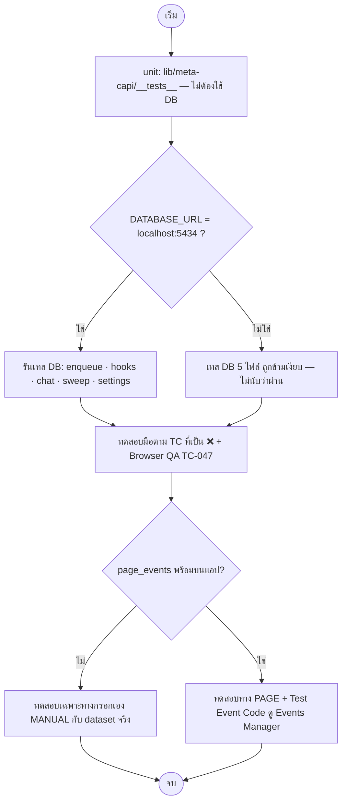

> **โมดูล:** 00089 - Meta Conversion API
> **ประเภทเอกสาร:** Test Case
> **เวอร์ชัน:** 1.0
> **วันที่จัดทำ:** 2026-11-11
> **สถานะ:** Draft — แมปจากไฟล์เทสที่มีอยู่บน working tree · **ยังไม่ได้รันชุดทดสอบในรอบเขียนเอกสาร** (ดู §5)
> **เจ้าของเอกสาร:** QA (ดู [[Feature-Docs-Ownership]])

# Test Case: ส่งยอดขายและเหตุการณ์จากแชท Messenger กลับไปให้ Meta

---

## 1. Overview

เอกสารนี้แมป FR / AC / BR ใน [[BRD]] เข้ากับ **เทสที่เขียนไว้จริง** (ชื่อเทสคัดจากไฟล์) และระบุตรง ๆ ว่าข้อไหน **ไม่มีเทสอัตโนมัติ** — AC ที่ไม่มีเทสอัตโนมัติถูกเขียนเป็นเคสทดสอบมือ (TC ที่ระบุ "มือ") ไม่ได้แปลว่าเคยทดสอบแล้ว

- **เอกสารต้นทาง:** [[BRD]] (FR-001..013 · BR-CAPI-01..09) · ตั้งเลข AC ในเอกสารนี้เองเป็น `FR-0xx.n` ตามลำดับ checkbox ใน BRD ข้อนั้น
- **ประเภทเทส:**

| ชื่อย่อ | ไฟล์ | ชนิด |
|---|---|---|
| **G** | `src/lib/meta-capi/__tests__/gate.test.ts` | unit (pure) |
| **EV** | `…/events.test.ts` | unit |
| **TR** | `…/triggers.test.ts` | unit |
| **PL** | `…/payload.test.ts` | unit |
| **CL** | `…/classify.test.ts` | unit |
| **UI** | `…/ui.test.ts` | unit (ตัวตัดสินฝั่งจอ) |
| **ENQ** | `src/services/__tests__/meta-capi-enqueue.db.test.ts` | DB จริง |
| **HK** | `src/services/__tests__/meta-capi-order-hooks.db.test.ts` | DB จริง (เรียก service เดิมจริง) |
| **CH** | `src/services/__tests__/meta-capi-chat.db.test.ts` | DB จริง |
| **SW** | `src/services/__tests__/meta-capi-sweep.db.test.ts` | DB จริง + fetch ปลอม |
| **ST** | `src/services/__tests__/meta-capi-settings.db.test.ts` | DB จริง + fetch ปลอม |
| **PERM** | `src/lib/shop-permissions.test.ts` (X9) · `src/lib/__tests__/route-capability-inventory.test.ts` | unit / inventory |
| **MENU** | `src/lib/seller-menu.test.ts` (slug `seller:settings-conversions-api` อยู่ในชุดอนุญาต) | unit |
| **CHN** | `src/services/__tests__/shop-channel.service.test.ts` (ปลุก dataset เมื่อเชื่อมเพจใหม่) | unit (mock) |

- **สภาพแวดล้อม:** เทส DB 5 ไฟล์ใช้ `describe.skipIf(!isLocal)` / `describe.skip` — **รันเฉพาะเมื่อ `DATABASE_URL` ชี้ `localhost:5434`** (HR13/HR14 · ไม่ลบข้อมูลนอก id ที่เทสสร้าง) · ฐาน/CI อื่น = ข้ามเงียบ (ดูบทเรียน "แก้ services ต้องรันเทส DB ก่อน push") · `OPEN_META_CAPI` / `META_CAPI_PILOT_SHOP_IDS` ตั้งด้วย `vi.stubEnv` ในเทส
- **ขอบเขต:** in-scope = ตรรกะเข้าคิว/ส่ง/ตั้งค่า/สิทธิ์ · out-of-scope = การรับของ Meta จริง (ใช้ fetch ปลอม) · การตรวจเห็นผลใน Events Manager/Ads Manager (ต้องมือกับ dataset จริง)

---

## 2. Test Scenarios

> รูปแบบ: **Linked** · **Precondition** · **Steps** · **Expected** · **เทสอัตโนมัติ** (ชื่อเทสตามไฟล์ หรือ "ไม่มี — มือ")

### กลุ่ม A — การเปิดฟีเจอร์ (FR-001)

### TC-001: ไม่ตั้งสวิตช์ระบบ = ปิดทุกร้าน
- **Linked to:** FR-001.1 · BR-CAPI-08
- **Precondition:** `OPEN_META_CAPI` ไม่ตั้ง (หรือค่าอื่นที่ไม่ใช่ `1`)
- **Steps:** (1) เรียก `isMetaCapiEnabled` (2) สร้างออเดอร์ในห้อง Messenger ที่เพจเปิดส่ง (3) เรียกฟังก์ชัน settings service ใด ๆ
- **Expected:** `false` · ไม่มีแถวเข้าคิว · settings โยน `FEATURE_DISABLED`
- **เทสอัตโนมัติ:** G "ไม่ตั้งสวิตช์ = ปิดทุกร้าน แม้มีรายชื่อทดลอง" · G "ค่าอื่นที่ไม่ใช่ 1 = ปิด" · ENQ "ปิดสวิตช์ระบบ / ร้านไม่อยู่ในรายชื่อทดลอง = ไม่เข้าคิว" · ST "ปิดสวิตช์ระบบ/ร้านไม่อยู่ในรายชื่อทดลอง = FEATURE_DISABLED ทุกฟังก์ชัน"

### TC-002: รายชื่อร้านทดลอง
- **Linked to:** FR-001.2 · FR-001.3
- **Precondition:** `OPEN_META_CAPI=1`
- **Steps:** (1) ตั้ง `META_CAPI_PILOT_SHOP_IDS=a,b` แล้วถามร้าน a / ร้าน c / ไม่ส่ง shopId (2) ล้างรายชื่อ
- **Expected:** a = เปิด · c = ปิด · ไม่ส่ง shopId = ปิด · รายชื่อว่าง = ทุกร้านเปิด
- **เทสอัตโนมัติ:** G "เปิด + มีรายชื่อ = เฉพาะร้านในรายชื่อ · ไม่ส่ง shopId = ปิด" · G "เปิด + ไม่มีรายชื่อ = ทุกร้าน"

### TC-003: ซ่อนเมนู/ทางลัด/หน้า เมื่อฟีเจอร์ปิด
- **Linked to:** FR-001.1 (ไม่เห็นเมนู · API ตอบปิด)
- **Precondition:** ร้านนอกรายชื่อทดลอง · ล็อกอินเป็นเจ้าของ
- **Steps:** เปิดเมนู ตั้งค่า · เปิด `/settings/conversions-api` ตรง ๆ · เปิดมือถือหน้า "ร้านค้า" · ดู chip บนแถว Messenger ที่ `/settings/channels`
- **Expected:** ไม่มีเมนู/แถวทางลัด/chip · หน้า = 404 (`notFound()`)
- **เทสอัตโนมัติ:** **ไม่มี — มือ** (MENU ตรวจแค่ว่า slug อยู่ในชุดที่อนุญาต ไม่ได้เรียก `applyMetaCapiMenu`)

### TC-004: ร้านถูกเอาออกจากรายชื่อ — แถวค้างไม่ถูกส่ง
- **Linked to:** FR-001.4
- **Precondition:** มีแถว `PENDING` ถึงเวลาส่ง · ร้านไม่อยู่ในรายชื่อทดลอง
- **Steps:** เรียก `sweepMetaCapi`
- **Expected:** ไม่เรียก Meta · แถวยัง `PENDING` ไม่ถูกจอง
- **เทสอัตโนมัติ:** **ไม่มี — มือ** (G ตรวจ gate · SW ไม่มีเคสนี้)

### กลุ่ม B — ตั้งค่าเพจและ dataset (FR-002..004)

### TC-005: เพจที่แสดง = Messenger ที่ ACTIVE ของร้านเท่านั้น
- **Linked to:** FR-002.1
- **Steps:** เรียก service ด้วยช่องของร้านอื่น / ไม่ใช่ Messenger / ไม่ ACTIVE
- **Expected:** `NOT_FOUND` ทุกฟังก์ชัน
- **เทสอัตโนมัติ:** ST "ช่องของร้านอื่น / ไม่ใช่ Messenger = NOT_FOUND ทุกฟังก์ชัน" · ST "ช่องที่ไม่ ACTIVE = NOT_FOUND" · ST "listCapiPages: นับ dataset/anyStopped/sent7d"

### TC-006: `enabledAt` — เปิดครั้งแรกส่งเฉพาะเหตุการณ์หลังจากนี้
- **Linked to:** FR-002.3
- **Steps:** (1) อ่านตั้งค่าเริ่มต้น (2) เปิด (3) บันทึกซ้ำขณะเปิด (4) ปิดแล้วเปิดใหม่ (5) บันทึกขณะปิดโดยไม่แตะ `enabled`
- **Expected:** ค่าเริ่มต้น `{false, null, CREATE, true}` · (2) ตั้ง `enabledAt` · (3) ไม่ขยับ · (4) ตั้งใหม่ · (5) ยัง null
- **เทสอัตโนมัติ:** ST "enabledAt ตั้งเฉพาะตอน false→true…" · ST "บันทึกตั้งค่าโดยไม่แตะ enabled ขณะปิดอยู่ = enabledAt ยัง null"
- **ช่องโหว่:** ไม่มีเทสว่า `enqueue` ไม่รับเหตุการณ์ที่เกิดก่อน `enabledAt` (เงื่อนไข `setting.enabledAt > at` ใน `resolveTarget`) — **มือ**

### TC-007: ปิดเพจ = ไม่มีเหตุการณ์ใหม่เข้าคิว แต่แถวที่เข้าแล้วยังส่ง
- **Linked to:** FR-002.2
- **Steps:** มีแถว `PENDING` → ปิดเพจ → สร้างออเดอร์ใหม่ → รัน sweep
- **Expected:** ออเดอร์ใหม่ไม่เข้าคิว · แถวเดิมถูกส่งตามปกติ
- **เทสอัตโนมัติ:** **ไม่มี — มือ**

### TC-008: เพิ่ม dataset ทางอัตโนมัติ (PAGE)
- **Linked to:** FR-003.1 · FR-003.2
- **Steps:** (1) POST dataset PAGE (fetch ปลอมตอบ id) (2) fetch ปลอมตอบกลุ่มสิทธิ์ (3) error อื่น
- **Expected:** (1) `POST {GRAPH_BASE}/{pageId}/dataset` ด้วย token เพจใน header · เก็บ id ที่ได้ (2) `PAGE_EVENTS_PERMISSION` (3) `META_ERROR` · ไม่มีแถวค้างเมื่อล้ม
- **เทสอัตโนมัติ:** ST "PAGE: POST /{pageId}/dataset ด้วย token เพจใน header · เก็บ id ที่ได้กลับมา" · ST "PAGE: Graph ปฏิเสธเรื่องสิทธิ์ = PAGE_EVENTS_PERMISSION · error อื่น = META_ERROR · ไม่มีแถวค้าง"

### TC-009: เพิ่ม dataset ทางกรอกเอง (MANUAL)
- **Linked to:** FR-003.3
- **Steps:** datasetId ไม่ใช่ตัวเลข · ไม่มี token · ข้อมูลถูกต้อง · แล้วอ่านหน้า detail
- **Expected:** `INVALID_INPUT` / `TOKEN_REQUIRED` · ถูกต้อง = เก็บ `tokenEnc` เข้ารหัส · `getCapiPage` ไม่มี token (มีแค่ `hasToken`)
- **เทสอัตโนมัติ:** ST "MANUAL: datasetId ต้องเป็นตัวเลข + ต้องมี token · เก็บเข้ารหัส · getCapiPage ไม่เปิดเผย token"

### TC-010: เพดาน 3 dataset · ห้ามซ้ำ · ลบแล้วตัวอื่นคงตัวตน
- **Linked to:** FR-003.4 · FR-003.5 · FR-003.6 · BR-CAPI-01
- **Steps:** เพิ่ม 3 ตัว → ตัวที่ 4 → ลบตัวแรก → เพิ่ม id ซ้ำกับตัวที่ยังอยู่ → ลบ dataset ที่มีแถวคิว
- **Expected:** `DATASET_LIMIT` · `DATASET_DUPLICATE` · แถวคิวของ dataset ที่ลบหายตาม (Cascade) · ตัวอื่นไม่กระทบ
- **เทสอัตโนมัติ:** ST "dataset ที่ 4 = DATASET_LIMIT · ซ้ำในเพจเดียวกัน = DATASET_DUPLICATE" · ST "ลบ dataset แล้วคิวหายตาม (cascade)" (ความเป็น "คงตัวตน" เป็นผลของ `UNIQUE(datasetRowId, dedupeKey)` เชิงโครงสร้าง ไม่มีเทสเฉพาะ)

### TC-011: แก้ dataset — เหตุการณ์ที่เปิด · token ใหม่ · resume
- **Linked to:** FR-003 · FR-005.1 · FR-012.2
- **Steps:** แก้ `events` (ใส่ค่านอกรายการ) · ใส่ token ใหม่ให้ dataset ที่ `STOPPED` (MANUAL) · ใส่ token ให้ dataset PAGE · dataset ของช่องอื่น · `resumeCapiDataset` ของ PAGE ที่ STOPPED
- **Expected:** ค่านอกรายการ = `INVALID_INPUT` · token ใหม่ปลุก `STOPPED→ACTIVE` · PAGE ใส่ token = `INVALID_INPUT` · ช่องอื่น = `NOT_FOUND` · resume ไม่เรียก Meta
- **เทสอัตโนมัติ:** ST "updateCapiDataset: events ต้องอยู่ในรายการ · token ใหม่ปลุก STOPPED กลับเป็น ACTIVE" · ST "token ใหม่กับ dataset แบบ PAGE = INVALID_INPUT · dataset ของช่องอื่น = NOT_FOUND" · ST "resumeCapiDataset: PAGE ที่ STOPPED → ACTIVE ไม่เรียก Meta"

### TC-012: ปุ่มทดสอบ
- **Linked to:** FR-004.1 · FR-004.2 · FR-004.3 · FR-004.4
- **Steps:** (1) มี code (2) ไม่มีห้องแชท (3) Meta ปฏิเสธ (4) ไม่มี code (5) ไม่มี code แต่อ่านโหนดไม่ได้เพราะสิทธิ์ / token ตาย (190)
- **Expected:** (1) ส่ง Purchase ฿1 ด้วย PSID ห้องล่าสุด + `test_event_code` · **ไม่เข้าคิว** (2) `NO_CONVERSATION` (3) `ok:false` + ข้อความ · ไม่เข้าคิว (4) `GET /{datasetId}?fields=id` อย่างเดียว ไม่ส่งเหตุการณ์ (5) สิทธิ์ = `unverified` · 190 = ล้มจริง
- **เทสอัตโนมัติ:** ST "ปุ่มทดสอบมี test code…" · "ปุ่มทดสอบ: ไม่มีห้องแชท = NO_CONVERSATION" · "ปุ่มทดสอบ: Meta ปฏิเสธ = ok false พร้อมข้อความ · ไม่เข้าคิว" · "ปุ่มทดสอบไม่มี code: GET /{datasetId}?fields=id อย่างเดียว · ไม่ส่งเหตุการณ์" · "ปุ่มทดสอบไม่มี code: อ่านโหนดไม่ได้เพราะสิทธิ์ = ok_but_unverified…"
- **ช่องโหว่:** เคส "ผลทดสอบไม่ใช้คีย์กันซ้ำของเหตุการณ์จริง" ครอบโดยการที่ไม่เขียน `MetaCapiEvent` — ไม่มีเทสแยก

### กลุ่ม C — เหตุการณ์และจังหวะ (FR-005..007)

### TC-013: รายการเหตุการณ์
- **Linked to:** FR-005.1 · BR-CAPI-04
- **Expected:** เลือกได้ 12 ตัว · ไม่มี PaymentSlipAttached · Lead 2 ตัวจุดจากกฎแท็กเท่านั้น · หน้า detail จัดกลุ่มครบ 12 คีย์ (เพิ่มเหตุการณ์ใหม่ลืมจัดกลุ่ม = แดง)
- **เทสอัตโนมัติ:** EV (2 เทส) · UI "กลุ่มเหตุการณ์บนหน้าจอ" (2 เทส)

### TC-014: เข้าคิว 1 แถวต่อ dataset ที่เปิดเหตุการณ์นั้น
- **Linked to:** FR-005.2
- **Steps:** dataset เปิดแค่ PURCHASE/ORDER_CREATED แล้วเกิด SHIPPED
- **Expected:** ไม่เข้าคิว
- **เทสอัตโนมัติ:** ENQ "เหตุการณ์ที่ dataset ไม่ได้เปิด = ไม่เข้าคิว" · ENQ "สร้างคำสั่งซื้อ…" (2 แถว: OrderCreated + Purchase)

### TC-015: ตาราง trigger → เหตุการณ์ ตามจังหวะ Purchase
- **Linked to:** FR-006.1 · FR-006.3 · FR-006.4
- **Expected:** ตามตาราง SRS TFR-006
- **เทสอัตโนมัติ:** TR (5 เทส: สร้าง · ร่างที่ยืนยัน · ยืนยันรับ · ชำระครบ · ขั้นอื่น map ตรงตัว)

### TC-016: ชำระครบ ≠ มัดจำ
- **Linked to:** FR-006.2
- **Steps:** `purchaseAt=PAYMENT` · บันทึกมัดจำ 30 แล้วส่วนที่เหลือ 70 (ยอด 100) · ร้านกดยืนยันรับเงิน · ได้รับเงินปลายทาง (และกด clear)
- **Expected:** มัดจำอย่างเดียว = ไม่มี Purchase · ครบ = Purchase · `setCodReceived(clear)` ไม่ใช่ชำระ
- **เทสอัตโนมัติ:** HK "recordPayment: มัดจำอย่างเดียว = ไม่มี Purchase…" · HK "ร้านกดยืนยันรับเงิน / ได้รับเงินปลายทาง = ชำระครบ → Purchase"

### TC-017: จังหวะ "ยืนยัน"
- **Linked to:** FR-006.3
- **เทสอัตโนมัติ:** HK "confirmOrder: purchaseAt=CONFIRM → Purchase เข้าคิวตอนยืนยัน · ก่อนยืนยันยังไม่มี" · TR "ชำระครบ: Purchase เมื่อจังหวะ CONFIRM (อันไหนก่อน) หรือ PAYMENT"
- **ช่องโหว่:** ทางยืนยันอื่น (ยืนยันอัตโนมัติ ×2 · `markManualDelivered` · `settleCodFromCarrier`) ไม่มีเทส

### TC-018: ออเดอร์ร่างที่ยืนยัน (`countPromotedDraft`)
- **Linked to:** FR-006.4 · FR-008.1 · BRD Scenario 3
- **Steps:** ร่างยังไม่ยืนยัน → ยืนยัน (ร้านนับ) → ตั้ง `countPromotedDraft=false` แล้วยืนยันร่างใหม่
- **Expected:** ร่าง = ไม่มีอะไร · นับ = OrderCreated + Purchase · ไม่นับ = ไม่มีอะไร
- **เทสอัตโนมัติ:** HK "ยืนยันออเดอร์ร่าง: ร้านนับ = เข้าคิว · ร้านไม่นับ = ไม่เข้า" · TR "ออเดอร์ร่างที่ยืนยัน…"
- **ช่องโหว่:** กรณี BRD Scenario 3 ส่วนสอง (ไม่นับร่าง + จังหวะ PAYMENT → ชำระครบแล้วยังส่ง Purchase) ไม่มีเทสรวม

### TC-019: Purchase ครั้งเดียวต่อออเดอร์ต่อ dataset
- **Linked to:** FR-006.5 · FR-006.6 · BR-CAPI-01
- **เทสอัตโนมัติ:** ENQ "เรียกซ้ำ = ไม่มีแถวเพิ่ม (คีย์กันซ้ำต่อ dataset)" · HK "markManualDispatched → OrderShipped (กดซ้ำ = ไม่เพิ่มแถว)"
- **ช่องโหว่:** "เปลี่ยนจังหวะหลังส่ง Purchase แล้วไม่ส่งซ้ำ" และ "ชำระครบ→ยกเลิกการชำระ→ชำระครบอีก" ไม่มีเทสตรง (อาศัยคีย์เดียวกัน)

### TC-020: ยอดตามวิธีที่เลือก · แนบสินค้า
- **Linked to:** FR-007.1 · FR-007.2 · FR-007.4 · FR-007.5 · FR-007.6 · BR-CAPI-04
- **Steps:** `NET` / `NO_VAT` / ติดลบ / ปัด · แนบ ≤100 และ >100 รายการ · สร้างออเดอร์ยอด 1,070 VAT 70 เปิด `NO_VAT`+`sendContents`
- **Expected:** `NET` = `totalAmount` · `NO_VAT` = −VAT (ไม่ติดลบ) · ปัด 2 ตำแหน่ง · THB · >100 รายการไม่แนบ `contents` (ยังมี `num_items`/`order_id`) · Purchase = 1000 + items · OrderCreated (ไม่ตั้ง option) = 1070
- **เทสอัตโนมัติ:** PL "orderValue" (3 เทส) · PL "แนบสินค้า…" · PL "สินค้าเกิน 100 รายการ = ไม่แนบ contents…" · ENQ "สร้างคำสั่งซื้อในห้อง Messenger → OrderCreated + Purchase · ยอดไม่รวม VAT + สินค้า…"
- **หมายเหตุ:** FR-007.3 (ไม่มีตัวเลือกไม่รวมค่าส่ง) เป็นการ "ไม่มี" — ตรวจด้วยตา/ code review

### TC-021: โครง body = business_messaging + ตัวตนลูกค้าแค่ page_id/PSID
- **Linked to:** BR-CAPI-04 · BRD §3.1
- **เทสอัตโนมัติ:** PL "buildCapiBody — ส่งแค่ page_id + PSID เป็นตัวตนลูกค้า · action_source business_messaging · เวลาเป็นวินาที" · PL "ไม่มียอด = ไม่มี custom_data · มี test code = แนบ test_event_code" · SW "ส่งสำเร็จ: …body business_messaging…"

### กลุ่ม D — จุดเกิดเหตุการณ์ (FR-008..010)

### TC-022: สร้างคำสั่งซื้อ → OrderCreated / Purchase(สร้าง)
- **Linked to:** FR-008.1 · FR-008.7 · BRD Scenario 4
- **เทสอัตโนมัติ:** HK "createOrder ในห้อง Messenger → OrderCreated + Purchase เข้าคิว" · HK "createOrder ไม่ผูกห้อง → ไม่มีอะไรเข้าคิว" · ENQ "ไม่ผูกห้องแชท = ไม่เข้าคิว"
- **ช่องโหว่:** ห้อง LINE/IG · ห้องไม่มี PSID · ออเดอร์ dry-run — ไม่มีเทส (**มือ**)

### TC-023: แนบสลิป → AddPaymentInfo
- **Linked to:** FR-008.2
- **เทสอัตโนมัติ:** HK "attachSlip → AddPaymentInfo"
- **ช่องโหว่:** ทางที่ร้านบันทึกการชำระพร้อมสลิป (`recordPayment` + `slipFileId`) ไม่มีเทส

### TC-024: ได้เลขพัสดุ/จัดส่ง → OrderShipped
- **Linked to:** FR-008.3
- **เทสอัตโนมัติ:** HK "markManualDispatched → OrderShipped (กดซ้ำ = ไม่เพิ่มแถว)" **เท่านั้น**
- **ช่องโหว่ (ไม่มีเทส):** `shipOrder` · `updateShipmentTracking` · iShip: `dispatchShipment` (รวม dry-run ไม่ส่ง) · `advanceOrderOnCarrierMove` · `linkShipment` · `advanceOrderIfDispatched` · Flash: `dispatchFlash` · `resolveReviewShipment` · `linkFlashShipment`

### TC-025: ส่งถึง/ส่งสำเร็จ/ยืนยันรับอัตโนมัติ → OrderDelivered (ครั้งแรก)
- **Linked to:** FR-008.4
- **เทสอัตโนมัติ:** **ไม่มีเลย**
- **ช่องโหว่ (ไม่มีเทส):** `markManualDelivered` · `settleCodFromCarrier` · `autoConfirmDelivered` · `autoConfirmPickup` · iShip `handleStatusWebhook` (เฉพาะ `deliveredAt` ครั้งแรก ∧ ขาไป) · Flash `applyFlashRoutes` (`firstDelivered` ∧ ไม่ใช่ขากลับ)

### TC-026: ยกเลิก → OrderCanceled · ออเดอร์ที่ยกเลิกแล้วไม่ส่งอย่างอื่น
- **Linked to:** FR-008.5
- **เทสอัตโนมัติ:** HK "cancelOrder → OrderCanceled" · ENQ "ออเดอร์ที่ยกเลิกแล้ว: ส่งได้แค่ OrderCanceled · เงินเข้าทีหลังไม่กลายเป็น Purchase"
- **ช่องโหว่:** การทิ้งออเดอร์ร่างต้องไม่ส่ง OrderCanceled — ไม่มีเทส (อาศัย `auto-order-detect` ไม่เรียก `cancelOrder`)

### TC-027: คืนสินค้าครบ → OrderReturned
- **Linked to:** FR-008.6
- **เทสอัตโนมัติ:** HK "receiveOrderReturn คืนครบ → OrderReturned"
- **ช่องโหว่:** คืนบางส่วนต้องไม่ส่ง · ออเดอร์ `CANCELLED` ต้องไม่ส่ง — ไม่มีเทส

### TC-028: แพ้การแข่ง (กดซ้ำพร้อมกัน) ไม่เข้าคิว
- **Linked to:** FR-008.8 · BR-CAPI-03
- **เทสอัตโนมัติ:** **ไม่มีเทสแข่งจริง** — HK "กดซ้ำ = ไม่เพิ่มแถว" ครอบเฉพาะผลลัพธ์จาก dedupe ไม่ใช่ `count>0` guard

### TC-029: การ์ดคำสั่งซื้อ → InitiateCheckout
- **Linked to:** FR-009.1
- **เทสอัตโนมัติ:** CH "การ์ดคำสั่งซื้อส่งสำเร็จ → InitiateCheckout ครั้งเดียวต่อออเดอร์" · CH "ข้อความที่ยังไม่ SENT / ไม่ใช่การ์ด = ไม่เข้าคิว"

### TC-030: การ์ดสินค้า → ViewContent (วันละครั้ง/ห้อง/สินค้า เวลาไทย)
- **Linked to:** FR-009.2
- **เทสอัตโนมัติ:** CH "การ์ดสินค้าส่งสำเร็จ → ViewContent ราคาสินค้า · วันละครั้งต่อห้องต่อสินค้า (เวลาไทย)" (ใช้ 17:30Z = 00:30 วันถัดไปไทย)

### TC-031: CartAbandoned 24–72 ชม.
- **Linked to:** FR-009.3
- **เทสอัตโนมัติ:** CH "CartAbandoned: การ์ดส่งแล้ว 24–72 ชม. …ครั้งเดียวต่อการ์ด" (30 ชม. ผ่าน · 10 ชม./80 ชม. ไม่ผ่าน · กวาดซ้ำไม่ซ้ำ) · CH "CartAbandoned: มีสลิปแล้ว หรือยกเลิกแล้ว = ไม่ส่ง"
- **ช่องโหว่:** มีการชำระแล้ว (isOrderUnpaid) · การ์ดก่อน `enabledAt` · เพจไม่เปิด `CART_ABANDONED` — ไม่มีเทส

### TC-032: กฎแท็ก → Lead
- **Linked to:** FR-010.1 · FR-010.2 · FR-010.3 · BR-CAPI-02
- **เทสอัตโนมัติ:** CH "ติดแท็กที่ผูกกฎ → QualifiedLead มูลค่าตามกฎ · ห้องเดียวกันไม่เกิน 1 ครั้ง/30 วัน" (29 วันซ้ำ = ไม่เข้า · 31 วัน = เข้า) · CH "แท็กที่ไม่มีกฎ = ไม่เข้าคิว · ชื่อแท็กไม่สนตัวพิมพ์" · CH "ทางติดแท็กเอง (เขียนทับทั้งชุด) นับเฉพาะแท็กที่เพิ่งติด" · ST "eventOptions: ตรวจชนิด/ขอบเขต/แท็กต้องเป็นของร้านนี้" (≤20 กฎ · 0–10,000,000 · แท็กร้านอื่น) · UI "กฎแท็ก" (parse/dirty/validate/toSaved)
- **ช่องโหว่:** ทางติดแท็กอัตโนมัติจากคำ (`applyKeywordTags`) ไม่มีเทส Lead ตรง (ครอบเฉพาะทาง `updateConversationCrm`) · "ส่งล้มเหลวไม่ทำให้ติดแท็กล้ม" ไม่มีเทส

### TC-033: ลบแท็กที่ผูกกฎ — **ยังไม่มีเทส · มีช่องโหว่ที่รู้แล้ว**
- **Linked to:** FR-010.5
- **Precondition:** กฎ `QUALIFIED_LEAD` ผูกแท็ก X · ลบแท็ก X (`deleteShopTag`)
- **Steps:** (1) ติดแท็ก X อีกครั้งในห้อง (2) เปิดหน้า detail แล้วเปลี่ยน `valueMode` ของ Purchase (PUT `eventOptions` ทั้งก้อน)
- **Expected (ตาม BRD):** กฎไม่จุดอีก · กฎหายจากหน้าจอ · บันทึกอย่างอื่นได้ปกติ
- **ผลจริงตามโค้ด (SRS §8.2 ข้อ 2):** (1) ไม่จุด ✔ (2) **ถูกปฏิเสธ `INVALID_INPUT "มีแท็กที่ไม่ใช่ของร้านนี้"`** เพราะ `tagId` กำพร้ายังอยู่ใน `eventOptions`
- **เทสอัตโนมัติ:** **ไม่มี — มือ** (ควรเพิ่มเทสหลังตัดสินใจแก้)

### กลุ่ม E — คิว การส่ง และการหยุด (FR-011..012)

### TC-034: ส่งสำเร็จ
- **Linked to:** FR-011.1 · FR-011.6 · BR-CAPI-04
- **เทสอัตโนมัติ:** SW "ส่งสำเร็จ: POST /{datasetId}/events ด้วย token เพจใน header · body business_messaging · แถว SENT" (ตรวจ: token ไม่อยู่ใน body/`lastRequest` · มี `event_id` ขึ้นต้น `purchase:`) · SW "คืนสรุปจำนวนต่อผล"

### TC-035: ล้มชั่วคราว → ลองใหม่ 1 แล้ว 5 นาที → FAILED ครั้งที่ 3
- **Linked to:** FR-011.3 · BR-CAPI-05
- **เทสอัตโนมัติ:** SW "ล้มชั่วคราว: ลองใหม่หลัง 1 แล้ว 5 นาที · ครั้งที่ 3 = FAILED" (รวมตรวจว่ารอบที่ยังไม่ถึงเวลาไม่ยิง) · CL "รหัสชั่วคราว / 5xx / 429 / ต่อไม่ติด = RETRY"

### TC-036: `events_received < 1` = ล้มทันที
- **Linked to:** FR-011.4
- **เทสอัตโนมัติ:** SW "200 แต่ events_received 0 = FAILED ทันที" · CL "200 แต่ events_received < 1 หรือไม่มี = FAIL" · CL "code 100 อื่น = FAIL…"

### TC-037: token เสีย → หยุด dataset · แถวรอ · แจ้งครั้งเดียว
- **Linked to:** FR-012.1 · BR-CAPI-06
- **เทสอัตโนมัติ:** SW "token เสีย: dataset STOPPED · แถวยัง PENDING ไม่นับครั้ง · รอบถัดไปไม่ส่ง · แจ้งเจ้าของครั้งเดียว" (2 แถว · push 1 ครั้ง) · CL "token เสีย/ไม่มีสิทธิ์ = STOP" · CL "(#100) Missing Permission = STOP…"
- **หมายเหตุ:** `pushMetaCapiStopped` ถูก mock ในเทส — ไม่ได้ทดสอบว่า push ไปถึงใคร (โค้ดส่งผู้ถือ H3 ไม่ใช่เฉพาะเจ้าของ — SRS §8.2 ข้อ 7)

### TC-038: เชื่อมเพจใหม่/แก้ token → ส่งต่อแถวที่ค้าง
- **Linked to:** FR-012.2
- **เทสอัตโนมัติ:** CHN (ยืนยัน `metaCapiDataset.updateMany{shopChannelId, source:'PAGE', status:'STOPPED'} → ACTIVE` ตอนเชื่อมเพจที่มีอยู่แล้ว — ใช้ mock) · ST "token ใหม่ปลุก STOPPED…" · ST "resumeCapiDataset…"
- **ช่องโหว่:** ไม่มีเทสแบบ end-to-end ว่าแถวที่ค้างถูกส่งจริงหลังปลุก

### TC-039: เก่ากว่า 7 วัน = SKIPPED
- **Linked to:** FR-011.5 · BR-CAPI-07
- **เทสอัตโนมัติ:** SW "เก่ากว่า 7 วัน = SKIPPED ไม่เรียก Meta" (เหตุผล `TOO_OLD`)
- **ช่องโหว่:** "เวลาเหตุการณ์ไม่เลื่อนตอนลองใหม่" ไม่มีเทสตรง

### TC-040: dataset กรอกเอง ใช้ token ของมัน · เหตุการณ์จริงไม่มี test_event_code
- **Linked to:** FR-011 · TD-010
- **เทสอัตโนมัติ:** SW "dataset กรอกเอง ใช้ token ของ dataset · เหตุการณ์จริงไม่มี test_event_code"

### TC-041: ลบแถวเก่ากว่า 180 วัน
- **Linked to:** FR-011.6
- **เทสอัตโนมัติ:** SW "ลบแถวที่สร้างเก่ากว่า 180 วัน · แถวใหม่อยู่"

### TC-042: ตัวส่งสองตัวชนกัน — แถวเดียวไม่ถูกส่งสองครั้ง
- **Linked to:** FR-011.2
- **เทสอัตโนมัติ:** **ไม่มี — มือ/review** (การจองแบบ `updateMany ... lockedAt` ไม่มีเทสแข่งจริง · ไม่มีเทสล็อกค้าง >3 นาที)

### TC-043: Cron route — auth
- **Linked to:** FR-011.2
- **Steps:** `GET /api/cron/meta-capi` โดย (ก) ไม่มี header (ข) `CRON_SECRET` ว่าง (ค) Bearer ถูกต้อง
- **Expected:** (ก)(ข) 401 · (ค) 200 `{ok, sent, failed, retried, stopped, skipped, cartAbandoned, purged}`
- **เทสอัตโนมัติ:** **ไม่มี — มือ**

### กลุ่ม F — บันทึก สิทธิ์ ความปลอดภัย (FR-013 · BR-CAPI-09)

### TC-044: บันทึกการส่ง + ตัวเลข 7 วัน
- **Linked to:** FR-013.1 · FR-013.2
- **เทสอัตโนมัติ:** ST "listCapiLog: เรียงใหม่→เก่า · กรอง status/eventKey · cursor แบ่งหน้า · ไม่รั่ว token" · ST "listCapiPages: นับ dataset/anyStopped/sent7d" · UI "capiReasonKey" (แปลงเหตุผลเป็นข้อความไทย) · UI "capiPageStatus (มติ U2)" · UI "purchaseTimingOf"
- **ช่องโหว่:** `getCapiWeekStats` (การ์ด "ผลการส่ง" ของหน้า detail) ไม่มีเทส

### TC-045: สิทธิ์ — เจ้าของเท่านั้น (X9)
- **Linked to:** BR-CAPI-09 · PRD Q1
- **Steps:** ตรวจ `can(roles,'X9')` ทุกบทบาท · ตรวจทะเบียน route ทุกไฟล์ใต้ `/api/shops/meta-capi/**` + 3 หน้า มี `X9`
- **Expected:** OWNER = true · MANAGER/CHAT/BILLING/TECHNICIAN = false
- **เทสอัตโนมัติ:** PERM "X9: 'Y----'" และ `can(['OWNER'],'X9')` / บทบาทอื่น false · `route-capability-inventory` (ทะเบียนครบ + literal ต่อเมธอดในตัว handler)
- **ช่องโหว่:** ไม่มีเทสระดับ HTTP ว่า PATCH/DELETE ฯลฯ ตอบ 403 `FORBIDDEN_ROLE` จริงให้ผู้ดูแล · ไม่มีเทสหน้าแสดง `NoPermissionCard`

### TC-046: ความปลอดภัยของ token / ข้อมูลลูกค้า
- **Linked to:** BRD §3.1 · §6.4
- **เทสอัตโนมัติ:** ST (MANUAL เก็บเข้ารหัส · `getCapiPage` ไม่เปิด token) · ST "listCapiLog … ไม่รั่ว token" · SW (token ไม่อยู่ใน body/`lastRequest`) · PL (ตัวตนลูกค้า = page_id + PSID เท่านั้น)

### TC-047: Browser QA 3 หน้า (มือ)
- **Linked to:** FR-002 · FR-004 · FR-010 · FR-012 · FR-013 · Design-Spec
- **Steps:** ร้านทดลอง · เจ้าของ · เพจที่มี `page_events`: เปิดเพจ → เพิ่ม dataset (PAGE) → ทดสอบด้วย Test Event Code ดู Events Manager → ตั้งจังหวะ/ยอด → ตั้งกฎแท็ก → ดูบันทึก · ทดสอบ 3 ขนาดจอ · ตรวจ "ส่งต่อเมื่อเชื่อมเพจใหม่"
- **Expected:** ตาม Design-Spec · เห็นเหตุการณ์ใน Events Manager
- **เทสอัตโนมัติ:** **ไม่มี** — ยังไม่เคยเปิดหน้าจริง (บันทึกว่ายังไม่ทำ) · ต้องมีสิทธิ์ `page_events` บนแอปก่อนทางอัตโนมัติจึงจะทดสอบได้ (SRS §7.5) · QA ที่ยิงปุ่มทดสอบ/แจ้งเตือนบนฐาน local ต้องเปิด dev ด้วย `scripts/qa-block-external.cjs` (convention `local-qa-blocks-external-side-effects`)

---

## 3. Traceability Matrix

> ✅ = มีเทสอัตโนมัติ · 🟡 = ครอบบางส่วน · ❌ = ไม่มีเทสอัตโนมัติ (ต้องมือ)

| AC / FR ใน [[BRD]] | Test Case | ครอบคลุมโดยเทสอัตโนมัติ |
|---|---|---|
| FR-001.1 ไม่ตั้งสวิตช์ = ปิดทุกชั้น | TC-001 · TC-003 | 🟡 (ไม่มีเทสเมนู/หน้า/API route) |
| FR-001.2 · .3 รายชื่อทดลอง | TC-002 | ✅ |
| FR-001.4 ออกจากรายชื่อ แถวค้างไม่ส่ง | TC-004 | ❌ |
| FR-002.1 แสดงเฉพาะเพจ Messenger ACTIVE | TC-005 | ✅ |
| FR-002.2 ปิดเพจ ไม่เข้าคิวใหม่ แถวเดิมยังส่ง | TC-007 | ❌ |
| FR-002.3 เปิดครั้งแรก ส่งเฉพาะหลังจากนี้ | TC-006 | 🟡 (ตั้ง `enabledAt` ✅ · ตัดเหตุการณ์ก่อนหน้า ❌) |
| FR-003.1 · .2 PAGE | TC-008 | ✅ |
| FR-003.3 MANUAL | TC-009 | ✅ |
| FR-003.4 · .5 · .6 เพดาน/ซ้ำ/ลบ | TC-010 | ✅ |
| FR-004.1–.4 ปุ่มทดสอบ | TC-012 | ✅ |
| FR-005.1 12 เหตุการณ์ | TC-013 | ✅ |
| FR-005.2 1 แถวต่อ dataset | TC-014 | ✅ |
| FR-006.1 · .3 · .4 จังหวะ/ร่าง | TC-015 · TC-017 · TC-018 | ✅ (ทางยืนยันบางทางไม่มีเทส) |
| FR-006.2 ชำระครบ ≠ มัดจำ | TC-016 | ✅ |
| FR-006.5 · .6 Purchase ครั้งเดียว | TC-019 | 🟡 |
| FR-007.1 · .2 · .4 · .5 · .6 ยอด/แนบสินค้า | TC-020 · TC-021 | ✅ |
| FR-007.3 ไม่มีตัวเลือกไม่รวมค่าส่ง | TC-020 (หมายเหตุ) | ❌ (เป็นการไม่มี) |
| FR-008.1 OrderCreated/Purchase | TC-022 | 🟡 |
| FR-008.2 AddPaymentInfo | TC-023 | 🟡 |
| FR-008.3 OrderShipped | TC-024 | 🟡 (เฉพาะส่งเอง) |
| FR-008.4 OrderDelivered | TC-025 | ❌ |
| FR-008.5 OrderCanceled | TC-026 | ✅ |
| FR-008.6 OrderReturned | TC-027 | 🟡 |
| FR-008.7 ไม่ผูกห้อง/ไม่มี PSID | TC-022 | 🟡 (ไม่ผูกห้อง ✅ · ไม่มี PSID/ไม่ใช่ Messenger ❌) |
| FR-008.8 แพ้การแข่ง | TC-028 | ❌ |
| FR-009.1 InitiateCheckout | TC-029 | ✅ |
| FR-009.2 ViewContent | TC-030 | ✅ |
| FR-009.3 CartAbandoned | TC-031 | 🟡 |
| FR-010.1–.3 กฎแท็ก | TC-032 | ✅ (ทางติดอัตโนมัติ ❌) |
| FR-010.4 ติดแท็กไม่ล้มเมื่อส่งล้ม | TC-032 | ❌ |
| FR-010.5 ลบแท็กที่ผูกกฎ | TC-033 | ❌ · **มีช่องโหว่ในโค้ด** |
| FR-011.1 เข้าคิวไม่เรียก Meta | TC-034 | 🟡 (ตรวจโดยโครงสร้าง) |
| FR-011.2 cron 1 นาที · ไม่ส่งซ้อน | TC-042 · TC-043 | ❌ |
| FR-011.3 ลองใหม่ 1/5 นาที ≤3 | TC-035 | ✅ |
| FR-011.4 events_received<1 | TC-036 | ✅ |
| FR-011.5 เวลาไม่เลื่อน · >7 วัน ข้าม | TC-039 | 🟡 |
| FR-011.6 เก็บ req/res ไม่มี token · ลบ 180 วัน | TC-034 · TC-041 | ✅ |
| FR-012.1 หยุด dataset + แจ้งครั้งเดียว | TC-037 | ✅ (push ถูก mock) |
| FR-012.2 เชื่อมใหม่ → ส่งต่อ | TC-038 · TC-011 | 🟡 |
| FR-013.1 · .2 บันทึกการส่ง | TC-044 | ✅ |
| BR-CAPI-01 กันซ้ำ | TC-010 · TC-014 · TC-019 | ✅ |
| BR-CAPI-02 Lead 30 วัน | TC-032 | ✅ |
| BR-CAPI-03 เข้าคิวเฉพาะผู้ชนะ | TC-028 | ❌ |
| BR-CAPI-04 business_messaging + page_id/PSID | TC-021 · TC-034 | ✅ |
| BR-CAPI-05 ลองใหม่ + รหัส | TC-035 · TC-036 | ✅ |
| BR-CAPI-06 รหัสหยุด | TC-037 | ✅ |
| BR-CAPI-07 event_time · >7 วัน | TC-039 | 🟡 |
| BR-CAPI-08 ปิดเป็นค่าเริ่มต้น + รายชื่อ | TC-001 · TC-002 | ✅ |
| BR-CAPI-09 ตั้งค่าตามสิทธิ์ (เจ้าของ) | TC-045 | 🟡 |
| §3.1 ความถูกต้อง/ปลอดภัย (ไม่มีข้อมูลลูกค้านอกจาก page+PSID · token) | TC-021 · TC-046 | ✅ |

> ทุก AC/FR/BR ใน [[BRD]] ปรากฏในตารางนี้ · AC ที่เป็น ❌ ต้องทดสอบมือจนกว่าจะเขียนเทส

### 3.1 จุดเรียก (`// 00089`) ที่ **ไม่มีเทสอัตโนมัติ**

| จุดเรียก | Trigger | หมายเหตุ |
|---|---|---|
| `markManualDelivered` (order.service) | `CONFIRMED` + `DELIVERED` | |
| `autoConfirmDelivered` (order-auto-confirm.service) | `CONFIRMED` + `DELIVERED` | |
| `autoConfirmPickup` (order-pickup-auto-confirm.service) | `CONFIRMED` + `DELIVERED` | |
| `settleCodFromCarrier` (order.service) | `FULLY_PAID` + `CONFIRMED` + `DELIVERED` | |
| `shipOrder` · `updateShipmentTracking` (order.service) | `SHIPPED` | ส่งเอง ทางกรอกเลข (ต่างจาก `markManualDispatched` ที่มีเทส) |
| iShip: `dispatchShipment` · `advanceOrderOnCarrierMove` · `linkShipment` · `advanceOrderIfDispatched` | `SHIPPED` | รวมเงื่อนไข `!dryRun` |
| iShip: `handleStatusWebhook` | `DELIVERED` | เงื่อนไข `stamped.count>0 ∧ FORWARD` |
| Flash: `dispatchFlash` · `resolveReviewShipment` · `linkFlashShipment` | `SHIPPED` | |
| Flash: `applyFlashRoutes` (flash-status) | `DELIVERED` | เงื่อนไข `firstDelivered ∧ !isReturnLeg` |
| `recordPayment` สาขา `slipFileId` | `SLIP` | |
| `applyKeywordTags` → `enqueueTagLeadCapi` | Lead | มีแต่ทาง `updateConversationCrm` |

ส่วนอื่นที่ไม่มีเทส: dry-run ไม่ส่ง · ห้องไม่มี PSID/ไม่ใช่ Messenger · `enabledAt` ตัดเหตุการณ์ก่อนหน้า (ฝั่ง enqueue) · ร้านออกจากรายชื่อทดลองที่ sweep · cron route auth · `applyMetaCapiMenu` · หน้า RSC/`NoPermissionCard` · `getCapiWeekStats` · ล็อกแถวแข่งกัน/ล็อกค้างหมดอายุ · ลบแท็กที่ผูกกฎ

---

## 4. Flow (การทดสอบ)

---

## 5. ผลล่าสุด

| Run | วันที่ | ผล | ผู้ทดสอบ |
|---|---|---|---|
| — | — | **ยังไม่มีบันทึกการรัน** — เอกสารนี้เขียนโดยอ่านไฟล์เทส ไม่ได้รันชุดทดสอบ (ห้ามถือว่าผ่าน) | — |

ต้องรันก่อน merge: `npx vitest run src/lib/meta-capi src/lib/shop-permissions.test.ts src/lib/seller-menu.test.ts src/services/__tests__/shop-channel.service.test.ts` และเทส DB 5 ไฟล์ด้วย `DATABASE_URL` ชี้ `localhost:5434` (HR13/HR14 — ห้ามชี้ฐานแชร์/prod) · แก้ `services/` ต้องรันเทส DB ก่อน push เพราะ CI ข้ามเงียบ

---

## 6. สรุป (Summary)

ชุดเทสนี้ trace กลับ FR-001..013 และ BR-CAPI-01..09 ทุกข้อ — เทสอัตโนมัติครอบแกนหลัก (เกต · ตั้งค่า · ยอด · จังหวะ · ลองใหม่ · หยุด) แต่ **จุดเรียกในระบบจัดส่ง/ยืนยันอัตโนมัติ/COD ปิดยอดส่วนใหญ่ไม่มีเทส** และยังไม่มีเทสทั้งระดับ HTTP/หน้า/cron

**Open Questions:**
- ลำดับการเพิ่มเทสที่คุ้มสุด: (1) ลบแท็กที่ผูกกฎ (TC-033 — มีช่องโหว่จริง) (2) `markManualDelivered`/`settleCodFromCarrier`/auto-confirm (3) cron route auth (4) iShip/Flash webhook
- จะทำ Browser QA (TC-047) เมื่อใดและด้วยเพจไหน (ต้องมีสิทธิ์ `page_events` สำหรับทางอัตโนมัติ)
