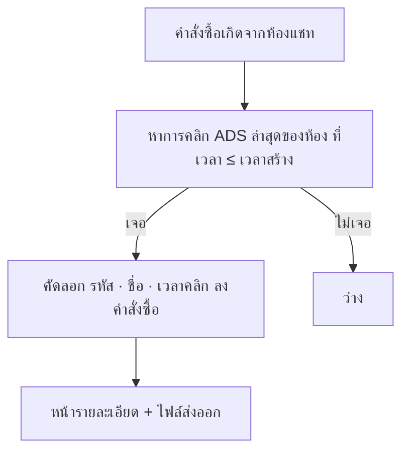

> **โมดูล:** 00091 - Order Ad Attribution
> **ประเภทเอกสาร:** Business Requirements Document (BRD) - NON-TECHNICAL
> **เวอร์ชัน:** 0.1
> **วันที่จัดทำ:** 2026-11-14
> **สถานะ:** Approved 2026-11-14 (user "อนุมัติ 00091" — ไม่จำกัดระยะเวลา · แสดง 4 จุด + รายงาน · เติมย้อนหลัง)

# BRD: บันทึกว่าคำสั่งซื้อมาจากโฆษณาไหน

## 1. บทนำ

**ระบบ:** ตัวบันทึกแอดที่มาของคำสั่งซื้อ — คัดลอกการคลิกแอดล่าสุดของห้องแชทลงคำสั่งซื้อตอนสร้าง
**Input:** คำสั่งซื้อที่ผูกห้องแชท · ประวัติการคลิกแอดของห้อง
**Output:** รหัสแอด · ชื่อแอด · เวลาคลิก ในคำสั่งซื้อ → หน้ารายละเอียด + ไฟล์ส่งออก

| กลุ่มผู้ใช้ | สิทธิ์ |
|-----------|-------|
| สมาชิกร้านที่เห็นคำสั่งซื้อ | เห็นแอดที่มา (อ่านอย่างเดียว) |

## 2. Functional Requirements

#### FR-001: บันทึกแอดตอนสร้างคำสั่งซื้อ
> ในฐานะเจ้าของร้าน ฉันต้องการให้คำสั่งซื้อจำว่าลูกค้ามาจากแอดไหน เพื่อรู้ว่าแอดไหนทำยอด

**Acceptance Criteria:**
- [ ] สร้างคำสั่งซื้อจากห้องแชทที่มีการคลิกแอด → บันทึกการคลิก **ADS ล่าสุดที่เวลา ≤ เวลาสร้าง** (รหัส · ชื่อ · เวลาคลิก · รูปแอด — มติ user 2026-11-14)
- [ ] การคลิกที่เกิด **หลัง** เวลาสร้างไม่ถูกเลือก
- [ ] การคลิกแบบ SHORTLINK ไม่ถูกเลือก
- [ ] ห้องไม่เคยคลิกแอด / ไม่ผูกห้อง = ช่องแอดว่าง
- [ ] ยืนยันออเดอร์ร่าง (00061) ใช้กฎเดียวกัน เวลาอ้างอิง = เวลาที่ยืนยันเป็นคำสั่งซื้อ
- [ ] หาแอดผิดพลาด → คำสั่งซื้อยังสร้างสำเร็จ
- [ ] คำสั่งซื้อที่ลงวันที่ย้อนหลัง (00033) ใช้เวลาที่ลงไว้เป็นเวลาอ้างอิง

**Example:**
```
คลิก "โปรล้อแม็ก" 1 พ.ย. · คลิก "ไฟหน้า LED" 5 พ.ย. · สร้างคำสั่งซื้อ 6 พ.ย. → "ไฟหน้า LED"
คลิกแอดใหม่ 8 พ.ย. → คำสั่งซื้อเดิมยังเป็น "ไฟหน้า LED"
```

#### FR-002: ไม่หายเมื่อลบห้องแชท
- [ ] ลบห้องแชท/ประวัติการคลิก → คำสั่งซื้อยังแสดงชื่อและรหัสแอดเดิม

#### FR-003: แสดงบนหน้ารายละเอียดคำสั่งซื้อ (ผู้ขาย)
- [ ] ใบที่มีแอด: แถว "มาจากโฆษณา" แสดงชื่อแอด (ไม่มีชื่อ = รหัสแอด) + วันเวลาที่คลิก
- [ ] ใบที่ไม่มี: ไม่แสดงแถวนี้เลย
- [ ] ไม่แสดงในหน้าคำสั่งซื้อฝั่งผู้ซื้อ

#### FR-006: ป้ายในรายการคำสั่งซื้อ (/orders)
- [ ] ใบที่มีแอด: แถวหัวของใบ (แถวเดียวกับเลขคำสั่งซื้อ/ปุ่มเปิดข้อความสนทนา) มีป้าย "โฆษณา: {ชื่อแอด}" ไอคอนโฆษณา · ชื่อยาวตัดด้วย … และเห็นชื่อเต็มเมื่อชี้
- [ ] ใบที่ไม่มีแอด: ไม่มีป้าย ไม่มีที่ว่างเพิ่ม
- [ ] desktop และมือถือ (การ์ดรายการ) แสดงทั้งคู่

#### FR-007: บรรทัดในการ์ดคำสั่งซื้อในห้องแชท (ผู้ขาย)
- [ ] ใบที่มีแอด: บรรทัด "จากโฆษณา: {ชื่อแอด}" ในการ์ดคำสั่งซื้อที่แสดงในห้องแชทฝั่งผู้ขาย
- [ ] ใบที่ไม่มีแอด: การ์ดเหมือนเดิมทุกประการ
- [ ] ข้อความที่ส่งถึงลูกค้า (การ์ด/ลิงก์ใน Messenger) **ไม่มี** ชื่อแอด — ลูกค้าไม่ควรเห็นชื่อแคมเปญของร้าน
- [ ] HR18: แอปผู้ขาย (แชท Native) ต้องแสดงตาม หรือระบุใน PR ว่ายังไม่ตาม

#### FR-004: คอลัมน์ในไฟล์ส่งออก (00086)
- [ ] เพิ่ม 2 คอลัมน์: "โฆษณา" (ชื่อแอด) · "รหัสโฆษณา"
- [ ] ใบที่ไม่มีแอด = ว่าง

#### FR-005: เติมย้อนหลัง
- [ ] คำสั่งซื้อเก่าที่ผูกห้องแชทและช่องแอดยังว่าง ได้รับแอดตามกฎ FR-001 (เวลาอ้างอิง = เวลาสร้างคำสั่งซื้อ)
- [ ] ไม่แตะใบที่มีค่าแล้ว · รันซ้ำได้ผลเท่าเดิม
- [ ] ไม่รวมออเดอร์ร่าง (DRAFTED) และออเดอร์ทดสอบ

#### FR-008: รายงานยอดขายตามโฆษณา (`/reports/ads`)
> ในฐานะเจ้าของร้าน ฉันต้องการเห็นว่าแต่ละแอดพาแชทมาเท่าไร ปิดการขายได้กี่ใบ ยอดเท่าไร เพื่อเลือกเพิ่ม/ลดงบแอด

**Acceptance Criteria:**
- [ ] เลือกช่วงวันที่ (ค่าเริ่มต้น 30 วันล่าสุด) และเลือกเพจได้ (ค่าเริ่มต้น ทุกเพจ)
- [ ] หนึ่งแถวต่อแอด: แชทจากแอด · คำสั่งซื้อ · อัตราปิดการขาย · ยอดขาย · ยอดเฉลี่ยต่อใบ · ยกเลิก/คืน
- [ ] ยอดขายใช้ตัวคำนวณ/นิยามเดียวกับรายงานยอดขายสินค้าเดิม (HR16) — ยืนยันกับโค้ดก่อนเขียน SRS
- [ ] แถวสรุป: ยอดขายจากแอดรวม · ยอดขายที่ไม่ได้มาจากแอด · สัดส่วน %
- [ ] แชทจากแอด = จำนวนห้องที่มีการคลิกแอดนั้นในช่วงวันที่ (ห้องเดียวคลิกซ้ำ = 1)
- [ ] แอดที่มีแชทแต่ไม่มีคำสั่งซื้อ ยังแสดง (คำสั่งซื้อ 0) — ให้เห็นแอดที่ไม่ปิดการขาย
- [ ] กดแถว → รายการคำสั่งซื้อของแอดนั้นในช่วงวันที่
- [ ] ส่งออกไฟล์ได้
- [ ] เจ้าของร้านเท่านั้น (F1) · บทบาทอื่นเห็นการ์ดไม่มีสิทธิ์
- [ ] ร้านที่ไม่มีข้อมูลแอดเลย: หน้าว่างพร้อมคำอธิบายว่าข้อมูลมาจากลูกค้าที่คลิกแอด Messenger

#### FR-009: แดชบอร์ดรายงานยอดขายตามโฆษณา (กราฟ/การ์ด) — **อนุมัติ 2026-11-14 (เฟส 1)**
> ในฐานะเจ้าของร้าน ฉันต้องการเห็นภาพรวมโฆษณาเป็นกราฟและการ์ดในหน้าเดียว เพื่อรู้แนวโน้มและตัดสินใจเรื่องงบแอดได้เร็วโดยไม่ต้องอ่านตาราง

ม็อกอัพ: `docs/superpowers/specs/2026-11-14-00091-ads-report-charts-mockup.html` + `.md` · โครงจากธีม Paces `dashboard/analytics`

**Acceptance Criteria:**
- [ ] ตัวเลือกช่วงเวลาเดียวบนหัวหน้า (วันนี้ / 7 วัน / 30 วัน / เดือนนี้ / กำหนดเอง) + เลือกเพจ + ส่งออก — ทุกการ์ดใช้ช่วงและเพจเดียวกัน (ไม่มีตัวเลือกวันที่รายการ์ด)
- [ ] การ์ด "ยอดขายจากโฆษณา": ยอดรวม + เปลี่ยนแปลงเทียบช่วงก่อนหน้าที่ยาวเท่ากัน + กราฟแท่งซ้อนรายวัน (จากโฆษณา / ไม่ได้มาจากโฆษณา)
- [ ] การ์ด "สัดส่วนยอดขาย": % จากโฆษณา vs ไม่ได้มาจากโฆษณา (ยอดและจำนวนใบ) + ตาราง แชทจากโฆษณา · คำสั่งซื้อ · อัตราปิดการขาย เทียบช่วงก่อน
- [ ] การ์ด "แอดที่ทำยอดสูงสุด" 5 อันดับพร้อมสัดส่วน
- [ ] การ์ด "ภาพรวมรายวัน" แท็บ ยอดขาย · คำสั่งซื้อ (เส้นช่วงนี้ vs ช่วงก่อน) — แท็บค่าโฆษณา/ROAS ตาม FR-010
- [ ] การ์ด donut สัดส่วนยอดขายตามแอด (5 อันดับ + อื่น ๆ)
- [ ] การ์ดยอดขายจากโฆษณาตามจังหวัด (จาก `shippingAddress.province` · ใบไม่มีที่อยู่แสดงเป็น "ไม่ระบุจังหวัด")
- [ ] การ์ดยอดขายตามช่องทาง (Messenger · Instagram · LINE · TikTok · หน้าร้าน/อื่น ๆ) และยอดขายจากโฆษณาตามเพจ
- [ ] ตารางรายแอดเดิม (FR-008) อยู่ในการ์ดแถวล่าง: ค้นหาชื่อแอด · จำนวนแถวต่อหน้า · ตัวเลขจัดกลาง · แถวรวม · มือถือเป็นการ์ดรายการ · อ่านอย่างเดียว
- [ ] HR16: ผลรวมรายวันของทุกกราฟ = ตัวเลขบนการ์ดสรุป = แถวรวมของตาราง (ยอดขายนิยามเดียวกับ FR-008 / `salesOrderWhere`) — มีเทส parity
- [ ] ช่วงก่อนหน้าเป็น 0 → ไม่แสดง % เปลี่ยนแปลง
- [ ] กราฟทุกตัวผ่าน `ApexChart` wrapper + สี `getColor('chart-*')` ไม่มีสีม่วง (HR10)
- [ ] เจ้าของร้านเท่านั้น (สิทธิ์เดียวกับ FR-008) · Desktop / Tablet 2 คอลัมน์ / Mobile คอลัมน์เดียว

#### FR-010: ตัวชี้วัดการตลาดจาก Meta (ค่าโฆษณา · ROAS) — **อนุมัติแนวทาง 2026-11-14 · ทำเฟส 2**
> ในฐานะเจ้าของร้าน ฉันต้องการรู้ว่าแต่ละแอดใช้เงินไปเท่าไรและได้ยอดกลับมากี่เท่า เพื่อตัดแอดที่ไม่คุ้มและเพิ่มงบแอดที่คุ้ม

**Acceptance Criteria:**
- [ ] ดึงค่าโฆษณารายแอดรายวันจาก Meta Marketing API Insights (`/act_{adAccountId}/insights` level=ad) ผ่านการเชื่อมบัญชีโฆษณาของ 00092 (`MetaAudienceConnection`)
- [ ] ตารางรายแอดเพิ่ม: ค่าโฆษณา · ROAS · ต้นทุนต่อออเดอร์ · แท็บ "ค่าโฆษณา" (ยอดขายทับค่าโฆษณารายวัน) และ "ROAS" (รายวัน) ในการ์ดภาพรวมรายวัน · กล่อง "แอดที่ ROAS ดีที่สุด" (นับเฉพาะแอดที่มี ≥ 10 คำสั่งซื้อในช่วง — มติ user 2026-11-14)
- [ ] ROAS = ยอดขายของ Deep ÷ ค่าโฆษณา · ต้นทุนต่อออเดอร์ = ค่าโฆษณา ÷ คำสั่งซื้อของ Deep — **ห้ามใช้ยอด purchase/conversion ของ Meta**
- [ ] ยังไม่เชื่อมบัญชีโฆษณา / การเชื่อมใช้ไม่ได้: แบนเนอร์พร้อมปุ่มไป `/settings/capis` · คอลัมน์ ค่าโฆษณา/ROAS ในตาราง **ซ่อน** (ไม่แสดง "—") เมื่อยังไม่เชื่อมหรือ state ≠ OK · ยอดขายและคำสั่งซื้อยังดูได้ปกติ
- [ ] แอดที่ไม่มีใน Insights → ค่าโฆษณา "—" (ไม่ใช่ ฿0) · แอดที่มีค่าโฆษณาแต่ไม่มีแชท/คำสั่งซื้อ → แสดงแถวด้วย (ROAS 0)
- [ ] ระบุชื่อบัญชีโฆษณาที่ใช้คำนวณ (ร้านผูกได้บัญชีเดียว)
- [ ] ไม่ยิง Graph ทุกครั้งที่เปิดหน้า: ดึงสดต่อคำขอ + แคชฝั่ง server ~15 นาที ไม่มีตารางใหม่ (มติ 2026-11-14)

## 3. Business Flow



## 4. กฎทางธุรกิจ

- **BR-ATT-01** เลือกการคลิก source = ADS ที่ `เวลาคลิก ≤ เวลาสร้าง` ล่าสุด · ไม่จำกัดระยะเวลา
- **BR-ATT-02** ค่าเป็นภาพนิ่ง บันทึกครั้งเดียว ไม่อัปเดตภายหลัง ไม่ให้แก้
- **BR-ATT-03** การบันทึกล้มเหลวต้องไม่ทำให้การสร้างคำสั่งซื้อล้ม
- **BR-ATT-04** เติมย้อนหลังเขียนเฉพาะช่องที่ว่าง

## 5. Quality
- ความถูกต้อง: เทสเลือกตัวล่าสุดก่อนเวลาสร้าง / ไม่เลือกตัวหลัง / ไม่เลือก SHORTLINK · ยอดขายในรายงานรวมกันต้องเท่ากับรายงานยอดขายเดิมในช่วงเดียวกัน (เทส parity)
- ความเร็ว: เพิ่มไม่เกิน 1 query ต่อการสร้างคำสั่งซื้อ (index ที่มีอยู่)
- ความปลอดภัย: query ผูก shop ผ่านคำสั่งซื้อ/ห้องของร้านเดียวกัน

**หมายเหตุ:** ภาพรวม ดู [[PRD]]
