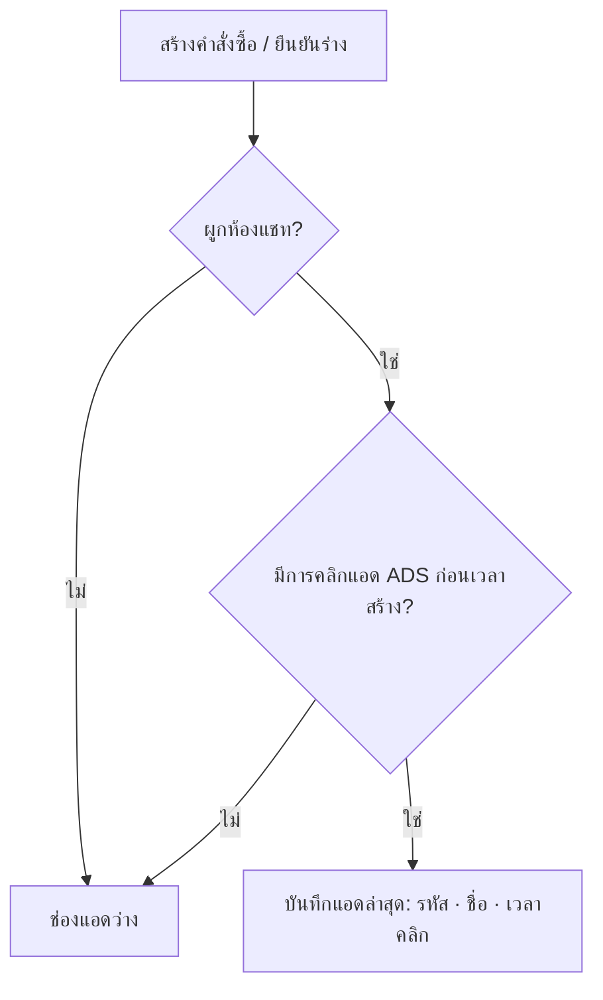

> **โมดูล:** 00091 - Order Ad Attribution
> **ประเภทเอกสาร:** Product Requirements Document (PRD)
> **เวอร์ชัน:** 0.1
> **วันที่จัดทำ:** 2026-11-14
> **สถานะ:** Approved 2026-11-14 (user "อนุมัติ 00091" — ไม่จำกัดระยะเวลา · แสดง 4 จุด + รายงาน · เติมย้อนหลัง)
> **เจ้าของเอกสาร:** BA + PO + PM

# PRD: บันทึกว่าคำสั่งซื้อมาจากโฆษณาไหน

---

## Executive Summary

ร้านยิงโฆษณา Click-to-Messenger แล้วปิดการขายในแชท ระบบเก็บประวัติ "ลูกค้าคลิกแอดไหนเข้ามา" ไว้ทุกครั้งแล้ว (ตาราง `ConversationAdReferral` ตั้งแต่ 2026-07-31 · prod 33,906 ครั้ง) แต่ **คำสั่งซื้อไม่ได้บันทึกว่ามาจากแอดไหน** — ร้านตอบไม่ได้ว่าแอดตัวไหนทำยอดขาย และถ้าห้องแชทถูกลบ ประวัติแอดหายตามไปด้วย

ฟีเจอร์นี้บันทึก **แอดล่าสุดที่ลูกค้าคลิกก่อนสร้างคำสั่งซื้อ** ลงในคำสั่งซื้อ แบบภาพนิ่งถาวร แสดงบนหน้ารายละเอียดคำสั่งซื้อ และเป็นคอลัมน์ในไฟล์ส่งออก พร้อมเติมย้อนหลังให้คำสั่งซื้อเก่า

ข้อมูล prod 30 วันล่าสุด: คำสั่งซื้อ 613 ใบ · จากแชท 418 · **ระบุแอดได้ 397 ใบ (95% ของที่มาจากแชท)**

---

## 1. Business Goals & KPIs

| เป้าหมาย | รายละเอียด |
|----------|-----------|
| **ร้านรู้ว่าแอดไหนทำยอด** | ทุกคำสั่งซื้อจากแชทที่ลูกค้าเคยคลิกแอด มีชื่อแอดติดอยู่ |
| **ข้อมูลไม่หาย** | ลบห้องแชทแล้ว คำสั่งซื้อยังจำแอดได้ |
| **รายงานยอดขายตามแอดใน Deep** | เห็นแชท → คำสั่งซื้อ → ยอดขาย ต่อแอด โดยไม่ต้องเปิด Ads Manager |

| KPI | เป้าหมาย |
|-----|---------|
| คำสั่งซื้อจากแชทที่มีประวัติคลิกแอด แล้วถูกบันทึกแอด | 100% |
| คำสั่งซื้อที่บันทึกแอดผิดตัว (ไม่ใช่ตัวล่าสุดก่อนสร้าง) | 0 |

---

## 2. User Personas

**เจ้าของร้านที่ยิงแอด Messenger** — อยากรู้ว่าแอดตัวไหนปิดการขายได้ เพื่อเพิ่มงบตัวที่ดี ตัดตัวที่ไม่ดี · ตอนนี้ต้องเปิดแชททีละห้องดูแบนเนอร์แอด

---

## 3. Business Requirements

### 3.1 บันทึกแอดตอนสร้างคำสั่งซื้อ

**ความต้องการ:** ตอนคำสั่งซื้อเกิดจากห้องแชท (สร้างในแชท · ยืนยันออเดอร์ร่างจากแชท) ระบบหา **การคลิกแอดล่าสุดของห้องนั้นที่เกิดก่อนเวลาสร้าง** แล้วบันทึกลงคำสั่งซื้อ: รหัสแอด · ชื่อแอด · เวลาที่คลิก

**Business Rules:**
- นับเฉพาะการคลิกที่มาจาก **โฆษณา** (source = ADS) — ลิงก์สั้น (SHORTLINK) ไม่นับ
- **ไม่จำกัดระยะเวลา** — ใช้ตัวล่าสุดก่อนสร้างเสมอ (มติ user 2026-11-14)
- บันทึกครั้งเดียวตอนสร้าง **ไม่เปลี่ยนตาม** แม้ลูกค้าคลิกแอดใหม่หลังจากนั้น
- ไม่มีห้องแชท / ห้องไม่เคยคลิกแอด = ไม่บันทึก (ว่าง)

### 3.2 แสดงผล

**ความต้องการ:**
- **รายการคำสั่งซื้อ (/orders)** — แถวหัวของแต่ละใบ (ข้างเลขคำสั่งซื้อ) แสดงป้าย "โฆษณา: {ชื่อแอด}" (มติ user 2026-11-14)
- **การ์ดคำสั่งซื้อในห้องแชท** (ฝั่งผู้ขาย) — บรรทัดใต้หัวการ์ด "จากโฆษณา: {ชื่อแอด}" (มติ user 2026-11-14) · 🛑 HR18: การ์ดนี้อยู่ในแชทเว็บ ต้องแก้แชท Native ในแอปผู้ขายตาม
- **หน้ารายละเอียดคำสั่งซื้อฝั่งผู้ขาย** — แถว "มาจากโฆษณา: {ชื่อแอด}" + เวลาที่ลูกค้าคลิก
- **ไฟล์ส่งออกคำสั่งซื้อ (00086)** — คอลัมน์ "โฆษณา" (ชื่อแอด) และ "รหัสโฆษณา"
- คำสั่งซื้อที่ไม่ได้มาจากแอด = **ไม่แสดงอะไรเลยทุกจุด** (ไม่มีป้ายว่าง/ขีด)

**Business Rules:** ชื่อแอดคือชื่อใน Ads Manager (ไม่ใช่ข้อความโฆษณา) · ไม่มีชื่อแต่มีรหัส = แสดงรหัส

### 3.4 รายงานยอดขายตามโฆษณา (มติ user 2026-11-14 "ใน deep ควรทำ report")

**ความต้องการ:** หน้า **รายงาน → ยอดขายตามโฆษณา** (`/reports/ads`) เลือกช่วงวันที่ได้ ตารางหนึ่งแถวต่อแอด:

| คอลัมน์ | ความหมาย |
|---|---|
| โฆษณา | ชื่อแอด (+ รูปแอดถ้ามี) · กดดูคำสั่งซื้อของแอดนั้น |
| แชทจากแอด | จำนวนห้องแชทที่ลูกค้าคลิกแอดนี้เข้ามาในช่วงวันที่ |
| คำสั่งซื้อ | จำนวนคำสั่งซื้อที่บันทึกว่ามาจากแอดนี้ (ไม่นับยกเลิก) |
| อัตราปิดการขาย | คำสั่งซื้อ ÷ แชทจากแอด |
| ยอดขาย | ผลรวมยอดคำสั่งซื้อ — **นิยามเดียวกับรายงานยอดขายสินค้าเดิม (HR16)** |
| ยอดเฉลี่ยต่อใบ | ยอดขาย ÷ คำสั่งซื้อ |
| ยกเลิก/คืน | จำนวนใบที่ยกเลิกหรือคืน |

+ แถวสรุปบนสุด: ยอดขายจากแอดทั้งหมด vs ยอดขายที่ไม่ได้มาจากแอด (เห็นสัดส่วนว่าแอดทำยอดกี่ %)
+ เรียงตามยอดขาย/คำสั่งซื้อ/อัตราปิดการขายได้ · ส่งออกเป็นไฟล์ได้

**Business Rules:**
- เห็นได้เฉพาะ **เจ้าของร้าน** (สิทธิ์เดียวกับรายงานยอดขายสินค้า `F1`) — เป็นข้อมูลยอดขาย
- นับคำสั่งซื้อตามวันที่ของคำสั่งซื้อ · นับแชทตามวันที่คลิกแอด
- ร้านมีหลายเพจ = รวมทุกเพจ + ตัวกรองเลือกเพจ

**เหตุผล:** ร้านเทียบกับตัวเลขของ Meta ได้ (Meta อาจนับต่างเพราะหน้าต่างเวลา/การจับคู่) และเห็น "อัตราปิดการขายต่อแอด" ซึ่ง Ads Manager ไม่มี

### 3.3 เติมย้อนหลัง

**ความต้องการ:** คำสั่งซื้อเก่าที่ผูกห้องแชท ได้รับการบันทึกแอดตามกฎเดียวกับ 3.1 (ใช้เวลาสร้างของคำสั่งซื้อนั้น) — รันครั้งเดียวหลัง deploy

**Business Rules:** เติมเฉพาะใบที่ยังว่าง · ไม่เขียนทับใบที่บันทึกไว้แล้ว · ประวัติแอดเริ่ม 2026-07-31 ⇒ ใบก่อนหน้านั้นจะว่าง

---

## 4. Business Rules & Constraints

| กฎ | คำอธิบาย |
|----|----------|
| **ภาพนิ่ง** | ค่าแอดในคำสั่งซื้อเป็นสำเนาตอนสร้าง ไม่ผูกกับห้องแชท — ลบห้องแล้วไม่หาย |
| **เห็นได้ทุกคนที่เห็นคำสั่งซื้อ** | ไม่ใช่ข้อมูลเงิน/ต้นทุน |
| **ไม่กระทบการสร้างคำสั่งซื้อ** | หาแอดไม่ได้/ผิดพลาด → สร้างคำสั่งซื้อได้ตามปกติ ช่องแอดว่าง |

| ข้อจำกัด | รายละเอียด |
|---------|-----------|
| **Instagram / LINE** | Instagram มี referral เช่นกันถ้ามาจากแอด IG (เก็บตารางเดียวกัน) · LINE ไม่มีข้อมูลแอด |
| **ข้อมูลเริ่ม 2026-07-31** | ก่อนหน้านั้นไม่มีประวัติคลิกแอด |

---

## 5. Out of Scope

| หัวข้อ | เหตุผล |
|--------|--------|
| **ROAS / ต้นทุนต่อการซื้อ** | ต้องรู้ยอดใช้เงินแอด — ดึงจาก Meta ต้องใช้สิทธิ์ `ads_read` + App Review · ดูใน Ads Manager ได้อยู่แล้วจาก CAPI (00089) |
| **ดึงยอดใช้เงินแอดจาก Marketing API** | ต้องใช้สิทธิ์ `ads_read` + App Review |
| **ตัวกรองรายการคำสั่งซื้อตามแอด** | รอบถัดไป |
| **แก้แอดของคำสั่งซื้อเอง** | ค่าเป็นข้อเท็จจริงจากระบบ ไม่ให้แก้ |
| **ส่งรหัสแอดไป Meta CAPI (00089)** | Meta จับคู่แอดจาก PSID เองอยู่แล้ว |

---

## 6. Risks & Mitigation

| ความเสี่ยง | แนวทางแก้ไข |
|-----------|-------------|
| เลือกแอดผิดตัว (เอาตัวหลังสร้าง) | เงื่อนไขเวลาคลิก ≤ เวลาสร้าง + เทส |
| เติมย้อนหลังทับข้อมูล | เขียนเฉพาะแถวที่ยังว่าง + scope ต่อแถว + นับแถวก่อน/หลัง |
| สร้างคำสั่งซื้อช้าลง | query เดียวบน index `(conversationId, receivedAt)` ที่มีอยู่แล้ว |

---

## 7. Glossary

| คำ | ความหมาย |
|----|----------|
| **การคลิกแอด (referral)** | ลูกค้ากดโฆษณาแล้วเข้ามาทักแชท — Meta ส่งรหัสแอดมาทาง webhook |
| **ชื่อแอด** | ชื่อที่ร้านตั้งใน Ads Manager |

---

## 8. Dependencies & Assumptions

- **00018** ตาราง `ConversationAdReferral` (เก็บทุกการคลิก) · `Order.conversationId`
- **00086** ไฟล์ส่งออกคำสั่งซื้อ
- สมมติ: เวลาคลิก (`receivedAt`) คือเวลาที่ webhook ของ Meta มาถึง ≈ เวลาที่ลูกค้าคลิก

---

## 9. ตัวอย่าง

**Scenario:** ลูกค้าคลิกแอด "โปรล้อแม็ก 11.11" วันที่ 1 → คลิกแอด "ไฟหน้า LED" วันที่ 5 → พนักงานสร้างคำสั่งซื้อวันที่ 6 → คำสั่งซื้อบันทึก "ไฟหน้า LED" · วันที่ 8 ลูกค้าคลิกแอดใหม่อีก → คำสั่งซื้อเดิมยังเป็น "ไฟหน้า LED"

---

**หมายเหตุ:** FR/AC ดู [[BRD]]
