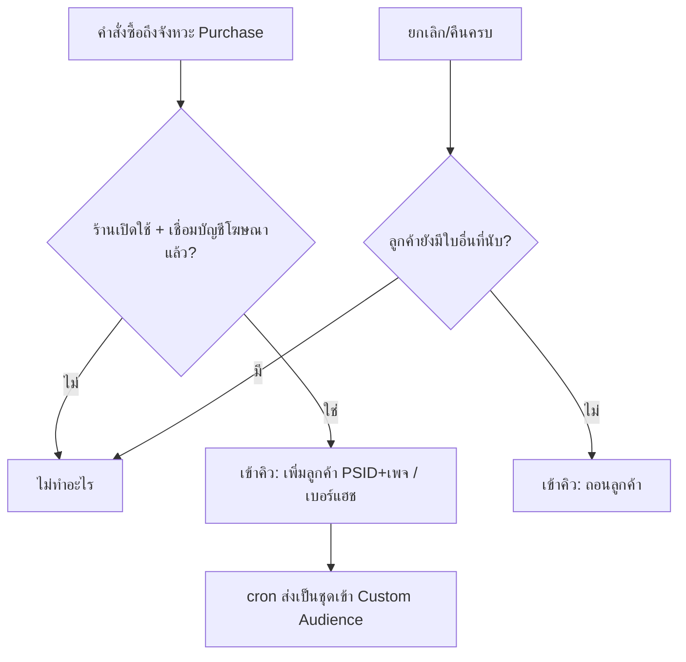

> **โมดูล:** 00092 - Purchaser Custom Audience Sync
> **ประเภทเอกสาร:** Product Requirements Document (PRD)
> **เวอร์ชัน:** 0.1 · **วันที่:** 2026-11-14 · **สถานะ:** Draft — รอ user อนุมัติ (HR11)

# PRD: ส่งรายชื่อลูกค้าที่ซื้อแล้วเข้า Custom Audience อัตโนมัติ

## Executive Summary

ร้านอยากยิงแอดหา "คนที่ซื้อแล้ว" (ขายซ้ำ / ตัดออกจากแอดหาลูกค้าใหม่ / ทำ Lookalike) แต่ Meta ยังยืนยันไม่ได้ว่าสร้าง Custom Audience จากเหตุการณ์ในแชท Messenger (00089) ได้ — ทางที่แน่นอนคือ **Customer File Custom Audience** ผ่าน Marketing API

ฟีเจอร์นี้ให้ Deep สร้าง Custom Audience "ลูกค้าที่ซื้อแล้ว — {ชื่อเพจ/ร้าน}" ในบัญชีโฆษณาของร้าน และเพิ่ม/ถอนคนอัตโนมัติตามคำสั่งซื้อ ใช้ตัวตน 2 แบบ:
1. **รหัสลูกค้าในแชท (PSID) + รหัสเพจ** — Meta รองรับ schema Facebook UID พร้อม `page_ids` สำหรับรหัสที่ได้จาก Page webhook ⇒ ลูกค้าจากแชท Messenger จับคู่ได้แทบ 100%
2. **เบอร์โทรแบบแฮช SHA-256** — สำหรับคำสั่งซื้อที่ไม่ได้มาจากแชท (สร้างเอง/LINE/หน้าร้าน) จับคู่ได้ราว 20–70%

ทดลองกับร้านธนภัทร์ก่อน ด้วยสิทธิ์ `ads_management` ระดับ Standard (บัญชีที่มี role บนแอป)

## 1. Goals & KPIs

| เป้าหมาย | KPI |
|---|---|
| ลูกค้าที่ซื้อแล้วเข้า audience เอง ไม่ต้องอัปโหลดไฟล์ | คำสั่งซื้อใหม่เข้า audience ภายใน 15 นาที |
| ใช้ยิงแอดได้จริง | audience ≥ 100 คนที่จับคู่ได้ (ขั้นต่ำของ Meta) |

## 2. Persona

เจ้าของร้านที่ยิงแอด — อยากกันลูกค้าเก่าออกจากแอดหาลูกค้าใหม่ และยิงแอดขายซ้ำ/ของเสริมให้คนที่เคยซื้อ

## 3. Business Requirements

### 3.1 เชื่อมบัญชีโฆษณา
- เจ้าของร้านเชื่อม **บัญชีโฆษณา (Ad Account)** ที่ใช้ยิงแอด — ทางหลัก: กดเชื่อมผ่าน Facebook (ขอ `ads_management`) แล้วเลือกบัญชีโฆษณา · ทางรอง: กรอก System User token + Ad Account ID เอง (ไม่หมดอายุ)
- token เข้ารหัส ไม่แสดงกลับ · token แบบกดเชื่อม (อายุ ~60 วัน) ใกล้หมด = แจ้งเจ้าของให้เชื่อมใหม่
- ต้องยอมรับข้อตกลง Custom Audience ของ Meta ในบัญชีโฆษณาก่อน (ระบบตรวจและบอกลิงก์ถ้ายังไม่ยอมรับ)

### 3.2 สร้าง audience
- เปิดใช้ = ระบบสร้าง Custom Audience ชื่อ "Deep · ลูกค้าที่ซื้อแล้ว · {ชื่อร้าน}" ให้ 1 ตัวต่อร้านต่อบัญชีโฆษณา (ป้าย Meta: `GENERAL_CUSTOMERS`)
- ร้านเห็นชื่อ/รหัส audience + จำนวนที่ส่งไปแล้ว + ลิงก์เปิดใน Ads Manager

### 3.3 ใครคือ "ลูกค้าที่ซื้อแล้ว"
- คำสั่งซื้อที่ **ถึงจังหวะ Purchase ตามที่ร้านตั้งใน 00089** (สร้าง / ยืนยัน / ชำระครบ) — ใช้นิยามเดียวกันทั้งระบบ ไม่ตั้งเกณฑ์ใหม่
- ร้านที่ไม่ได้เปิด 00089 ใช้ค่าเริ่มต้น = ชำระครบ
- ไม่รวมออเดอร์ร่าง / ออเดอร์ทดสอบ

### 3.4 เพิ่ม/ถอนอัตโนมัติ
- คำสั่งซื้อถึงเกณฑ์ → เพิ่มลูกค้าเข้า audience (PSID+เพจ ถ้ามาจากแชท Messenger · เบอร์แฮช ถ้ามีเบอร์)
- คำสั่งซื้อถูกยกเลิก/คืนครบ และลูกค้าคนนั้น **ไม่มีคำสั่งซื้ออื่นที่ยังนับอยู่** → ถอนออก
- ส่งเป็นชุดผ่านคิว (ไม่ยิงตอนสร้างคำสั่งซื้อ) ล้มลองใหม่ · token เสีย = หยุด + แจ้งเจ้าของ (แบบเดียวกับ 00089)

### 3.5 เติมย้อนหลัง
- เปิดใช้ครั้งแรก = ส่งลูกค้าที่ซื้อแล้วทั้งหมดของร้าน (ย้อนได้ทั้งหมดที่มีในระบบ) ในครั้งเดียว

## 4. Rules & Constraints

| กฎ | รายละเอียด |
|---|---|
| ข้อมูลที่ออกจากระบบ | PSID+รหัสเพจ และ/หรือ เบอร์โทรแฮช SHA-256 (ตัดสัญลักษณ์, 0 นำหน้า → 66) เท่านั้น — ไม่ส่งชื่อ ที่อยู่ ยอดเงิน |
| สิทธิ์ | เจ้าของร้านเท่านั้น (ข้อมูลลูกค้าออกนอกระบบ) |
| ช่วงทดลอง | ปิดเป็นค่าเริ่มต้น เปิดด้วย env + รายชื่อร้านทดลองแบบ 00089 |
| Meta | ขั้นต่ำ 100 คนที่จับคู่ได้ถึงจะใช้ยิงแอด · อัปเดต audience อาจใช้เวลาถึง 24 ชม. |

## 5. Out of Scope

| หัวข้อ | เหตุผล |
|---|---|
| audience แบบอื่น (คนทิ้งตะกร้า, Lead) | รอบถัดไป ใช้กลไกเดียวกัน |
| audience แบบมีมูลค่า (value-based) | รอบถัดไป |
| สร้าง Lookalike/แคมเปญให้อัตโนมัติ | ร้านทำเองใน Ads Manager |
| Instagram (IGSID) | ยืนยันกับเอกสารก่อน — รอบถัดไป |
| ยอดใช้เงินแอด / ROAS | ฟีเจอร์แยก (ใช้ `ads_read`) |

## 6. Risks

| ความเสี่ยง | แนวทาง |
|---|---|
| ขอ `ads_management` Advanced ยาก | ช่วงทดลองใช้ Standard · เปิดทุกร้านต้องยื่นรีวิว |
| token ผู้ใช้หมดอายุ 60 วัน | แจ้งเตือนล่วงหน้า + ทางรอง System User token |
| ถอนลูกค้าผิด (ยังมีคำสั่งซื้ออื่น) | ตรวจ "ยังมีใบที่นับอยู่" ก่อนถอนเสมอ + เทส |
| ส่งข้อมูลลูกค้าออกนอกระบบ | ส่งแค่รหัส/แฮช · เจ้าของเปิดเอง · มีข้อความแจ้งก่อนเปิด |

## 7. Dependencies
- 00089 (จังหวะ Purchase · คิว/cron · ร้านทดลอง) · 00018 (PSID/เพจ) · สิทธิ์ `ads_management` Standard บนแอป Deep Chat & LIVE (ต้องเปิดใน App Dashboard)

## 8. ตัวอย่าง

