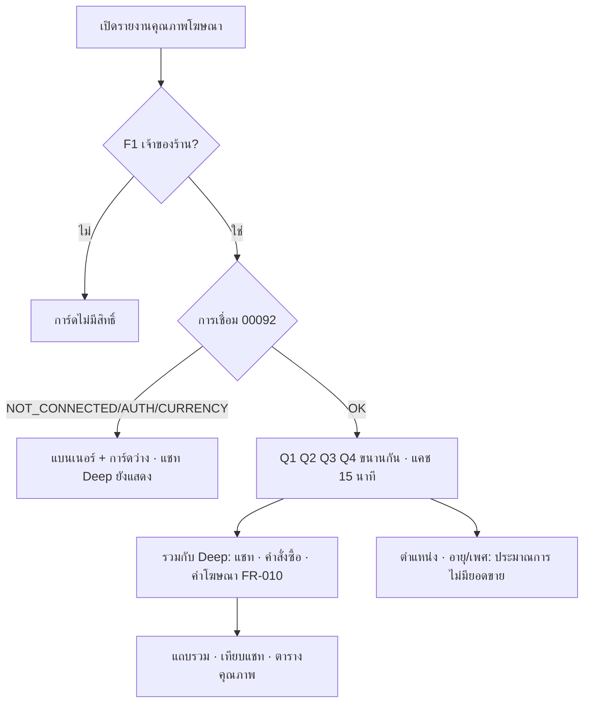
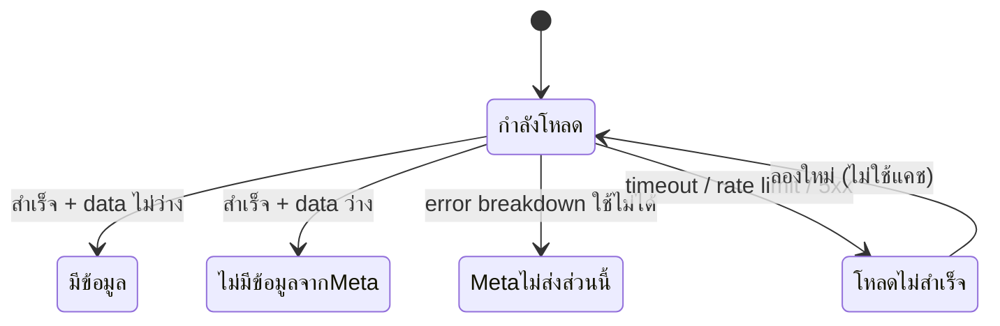

> **โมดูล:** 00093 - Ad Insights Quality
> **ประเภทเอกสาร:** Business Requirements Document (BRD)
> **เวอร์ชัน:** 0.1
> **วันที่จัดทำ:** 2026-11-14
> **สถานะ:** Approved 2026-11-14 (user "อนุมัติ" · Q1 = report แยก · UI tone = Paces Analytics ตามภาพที่ user ส่ง)

# BRD: คุณภาพแชทและแพลตฟอร์มของโฆษณา

## 1. บทนำ

**ระบบ:** หน้ารายงาน "คุณภาพโฆษณา" `/reports/ad-quality` (แยกจาก `/reports/ads`) — อ่านตัวชี้วัดจาก Meta Marketing API Insights แล้ววางข้างตัวเลขของ Deep
**Input:** ช่วงวันที่ · เพจ (ของเดิม) · แอด (ใหม่ — เฉพาะการ์ดตำแหน่งและอายุ/เพศ) · การเชื่อมบัญชีโฆษณา 00092 · `ConversationAdReferral` · คำสั่งซื้อที่บันทึกแอด (00091)
**Output:** ตัวเลขรวม · ตารางเทียบแชท · ตารางคุณภาพรายแอด · การ์ดตำแหน่ง · การ์ดอายุ/เพศ

| กลุ่มผู้ใช้ | สิทธิ์ |
|-----------|-------|
| เจ้าของร้าน (`F1`) | เห็นรายงาน (อ่านอย่างเดียว) |
| บทบาทอื่น | เห็นการ์ดไม่มีสิทธิ์ เหมือนรายงานยอดขายตามโฆษณา |

## 2. นิยามเดียวทั้งระบบ (HR16)

| คำ | นิยาม | แหล่ง |
|---|---|---|
| **แชทจากแอด (Deep)** | จำนวน `conversationId` ไม่ซ้ำ ที่มี `ConversationAdReferral` `source = 'ADS'` · `adId` = แอดนั้น · `receivedAt` ในช่วง · ห้องเป็นของร้าน (+ เพจตามตัวกรอง) — **ใช้ตัวคำนวณเดียวกับ 00091 FR-008 (`getAdSalesReport`) ห้ามเขียนใหม่** | Deep |
| **แชทที่ Meta นับ** | ค่า `value` ของ `actions[]` ที่ `action_type = onsite_conversion.messaging_conversation_started_7d` ของแอดนั้น ในคำขอ Q1 (§5) | Meta |
| **ค่าโฆษณา** | ผลรวม `spend` รายวันจากตัวดึงของ FR-010 (`getAdSpend`) — **ตัวเดียวกับรายงานยอดขายตามโฆษณา** ไม่ใช้ `spend` จาก Q1 | Meta ผ่าน FR-010 |
| **คำสั่งซื้อ · อัตราปิดการขาย** | นิยาม 00091 FR-008 (`salesOrderWhere`) | Deep |
| **การแสดงผล · คลิก** | `impressions` · `inline_link_clicks` จาก Q1 | Meta |
| **เข้าถึง · ความถี่** | `reach` · `impressions ÷ reach` — รายแอดจาก Q1 · ยอดรวมจาก Q2 (ระดับบัญชี) | Meta (ประมาณการ) |

🛑 "แชท" ที่ไม่มีคำขยาย ห้ามใช้บนหน้ารายงานนี้ — ทุกที่ต้องเป็น "แชท (Meta)" หรือ "แชท (Deep)"

## 3. Functional Requirements

#### FR-001: รายงานคุณภาพโฆษณา (หน้าแยก) — มติ user 2026-11-14 "ทำเป็น report แยก"
> ในฐานะเจ้าของร้าน ฉันต้องการรายงานตัวชี้วัดของ Meta แยกจากรายงานยอดขายตามโฆษณา โดยใช้ช่วงวันที่/เพจแบบเดียวกัน

**Acceptance Criteria:**
- [ ] หน้าใหม่ `/reports/ad-quality` · เมนู "คุณภาพโฆษณา" ในกลุ่ม ANALYTICS ต่อจาก "ยอดขายตามโฆษณา" · ประกาศใน `route-capabilities.ts` เป็น `F1`
- [ ] ตัวเลือกช่วงวันที่ + เพจ แบบเดียวกับ `/reports/ads` (`DateRangeControl` เดิม · ค่าใน URL) · ลิงก์ข้ามระหว่างสองรายงานพกช่วง/เพจไปด้วย
- [ ] `/reports/ads` ไม่เปลี่ยนแปลงและ **ไม่เรียก Meta เพิ่ม** จากที่ FR-010 เรียกอยู่
- [ ] มีตัวเลือก "แอด" (ทุกแอด / รายชื่อแอดในช่วง) ที่หัวการ์ดตำแหน่งและการ์ดอายุ/เพศเท่านั้น
- [ ] การเชื่อมไม่พร้อม (`NOT_CONNECTED` / `AUTH` / `CURRENCY`) → ไม่ยิง Meta · แบนเนอร์เดียวกับ FR-010 (`AdSpendNotice` ชุดข้อความของหน้านี้) อธิบายเหตุผลจุดเดียว · **ซ่อนการ์ดคุณภาพแชท (Meta) · ค่าโฆษณา/การแสดงผล · ตำแหน่ง/อายุ/เพศ · ตารางคุณภาพรายแอด** (ไม่วาดการ์ดว่างซ้ำกัน — มติ Controller 2026-11-14 O1) · คงการ์ดเทียบแชท (แสดงเฉพาะแชท (Deep) ฝั่ง Meta เป็น "—") และตารางเทียบรายแอด (แชท (Deep) ต่อแอด ฝั่ง Meta "—" · ซ่อนแถบคู่/ส่วนต่าง) · สถานะ `ERROR` ของการเชื่อม: แบนเนอร์ + ปุ่ม "ลองใหม่" (ข้ามแคช) · การ์ดอื่นแสดงสถานะ "โหลดไม่สำเร็จ" ของตัวเอง (FR-008)
- [ ] UI tone ตาม Paces `dashboard/analytics` (มติ user): หัวการ์ดตัวพิมพ์เล็กสีเทาแบบ kicker · ไอคอนวงกลมสีทึบหน้าตัวเลขหลัก · ป้าย delta พื้นสีอ่อน · แถบ progress หลายสี · donut หลายสี — **แทนม่วงทุกจุดด้วยสีอื่นของ Paces (HR7: ม่วงเป็นของฝั่งผู้ซื้อ)**
- [ ] Desktop / Tablet 2 คอลัมน์ / Mobile คอลัมน์เดียว

#### FR-002: ดึงข้อมูลจาก Meta
**Acceptance Criteria:**
- [ ] ยิง 4 คำขอ (§5 Q1–Q4) ขนานกันเมื่อเปิดหน้ารายงานคุณภาพเท่านั้น ผ่าน `MetaAudienceConnection` ของร้าน · โทเคนส่งทาง header เท่านั้น (แบบ `fetchAdInsights`)
- [ ] ทุกคำขอใช้ `action_report_time=conversion` (นับแชทตามวันที่เกิดแชท ให้ตรงกับ Deep ที่นับตาม `receivedAt`) และ attribution ตามค่าตั้งของบัญชี (ไม่ส่ง `action_attribution_windows`)
- [ ] แคชฝั่ง server 15 นาที ต่อ (shop · บัญชี · since · until · ชนิดคำขอ · ชุดแอดที่กรอง) · เก็บเฉพาะผลสำเร็จ (ผลล้มเหลวไม่แคช — แบบ FR-010) · ไม่มีตารางใหม่ ไม่มี migration
- [ ] ผลที่แคชมี `fetchedAt` · หัวหน้าแสดง "ข้อมูลจาก Meta อัปเดตเมื่อ HH:mm" (ใช้ `formatDateTime`)
- [ ] timeout ต่อคำขอ 8 วินาที · คำขอหนึ่งล้มไม่ทำให้การ์ดอื่นล้ม (แต่ละการ์ดมีสถานะของตัวเอง — FR-008)
- [ ] เพจเกิน `MAX_PAGES` = ถือว่าไม่ครบ → สถานะ ERROR ของการ์ดนั้น (ห้ามแสดงตัวเลขบางส่วนเป็นตัวเลขจริง)

#### FR-003: แถบตัวเลขรวม
**Acceptance Criteria:**
- [ ] 7 ช่อง: ค่าโฆษณา · การแสดงผล · เข้าถึง (ประมาณการ) · ความถี่ (ประมาณการ) · CTR · CPC · แชท (Meta) / แชท (Deep) พร้อมส่วนต่าง %
- [ ] ค่าโฆษณา = ตัวเลขเดียวกับรายงานยอดขายตามโฆษณาในช่วง/เพจเดียวกัน (เทส parity)
- [ ] การแสดงผล · คลิก · แชท (Meta) รวม = ผลรวมคอลัมน์ในตาราง FR-005 (เทส parity) · เข้าถึง/ความถี่รวมมาจาก Q2 (ไม่บวกรายแอด — คนเดียวเห็นหลายแอด)
- [ ] สูตรตาม §4 · ตัวหาร 0 → "—"

#### FR-004: แชทที่ Meta นับ vs แชทที่ Deep เห็น
> ในฐานะเจ้าของร้าน ฉันต้องการรู้ว่าแอดไหนแชทเข้ามาไม่ถึง Deep และเพราะอะไร

**Acceptance Criteria:**
- [ ] หนึ่งแถวต่อแอดที่มีค่าใน Q1 หรือมีแชท (Deep): แชท (Meta) · แชท (Deep) · ส่วนต่าง % (สูตร F-01)
- [ ] ส่วนต่าง ≥ 20% **และ** แชท (Meta) ≥ 20 → ป้าย "ส่วนต่างสูง" โทน warning (ไม่ใช่ danger) · แชท (Meta) < 20 → ไม่ติดป้าย (ตัวอย่างน้อยเกินไป)
- [ ] ส่วนต่างติดลบ (Deep มากกว่า) → แสดง "Deep เห็นมากกว่า" โทนกลาง ไม่ใช่ข้อผิดพลาด
- [ ] แอดที่ Meta นับแชทแต่ Deep = 0 (แถวผีของ FR-010) → ส่วนต่าง 100% + ป้าย "ยังไม่มีแชทเข้า Deep"
- [ ] แอดที่ไม่มีใน Q1 → แชท (Meta) "—" · ไม่คำนวณส่วนต่าง · ไม่ร่วมผลรวม (F-02)
- [ ] ปุ่ม "ทำไมตัวเลขไม่เท่ากัน" เปิดคำอธิบายสาเหตุ BR-AIQ-04 (ข้อความคงที่ ไม่เดาสาเหตุรายแอด)
- [ ] ผลรวมด้านล่าง: Σ Meta · Σ Deep · ส่วนต่างรวม — นับจากชุดแอดเดียวกัน (F-02)

#### FR-005: ตารางคุณภาพแชทรายแอด
> ในฐานะเจ้าของร้าน ฉันต้องการเห็นว่าแชทจากแต่ละแอดคุยต่อ/บล็อก/ซื้อ แค่ไหน

**Acceptance Criteria:**
- [ ] คอลัมน์: โฆษณา (ชื่อ + บรรทัดรอง "แคมเปญ › ชุดโฆษณา") · การแสดงผล · CTR · แชท (Meta) · คุยต่อ ≥2 · คุยต่อ ≥3 · ตอบกลับ · บล็อก · ปิดการขาย (Deep) · ดูวิดีโอ
- [ ] อัตราทุกตัวตามสูตร F-05 ถึง F-09 · แสดง % 1 ตำแหน่ง + จำนวนดิบเมื่อชี้/บรรทัดรอง
- [ ] คอลัมน์ฝั่ง Meta กับ Deep แยกด้วยหัวกลุ่ม "Meta" / "Deep"
- [ ] ดูวิดีโอ: เฉพาะแอดวิดีโอ (BR-AIQ-08) แสดง ThruPlay % + แถบ p25/p50/p75/p100 · แอดไม่ใช่วิดีโอ = "ไม่ใช่วิดีโอ" (ไม่ใช่ 0)
- [ ] ค้นหาชื่อแอด/แคมเปญ · จัดกลุ่มตามแคมเปญได้ (สลับ "รายแอด / ตามแคมเปญ") — แถวแคมเปญรวมด้วยสูตรเดียวกัน (ผลรวมตัวตั้ง ÷ ผลรวมตัวหาร ไม่ใช่เฉลี่ย %)
- [ ] เรียงได้: แชท (Meta) (ค่าเริ่มต้น) · คุยต่อ ≥3 · บล็อก · ปิดการขาย
- [ ] มือถือเป็นการ์ดรายการ (ตัวเลขหลัก: แชท Meta · คุยต่อ ≥3 · บล็อก · ปิดการขาย)

#### FR-006: แพลตฟอร์มและตำแหน่ง
> ในฐานะเจ้าของร้าน ฉันต้องการรู้ว่าแอดได้แชทถูกที่สุดที่ตำแหน่งไหน

**Acceptance Criteria:**
- [ ] แถวต่อ (`publisher_platform`, `platform_position`) จาก Q3 · ชื่อไทยตามตาราง BR-AIQ-09 · ค่าที่ไม่อยู่ในตาราง = แสดงค่าดิบ (ไม่ทิ้งแถว)
- [ ] คอลัมน์: ค่าโฆษณา · การแสดงผล · คลิก · แชท (Meta) · ต้นทุนต่อแชท (Meta) (F-10) · สัดส่วนแชท (แถบ)
- [ ] ป้าย "ประมาณการ" ที่หัวการ์ด + หมายเหตุ "ตัวเลขแยกตำแหน่งเป็นค่าประมาณของ Meta ผลรวมอาจไม่เท่ายอดรวม"
- [ ] **ไม่มีคอลัมน์ยอดขาย/คำสั่งซื้อ/ROAS** + หมายเหตุ "Deep รู้ว่าแชทมาจากแอดไหน แต่ไม่รู้ว่าลูกค้าเห็นแอดที่ตำแหน่งไหน จึงแยกยอดขายตามตำแหน่งไม่ได้"
- [ ] ไม่บังคับผลรวมแถวให้เท่าแถบตัวเลขรวม (ค่าประมาณ) — ไม่มีแถวรวมในตารางนี้
- [ ] ตัวเลือกแอด: ทุกแอด = ระดับบัญชี · แอดเดียว = กรองด้วย `ad.id`
- [ ] เรียงตามค่าโฆษณามากไปน้อย · แสดง 8 แถวแรก + "อื่น ๆ" รวมที่เหลือ

#### FR-007: อายุและเพศ
**Acceptance Criteria:**
- [ ] กราฟแท่งแนวนอนตามช่วงอายุ แบ่งเพศ (ชาย · หญิง · ไม่ระบุ) จาก Q4 · สลับตัวชี้วัด: แชท (Meta) / การแสดงผล / ค่าโฆษณา
- [ ] ตารางสรุปใต้กราฟ: ช่วงอายุ · แชท (Meta) · ต้นทุนต่อแชท (Meta) · สัดส่วน
- [ ] ป้าย "ประมาณการ" + หมายเหตุ "Deep ไม่มีอายุ/เพศของลูกค้า — ตัวเลขนี้คือคนที่ Meta แสดงแอดให้และที่เริ่มแชท ไม่ใช่ผู้ซื้อ"
- [ ] ไม่มีคอลัมน์ยอดขาย · ช่วงอายุ/เพศ "unknown" แสดงเป็น "ไม่ระบุ" (ไม่ทิ้ง)
- [ ] กราฟผ่าน `ApexChart` wrapper · สี `getColor('chart-*')` ไม่มีม่วง (HR10) · ไม่ใช้สีฟ้า/ชมพูตามเพศแบบเหมารวม

#### FR-008: สถานะของแต่ละการ์ด
**Acceptance Criteria:**
- [ ] ทุกการ์ดฝั่ง Meta มี 4 สถานะ: มีข้อมูล · **ไม่มีข้อมูลจาก Meta** (คำตอบสำเร็จแต่ `data` ว่าง หรือไม่มี action ที่ต้องใช้) · **Meta ไม่ส่งข้อมูลส่วนนี้** (error ที่บอกว่า breakdown ใช้ไม่ได้/ต้อง async — BR-AIQ-11) · โหลดไม่สำเร็จ (ปุ่ม "ลองใหม่")
- [ ] ไม่มีสถานะไหนแสดงเป็น 0
- [ ] ช่วงวันที่รวมวันนี้ → หมายเหตุ "ตัวเลขของวันนี้ Meta ยังอัปเดตอยู่"

## 4. สูตร

| รหัส | ตัวชี้วัด | สูตร | ตัวหาร 0 / ไม่มีค่า |
|---|---|---|---|
| F-01 | ส่วนต่างแชท (รายแอด) | (แชท Meta − แชท Deep) ÷ แชท Meta × 100 | Meta = 0 หรือไม่มี → "—" |
| F-02 | ส่วนต่างแชทรวม | (Σ Meta − Σ Deep) ÷ Σ Meta × 100 — Σ ทั้งสองข้างนับเฉพาะแอดที่ **มีค่าใน Q1** (ตัวลบนับจากชุดเดียวกับตัวตั้ง) | Σ Meta = 0 → "—" |
| F-03 | CTR | Σ `inline_link_clicks` ÷ Σ `impressions` × 100 | "—" |
| F-04 | CPC | ค่าโฆษณา ÷ Σ `inline_link_clicks` | "—" |
| F-05 | คุยต่อ ≥2 | `…messaging_user_depth_2_message_send` ÷ แชท Meta × 100 | "—" |
| F-06 | คุยต่อ ≥3 | `…messaging_user_depth_3_message_send` ÷ แชท Meta × 100 | "—" |
| F-07 | ตอบกลับ | `…messaging_conversation_replied_7d` ÷ แชท Meta × 100 | "—" |
| F-08 | บล็อก | `…messaging_block` ÷ แชท Meta × 100 | "—" |
| F-09 | ปิดการขาย (Deep) | คำสั่งซื้อ ÷ แชท Deep × 100 (00091) | "—" |
| F-10 | ต้นทุนต่อแชท (Meta) | `spend` ของแถวนั้น ÷ แชท Meta ของแถวนั้น (ตำแหน่ง/อายุ/เพศ ใช้ `spend` ของ breakdown — เป็นค่าประมาณ) | "—" |
| F-11 | ต้นทุนต่อแชท (Deep) | ค่าโฆษณา ÷ แชท Deep (เฉพาะตาราง/แถบรวม) | "—" |
| F-12 | ความถี่ | `impressions ÷ reach` ของแถวเดียวกัน | reach = 0 → "—" |
| F-13 | ThruPlay % | `video_thruplay_watched_actions` ÷ `impressions` × 100 · แถบ pN = `video_pN_watched_actions` ÷ `impressions` | "—" |

- อัตราที่ใช้ตัวตั้งจาก action คนละตัวกับตัวหารอาจเกิน 100% ได้ (Meta นับต่างวิธี) — แสดงค่าจริง ไม่ตัด
- แถวรวม/แถวแคมเปญ = ผลรวมตัวตั้ง ÷ ผลรวมตัวหาร (ห้ามเฉลี่ย %)

## 5. คำขอไปยัง Meta (สรุปเชิงธุรกิจ — รายละเอียดเทคนิคใน SRS)

ทุกคำขอ: `GET /act_{adAccountId}/insights` · `time_range={since,until}` (วันไทยเดียวกับ FR-010) · `action_report_time=conversion` · `limit=500`

| | ระดับ | breakdowns | fields | ใช้กับ |
|---|---|---|---|---|
| Q1 | `level=ad` (ไม่มี `time_increment` = รวมทั้งช่วง) | — | `ad_id, ad_name, adset_name, campaign_name, impressions, reach, inline_link_clicks, actions, video_p25_watched_actions, video_p50_watched_actions, video_p75_watched_actions, video_p100_watched_actions, video_thruplay_watched_actions` | FR-003/004/005 |
| Q2 | `level=account` | — | `impressions, reach` | เข้าถึง/ความถี่รวม |
| Q3 | `level=account` (+ `filtering` `ad.id IN` เมื่อเลือกแอด/เพจ) | `publisher_platform, platform_position` | `spend, impressions, inline_link_clicks, actions` | FR-006 |
| Q4 | เหมือน Q3 | `age, gender` | `spend, impressions, reach, actions` | FR-007 |

**ตัวกรองเพจ:** Meta ไม่รู้จักเพจของ Deep → เมื่อเลือกเพจ ชุดแอดในรายงาน = แอดที่มีแชท (Deep) ในเพจนั้นในช่วง · Q3/Q4 กรองด้วยชุดแอดนั้น · แอดที่ยังไม่มีแชทใน Deep (แถวผี) ไม่แสดง + หมายเหตุ "เลือกเพจแล้ว ไม่แสดงแอดที่ยังไม่มีแชทใน Deep"

## 6. หลักฐานจากเอกสาร Meta (ตรวจ 2026-11-14 ผ่าน Meta developer docs search)

| ข้อเท็จจริง | ที่มา |
|---|---|
| action type `onsite_conversion.messaging_conversation_started_7d` · `…messaging_conversation_replied_7d` · `…messaging_user_depth_2_message_send` · `…messaging_user_depth_3_message_send` · `…messaging_block` มีอยู่ในรายการ action ของ Insights | https://developers.facebook.com/documentation/ads-commerce/marketing-api/reference/ad-account/insights |
| `action_report_time` = `impression` / `conversion` / `mixed` / `lifetime` (conversion = นับตามวันที่เกิด action) · `publisher_platform`, `platform_position`, `age`, `gender` อยู่ในรายการ breakdowns · `export_format` = รายงาน async | ที่เดียวกัน |
| "Insights breakdown values are estimated" · คู่ breakdown ที่รองรับ เช่น `publisher_platform, platform_position` และ `age, gender` · `video_p25…p100_watched_actions` ไม่รองรับ breakdown `region` | https://developers.facebook.com/documentation/ads-commerce/marketing-api/insights/breakdowns |
| 2026-01-12: เลิก `7d_view`/`28d_view` · จำกัดประวัติ breakdown ของ unique fields 13 เดือน · บาง breakdown ต้อง async | https://developers.facebook.com/blog/post/2025/10/16/ads-insights-api-metric-availability-updates/ |
| ประกาศมีผล 2026-08-06: breakdown บางตัว (`frequency_value`) อาจใช้ไม่ได้กับบางบัญชี | หน้า reference ad-account/insights (ด้านบน) |
| Ad-level insights reference | https://developers.facebook.com/docs/graph-api/reference/adgroup/insights/ |
| Rate limit ของ Marketing API (โควตา Standard ต่ำกว่า Advanced) | https://developers.facebook.com/docs/marketing-api/overview/rate-limiting |

🛑 **ต้องพิสูจน์ด้วยคำตอบจริงก่อนเขียน SRS** (`docs/conventions/external-payload-schema.md`): ยิง Q1–Q4 ด้วยบัญชีร้านนำร่อง เก็บ payload ดิบ แล้วยืนยัน (1) แอด CTM ของร้านมี action ทั้ง 5 ตัวจริง (2) ความหมายของ `messaging_conversation_replied_7d` — เอกสารไม่ได้อธิบาย ต้องเทียบกับชื่อคอลัมน์ใน Ads Manager (3) ค่า `platform_position` ที่ได้จริง (4) `inline_link_clicks` นับการกดเปิด Messenger หรือไม่ (ถ้าไม่ เปลี่ยน F-03/F-04 เป็น `clicks`) (5) ตัวเลขตรงกับ Ads Manager เมื่อใช้ช่วงและ attribution เดียวกัน

## 7. กฎทางธุรกิจ

- **BR-AIQ-01** ยอดขาย/ROAS มาจาก Deep เท่านั้น · ห้ามอ่าน `purchase`/`action_values`/`purchase_roas` ของ Meta (สืบจาก FR-010)
- **BR-AIQ-02** ห้ามแสดงยอดขาย คำสั่งซื้อ หรือ ROAS แยกตามตำแหน่ง อายุ เพศ — รวมทั้งแบบเกลี่ยตามสัดส่วน (PRD 4.3)
- **BR-AIQ-03** ค่าประมาณ (เข้าถึง · ความถี่ · ทุกค่าจาก Q3/Q4) มีป้าย "ประมาณการ" ที่หัวการ์ด/หัวคอลัมน์ทุกครั้ง
- **BR-AIQ-04** คำอธิบาย "ทำไมตัวเลขไม่เท่ากัน" (ข้อความคงที่ ไม่ตัดสินรายแอด):
  1. **แชทไม่ถึง Deep** — เพจ/Instagram ไม่ได้เชื่อม หรือการรับข้อความของเพจหลุด (`webhook-subscription-two-layers`)
  2. **ระบบอื่นรับเธรดไป** — Meta AI หรือแอปแชทอื่นถือเธรด Deep จึงไม่ได้รับ referral ของแอด
  3. **นับต่างหน้าต่างเวลา** — Meta นับตาม attribution ของบัญชี (คลิกหรือดูแอดแล้วทักภายในช่วงเวลาที่ตั้ง) · Deep นับเฉพาะครั้งที่ Messenger แนบข้อมูลแอดมากับแชท
  4. **Meta นับเฉพาะบทสนทนาใหม่** — ลูกค้าเก่าที่ทักซ้ำในเธรดเดิมอาจไม่ถูก Meta นับ แต่ Deep นับ → Deep มากกว่าได้ (ความหมาย `_7d` ต้องยืนยันตาม §6)
- **BR-AIQ-05** เกณฑ์ป้าย "ส่วนต่างสูง": ส่วนต่าง ≥ 20% และแชท (Meta) ≥ 20 — ค่าคงที่เดียวในโค้ด
- **BR-AIQ-06** ตัวเลขที่เทียบกันต้องมาจากช่วงวันที่เดียวกัน (วันไทย) และชุดแอดเดียวกัน
- **BR-AIQ-07** action ที่ไม่มีในคำตอบ = ไม่ทราบ ("—") ไม่ใช่ 0 · action ที่มีค่า "0" = 0
- **BR-AIQ-08** แอดวิดีโอ = คำตอบ Q1 มี `video_p25_watched_actions` หรือ `video_thruplay_watched_actions` ที่มีค่า > 0
- **BR-AIQ-09** ชื่อตำแหน่งภาษาไทย (ค่าอื่นแสดงค่าดิบ):

  | publisher_platform · platform_position | แสดง |
  |---|---|
  | facebook · feed | Facebook ฟีด |
  | facebook · facebook_reels | Facebook Reels |
  | facebook · facebook_stories | Facebook Stories |
  | facebook · marketplace | Facebook Marketplace |
  | facebook · video_feeds | Facebook วิดีโอ |
  | instagram · stream | Instagram ฟีด |
  | instagram · story | Instagram Stories |
  | instagram · reels | Instagram Reels |
  | instagram · explore | Instagram Explore |
  | messenger · messenger_inbox | Messenger กล่องข้อความ |
  | messenger · messenger_stories | Messenger Stories |
  | audience_network · (ทุกค่า) | Audience Network |

- **BR-AIQ-10** รายงานนี้ใช้การเชื่อมเดียวกับ FR-010 · สถานะการเชื่อม (`NOT_CONNECTED`/`AUTH`/`CURRENCY`/`ERROR`) ใช้ชุดเดียวกัน
- **BR-AIQ-11** error ของ Meta ที่บอกว่า breakdown/field ใช้ไม่ได้กับบัญชีนี้ (เช่น ต้องเปิดใน Ads Manager หรือต้องใช้ async) → สถานะ "Meta ไม่ส่งข้อมูลส่วนนี้" ของการ์ดนั้น · v1 ไม่ทำ async report
- **BR-AIQ-12** ไม่ log โทเคน/URL ที่มีโทเคน · ไม่ log payload ที่มีข้อมูลผู้ใช้ (Insights ไม่มี PII แต่ยึดกติกาเดียวกับ FR-010)

## 8. Business Flow

## 9. Edge Cases

| กรณี | ผล |
|---|---|
| แอดมีแชท (Deep) แต่ไม่อยู่ใน Q1 (เช่น บัญชีโฆษณาอื่น / แอดถูกลบ) | แสดงแถว ฝั่ง Meta "—" · ไม่ร่วม F-02 · หมายเหตุ "ไม่พบใน Insights ของบัญชีนี้" |
| แอดใน Q1 แต่ Deep ไม่มีแชท | แถวแสดง · ป้าย "ยังไม่มีแชทเข้า Deep" |
| แอด Q1 ไม่มี action แชทเลย (เช่น แอดไม่ใช่ CTM) | แชท (Meta) "—" · อัตราคุณภาพ "—" · ยังแสดงการแสดงผล/CTR |
| ชื่อแอดใน Q1 ต่างจากชื่อใน referral | ใช้ชื่อจาก Q1 (ชื่อปัจจุบันใน Ads Manager) · ไม่มีใน Q1 ใช้ชื่อจาก 00091 |
| ช่วงวันที่ > 37 เดือน / ก่อนข้อมูล breakdown ที่ Meta เก็บ | การ์ดนั้นเป็น "Meta ไม่ส่งข้อมูลส่วนนี้" |
| ช่วงวันที่เป็น "วันนี้" | แสดงได้ + หมายเหตุ FR-008 |
| rate limit (17 / 80004 / 613) | "โหลดไม่สำเร็จ" + ลองใหม่ · แคชผลสำเร็จเดิมยังใช้ได้ถ้ายังไม่หมดอายุ |
| ตำแหน่งที่ไม่รู้จัก | แสดงค่าดิบ `publisher_platform · platform_position` |
| เลือกแอดเดียวแล้วแอดนั้นไม่มีแถวใน Q3/Q4 | "ไม่มีข้อมูลจาก Meta" |
| ส่วนต่างติดลบมาก (Deep ≫ Meta) | แสดงค่าลบ · โทนกลาง · ไม่มีป้ายเตือน |

## 10. Quality

- **ความถูกต้อง:** เทส parity — ค่าโฆษณารายงานคุณภาพ = รายงานยอดขายตามโฆษณา · แถบรวม = ผลรวมตาราง · แชท (Deep) ต่อแอด = ค่าเดียวกับ FR-008 · เทสสูตร F-01–F-13 รวมกรณีตัวหาร 0 และ action หาย (ต้องได้ null ไม่ใช่ 0) · เทส parser กับ payload จริงที่เก็บจาก §6 (fixture ห้ามแต่งเอง)
- **ความเร็ว:** รายงานยอดขายตามโฆษณาไม่ช้าลง · รายงานคุณภาพครั้งแรก ≤ 8 วินาที (timeout) · ครั้งถัดไปในแคช ≤ 1 วินาที
- **ความปลอดภัย:** สิทธิ์ `F1` ที่หน้าและที่ service · โทเคนอยู่ใน header เท่านั้น · `adAccountId` ต้องเป็นตัวเลขล้วน · `paging.next` ต้องเป็น `graph.facebook.com` (แบบ `fetchAdInsights`)
- **ความโปร่งใส:** ทุกตัวเลขระบุแหล่ง (Meta/Deep) · ค่าประมาณมีป้าย · ไม่มีข้อมูล ≠ 0

## 11. มติ (user 2026-11-14 "อนุมัติ" + "ทำเป็น report แยก")

1. **Q1 ที่วาง** → หน้ารายงานแยก `/reports/ad-quality` (FR-001)
2. **Q2 เกณฑ์ป้ายส่วนต่างสูง** → ตามที่เสนอ 20% และ ≥ 20 แชท (Meta)
3. **Q3 ความลึกของแชทที่ Deep นับเอง** → ไม่อยู่ใน v1 (รอบถัดไป)
4. **Q4 ภูมิภาค** → ตัดจาก v1 ตามที่เสนอ
5. **Q5 เปิดให้ร้านอื่น** → ไม่อยู่ในขอบเขต v1 · ใช้ได้เฉพาะบัญชีที่มีบทบาทในแอป (Standard access) จนกว่าจะยื่น App Review

**หมายเหตุ:** ภาพรวม ดู [[PRD]] · ม็อกอัพ `docs/superpowers/specs/2026-11-14-00093-ad-insights-mockup.html`
