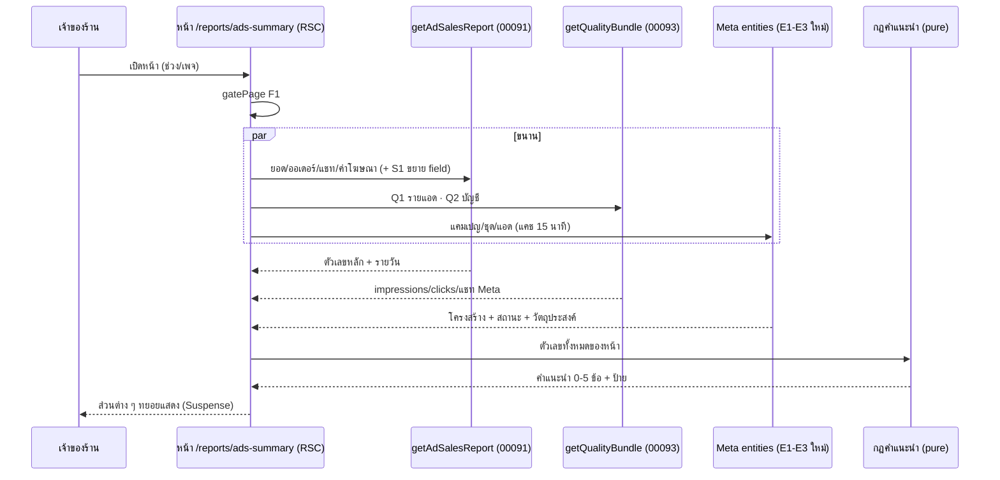

> **โมดูล:** 00094 - Ads Intelligence Report
> **ประเภทเอกสาร:** Business Requirements Document (BRD) - NON-TECHNICAL
> **เวอร์ชัน:** 0.1
> **วันที่จัดทำ:** 2026-11-15
> **สถานะ:** Approved 2026-11-15 (user "ตามเสนอทุกอย่าง")
> **เจ้าของเอกสาร:** BA

# BRD: สรุปโฆษณา

---

## 1. บทนำ

### 1.1 วัตถุประสงค์ของเอกสาร

1. กำหนด FR + Acceptance Criteria ของหน้า "สรุปโฆษณา" (`/reports/ads-summary`)
2. ล็อกสูตรทุกตัว และทิศทาง "ขึ้น = ดี/แย่" ของแต่ละตัวชี้วัด
3. ล็อกกฎคำแนะนำและกฎป้ายจัดกลุ่มแคมเปญ ให้ตรวจสอบได้และเทสได้
4. ระบุว่าตัวเลขไหนมาจาก Meta ตัวไหนมาจาก Deep และตัวไหน*ไม่มี*

### 1.2 ขอบเขต

**Input:** ช่วงวันที่ · เพจ (ไม่บังคับ) · การจัดกลุ่มกราฟ (วัน/สัปดาห์/เดือน) · ข้อมูล Deep (แชทจากโฆษณา ใบสั่งซื้อ ต้นทุน snapshot) · Meta Insights + โครงสร้างแคมเปญ ผ่านบัญชีโฆษณาที่เชื่อม (00092)

**Output:** หน้ารายงาน 7 ส่วน (PRD §4.2) · CSV ตารางแคมเปญ

**ระบบที่เกี่ยวข้อง:** 00091 (`getAdSalesReport`, `getAdSpend`, export) · 00093 (`getQualityBundle` Q1/Q2, `ad-quality-formulas`) · 00092 (การเชื่อมบัญชี) · 00016 (`OrderItem.cost`)

### 1.3 กลุ่มผู้ใช้งาน

| กลุ่มผู้ใช้ | สิทธิ์ |
|---|---|
| เจ้าของร้าน | เห็นทั้งหน้า |
| พนักงานที่มี capability F1 | เห็นทั้งหน้า (ด่านเดียวกับ `/reports/ads`) |
| พนักงานไม่มี F1 | `NoPermissionCard` แบบ `/reports/ads` |

---

## 2. นิยามเดียวทั้งระบบ (HR16)

| คำ | นิยาม | ที่มา (ห้ามนับใหม่) |
|---|---|---|
| ยอดขายจากโฆษณา · คำสั่งซื้อจากโฆษณา · แชทจากโฆษณา (Deep) | ตามเดิมทุกประการ | `getAdSalesReport` (00091 FR-008) |
| ค่าโฆษณา · ROAS · ต้นทุนต่อออเดอร์ | ตามเดิม — ROAS/ต้นทุนต่อออเดอร์ใช้ "ชุดแอดที่มีค่าโฆษณา > 0" | `getAdSalesReport().ads.summary` (00091 FR-010) |
| แชทที่ Meta นับ · impressions · reach · link clicks รายแอด | ตามเดิม | `getQualityBundle().ad` (00093 Q1) |
| ต้นทุนสินค้าของใบ | `OrderItem.cost × qty` หักคืนด้วย `costNetOfReturns` — **ใบชุดเดียวกับยอดขายจากโฆษณา** | นิยาม COGS ของ `pnl.service` (00016) |
| CTR · CPC | ใช้ **link click** (`inline_link_clicks`) | 00093 F-03/F-04 |

🛑 หน้านี้ห้ามมีตัวนับยอดขาย/ออเดอร์/แชทของตัวเอง — เทส parity: ตัวเลขหลักทุกตัว = `/reports/ads` ช่วง/เพจเดียวกัน

🛑 "กำไรขั้นต้นหลังค่าโฆษณา" **ไม่ใช่** กำไรสุทธิของ P&L — ชุดใบต่างกัน (`salesOrderWhere` vs `revenueWindowWhere`) และไม่หักค่าส่ง/ค่าใช้จ่าย · ห้ามวางข้างกันเป็นตัวเดียวกัน

---

## 3. Functional Requirements

### 3.1 หน้าและตัวกรอง

#### FR-001: หน้า "สรุปโฆษณา"

> ในฐานะเจ้าของร้าน ฉันต้องการหน้าเดียวที่ตอบว่าแอดคุ้มไหมและควรทำอะไรต่อ

- [ ] AC-1: route `/reports/ads-summary` ในกลุ่ม `(paces)/seller` · เมนู ANALYTICS ก่อน "ยอดขายตามโฆษณา" · ประกาศ capability F1 ใน `route-capabilities.ts`
- [ ] AC-2: ตัวกรอง = ช่วงวันที่ + เพจ (ตัวแปลง `parseAdReportQuery` เดิม ค่าตั้งต้น 30 วัน · เพดานช่วงเดิม)
- [ ] AC-3: ไม่มีแถบลิงก์ระหว่างรายงาน (ซ้ำกับเมนูซ้าย — มติ user 2026-11-15) · ลิงก์ในเนื้อหาที่พาไปหน้าอื่น ("ดูส่วนต่างแชท" ฯลฯ) พก `from/to/shopChannelId`
- [ ] AC-4: หัวหน้า = ชื่อ + breadcrumb · ไม่มีบรรทัดช่วงวันที่/ช่วงเทียบใต้ตัวกรอง (ช่วงอยู่ในปุ่มเลือกวันที่แล้ว — มติ user 2026-11-15) · ไม่มีย่อหน้าอธิบาย
- [ ] AC-5: ไม่เชื่อมบัญชีโฆษณา → ส่วนที่ใช้ Meta แสดงสถานะ "ยังไม่ได้เชื่อมบัญชีโฆษณา" + ปุ่มไปหน้าเชื่อม · ส่วนที่ใช้ Deep ล้วนยังแสดง
- [ ] AC-6: ร้านไม่เคยมีข้อมูลแอดเลย (`hasAnyAdData = false`) → empty state หน้าเดียว (แบบ `/reports/ads`)

### 3.2 ตัวเลขหลัก

#### FR-002: การ์ดตัวเลขหลัก 4 ใบ

- [ ] AC-1: ค่าโฆษณา · ยอดขายจากโฆษณา · ROAS · ต้นทุนต่อออเดอร์ (มติ user 2026-11-15 "อยากได้แค่ 4") — ค่าและค่าช่วงก่อนจาก §2 เท่านั้น
- [ ] AC-1b: โครงการ์ด = Paces `dashboard/ecommerce/components/StatisticCard.tsx` ตรง ๆ (มติ user 2026-11-15 "ควรเป็นตาม Theme"): ชื่อซ้ายบน · ไอคอนวงกลม primary/15 ขวาบน · ตัวเลข text-xl · ลูกศร + % ข้อความสี + "เทียบช่วงก่อน" · **ไม่มี sparkline** · ข้อยกเว้นของ "% = badge" (BR-AIR-16)
- [ ] AC-2: แต่ละใบมี: ชื่อไทย · ค่า · % เปลี่ยน (F-10 ทุกตัว รวมอัตรา) · สีตาม**ทิศทางที่ดี** (BR-AIR-02) · sparkline รายวันของช่วงปัจจุบัน · ไอคอน info → tooltip นิยาม 1 บรรทัด
- [ ] AC-3: ช่วงก่อน ≤ 0 หรือ null → ซ่อน % (ห้ามแสดง +100% จากฐาน 0 — แบบ P&L)
- [ ] AC-4: ค่าที่คำนวณไม่ได้ = "—" ไม่ใช่ 0

#### FR-003: ตัวเลขรอง (แสดงตลอด ไม่ย่อ — มติ user 2026-11-15)

- [ ] AC-1: การ์ดเดียว 2 กลุ่ม — Deep: คำสั่งซื้อจากโฆษณา · อัตราปิดการขาย · ยอดเฉลี่ยต่อออเดอร์ / Meta: การแสดงผล · เข้าถึง (ประมาณการ) · ความถี่ · แชทที่ Meta นับ · CTR · CPC · CPM · ต้นทุนต่อแชท (Meta)
- [ ] AC-2: ป้าย "Meta" ครั้งเดียวที่หัวกลุ่ม Meta · กลุ่มของร้านไม่มีป้าย (BR-AIR-14)
- [ ] AC-3: กรองเพจ → ตัวเลข Meta ใช้ชุดแอดในขอบเขตเพจ (กติกา `scopeAdIds` ของ 00093)

### 3.3 คำแนะนำ

#### FR-004: คำแนะนำ 0–5 ข้อ

> ในฐานะเจ้าของร้าน ฉันต้องการรู้ว่าควรเริ่มแก้ที่ไหน โดยมีตัวเลขรองรับ

- [ ] AC-1: สร้างจากกฎ §6 เท่านั้น (pure function ใน `src/lib` · ไม่เรียก LLM)
- [ ] AC-0: แสดงเป็น **bubble ลอยมุมขวาล่าง** (ปิดไว้ตั้งต้น · ตัวเลขจำนวนข้อบน bubble) → กดเปิดแผง `role="dialog"` เหนือ bubble · Esc/คลิกนอก/ปุ่มปิด = ปิด โฟกัสกลับ bubble · แท็บเล็ตยกพ้น bottom nav (มติ user 2026-11-15 — ข้อยกเว้นของ `seller-action-placement` ที่มี 4 โซน: bubble นี้เป็นตัวเปิดข้อมูล ไม่ใช่ action) · สีฟ้า info
- [ ] AC-2: แต่ละข้อแสดงหัวข้อ**บรรทัดเดียว** + ป้ายความสำคัญ (สูง/กลาง/ต่ำ) · กดขยาย → (ก) ตัวเลขหลักฐาน 2–4 ตัว (ข) สาเหตุที่*เป็นไปได้* (ค) สิ่งที่ลองทำ (ง) ความมั่นใจ + ข้อจำกัด
- [ ] AC-3: ทุกตัวเลขในคำแนะนำต้องปรากฏบนหน้าเดียวกัน (ไม่มีตัวเลขที่ผู้ใช้ตรวจย้อนไม่ได้)
- [ ] AC-4: เรียงตามความสำคัญ → ค่าโฆษณาที่เกี่ยวข้องมากก่อน · สูงสุด 5 ข้อ
- [ ] AC-5: ไม่มีข้อไหนผ่านเกณฑ์ → "ยังไม่พบสิ่งที่ต้องแก้ในช่วงนี้" บรรทัดเดียว
- [ ] AC-6: ข้อมูลเกินเพดาน (`truncated`) หรือ Meta ไม่ OK → ปิดกฎที่ต้องใช้ข้อมูลนั้น (ไม่ใช่ปิดทั้งส่วน)
- [ ] AC-7: คำกริยาในข้อ (ค) เป็นการทดลอง — ห้ามคำว่า "หยุดแอด" / "เพิ่มงบ" แบบสั่ง (BR-AIR-07)

### 3.4 แนวโน้ม

#### FR-005: กราฟแนวโน้ม

- [ ] AC-0: โครงการ์ด = Paces `widgets/charts/components/SalesReport.tsx` (มติ user 2026-11-15): แท็บ รายวัน/รายสัปดาห์/รายเดือน ที่หัวการ์ด · แถบสรุป 4 ตัว (ยอดขายจากโฆษณา · ค่าโฆษณา · คำสั่งซื้อ · CTR) กดเลือกตัวที่ดูในกราฟ · กราฟ area gradient = ช่วงนี้ + เส้นประ = ช่วงก่อน (หน่วยเดียวกัน) — **แทน AC-1/AC-2 เดิม** (คู่ตัวเลข 2 แผง)
- [ ] AC-1: ตัวเลือกคู่: ค่าโฆษณา vs ยอดขาย · คำสั่งซื้อ vs ต้นทุนต่อออเดอร์ · CTR vs CPC · ROAS (เดี่ยว)
- [ ] AC-2: คู่ที่หน่วยต่างกัน = **สองแผงซ้อนแนวตั้ง แกน x ร่วม** — ห้ามแกน y คู่ (BR-AIR-05)
- [ ] AC-3: จัดกลุ่ม วัน/สัปดาห์ (จันทร์–อาทิตย์)/เดือน · อัตราทุกช่องคำนวณใหม่จาก Σ ตัวตั้ง ÷ Σ ตัวหารของช่องนั้น (ห้ามเฉลี่ยค่ารายวัน) · ช่องที่ไม่เต็มติดป้าย "ไม่เต็ม"
- [ ] AC-4: เส้นช่วงก่อน (เส้นประ) จัดตำแหน่งตามลำดับวัน (แบบ `prevDaily` เดิม)
- [ ] AC-5: ช่วง 1 วัน → รายชั่วโมงเฉพาะตัวเลข Deep · ตัวเลือกที่ต้องใช้ Meta ปิด + ป้าย "Meta ไม่มีรายชั่วโมง"
- [ ] AC-6: tooltip แสดงค่าจริง + วันที่ (`formatDate`) · สกุลเงิน ฿ คั่นหลัก
- [ ] AC-7: ใต้กราฟ 1 บรรทัดสรุปจากข้อมูล (BR-AIR-06) เช่น "ค่าโฆษณา +32% · ออเดอร์ +8%" — ไม่มีข้อมูลพอ = ไม่แสดงบรรทัดนี้

### 3.5 เส้นทางลูกค้า

#### FR-006: Funnel 5 ขั้น

- [ ] AC-1: การแสดงผล (Meta) → คลิกลิงก์ (Meta) → แชทที่ Meta นับ (Meta) → แชทที่ถึงร้าน (Deep) → คำสั่งซื้อ (Deep)
- [ ] AC-2: แต่ละช่วงต่อ: จำนวน · อัตราผ่าน · อัตราหลุด · เทียบช่วงก่อน (จุดเปอร์เซ็นต์)
- [ ] AC-3: เส้นแบ่งแหล่งข้อมูลระหว่างขั้น 3→4 · อัตรา 3→4 ใช้ป้าย "ต่างแหล่ง" และลิงก์ไป `/reports/ad-quality` (ส่วนต่างแชท)
- [ ] AC-4: ขั้นที่ไม่มีค่า (Meta ไม่ส่ง action / ไม่เชื่อม) → ขั้นนั้นแสดง "—" และอัตราที่ต้องใช้ขั้นนั้นไม่คำนวณ — ห้ามข้ามไปคำนวณขั้นถัดไปแทน
- [ ] AC-5: ไฮไลต์ช่วงที่อัตราผ่านลดลงมากที่สุดเทียบช่วงก่อน (เมื่อผ่านเกณฑ์ขั้นต่ำ BR-AIR-04) + หัวข้อบรรทัดเดียวว่า "หลุดมากขึ้นที่ช่วง X"
- [ ] AC-7: แสดงเป็น**ทรงกรวย (Sales Funnel)** ตาม ref ของ user 2026-11-15 — ชั้นคงที่ความกว้างลดหลั่น (ไม่สเกลตามจำนวน) · ชื่อขั้นในชั้น · จำนวนด้านซ้าย · อัตราผ่าน + badge ด้านขวา · ชั้น Meta = `info` ชั้นของร้าน = `primary` + คำอธิบายสี · ช่วงที่หลุดมากขึ้นพื้น warning/15 · สีตามธีม ไม่ใช่สีของ ref (HR6)
- [ ] AC-8: ตำแหน่ง = ส่วนเต็มแถวถัดจากการ์ดแนวโน้ม (user ลองวางข้างยอดขายและแชท 70:30 แล้วขอย้ายกลับ 2026-11-15) · จำนวนซ้าย · กรวยกลาง · อัตราผ่าน + badge ขวา
- [ ] AC-6: ไม่มี reach ใน funnel (reach เป็นจำนวนคน ขั้นอื่นเป็นจำนวนครั้ง)

### 3.6 แคมเปญ → ชุดโฆษณา → แอด

#### FR-007: ตารางลำดับชั้น + ป้ายจัดกลุ่ม

- [ ] AC-1: แถวแคมเปญ (ชื่อ · วัตถุประสงค์ · สถานะ · ป้าย · ค่าโฆษณา · การแสดงผล · CTR · CPC · CPM · แชท Meta · แชท Deep · คำสั่งซื้อ · ยอดขาย · ต้นทุนต่อออเดอร์ · ROAS · % เปลี่ยนค่าโฆษณา) → กดขยายเป็นชุดโฆษณา → แอด
- [ ] AC-2: แถวบนรวมจาก Σ แถวลูกเสมอ · อัตรา = Σ/Σ (`groupRatePct`) · reach/ความถี่ แสดงเฉพาะระดับแอด (รวมข้ามแอดไม่ได้)
- [ ] AC-3: แอดที่มีข้อมูล Deep แต่ Meta ไม่รู้จัก (ถูกลบ/คนละบัญชี) → กลุ่ม "ไม่ทราบแคมเปญ" ท้ายตาราง — ไม่ทิ้งแถว (ผลรวมตารางต้องเท่าตัวเลขหลัก)
- [ ] AC-4: เรียงทุกคอลัมน์ · ค้นหาชื่อ (แคมเปญ/ชุด/แอด) · กรองสถานะ + วัตถุประสงค์ + ป้าย · เลือกคอลัมน์ที่แสดง (จำใน localStorage) · ตั้งต้นแสดง 8 คอลัมน์หลัก
- [ ] AC-5: ป้ายตาม BR-AIR-08 · hover ป้าย = เหตุผลบรรทัดเดียว เช่น "ROAS 2.1 ต่ำกว่าแคมเปญแชทเฉลี่ย 4.0"
- [ ] AC-6: % เปลี่ยน ≥ 30% (ขึ้นหรือลง ตามทิศทางที่ดี) ไฮไลต์สีอ่อน + ไอคอนลูกศร (ไม่พึ่งสีอย่างเดียว)
- [ ] AC-7: แถวแอดมีลิงก์ "ดูออเดอร์" → ชีตคำสั่งซื้อเดิมของ 00091 (`listOrdersForAd`)
- [ ] AC-8: แท็บเล็ต 768 = ตารางเลื่อนแนวนอนในการ์ดของตัวเอง (ไม่มีมุมมองการ์ดสำหรับมือถือ)
- [ ] AC-9: เลือกได้สูงสุด 3 แคมเปญ → แถบเทียบตัวเลขหลักข้างกัน

- [ ] AC-10: โครงตาราง = Paces `apps/ecommerce/(orders)/orders/components/OrdersList.tsx` + `DataTable` + `TablePagination` (มติ user 2026-11-15 "ให้ตาม theme"): ค้นหาไอคอนในช่อง · "กรองตาม:" + form-select มีไอคอน + จำนวนต่อหน้า · ปุ่มส่งออก bg-primary ขวา · thead พื้นจาง · table-hover · footer "แสดง x ถึง y จาก n แคมเปญ" + pagination แบบกล่อง

#### FR-008b: กลุ่มผู้ชม (Audience Insights)

> ในฐานะเจ้าของร้าน ฉันอยากรู้ว่าโฆษณาไปถึงคนกลุ่มไหน และกลุ่มไหนได้แชทถูกที่สุด (user 2026-11-15 "อยากได้ Audience Insight ด้วย")

- [ ] AC-1: โครง = Paces `dashboard/analytics/components/AudienceInsight.tsx`: แถบบน เข้าถึง · แชท (Meta) · donut ตามเพศ (ชาย/หญิง/ไม่ระบุ) ยอดรวมกลาง · ตารางตามอายุ (เข้าถึง · แชท · ต้นทุน/แชท) + ป้าย "ถูกสุด" ที่กลุ่มต้นทุน/แชทต่ำสุด · ปุ่มไป `/reports/ad-quality` (พกช่วง/เพจ)
- [ ] AC-2: ข้อมูล = คำขอ Q4 (age,gender) ของ 00093 ตัวเดิม แคชร่วม — ไม่เพิ่มคำขอ · ค่าประมาณ → ป้าย "≈ ประมาณการ"
- [ ] AC-3: ห้ามยอดขาย/ออเดอร์/ROAS แยกตามอายุ/เพศ (ร้านไม่มีข้อมูล — สืบ BR-AIQ-02)
- [ ] AC-4: ตำแหน่ง: แถวเดียวกับ funnel (funnel 8/12 · กลุ่มผู้ชม 4/12) · แท็บเล็ตเรียงต่อกัน
- [ ] AC-5: donut ได้รับยกเว้นจาก BR-AIR-05 (ห้าม pie) เฉพาะการ์ดนี้ — 3 ส่วน สัดส่วนรวมเป็น 100% ตามธีม

#### FR-008: ส่งออก CSV

- [ ] AC-1: ปุ่ม "ส่งออก CSV" ส่งออกตารางระดับที่กางอยู่ (ทุกแถว ไม่ใช่แค่หน้าที่เห็น) ตามตัวกรอง/ค้นหาปัจจุบัน
- [ ] AC-2: หัวคอลัมน์ไทย · บรรทัดแรกระบุช่วงวันที่ + เพจ + เวลาที่สร้าง · ใช้ตัวสร้าง CSV เดิม (`ad-report-export.ts`) ผ่าน export route เดิม (เพิ่มชนิด) · ด่าน F1 เดิม

### 3.7 ครีเอทีฟ

#### FR-009: อันดับครีเอทีฟ + จุดกระจาย

- [ ] AC-1: แนวนอนเรียงตามคำสั่งซื้อ (สลับเป็น ROAS / ค่าโฆษณาได้) · แสดงรูปแอด: รูปจาก Deep (`adPhotoFileId` ผ่าน `variantUrlOf`) ก่อน → ไม่มีจึงใช้ thumbnail จาก Meta (ไม่เก็บ) → ไม่มีเลย = ไอคอน
- [ ] AC-2: จุดกระจาย ค่าโฆษณา (x) vs คำสั่งซื้อ (y) ขนาดจุด = แชท Deep · สีแยก 2 กลุ่ม: ต้นทุนต่อออเดอร์ต่ำกว่า/สูงกว่าเฉลี่ยร้าน + บรรทัดเดียว "เฉลี่ยทั้งร้าน ฿X ต่อออเดอร์" (Apex ผสม bubble+เส้นไม่ได้ — มติ O2) · แอดข้อมูลน้อยไม่วาด
- [ ] AC-3: ป้ายสองชนิดบนรายการ (BR-AIR-10): "ใช้เงินมาก ออเดอร์น้อย" · "CTR สูง ปิดการขายต่ำ"
- [ ] AC-4: แอดที่ "ข้อมูลน้อย" แสดงจาง และไม่ติดป้ายเชิงลบ

### 3.8 ความคุ้มค่า

#### FR-010: กำไรขั้นต้นหลังค่าโฆษณา + ROAS คุ้มทุน

- [ ] AC-1: ค่าโฆษณา · ยอดขายจากโฆษณา (ชุดที่มีค่าโฆษณา) · ต้นทุนสินค้า · กำไรขั้นต้น · กำไรหลังค่าโฆษณา · อัตรากำไรขั้นต้น · ROAS คุ้มทุน — สูตร §4
- [ ] AC-2: บรรทัดสินค้าในใบชุดนั้นมี `cost = null` แม้ 1 บรรทัด → ตัวเลขกำไรทั้งส่วนเป็น "ข้อมูลไม่เพียงพอ" + "สินค้า N รายการไม่มีต้นทุน" + ปุ่มไปหน้าสินค้า
- [ ] AC-3: แสดงเป็นแท่งน้ำตก (waterfall) ยอดขาย → −ต้นทุนสินค้า → −ค่าโฆษณา → กำไรหลังค่าโฆษณา
- [ ] AC-4: ป้ายถาวรบรรทัดเดียว "ยังไม่หักค่าส่ง/ค่าธรรมเนียม"
- [ ] AC-5: อัตรากำไรขั้นต้น ≤ 0 → ไม่แสดง ROAS คุ้มทุน · แสดง "ขายต่ำกว่าทุน"
- [ ] AC-6: กราฟแท่งรายแคมเปญ: กำไรหลังค่าโฆษณา (เฉพาะแคมเปญที่ต้นทุนครบ)

### 3.9 สถานะและประสิทธิภาพ

#### FR-011: สถานะรายส่วน

- [ ] AC-1: ทุกส่วนโหลดแยก (Suspense) · ส่วนที่ล้มแสดง `CardState` ของตัวเอง + ปุ่มลองใหม่ · ส่วนอื่นไม่ล้มตาม
- [ ] AC-2: skeleton ต่อส่วน (pattern `Skeletons.tsx` ของ 00093)
- [ ] AC-3: เวลาอัปเดตข้อมูล Meta ล่าสุด แสดงใน tooltip ของป้าย Meta (ไม่ใช่บรรทัดข้อความ)

---

## 4. สูตร

ตัวหาร 0 หรือไม่มีค่า → null ("—") · อัตรารวมกลุ่ม = Σ ตัวตั้ง ÷ Σ ตัวหาร (`groupRatePct`) · ใช้ฟังก์ชันใน `ad-quality-formulas.ts` / `ad-report-view.ts` ที่มีอยู่ — สูตรใหม่เพิ่มในไฟล์เดียวกัน

| รหัส | ตัวชี้วัด | สูตร | ใหม่? |
|---|---|---|---|
| F-01 | ROAS | ยอดขายแอดที่มีค่าโฆษณา ÷ ค่าโฆษณา | เดิม (00091) |
| F-02 | ต้นทุนต่อออเดอร์ | ค่าโฆษณา ÷ คำสั่งซื้อของแอดชุดเดียวกัน | เดิม |
| F-03 | อัตราปิดการขาย | คำสั่งซื้อ ÷ แชท Deep × 100 | เดิม |
| F-04 | CTR | link clicks ÷ การแสดงผล × 100 | เดิม (00093) |
| F-05 | CPC | ค่าโฆษณา ÷ link clicks | เดิม |
| F-06 | CPM | ค่าโฆษณา ÷ การแสดงผล × 1,000 | **ใหม่** |
| F-07 | ความถี่ | การแสดงผล ÷ เข้าถึง | เดิม |
| F-08 | ต้นทุนต่อแชท (Meta) | ค่าโฆษณา ÷ แชทที่ Meta นับ | เดิม |
| F-09 | ยอดเฉลี่ยต่อออเดอร์ | ยอดขายจากโฆษณา ÷ คำสั่งซื้อ | เดิม |
| F-10 | % เปลี่ยน | (ปัจจุบัน − ก่อน) ÷ ก่อน × 100 · ก่อน ≤ 0 หรือ null → null | **ใหม่** (ตัวเดียวใช้ทั้งหน้า) |
| F-11 | ~~เปลี่ยน (อัตรา) เป็นจุดเปอร์เซ็นต์~~ | **ยกเลิก** — หน้าจอใช้ % (F-10) ทุกจุด รวมตัวชี้วัดที่เป็นอัตรา · tooltip บอกค่าช่วงก่อน (มติ user 2026-11-15 "ทำไมเดี๋ยวใช้จุด เดี๋ยวใช้ %") | — |
| F-12 | ต้นทุนสินค้า | Σ `costNetOfReturns(cost × qty)` ของใบในชุด F-01 | **ใหม่** |
| F-13 | กำไรขั้นต้น | ยอดขายชุด F-01 − F-12 | **ใหม่** |
| F-14 | กำไรหลังค่าโฆษณา | F-13 − ค่าโฆษณา | **ใหม่** |
| F-15 | อัตรากำไรขั้นต้น | F-13 ÷ ยอดขายชุด F-01 | **ใหม่** |
| F-16 | ROAS คุ้มทุน | 1 ÷ F-15 (F-15 ≤ 0 → null) | **ใหม่** |
| F-17 | อัตราผ่าน funnel | ขั้นถัดไป ÷ ขั้นนี้ × 100 · อัตราหลุด = 100 − อัตราผ่าน | **ใหม่** |
| F-18 | ส่วนแบ่ง | ค่าของแถว ÷ ผลรวมทั้งตาราง × 100 | **ใหม่** |

---

## 5. คำขอไปยัง Meta (สรุปเชิงธุรกิจ — รายละเอียดเทคนิคใน SRS)

| รหัส | ขออะไร | ใช้ที่ | สถานะ |
|---|---|---|---|
| S1 | ค่าโฆษณารายแอดรายวัน (คำขอเดิมของ FR-010) **+ เพิ่ม field** การแสดงผล · link clicks · รหัส/ชื่อชุดโฆษณา · รหัส/ชื่อแคมเปญ | แนวโน้ม CTR/CPC/CPM · ตารางลำดับชั้น | ขยายคำขอเดิม — ไม่เพิ่มจำนวนคำขอ · `/reports/ads` ได้คำตอบใหญ่ขึ้นแต่ใช้แคชร่วม |
| Q1 / Q2 | ตัวเดิมของ 00093 | แชท Meta · reach · ตัวเลขรอง | เดิม (แคชร่วม) |
| E1 | รายการแคมเปญ: ชื่อ · วัตถุประสงค์ · สถานะ | ตาราง + ป้ายจัดกลุ่ม | **ใหม่** (entity ไม่ใช่ Insights) |
| E2 | รายการชุดโฆษณา: ชื่อ · สถานะ | ตาราง | **ใหม่** |
| E3 | สถานะแอด + thumbnail ครีเอทีฟ เฉพาะแอดในช่วง | ตาราง + ครีเอทีฟ | **ใหม่** |

🛑 ห้ามอ่าน `purchase` / `action_values` / `purchase_roas` (สืบ BR-AIQ-01) · thumbnail ไม่เก็บลงฐาน/Storage (URL ของ Meta หมดอายุ — ดึงใหม่ตามแคช)

---

## 6. กฎคำแนะนำ (FR-004)

ทุกกฎใช้ตัวเลขบนหน้าเท่านั้น · ทุกกฎมีเกณฑ์ขั้นต่ำ (BR-AIR-04) · เกณฑ์เป็นค่าคงที่ในไฟล์เดียว (`ad-insight-rules.ts`)

| รหัส | เงื่อนไข (ทุกข้อต้องจริง) | หัวข้อ (บรรทัดเดียว) | สาเหตุที่เป็นไปได้ | สิ่งที่ลองทำ | ความสำคัญ |
|---|---|---|---|---|---|
| R1 ต้นทุนต่อออเดอร์ขึ้น | F-02 ขึ้น ≥ 20% · คำสั่งซื้อทั้งสองช่วง ≥ 5 | "ต้นทุนต่อออเดอร์ขึ้น X%" | ชี้ตัวที่เปลี่ยนมากสุดใน: CPC ขึ้น ≥ 15% → "คลิกแพงขึ้น" · อัตราปิดการขายลด ≥ 15% (สัมพัทธ์) → "แชทปิดการขายได้น้อยลง" · CTR ลด ≥ 15% → "แอดดึงคลิกได้น้อยลง" · ไม่มีตัวไหนผ่าน = ไม่ระบุสาเหตุ | เทียบ funnel สองช่วง · ลองครีเอทีฟใหม่ในงบเท่าเดิม | สูง |
| R2 ใช้เงินโตเร็วกว่าผล | ค่าโฆษณาขึ้น ≥ 20% · การเติบโตของคำสั่งซื้อ < ครึ่งหนึ่งของการเติบโตค่าโฆษณา · ค่าโฆษณาช่วงก่อน ≥ เกณฑ์ | "ค่าโฆษณา +X% แต่ออเดอร์ +Y%" | งบที่เพิ่มไปลงกลุ่มคนที่ซื้อน้อยกว่า | ดูแคมเปญที่ค่าโฆษณาโตมากสุด (ลิงก์ตาราง) | สูง |
| R3 CTR ลด | CTR ลด ≥ 20% (สัมพัทธ์) · การแสดงผลทั้งสองช่วง ≥ 5,000 | "CTR ลดจาก A% เหลือ B%" | ครีเอทีฟเดิมถูกเห็นซ้ำ หรือกลุ่มเป้าหมายเปลี่ยน — **ยังยืนยันไม่ได้** | ลองครีเอทีฟใหม่ 1–2 ชิ้นข้างของเดิม | กลาง |
| R4 แชทเยอะ ปิดการขายน้อย | อัตราปิดการขายลด ≥ 25% (สัมพัทธ์) · แชท Deep ทั้งสองช่วง ≥ 20 | "ปิดการขายจากแชทลดเหลือ X%" | ขั้นตอนตอบแชท/ราคา/สต็อก | ไล่อ่านแชทจากโฆษณาที่ไม่มีออเดอร์ (ลิงก์ `/reports/ads`) | สูง |
| R5 แคมเปญกินงบ | แคมเปญเดียว ส่วนแบ่งค่าโฆษณา ≥ 30% · ส่วนแบ่งคำสั่งซื้อ ≤ ครึ่งของส่วนแบ่งค่าโฆษณา · ไม่ "ข้อมูลน้อย" | "แคมเปญ X ใช้เงิน A% ได้ออเดอร์ B%" | กลุ่มเป้าหมาย/ข้อความของแคมเปญนี้ปิดการขายได้น้อย | ลองย้ายงบส่วนหนึ่งไปแคมเปญที่ต้นทุนต่อออเดอร์ต่ำกว่าแบบทดลอง 7 วัน | สูง |
| R6 แอดน่าทดลองเพิ่มงบ | ROAS ของแอด ≥ 1.5 × ROAS รวม · คำสั่งซื้อ ≥ 5 · ค่าโฆษณา ≥ เกณฑ์ · สถานะแอดเปิดอยู่ | "แอด X ROAS สูงกว่าเฉลี่ย Y เท่า" | — | ลองเพิ่มงบเล็กน้อยแล้วเฝ้าดูต้นทุนต่อออเดอร์ 7 วัน | กลาง |
| R7 แชทหายระหว่างทาง | ป้ายส่วนต่างแชทระดับรวม = HIGH (กฎ `gapBadge` 00093) | "Meta นับแชท A · ถึงร้าน B" | Meta AI รับแชท / เพจไม่ได้เชื่อม (ดู 00093) | เปิดรายงานคุณภาพโฆษณา | กลาง |
| R8 CTR สูง ปิดการขายต่ำ | แอด: CTR ≥ 1.3 × CTR รวม · อัตราปิดการขาย ≤ 0.5 × อัตรารวม · แชท Deep ≥ 20 | "แอด X คนคลิกเยอะ แต่ซื้อน้อย" | ข้อความแอดไม่ตรงกับสิ่งที่ขายจริง | ตรวจว่าราคา/โปรในแอดตรงกับที่แอดมินตอบ | กลาง |

ความมั่นใจ (แสดงในส่วนขยาย): **สูง** = ตัวอย่าง ≥ 2× เกณฑ์ และช่วงไม่รวมเมื่อวาน/วันนี้ · **กลาง** = ผ่านเกณฑ์ · **ต่ำ** ไม่แสดงคำแนะนำ (ไม่ผ่านเกณฑ์)

---

## 7. กฎทางธุรกิจ

| รหัส | กฎ |
|---|---|
| BR-AIR-01 | ยอดขาย/ออเดอร์/แชท Deep มาจาก `getAdSalesReport` เท่านั้น · ห้ามใช้ purchase ของ Meta |
| BR-AIR-02 | ทิศทางที่ดี: **ขึ้น = ดี** ยอดขาย · ROAS · คำสั่งซื้อ · อัตราปิดการขาย · CTR · แชท · กำไร — **ขึ้น = แย่** ต้นทุนต่อออเดอร์ · CPC · CPM · ต้นทุนต่อแชท — **กลาง (ไม่มีสี)** การแสดงผล · เข้าถึง · ความถี่ — **ค่าโฆษณาขึ้น = ดี (เขียว)** มติ user 2026-11-15 "เขียว" (ใช้เงินมากขึ้น = ขยายโฆษณา · ความคุ้มดูที่ ROAS/ต้นทุนต่อออเดอร์) |
| BR-AIR-03 | สี + ไอคอนลูกศร + เครื่องหมาย +/− เสมอ (ไม่พึ่งสีอย่างเดียว) · ดีขึ้น = `success-ink` · แย่ลง = `warning-ink` (ไม่ใช่ danger — ตรงกับ `DeltaText` ของ 00091/00093, มติ Controller 2026-11-15 O1) · ห้ามม่วง buyer (HR7) |
| BR-AIR-04 | เกณฑ์ขั้นต่ำตั้งต้น: ค่าโฆษณา ≥ ฿500 **และ** แชท Deep ≥ 20 ต่อแถว/ช่วง (มติ Q3 2026-11-15) · ต่ำกว่า = "ข้อมูลน้อย" |
| BR-AIR-05 | ห้ามกราฟแกน y คู่ · ห้าม pie · ห้าม 3D · ห้ามอนิเมชันตกแต่ง |
| BR-AIR-06 | ประโยคสรุปใต้กราฟ/funnel สร้างจากตัวเลขจริงด้วยเทมเพลต ไม่เกิน 1 บรรทัด · ไม่มีข้อมูลพอ = ไม่แสดง |
| BR-AIR-07 | คำแนะนำไม่สั่งหยุด/เพิ่มงบ — ใช้ "ลอง…" "เทียบ…" "ตรวจ…" · สาเหตุใช้ "อาจ" เสมอ |
| BR-AIR-08 | ป้ายจัดกลุ่มแคมเปญ: เทียบเฉพาะแคมเปญ**กลุ่มวัตถุประสงค์เดียวกัน** — กลุ่ม "ปิดการขาย" = ENGAGEMENT/MESSAGES/LEADS/SALES (+ ชื่อเก่า MESSAGES/CONVERSIONS) · กลุ่มอื่น (AWARENESS/TRAFFIC/APP_PROMOTION/ไม่ทราบ) = "ไม่จัดกลุ่ม" · ค่ากลางของกลุ่ม = Σ/Σ ของแถวที่ไม่ "ข้อมูลน้อย" · **ข้อมูลน้อย** (BR-AIR-04) → **ทำได้ดี** ROAS ≥ 1.2× ค่ากลาง และต้นทุนต่อออเดอร์ ≤ 0.85× → **ควรดู** คำสั่งซื้อ 0 ทั้งที่ค่าโฆษณา ≥ 3× ต้นทุนต่อออเดอร์กลาง หรือ ROAS ≤ 0.6× หรือต้นทุนต่อออเดอร์ ≥ 1.5× → นอกนั้น **ปกติ** · กลุ่มที่มีแถวผ่านเกณฑ์ < 2 แถว = ไม่มีค่ากลาง → ทุกแถว "ไม่จัดกลุ่ม" |
| BR-AIR-09 | ช่วงที่รวมเมื่อวาน/วันนี้: ออเดอร์จากแชทล่าสุดอาจยังไม่เกิด และ Meta อาจอัปเดต conversion ย้อนหลัง → ความมั่นใจของ R1/R4 สูงสุด "กลาง" |
| BR-AIR-10 | ป้ายครีเอทีฟ: "ใช้เงินมาก ออเดอร์น้อย" = ส่วนแบ่งค่าโฆษณา ≥ 2× ส่วนแบ่งคำสั่งซื้อ และไม่ข้อมูลน้อย · "CTR สูง ปิดการขายต่ำ" = เงื่อนไข R8 |
| BR-AIR-11 | reach/ความถี่ ไม่รวมข้ามแอด/ชุด/แคมเปญ (คนเดียวเห็นหลายแอด) — ระดับรวมใช้ Q2 ระดับบัญชีเท่านั้น |
| BR-AIR-12 | ตัวเลข Meta ที่ไม่มีในคำตอบ = "—" ไม่ใช่ 0 (สืบ BR-AIQ-07) |
| BR-AIR-13 | ไม่มีข้อความอธิบายเกิน 1 บรรทัดบนหน้า (มติ 2026-11-15) — รายละเอียดอยู่ใน tooltip/ส่วนขยาย |
| BR-AIR-14 | **ห้ามคำว่า "Deep" บนหน้ารายงานทุกจุด** (มติ user 2026-11-15 — ผู้ใช้อยู่ใน Deep อยู่แล้ว บอกไปก็ไร้ความหมาย) · ข้อมูลของร้านเองไม่ติดป้ายแหล่ง · ติดป้ายเฉพาะตัวเลขที่มาจาก Meta · "แชท (Deep)" ในหน้าจอ = **"แชทเข้าร้าน"** (เอกสารนี้ยังใช้ "Deep" อธิบายแหล่งข้อมูลได้) |
| BR-AIR-15 | ข้อความบนหน้าใช้คำว่า **"โฆษณา"** ไม่ใช่ "แอด" (มติ user 2026-11-15 "แอด = โฆษณา") · "แอดมิน" ไม่เกี่ยว · ส่วนคำแนะนำแสดงเป็นกล่อง alert info สีฟ้า หัว "คำแนะนำ" (มติเดียวกัน) |
| BR-AIR-16 | การ์ดตัวเลขต้องชี้จุด focus (มติ user 2026-11-15 "ตัวเลขสีเดียวกันหมด แยกไม่ออก"): ชื่อเล็กจาง · ตัวเลขใหญ่หนา · % เปลี่ยน = **badge ทุกจุด** วางต่อท้ายตัวเลขแถวเดียวกัน ท่า Paces `dashboard/analytics/components/TotalOrder.tsx` (`badge text-sm py-0 bg-*/15` + ลูกศร + ค่าสัมบูรณ์) ตาม BR-AIR-02 (ดีขึ้น success · แย่ลง warning · กลาง light ไม่มีลูกศร) · กราฟเล็กสีตามทิศทางเดียวกัน (แย่ลง `chart-zeta` · กลาง `default-400` · ดีขึ้น `chart-primary`) |
| BR-AIR-17 | ห้าม `<select>`/checkbox native ทั้งหน้า (มติ user 2026-11-15) — select = `@/components/wrappers/Select` (react-select ท่า Paces `form/select/components/Select2.tsx`) · checkbox = `.form-checkbox` · ตารางลำดับชั้น = ท่า `tables/datatables/child-rows` (ปุ่ม ⊕/⊖ primary · striped · แถวลูกเป็นตารางย่อ) · การ์ดความคุ้มค่า = ท่า `widgets/charts/components/FinancialOverview.tsx` (แถบสรุป 4 ช่อง: ROAS ตอนนี้ · ROAS คุ้มทุน · อัตรากำไรขั้นต้น · กำไรหลังค่าโฆษณา) |
| BR-AIR-18 | ผลสแกน /ui-theme-sourcing 2026-11-15 (user "แก้ตามเสนอ") — ทุกส่วนมีต้นแบบในธีม: ตัวเลขรอง = `widgets/charts/components/Stat.tsx` (การ์ดเดี่ยว กราฟขวา) · อันดับครีเอทีฟ = `dashboard/ecommerce/components/TopSellingProducts.tsx` · funnel = `charts/apex/funnel` (isFunnel ความกว้างคงที่ ป้ายตัวเลขจริง — **แทน** ทรงกรวย clip-path ใน FR-006 AC-7) · แผงคำแนะนำ = `ui/popovers` · เทียบแคมเปญ = StatisticCard เล็ก · กราฟใช้ legend ของ Apex · ที่ยังไม่มีต้นแบบ: ปุ่ม bubble มุมขวาล่าง (มติ user · ธีมไม่มี FAB) |
| BR-AIR-19 | **ข้อยกเว้น HR10:** กราฟ funnel ใช้ ECharts (`src/components/wrappers/EChart.tsx` · series `funnel` · Apache 2.0) ไม่ใช่ ApexChart — user 2026-11-15 ขอหน้าตาตาม Highcharts funnel demo (กรวยบน + คอตรง · ป้ายนอกกรวยมีเส้นชี้) ซึ่ง Apex ทำไม่ได้ · Highcharts ไม่ใช้เพราะต้องซื้อ license เชิงพาณิชย์ · ความสูงชั้นคงที่ (ไม่แปรตามจำนวน) · ป้าย = ชื่อ (ตัวเลขจริง) + "ผ่าน X%" + badge ในป้ายเดียวกัน (rich text) · สี Meta = info · ของร้าน = primary · **แทน** BR-AIR-18 ส่วน funnel (Apex isFunnel) |

---

## 8. Business Flow

---

## 9. Edge Cases

| กรณี | ผล |
|---|---|
| ไม่เชื่อมบัญชีโฆษณา | ตัวเลขหลักที่ใช้ Meta (ค่าโฆษณา/ROAS/ต้นทุนต่อออเดอร์) = "—" · ยอด/ออเดอร์/อัตราปิดการขายยังแสดง · ตาราง = ระดับแอดจาก Deep ล้วน ในกลุ่ม "ไม่ทราบแคมเปญ" · R1/R2/R3/R5/R6/R7 ปิด |
| สกุลเงินบัญชีไม่ใช่ THB | สถานะ CURRENCY ของ FR-010 ทั้งส่วน Meta |
| แอดถูกย้ายชุด/เปลี่ยนชื่อในช่วง | จัดตามโครงสร้างปัจจุบันของ Meta (E1–E3) · ชื่อ = ชื่อล่าสุด |
| แคมเปญมีค่าโฆษณาแต่ไม่มีแชท/ออเดอร์ | แสดงในตาราง (แบบแถวผี 00091) ป้ายตาม BR-AIR-08 |
| กรองเพจ | ตาราง/Meta ใช้ชุดแอดในขอบเขตเพจ (สืบ 00091/00093) · แคมเปญที่ไม่มีแอดในเพจ = ไม่แสดง |
| ช่วง 1 วัน | กราฟรายชั่วโมงเฉพาะ Deep · คำแนะนำ R1–R4 ปิด (ตัวอย่างไม่พอเปรียบเทียบ) |
| ใบเกินเพดาน | แถบเตือนเดิม · คำแนะนำปิดทั้งหมด · กำไร = "ข้อมูลไม่เพียงพอ" |
| อัตราปิดการขาย > 100% | เก็บตามจริง (สืบ 00091) · ไม่ใช้แถวนั้นใน R6/R8 |
| เขตเวลาบัญชีไม่ใช่ไทย | ป้าย `tzMismatch` เดิมบนกราฟ |

---

## 10. Quality

- **ความถูกต้อง:** เทส parity กับ `/reports/ads` · เทสสูตร F-06/F-10/F-12–F-18 รวมตัวหาร 0 · เทส Σ/Σ ไม่เฉลี่ย % (รวมรายสัปดาห์/เดือน) · เทสกฎ R1–R8 ทั้งผ่าน/ไม่ผ่านเกณฑ์ (+ mutation ที่เกณฑ์) · เทส BR-AIR-08 รวมกลุ่มวัตถุประสงค์ต่างกัน · เทสแยกร้าน (ร้าน A ไม่เห็นแอด/บัญชีร้าน B)
- **ความเร็ว:** ไม่เพิ่ม query Deep (ใช้ผลเดิม) · Meta เพิ่มสูงสุด 3 คำขอ entity ต่อการเปิดหน้า (แคช 15 นาที) · ส่วนแรก (ตัวเลขหลัก Deep) แสดงก่อน Meta ตอบ
- **ความปลอดภัย:** ด่าน F1 · token ไม่ออก client/log/URL (สืบ 00091) · รหัสแอด/แคมเปญจาก Meta ตรวจรูปแบบตัวเลขก่อนใช้
- **ใช้งาน:** แท็บเล็ต 768 / เดสก์ท็อป 1440 — ไม่ทำ layout มือถือ (user 2026-11-15 "รายงานไม่ต้องเผื่อ mobile") · ภาษาไทยทั้งหน้า ใช้ CTR/CPC/CPM/ROAS ตัวย่ออังกฤษ + tooltip · คอนทราสต์ผ่าน AA · ไม่มี emoji (HR12)

---

## 11. มติ

user 2026-11-15 "ตามเสนอทุกอย่าง": Q1 หน้าใหม่ `/reports/ads-summary` · Q2 คำแนะนำต่อจากตัวเลขหลัก · Q3 ข้อมูลน้อย = ค่าโฆษณา < ฿500 หรือแชท Deep < 20 · Q4 ไม่มียอดเก็บเงินจริงใน v1 · Q5 ทำส่วนกำไรขั้นต้นหลังค่าโฆษณา
