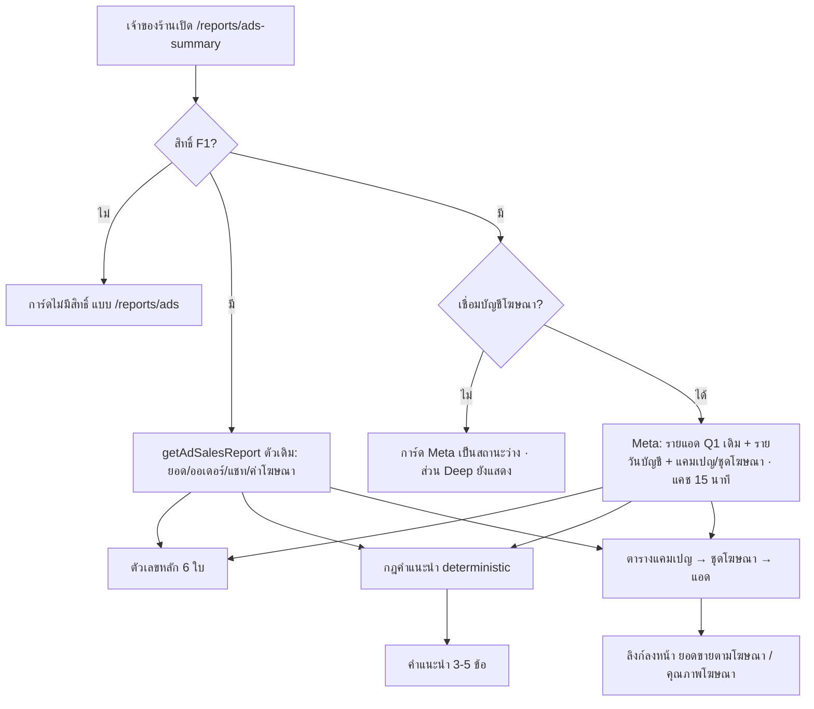

> **โมดูล:** 00094 - Ads Intelligence Report
> **ประเภทเอกสาร:** Product Requirements Document (PRD)
> **เวอร์ชัน:** 0.1
> **วันที่จัดทำ:** 2026-11-15
> **สถานะ:** Approved 2026-11-15 (user "ตามเสนอทุกอย่าง" — Q1–Q5 ตามข้อเสนอ) · ม็อกอัพก่อนเขียนโค้ด · รายงานรองรับแท็บเล็ต 768 ขึ้นไป ไม่ทำจอมือถือ (user 2026-11-15)
> **เจ้าของเอกสาร:** BA + PO + PM

# PRD: สรุปโฆษณา — รายงานที่บอกว่าโฆษณาคุ้มไหม และควรทำอะไรต่อ

---

## Executive Summary

ร้านมีรายงานโฆษณาอยู่แล้ว 2 หน้า

| หน้า | ตอบอะไร | ข้อจำกัดที่เจอ |
|---|---|---|
| `/reports/ads` ยอดขายตามโฆษณา (00091) | แอดไหนทำยอดขาย · ค่าโฆษณา · ROAS · ต้นทุน/ออเดอร์ | เรียงเป็นรายแอดอย่างเดียว ไม่มีแคมเปญ/ชุดโฆษณา · ไม่บอกว่าดีขึ้นหรือแย่ลง*เพราะอะไร* |
| `/reports/ad-quality` คุณภาพโฆษณา (00093) | แชท Meta เทียบ Deep · คุณภาพแชท · ตำแหน่ง · อายุ/เพศ | ตัวเลขดิบเยอะ · ไม่มีกราฟแนวโน้ม · ไม่มีคำแนะนำ |

ร้านยังต้องประกอบคำตอบเองจากสองหน้า ว่า **"เดือนนี้แอดคุ้มไหม แย่ลงตรงไหน ควรแก้อะไรก่อน"**

ฟีเจอร์นี้เพิ่ม **หน้า "สรุปโฆษณา"** เป็นทางเข้าแรกของกลุ่มรายงานโฆษณา ใช้ข้อมูลและสูตรที่มีอยู่แล้วของ 00091/00093 (ไม่นับใหม่) แล้วเพิ่ม 5 อย่างที่ยังไม่มี:

1. **ตัวเลขหลัก 4 ตัว** (+ ตัวเลขรองแสดงตลอด) พร้อมทิศทาง (ขึ้น = ดีหรือแย่ ตามความหมายของตัวนั้น) เทียบช่วงก่อน
2. **แนวโน้ม** รายวัน/สัปดาห์/เดือน เลือกคู่ตัวเลขดูได้ (ค่าโฆษณา vs ยอดขาย · ออเดอร์ vs ต้นทุนต่อออเดอร์ · CTR vs CPC)
3. **เส้นทางลูกค้า (funnel)** การแสดงผล → คลิก → แชท (Meta) → แชทถึงร้าน (Deep) → คำสั่งซื้อ พร้อมจุดที่หลุดมากที่สุด
4. **ตารางแคมเปญ → ชุดโฆษณา → แอด** พร้อมป้ายจัดกลุ่ม (ทำได้ดี / ปกติ / ควรดู / ข้อมูลน้อย)
5. **คำแนะนำ 3–5 ข้อ** จากกฎที่ตรวจสอบได้ (ไม่ใช้ AI คำนวณ) แต่ละข้อมีหลักฐานและระดับความมั่นใจ

ข้อเท็จจริงที่กำหนดขอบเขต:
- **ยอดขายมาจาก Deep เท่านั้น** (ใบที่บันทึกว่ามาจากแอด) — ไม่ใช้ purchase/ROAS ของ Meta (มติ 00091 BR · HR16)
- **ใบที่บันทึกแอดไว้ ≠ ใบที่แอดเป็นสาเหตุ** — ป้ายบนหน้าจอใช้คำว่า "ยอดขายที่มาจากแอด" ไม่ใช่ "แอดสร้างยอด"
- **มีแพลตฟอร์มเดียว (Meta) และบัญชีโฆษณาเดียวต่อร้าน** (00092) — ไม่มีตัวเลือกแพลตฟอร์ม/บัญชี
- ไม่มีตาราง/migration ใหม่ — ดึงสดจาก Meta + แคช 15 นาทีแบบเดียวกับ 00091 FR-010

---

## 1. Business Goals & KPIs

| เป้าหมาย | รายละเอียด |
|----------|-----------|
| **รู้ภายใน 30 วินาที** | ใช้เงินไปเท่าไหร่ · ได้ยอดเท่าไหร่ · คุ้มขึ้นหรือแย่ลง · แคมเปญไหนต้องดู · ควรลองอะไรต่อ |
| **เห็นสาเหตุ ไม่ใช่แค่ผล** | เมื่อต้นทุนต่อออเดอร์ขึ้น ชี้ได้ว่าหลุดที่ขั้นไหนของ funnel |
| **ตัดสินใจระดับแคมเปญ** | ร้านที่ยิงหลายแอดต่อแคมเปญ เห็นภาพรวมแคมเปญก่อนลงรายแอด |
| **กำไร ไม่ใช่แค่ยอดขาย** | เห็นกำไรขั้นต้นหลังค่าโฆษณา เมื่อมีต้นทุนสินค้าครบ — ไม่ครบ = บอกว่าขาดอะไร |

| KPI | เป้าหมาย |
|-----|---------|
| ร้านนำร่องเปิดหน้าสรุปโฆษณา | ≥ 2 ครั้ง/สัปดาห์ ใน 4 สัปดาห์แรก |
| ตัวเลขหลักบนหน้าสรุป ตรงกับ `/reports/ads` ช่วง/เพจเดียวกัน | ตรงทุกตัว (เทส parity) |
| คำแนะนำที่ไม่มีตัวเลขรองรับบนหน้าจอ | 0 ข้อ |
| กำไรที่แสดงทั้งที่ต้นทุนสินค้าไม่ครบ โดยไม่มีป้าย | 0 จุด |

---

## 2. User Personas

**เจ้าของร้านที่ยิงแอดแชท (ร้านนำร่องธนภัทร์)** — ยิงหลายแคมเปญ หลายแอด ต้องตัดสินใจเพิ่ม/ลดงบทุกวัน · ไม่ใช่นักการตลาด อ่าน CTR/CPM ไม่คล่อง · ต้องการคำตอบสั้นว่า "ตัวไหนดี ตัวไหนน่าห่วง"

**แอดมิน/คนยิงแอด** — ใช้ Ads Manager เป็น แต่ต้องการเห็นยอดขายจริงจาก Deep ข้างตัวเลขของ Meta · เข้าหน้านี้ได้เฉพาะเมื่อเจ้าของให้สิทธิ์การเงิน (capability F1 เหมือน `/reports/ads`)

---

## 3. User Stories

| # | ในฐานะ | ฉันต้องการ | เพื่อ |
|---|---|---|---|
| US-1 | เจ้าของร้าน | เห็นค่าโฆษณา · ยอดขายจากโฆษณา · ROAS · ออเดอร์ · ต้นทุนต่อออเดอร์ · อัตราปิดการขาย พร้อมลูกศรว่าดีขึ้นหรือแย่ลงจากช่วงก่อน | รู้ทันทีว่าแอดคุ้มขึ้นหรือแย่ลง |
| US-2 | เจ้าของร้าน | เห็นกราฟแนวโน้ม เลือกคู่ตัวเลขและรายวัน/สัปดาห์/เดือนได้ พร้อมเส้นช่วงก่อน | เห็นว่าเริ่มแย่ตั้งแต่เมื่อไหร่ |
| US-3 | เจ้าของร้าน | เห็นว่าคนหลุดที่ขั้นไหน ระหว่างเห็นแอด → คลิก → ทักแชท → สั่งซื้อ | รู้ว่าควรแก้แอด แก้ข้อความ หรือแก้การปิดการขาย |
| US-4 | เจ้าของร้าน | เห็นตารางแคมเปญ กดลงไปดูชุดโฆษณาและแอดได้ เรียง/ค้นหา/กรองได้ | หาแคมเปญที่ใช้เงินเยอะแต่ได้ผลน้อย |
| US-5 | เจ้าของร้าน | เห็นป้ายว่าแคมเปญ/แอดไหน "ทำได้ดี / ควรดู / ข้อมูลน้อย" พร้อมเหตุผลที่ติดป้าย | ไม่ต้องตีความตัวเลขเอง และไม่ถูกหลอกด้วยแอดที่เพิ่งเริ่ม |
| US-6 | เจ้าของร้าน | เห็นรูปแอดเรียงตามผลงาน และแอดที่ใช้เงินเยอะแต่ได้ออเดอร์น้อย | เลือกว่าจะทดลองครีเอทีฟใหม่กับตัวไหน |
| US-7 | เจ้าของร้าน | เห็นกำไรขั้นต้นหลังค่าโฆษณา และ ROAS คุ้มทุน เมื่อมีต้นทุนสินค้าครบ | รู้ว่า ROAS เท่าไหร่ถึงไม่ขาดทุน |
| US-8 | เจ้าของร้าน | เห็น 3–5 ข้อที่ควรลองทำ เรียงตามความสำคัญ กดดูหลักฐานได้ | รู้ว่าจะเริ่มแก้จากตรงไหน |
| US-9 | เจ้าของร้าน | ส่งออกตารางแคมเปญเป็น CSV | ส่งต่อให้คนยิงแอด |

---

## 4. Business Requirements (ภาพรวม — FR เต็มดู [[BRD]])

### 4.1 ที่วาง — ข้อเสนอ (รอมติ Q1)

หน้าใหม่ **`/reports/ads-summary` "สรุปโฆษณา"** เป็นเมนูแรกของกลุ่มโฆษณาใน ANALYTICS · สองหน้าเดิมเป็นหน้ารายละเอียด

- ไม่มีแถบลิงก์ระหว่างรายงาน — เมนูซ้ายมีครบแล้ว (มติ user 2026-11-15)
- ตัวกรองชุดเดียวกับ `/reports/ads`: ช่วงวันที่ + เพจ · เพิ่ม "เทียบกับ" (ช่วงก่อนหน้า — ค่าเดียวใน v1) และการจัดกลุ่ม วัน/สัปดาห์/เดือน (เฉพาะกราฟ)
- ไม่ยุบสองหน้าเดิม — ลิงก์/บุ๊กมาร์กเดิมยังใช้ได้ (backward compatible)

### 4.2 เนื้อหาหน้า เรียงจากบนลงล่าง

| ลำดับ | ส่วน | ตอบคำถาม | แหล่งข้อมูล |
|---|---|---|---|
| 1 | **ตัวเลขหลัก 4 ใบ** + แถบตัวเลขรอง (แสดงตลอด แบ่งกลุ่ม Deep/Meta) | US-1 | Deep (ยอด/ออเดอร์/แชท) + Meta (ค่าโฆษณา) — ตัวเดียวกับ 00091 |
| 2 | **คำแนะนำ** 3–5 ข้อ (หัวข้อบรรทัดเดียว กดขยายดูหลักฐาน) | US-8 | กฎในโค้ด จากตัวเลขบนหน้านี้เท่านั้น |
| 3 | **แนวโน้ม** (กราฟเลือกคู่ตัวเลข · วัน/สัปดาห์/เดือน · เส้นช่วงก่อน) | US-2 | Deep รายวัน (00091) + Meta รายวันระดับบัญชี (คำขอใหม่) |
| 4 | **เส้นทางลูกค้า** 5 ขั้น | US-3 | Meta ขั้น 1–3 · Deep ขั้น 4–5 · มีเส้นแบ่งแหล่งข้อมูล |
| 5 | **แคมเปญ → ชุดโฆษณา → แอด** (ตาราง + ป้าย) | US-4, US-5, US-9 | Meta (โครงสร้าง/สถานะ/วัตถุประสงค์/ตัวชี้วัด) + Deep (แชท/ออเดอร์/ยอด) |
| 6 | **ครีเอทีฟ** อันดับแนวนอน + จุดกระจาย ค่าโฆษณา vs ออเดอร์ | US-6 | รูปแอดจาก Deep (00091) / Meta thumbnail · ตัวเลขชุดเดียวกับตาราง |
| 7 | **ความคุ้มค่า** ค่าโฆษณา vs ยอดขาย · กำไรขั้นต้นหลังค่าโฆษณา · ROAS คุ้มทุน | US-7 | Deep (ต้นทุน snapshot ของใบ) + Meta (ค่าโฆษณา) |

หลักการแสดงผล (มติเดิม — `feedback_report_copy_concise`): **ไม่มีย่อหน้าอธิบาย** · หัวการ์ดบรรทัดเดียว · คำอธิบายตัวชี้วัดอยู่ใน tooltip ไอคอน info · คำแนะนำแสดงหัวข้อบรรทัดเดียว รายละเอียดอยู่ในส่วนที่กดขยาย

### 4.3 สิ่งที่ข้อมูล*ไม่*รองรับ และหน้าจอจะไม่แสร้งว่ารองรับ

| เรื่อง | เหตุผล | หน้าจอทำอะไร |
|---|---|---|
| ยอดขายที่ Meta อ้าง (platform-attributed) | มติ 00091 ห้ามใช้ purchase ของ Meta | ไม่แสดง · มีแค่ยอดจาก Deep |
| ยอดที่เก็บเงินได้จริง (COD สำเร็จ/โอนครบ) แยกรายแอด | ยอดขาย 00091 = ใบที่นับเป็นยอดขาย ไม่ใช่เงินเข้า | ไม่แสดงใน v1 (Q4) |
| กำไรเมื่อสินค้าบางรายการไม่มีต้นทุน | ต้นทุนเป็น snapshot ต่อบรรทัด อาจว่าง | "ข้อมูลไม่เพียงพอ" + จำนวนรายการที่ขาดต้นทุน |
| ค่าส่ง/ค่าธรรมเนียม/COD ไม่สำเร็จ ในกำไรรายแอด | ไม่มีการกระจายค่าเหล่านี้ลงรายแอด | กำไรขั้นต้นหลังค่าโฆษณาเท่านั้น ติดป้ายว่า "ยังไม่หักค่าส่ง/ค่าธรรมเนียม" |
| ความล้าของครีเอทีฟ (creative fatigue) | ต้องใช้ความถี่+CTR รายวันรายแอด — reach รวมข้ามวันไม่ได้ | ไม่ทำใน v1 (§6) |
| แนวโน้มรายชั่วโมง | Meta ไม่ส่งค่าโฆษณารายชั่วโมงในคำขอที่ใช้ | ช่วง 1 วัน = กราฟ Deep อย่างเดียว ติดป้าย |

---

## 5. Constraints

| ข้อจำกัด | ผลกระทบ |
|---|---|
| **Standard access ของแอป Deep** (สืบจาก 00093) | ใช้ได้จริงเฉพาะร้านนำร่องจนกว่า `ads_read` จะได้ Advanced |
| **Rate limit Insights** | ไม่เพิ่มคำขอ Insights (ขยาย field คำขอค่าโฆษณาเดิม) · เพิ่มคำขอรายการแคมเปญ/ชุด/แอด 3 ตัว · แคช 15 นาที + ยิงขนาน + ดึงเฉพาะเมื่อเปิดหน้า |
| **เพดานใบ `MAX_ITEM_ROWS`** (00091) | ช่วงที่มีใบเกินเพดาน → แถบเตือน "ตัวเลขอาจต่ำกว่าจริง" ตัวเดียวกับ `/reports/ads` · คำแนะนำทั้งหมดปิด |
| **เขตเวลาบัญชีโฆษณา ≠ Asia/Bangkok** | ป้ายเดียวกับ 00091 (`tzMismatch`) · กราฟรายวันอาจเหลื่อมหนึ่งวัน |
| **ผลล่าช้า** | ช่วงที่รวมวันนี้/เมื่อวาน: ออเดอร์จากแชทล่าสุดยังไม่เกิด และ Meta อัปเดตย้อนหลัง → ความมั่นใจของคำแนะนำที่อิงอัตราปิดการขายสูงสุด "กลาง" (BRD BR-AIR-09) |

---

## 6. Out of Scope

| หัวข้อ | เหตุผล |
|--------|--------|
| ตัวเลือกแพลตฟอร์มโฆษณา (TikTok/LINE Ads) และหลายบัญชีโฆษณา | ระบบเชื่อมได้แค่ Meta บัญชีเดียว (00092) |
| เลือกช่วงเทียบเอง (เช่น ปีที่แล้ว) | v1 = ช่วงก่อนหน้ายาวเท่ากันเท่านั้น (นิยามเดียวกับ 00091) |
| ความล้าครีเอทีฟ / แนวโน้มรายแอด | ต้องเพิ่มคำขอรายวันรายแอด (หนัก) — เฟสถัดไป |
| Heatmap วัน × ชั่วโมง | ทำได้จากเวลาแชท/ออเดอร์ของ Deep แต่ไม่อยู่ในคำถาม 30 วินาที — เฟสถัดไป |
| PDF | ไม่มีโครง PDF ในระบบ · ไม่เพิ่ม stack ใหม่ (ใช้พิมพ์จากเบราว์เซอร์ไม่ได้รับประกันหน้าตา) |
| AI สรุปคำแนะนำ (Typhoon) | v1 เป็นกฎล้วน · ต่อ AI ได้ทีหลังโดยให้สรุปจากคำแนะนำที่คำนวณแล้วเท่านั้น |
| คะแนนคุณภาพโฆษณารวมเป็นตัวเลขเดียว | ตัวเลขเดียวซ่อนเหตุผล · ใช้ป้ายจัดกลุ่ม + เหตุผลแทน (BRD FR-007) |
| แก้งบ/หยุดแอดจาก Deep | อ่านอย่างเดียว · คำแนะนำไม่สั่งหยุด/เพิ่มงบ — เสนอเป็นการทดลอง |
| เก็บประวัติ Insights ลงฐาน | ไม่มีตารางใหม่ (มติ FR-010) |
| แชท Native ในแอปผู้ขาย | ไม่แตะแชท (HR18 ไม่เกี่ยว) — แอปเปิดหน้ารายงานผ่าน WebView ตามเดิม |

---

## 7. Risks & Mitigation

| ความเสี่ยง | แนวทางแก้ไข |
|-----------|-------------|
| คำแนะนำผิดเพราะข้อมูลน้อย → ร้านหยุดแอดที่ยังไม่ได้เรียนรู้ | เกณฑ์ขั้นต่ำต่อกฎ (ค่าโฆษณา/แชท/ออเดอร์) · ต่ำกว่าเกณฑ์ = "ข้อมูลน้อย" ไม่ใช่ "แย่" · ภาษาเป็น "ลองทดสอบ" ไม่ใช่ "หยุด" |
| ตัวเลขหน้าสรุปไม่ตรงกับ `/reports/ads` | เรียก `getAdSalesReport` ตัวเดียวกัน · เทส parity |
| เทียบแคมเปญต่างวัตถุประสงค์ด้วยเกณฑ์เดียว | ป้ายจัดกลุ่มเทียบเฉพาะแคมเปญวัตถุประสงค์เดียวกัน · Awareness/Traffic = "ไม่จัดกลุ่ม" |
| funnel ผสมตัวเลข Meta กับ Deep แล้วอ่านเป็นตัวเดียวกัน | เส้นแบ่งแหล่งข้อมูลระหว่างขั้น 3→4 · อัตราข้ามเส้นแบ่งใช้ป้าย "ต่างแหล่ง" |
| กำไรที่เป็นไปไม่ได้ (สูงกว่า P&L) | ต้นทุนนับจากใบชุดเดียวกับยอดขาย (ตัวลบชุดเดียวกับตัวตั้ง) · ไม่หักค่าส่ง = ติดป้าย |
| หน้าช้าเพราะเรียก Meta หลายคำขอ | ยิงขนาน · แต่ละส่วนโหลดแยก (streaming) · ส่วนที่ล้มไม่ลากส่วนอื่น |
| ข้อความเยอะเกิน (ขัดมติ 2026-11-15) | คำแนะนำ = หัวข้อบรรทัดเดียว · รายละเอียดอยู่ในส่วนขยาย · critique/clarify ห้ามเพิ่มย่อหน้า |

---

## 8. Glossary

| คำ | ความหมาย |
|----|----------|
| **ยอดขายจากโฆษณา** | ยอดของใบที่นับเป็นยอดขายและบันทึกรหัสแอดไว้ (นิยาม 00091 FR-008) |
| **ค่าโฆษณา** | spend จาก Meta Insights (00091 FR-010) |
| **ROAS** | ยอดขายจากโฆษณาที่มีค่าโฆษณา ÷ ค่าโฆษณา (00091) |
| **ต้นทุนต่อออเดอร์** | ค่าโฆษณา ÷ คำสั่งซื้อของแอดชุดเดียวกัน (00091) |
| **อัตราปิดการขาย** | คำสั่งซื้อจากโฆษณา ÷ แชทจากโฆษณา (Deep) |
| **CTR / CPC** | ใช้ **link click** (`inline_link_clicks`) เท่านั้น — ตัวเดียวกับ 00093 |
| **กำไรขั้นต้นหลังค่าโฆษณา** | ยอดขายจากโฆษณา − ต้นทุนสินค้าของใบชุดเดียวกัน − ค่าโฆษณา |
| **ROAS คุ้มทุน** | 1 ÷ อัตรากำไรขั้นต้น — ROAS ต่ำกว่านี้ = ค่าโฆษณากินกำไรหมด (ก่อนค่าส่ง/ค่าธรรมเนียม) |
| **ข้อมูลน้อย** | ค่าโฆษณา/แชท/ออเดอร์ ต่ำกว่าเกณฑ์ขั้นต่ำของกฎนั้น — ยังตัดสินไม่ได้ |

---

## 9. Dependencies & Assumptions

- **00091** `getAdSalesReport` (ยอด/ออเดอร์/แชท/ค่าโฆษณา/รายวัน) · `getAdSpend` + แคช · export route
- **00093** `fetchQuality`/`getQualityBundle` (Q1 รายแอด: impressions/reach/link clicks/แชท Meta) · `ad-quality-formulas.ts`
- **00092** `MetaAudienceConnection` (บัญชีโฆษณา + โทเคน)
- **00016** `OrderItem.cost` (snapshot) · `costNetOfReturns`
- ApexCharts ผ่าน `ApexChart` wrapper (HR10) — มี line/area/bar/scatter ครบ ไม่ต้องเพิ่มไลบรารี
- สมมติ: แอดของร้านนำร่องเป็นแคมเปญวัตถุประสงค์ Engagement/Messages เป็นหลัก — ต้องยืนยันจากคำตอบ `/campaigns` จริงก่อนเขียน SRS (BRD §6)

---

## 10. ตัวอย่าง

**Scenario:** ร้านธนภัทร์เปิด "สรุปโฆษณา" ช่วง 30 วัน → การ์ดบอก ค่าโฆษณา ฿18,400 (+9%) · ยอดขายจากโฆษณา ฿96,200 (+24%) · ROAS 5.2 (ดีขึ้น) · ต้นทุนต่อออเดอร์ ฿142 (−6%, ดีขึ้น) → คำแนะนำข้อ 1 "แคมเปญ ADMD ใช้เงิน 31% ได้ออเดอร์ 8%" กดขยายเห็นตัวเลขและข้อเสนอ "ลองเทียบครีเอทีฟใหม่กับชุดเดิมในงบเท่ากัน" → กดชื่อแคมเปญ ลงไปเห็นแอด 3 ตัวในชุด

---

## 11. คำถามเปิด — ตอบแล้ว 2026-11-15: ตามข้อเสนอทุกข้อ

| # | คำถาม | ข้อเสนอ |
|---|---|---|
| Q1 | วางเป็นหน้าใหม่ `/reports/ads-summary` หรือยุบเข้า `/reports/ads` เป็นแท็บ | **หน้าใหม่** — สองหน้าเดิมเพิ่งผ่าน critique · ยุบ = แตะงานที่เพิ่งขึ้น prod |
| Q2 | คำแนะนำแสดงบนสุด (ต่อจากตัวเลขหลัก) หรือท้ายหน้า | **ต่อจากตัวเลขหลัก** — คำถาม 30 วินาทีข้อ "ควรทำอะไร" |
| Q3 | เกณฑ์ขั้นต่ำของ "ข้อมูลน้อย" | ค่าโฆษณา ≥ ฿500 **และ** แชท (Deep) ≥ 20 ในช่วง — ตั้งค่าได้ในโค้ดที่เดียว (ยังไม่ทำหน้าตั้งค่า) |
| Q4 | ต้องการยอด "เก็บเงินได้จริง" แยกรายแอดใน v1 ไหม | **ไม่** — นิยามยังไม่มีในระบบ ต้องคุยแยก |
| Q5 | ส่วนกำไร: ทำใน v1 หรือเลื่อน | **ทำ** แบบกำไรขั้นต้นหลังค่าโฆษณา + ป้ายข้อมูลไม่ครบ |

---

**หมายเหตุ:** FR/AC/สูตร/กฎคำแนะนำ ดู [[BRD]] · ม็อกอัพ (แท็บเล็ต + เดสก์ท็อป) + Design Spec ทำหลังอนุมัติ PRD/BRD (HR8 `safepay-ux` เป็นด่านก่อนเขียน frontend)
