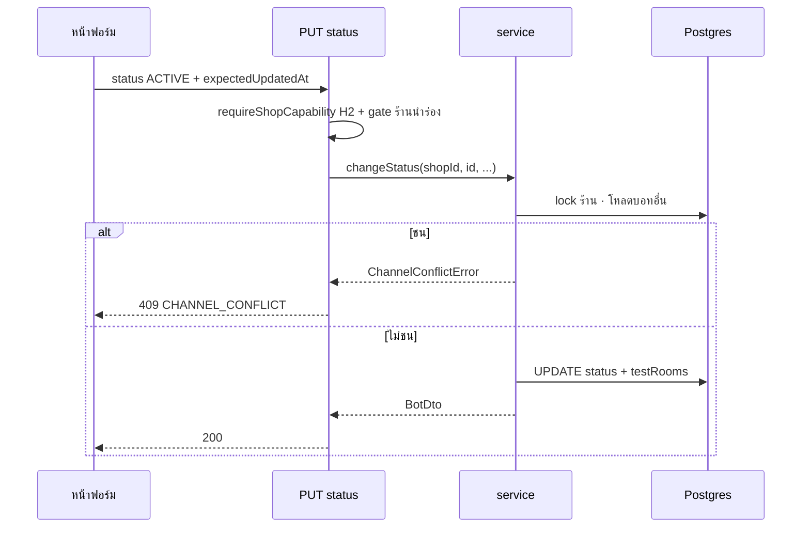

> **โมดูล:** 00095 — Sales Follow Bot
> **ประเภทเอกสาร:** API Contract
> **เวอร์ชัน:** 0.1 (P1)
> **วันที่จัดทำ:** 2026-11-16
> **สถานะ:** Draft
> **เจ้าของเอกสาร:** SA (ดู [[Feature-Docs-Ownership]])

# API Contract: บอทติดตามยอดขาย

---

## 1. Overview

route handler ของ Next.js App Router (Next.js 16) provider = แอปนี้ (`src/app/api/**`) · ผู้บริโภค = หน้า Paces ฝั่งผู้ขายและ Vercel Cron · ไม่มี endpoint ให้แอปมือถือ/ภายนอก

- **เอกสารออกแบบต้นทาง:** [[SDS]] (ทุก endpoint trace ที่ §7 ท้ายเอกสาร)
- **Base URL:** same-origin `https://seller.deepthailand.app` (dev `seller.deepth.local`) — path ด้านล่างเริ่มที่ `/api`
- **Content-Type:** `application/json` · ทุกคำตอบใช้ `jsonNoStore` (ตัวช่วยเดิม `src/lib/shop-api-guard.ts:17`)
- **Convention:** คำตอบ error เป็นรูปแบนราบเหมือน 00078 — `{ "error": "CODE", ... }` ไม่ห่อซ้อน (`auto-notify/route-errors.ts:9-17`) · export `dynamic = 'force-dynamic'`
- **ค่าคงที่:** `SalesStageKey` = `NOT_BOUGHT | BILLED | ORDER_CONFIRMED | SHIPPED | COMPLETED | PARCEL_PROBLEM | CANCELLED` · `BotStatus` = `CLOSED | TESTING | ACTIVE`

---

## 2. Authentication
| รายการ | ค่า |
|---|---|
| วิธี | NextAuth session cookie (ไม่มี Bearer) |
| ด่าน | `requireShopCapability(await getServerSession(authOptions), cap)` → `{ shopId, userId }` (`src/lib/shop-capability.ts:56`) |
| Capability | อ่านแผงห้อง = `H1` · ที่เหลือทั้งหมด = `H2` (บทบาท OWNER/MANAGER/CHAT — มติ Q-11 ข; `shop-permissions.ts:25-26`) |
| shop | ใช้ร้านที่ active ของ session เท่านั้น — **ไม่รับ shopId จาก client** |
| ด่านร้านนำร่อง + vertical | หลังผ่านสิทธิ์: `isSalesFollowBotEnabled(shopId)` และ `Shop.vertical='ONLINE_SALES'` ไม่ผ่าน → 403 `FEATURE_NOT_ENABLED` / 409 `NOT_AVAILABLE_FOR_SHOP` |
| cron | `Authorization: Bearer ${CRON_SECRET}` · env ว่าง = 401 ทันที (แบบ `cron/chat-outbox/route.ts:28-35`) |
| ไม่ผ่าน | 401 `{ "error": "unauthorized" }` / 403 ตามผลของ `requireShopCapability` |

---

## 3. Endpoint List
| Method | Path | คำอธิบาย |
|---|---|---|
| `GET` | `/api/shops/current/sales-follow-bot/bots` | รายการบอท (ไม่รวมที่ลบ) |
| `POST` | `/api/shops/current/sales-follow-bot/bots` | สร้างบอท (สถานะ CLOSED เสมอ) |
| `GET` | `/api/shops/current/sales-follow-bot/bots/[id]` | รายละเอียดสำหรับฟอร์มแก้ |
| `PATCH` | `/api/shops/current/sales-follow-bot/bots/[id]` | แก้บอท (แทนที่ทั้งชุดฟิลด์ที่ส่ง) |
| `DELETE` | `/api/shops/current/sales-follow-bot/bots/[id]` | ลบ (ซ่อน) + หยุดทุกห้อง |
| `PUT` | `/api/shops/current/sales-follow-bot/bots/[id]/status` | เปลี่ยน ปิด/ทดสอบ/เปิดใช้ |
| `GET` | `/api/shops/current/sales-follow-bot/options` | ช่องทาง แท็ก สถานะ ขีดจำกัด สำหรับฟอร์ม |
| `GET` | `/api/shops/current/sales-follow-bot/test-rooms` | ค้นห้องเลือกเป็นห้องทดสอบ |
| `GET` | `/api/shops/current/sales-follow-bot/sends` | ประวัติการส่ง (cursor) |
| `GET` | `/api/chat/conversations/[id]/follow-bot` | แผงในห้อง |
| `POST` | `/api/chat/conversations/[id]/follow-bot/stop` | หยุดบอทห้องนี้ |
| `GET` | `/api/cron/sales-follow-bot` | tick (Vercel Cron ทุก 1 นาที) |

---

## 4. Endpoint Detail

### 4.0 ชนิดร่วม
```json
// BotStep
{ "delayMin": 30, "kind": "TEXT", "text": "สวัสดีค่ะ คุณ{ชื่อ} ยังสนใจอยู่ไหมคะ", "imageFileId": null, "adOnly": false }
```
- `kind`: `TEXT` | `TEXT_IMAGE` (P1) · `delayMin` จำนวนเต็ม ≥1 (UI แปลงนาที/ชั่วโมง/วัน) · `adOnly` = **ผลคำนวณฝั่งเซิร์ฟเวอร์** (ผลรวมสะสม > 1,380 นาที) ไม่รับจาก client
```json
// BotDto
{
  "id": "uuid", "name": "ตามคนถามราคา", "status": "CLOSED",
  "salesStatuses": ["NOT_BOUGHT"],
  "tags": [{ "key": "ถามราคา", "name": "ถามราคา", "missing": false }],
  "tagMatch": "ANY",
  "channelIds": ["uuid"], "testRoomIds": [],
  "steps": [ /* BotStep[] */ ],
  "totalDelayMin": 210,
  "structureRev": 1, "updatedAt": "2026-11-16T09:00:00.000Z",
  "warnings": [{ "code": "TAG_MISSING", "keys": ["vip"] }],
  "activeRunCount": 3
}
```

### 4.1 `GET /api/shops/current/sales-follow-bot/bots`
Capability H2 · คืนบอทของร้านที่ `deletedAt IS NULL` เรียง `createdAt DESC` พร้อม `warnings` (แท็กหาย) และ `activeRunCount`

**Response 200** `{ "bots": BotDto[] }` — ฟิลด์ `steps[].text` ถูกส่งครบ (ใช้แสดงตัวอย่างขั้นแรก) · **Error:** 401/403/409 ตามด่าน §2 · 500 `INTERNAL_ERROR`

### 4.2 `POST /api/shops/current/sales-follow-bot/bots`
สร้างบอท **สถานะ CLOSED เสมอ** (ไม่รับ `status` — AC-FB-04) · ตรวจชนช่องทาง (§5 `CHANNEL_CONFLICT`) ใต้ advisory lock ต่อร้าน

| ส่วน | ฟิลด์ | ชนิด | บังคับ | คำอธิบาย |
|---|---|---|---|---|
| Body | `name` | string | yes | trim ไม่ว่าง ≤60 |
| Body | `salesStatuses` | `SalesStageKey[]` | no | ว่าง = ทุกสถานะ |
| Body | `tags` | string[] (ชื่อแท็ก) ≤20 | no | ต้องมีอยู่ในแท็กของร้าน |
| Body | `tagMatch` | `ANY`\|`ALL` | no (ค่าตั้งต้น ANY) | |
| Body | `channelIds` | uuid[] 1..50 | yes | ต้องเป็น ShopChannel ของร้าน provider Messenger/IG/LINE |
| Body | `steps` | BotStep[] 1..10 | yes | ตรวจ TFR-FB-04 |

เงื่อนไขข้ามฟิลด์: `salesStatuses` หรือ `tags` ต้องมีอย่างน้อยหนึ่งอย่าง (`NO_CONDITION`) · Σ`delayMin` ≤ 10,020 (`STEPS_TOTAL_TOO_LONG` + `stepIndex`)

**Response 201** `BotDto` · **Error:** 400 `VALIDATION_ERROR` (`issues[].code` ∈ `NAME_REQUIRED`, `NAME_TOO_LONG`, `NO_CONDITION`, `STEPS_COUNT`, `STEP_DELAY_MIN`, `STEPS_TOTAL_TOO_LONG`, `STEP_TEXT_REQUIRED`, `STEP_TEXT_TOO_LONG`, `STEP_IMAGE_REQUIRED`, `UNKNOWN_VARIABLE`, `TOO_MANY_TAGS`, `TOO_MANY_CHANNELS`) · 400 `CHANNEL_NOT_FOUND` · 400 `TAG_NOT_FOUND` `{ "names": [...] }` · 409 `CHANNEL_CONFLICT` `{ "conflicts": [{ "channelId", "botId", "botName" }] }`

```json
// Request
{ "name": "ตามคนถามราคา", "salesStatuses": ["NOT_BOUGHT"], "tags": ["ถามราคา"], "tagMatch": "ANY",
  "channelIds": ["8d2…"], "steps": [{ "delayMin": 30, "kind": "TEXT", "text": "สวัสดีค่ะ คุณ{ชื่อ} ยังสนใจอยู่ไหมคะ" }] }
// Response 201  → BotDto (status "CLOSED")
```

### 4.3 `GET /api/shops/current/sales-follow-bot/bots/[id]`
**Response 200** `BotDto` · **Error:** 404 `NOT_FOUND` (id ไม่ใช่ของร้าน/ถูกลบ ตอบเหมือนกัน)

### 4.4 `PATCH /api/shops/current/sales-follow-bot/bots/[id]`
แก้ฟิลด์เดียวกับ 4.2 (ส่งเฉพาะที่แก้ได้ แต่ `steps` ส่งทั้งชุดเมื่อแก้) + **`expectedUpdatedAt`** (ISO, บังคับ) กันสองคนแก้ทับกัน (ทุกคนที่ตอบแชทแก้ได้ Q-11)
- แก้ **โครง** ขั้น (จำนวน/`kind`/ลำดับ) → `structureRev+1` และหยุดทุก run `BOT_EDITED` พร้อมบรรทัดระบบ (ในทรานแซกชันเดียว) · แก้เฉพาะ `text`/`imageFileId`/`delayMin`/ชื่อ → ไม่หยุด · บันทึกซ้ำโดยไม่มีอะไรเปลี่ยน → ไม่หยุด (AC-FB-05)
- **Response 200** `BotDto` + `stoppedRuns: number`
- **Error:** 400 (เหมือน 4.2) · 404 · 409 `BOT_STALE` `{ "currentUpdatedAt": "…" }` · 409 `CHANNEL_CONFLICT`

### 4.5 `DELETE /api/shops/current/sales-follow-bot/bots/[id]`
ซ่อนบอท (soft delete) + หยุดทุก run `BOT_DELETED` + บรรทัดระบบ · ไม่มี body · query `expectedUpdatedAt` (ISO) บังคับ · UI ถามยืนยันด้วย `activeRunCount` จาก 4.1/4.3 ก่อน
**Response 200** `{ "deleted": true, "stoppedRuns": 3 }` · **Error:** 404 · 409 `BOT_STALE`

### 4.6 `PUT /api/shops/current/sales-follow-bot/bots/[id]/status`
| Body | ฟิลด์ | ชนิด | บังคับ |
|---|---|---|---|
| | `status` | `CLOSED`\|`TESTING`\|`ACTIVE` | yes |
| | `testRoomIds` | uuid[] 1..20 | เมื่อ `TESTING` (แทนที่ชุดเดิม) |
| | `expectedUpdatedAt` | ISO | yes |

ห้องทดสอบต้องอยู่บนช่องทางของบอทและเป็นของร้าน · ตั้ง `TESTING`/`ACTIVE` ตรวจชนช่องทางซ้ำ (4.2) · **Response 200** `BotDto` · **Error:** 400 `TEST_ROOMS_REQUIRED` · 400 `TEST_ROOM_NOT_FOUND` · 404 · 409 `BOT_STALE` · 409 `CHANNEL_CONFLICT` · ผลข้างเคียง: run ที่ไม่อยู่ในขอบเขตใหม่ถูกหยุดในรอบ tick ถัดไป (`BOT_DISABLED`/`OUT_OF_SCOPE`)

### 4.7 `GET /api/shops/current/sales-follow-bot/options`
**Response 200**
```json
{
  "channels": [{ "id": "uuid", "provider": "MESSENGER", "name": "เพจร้าน", "status": "ACTIVE" }],
  "tags": [{ "key": "ถามราคา", "name": "ถามราคา" }],
  "stages": [{ "key": "NOT_BOUGHT", "label": "ยังไม่ซื้อ" }],
  "limits": { "maxSteps": 10, "maxText": 1000, "maxName": 60, "maxTestRooms": 20, "maxChannels": 50, "maxTags": 20, "minDelayMin": 1, "maxTotalDelayMin": 10020, "adOnlyAfterMin": 1380 },
  "variables": ["ชื่อ"]
}
```
`channels` เฉพาะ provider Messenger/IG/LINE ของร้าน (ไม่มี DEEP) · การล็อกช่องที่ชน (AC-FB-20) คำนวณฝั่ง client ด้วย `findChannelConflicts` จาก 4.1 (ฟังก์ชันเดียวกับที่เซิร์ฟเวอร์ใช้ตัดสิน)

### 4.8 `GET /api/shops/current/sales-follow-bot/test-rooms`
| Query | `channelIds` | uuid[] (คั่น comma) | yes |
|---|---|---|---|
| | `q` | string ≤60 | no (ค้นชื่อผู้ติดต่อ/นามแฝง) |

**Response 200** `{ "rooms": [{ "conversationId", "contactName", "channel", "shopChannelId", "lastInboundAt" }] }` (≤20 รายการ เรียง `lastInboundAt DESC`) · channelId ที่ไม่ใช่ของร้าน = ไม่ปรากฏในผล (ไม่ error)

### 4.9 `GET /api/shops/current/sales-follow-bot/sends`
| Query | `cursor` | string | no |
|---|---|---|---|
| | `limit` | int 1..50 | no (ค่าตั้งต้น 50) |

keyset `(createdAt DESC, id DESC)` · cursor = base64url ของ `"<ISO createdAt>|<id>"` · **cursor พัง/ปลอม = `200 { "items": [], "nextCursor": null }` (ไม่ใช่ 400/500)**
**Response 200**
```json
{ "items": [{
  "id": "uuid", "conversationId": "uuid", "contactName": "สมชาย", "channel": "MESSENGER",
  "botName": "ตามคนถามราคา", "botDeleted": false,
  "step": 2, "stepCount": 3,
  "status": "SENT", "reason": null, "reasonText": null,
  "at": "2026-11-16T09:30:00.000Z"
}], "nextCursor": "…" | null }
```
- `step` เริ่ม 1 (เก็บใน DB เริ่ม 0) · `at` = เวลาฟองจริง (`ChatMessage.createdAt`) เมื่อ `SENT` ไม่งั้น `settledAt ?? createdAt` · `reasonText` = ข้อความไทยจากตาราง reason ฝั่งเซิร์ฟเวอร์ (ไม่ใช่รหัสดิบ) · `botDeleted` → UI แสดง "บอทที่ถูกลบแล้ว"

### 4.10 `GET /api/chat/conversations/[id]/follow-bot`
Capability H1 · ตรวจ `Conversation.shopId = gate.shopId` ที่ WHERE แรก
**Response 200**
```json
{ "available": true,
  "run": {
    "runId": "uuid", "botName": "ตามคนถามราคา", "stageLabel": "ยังไม่ซื้อ",
    "holdReason": null, "holdText": null, "awaitingShop": false, "canStop": true,
    "steps": [
      { "index": 1, "state": "SENT", "sentAt": "2026-11-16T09:30:00.000Z", "dueAt": null, "reasonText": null },
      { "index": 2, "state": "PENDING", "sentAt": null, "dueAt": "2026-11-16T12:30:00.000Z", "reasonText": null }
    ] } }
```
- `available:false` (และ `run` ไม่ปรากฏ) เมื่อ: ห้อง `channel='DEEP'` · ร้านไม่เปิด · ไม่ใช่ ONLINE_SALES · ห้องไม่ใช่ของร้าน (กรณีนี้ตอบ 404 `NOT_FOUND`)
- `run:null` เมื่อไม่มี run ACTIVE **หรือ** `decideRun` บอกว่าจะหยุดด้วยเหตุ CUSTOMER_REPLIED/TAG_REMOVED (AC-FB-74)
- `state` ∈ `SENT | PENDING | SENDING | SKIPPED | FAILED` · `awaitingShop=true` → UI ขึ้น "รอคุณตอบลูกค้า"
- **Error:** 404 `NOT_FOUND`

### 4.11 `POST /api/chat/conversations/[id]/follow-bot/stop`
Capability H2 · ไม่มี body · หยุด run ACTIVE ของห้อง `ADMIN_STOPPED` + บรรทัดระบบ · **idempotent: ไม่มี run/กดซ้ำ = 200 ไม่ error**
**Response 200** `{ "stopped": true | false }` · **Error:** 404 `NOT_FOUND` (ห้องไม่ใช่ของร้าน)

### 4.12 `GET /api/cron/sales-follow-bot`
เรียกโดย Vercel Cron · 401 เมื่อ `CRON_SECRET` ว่าง/ไม่ตรง
**Response 200** `{ "shops": 1, "evaluated": 12, "stopped": 2, "held": 0, "sent": 3, "skipped": 0, "failed": 0, "attached": 4, "timedOut": false }` — ตัวเลขล้วน ไม่มี id ร้าน/ห้อง · tick ไม่ throw: error ภายในถูก log และสะท้อนเป็นตัวเลขเท่านั้น

---

## 5. Error Code Table
| Error Code | HTTP | ความหมาย / เงื่อนไข |
|---|---|---|
| `VALIDATION_ERROR` | 400 | body/query ไม่ผ่าน Valibot หรือ `validateSteps` — มี `issues: [{ code, path, stepIndex? , name? }]` |
| `CHANNEL_NOT_FOUND` | 400 | ช่องทางไม่มี/ไม่ใช่ของร้าน/เป็น DEEP (ตอบเหมือนกันทุกกรณี) |
| `TAG_NOT_FOUND` | 400 | ชื่อแท็กไม่อยู่ใน ShopTag ของร้าน `{ names }` |
| `TEST_ROOMS_REQUIRED` | 400 | ตั้ง TESTING โดยไม่มีห้องทดสอบ 1..20 |
| `TEST_ROOM_NOT_FOUND` | 400 | ห้องทดสอบไม่ใช่ของร้านหรือไม่อยู่บนช่องทางของบอท |
| `unauthorized` | 401 | ไม่มี session / cron secret ผิด (ตัวพิมพ์เล็กตามด่านเดิม) |
| `FORBIDDEN` | 403 | บทบาทไม่มี capability (จาก `requireShopCapability`) |
| `FEATURE_NOT_ENABLED` | 403 | ร้านไม่อยู่ในรายชื่อนำร่อง (fail-closed) |
| `NOT_FOUND` | 404 | บอท/ห้องไม่พบหรือไม่ใช่ของร้านนี้ |
| `BOT_STALE` | 409 | `expectedUpdatedAt` ไม่ตรง — มี `currentUpdatedAt` |
| `CHANNEL_CONFLICT` | 409 | ชน 1 ช่องทาง 1 บอทต่อสถานะ — `conflicts[]` |
| `NOT_AVAILABLE_FOR_SHOP` | 409 | ร้านไม่ใช่ ONLINE_SALES (P1) |
| `INTERNAL_ERROR` | 500 | ไม่คาดคิด (log แท็กเส้นทาง ไม่ log body) |

**โครงมาตรฐาน:** `{ "error": "BOT_STALE", "currentUpdatedAt": "2026-11-16T09:00:00.000Z" }` (แบนราบ ตาม convention เดิมของโปรเจกต์ ต่างจากแม่แบบ nested ของเทมเพลต โดยตั้งใจ)

**รหัสเหตุผลของแถวประวัติ (ไม่ใช่ HTTP — ใช้ใน `reason`/`stopReason`):**
| รหัส | ข้อความไทย (ร่าง) |
|---|---|
| `STAGE_CHANGED` | สถานะการขายเปลี่ยน |
| `TAG_REMOVED` | แท็กถูกเอาออก |
| `BOT_DISABLED` / `BOT_EDITED` / `BOT_DELETED` | บอทถูกปิด / ถูกแก้ไข / ถูกลบ |
| `CUSTOMER_REPLIED` | ลูกค้าตอบแล้ว |
| `WINDOW_CLOSED` | เลยกรอบเวลา |
| `NOT_INTERESTED` | ลูกค้าไม่สนใจ |
| `OUT_OF_SCOPE` | ห้องหลุดขอบเขต |
| `CONTACT_BLOCKED` | ลูกค้าบล็อก/เลิกติดตาม |
| `ADMIN_STOPPED` | หยุดโดยแอดมิน |
| `OTHER_APP_CONTROLS` | แอปอื่นคุมห้องนี้ |
| `LINE_QUOTA_FULL` | โควตา LINE เต็ม |
| `META_WINDOW_REJECTED` | Meta ไม่ให้ส่งนอกกรอบ |
| `IMAGE_MISSING` | ไม่พบรูป |
| `EMPTY_MESSAGE` | ข้อความว่างหลังแทนตัวแปร |
| `PLATFORM_REJECTED` | ผู้ให้บริการปฏิเสธ |
| `UNCERTAIN_SEND` | ไม่ทราบผล (ค้างส่งเกินเวลา) |
| hold: `META_AI_HOLDING` / `AUTO_REPLY_OFF` / `CHANNEL_NOT_ACTIVE` / `SHOP_NOT_ENABLED` | Meta AI กำลังตอบห้องนี้ / ร้านปิดตอบอัตโนมัติห้องนี้ / ช่องทางหลุด / ร้านยังไม่เปิดใช้ |

---

## 6. Sequence
**บันทึกบอทที่มีความเสี่ยงชน** (SDS flow 4.4) และ **tick ส่ง** (SRS §4) — ไม่ซ้ำที่นี่


---

## 7. Traceability
| Endpoint | SDS Component / Decision | BRD FR |
|---|---|---|
| `GET/POST bots` | `sales-follow-bot.service` · flow 4.4 | FR-FB-01, 40 |
| `GET/PATCH/DELETE bots/[id]` | service · TD-FB-004 | FR-FB-01, 05, 06, 32 |
| `PUT bots/[id]/status` | service · `conflicts.ts` | FR-FB-02, 05 |
| `GET options` · `GET test-rooms` | service · `schemas.ts` | FR-FB-01, 02 |
| `GET sends` | service (keyset) | FR-FB-40 |
| `GET …/follow-bot` | `sales-follow-facts` + `decide` | FR-FB-41, 42 |
| `POST …/follow-bot/stop` | service + `sales-follow-note` | FR-FB-30, 31 |
| `GET /api/cron/sales-follow-bot` | engine · TD-FB-001 | FR-FB-20..24, 30, 51 |

---

## 8. สรุป
สัญญานี้ให้ DEV ทำ route ได้โดยไม่ต้องตัดสินรูปร่าง request/response ใหม่ · QA ใช้ตาราง §5 วางเทส negative (ข้ามร้าน · ชน · stale · cursor ปลอม · stop ซ้ำ)

**Open Questions:** (ก) `requireOnlineSalesVertical` คืน status อะไร — ถ้าไม่ใช่ 409 ให้ปรับ `NOT_AVAILABLE_FOR_SHOP` ตามของจริง (ข) การแสดงชื่อ `contactName` ต้องใช้ฟังก์ชันชื่อผู้ติดต่อเดิมของ inbox (ต้อง Explore) · (ค) OD-FB-1..7 ใน [[SRS]]

## ภาคผนวก — ส่วนต่อขยาย 2026-11-16

`POST …/bots` และ `PATCH …/bots/[id]` รับเพิ่ม `finalAction` (`NONE|RESOLVE|HIDE|SPAM`, ไม่ส่ง = NONE/ค่าเดิม) และ `finalDelayMin` (จำนวนเต็ม 0..10080 นาที, ไม่ส่ง = 1440/ค่าเดิม) · `BotDto` คืนทั้งสองฟิลด์ · ผิด → 400 `VALIDATION_ERROR` issue `FINAL_DELAY_INVALID` (delay) / `INVALID_BODY` (action) · แก้สองฟิลด์ไม่หยุด run · `GET …/sends` คืน `controlReclaimed` และ `reason` ใหม่ `ROUTING_NOT_ENABLED`/`CHANNEL_TOKEN_INVALID` · cron `TickResult` เพิ่ม `finalActed`,`finalSkipped`

**FR-FA-7:** `POST …/bots` และ `PATCH …/bots/[id]` รับเพิ่ม `replyHandoff` (`ADMIN|META_AI`, ไม่ส่ง = ADMIN/ค่าเดิม) · `BotDto` คืนฟิลด์นี้ · ค่านอกชุด → 400 `VALIDATION_ERROR` issue `INVALID_BODY` · แก้ค่านี้ไม่หยุด run
