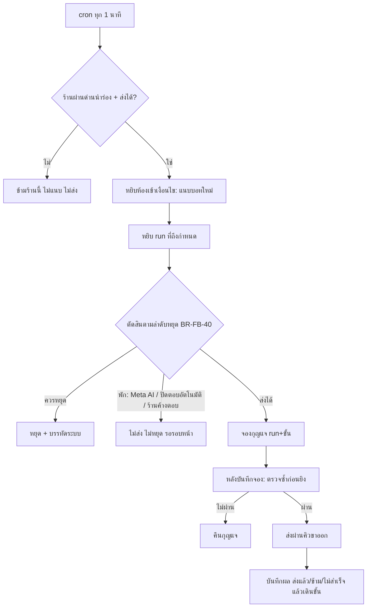
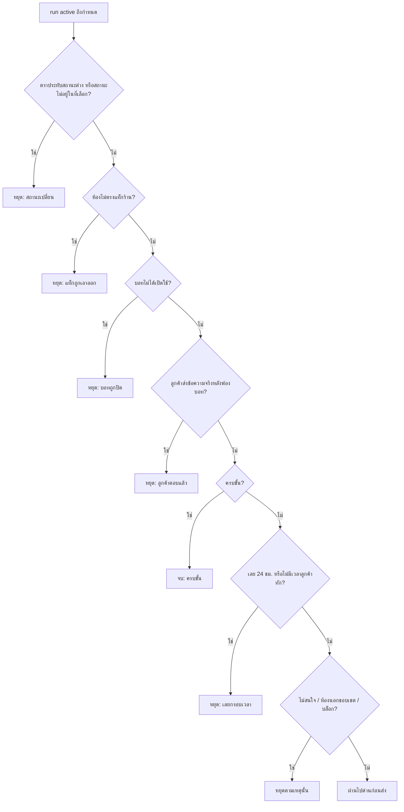
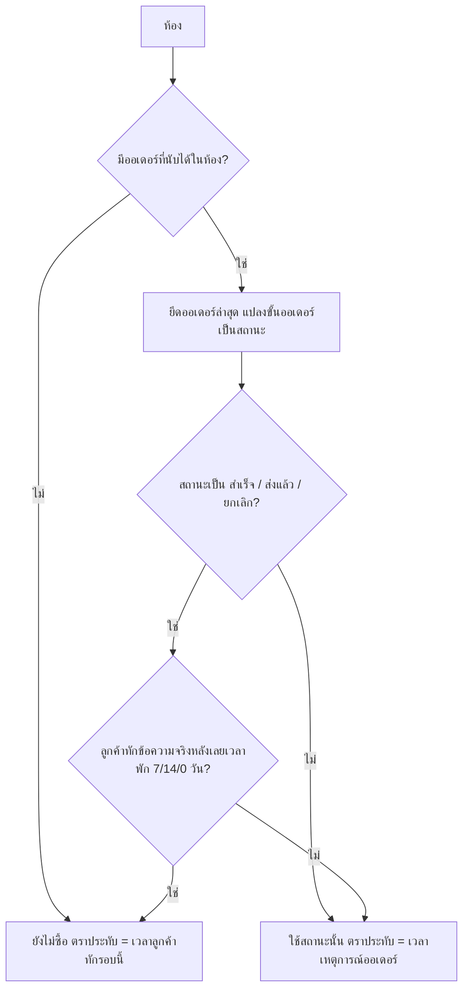
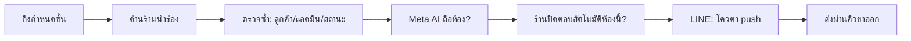

---
title: "BRD — 00095 บอทติดตามยอดขาย (Sales Follow Bot)"
owner: shinobu22
status: draft
created: 2026-11-16
tags: [feature, brd, 00095, chat, automation, follow-bot]
related: ["[[PRD]]", "[[REFERENCE-gochat-v3]]", "[[MAPPING-safepay]]"]
---

> **โมดูล:** 00095 — Sales Follow Bot
> **ประเภทเอกสาร:** Business Requirements Document (BRD) - NON-TECHNICAL
> **เวอร์ชัน:** 0.1
> **วันที่จัดทำ:** 2026-11-16
> **สถานะ:** Draft — รอ user ตัดสิน Open Questions §13
> **เจ้าของเอกสาร:** BA (ดู [[Feature-Docs-Ownership]])

# BRD: บอทติดตามยอดขาย (Sales Follow Bot) (Business Requirements Document)

> รหัส: `FR-FB-xx` ความต้องการ · `BR-FB-xx` กฎธุรกิจ · `AC-FB-xx` เกณฑ์ตรวจรับ (ทดสอบได้) · `Q-n` คำถามเปิด · "มติ gochat <วันที่>" = มติผู้ใช้ที่จดไว้ใน [[REFERENCE-gochat-v3]] §5 (ปี 2569)
> ช่วงที่ระบุ [P1]/[P2]/[P3] = รอบส่งมอบที่เสนอ (PRD §3.7) · ไม่ระบุ = P1
> ค่าที่ยังรอ Q-n เขียนเป็น "ค่าตั้งต้นตามข้อเสนอ" — เปลี่ยนตามคำตอบ

---

## 1. บทนำ

### 1.1 วัตถุประสงค์ของเอกสาร

1. อธิบายความต้องการของบอทที่ตามลูกค้าที่เงียบเป็นขั้นตามเวลา และหยุดเองเมื่อไม่ควรตามต่อ
2. กำหนดขอบเขต โดยแปลงจากระบบของ gochat-v3 เป็นโมเดลจริงของ Deep (ไม่สัญญาสิ่งที่ Deep ทำไม่ได้)
3. กำหนดกฎธุรกิจเป็นรายข้อ รวมบทเรียน/บั๊ก prod ของ gochat เป็นกฎตั้งแต่วันแรก พร้อมเกณฑ์ตรวจรับที่ทดสอบได้
4. ให้ทีมธุรกิจและทีมพัฒนาเห็นตรงกัน รวมถึงจุดที่ต้องให้ user ตัดสิน (§13)

### 1.2 ขอบเขตของระบบ

**บอทติดตามยอดขาย** คือระบบที่ให้ร้านตั้งชุดข้อความตามเวลา แนบให้ห้องแชทที่ตรงเงื่อนไขอัตโนมัติ ส่งผ่านช่องทางที่เชื่อม (Messenger/IG/LINE) และหยุดเองตามกฎ

**เข้าสู่ระบบ (Input):**
- การตั้งค่าบอทโดยสมาชิกร้าน (ชื่อ สถานะ เงื่อนไข ช่องทาง ขั้น)
- เหตุการณ์ในห้อง: ข้อความลูกค้า/ร้าน · แท็กร้านของผู้ติดต่อ · `salesStatus` · ออเดอร์ของห้อง
- เวลาปัจจุบัน (รอบตรวจทุกนาที)

**ออกจากระบบ (Output):**
- ข้อความถึงลูกค้า (ข้อความ / ข้อความ+รูป ใน P1)
- ประวัติการส่ง · สถานะ run ต่อห้อง · บรรทัดระบบภายในห้อง (ลูกค้าไม่เห็น)

**ระบบที่เกี่ยวข้อง:**
- 00078 (ฐานโครงส่งอัตโนมัติ) · 00083 (แท็กร้าน) · 00023 (บอทตอบ) · 00077 (โต๊ะแชท "ลูกค้ารอ") · 00066 (ติดตามลูกค้า — คนละหน้าที่) · ระบบออเดอร์ · ตัวส่งขาออก Messenger/IG/LINE · สิทธิ์ผู้ขาย (capability)

### 1.3 กลุ่มผู้ใช้งาน

| กลุ่มผู้ใช้ | บทบาท | สิทธิ์การใช้งาน (ค่าตั้งต้นตามข้อเสนอ Q-11) |
|-----------|--------|----------------|
| **เจ้าของร้าน (OWNER)** | ผู้ตั้งบอท | สร้าง/แก้/ลบ/เปลี่ยนสถานะบอท · ดูประวัติ · แนบ/หยุดในห้อง |
| **ผู้จัดการ (MANAGER)** | ผู้ตั้งบอท | เหมือนเจ้าของ |
| **แอดมินแชท (CHAT)** | ผู้ใช้ในห้อง | ดูประวัติ/แผงในห้อง · กด "หยุดบอทห้องนี้" · **ไม่** สร้าง/แก้/ลบบอท |
| **บทบาทบัญชี/ช่าง (BILLING, TECHNICIAN)** | — | ไม่เห็นหน้าและแผง (ไม่มีสิทธิ์อ่านแชท) |
| **ลูกค้า** | ผู้รับข้อความ | ไม่มีสิทธิ์ในระบบ · ไม่เห็นบรรทัดระบบ |
| **ผู้ใช้นอกร้าน / ร้านอื่น** | — | เข้าไม่ถึงทุกกรณี (ทุกคำสั่งกรองด้วยร้าน) |

---

## 2. ความต้องการหลัก (Functional Requirements)

### 2.1 จัดการบอท

#### FR-FB-01: สร้างและแก้บอทตามเงื่อนไข [P1]

**User Story:**
> ในฐานะเจ้าของ/ผู้จัดการร้าน ฉันต้องการตั้งชุดข้อความตามเวลาและเงื่อนไขห้องที่จะตาม เพื่อให้ลูกค้าที่เงียบถูกทักตามโดยไม่ต้องไล่เอง

**Acceptance Criteria:**
- [ ] AC-FB-01: ฟิลด์ที่บันทึกได้: ชื่อ (ไม่ว่าง ≤60 ตัว) · สถานะ · สถานะการขายที่ตาม (ว่างได้) · แท็กร้าน + โหมด any/all · ช่องทางที่เชื่อมที่บอทใช้ (1-50 ช่อง) · ขั้น 1-10
- [ ] AC-FB-02: ไม่เลือกทั้งสถานะการขายและแท็กร้าน = บันทึกไม่ได้ ("เลือกสถานะหรือแท็กอย่างน้อยหนึ่งอย่าง")
- [ ] AC-FB-03: ช่องทางที่เลือกต้องเป็น Messenger/IG/LINE ของร้านนี้เท่านั้น · ช่องทางของร้านอื่นหรือช่องทาง DEEP = ปฏิเสธเหมือนไม่พบ
- [ ] AC-FB-04: บอทใหม่เริ่มที่สถานะ "ปิด" เสมอ (ไม่มีทางสร้างแล้วเปิดใช้ในคลิกเดียวกัน)
- [ ] AC-FB-05: แก้บอทแล้วบันทึกซ้ำโดยไม่เปลี่ยนอะไรไม่ทำให้ห้องที่ตามอยู่หยุด

**Business Flow:**
1. หน้าบอทติดตามยอดขาย → "สร้างบอทติดตาม"
2. กรอกชื่อ เงื่อนไข ช่องทาง ขั้น → บันทึกเป็น "ปิด"
3. (แนะนำ) สลับ "ทดสอบ" → ตรวจในแชททดสอบ → "เปิดใช้"

#### FR-FB-02: สถานะบอท ปิด / ทดสอบ / เปิดใช้ [P1 — Q-10]

**User Story:**
> ในฐานะเจ้าของร้าน ฉันต้องการลองบอทกับห้องทดสอบของฉันก่อน เพื่อไม่ให้ลูกค้าจริงได้รับข้อความที่ยังไม่ผ่านตา

**Acceptance Criteria:**
- [ ] AC-FB-06: สถานะ "ทดสอบ" ต้องเลือกแชททดสอบ 1-20 ห้อง ที่อยู่บนช่องทางของบอท · ไม่เลือก = บันทึกไม่ได้
- [ ] AC-FB-07: บอท "ทดสอบ" แนบและส่งเฉพาะแชททดสอบ · ห้องอื่นที่ตรงเงื่อนไขไม่ถูกแนบ
- [ ] AC-FB-08: เปลี่ยนจาก "ทดสอบ" เป็น "ปิด" หรือ "เปิดใช้" ทำให้ run ที่ติดห้องนอกขอบเขตหยุดด้วยเหตุ "ห้องหลุดขอบเขต"
- [ ] AC-FB-09: บอท "เปิดใช้" ครั้งแรกไม่แนบห้องที่เลยเวลาขั้นแรกไปแล้ว (BR-FB-06) — เปิดบอทใหม่ไม่ทำให้ห้องเก่าทั้งร้านได้รับข้อความ

#### FR-FB-03: ขั้นข้อความและตัวแปร [P1]

**User Story:**
> ในฐานะเจ้าของร้าน ฉันต้องการเขียนข้อความและแนบรูปในแต่ละขั้น พร้อมเรียกชื่อลูกค้า เพื่อให้ข้อความดูเป็นกันเองไม่เหมือนบอท

**Acceptance Criteria:**
- [ ] AC-FB-10: ชนิดขั้นใน P1 มี 2 แบบ: "ข้อความ" และ "ข้อความ + รูป" · ข้อความ ≤1,000 ตัว ไม่ว่าง · ขั้น "ข้อความ + รูป" ต้องเลือกรูป
- [ ] AC-FB-11: ตัวแปรที่ใช้ได้ใน P1 คือ `{ชื่อ}` เท่านั้น · ใช้ตัวแปรอื่น (เช่น `{สินค้า}` `{ราคา}`) = บันทึกไม่ได้ พร้อมข้อความบอกเหตุผล
- [ ] AC-FB-12: ส่ง "ข้อความ + รูป" = ข้อความก่อน แล้วรูป
- [ ] AC-FB-13: ลูกค้าที่ไม่มีชื่อ = ตัวแปร `{ชื่อ}` ถูกตัดทิ้งโดยไม่เหลือช่องว่างซ้อน/ข้อความห้วน (ค่าตั้งต้นตามข้อเสนอ — A-5)
- [ ] AC-FB-14: ฟอร์มแสดง "ตัวอย่างในแชท" ที่ตรงกับสิ่งที่จะส่งจริง (รวมลำดับข้อความ/รูป)

#### FR-FB-04: กติกาเวลาในฟอร์ม [P1 — Q-2]

**Acceptance Criteria:**
- [ ] AC-FB-15: เวลารอต่อขั้น ≥ 1 นาที · หน่วย นาที/ชั่วโมง (ไม่มี "วัน" ใน P1)
- [ ] AC-FB-16: เวลาสะสมของทุกขั้นรวมกัน ≤ 23 ชม. · เกิน = บันทึกไม่ได้ พร้อมบอกว่า "ขั้นที่ x เกินกรอบ 24 ชม. ของช่องทาง"
- [ ] AC-FB-17: ปุ่ม "เพิ่มขั้น" ถูกล็อกเมื่อครบ 10 ขั้นหรือเวลาสะสมเต็ม พร้อมเหตุผลใต้ปุ่ม (ไม่ใช่ปุ่มจางเฉย ๆ)
- [ ] AC-FB-18: ป้ายขั้นแรกอ่านว่า "รอ … หลังแอดมินตอบล่าสุด" · ขั้นถัดไป "ถ้ายังไม่ตอบ รอต่ออีก …"

#### FR-FB-05: ชนกัน 1 ช่องทาง 1 บอทต่อสถานะ [P1]

**Acceptance Criteria:**
- [ ] AC-FB-19: บันทึกบอทตามเงื่อนไขที่ ช่องทางเดียวกัน และสถานะการขายซ้อนกัน **หรือ** ฝ่ายใดฝ่ายหนึ่งไม่เลือกสถานะ (= ทุกสถานะ) กับบอทอื่นที่ไม่ปิด/ไม่ถูกลบ = ปฏิเสธ พร้อมบอก "อยู่ในบอท <ชื่อ>"
- [ ] AC-FB-20: หน้าเลือกช่องทางแสดงช่องที่ชนเป็นล็อก + บอกว่าอยู่ในบอทไหน
- [ ] AC-FB-21: บันทึกสองบอทพร้อมกันที่ชนกัน → สำเร็จได้อย่างมากหนึ่งตัว (ไม่หลุดทั้งคู่)
- [ ] AC-FB-22: บอทที่แท็กร้านถูกลบหมดและไม่มีสถานะการขาย (ไม่เหลือเงื่อนไข) ไม่นับเป็นบอทที่ชน

#### FR-FB-06: ลบบอท [P1]

**Acceptance Criteria:**
- [ ] AC-FB-23: ลบบอท = ซ่อนจากรายการ · ห้องที่ตามอยู่หยุดด้วยเหตุ "บอทถูกลบ" · ประวัติการส่งยังเห็น โดยชื่อบอทแสดงเป็น "บอทที่ถูกลบแล้ว"
- [ ] AC-FB-24: ขอลบต้องมียืนยัน บอกจำนวนห้องที่กำลังตามอยู่

### 2.2 สถานะการขายของห้อง

#### FR-FB-10: คำนวณสถานะการขาย [P1 — Q-3, Q-4]

**User Story:**
> ในฐานะเจ้าของร้าน ฉันต้องการให้บอทรู้เองว่าลูกค้าซื้อไปถึงไหน เพื่อไม่ตามขายคนที่จ่ายแล้ว และไม่ต้องมานั่งย้ายสถานะเอง

**Acceptance Criteria:**
- [ ] AC-FB-25: ห้องที่ไม่มีออเดอร์ที่นับได้ = "ยังไม่ซื้อ" · ห้องที่มีแต่ร่างออเดอร์/ออเดอร์ทดสอบ = "ยังไม่ซื้อ"
- [ ] AC-FB-26: เมื่อมีหลายออเดอร์ในห้อง สถานะยึดออเดอร์ที่นับได้ล่าสุด (มติ gochat 19 ต.ค.) · ออเดอร์ใหม่เปลี่ยนสถานะห้องได้ทันที
- [ ] AC-FB-27: ตารางแปลงขั้นออเดอร์ → สถานะการขายตาม PRD §3.2 มีเทสครบทุกขั้นออเดอร์ที่ระบบผลิตได้ (ไม่มีค่าตกหล่นไปเป็นค่าเริ่มต้นเงียบ ๆ — ค่าที่ไม่รู้จัก = ไม่ย้ายสถานะ และบันทึกเตือน)
- [ ] AC-FB-28: ออเดอร์ที่ยกเลิก/ตีกลับ ไม่นับเป็น "ซื้อแล้ว" ในนิยามลูกค้าซื้อซ้ำ (ใช้นิยามเดียวกับ `countsAsCustomerOrder`)
- [ ] AC-FB-29: ไม่มีทางแก้สถานะด้วยมือ — เมนูหัวห้องแสดงสถานะอ่านอย่างเดียว

#### FR-FB-11: จบรอบ และตราประทับสถานะ [P1]

**Acceptance Criteria:**
- [ ] AC-FB-30: ห้องสถานะ "สำเร็จ" แล้วลูกค้าทักใหม่ **เกิน 7 วัน** หลังเข้าสถานะ = รอบใหม่ สถานะ "ยังไม่ซื้อ" · ทักก่อนครบ 7 วัน = ยังเป็น "สำเร็จ"
- [ ] AC-FB-31: "ส่งแล้ว" ครบ **14 วัน** · "ยกเลิก" ทักใหม่เมื่อไรก็ได้ (0 วัน) = รอบใหม่ · สถานะอื่น (เปิดบิล/ยืนยันแล้ว/พัสดุมีปัญหา) ไม่จบรอบเอง
- [ ] AC-FB-32: เงื่อนไข "เกิน" = เกินจริง (ไม่ใช่เท่ากับ) · ตัวคำนวณในโค้ดกับตัวกรองในฐานข้อมูลใช้ค่าเดียวกัน (เทสเทียบ)
- [ ] AC-FB-33: ตราประทับของ "ยังไม่ซื้อ" ที่เปิดรอบใหม่ = เวลาที่ลูกค้าทักข้อความจริงที่เปิดรอบ · ตราประทับของสถานะอื่น = เวลาเหตุการณ์ออเดอร์ที่ทำให้เข้าสถานะ ไม่ใช่เวลาที่ระบบประมวลผล · เวลาอนาคตไม่ถูกใช้

#### FR-FB-12: แสดงสถานะในห้อง [P1]

**Acceptance Criteria:**
- [ ] AC-FB-34: แถวชิปหัวห้องแสดงสถานะการขายปัจจุบัน (ข้อความ+ไอคอน ไม่สื่อด้วยสีอย่างเดียว) · ห้อง DEEP ไม่แสดง
- [ ] AC-FB-35: สถานะการขายไม่ถูกใส่เป็นแท็กในรายการห้อง (มติ gochat 8 ต.ค.: เห็นที่หัวห้องที่เดียว)

### 2.3 การแนบและการส่ง

#### FR-FB-20: แนบบอทให้ห้องอัตโนมัติ [P1]

**Acceptance Criteria:**
- [ ] AC-FB-36: ระบบหยิบห้องเมื่อครบทุกข้อ: ช่องทาง Messenger/IG/LINE · ช่องทางของห้องอยู่ในบอท · ลูกค้าทักจริงภายใน 24 ชม. · ยังไม่เลยเวลาขั้นแรก · `salesStatus` ไม่ใช่ "ไม่สนใจ" · ห้องไม่สแปม/ไม่ซ่อน · สถานะการขายอยู่ในที่บอทเลือก (หรือบอทไม่เลือก) · แท็กร้านตรง any/all · ห้องยังไม่มี run active · ช่องทางเชื่อมอยู่ (ไม่หลุด/หมดอายุ)
- [ ] AC-FB-37: ห้องหนึ่งมี run active ได้ไม่เกิน 1 · ชน = ตัวที่สองไม่ถูกแนบ (เทสแข่งกัน)
- [ ] AC-FB-38: บอท × ห้อง × ตราประทับสถานะเดียวกัน แนบได้ครั้งเดียว · หยุดเพราะ "ลูกค้าตอบ" แล้วห้ามแนบซ้ำในรอบสถานะเดิม
- [ ] AC-FB-39: บอทที่ไม่เลือกสถานะการขาย: หลัง run จบ ไม่หยิบห้องเดิมอีกจนกว่าลูกค้าทักข้อความจริงใหม่ (มติ gochat 5 พ.ย.; กัน "สถานะเปลี่ยนแล้วบอทหยิบใหม่ส่งหาคนที่เพิ่งจ่าย")
- [ ] AC-FB-40: ห้องที่ ConversationDEEP / ไม่มีผู้ติดต่อภายนอก ไม่ถูกหยิบ (Q-5)
- [ ] AC-FB-41: แนบเฉพาะบอทที่ "เปิดใช้" (หรือ "ทดสอบ" + ห้องทดสอบ) ของร้านที่ผ่านด่านร้านนำร่อง

#### FR-FB-21: เวลาของแต่ละขั้น [P1]

**Acceptance Criteria:**
- [ ] AC-FB-42: เวลาถึงกำหนดของขั้น = (เวลาที่ใหม่กว่าระหว่าง "ร้านตอบล่าสุด" กับ "เวลาส่งขั้นก่อน") + เวลารอของขั้น
- [ ] AC-FB-43: ร้านตอบใหม่ระหว่างรอ → เวลาถึงกำหนดเลื่อนตาม (ไม่ยิงตามเวลาเก่า)
- [ ] AC-FB-44: ร้านค้างตอบ (ข้อความจริงล่าสุดเป็นของลูกค้า) = ไม่มีกำหนด ไม่หยุด ไม่ส่ง จนกว่าแอดมินตอบ
- [ ] AC-FB-45: ข้อความที่ล้ม (failed) ไม่ถูกนับเป็น "ร้านตอบ" (กันนาฬิกาถูกรีเซ็ตซ้ำจนหลุดกรอบ — บทเรียน gochat #2)
- [ ] AC-FB-46: ฟองของบอทติดตามเอง · บรรทัดระบบ/การ์ดภายใน ไม่นับเป็น "ร้านตอบ" · คำตอบอัตโนมัติอื่น (บอทตอบ 00023, แจ้งลูกค้า 00078) นับ (ค่าตั้งต้นตาม gochat — Q-7)
- [ ] AC-FB-47: ย้อนดูข้อความไม่เกิน 30 วัน และ query ต้องมีขอบเวลาเสมอ
- [ ] AC-FB-48: เกิน 24 ชม. หลังลูกค้าทักข้อความจริงล่าสุด = หยุด "เลยกรอบเวลา" (ไม่ส่ง)

#### FR-FB-22: ส่ง ไม่ซ้ำ ไม่ผิดจังหวะ [P1]

**Acceptance Criteria:**
- [ ] AC-FB-49: ขั้นหนึ่งของ run หนึ่งส่งได้ไม่เกิน 1 ฟอง แม้มี worker/cron หลายตัวรันพร้อมกัน (เทสสองตัวแข่งกัน = 1 ฟอง)
- [ ] AC-FB-50: ก่อนยิงตรวจซ้ำทุกข้อ: run ยัง active · ขั้นยังเดิม · เงื่อนไขห้องยังตรง · ยังในกรอบ · ไม่ใช่ "ไม่สนใจ" · ร้านไม่ค้างตอบ · **แอดมินไม่ได้ตอบหลังจองคิว** · ตราประทับสถานะเท่าเดิม · ช่องทางไม่ถูกบล็อก · ไม่ติดด่านก่อนส่ง (FR-FB-23) — ข้อใดไม่ผ่าน = ไม่ยิง คืนกุญแจ
- [ ] AC-FB-51: การยิงเกิดหลังบันทึกการจองสำเร็จเท่านั้น (ถ้าบันทึกล้ม = ไม่ส่ง)
- [ ] AC-FB-52: ฟองบอทติดป้ายผู้ส่งแบบ "บอทติดตาม" (ค่าใหม่ ไม่ใช่ค่าของบอทตอบ/แจ้งลูกค้า) · ไม่ถูกนับเป็นผลงานพนักงาน · ไม่เปิดตัวติดแท็กอัตโนมัติจากคำในข้อความ · ไม่ทำให้บอทตอบ (00023) หยุดชั่วคราวเพราะ "คนรับช่วง"
- [ ] AC-FB-53: ส่งผ่านคิวขาออกเดียวกับข้อความร้าน (คิวเป็นเจ้าของการยิงและการกันซ้ำชั้นล่าง)

#### FR-FB-23: ด่านก่อนส่ง (ลำดับสิทธิ์) [P1 — Q-6, Q-7, Q-8]

**Acceptance Criteria:**
- [ ] AC-FB-54: ห้อง Meta AI ถืออยู่ (ตัวตัดสินเดียวกับป้าย 00078 A) = พักส่ง ไม่หยุด · บันทึกเหตุผล "Meta AI กำลังตอบห้องนี้" ครั้งเดียวต่อขั้น
- [ ] AC-FB-55: Meta ปฏิเสธเพราะแอปอื่นคุมห้อง = ขั้นนั้น "ข้าม" (ไม่ลองซ้ำ) เหตุผลชัดในประวัติ
- [ ] AC-FB-56: ห้องที่ร้านปิดตอบอัตโนมัติ (`autoReplyEnabled=false`) = พักส่ง ไม่หยุด (ค่าตั้งต้นตามข้อเสนอ Q-6)
- [ ] AC-FB-57: LINE: ก่อน push เช็คโควตาข้อความของร้าน · เต็ม = "ข้าม" เหตุผล "โควตา LINE เต็ม" ไม่ใช่ล้มเงียบ
- [ ] AC-FB-58: ไม่มีการตั้ง HUMAN_AGENT/message tag ในเส้นทางส่งของบอทนี้ (เทสที่แดงถ้ามีใครเพิ่ม)
- [ ] AC-FB-59: เพดานต่อห้องต่อวันของแจ้งลูกค้า 00078 ไม่บล็อกและไม่ถูกนับโดยบอทติดตาม (ค่าตั้งต้น Q-7 — คนละเพดาน)

#### FR-FB-24: ผลของแต่ละขั้น [P1 — Q-9]

**Acceptance Criteria:**
- [ ] AC-FB-60: ผลมี 4 ค่า: ส่งแล้ว · ข้าม · ไม่สำเร็จ · กำลังส่ง — พร้อมเหตุผลไทย
- [ ] AC-FB-61: ขั้นล้ม/ข้ามแล้วเดินต่อขั้นถัดไป (ไม่ค้างทั้ง run) · ขั้นสุดท้ายล้ม = run จบ
- [ ] AC-FB-62: ขั้นที่ค้างสถานะ "กำลังส่ง" เกิน 10 นาที = "ไม่ทราบผล" แล้วเดินต่อ ไม่ยิงซ้ำ (ค่าตั้งต้นตามข้อเสนอ Q-9: ไม่มีการลองใหม่อัตโนมัติ)
- [ ] AC-FB-63: ช่องทางหลุดชั่วคราว (เพจหลุด) = พักไม่ข้ามขั้น จนเลยกรอบเองหรือกลับมา

### 2.4 เงื่อนไขหยุด

#### FR-FB-30: หยุดตามเหตุ [P1]

**Acceptance Criteria:** (ลำดับตรวจตาม BR-FB-40)
- [ ] AC-FB-64: สถานะการขายเปลี่ยน (ตราประทับต่าง หรือไม่อยู่ในสถานะที่บอทเลือก) → หยุด "สถานะเปลี่ยน"
- [ ] AC-FB-65: ห้องไม่ตรงแท็กร้านของบอท → หยุด "แท็กถูกเอาออก" (all: เอาออกตัวเดียวก็หยุด · แท็กของบอทถูกลบหมดและไม่มีสถานะ = หยุด)
- [ ] AC-FB-66: บอทถูกปิด → หยุด "บอทถูกปิด"
- [ ] AC-FB-67: ลูกค้าส่ง **ข้อความจริง** หลังฟองบอทที่ส่งแล้ว → หยุด "ลูกค้าตอบแล้ว" · reaction/กดหัวใจ/คลิกโฆษณา/เหตุการณ์ระบบ/เลิกติดตาม LINE ไม่นับ (Q-15)
- [ ] AC-FB-68: ส่งครบขั้น → จบ "ครบขั้นแล้ว"
- [ ] AC-FB-69: เลยกรอบ 24 ชม. หรือไม่มีเวลาลูกค้าทัก → หยุด "เลยกรอบเวลา"
- [ ] AC-FB-70: `salesStatus` = ไม่สนใจ → หยุด "ลูกค้าไม่สนใจ"
- [ ] AC-FB-71: ห้องหลุดช่องทางบอท / เปลี่ยนเป็นทดสอบ / ไม่ใช่แชททดสอบ → หยุด "ห้องนอกขอบเขต"
- [ ] AC-FB-72: LINE ลูกค้าบล็อก (`isBlocked`) → หยุด "ลูกค้าบล็อก/เลิกติดตาม" (เหตุหยุดเพิ่มของ Deep)
- [ ] AC-FB-73: สมาชิกร้านกด "หยุด" → หยุด "หยุดโดยแอดมิน" · กดซ้ำ/ไม่มี run = ถือว่าสำเร็จ ไม่ error
- [ ] AC-FB-74: ห้องที่ลูกค้าตอบหลังฟองบอท หรือไม่ตรงแท็ก = แผงในห้องซ่อนแถวบอททันทีก่อนรอบตรวจถัดไป

#### FR-FB-31: บรรทัดระบบในห้อง [P1]

**Acceptance Criteria:**
- [ ] AC-FB-75: ทุกการหยุด (ไม่ใช่จบครบขั้น — ครบขั้นก็บันทึกได้) เขียนบรรทัดระบบภายในห้อง บอกชื่อบอท + เหตุผลไทย
- [ ] AC-FB-76: บรรทัดระบบ **ไม่ส่งถึงลูกค้า** · ไม่ขยับ "ข้อความล่าสุด/ผู้ส่งล่าสุด" ของห้อง · ไม่ทำให้ห้องกลายเป็น "ลูกค้ารอ"/ไม่อ่าน

#### FR-FB-32: แก้และลบบอทขณะมีห้องตาม [P1]

**Acceptance Criteria:**
- [ ] AC-FB-77: แก้ **โครง** ขั้น (จำนวน/ชนิด/ลำดับ) → ห้องที่ตามอยู่หยุด "บอทถูกแก้ไข"
- [ ] AC-FB-78: แก้เฉพาะถ้อยคำ/รูป/เวลารอ → ห้องตามต่อ และเวลาถึงกำหนดคิดใหม่
- [ ] AC-FB-79: ลบแท็กร้าน/เปลี่ยนชื่อแท็ก/รวมแท็ก → บอทที่อ้างแท็กนั้นแสดงเตือน "แท็กหาย" ในหน้ารายการ · ไม่ปล่อยให้บอทแบบ "ครบทุกแท็ก" ตายเงียบถาวร (บทเรียน gochat #10)

### 2.5 พื้นผิวบนจอ

#### FR-FB-40: หน้ารายการบอท + ประวัติการส่ง [P1]

**Acceptance Criteria:**
- [ ] AC-FB-80: แท็บ "บอท": ตารางชื่อ (+ตัวอย่างข้อความขั้นแรก) · ห้องที่ตาม (สถานะ + แท็ก + ช่องทาง) · ขั้นตอน (N ขั้น ภายใน …) · สถานะ ปิด/ทดสอบ/เปิดใช้ · แถวเป็นลิงก์ไปหน้าแก้ · ว่าง = "ยังไม่มีบอทติดตาม"
- [ ] AC-FB-81: แท็บ "ประวัติการส่ง": ลูกค้า (ลิงก์เข้าห้อง) · ช่องทาง · บอท "ขั้น n/N" · ผล+เหตุผล · เวลา · หน้าละ 50 · โหลดเพิ่ม · cursor ปลอม = ว่าง ไม่ล้ม
- [ ] AC-FB-82: ผู้ไม่มีสิทธิ์แก้เห็นหน้าแบบอ่านอย่างเดียว · ปุ่ม "สร้าง" ใช้งานไม่ได้พร้อมเหตุผล (ไม่ซ่อน) · เข้า URL สร้าง/แก้ตรง = ปฏิเสธฝั่งเซิร์ฟเวอร์
- [ ] AC-FB-83: ร้านที่ไม่ใช่ร้านนำร่อง = ไม่เห็นเมนู · เข้า URL ตรง = หน้า "เร็ว ๆ นี้" ไม่ใช่ 500/ข้อมูล
- [ ] AC-FB-84: ข้อความอธิบายหน้าสั้นบรรทัดเดียว + ปุ่ม (ไม่มีย่อหน้ายาว) · ไม่มีคำว่า "Deep" · ไม่มี emoji

#### FR-FB-41: แผงในห้องแชท [P1]

**Acceptance Criteria:**
- [ ] AC-FB-85: ห้อง Messenger/IG/LINE ที่ร้านผ่านด่าน: แสดงแถว "บอทติดตาม" ในแผงข้อมูลลูกค้า · ห้อง DEEP/ร้านไม่ผ่านด่าน = ไม่แสดงแถวเลย
- [ ] AC-FB-86: มี run: ชื่อบอท + ปุ่ม "หยุด" + รายการขั้น "ส่งแล้ว HH:MM / อีก … / รอส่ง / กำลังส่ง / ข้าม · เหตุผล" · ขั้นปัจจุบันขณะร้านค้างตอบ = "รอคุณตอบลูกค้า"
- [ ] AC-FB-87: "ส่งแล้ว HH:MM" ใช้เวลาของฟองจริงในห้อง ไม่ใช่เวลาจองคิว
- [ ] AC-FB-88: กด "หยุด" แล้วแถวหายทันที ล้มเด้งกลับ + toast (ใช้ `pacesToast`)
- [ ] AC-FB-89: ผู้ที่เปิดห้องไม่ได้ (ห้องล็อกให้คนอื่น/ไม่มีสิทธิ์ตอบ) = ปุ่มหยุดใช้ไม่ได้พร้อมเหตุผล (ไม่หาย)

#### FR-FB-42: ป้ายในห้อง/รายการห้อง [P1 ป้ายหัวห้อง · P2 ป้ายกระพริบในรายการ]

**Acceptance Criteria:**
- [ ] AC-FB-90: [P1] แถวชิปหัวห้องมีชิป "บอทติดตามอยู่" เมื่อมี run active
- [ ] AC-FB-91: [P2] รายการห้องแสดงป้ายบนรูปลูกค้า "ตามอยู่/ใกล้ส่ง (ภายใน 10 นาที)" ตามเพดานชิปของแถว (≤2+N)

### 2.6 สิทธิ์ การเปิดใช้ และผลกระทบข้ามระบบ

#### FR-FB-50: สิทธิ์ [P1 — Q-11]

**Acceptance Criteria:**
- [ ] AC-FB-92: ทุก route/หน้าใหม่ประกาศใน `route-capabilities.ts` ก่อนใช้ (เทสที่แดงถ้าลืม)
- [ ] AC-FB-93: สร้าง/แก้/ลบ/เปลี่ยนสถานะบอท = OWNER, MANAGER · อ่านประวัติ/แผงในห้อง/หยุดรายห้อง = ผู้มีสิทธิ์ส่งแชท (OWNER, MANAGER, CHAT)
- [ ] AC-FB-94: ทุกคำสั่งอ่าน/เขียนกรอง `shopId` ของร้านที่ active ที่ query แรก (ไม่มี RLS ให้พึ่ง) · เทสข้ามร้าน: ใช้ id บอท/ห้อง/แท็กของร้านอื่น = ไม่พบ
- [ ] AC-FB-95: พารามิเตอร์สิทธิ์ไม่มี default เปิด (convention `permission-gate-follows-the-row`)

#### FR-FB-51: ร้านนำร่องและ kill switch [P1 — Q-12]

**Acceptance Criteria:**
- [ ] AC-FB-96: ร้านใดไม่อยู่ในรายชื่อนำร่อง = ไม่แนบ ไม่ส่ง (ที่ตัวส่ง ไม่ใช่แค่ซ่อนหน้า) · รายชื่อว่าง/ไม่ตั้ง = ปิดทั้งระบบ (fail-closed)
- [ ] AC-FB-97: ถอนร้านออกจากรายชื่อระหว่างมี run active = run ไม่ถูกยิงอีก และหยุดเองเมื่อเลยกรอบ (ไม่ตายค้าง ไม่ส่ง)
- [ ] AC-FB-98: รายชื่อร้านนำร่องเป็นค่าตั้งค่าระดับระบบ ไม่ใช่ค่าฝังในโค้ด

#### FR-FB-52: จุดต่อข้ามระบบที่ต้องรู้จักบอทใหม่ [P1]

**Acceptance Criteria:**
- [ ] AC-FB-99: ทุกจุดที่อ่านป้ายผู้ส่งอัตโนมัติรู้จักค่า "บอทติดตาม": ผลงานแอดมิน (ไม่นับ) · ติดแท็กตามคำ (ข้ามข้อความบอท) · "ลูกค้ารอ"/โต๊ะแชท · การหยุดชั่วคราวเมื่อคนรับช่วงของบอทตอบ (ไม่ถือว่าคน) · ประวัติ/ส่งออก — มีเทสที่แดงเมื่อถอดการรองรับทีละจุด
- [ ] AC-FB-100: ข้อความของบอทไม่ทำให้ตัวนับ "ไม่ได้อ่าน" ฝั่งร้านเพิ่ม

### 2.7 เนื้อหาหลากหลาย + บอทเฉพาะกลุ่ม [P2 — ร่างเบา, ต้องขยายใน BRD v0.2 หลัง P1 ผ่าน]

#### FR-FB-60: ขั้นการ์ดสินค้า / ข้อความที่ใช้บ่อย / ปุ่ม [P2]

**Acceptance Criteria:**
- [ ] AC-FB-101: การ์ดสินค้า 1-10 ชิ้น ส่งเป็นการ์ดเลื่อนข้างในข้อความเดียว · ชิ้นที่หมด/ไม่พบข้าม · เหลือ 0 = ขั้นล้ม ไม่ลองซ้ำ
- [ ] AC-FB-102: ข้อความที่ใช้บ่อย 1-5 รายการ ส่งทีละรายการตามลำดับ · รายการถูกลบ/ปิดข้าม · เหลือ 0 = ขั้นล้ม
- [ ] AC-FB-103: ปุ่ม 0-3 ต่อข้อความ ปุ่มละ ≤20 ตัว ไม่ว่าง ไม่ซ้ำ · มีปุ่มข้อความ ≤640 · ลูกค้ากดปุ่ม = นับเป็น "ลูกค้าตอบ" (มติ gochat 4 พ.ย.) ต้องมีทางรับ postback เป็นข้อความจริงก่อน (ปัจจุบัน postback ไม่สร้างข้อความ)

#### FR-FB-61: บอทเฉพาะกลุ่ม (รายสินค้า) [P2]

**Acceptance Criteria:**
- [ ] AC-FB-104: แอดมินแนบมือในแผงห้อง ผูกสินค้า 1 ชิ้น · ตัวแปร `{สินค้า}` `{ราคา}` (ราคา = ราคาปัจจุบัน ณ ตอนส่ง) · ทับบอทเดิมของห้อง (หยุดเหตุ "ถูกแทนที่") · แนบซ้ำบอทเดิมในรอบเดียวกัน = ปฏิเสธ
- [ ] AC-FB-105: แนบได้เฉพาะห้องที่ลูกค้าทักภายใน 24 ชม.

### 2.8 ส่งเกิน 24 ชม. [P3 — ไม่ผูกวัน]

#### FR-FB-70: ขั้น Utility [P3]

- ตัวเลือกและงานนอก repo ดู Q-2 · ไม่มีรายการ AC ใน v0.1 (ห้ามเขียน AC ของสิ่งที่ยังไม่มีเทมเพลตจริง)

---

## 3. Acceptance Criteria สรุป

### 3.1 บอทและฟอร์ม

**เมื่อระบบทำงานถูกต้อง:**
- ✅ บอทใหม่เริ่ม "ปิด" · บันทึกไม่ได้เมื่อไม่มีเงื่อนไข/เวลาสะสมเกิน 23 ชม./ขั้นเกิน 10/ตัวแปรผิดชนิด
- ✅ สองบอทชนกันที่ช่องทาง×สถานะเดียวกัน บันทึกพร้อมกันได้อย่างมากหนึ่งตัว
- ✅ แก้ถ้อยคำไม่หยุดห้อง · แก้โครงหยุดห้อง

### 3.2 สถานะการขาย

**เมื่อห้องมีออเดอร์หลายใบ/ลูกค้าทักหลังจบ:**
- ✅ ห้องไม่มีออเดอร์ที่นับ = ยังไม่ซื้อ · ยึดออเดอร์ล่าสุด · "สำเร็จ" 7 วัน / "ส่งแล้ว" 14 วัน / "ยกเลิก" 0 วัน ก่อนนับเป็นรอบใหม่
- ✅ ไม่มีคนต้องกดย้ายสถานะ และไม่มีสถานะค้างเพราะลืมแขวนจุดเขียนออเดอร์

### 3.3 การส่ง

**เมื่อถึงเวลาขั้น:**
- ✅ ส่งไม่เกิน 1 ฟองต่อ (run, ขั้น) แม้แข่งกัน · ตรวจซ้ำครบก่อนยิง · แอดมินตอบหลังจองคิว = ไม่ยิง
- ✅ ไม่เคยใช้ HUMAN_AGENT · ห้อง Meta AI ถือ/แอปอื่นคุม/โควตา LINE เต็ม = ข้ามหรือพักพร้อมเหตุผล ไม่ล้มเงียบ

### 3.4 การหยุด

**เมื่อมีเหตุหยุดข้อใดข้อหนึ่ง:**
- ✅ หยุดภายในรอบตรวจถัดไป (ไม่เกิน 1-2 นาที) และบรรทัดระบบขึ้นในห้อง ลูกค้าไม่เห็น
- ✅ ลูกค้าตอบข้อความจริง = หยุด · กด reaction = ไม่หยุด

### 3.5 สิทธิ์และ rollout

**เมื่อร้านไม่อยู่ในรายชื่อนำร่อง/ผู้ใช้ไม่มีสิทธิ์:**
- ✅ ไม่แนบ ไม่ส่ง ไม่เห็นเมนู · URL ตรง = ปฏิเสธฝั่งเซิร์ฟเวอร์ · ข้ามร้านไม่ได้

---

## 4. Business Flows (กระบวนการทำงาน)

### 4.1 Flow หลัก: รอบตรวจทุกนาที

### 4.2 ลำดับตัดสินหยุด

### 4.3 คำนวณสถานะการขายของห้อง

### 4.4 ลำดับสิทธิ์ก่อนส่ง (สรุปภาพ)

---

## 5. Use Case Scenarios (สถานการณ์การใช้งานจริง)

### Scenario 1: Best Case — ตามจนลูกค้าตอบ

**ผู้เกี่ยวข้อง:** เจ้าของร้าน · ลูกค้า · แอดมิน

**เงื่อนไขเริ่มต้น:**
- บอท "ตามคนถามราคา" เปิดใช้ · เงื่อนไข: ยังไม่ซื้อ + แท็ก "ถามราคา" · ขั้น 1 รอ 30 นาที · ขั้น 2 รอ 3 ชม.

**ขั้นตอน:**
1. ลูกค้าถามราคา 14:00 แอดมินตอบ 14:02 ติดแท็ก "ถามราคา"
2. รอบตรวจแนบบอทให้ห้อง
3. 14:32 ส่งขั้น 1
4. 14:50 ลูกค้าตอบ "ขอคิดก่อน"

**ผลลัพธ์:**
- บอทหยุด "ลูกค้าตอบแล้ว" · ขั้น 2 ไม่ถูกส่ง · บรรทัดระบบขึ้นในห้อง · แอดมินคุยต่อ

### Scenario 2: ลูกค้าจ่ายเงินระหว่างบอทรอ

**ผู้เกี่ยวข้อง:** ลูกค้า · แอดมิน

**เงื่อนไขเริ่มต้น:** บอทตามห้อง "ยังไม่ซื้อ" ส่งขั้น 1 แล้ว รอขั้น 2

**ขั้นตอน:**
1. แอดมินเปิดบิลและยืนยันออเดอร์ให้ห้องนี้
2. สถานะการขายเปลี่ยนเป็น "เปิดบิล"/"ยืนยันแล้ว"

**ผลลัพธ์:**
- ขั้น 2 ไม่ถูกส่ง · run หยุด "สถานะเปลี่ยน" · รอบตรวจถัดไปไม่แนบบอทตัวนี้ซ้ำ (บอท "ยังไม่ซื้อ") ถ้าเป็นบอทที่ไม่เลือกสถานะ ก็ไม่หยิบจนลูกค้าทักใหม่ (BR-FB-09)

### Scenario 3: แอดมินตอบช้ากว่าเวลารอ

**ผู้เกี่ยวข้อง:** แอดมิน

**ขั้นตอน:**
1. ลูกค้าทัก 10:00 แอดมินยังไม่ตอบ (ร้านค้างตอบ)
2. 10:40 แอดมินตอบ → นับเวลารอจาก 10:40 ไม่ใช่ 10:00 · ขั้น 1 ถึงกำหนด 11:10

**ผลลัพธ์:**
- ไม่มีการยิงทันทีหลังแอดมินตอบ

### Scenario 4: ลูกค้าเงียบเกิน 24 ชม. บน Messenger/IG

**ขั้นตอน:**
1. ร้านตั้งขั้นเวลาสะสม 22 ชม. ผ่านฟอร์ม (≤23 ชม.)
2. แต่แอดมินตอบช้า ทำให้เวลาถึงกำหนดเลย 24 ชม. หลังลูกค้าทัก

**ผลลัพธ์:**
- run หยุด "เลยกรอบเวลา" ไม่ส่ง · ไม่มีการใช้ tag พิเศษ

### Scenario 5: ห้องที่ Meta AI ถืออยู่

**ขั้นตอน:**
1. ขั้นถึงกำหนด ห้องมี echo ของ Meta AI ภายใน 24 ชม. (ป้ายถืออยู่)

**ผลลัพธ์:**
- พักส่ง (ไม่หยุด) บันทึกเหตุผลครั้งเดียว · ถ้าพักจนเลยกรอบ → หยุด "เลยกรอบเวลา"

### Scenario 6: LINE โควตาเต็ม

**ขั้นตอน:**
1. ขั้นของห้อง LINE ถึงกำหนด แต่โควตาข้อความของร้านเต็ม

**ผลลัพธ์:**
- ขั้น "ข้าม" เหตุผล "โควตา LINE เต็ม" · run เดินขั้นถัดไป (ถึงกำหนดแล้วเช็คใหม่) · ประวัติแสดงเหตุผล

### Scenario 7: ลูกค้าเพิ่งได้ของแล้วทักใหม่

**ขั้นตอน:**
1. ห้องสถานะ "สำเร็จ" (ส่งถึงเมื่อ 3 วันก่อน) ลูกค้าทักถามเรื่องอื่น

**ผลลัพธ์:**
- ยังเป็น "สำเร็จ" (ไม่ถึง 7 วัน) → บอท "ยังไม่ซื้อ" ไม่หยิบห้องนี้ · บอท "สำเร็จ" (ถ้ามี) หยิบได้

### Scenario 8: เปิดบอทใหม่กลางวัน

**ขั้นตอน:**
1. ร้านสร้างบอท ขั้นแรกรอ 30 นาที แล้วเปิดใช้ ร้านมีห้องที่ลูกค้าทักเมื่อ 3 ชม. ก่อน

**ผลลัพธ์:**
- ห้องเก่านั้น (เลยเวลาขั้นแรก) ไม่ถูกแนบ · เฉพาะห้องที่ลูกค้าทักภายใน 30 นาทีล่าสุดถูกแนบ

### Scenario 9: ลูกค้ากดหัวใจ (reaction) ใต้ฟองบอท

**ผลลัพธ์:**
- ไม่นับเป็นตอบ บอทไม่หยุด (ต่างจากกรณีลูกค้าพิมพ์ข้อความ) — ตามนิยามข้อความจริง (Q-15)

### Scenario 10: ถอนร้านออกจากนำร่องกลางทาง

**ผลลัพธ์:**
- บอทไม่ส่งอีกทันทีในรอบตรวจถัดไป · run ค้างจนเลยกรอบแล้วหยุดเอง · ข้อมูลประวัติยังอยู่

---

## 6. ความต้องการด้านคุณภาพ (Quality Requirements)

### 6.1 ความถูกต้องของข้อมูล
- สถานะการขายต้องตรงกับออเดอร์ล่าสุดเสมอ (คำนวณ ไม่เก็บซ้ำ) · เวลาเทียบ "ตราประทับ/ลูกค้าตอบ/ร้านตอบ" ทำในฐานข้อมูล ไม่เทียบ JS Date (ตัดไมโครวินาที — บทเรียน gochat #5)
- ค่า JSON ของขั้นที่ส่งเข้า SQL ต้องมีเทสอ่านค่ากลับ (บทเรียน gochat #6: พารามิเตอร์ JSON ถูก stringify ซ้ำทำให้ทุกคีย์เป็น NULL)
- ทุก BR มี "บรรทัดที่บังคับ + เทสที่แดงเมื่อถอด" (convention `rule-must-be-enforced-not-described`) และทดลอง mutation อย่างน้อยกฎหยุด/กันซ้ำ

### 6.2 ความรวดเร็ว
- รอบตรวจทุกนาที ภายในงบเวลา 60 วินาทีของ cron (ไม่มีตัวรันต่อร้าน) · เกินงบ = ยกงานที่เหลือรอบหน้า เรียงงานที่ถึงกำหนดก่อน
- ไม่เพิ่มดัชนีบนคอลัมน์ที่ถูกเขียนถี่ (เช่น `lastInboundAt`) โดยไม่วัดก่อน (บทเรียน gochat #13) · query ลูกค้าตอบ/ร้านตอบต้องมีขอบเวลาและผ่านการวัดแผน query
- เป้า: ขั้นที่ถึงกำหนด 95% ส่งภายใน 3 นาที

### 6.3 ความน่าเชื่อถือ
- ยิงหลังบันทึกการจองสำเร็จเสมอ (ห้ามยิงในธุรกรรมที่ rollback ได้ แล้วข้อความออกไปแล้ว — บทเรียน gochat #16)
- ไม่ throw ออกจากลูปรอบ: ห้องหนึ่งพังไม่กระทบห้องอื่น/ร้านอื่น
- ล้มลองซ้ำไม่ได้ในรอบแรก (คิวขาออกส่งครั้งเดียวต่อแถว) — "ไม่ทราบผล" เดินต่อไม่ยิงซ้ำ
- ขยายเพดานจำนวนขั้นในอนาคต = ต้องไล่ทุกตาราง/CHECK ที่อ้างจำนวนขั้นพร้อมกัน (ไม่งั้นการจองขั้นที่เกินล้มทั้งรอบ — บทเรียน gochat #4)
- CHECK ใน migration เพิ่มค่าอย่างเดียว (ห้ามหด) ระหว่าง deploy · ห้ามสร้างบอทไม่เลือกสถานะระหว่าง deploy · ก่อน deploy ให้นับ run/ห้องที่จะเข้าเงื่อนไขทันที

### 6.4 ความปลอดภัย
- ทุกคิวรีกรองร้าน (ไม่มี RLS) · ทุก route ประกาศ capability · ข้อความที่ร้านพิมพ์ถูก sanitize ก่อนส่ง/แสดง
- ไม่ใช้ HUMAN_AGENT · ไม่ส่งเข้าห้องที่แอปอื่นคุม
- บรรทัดระบบ/ประวัติไม่เผยข้อมูลลูกค้าเกินที่แชทเห็นอยู่แล้ว (เบอร์ ที่อยู่ ไม่ถูกคัดลอกเข้าประวัติ)

### 6.5 ความสะดวกในการใช้งาน (Usability)
- ผ่าน `safepay-ux` gate ทุกพื้นผิว · mockup 3 จอ (มือถือ/แท็บเล็ต/เดสก์ท็อป) สำหรับฟอร์มและแผงในห้อง · หน้ารายการ/ประวัติ = แท็บเล็ต+เดสก์ท็อปตามมติรายงาน (ยืนยันที่ ux gate)
- สีไม่สื่อความหมายอย่างเดียว · เป้าแตะ ≥ 44px บนมือถือ · ปุ่มที่ใช้ไม่ได้บอกเหตุผล ไม่ซ่อน
- ไม่มี emoji · ไม่มีคำว่า "Deep" ในข้อความหน้าจอ · ข้อความอธิบายหนึ่งบรรทัด + ปุ่ม · Paces primitive ล้วน (HR1/7) · toast ใช้ `pacesToast` · modal ใช้ Swal · select ใช้ Select2 (ห้าม native)
- ข้อความบนจอเรื่องสิทธิ์ต้องตรงกับสิทธิ์จริง (บทเรียน: ข้อความ gochat บอก "เฉพาะเจ้าของ" ทั้งที่โค้ดอนุญาตมากกว่า)

---

## 7. ข้อจำกัด (Constraints)

### 7.1 ข้อจำกัดทางธุรกิจ
- ทุกขั้นต้องส่งภายใน 24 ชม. หลังลูกค้าทักล่าสุด · เวลาสะสมสูงสุด 23 ชม. (เผื่อ 1 ชม. ให้คิวช้า)
- ขั้น 1-10 · ข้อความ ≤1,000 · ชื่อบอท ≤60 · แชททดสอบ ≤20 · ช่องทางต่อบอท ≤50 (ตัวเลขวิศวกรรมของ gochat — ยืนยัน/ปรับที่ SRS)
- 1 ช่องทาง 1 บอทตามเงื่อนไขต่อสถานะ · ห้องละ 1 run active
- บอทตามเงื่อนไขเท่านั้นใน P1

### 7.2 ข้อจำกัดทางเทคนิค
- ไม่มี Utility template / ห้าม HUMAN_AGENT โดยบอท → Messenger/IG เกิน 24 ชม. ส่งไม่ได้
- LINE ส่งตามเวลาได้เฉพาะแบบ push (ใช้โควตา) · reply token หมดใน 60 วิ
- แท็กร้านผูกผู้ติดต่อ และการแก้มือเขียนทั้งอาร์เรย์โดยไม่มี event → ไม่มีเวลาติดแท็ก ต้องตรวจสถานะปัจจุบัน
- ห้องแอป Deep ไม่มีผู้ติดต่อ/แท็ก
- cron ไม่มีตัวรันต่อร้าน — รวมทุกร้านในรอบเดียว
- ห้าม `db pull` / `migrate dev` (HR13/14) · push main = migrate deploy บน prod (HR15) · CHECK ทั้งหมดเป็น SQL ใน migration
- `lastInboundAt` ขยับจากสิ่งที่ไม่ใช่ข้อความ (reaction/postback/คลิกโฆษณา) — ห้ามใช้ตัดสิน "ลูกค้าตอบ"

---

## 8. กฎทางธุรกิจ (Business Rules)

### 8.1 กฎบอทและการเข้าถึง

- **BR-FB-01** ด่านร้านนำร่องบังคับที่ตัวแนบ/ตัวส่ง (ไม่ใช่เฉพาะหน้าจอ) · รายชื่อว่าง = ปิดทั้งหมด *(gochat: worker ไม่เช็ก — บทเรียน #15; Deep ปรับให้เข้มกว่า)*
- **BR-FB-02** ช่องทางที่บอทครอบ: Messenger, Instagram, LINE เท่านั้น · ห้อง DEEP ไม่เข้า (Q-5)
- **BR-FB-03** สถานะบอท ปิด / ทดสอบ / เปิดใช้ · บอทใหม่ = ปิด · ทดสอบ = แนบ/ส่งเฉพาะแชททดสอบ 1-20 ห้องบนช่องทางของบอท · ปิดกับทดสอบเปิดพร้อมกันไม่ได้ (Q-10)
- **BR-FB-04** ประเภทบอท (ตามเงื่อนไข / เฉพาะกลุ่ม) เปลี่ยนหลังสร้างไม่ได้ · P1 มีแต่ตามเงื่อนไข
- **BR-FB-05** เงื่อนไขหยิบห้อง ต้องครบทุกข้อใน AC-FB-36
- **BR-FB-06** ไม่แนบห้องที่ "เลยเวลาขั้นแรก" (ลูกค้าทักล่าสุด + เวลารอขั้นแรก ≤ ตอนนี้) — กัน "เปิดบอทใหม่ยิงห้องเก่าทั้งร้าน" (มติ gochat 8 ต.ค.)
- **BR-FB-07** 1 ช่องทางเชื่อม 1 บอทตามเงื่อนไขต่อสถานะการขาย (มติ gochat 9 ต.ค.) ชนเมื่อ ช่องทางเดียวกัน และสถานะซ้อน หรือฝ่ายใดไม่เลือกสถานะ · ตรวจตอนบันทึก ภายใต้ล็อกระดับร้าน
- **BR-FB-08** ห้องละ 1 run active
- **BR-FB-09** บอท × ห้อง × ตราประทับสถานะ แนบได้ครั้งเดียว · บอทที่ไม่เลือกสถานะ: จบแล้วไม่หยิบห้องเดิมจนลูกค้าทักข้อความจริงใหม่ (มติ gochat 5 พ.ย.; บทเรียน #1: "บอททุกสถานะ: สถานะเปลี่ยน → หยุด → นาทีถัดไปหยิบใหม่ = ส่งหาคนที่เพิ่งจ่าย")

### 8.2 กฎสถานะการขาย (Q-3, Q-4)

- **BR-FB-10** สถานะ 7 ค่า: ยังไม่ซื้อ · เปิดบิล · ยืนยันแล้ว · ส่งแล้ว · สำเร็จ · พัสดุมีปัญหา · ยกเลิก (ชื่อ "ยืนยันแล้ว" ตามมติ gochat — ไม่ใช้ "ชำระแล้ว") · คำนวณจากออเดอร์ล่าสุดของห้อง ไม่เก็บเป็นแท็ก
- **BR-FB-11** ไม่มีออเดอร์ที่นับได้ (รวมมีแต่ร่าง/ออเดอร์ทดสอบ) = ยังไม่ซื้อ
- **BR-FB-12** ยึดออเดอร์ที่นับได้ล่าสุดของห้อง · นิยาม "นับได้" ใช้ตัวเดียวกับ `countsAsCustomerOrder` (ไม่นับร่าง/ยกเลิก/คืน/ไม่มา/ตีกลับ) *เฉพาะเมื่อตัดสินว่า "ซื้อแล้ว" — สถานะ "ยกเลิก/พัสดุมีปัญหา" มาจากออเดอร์ล่าสุดที่ไม่ใช่ร่าง ดู SRS เรื่องความต่างนี้*
- **BR-FB-13** กติกาจบรอบ (BR-AUTOREPLY-062 / มติ gochat 15 ต.ค.): สำเร็จ 7 วัน · ส่งแล้ว 14 วัน · ยกเลิก 0 วัน · ลูกค้าทักข้อความจริงหลัง **เลย** ช่วงนั้น = ยังไม่ซื้อ รอบใหม่ · สถานะอื่นไม่จบรอบเอง · ออเดอร์ใหม่ย้ายสถานะได้ทันทีไม่ผ่านกติกานี้ *(บทเรียน #3: ถ้าทักใหม่หลังซื้อแล้วกลับเป็นยังไม่ซื้อทันที บอทจะตามขายคนที่เพิ่งได้ของ)*
- **BR-FB-14** ตราประทับ = เวลาเหตุการณ์ออเดอร์จริง (ไม่ใช่เวลาประมวลผล) · ของ "ยังไม่ซื้อ" = เวลาลูกค้าทักข้อความจริงที่เปิดรอบ · ห้ามใช้เวลาอนาคต (บทเรียน #7)
- **BR-FB-15** ไม่มี Marketplace · ไม่มีเมนูย้ายสถานะมือ
- **BR-FB-16** "ยืนยันแล้ว" = ออเดอร์ที่ร้านยืนยัน/ชำระแล้วและยังไม่ส่ง · เพราะ `CONFIRMED` ของ Deep ในหลายเส้นทางแปลว่า "ปิดงาน/ได้รับของ" ไม่ใช่ "ชำระแล้ว" (MAPPING §6) · **SRS ต้องปักนิยามตามโค้ดจริงก่อนเขียน** (HR16) · ห้ามแตกต่างจากนิยามใน `order-stage.ts`
- **BR-FB-17** (HR16) ค่าที่ไม่รู้จัก = ไม่ย้ายสถานะ + บันทึกเตือน ไม่เดาเป็น "ยังไม่ซื้อ"

### 8.3 กฎเวลาและการส่ง

- **BR-FB-20** เวลาถึงกำหนดขั้น = max(ร้านตอบล่าสุด, ส่งขั้นก่อน) + เวลารอ · ร้านตอบล่าสุดไม่พบใน 30 วัน → ใช้ค่าสำรองตามลำดับ (ใน SRS)
- **BR-FB-21** "ร้านตอบล่าสุด" = ข้อความขาออกจริงของร้าน ไม่ใช่ failed · ไม่ใช่ฟองของบอทติดตามเอง · ไม่ใช่บรรทัดระบบ/การ์ดภายใน · นับคำตอบอัตโนมัติอื่น (00023/00078) และ echo จากผู้ใช้ Business Suite/Meta AI (ลูกค้าได้รับคำตอบแล้ว) — ค่าตั้งต้นตามข้อเสนอ Q-7
- **BR-FB-22** ร้านค้างตอบ = ข้อความจริงล่าสุดเป็นของลูกค้า → ไม่นับเวลา รอแอดมินไม่มีกำหนด ไม่หยุด (มติ gochat 23 ต.ค. แบบ ข)
- **BR-FB-23** เพดานสองชั้น: ฟอร์มจำกัดเวลาสะสม ≤23 ชม. · engine ตัดที่ 24 ชม. นับจากลูกค้าทักข้อความจริงล่าสุด
- **BR-FB-24** เวลารอต่อขั้น ≥1 นาที (หน่วยนาที/ชั่วโมง ใน P1)
- **BR-FB-30** ส่งผ่านคิวขาออกเดียวกับแชท ติดป้ายผู้ส่ง "บอทติดตาม" (ค่าใหม่) · ทุกจุดที่ตีความป้ายผู้ส่งอัตโนมัติต้องรู้จัก (AC-FB-99) *(Deep-specific; MAPPING §11 ข้อ 5)*
- **BR-FB-31** กุญแจกันซ้ำ (run, ขั้น) จองก่อนยิง ในธุรกรรมเดียวกับการตัดสินว่าถึงกำหนด · ไม่ได้กุญแจ = มีคนส่งแล้ว
- **BR-FB-32** ตรวจซ้ำก่อนยิง (AC-FB-50) · แอดมินตอบหลังจอง = ไม่ยิง
- **BR-FB-33** ยิงหลังบันทึกจองสำเร็จเท่านั้น · ห้ามยิงในธุรกรรมที่ rollback ได้
- **BR-FB-34** ล้ม/ข้าม = เดินขั้นถัดไป · "ไม่ทราบผล" ไม่ยิงซ้ำ (ส่งไม่ถึงดีกว่าส่งสองรอบ) · ไม่ลองใหม่อัตโนมัติ (Q-9) · ช่องทางหลุดชั่วคราว = พักไม่ข้าม
- **BR-FB-35** ห้ามใช้ HUMAN_AGENT/message tag · ห้องที่แอปอื่นคุม = ขั้นข้าม
- **BR-FB-36** LINE ตามเวลาเป็น push เสมอ → เช็คโควตาก่อน · เต็ม = ข้ามพร้อมเหตุผล (Q-8)
- **BR-FB-37** ตัวแปร P1 `{ชื่อ}` เท่านั้น · แทนค่าแล้วเกินขีดจำกัดช่องทาง = ตัดตามกติกาใน SRS
- **BR-FB-38** ห้องสแปม/ซ่อน ไม่แนบ ไม่ส่ง · ห้อง "ปิดงานแล้ว" (resolved) บอทยังส่ง (มติ gochat 23 ต.ค. แบบ ก) — ยืนยันที่ A-6

### 8.4 กฎลำดับสิทธิ์กับระบบอัตโนมัติอื่น (Q-6, Q-7)

| สถานการณ์ | บอทติดตามทำ | ที่มา |
|-----------|-------------|--------|
| Meta AI ถือห้อง | **พักส่ง ไม่หยุด** | MAPPING §7 · gochat "ห้อง AI ตอบเอง ข้าม ไม่หยุด" |
| ร้านปิดตอบอัตโนมัติห้องนั้น (`autoReplyEnabled=false`) | **พักส่ง ไม่หยุด** | ข้อเสนอ Q-6 |
| บอทตอบ 00023 ตอบข้อความลูกค้าไปแล้ว | นับเป็นร้านตอบ → เลื่อนเวลาถึงกำหนด | ข้อเสนอ Q-7 · gochat "คำตอบอัตโนมัติอื่นนับ" |
| แจ้งลูกค้า 00078 ส่งไปแล้ว | นับเป็นร้านตอบ · เพดานต่อห้องต่อวันของ 00078 ไม่ยุ่งกับบอทนี้ | ข้อเสนอ Q-7 |
| คนรับช่วงห้อง (แอดมินตอบ) | นับเป็นร้านตอบ ไม่หยุดบอท (บอทหยุดเมื่อเงื่อนไขหยุดข้อใดข้อหนึ่ง) · แอดมินตอบหลังจองคิว = ไม่ยิง | gochat |
| ฟองบอทติดตามเอง | ไม่ทำให้ 00023 ถือว่าคนรับช่วง · ไม่นับผลงานพนักงาน · ไม่ติดแท็กตามคำ | BR-FB-30 |
| โควตา LINE เต็ม | ข้ามพร้อมเหตุผล | Q-8 |

### 8.5 กฎหยุดและบรรทัดระบบ

- **BR-FB-40** ลำดับตัดสินหยุด (ลำดับมีผล): สถานะเปลี่ยน → แท็กถูกเอาออก → บอทถูกปิด → ลูกค้าตอบแล้ว → ครบขั้น → เลยกรอบเวลา → ไม่สนใจ → ห้องนอกขอบเขต/ลูกค้าบล็อก · หยุดโดยแอดมิน/บอทถูกลบ/บอทถูกแก้ไข/(P2) ถูกแทนที่ เกิดจากการกระทำ
- **BR-FB-41** หยุดทุกครั้ง = ปิด run + บรรทัดระบบภายในห้อง (ลูกค้าไม่เห็น ไม่ขยับห้อง ไม่เพิ่มไม่ได้อ่าน)
- **BR-FB-42** "ลูกค้าตอบ" = ข้อความจริงจากลูกค้าที่ไม่ใช่ reaction/เหตุการณ์ระบบ/เลิกติดตาม/คลิกโฆษณา · เวลาอ้างอิง = เวลาฟองบอทที่ "ส่งแล้ว" ล่าสุด · ก่อนบอทส่งขั้นแรก = ยังรอแอดมินตามเดิม (Q-15)
- **BR-FB-43** แก้โครงขั้น = หยุด "บอทถูกแก้ไข" · แก้ถ้อยคำ/เวลา = ตามต่อ
- **BR-FB-44** ลบบอท = ซ่อน + หยุดทุกห้อง · ประวัติอยู่
- **BR-FB-45** "ไม่สนใจ" (`salesStatus` = NOT_INTERESTED) = หยุด
- **BR-FB-46** LINE ลูกค้าบล็อก = หยุด
- **BR-FB-47** ลูกค้าตอบหลังบอทหยุดแล้ว ไม่แนบซ้ำในรอบสถานะเดิม (BR-FB-09)
- **BR-FB-48** ห้องค้าง active ไม่มีกำหนด (ร้านค้างตอบ) ต้องถูกจำกัดด้วยกรอบ 24 ชม. เสมอ (บทเรียน #14)
- **BR-FB-49** ประวัติการส่งและ run เก็บถาวรใน P1 และต้องมีแผน retention ก่อน P2 (Q-16 · gochat ไม่มี retention เป็นหนี้ที่ทราบแล้ว)

### 8.6 กฎแท็กร้าน (Q-5)

- **BR-FB-50** เงื่อนไขแท็กร้านตรวจจาก **สถานะปัจจุบันของผู้ติดต่อ** ทุกรอบ (ไม่พึ่ง event log/เวลาติดแท็ก — Deep ไม่มี) · all = ต้องมีทุกแท็ก · any = อย่างน้อยหนึ่ง
- **BR-FB-51** ใช้ได้เฉพาะแท็กธรรมดาของร้าน (ShopTag) · ชื่อแท็กที่ไม่เหลือในกติกาของร้านถือว่า "หาย" → บอทแสดงเตือน (AC-FB-79) ไม่ตายเงียบ
- **BR-FB-52** บอทต้องมีเงื่อนไขอย่างน้อยหนึ่งอย่าง (สถานะหรือแท็กร้าน) · แท็กของบอทถูกลบหมดและไม่มีสถานะ = ไม่แนบ (ค่าที่ gochat ตั้งเอง — ยังไม่ยืนยัน → A-7)

### 8.7 กฎการนำออกใช้ (rollout)

- **BR-FB-80** เปิดทีละร้านนำร่อง · บอทใหม่ปิดเสมอ · เริ่มที่ "ทดสอบ" ก่อนเปิดใช้ (แนะนำในฟอร์ม)
- **BR-FB-81** migration เพิ่มค่าอย่างเดียว (ไม่หด CHECK) · ขยายเพดานขั้นต้องไล่ทุกตาราง · ห้ามสร้างบอทไม่เลือกสถานะระหว่างช่วง deploy
- **BR-FB-82** ก่อนขึ้น prod: นับห้อง/ร้านที่จะเข้าเงื่อนไขทันทีหลังเปิด (ห้องที่ลูกค้าตอบไปแล้วในอดีตต้องไม่ถูกหยุดพร้อมกันเป็นก้อน — บทเรียน #1)
- **BR-FB-83** เมื่อเกิดความผิดพลาดบน prod ต้องมีทางถอย: ถอนร้านออกจากรายชื่อนำร่อง (kill switch) หยุดการส่งในรอบถัดไป
- **BR-FB-84** ไม่ทำสคริปต์ซ่อมที่ยิง/ปลุกบอทโดยไม่ผ่าน dry-run และ `--apply` ต้องยืนยัน (ตามแบบสคริปต์ซ่อมของ gochat)
- **BR-FB-85** รายการเอกสารที่ต้อง sync เมื่อเขียน SRS: data model, enum ป้ายผู้ส่งใหม่, capability, route, API — `docs/SRS.md` (HR11)

### 8.8 กฎหน้าจอ

- **BR-FB-70** ชื่อเมนู/หัวหน้า "บอทติดตามยอดขาย" (Q-1) · อยู่ใต้ "ตั้งค่า" ข้างตั้งค่าแจ้งลูกค้าอัตโนมัติ (ที่ตั้งสุดท้ายให้ ux gate ยืนยัน)
- **BR-FB-71** แท็บ "บอท" / "ประวัติการส่ง" · ประวัติไม่มีตัวกรองใน P1
- **BR-FB-72** แผงในห้องและป้ายหัวห้องวางในตำแหน่งเดียวกับ 00066/00078 (แผงข้อมูลลูกค้า + แถวชิปหัวห้อง) — อ่านหน้าพี่น้องก่อน (convention `sibling-surface-parity`)
- **BR-FB-73** ปุ่มที่ใช้ไม่ได้ต้องบอกเหตุผล (ไม่ซ่อน/ไม่จางเฉย ๆ)
- **BR-FB-74** ข้อความบนจอเรื่องสิทธิ์ต้องตรงกับ capability จริง
- **BR-FB-75** ไม่มี emoji · ไม่มีคำว่า "Deep" บนหน้า

---

## 9. อภิธานศัพท์ (Glossary)

| คำศัพท์ | ความหมาย |
|---------|----------|
| **บอทติดตามยอดขาย / บอทขุด** | ชุดข้อความตามเวลา ระบบแนบและส่งเอง |
| **run** | การที่บอทตัวหนึ่งตามห้องหนึ่ง (active / จบ / หยุด) |
| **ขั้น** | ข้อความหนึ่งชุดในบอท + เวลารอ |
| **สถานะการขาย** | 7 ค่า คำนวณจากออเดอร์ล่าสุดของห้อง |
| **ตราประทับสถานะ** | เวลาที่ห้องเข้าสถานะปัจจุบัน |
| **รอบ (ของห้อง)** | ช่วงตั้งแต่ลูกค้าทัก "ยังไม่ซื้อ" จนจบด้วยสถานะปลายทางพ้นช่วงพัก |
| **ร้านตอบล่าสุด / ร้านค้างตอบ / ลูกค้าตอบ** | ดู PRD §7 |
| **ฟองบอท** | ข้อความที่บอทส่ง ติดป้ายผู้ส่ง "บอทติดตาม" |
| **บรรทัดระบบ** | ข้อความภายในห้องที่ลูกค้าไม่เห็น บอกว่าบอทหยุดเพราะอะไร |
| **ด่านก่อนส่ง** | เงื่อนไขพัก/ข้ามก่อนยิง (Meta AI, ปิดตอบอัตโนมัติ, โควตา LINE) |
| **ร้านนำร่อง** | ร้านที่ได้สิทธิ์ใช้ฟีเจอร์ระยะทดลอง |
| **kill switch** | ถอนร้านออกจากรายชื่อนำร่องเพื่อหยุดส่งทันที |
| **Utility template** | เทมเพลตแจ้งเตือนที่ Meta อนุมัติ ส่งเกิน 24 ชม. ได้ (ยังไม่มีใน Deep) |
| **HUMAN_AGENT** | tag ของ Meta ให้คนตอบเกิน 24 ชม. (ห้ามใช้กับบอท) |

---

## 10. สรุป

เอกสาร BRD นี้อธิบายความต้องการหลักของ **บอทติดตามยอดขาย** แบบไม่ใช่เทคนิค

**จุดเด่นของระบบ:**
- ตามลูกค้าที่เงียบเป็นขั้นตามเวลาโดยไม่ต้องมีคนจำ · หยุดเองครบทุกเหตุที่ไม่ควรตามต่อ
- ยกบทเรียน prod ของ gochat 16 ข้อเป็นกฎตั้งแต่วันแรก (ส่งหาคนที่เพิ่งจ่าย · นับเวลาผิดจุด · ลูกค้ากดหัวใจถูกนับเป็นตอบ · ขยายเพดานแล้วทั้งร้านหยุด ฯลฯ)
- ปรับให้ตรงความจริงของ Deep: ไม่ใช้ช่องโหว่ 24 ชม. · สถานะการขายคำนวณจากออเดอร์ · ใช้โครง 00078 · ด่าน kill switch ที่ตัวส่ง

**ผลลัพธ์ที่คาดหวัง:**
- ร้านนำร่องตั้งบอทได้ภายใน 5 นาที · ส่งผิดจังหวะ = 0 · ส่งซ้ำ = 0 · อัตราลูกค้าตอบหลังบอทวัดได้เป็นแนวโน้ม

---

## 11. ตารางตามรอย: BRD → PRD

| PRD | BRD FR | BR หลัก |
|---|---|---|
| §3.1 บอทและเงื่อนไข | FR-FB-01, 02, 03, 04, 05, 06 | BR-FB-02..09, 37 |
| §3.2 สถานะการขาย | FR-FB-10, 11, 12 | BR-FB-10..17 |
| §3.3 การส่งตามเวลา | FR-FB-20, 21, 22, 23, 24 | BR-FB-20..38 |
| §3.4 เงื่อนไขหยุด | FR-FB-30, 31, 32 | BR-FB-40..49 |
| §3.5 พื้นผิวบนจอ | FR-FB-40, 41, 42 | BR-FB-70..75 |
| §3.6 สิทธิ์/rollout | FR-FB-50, 51, 52 | BR-FB-01, 02, 30, 80..85 |
| §3.7 แบ่งรอบ | FR-FB-60, 61, 70 (P2/P3) | — |
| §4.2 / §5 ข้อจำกัด/นอกขอบเขต | §7 | — |
| §6 ความเสี่ยง | §6 คุณภาพ | BR-FB-33, 34, 81 |

**ตารางตามรอยบทเรียน gochat → กฎของเรา**

| บทเรียน (REFERENCE §8) | กฎ/AC |
|---|---|
| #1 CS-23480: สถานะเปลี่ยนแล้วบอทหยิบซ้ำ/ลูกค้าตอบแล้วยังตาม/กดปุ่ม/block ถูกนับตอบ | BR-FB-09, 42, 47 · AC-FB-38, 39, 67 |
| #2 นับจากร้านตอบ + ล้มไม่นับ + แอดมินตอบหลังจอง | BR-FB-20..22, 32 · AC-FB-42..46, 50 |
| #3 ทักหลังซื้อแล้วกลับเป็นยังไม่ซื้อทันที | BR-FB-13 · AC-FB-30, 31 |
| #4 ขยายเพดานขั้นต้องไล่ทุก CHECK | §6.3 · BR-FB-81 |
| #5-6 ไมโครวินาที/JSON | §6.1 |
| #7 ประทับเวลาเหตุการณ์ | BR-FB-14 · AC-FB-33 |
| #9-10 แท็กถูกเอาออก/ลบแท็กล้างอ้างอิง | BR-FB-50, 51 · AC-FB-65, 79 |
| #12-13 ภาระฐานข้อมูล | §6.2 |
| #14 ห้องค้างไม่มีกำหนด | BR-FB-48 |
| #15 รายชื่อร้านกันแค่ทางเข้า / rollout | BR-FB-01, 80..84 |
| #16 ยิงในธุรกรรม | BR-FB-33 · AC-FB-51 |

---

## 12. Assumptions (สมมติไว้แล้ว ไม่หยุดงาน — ถ้าผิดให้แจ้ง)

| รหัส | สมมติฐาน |
|---|---|
| A-1 | มติผู้ใช้ของ gochat (REFERENCE §5.2) ใช้เป็นค่าตั้งต้นของ Deep ยกเว้นข้อที่ Deep ทำไม่ได้/ขัดกัน (ระบุใน Q-n) |
| A-2 | ค่าที่ gochat ตั้งเองโดยไม่ถูกถามผู้ใช้ (REFERENCE §5.3) ถือเป็น "ค่าที่ผู้ใช้ยังไม่ยืนยันใน Deep" ได้แก่ นับ "ลูกค้าตอบ" เฉพาะหลังฟองบอทแรก · แท็กบอทถูกลบหมด = ไม่แนบ · ตัวเลขวิศวกรรม — ทบทวนตอน SRS |
| A-3 | "ร้านขายสินค้าออนไลน์" เป็นกลุ่มเป้าหมาย P1 (Q-14) |
| A-4 | `Order.conversationId` ผูกถูกต้องสำหรับออเดอร์ที่เปิดจากห้องแชท · ออเดอร์ที่ไม่ผูกห้องไม่ส่งผลต่อสถานะการขายของห้อง (ลูกค้าคนเดียวกันแต่คนละห้อง = สถานะแยกกัน) |
| A-5 | ลูกค้าไม่มีชื่อ → ตัดตัวแปร `{ชื่อ}` ทิ้ง ไม่เติมคำแทน (ไม่ invent คำเรียก) |
| A-6 | ห้องสแปม/ซ่อน = ไม่ส่ง · ห้อง "ปิดงานแล้ว" = ส่งได้ (ตามมติ gochat 23 ต.ค.) — ยืนยันตอน SRS ว่า "ปิดงาน" ของห้อง Deep (`resolvedAt`) หมายถึงสิ่งเดียวกัน |
| A-7 | บอทที่แท็กถูกลบหมดและไม่มีสถานะ = ไม่แนบ (ปลอดภัยกว่าตามทุกห้อง) |
| A-8 | `OrderEvent` มีเวลาเข้าสถานะที่ใช้เป็นตราประทับได้ · ถ้าไม่ครบทุกขั้น ให้ SRS เสนอแหล่งเวลาอื่น (ห้ามเดาเป็น now) |
| A-9 | ข้อความ LINE follow/unfollow อาจไม่สร้าง `ChatMessage` (ยังไม่ตรวจ) — SRS ต้องยืนยันก่อนกำหนดวิธีตรวจ "ลูกค้าตอบ" และ "บล็อก" |
| A-10 | index ของ `ChatMessage` พอสำหรับ query รายห้องทุกนาที (ยังไม่ตรวจ) — วัดก่อน |
| A-11 | ฟีเจอร์ไม่เกี่ยวกับ App Store/แพ็กเกจเสียเงินใน P1 (Q-12) |
| A-12 | ข้อความแจ้งเตือน 00078 ที่ลูกค้าเพิ่งได้รับ ไม่ทำให้บอทหยุด (แค่เลื่อนเวลา) |
| A-13 | เมนูอยู่ใต้ "ตั้งค่า" (BR-FB-70) ให้ ux gate ยืนยัน |

---

## 13. Open Questions — ต้องให้ user ตัดสิน

> แต่ละข้อมี ตัวเลือก ก/ข/ค + ข้อแนะนำ + เหตุผลสั้น · ข้อที่ไม่ตอบ = ใช้ข้อแนะนำเป็นค่าตั้งต้น

| # | คำถาม | ตัวเลือก | ข้อแนะนำ / เหตุผล |
|---|---|---|---|
| **Q-1** | ชื่อที่ผู้ใช้เห็น | (ก) "บอทติดตามยอดขาย" (ข) "บอทขุด" (ค) "ติดตามลูกค้าอัตโนมัติ" | **(ก)** ตรงกับ gochat · (ข) เป็นชื่อในทีมไม่สื่อกับร้านใหม่ · (ค) ชนกับ 00066 "ติดตามลูกค้า" (เตือนพนักงาน ไม่ส่งหาลูกค้า) |
| **Q-2** | ขั้นที่ตั้งเวลาเกิน 24 ชม. บน Messenger/IG (เราไม่มี Utility template และห้าม HUMAN_AGENT) | (ก) ทุกช่องทางตั้งสะสม ≤23 ชม. เท่ากัน ฟอร์มปฏิเสธเกิน; เลยกรอบตอนรัน = หยุด "เลยกรอบเวลา" (ข) Messenger/IG ≤23 ชม. · LINE ส่งเกินได้ (กินโควตา push) (ค) ก + เปิดงาน P3 ยื่น Utility template/App Review แยก | **(ก)** — ตรงกับกติกา gochat ของขั้นธรรมดา (LINE ก็หยุดที่ 24 ชม. เป็นกติกาของเรา) · ไม่ใช้ช่องโหว่ · LINE เกินกรอบเปิดทีหลังได้ถ้าร้านต้องการ (ข) เพราะมีผลกับโควตา · (ค) เป็นงานนอก repo ไม่ผูกวัน |
| **Q-3** | แท็กสถานะการขาย 7 ขั้น | (ก) **คำนวณ** จากออเดอร์ล่าสุดของห้อง ไม่เก็บ (ห้องไม่มีออเดอร์ที่นับ/มีแต่ร่าง = "ยังไม่ซื้อ") (ข) เก็บเป็นแท็กแบบ gochat ไล่แขวนทุกจุดเปลี่ยน `Order.status` (≥8 ไฟล์) (ค) P1 ไม่มีสถานะ ใช้แค่แท็กร้าน + "ไม่สนใจ" | **(ก)** — จุดเขียนสถานะกระจาย เก็บแล้วค้าง = ตามขายคนที่จ่ายแล้ว · ตรง convention `stored-flag-vs-owner-truth` · ข้อแลก: ต้องออกแบบตราประทับ/จบรอบจากเหตุการณ์ออเดอร์ |
| **Q-4** | นิยาม "ยืนยันแล้ว" (เดิม gochat = ชำระแล้ว) แต่ `CONFIRMED` ของเราหลายเส้นทางแปลว่า "ปิดงาน" | (ก) ยืนยัน = ออเดอร์ที่ร้านยืนยัน/ชำระแล้ว (ดูจากการชำระที่ยืนยัน) ยังไม่ส่ง (ข) ตัดขั้นนี้ รวมเป็น 6 สถานะ ("เปิดบิล" ครอบจนส่ง) (ค) ใช้ตามชื่อ `CONFIRMED` ตรง ๆ | **(ก)** — ยังแยก "ยังไม่จ่าย" กับ "จ่ายแล้วรอส่ง" ซึ่งเป็นจุดที่บอทห้ามตามขายผิดคน · SRS ต้องปักนิยามกับโค้ด (HR16) ก่อนเขียน |
| **Q-5** | แท็กร้านผูกผู้ติดต่อ ไม่ใช่ห้อง · ห้องแอป Deep ไม่มีแท็ก/ผู้ติดต่อ | (ก) บอทครอบเฉพาะ Messenger/IG/LINE ที่มีผู้ติดต่อ · ห้อง DEEP ไม่เข้า (ข) ห้อง DEEP เข้าได้เมื่อบอทไม่ใช้เงื่อนไขแท็กร้าน (ค) ทำแท็กห้องสำหรับ DEEP ใหม่ | **(ก)** — ตรงกับที่ส่งข้อความผ่านเพจ/OA ตามจริง · (ข)(ค) ต้องทำตัวส่งและแท็กเพิ่ม ไม่คุ้มใน P1 |
| **Q-6** | ลำดับสิทธิ์กับห้องที่ Meta AI ถือ / ร้านปิดตอบอัตโนมัติห้องนั้น / บอทตอบ 00023 | (ก) Meta AI ถือ + ปิดตอบอัตโนมัติ = พักส่ง ไม่หยุด · ข้อความของบอทตอบ 00023 นับเป็นร้านตอบ (ข) ทั้งสองกรณี = หยุดบอท (ค) บอทติดตามไม่สนใจสวิตช์ห้อง (เหมือน gochat ไม่มีสวิตช์นี้) | **(ก)** — ส่งเข้าห้อง Meta AI ถืออยู่ล้มแบบลองใหม่ไม่ได้อยู่แล้ว · ร้านปิดตอบอัตโนมัติ = ไม่อยากให้ระบบพูดแทน แต่พักได้ ไม่ต้องทิ้ง run · เลยกรอบแล้วหยุดเอง |
| **Q-7** | ฟองของ 00023 (`AUTO`) และ 00078 (`AUTO_NOTICE`) นับเป็น "ร้านตอบล่าสุด" ไหม · เพดานต่อห้องต่อวันของ 00078 | (ก) นับ (ตามมติ gochat "คำตอบอัตโนมัติอื่นนับ") · ฟองบอทติดตามไม่นับ · เพดาน 00078 คนละตัว ไม่รวม (ข) ไม่นับ — นับเฉพาะคนตอบ (ค) นับ + ใช้เพดานต่อห้องต่อวันร่วมกับ 00078 | **(ก)** — ลูกค้าเพิ่งได้คำตอบ ไม่ควรโดนทักตามทันที · เพดานร่วม (ค) ทำให้แจ้งเลขพัสดุอาจถูกบอทแย่งโควตา ทั้งที่สำคัญกว่า |
| **Q-8** | LINE ตามเวลาเป็น push ทั้งหมด = กินโควตาข้อความของร้าน | (ก) ส่งได้ แต่เช็คโควตาก่อน เต็ม = ข้ามพร้อมเหตุผล + เตือนในฟอร์มว่าขั้น LINE ใช้โควตา (ข) P1 ไม่รองรับ LINE (Messenger+IG เท่านั้น) (ค) LINE ต้องเปิดสวิตช์ยอมรับต่อบอท | **(ก)** — ใช้ด่านโควตาที่มีอยู่แล้ว · (ค) ถ้าร้านนำร่องกังวลเรื่องโควตา เปลี่ยนเป็น (ค) ได้ง่ายโดยไม่เสียงาน |
| **Q-9** | ส่งล้มแล้วลองใหม่ไหม (คิวขาออกส่งครั้งเดียวต่อแถว ไม่มี auto-retry; gochat ลองใหม่พัก 5 นาที ≤60 นาที) | (ก) ไม่ลองใหม่: ล้ม/ไม่ทราบผล = บันทึกแล้วเดินขั้นต่อ ช่องทางหลุดชั่วคราวพักไม่ข้าม (ข) ลองใหม่ตามแบบ gochat (ค) ลองใหม่เฉพาะล้มที่ผู้ให้บริการบอก retryable | **(ก)** — ตรงนิสัยคิวเดิม · "ส่งไม่ถึงดีกว่าส่งสองรอบ" · (ข)(ค) เพิ่มความซับซ้อนและเสี่ยงส่งซ้ำ |
| **Q-10** | โหมดทดสอบ (gochat มี 3 สถานะ) แต่ใน 00078 user ตัดโหมดทดสอบออกแล้ว | (ก) 3 สถานะ ปิด/ทดสอบ/เปิดใช้ + แชททดสอบ 1-20 (ข) 2 สถานะ ปิด/เปิดใช้ + กันห้องเก่า (BR-FB-06) + Swal ยืนยันตอนเปิดครั้งแรก | **(ก)** — บอทนี้ตามลูกค้าหลายคนหลายขั้นตามเวลา ดูผลไม่ได้เมื่อเปิดแล้วต่างจาก 00078 ที่ส่งทีละออเดอร์ · แต่ถ้าอยากเบากว่า (ข) ทำได้ (ตัดตารางแชททดสอบ) |
| **Q-11** | ใครตั้ง/แก้บอทได้ (gochat มติ 15 ต.ค.: ทุกคนแก้ได้) | (ก) แก้ = OWNER, MANAGER (แบบ X8 แจ้งลูกค้า) · อ่านประวัติ/หยุดรายห้อง = OWNER, MANAGER, CHAT (ข) ทุกบทบาทที่ตอบแชทแก้ได้ (ตาม gochat) (ค) OWNER เท่านั้น | **(ก)** — บอทพูดในนามร้านถึงลูกค้า ควรจำกัดผู้แก้ แต่แอดมินต้องหยุดบอทในห้องได้ทันที · เป็นการเบี่ยงจากมติ gochat (ข) โดยตั้งใจ ถ้าอยากตามต้นแบบเลือก (ข) |
| **Q-12** | ร้านนำร่อง/แพ็กเกจ/App Store | (ก) env รายชื่อร้านนำร่อง (fail-closed) ฟรี ไม่ผูกแพ็กเกจ แล้วเปิดทุกร้านเมื่อผ่าน checklist (ข) เป็นฟีเจอร์เสียเงินผ่าน App Store (ค) ผูกแพ็กเกจ BUSINESS | **(ก)** — Deep ไม่มีสิทธิ์รายฟีเจอร์ตามแพ็กเกจ (มีเฉพาะ Deep Stock) · (ข) ต้องไล่ skill `app-store-surfaces` ทุกจุด ไม่เหมาะ P1 |
| **Q-13** | บอทเฉพาะกลุ่ม/รายสินค้า + การ์ดสินค้า/ข้อความที่ใช้บ่อย/ปุ่ม เข้ารอบไหน | (ก) P2 (ข) เข้า P1 ทั้งหมด (ค) P1 เฉพาะการ์ดสินค้า/ข้อความที่ใช้บ่อย บอทเฉพาะกลุ่ม+ปุ่ม P2 | **(ก)** — ปุ่มต้องมีทางรับ postback เป็นข้อความจริงก่อน (ตอนนี้ไม่สร้างข้อความ) · บอทเฉพาะกลุ่มต้องมี UI แนบมือในห้อง + สินค้าแนะนำ · แกน P1 ควรพิสูจน์ความถูกต้องของการหยุด/กันซ้ำก่อน |
| **Q-14** | ร้านประเภทไหนใช้ได้ (ONLINE_SALES / SERVICE_QUEUE / LODGING) | (ก) P1 เฉพาะร้านขายสินค้าออนไลน์ (ข) ทุก vertical ที่มีกล่องแชท (ค) เปิดบางส่วนตามร้านนำร่องที่เลือก | **(ก)** — ขั้นออเดอร์ที่ map เป็นสถานะการขายมาจากโลกพัสดุ ร้านบริการ/บ้านพักมีวงจรต่างกัน ต้องมี mapping แยก |
| **Q-15** | นิยาม "ลูกค้าตอบ" | (ก) ข้อความจริงใน `ChatMessage` ของลูกค้าเท่านั้น (reaction/postback/คลิกโฆษณา/follow-unfollow ไม่นับ) (ข) ใช้ `lastInboundAt` > เวลาฟองบอท (ถูกกว่า แต่หยาบ) | **(ก)** — `lastInboundAt` ขยับจาก reaction/คลิกโฆษณา ทำให้หยุดผิดจังหวะ · gochat เจอแบบเดียวกัน (block OA = "ตอบ") · ข้อแลก: query หนักกว่า ต้องวัดดัชนี |
| **Q-16** | อายุข้อมูลประวัติการส่ง/run (gochat ไม่มี retention) | (ก) ไม่ตั้งใน P1 จดเป็นหนี้ ทบทวนก่อน P2 (ข) เก็บ 180 วันแล้วลบ/เก็บถาวรสรุป | **(ก)** — P1 มีร้านนำร่องไม่กี่ร้าน ปริมาณน้อย · แต่ต้องมีแผนก่อนเปิดทุกร้าน |

---

**หมายเหตุ:**
สำหรับความต้องการทางธุรกิจระดับภาพรวม/personas/KPI ดู [[PRD]] ของโมดูลนี้
สำหรับ technical specification (architecture/API/data/NFR) ดู [[SRS]] ของโมดูลนี้ (ยังไม่เขียน)
