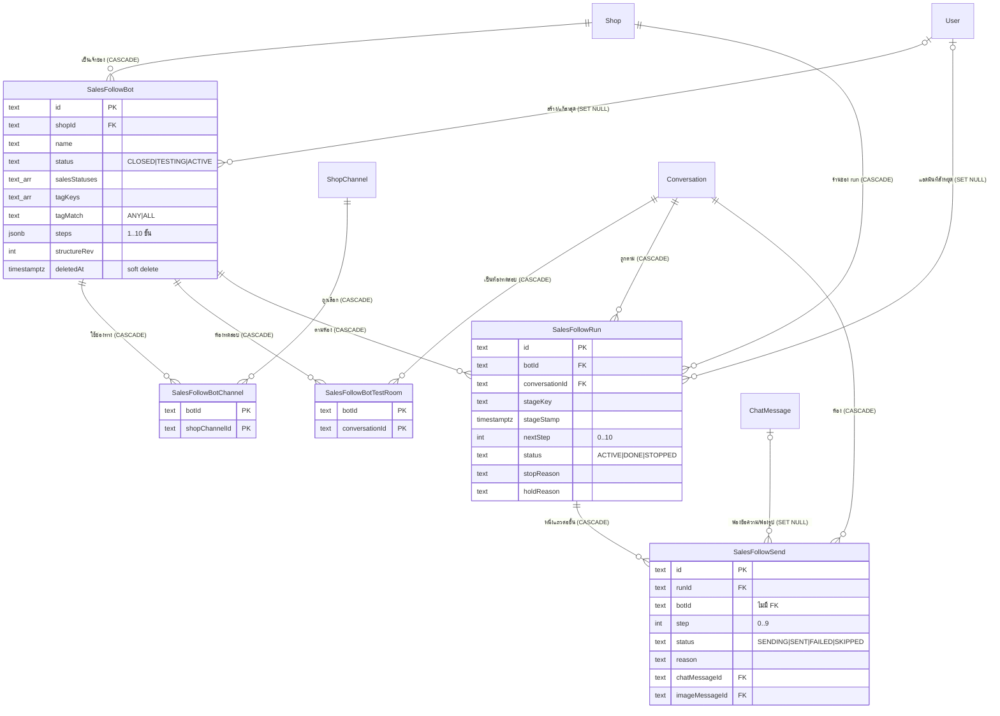

> **โมดูล:** 00095 — Sales Follow Bot
> **ประเภทเอกสาร:** DATABASE Design
> **เวอร์ชัน:** 0.1 · **วันที่จัดทำ:** 2026-11-16 · **สถานะ:** Draft
> **เจ้าของเอกสาร:** safepay-database
> **ที่มา:** [[SRS]] §5 + TFR-FB-04/10/14/16 · [[SDS]] §8 S-1 · [[BRD]] §0 · อ่าน `prisma/schema.prisma` ของ branch `feat/00095-sales-follow-bot`
> **Migration:** `prisma/migrations/20261117100000_00095_sales_follow_bot/migration.sql` (ล่าสุดก่อนหน้า `20261114120000_00091_order_ad_attribution`)

# DATABASE: บอทติดตามยอดขาย (00095)

---

## 1. Overview

- Store เดียว: PostgreSQL 16 (Supabase) ผ่าน Prisma · **เพิ่ม 5 ตารางใหม่ล้วน** ไม่แก้คอลัมน์/ตารางเดิม (มีแต่ relation ย้อนกลับในไฟล์ schema ซึ่งไม่มีผลต่อ DB)
- รูปแบบตาม convention 00078: `String` + DB `CHECK` (ไม่ใช้ Prisma enum) · เวลาทุกคอลัมน์ `Timestamptz(3)` · PK `uuid` เป็น `TEXT` · ไม่มี RLS (authz อยู่ที่ service)
- ไม่เก็บ: สถานะการขาย (คำนวณ — TFR-FB-01) · เนื้อข้อความที่ส่ง/เบอร์/ที่อยู่ (อยู่ใน `ChatMessage`) · ธง `adOnly` (คำนวณจาก steps)
- ค่าใหม่ที่ **ไม่ต้อง migration** เพราะคอลัมน์ไม่มี CHECK: `ChatMessage.autoReplyKind = 'AUTO_FOLLOW'` · `ChatMessage.type = 'FOLLOW_BOT_NOTE'` (comment ใน schema อัปเดตแล้ว)

### 1.1 ผลตัดสินหลัก

| # | เรื่อง | ผลตัดสิน | เหตุผล |
|---|---|---|---|
| D-1 | ห้องละ 1 บอท ACTIVE | partial unique `SalesFollowRun(conversationId) WHERE status='ACTIVE'` | BR-FB-08 · ตัวตัดสินเมื่อหลายบอท/หลาย tick แข่ง INSERT (TFR-FB-10) |
| D-2 | ไม่แนบซ้ำสถานะเดิมหลังจบ | unique `(botId, conversationId, stageStamp)` | BR-FB-09 · `stageStamp` = เวลาเข้าสถานะ จึงเข้าสถานะใหม่ = รอบใหม่ได้ |
| D-3 | ไม่ส่งซ้ำ | unique `SalesFollowSend(runId, step)` | BR-FB-31 · จองก่อนยิง (TFR-FB-14) · Meta ไม่มี idempotency key |
| D-4 | ประวัติอยู่รอดหลังบอทถูกลบ | `SalesFollowSend.botId` เป็น `TEXT` ไม่มี FK + บอท soft delete (`deletedAt`) | ต้องดูประวัติได้แม้ลบบอท |
| D-5 | steps เป็น JSON | `SalesFollowBot.steps jsonb` + CHECK แค่ "array 1..10" | โครงขั้นตรวจที่ service (Valibot) · แก้ขั้น → `structureRev`++ |
| D-6 | array ห้าม NULL | migration `SET NOT NULL` บน `salesStatuses`/`tagKeys` | Prisma ไม่ใส่ NOT NULL ให้ scalar list · `cardinality(NULL)` ทำให้ CHECK "ต้องมีเงื่อนไข" ผ่านเงียบ |
| D-7 | ไม่เพิ่ม index บน `ChatMessage` | ใช้ `(conversationId,createdAt)` · `(conversationId,senderRole,createdAt)` · `(conversationId,autoReplyKind,createdAt)` เดิม | SRS A-10/TFR-FB-22 · ตารางใหญ่สุด · ต้อง EXPLAIN บน prod (อ่านอย่างเดียว) ก่อนเปิดร้านที่ 2 |

---

## 2. ERD



---

## 3. Tables

คอลัมน์ทั้งหมดตรง `prisma/schema.prisma` (model อยู่ท้ายไฟล์ ใต้หัวข้อ `feature 00095`) — ตารางด้านล่างสรุปเฉพาะที่ต้องรู้เหตุผล

### 3.1 `SalesFollowBot`
| Column | Type | Null | Default | หมายเหตุ |
|---|---|---|---|---|
| `id` | text | NO | uuid | PK |
| `shopId` | text | NO | - | FK Shop CASCADE |
| `name` | text | NO | - | CHECK trim ไม่ว่าง ≤60 |
| `status` | text | NO | `'CLOSED'` | CLOSED/TESTING/ACTIVE · เริ่มปิดเสมอ (สร้างแล้วไม่ยิงเอง) |
| `salesStatuses` | text[] | NO | `{}` | ⊆ 7 key |
| `tagKeys` | text[] | NO | `{}` | ≤20 · เก็บ key ที่ normalize แล้ว (`tagNameKey`) |
| `tagMatch` | text | NO | `'ANY'` | ANY/ALL |
| `steps` | jsonb | NO | - | array 1..10 · `{delayMin,kind,text,imageFileId}` |
| `structureRev` | int | NO | 1 | เพิ่มเมื่อแก้ขั้น/เงื่อนไข → run เก่าหยุด `BOT_EDITED` |
| `createdByUserId` / `updatedByUserId` | text | YES | - | FK User SET NULL |
| `createdAt` / `updatedAt` | timestamptz(3) | NO | now | |
| `deletedAt` | timestamptz(3) | YES | NULL | soft delete |

### 3.2 `SalesFollowBotChannel` · `SalesFollowBotTestRoom`
- `SalesFollowBotChannel`: PK `(botId, shopChannelId)` · FK ทั้งคู่ CASCADE · ≤50 ช่องทางต่อบอท บังคับที่ service
- `SalesFollowBotTestRoom`: PK `(botId, conversationId)` · `createdByUserId` SET NULL · ≤20 ห้องต่อบอท บังคับที่ service
- ชน "1 ช่องทาง 1 บอทต่อสถานะ" (TFR-FB-05) **ตรวจที่ service** ไม่ใช่ DB — เงื่อนไขข้ามตารางและข้าม array ทำเป็น constraint ไม่ได้

### 3.3 `SalesFollowRun`
| Column | Type | Null | Default | หมายเหตุ |
|---|---|---|---|---|
| `shopId` / `botId` / `conversationId` | text | NO | - | FK CASCADE ทั้งสาม |
| `stageKey` | text | NO | - | สถานะการขาย ณ ตอนแนบ (7 ค่า) |
| `stageStamp` | timestamptz(3) | NO | - | เวลาเข้าสถานะ (TFR-FB-02) |
| `structureRev` | int | NO | - | snapshot ของ `SalesFollowBot.structureRev` ตอนแนบ |
| `nextStep` | int | NO | 0 | 0..10 (10 = ครบทุกขั้น) |
| `lastSentAt` / `nextDueAt` | timestamptz(3) | YES | - | |
| `holdReason` | text | YES | - | พักชั่วคราว (ไม่จบ run) |
| `status` | text | NO | `'ACTIVE'` | ACTIVE/DONE/STOPPED |
| `stopReason` | text | YES | - | 11 ค่า · บังคับเมื่อ STOPPED |
| `stoppedByUserId` | text | YES | - | FK User SET NULL |
| `finishedAt` | timestamptz(3) | YES | - | บังคับเมื่อ DONE/STOPPED |

### 3.4 `SalesFollowSend`
| Column | Type | Null | หมายเหตุ |
|---|---|---|---|
| `shopId` | text | NO | **ไม่มี FK** — ลบร้าน cascade ผ่าน `SalesFollowRun` อยู่แล้ว · มีไว้ให้ index ประวัติรายร้าน |
| `runId` | text | NO | FK Run CASCADE |
| `conversationId` | text | NO | FK CASCADE |
| `botId` | text | NO | **ไม่มี FK** (D-4) |
| `step` | int | NO | 0..9 (ดัชนีขั้น เริ่มที่ 0) |
| `status` / `reason` | text | NO / YES | `reason` บังคับเมื่อ FAILED/SKIPPED |
| `chatMessageId` / `imageMessageId` | text | YES | FK ChatMessage SET NULL (ฟองข้อความ/ฟองรูป) |
| `createdAt` / `settledAt` | timestamptz(3) | NO / YES | `settledAt` NULL ⇔ SENDING |

> ห้ามลบแถว `SalesFollowSend` ด้วย cron/retention แบบเดี่ยว — เป็นด่านกันส่งซ้ำ (เหมือน `AutoNotifyLedger`) · การลบมาจาก cascade ของ Run/Conversation/Shop เท่านั้น

---

## 4. Constraints (CHECK) และ Unique

| Table | Constraint | นิยาม | Trace |
|---|---|---|---|
| Bot | `SalesFollowBot_name_check` | `btrim(name)<>'' AND char_length(name)<=60` | TFR-FB-04 |
| Bot | `_status_check` · `_tagMatch_check` | `IN (CLOSED,TESTING,ACTIVE)` · `IN (ANY,ALL)` | TFR-FB-04/06 |
| Bot | `_salesStatuses_check` | `<@ ARRAY[7 key]` | TFR-FB-01 |
| Bot | `_tagKeys_check` | `cardinality<=20` | TFR-FB-04 (ข้อเสนอ SRS) |
| Bot | `_steps_check` | `jsonb_typeof='array' AND length BETWEEN 1 AND 10` | TFR-FB-04 |
| Bot | `_condition_check` | `cardinality(salesStatuses)>0 OR cardinality(tagKeys)>0` | AC-FB-02 |
| Run | `_stageKey_check` · `_status_check` | 7 ค่า · `IN (ACTIVE,DONE,STOPPED)` | TFR-FB-02/10 |
| Run | `_nextStep_check` | `BETWEEN 0 AND 10` | TFR-FB-04 |
| Run | `_stopReason_check` | NULL หรือ 11 ค่า | TFR-FB-11 |
| Run | `_holdReason_check` | NULL หรือ 4 ค่า | TFR-FB-08/15 |
| Run | `_status_shape` | ACTIVE: stopReason/finishedAt NULL · DONE: stopReason NULL + finishedAt · STOPPED: ทั้งคู่มีค่า | TFR-FB-02 |
| Send | `_step_check` | `BETWEEN 0 AND 9` | TFR-FB-04 |
| Send | `_status_check` · `_reason_check` | 4 ค่า · NULL หรือ 7 ค่า | TFR-FB-14 |
| Send | `_reason_shape` | `(status IN (FAILED,SKIPPED)) = (reason IS NOT NULL)` | TFR-FB-14 |
| Send | `_settled_shape` | `(status='SENDING') = (settledAt IS NULL)` | TFR-FB-14/16 |

| Unique | นิยาม | หน้าที่ |
|---|---|---|
| `SalesFollowRun_conversation_active_key` (**partial, SQL เท่านั้น**) | `(conversationId) WHERE status='ACTIVE'` | D-1 |
| `SalesFollowRun_botId_conversationId_stageStamp_key` | `(botId, conversationId, stageStamp)` | D-2 |
| `SalesFollowSend_runId_step_key` | `(runId, step)` | D-3 |

> **`ON CONFLICT` กับ partial unique:** INSERT Run ต้องเขียน `ON CONFLICT DO NOTHING` แบบไม่ระบุเป้าหมาย (หรือระบุ `(conversationId) WHERE status='ACTIVE'` ให้ตรงนิยามเป๊ะ) — Prisma `create` + catch P2002 ห้ามใช้ (ก่อ ERROR ใน log Postgres, convention `insert-then-catch-logs-every-error`)

**ข้อห้ามขยายเพดานขั้น:** เพดาน 10 ขั้นอยู่ที่ `constants.ts` และ CHECK **3 ตาราง** — ถ้าจะเพิ่มเป็น N ต้องแก้พร้อมกัน: `SalesFollowBot_steps_check` (≤N) · `SalesFollowRun_nextStep_check` (≤N) · `SalesFollowSend_step_check` (≤N-1) แล้วเพิ่ม migration แบบ DROP+ADD CONSTRAINT (additive — ผ่อนเงื่อนไขอย่างเดียว) + แก้เทส `sales-follow-bot-db-constraint.test.ts`

---

## 5. Indexes

| Table | Index | ประเภท | Query ที่รองรับ |
|---|---|---|---|
| Bot | `(shopId, deletedAt)` | btree (DSL) | ลิสต์บอทของร้าน/นับบอท |
| Bot | `(shopId, status) WHERE deletedAt IS NULL` | partial (SQL) | tick: บอท TESTING/ACTIVE ของร้าน (TFR-FB-09) |
| Bot | `(createdByUserId)` `(updatedByUserId)` | btree (DSL) | FK (SET NULL scan) |
| BotChannel | `(shopChannelId)` | btree | ตรวจชนช่องทาง (TFR-FB-05) · cascade ShopChannel |
| TestRoom | `(conversationId)` `(createdByUserId)` | btree | "ห้องนี้เป็นห้องทดสอบของบอทไหน" · FK |
| Run | `(updatedAt) WHERE status='ACTIVE'` | partial (SQL) | ชุด evaluate ของ tick เรียง `updatedAt` (TFR-FB-09) · SRS ระบุ `(status,updatedAt)` — ใช้คอลัมน์เดียวเพราะ predicate ล็อก status แล้ว |
| Run | `(botId) WHERE status='ACTIVE'` | partial (SQL) | หยุด/นับ run ตอนแก้-ลบ-ปิดบอท |
| Run | `(conversationId, createdAt)` | btree | แผงในห้อง/ประวัติรายห้อง |
| Run | `(shopId)` `(stoppedByUserId)` | btree | กรองร้าน · FK |
| Send | `(shopId, createdAt DESC, id DESC)` | btree | หน้าประวัติรายร้าน (keyset) |
| Send | `(conversationId, createdAt)` | btree | แผงห้อง |
| Send | `(createdAt) WHERE status='SENDING'` | partial (SQL) | sweeper หา SENDING ค้าง (TFR-FB-16) |
| Send | `(chatMessageId)` `(imageMessageId)` | btree | FK SET NULL เวลาลบข้อความ |

Prisma DSL ประกาศ partial index ไม่ได้ → 5 ตัว (`SalesFollowBot_shopId_status_active_idx`, `SalesFollowRun_conversation_active_key`, `SalesFollowRun_active_updatedAt_idx`, `SalesFollowRun_botId_active_idx`, `SalesFollowSend_sending_createdAt_idx`) อยู่ใน SQL ของ migration เท่านั้น และมี comment กำกับใน `schema.prisma` · **อย่าให้ใครรัน `db pull`/`migrate dev` แล้ว commit ผลกลับมา** (HR13/14) — เพราะ DSL ไม่รู้จักมันจะพยายามลบ

---

## 6. Migration Plan

### 6.1 ลำดับ
ไฟล์เดียว `20261117100000_00095_sales_follow_bot` (หนึ่ง transaction โดยปริยายของ Prisma — ล้มแล้ว rollback ทั้งก้อน):
1. CREATE TABLE 5 ตาราง + PK (ส่วนที่ได้จาก `prisma migrate diff` ไม่แก้มือ)
2. CREATE INDEX / UNIQUE ที่ DSL รู้จัก
3. ADD FOREIGN KEY (Shop/User/ShopChannel/Conversation/ChatMessage เป็นตารางเดิมที่มีอยู่แล้ว — ไม่มีลำดับพึ่งพากับ migration อื่น)
4. `SET NOT NULL` ให้ array 2 คอลัมน์ → ADD CONSTRAINT CHECK ทั้งหมด → CREATE partial index/unique

ไม่มี backfill (ไม่มีแถว = ไม่มีบอท) · ตารางใหม่ว่าง ADD CONSTRAINT/INDEX จึงไม่ล็อกนาน · ไม่แตะตารางเดิมจึงไม่มี lock ต่อ `Conversation`/`ChatMessage`

### 6.2 Rollback
ไม่มีข้อมูลเดิมที่ถูกแก้ — rollback = ลบของใหม่ (ทำเมื่อ Controller สั่งเท่านั้น; ห้าม drop เอง):
```sql
DROP TABLE "SalesFollowSend", "SalesFollowRun", "SalesFollowBotTestRoom", "SalesFollowBotChannel", "SalesFollowBot";
DELETE FROM "_prisma_migrations" WHERE migration_name = '20261117100000_00095_sales_follow_bot';
```
ลำดับ DROP ตามนี้ (ลูกก่อนแม่) · ข้อมูลที่หาย = ตั้งค่าบอท + ประวัติการส่ง (ฟองที่ส่งไปแล้วยังอยู่ใน `ChatMessage`) · ก่อน rollback ปิดบอททุกตัว (`status='CLOSED'`) และปิด cron เพื่อไม่ให้ tick ยิงระหว่างทาง · โค้ดที่ deploy แล้วจะ error ถ้าตารางหาย → rollback โค้ดก่อนตาราง

### 6.3 HR15 — push `main` = `prisma migrate deploy` บน prod
ก่อน merge ต้องแจ้ง user 3 ข้อ: (1) prod ไม่ต้องสั่ง migrate เอง — push main แล้ว deploy รันให้ (2) local/dev ต้อง apply เอง: `DATABASE_URL=postgresql://…@localhost:5434/<db> npx prisma migrate deploy` (ปักหมุด localhost) (3) migrate ล้ม = deploy ไม่ขึ้น (SQL นี้ทดสอบแล้ว — ดู §6.4)

### 6.4 ที่ตรวจแล้ว
- `prisma validate` ผ่าน · ส่วนที่ 1 ของ SQL = ผล `prisma migrate diff --from-schema-datamodel <schema@HEAD> --to-schema-datamodel prisma/schema.prisma --script` (ไม่ใช้ shadow DB)
- ลอง apply ทั้งไฟล์ใน `BEGIN … ROLLBACK` บน DB local (`localhost:5434`) ผ่าน · ฐานไม่เปลี่ยน · probe ใน txn: Run ACTIVE ซ้ำห้องเดียวชน partial unique · Bot ไม่มีเงื่อนไขชน `_condition_check`

---

## 7. Query impact / ข้อควรระวัง

- **tick** (TFR-FB-09/10): ผู้สมัครแนบดึงจาก `Conversation` ด้วย index เดิม `(shopId,lastInboundAt)` ไม่มี index ใหม่บน `Conversation`/`ChatMessage` · evaluate ใช้ partial `(updatedAt) WHERE ACTIVE` — ตารางเล็ก (≤ จำนวนห้องที่กำลังติดตาม)
- **ตรวจ "ลูกค้าตอบหรือยัง / แอดมินตอบล่าสุด"** อ่าน `ChatMessage` ด้วย 3 index เดิมของ A-10 — **ยังไม่ได้วัดบน prod** → ต้อง `EXPLAIN` อ่านอย่างเดียว (Supabase PAT) ก่อนเปิดร้านที่ 2 (TFR-FB-22)
- ตัวอย่าง query ในเอกสารนี้ไม่มีตารางอ่อนไหว · `SalesFollowSend` ไม่เก็บเนื้อข้อความ/เบอร์/ชื่อ จึงปลอดภัยต่อการ select ทั้งแถวในหน้าประวัติ (แต่ยังเลือกเฉพาะคอลัมน์ตามปกติ)
- **Retention:** `SalesFollowRun`/`SalesFollowSend` โตตามจำนวน (ห้อง × ขั้น) — P1 ไม่ตัดแถวเก่า (Send เป็นด่านกันซ้ำ) · ถ้าจะตัดต้องตัดทั้ง Run พร้อมลูก และเฉพาะ Run ที่ `status<>'ACTIVE'` (ตัดสินใจรอบหลัง — TFR-FB-22)
- ลบ `Conversation` → CASCADE ลบ Run/Send/TestRoom ของห้องนั้นด้วย (ประวัติรายห้องหายตามห้อง — ตั้งใจ)

---

## 8. Traceability

| ตาราง | SRS / SDS |
|---|---|
| `SalesFollowBot` | TFR-FB-04/06/07 · SDS S-1 |
| `SalesFollowBotChannel` | TFR-FB-04/05 |
| `SalesFollowBotTestRoom` | TFR-FB-06/10 |
| `SalesFollowRun` | TFR-FB-02/10/11/12 (D-1, D-2) |
| `SalesFollowSend` | TFR-FB-14/16/19 (D-3, D-4) |

## 9. ต่างจาก SRS §5.1 (ปรับให้ถูกกับ schema/Prisma จริง)
1. `salesStatuses`/`tagKeys`: เพิ่ม `SET NOT NULL` (D-6) — SRS ไม่ได้ระบุ
2. Index ตัวหยิง evaluate: `(updatedAt) WHERE status='ACTIVE'` แทน `(status, updatedAt) WHERE …` (เทียบเท่า ประหยัดหนึ่งคอลัมน์)
3. เพิ่ม index บน FK ที่ SRS ไม่ได้ระบุ (`createdByUserId`/`updatedByUserId`/`stoppedByUserId`/`conversationId` ของ TestRoom/`chatMessageId`/`imageMessageId`/`Run.shopId`) — ลบ/SET NULL แถวแม่ไม่ต้อง seq scan
4. `SalesFollowBotTestRoom.createdAt` ใส่ default now · `SalesFollowSend.shopId` ไม่มี FK ตาม SRS (จดไว้ชัด)

## ภาคผนวก — ส่วนต่อขยาย 2026-11-16

| ตาราง | คอลัมน์ใหม่ | CHECK/Index |
|---|---|---|
| SalesFollowBot | `finalAction` text NOT NULL default 'NONE' · `finalDelayMin` int NOT NULL default 1440 | `_finalAction_check` ∈ NONE/RESOLVE/HIDE/SPAM · `_finalDelayMin_check` 0..10080 |
| SalesFollowRun | `finalActionAt` timestamptz? · `finalActionTaken` text? | `_finalActionTaken_check` ∈ RESOLVE/HIDE/SPAM/NULL · partial index `SalesFollowRun_final_pending_idx (lastSentAt) WHERE status='DONE' AND finalActionAt IS NULL` |
| SalesFollowSend | `controlReclaimed` bool NOT NULL default false | `_reason_check` ขยาย +`ROUTING_NOT_ENABLED`,`CHANNEL_TOKEN_INVALID` |

migration `20261117100200_00095_ext_final_action` · `20261117100300_00095_ext_reclaim_control` — additive ล้วน (HR15: push main = deploy prod migrate) · local apply ด้วย `migrate deploy` ปักหมุด localhost:5434

**ต่อขยาย FR-FA-7:** `SalesFollowBot.replyHandoff` text NOT NULL default 'ADMIN' · `SalesFollowBot_replyHandoff_check` ∈ ADMIN/META_AI (migration `20261118110000_00095_ext_reply_handoff`)
