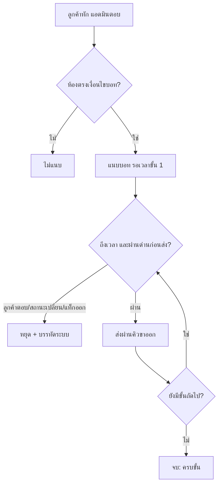

> **โมดูล:** 00095 — Sales Follow Bot (ชื่อใน UI ที่เสนอ: "บอทติดตามยอดขาย" · ทีมเรียก "บอทขุด")
> **ประเภทเอกสาร:** Product Requirements Document (PRD)
> **เวอร์ชัน:** 0.1
> **วันที่จัดทำ:** 2026-11-16
> **สถานะ:** Draft — รอ user เคาะ Open Questions ใน BRD §13 (ต้องผ่านก่อนเขียนโค้ด ตาม HR11)
> **เจ้าของเอกสาร:** BA + PO + PM (ดู [[Feature-Docs-Ownership]])

# PRD: บอทติดตามยอดขาย (Sales Follow Bot)

> ที่มา: ยกฟีเจอร์ที่ขึ้น prod แล้วใน gochat-v3 (`/sales-bot`) มาทำใน Deep · พฤติกรรมและมติผู้ใช้ยกจาก [[REFERENCE-gochat-v3]] (อ้างเป็น "มติ gochat <วันที่>") แล้วปรับให้ตรงความจริงของโค้ด Deep ตาม [[MAPPING-safepay]]
> รหัส: `FR-FB-xx` ความต้องการ · `BR-FB-xx` กฎธุรกิจ · `AC-FB-xx` เกณฑ์ตรวจรับ · `Q-n` คำถามเปิด (อยู่ใน BRD §13)

---

## Executive Summary

ลูกค้าทักร้านมาถามราคา แล้วเงียบ — ร้านต้องไล่ทักตามเองทีละห้อง ซึ่งทำไม่ไหวเมื่อมีหลายสิบห้องต่อวัน และคนที่ลืมตามคือยอดขายที่หายไป

**บอทติดตามยอดขาย** ให้ร้านตั้ง "ชุดข้อความตามเป็นขั้น ๆ ตามเวลา" (เช่น 30 นาทีหลังแอดมินตอบล่าสุด ทักถามอีกครั้ง, อีก 3 ชั่วโมงส่งรูป/โปรโมชัน) ระบบจะแนบบอทให้ห้องที่เข้าเงื่อนไข (สถานะการขาย + แท็กของร้าน + ช่องทางที่เชื่อม) แล้วส่งข้อความเองตามเวลา และ **หยุดเองทันที** เมื่อลูกค้าตอบ, แอดมินเข้ามาคุยเอง, สถานะการขายเปลี่ยน (เช่น ลูกค้าจ่ายแล้ว), แท็กถูกเอาออก, หรือเลยกรอบเวลาของช่องทาง

ผลทางธุรกิจ: ร้านไม่ปล่อยลูกค้าที่ยังลังเลหลุด · แอดมินใช้เวลากับห้องที่ลูกค้าตอบจริง · ไม่เกิดเหตุเสียหน้าอย่าง "ตามขายคนที่เพิ่งจ่ายเงิน" (บั๊ก prod ที่ gochat เจอจริง — กลายเป็นกฎตั้งแต่วันแรกของเรา)

**ความจริงของ Deep ที่ทำให้ไม่ใช่ copy ตรง ๆ** (รายละเอียด [[MAPPING-safepay]] §11):
1. Messenger/Instagram ส่งเกิน 24 ชม. ไม่ได้ (บอทห้ามใช้ HUMAN_AGENT และเรายังไม่มี Utility template) → ขั้นทุกขั้นต้องอยู่ในกรอบ ~23 ชม. ตั้งแต่ตอนตั้งบอท
2. Deep ไม่มีแท็ก "สถานะการขาย 7 ขั้น" ที่เก็บไว้ → เสนอ **คำนวณจากออเดอร์ล่าสุดของห้อง**
3. แท็กร้านของเราผูกกับ "ผู้ติดต่อ" ไม่ใช่ห้อง และห้องแชทในแอป Deep ไม่มีแท็ก → บอทครอบเฉพาะ Messenger/IG/LINE
4. ต้องจัดลำดับสิทธิ์กับบอทตอบ (00023) · Meta AI ที่ถือห้อง · แจ้งลูกค้าอัตโนมัติ (00078) · โควตา push ของ LINE

**แบ่งรอบส่งมอบ** (เสนอ): P1 แกนบอท (บอทตามเงื่อนไข · ข้อความ/ข้อความ+รูป · หยุดครบทุกเหตุ · ประวัติ · แผงในห้อง · ร้านนำร่อง) → P2 เนื้อหาแบบหลากหลาย + บอทเฉพาะกลุ่ม → P3 ส่งเกิน 24 ชม. (ต้องมีงานนอก repo)

---

## 1. Business Goals & KPIs

### 1.1 เป้าหมายทางธุรกิจ

| เป้าหมาย | รายละเอียด |
|----------|-----------|
| **ดึงลูกค้าที่เงียบกลับมาคุย** | ห้องที่ลูกค้าถามแล้วเงียบ ได้รับการทักตามตามเวลาที่ร้านตั้ง โดยไม่ต้องมีคนจำ |
| **ไม่รบกวนลูกค้าผิดจังหวะ** | หยุดทันทีเมื่อลูกค้าตอบ/ซื้อแล้ว/ร้านเข้ามาคุยเอง — ไม่ส่งหาคนที่เพิ่งจ่ายเงิน ไม่ส่งซ้ำ |
| **ปลอดภัยต่อบัญชีเพจ/OA ของร้าน** | ส่งอยู่ในกรอบที่ Meta/LINE อนุญาตเท่านั้น ไม่พึ่งช่องโหว่ (ไม่ใช้ HUMAN_AGENT) ไม่เผาโควตา LINE โดยร้านไม่รู้ |
| **ร้านเห็นและคุมได้** | เห็นว่าบอทส่งอะไร ห้องไหน ผลอะไร และกดหยุดรายห้องได้ |
| **ใช้ของเดิมที่ Deep มี ไม่สร้างระบบคู่ขนาน** | ใช้ตัวส่งขาออก/คิว/แท็กร้าน/ออเดอร์/ด่านสิทธิ์เดิม ยกโครง 00078 |

### 1.2 ตัวชี้วัดความสำเร็จ (KPIs)

> ค่าเป้าหมายเป็น **ข้อเสนอ** — ยังไม่มี baseline (Deep ไม่เคยมีบอทแบบนี้) ให้ user ยืนยันหรือตั้งใหม่ · ตัวเลขกลุ่ม "ผลทางขาย" เป็นความสัมพันธ์ ไม่ใช่การพิสูจน์เหตุผล

| KPI | คำอธิบาย | เป้าหมาย (ข้อเสนอ) |
|-----|----------|---------|
| **ส่งผิดจังหวะ = 0** | จำนวนฟองบอทที่ส่ง "หลังลูกค้าตอบ" หรือ "หลังสถานะเปลี่ยนเป็นยืนยันแล้ว/ส่งแล้ว/สำเร็จ" หรือ "หลังเลย 24 ชม." (นับจากประวัติ + ข้อความจริง) | 0 ทุกสัปดาห์ |
| **ส่งซ้ำ = 0** | ขั้นเดียวกันของ run เดียวกันถูกส่งมากกว่า 1 ฟอง | 0 |
| **อัตราลูกค้าตอบหลังบอท** | ห้องที่ลูกค้าส่งข้อความจริงภายใน 24 ชม. หลังฟองบอทแรก ÷ ห้องที่บอทส่งฟองแรก | รายงานเป็นแนวโน้ม ไม่ตั้งเกณฑ์ผ่าน/ตกใน 30 วันแรก |
| **ออเดอร์หลังบอท** | ห้องที่มีออเดอร์ที่นับได้เกิดภายใน 48 ชม. หลังฟองบอทแรก ÷ ห้องที่บอทส่งฟองแรก | รายงานเป็นแนวโน้ม |
| **อัตราขั้นล้ม/ข้าม** | ขั้นที่สถานะ failed หรือ skipped ÷ ขั้นที่ถึงกำหนด | < 10% (แยกเหตุผล: โควตา LINE · Meta AI ถือห้อง · ช่องทางหลุด) |
| **การนำไปใช้ (ร้านนำร่อง)** | ร้านนำร่องที่เปิดบอทเป็น "เปิดใช้" ≥ 1 ตัวภายใน 14 วันหลังเปิดสิทธิ์ | ≥ 1 ร้านนำร่องทุกร้านที่ได้สิทธิ์ |
| **ข้อร้องเรียน** | ร้านรายงานว่า "บอทส่งหาคนที่ไม่ควรส่ง" | 0 |

---

## 2. User Personas (กลุ่มผู้ใช้งาน)

### 2.1 เจ้าของร้านออนไลน์ที่ขายผ่านแชท (ผู้ตั้งบอท)

**ข้อมูลพื้นฐาน:**
- เจ้าของ/ผู้จัดการร้านที่รับออเดอร์ผ่าน Messenger, Instagram, LINE OA (บทบาท OWNER/MANAGER)
- ร้านในกลุ่มขายสินค้าออนไลน์ที่เปิดบิลผ่านระบบออเดอร์ของ Deep

**เป้าหมาย:**
- เพิ่มยอดจากลูกค้าที่ถามแล้วเงียบ โดยไม่เพิ่มคน

**ความต้องการ:**
- ตั้งข้อความตาม 2-5 ขั้นครั้งเดียว แล้วใช้ซ้ำกับทุกห้องที่เข้าเงื่อนไข
- ทดลองกับแชททดสอบของตัวเองก่อนเปิดจริง
- มั่นใจว่าบอทไม่ส่งหาลูกค้าที่ซื้อแล้ว/ตอบแล้ว

**จุดปวด (Pain Points):**
- ตามลูกค้าเองไม่ทัน ลืม · ตามผิดจังหวะ (ลูกค้าเพิ่งจ่าย)
- กลัวบัญชีเพจโดนจำกัดจากการส่งนอกกรอบ

### 2.2 แอดมินตอบแชท (บทบาท CHAT)

**ข้อมูลพื้นฐาน:**
- ตอบลูกค้าในกล่องแชทรายวัน อาจหลายกะ

**เป้าหมาย:**
- รู้ว่าห้องไหนบอทกำลังตาม จะได้ไม่พิมพ์ซ้อนกับบอท และเข้ามาคุยต่อเมื่อลูกค้าตอบ

**ความต้องการ:**
- เห็นป้าย "บอทติดตามอยู่" ในห้อง พร้อมรายการขั้นที่ส่งแล้ว/รอส่ง
- กด "หยุดบอทห้องนี้" ได้ทันที

**จุดปวด (Pain Points):**
- ไม่รู้ว่าลูกค้าได้รับข้อความอะไรไปแล้วจากระบบ ตอบซ้ำหรือขัดกัน

### 2.3 ลูกค้าของร้าน (ผู้รับข้อความ — ไม่ใช่ผู้ใช้ระบบ)

**ข้อมูลพื้นฐาน:**
- ผู้ซื้อที่ทักร้านผ่าน Messenger/IG/LINE

**ความต้องการ:**
- ได้รับการทักตามที่สุภาพ ไม่ถี่เกินไป หยุดเมื่อบอกว่าไม่สนใจ/ตอบแล้ว

**จุดปวด (Pain Points):**
- โดนทักซ้ำหลังซื้อไปแล้ว หรือโดนส่งหลายฟองรัว ๆ

---

## 3. Business Requirements

### 3.1 บอทและเงื่อนไขที่บอทตาม

**ความต้องการ:**
- ร้านสร้างบอทได้หลายตัว แต่ละตัวมี ชื่อ · สถานะ (ปิด/ทดสอบ/เปิดใช้) · เงื่อนไขห้องที่จะตาม · ช่องทางที่เชื่อม (เพจ/IG/OA) ที่บอทใช้ · ขั้นข้อความ 1-10 ขั้น
- เงื่อนไขห้อง = สถานะการขาย (เลือกได้หลายค่า; ว่าง = ทุกสถานะ) + แท็กของร้าน (แท็กใดแท็กหนึ่ง/ครบทุกแท็ก) ต้องเลือกอย่างน้อยหนึ่งอย่าง
- ช่องทางที่เชื่อมหนึ่งช่องมีบอทตามเงื่อนไขตัวเดียวต่อสถานะการขาย (มติ gochat 9 ต.ค.)

**Business Rules:** BR-FB-03..09 (BRD §8.1-8.2)

**เหตุผล:**
- ถ้าสองบอทตามห้องเดียวกันได้ ลูกค้าจะโดนทักซ้อน · การจำกัดที่ระดับ "ช่องทาง × สถานะ" ทำให้เจ้าของคาดเดาได้ว่าห้องไหนได้ข้อความอะไร

### 3.2 สถานะการขายของห้อง (เสนอ: คำนวณจากออเดอร์ ไม่เก็บเป็นแท็ก)

**ความต้องการ:**
- ทุกห้องมีสถานะการขาย 1 ใน 7 ค่า: ยังไม่ซื้อ · เปิดบิล · ยืนยันแล้ว · ส่งแล้ว · สำเร็จ · พัสดุมีปัญหา · ยกเลิก (ชื่อและโทนตามมติ gochat 10 ต.ค./15 ต.ค.)
- ห้องที่ยังไม่มีออเดอร์ที่นับได้ (ลีดที่ยังไม่เปิดบิล / มีแต่ร่างออเดอร์) = **"ยังไม่ซื้อ"**
- สถานะเปลี่ยนตามออเดอร์ล่าสุดของห้องเองโดยไม่ต้องมีใครกด

**Business Rules:** BR-FB-10..16

**เหตุผล:**
- จุดที่เขียน `Order.status` ใน Deep กระจายหลายไฟล์ ถ้าเก็บเป็นแท็กแล้วลืมแขวนจุดใดจุดหนึ่ง สถานะจะค้างและบอทจะตามขายคนที่จ่ายแล้ว (บทเรียน gochat ข้อ 1/7/8) · การคำนวณจากออเดอร์จริงทุกครั้งตัดความเสี่ยงนี้ (convention `stored-flag-vs-owner-truth`)

**สถานะการขายที่ต้องรองรับ:**

| สถานะ | ที่มา (ข้อเสนอ — ยืนยันที่ SRS กับ `order-stage.ts`) |
|-------|------|
| **ยังไม่ซื้อ** | ไม่มีออเดอร์ที่นับได้ในห้อง · หรือรอบก่อนจบแล้ว (BR-FB-13) |
| **เปิดบิล** | ออเดอร์ล่าสุดเปิดแล้วยังไม่ยืนยัน/ชำระ |
| **ยืนยันแล้ว** | ออเดอร์ล่าสุดยืนยัน/ชำระแล้ว ยังไม่ส่ง (นิยามชัดอยู่ที่ Q-4) |
| **ส่งแล้ว** | ออเดอร์ล่าสุดอยู่ระหว่างขนส่ง |
| **สำเร็จ** | ส่งถึงแล้ว/ปิดงาน (มติ gochat 17 ต.ค.: ส่งถึง = สำเร็จ) |
| **พัสดุมีปัญหา** | พัสดุมีปัญหา/ส่งไม่สำเร็จ/ตีกลับ |
| **ยกเลิก** | ออเดอร์ล่าสุดถูกยกเลิก |

### 3.3 การส่งตามเวลา

**ความต้องการ:**
- แต่ละขั้นตั้ง "รอนานเท่าไรหลังแอดมินตอบล่าสุด/หลังขั้นก่อน" (นาที/ชั่วโมง)
- ถ้าร้านยังค้างตอบลูกค้า (ข้อความจริงล่าสุดเป็นของลูกค้า) บอทไม่นับเวลา รอแอดมินโดยไม่มีกำหนด
- ทุกขั้นต้องส่งได้ภายใน 24 ชม. หลังลูกค้าทักล่าสุด (ฟอร์มจำกัดเวลาสะสม ≤ 23 ชม. — Q-2)
- ส่งผ่านคิวขาออกเดียวกับระบบแชท ติดป้ายว่า "ส่งโดยบอทติดตาม" เพื่อไม่ปนกับพนักงาน

**Business Rules:** BR-FB-20..38

**เหตุผล:**
- นับจากร้านตอบล่าสุดเพราะนับจากลูกค้าทักทำให้แอดมินที่ตอบช้ากว่าเวลารอโดนบอทยิงต่อทันที (บั๊ก gochat #828) · ส่งไม่ถึงดีกว่าส่งสองรอบ (กุญแจกันซ้ำ + ไม่ยิงซ้ำเมื่อไม่แน่ใจ)

### 3.4 เงื่อนไขหยุด

**ความต้องการ:**
- หยุดเองเมื่อ: สถานะการขายเปลี่ยน · แท็กร้านไม่ตรงแล้ว · บอทถูกปิด/ลบ/แก้โครง · **ลูกค้าตอบข้อความจริง** · ครบขั้น · เลยกรอบ 24 ชม. · ห้องตั้ง "ไม่สนใจ" · ห้องหลุดจากช่องทาง/ขอบเขตทดสอบ · ลูกค้าบล็อก/เลิกติดตาม (LINE) · แอดมินกด "หยุด"
- หยุดทุกครั้งเขียนบรรทัดระบบภายในห้อง (ลูกค้าไม่เห็น ไม่ดันห้องขึ้นบน) บอกเหตุผลเป็นภาษาคน
- ห้องที่ Meta AI ถืออยู่/ร้านปิดบอทห้องนั้น = **พักส่ง ไม่หยุด** (ไปหยุดที่เลยกรอบเองถ้านานพอ)

**Business Rules:** BR-FB-40..49

**เหตุผล:** แต่ละเหตุหยุดมาจากบั๊กหรือมติจริงของ gochat (ลูกค้าตอบแล้วบอทยังตาม · เอาแท็กออกแล้วยังตาม · บอททุกสถานะหยิบห้องซ้ำหลังสถานะเปลี่ยน)

### 3.5 พื้นผิวบนจอ

**ความต้องการ (P1):**
- หน้าตั้งค่า "บอทติดตามยอดขาย": แท็บ **บอท** (รายการ + สร้าง/แก้) และ **ประวัติการส่ง** (ลูกค้า · ช่องทาง · บอท/ขั้น · ผล · เวลา)
- แผงในห้องแชท (แผงข้อมูลลูกค้า): แสดงบอทที่ตามอยู่ + รายการขั้น (ส่งแล้ว HH:MM / อีก … / รอส่ง / ข้าม + เหตุผล) + ปุ่ม "หยุด"
- ป้ายสถานะการขาย (อ่านอย่างเดียว) + ป้าย "บอทติดตามอยู่" ในแถวชิปหัวห้อง

**Business Rules:** BR-FB-70..75

### 3.6 สิทธิ์ การเปิดใช้ และการ rollout

**ความต้องการ:**
- บอทพูดแทนร้านถึงลูกค้า → ตั้งค่า/แก้/ลบ = เจ้าของ/ผู้จัดการ (แบบเดียวกับตั้งค่าแจ้งลูกค้าอัตโนมัติ 00078) · อ่านประวัติ/ดูแผงในห้อง/หยุดบอทในห้อง = ผู้ที่ตอบแชทได้ (Q-11)
- เปิดเฉพาะร้านนำร่องก่อน (รายชื่อร้านจาก env) · ปิดร้านออกจากรายชื่อ = บอทหยุดส่งทันที (kill switch ทำงานที่ตัวส่ง ไม่ใช่แค่ทางเข้าหน้า — ต่างจาก gochat ที่ worker ไม่เช็ก)
- บอทใหม่เริ่มสถานะ "ปิด" เสมอ

**Business Rules:** BR-FB-01, 02, 80..85

### 3.7 ขอบเขตแบ่งรอบ (ข้อเสนอ)

| รอบ | เนื้อหา | หมายเหตุ |
|---|---|---|
| **P1 แกนบอท** | บอทตามเงื่อนไข · ขั้นข้อความ + ข้อความ+รูป · ตัวแปร `{ชื่อ}` · สถานะการขาย (คำนวณ) · แท็กร้าน any/all · เลือกช่องทางที่เชื่อม · ปิด/ทดสอบ/เปิดใช้ (Q-10) · หยุดครบทุกเหตุ · ด่านก่อนส่ง (Meta AI/บอทตอบ/โควตา LINE) · ประวัติการส่ง · แผงในห้อง+ป้าย · capability · ร้านนำร่อง | Messenger + IG + LINE · เพดาน 23 ชม. |
| **P2 เนื้อหา+บอทเฉพาะกลุ่ม** | ขั้นการ์ดสินค้า (≤10 ชิ้น) · ขั้นข้อความที่ใช้บ่อย (≤5) · ปุ่มในข้อความ (0-3) · บอทเฉพาะกลุ่ม (แอดมินแนบมือ ผูกสินค้า, ตัวแปร `{สินค้า}` `{ราคา}`) · ป้ายกระพริบในรายการห้อง · สินค้าแนะนำตอนแนบ · รายงานผลบอท | ต้องผ่านด่าน ux ทีละพื้นผิว (Q-13) |
| **P3 เกิน 24 ชม.** | ขั้น Utility (Messenger เทมเพลต Meta · LINE push เกิน 24 ชม. ถ้า user ยอม) | **ต้องมีงานนอก repo:** ยื่น Utility template / App Review — เอกสารนี้ไม่สัญญากำหนดวัน |

---

## 4. Business Rules & Constraints

### 4.1 กฎทางธุรกิจหลัก

| กฎ | คำอธิบาย |
|----|----------|
| **ไม่ส่งหาคนที่ไม่ควรส่ง** | ลูกค้าตอบ · สถานะเปลี่ยน · ซื้อแล้ว · ไม่สนใจ · บล็อก = หยุดทันที ความถูกต้องของข้อนี้สำคัญกว่าจำนวนข้อความที่ส่งได้ |
| **ส่งไม่ถึงดีกว่าส่งสองรอบ** | ไม่แน่ใจว่าส่งไปหรือยัง = บันทึก "ไม่ทราบผล" แล้วเดินต่อ ไม่ยิงซ้ำ |
| **เวลานับจากร้านตอบล่าสุด** | ไม่ใช่เวลาที่ลูกค้าทัก |
| **เปิดบอทใหม่ไม่ยิงห้องเก่าทั้งร้าน** | แนบเฉพาะห้องที่ยังไม่เลยเวลาของขั้นแรก (มติ gochat 8 ต.ค.) |
| **สถานะการขายมาจากออเดอร์จริง** | ไม่เก็บซ้ำ ไม่มีใครต้องกดย้ายสถานะ |
| **ไม่ใช้ช่องโหว่ของแพลตฟอร์ม** | ไม่ใช้ HUMAN_AGENT/message tag · ไม่ส่งเข้าห้องที่แอปอื่นคุม |

### 4.2 ข้อจำกัดทางธุรกิจ

| ข้อจำกัด | รายละเอียด |
|---------|-----------|
| **กรอบ 24 ชม.** | Messenger/IG ส่งได้ภายใน 24 ชม. หลังลูกค้าทักเท่านั้น · LINE ไม่มีกรอบจากแพลตฟอร์ม แต่ใช้กติกา 24 ชม. เดียวกัน (มติ gochat) |
| **โควตา LINE** | ข้อความตามเวลาเป็น push ทั้งหมด (reply token หมดใน 60 วิ) = กินโควตาข้อความของร้าน |
| **ห้องในแอป Deep ไม่มีแท็ก** | ไม่เข้าบอท |
| **ไม่มี Marketplace** | ชุดสถานะ Shopee/Lazada ของ gochat ไม่เกี่ยวกับ Deep |
| **ตัวเลขเพดาน** | ขั้น ≤10 · ข้อความ ≤1,000 ตัว · แชททดสอบ ≤20 · ชื่อบอท ≤60 · ช่องทางต่อบอท ≤50 |

### 4.3 เหตุผลการข้าม/ล้มของขั้น (ผลที่ระบบต้องบันทึก)

ส่งแล้ว · ข้าม (ช่องทางถูกบล็อก/ห้อง Meta AI ถือ/แอปอื่นคุมห้อง/โควตา LINE เต็ม/รูปหาย) · ไม่สำเร็จ (ผู้ให้บริการปฏิเสธ) · ไม่ทราบผล (ค้างส่งเกินเวลา) — ทุกค่ามีข้อความไทยที่ร้านอ่านเข้าใจในประวัติ

---

## 5. Out of Scope (นอกขอบเขต)

| หัวข้อ | คำอธิบาย |
|--------|----------|
| **Marketplace (Shopee/Lazada)** | Deep ไม่มีห้อง/ออเดอร์ Marketplace — ตัดทั้งชุดสถานะ MKP + นับซื้อซ้ำจาก MKP |
| **ห้องแชทในแอป Deep (channel DEEP)** | ไม่มีแท็กร้านและไม่มีผู้ติดต่อภายนอก (Q-5) |
| **การเปลี่ยนสถานะการขายด้วยมือ** | สถานะคำนวณจากออเดอร์ — ไม่มีเมนูเลือกสถานะที่หัวห้อง · ใช้ "ไม่สนใจ" (`salesStatus`) ที่มีอยู่แทนเมื่อต้องการให้บอทเลิกตาม |
| **ส่งเกิน 24 ชม. / Utility template** | P3 ต้องมีงานนอก repo (Q-2) |
| **ใช้ HUMAN_AGENT ให้บอท** | ห้ามโดยโค้ดและนโยบาย |
| **บอทตอบลูกค้าแบบโต้ตอบ** | นั่นคือ 00023 Chat-Bot — บอทนี้ส่งตามตาราง ไม่ตอบคำถาม |
| **A/B test / ส่งตามเวลาที่ลูกค้าอ่านล่าสุด / ตั้งเวลาเป็นนาฬิกา (เช่น 09:00)** | ไม่อยู่ในต้นแบบ gochat และไม่มีมติ |
| **ลบ/ย้อนข้อความที่บอทส่งไปแล้ว** | ข้อความอยู่ในห้องเหมือนข้อความร้านปกติ |
| **ส่งข้ามร้าน / กล่องรวมหลายร้าน (00037) แบบรวมบอท** | บอทเป็นของร้านใดร้านหนึ่ง ไม่รวมข้ามร้าน |
| **ปุ่ม/การ์ดสินค้า/บอทเฉพาะกลุ่ม** | เลื่อนไป P2 (ไม่ใช่ตัดทิ้ง) |

---

## 6. Risks & Mitigation (ความเสี่ยงและแนวทางแก้ไข)

### 6.1 ความเสี่ยงทางธุรกิจ

| ความเสี่ยง | ผลกระทบ | ระดับความรุนแรง | แนวทางแก้ไข |
|-----------|---------|-----------------|-------------|
| **ส่งหาลูกค้าที่เพิ่งจ่าย/ตอบแล้ว** | ลูกค้าไม่พอใจ ร้านเสียหน้า | สูง | BR-FB-09/40-43 + ตรวจซ้ำก่อนยิง + ร้านนำร่อง + โหมดทดสอบ |
| **บัญชีเพจถูก Meta จำกัดจากส่งนอกกรอบ/สแปม** | ร้านใช้เพจไม่ได้ | สูง | ทุกขั้นอยู่ใน 23 ชม. · ไม่ใช้ tag พิเศษ · จำนวนขั้น ≤10 · หยุดเมื่อลูกค้าเงียบไม่ตอบ (จบที่ขั้นสุดท้าย) |
| **โควตา LINE ร้านหมดเงียบ ๆ** | ข้อความสำคัญอื่น (แจ้งเลขพัสดุ) ส่งไม่ได้ | กลาง | เช็คโควตาก่อนส่ง · เต็ม = ข้ามพร้อมเหตุผล · เตือนในฟอร์มว่าขั้น LINE ใช้โควตา (Q-8) |
| **ชนกับบอทตอบ/Meta AI/แจ้งลูกค้า 00078 ทำให้ลูกค้าได้ข้อความซ้อน** | ประสบการณ์แย่ | กลาง | ตารางลำดับสิทธิ์ BRD §8.4 + Q-6/Q-7 |
| **ร้านตั้งข้อความขายรัวเกินไป** | ลูกค้าบล็อก | กลาง | ค่าตั้งต้นแนะนำ 2-3 ขั้น · เพดานเวลาสะสม 23 ชม. · หยุดเมื่อลูกค้าตอบ |
| **ร้านเข้าใจว่าบอทจะตามห้อง DEEP/ห้องเก่า** | ผิดคาด | ต่ำ | ข้อความอธิบายสั้น ๆ ในฟอร์ม (ช่องทางที่ครอบ/ไม่ยิงห้องเก่า) |

### 6.2 ความเสี่ยงทางเทคนิค

| ความเสี่ยง | ผลกระทบ | แนวทางแก้ไข |
|-----------|---------|-------------|
| **คำนวณ "ลูกค้าตอบ" จาก `lastInboundAt`** ซึ่งขยับจาก reaction/postback/คลิกโฆษณา | บอทหยุดเพราะลูกค้ากดหัวใจ (หรือไม่หยุดเมื่อควร) | นับจาก `ChatMessage` ผู้ซื้อจริงเท่านั้น (Q-15) · ตรวจ index ก่อนใช้ (MAPPING "ไม่ได้ตรวจ") |
| **ไม่มีเวลาติดแท็ก/ไม่มี event เมื่อแท็กถูกแก้มือทับทั้งอาร์เรย์** | ตรวจ "แท็กถูกเอาออก" ผิด | ตัดสินจากสถานะปัจจุบันทุกรอบ ไม่ใช้เวลาแท็ก |
| **cron กวาดทั้งระบบรอบเดียวใน 60 วิ (ไม่มี eachTenant)** | รอบล้น ส่งช้า | งบเวลาต่อรอบ + เรียงงานเร่งก่อน + ยกต่อรอบหน้า |
| **ไม่มี RLS** | ข้อมูลรั่วข้ามร้านถ้าลืมกรอง | ทุก query กรอง `shopId` ตั้งแต่แรก + เทสข้ามร้าน |
| **ค่า `autoReplyKind` ใหม่ (AUTO_FOLLOW) ถูกลืมในจุดที่นับ "พนักงานตอบ"** | บอทถูกนับเป็นคน / หยุดตัวเอง / ติดแท็กจากข้อความบอท | ไล่ทุกจุดที่อ่านค่านี้ + เทสที่แดงเมื่อถอดการรองรับ |
| **เปลี่ยน CHECK ไม่ครบทุกตาราง** (บทเรียน gochat #4) | บอททั้งร้านหยุดเงียบ | ถ้าขยายเพดานขั้นในอนาคตต้องไล่ทุกตารางที่อ้างจำนวนขั้นพร้อมกัน — ใส่เป็น AC ใน SRS |
| **เวลาเทียบด้วย JS Date (ตัดไมโครวินาที)** | ตรวจ "สถานะเปลี่ยน" ผิดทุกครั้ง | เทียบในฐานข้อมูล (บทเรียน gochat #5) |

---

## 7. Glossary (อภิธานศัพท์)

| คำศัพท์ | ความหมาย |
|---------|----------|
| **บอทติดตามยอดขาย / บอทขุด** | ชุดข้อความตามเวลาที่ร้านตั้ง ระบบส่งเองถึงลูกค้าที่เงียบ |
| **บอทตามเงื่อนไข** | บอทที่ระบบแนบให้ห้องเองเมื่อห้องตรงเงื่อนไข (P1) |
| **บอทเฉพาะกลุ่ม** | บอทที่แอดมินแนบมือในห้อง ผูกสินค้า (P2) |
| **run (บอทที่ติดกับห้อง)** | การที่บอทตัวหนึ่งตามห้องหนึ่ง มีขั้นปัจจุบัน/สถานะ active-done-stopped · ห้องละ 1 run active |
| **ขั้น** | ข้อความหนึ่งชุดในบอท พร้อมเวลารอ |
| **สถานะการขาย** | 7 ค่าของห้อง: ยังไม่ซื้อ … ยกเลิก (BR-FB-10) |
| **ตราประทับสถานะ** | เวลาที่ห้องเข้าสถานะการขายปัจจุบัน ใช้ตัดสินว่า "สถานะเปลี่ยนแล้ว" และ "รอบใหม่" |
| **ร้านตอบล่าสุด** | ข้อความขาออกจริงล่าสุดของร้านที่ไม่ใช่ข้อความที่ล้ม ไม่ใช่ฟองของบอทติดตามเอง |
| **ร้านค้างตอบ** | ข้อความจริงล่าสุดในห้องเป็นของลูกค้า |
| **ลูกค้าตอบ** | ข้อความจริงจากลูกค้าหลังฟองบอท (ไม่นับ reaction/ปุ่ม/เหตุการณ์ระบบ — Q-15) |
| **กรอบ 24 ชม.** | ช่วงที่ส่งได้หลังลูกค้าทักล่าสุด |
| **ร้านนำร่อง** | ร้านที่ได้สิทธิ์ใช้ฟีเจอร์ในระยะทดลอง |
| **แชททดสอบ** | ห้องที่ร้านเลือกไว้ให้บอทสถานะ "ทดสอบ" ส่งเฉพาะห้องเหล่านั้น |
| **Utility template** | เทมเพลตข้อความแจ้งเตือนที่ Meta อนุมัติ ส่งเกิน 24 ชม. ได้ (Deep ยังไม่มี) |

---

## 8. Success Metrics (ตัวชี้วัดความสำเร็จ)

| ตัวชี้วัด | ค่าที่คาดหวัง | วิธีวัด |
|----------|---------------|--------|
| **ส่งผิดจังหวะ** | 0 | query ประวัติการส่งเทียบข้อความลูกค้า/สถานะออเดอร์ ณ เวลาส่ง รายสัปดาห์ในช่วงนำร่อง |
| **ส่งซ้ำ** | 0 | นับ (run, ขั้น) ที่มี > 1 ฟองในกล่องแชท |
| **เวลาหน่วงเกินกำหนด** | 95% ของขั้นส่งภายใน 3 นาทีหลังถึงเวลา (ยกเว้นร้านค้างตอบ/พักส่ง) | ส่วนต่างเวลา "ถึงกำหนด" กับเวลาฟอง |
| **ผล run** | สัดส่วนจบด้วยเหตุผล (ลูกค้าตอบ / ครบขั้น / สถานะเปลี่ยน / window …) | รายงานจากประวัติ |
| **ความถูกต้องสถานะการขาย** | ตรงกับออเดอร์ล่าสุด 100% ในชุดตรวจสุ่ม | เทสเทียบฟังก์ชันคำนวณกับ `Order`/`OrderEvent` ชุดตัวอย่างทุกสถานะ |

---

## 9. Dependencies & Assumptions

### 9.1 สิ่งที่ต้องพึ่งพา (Dependencies)

| ระบบ/ส่วนประกอบ | ความสัมพันธ์ |
|-----------------|-------------|
| **00078 แจ้งลูกค้าอัตโนมัติ** | ฐานของโครง: บันทึกกันส่งซ้ำ · claim · ตรวจซ้ำก่อนส่ง · ส่งผ่านคิวขาออก · ตัวแปร/ตัวแก้ข้อความ · สถานะผู้ถือห้อง Meta (M1) |
| **00083 แท็กอัตโนมัติ/แท็กร้าน** | เงื่อนไขแท็กร้าน (any/all) · แท็กผูกผู้ติดต่อ |
| **00023 Chat-Bot / Auto Reply** | ด่านรับช่วง (`autoReplyEnabled`, หยุดชั่วคราว) · ค่าป้ายผู้ส่งอัตโนมัติ |
| **00077 โต๊ะแชท** | นิยาม "ลูกค้ารอ" ใช้ร่วมกัน |
| **00066 ติดตามลูกค้า** | คนละหน้าที่ (เตือนพนักงาน ไม่ส่งหาลูกค้า) — ใช้เป็นแบบตำแหน่ง UI เท่านั้น ห้าม import ตัวส่งขาออกข้ามกัน |
| **ระบบออเดอร์** | `Order` + `OrderEvent` ผูกห้อง (`conversationId`) · ขั้นออเดอร์ที่คำนวณ |
| **ตัวส่งขาออก + คิว (Messenger/IG/LINE)** | ส่งข้อความ/รูป · LINE โควตา push |
| **สิทธิ์ผู้ขาย (capability)** | `shop-permissions.ts` + `route-capabilities.ts` |
| **Vercel cron** | รอบทุก 1 นาที (เกาะแบบ `chat-outbox`) |

### 9.2 สมมติฐาน (Assumptions)

- ผู้ใช้เคาะ Q-1..Q-16 ตามข้อเสนอหรือบอกทางอื่น ก่อนเริ่ม SRS/โค้ด
- มติผู้ใช้ของ gochat เป็นค่าตั้งต้นของ Deep (เป็นผู้ใช้คนเดียวกัน) ยกเว้นจุดที่ Deep ทำไม่ได้/เสี่ยง
- รายการสมมติฐานละเอียด: BRD §12

---

## 10. Appendix

### 10.1 ตัวอย่าง User Journey

**Scenario: ร้านเสื้อผ้า ตั้งบอทตามลูกค้าที่ถามแล้วเงียบ**

1. เจ้าของร้านเปิด ตั้งค่า → บอทติดตามยอดขาย → "สร้างบอทติดตาม"
2. ตั้งชื่อ "ตามคนถามราคา" · เลือกสถานะการขาย "ยังไม่ซื้อ" · แท็กร้าน "ถามราคา" · เลือกเพจ Messenger ของร้าน
3. ขั้น 1: รอ 30 นาทีหลังแอดมินตอบล่าสุด "สวัสดีค่ะ คุณ{ชื่อ} ยังสนใจอยู่ไหมคะ" · ขั้น 2: รอ 3 ชั่วโมง ข้อความ+รูปโปรโมชัน · เวลาสะสมไม่เกิน 23 ชม.
4. เปิดเป็น "ทดสอบ" เลือกแชททดสอบ 1 ห้อง (ของเจ้าของเอง) ดูฟองในแชท แล้วสลับเป็น "เปิดใช้"
5. ลูกค้าทักถามราคา แอดมินตอบ 14:00 → 14:30 บอทส่งขั้น 1
6. ลูกค้าเงียบ → 17:30 บอทส่งขั้น 2 → ครบขั้น run จบ "ครบขั้นแล้ว"
7. อีกห้อง: ลูกค้าตอบหลังขั้น 1 → บอทหยุด "ลูกค้าตอบแล้ว" บรรทัดระบบขึ้นในห้อง (ลูกค้าไม่เห็น) แอดมินเห็นและคุยต่อ

### 10.2 ตัวอย่างการตั้งค่าเสริม

| กรณี | ตั้งค่า | ผล |
|------|--------|-----|
| ตามคนที่ส่งสลิปแล้วเงียบ | สถานะ "เปิดบิล" · ไม่เลือกแท็ก | แนบห้องที่ออเดอร์ยังเปิดบิล หยุดทันทีเมื่อออเดอร์ยืนยัน |
| ขอรีวิวหลังสำเร็จ (P1 ใช้ได้เฉพาะข้อความ) | สถานะ "สำเร็จ" | ตามกฎจบรอบ: ลูกค้าทักหลัง 7 วันนับเป็นรอบใหม่ ไม่ตามขายคนที่เพิ่งได้ของ |
| ร้านไม่เลือกสถานะ เลือกแท็ก "VIP" | แท็กร้านอย่างเดียว | ตามทุกสถานะ แต่ไม่หยิบห้องเดิมซ้ำจนกว่าลูกค้าทักใหม่ (มติ gochat 5 พ.ย.) |

---

**หมายเหตุ:**
เอกสารนี้เป็นการบันทึกความต้องการทางธุรกิจ (Business Requirements) โดยไม่มีรายละเอียดทางเทคนิค
สำหรับ Functional Requirements / User Story / Acceptance Criteria / Open Questions ดู [[BRD]] ของโมดูลนี้
สำหรับ technical specification ดู [[SRS]] ของโมดูลนี้ (ยังไม่เขียน — รอ PRD+BRD ผ่าน user)
