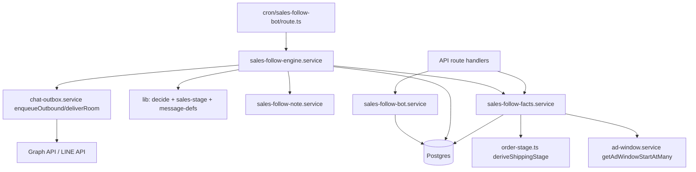
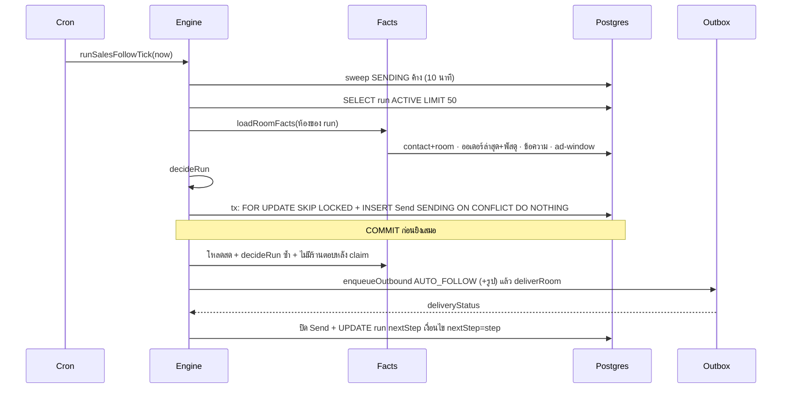
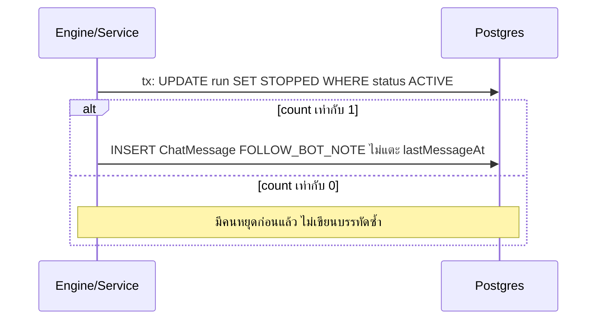
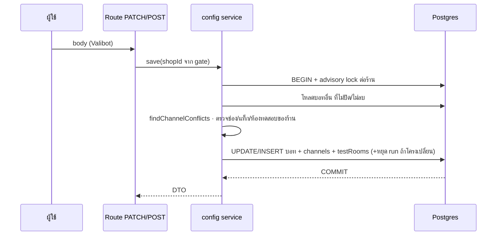

> **โมดูล:** 00095 — Sales Follow Bot
> **ประเภทเอกสาร:** System Design Spec (SDS)
> **เวอร์ชัน:** 0.1 (P1)
> **วันที่จัดทำ:** 2026-11-16
> **สถานะ:** Draft
> **เจ้าของเอกสาร:** SA (ดู [[Feature-Docs-Ownership]])

# SDS: บอทติดตามยอดขาย (Sales Follow Bot)

---

## 1. บทนำ & References

### 1.1 วัตถุประสงค์
ออกแบบการสร้างบอทติดตามยอดขายตาม [[SRS]] ให้ตรงสถาปัตยกรรมเดิม (Next.js 16 App Router · service layer `src/services/` · Prisma · NextAuth + service guard ไม่ใช่ RLS) โดย **ยกโครง 00078** และไม่เพิ่ม framework/ตัวคิวใหม่

### 1.2 ขอบเขตการออกแบบ
P1 เท่านั้น · ไฟล์ใหม่ใต้ `src/lib/sales-follow-bot/` และ `src/services/sales-follow-*.service.ts` · แก้จุดอ่านป้ายผู้ส่ง (SRS TFR-FB-18) · ไม่แตะ `chat-outbox` ยกเว้นข้อ 10 ของตาราง

### 1.3 เอกสารอ้างอิง
| เอกสาร | ความสัมพันธ์ |
|---|---|
| [[SRS]] | TFR/NFR ที่ SDS realize |
| 00078 SDS | ต้นแบบ ledger/claim/revalidate (`auto-notify.service.ts`) |
| [[REFERENCE-gochat-v3]] §3 | ต้นแบบ engine |

---

## 2. Architecture Overview

### 2.1 มุมมอง
ฟังก์ชัน **pure** (ตัดสินใจ) แยกจาก **service** (I/O) — เหมือน `eligibility.ts` ↔ `auto-notify.service.ts` ของ 00078 ทำให้เทสตาราง input/output ได้โดยไม่ต้องมี DB · I/O ทั้งหมดอ่านเป็นชุดต่อ tick (batch) ไม่ N+1

### 2.2 Deploy
cron `* * * * *` แยกอีกตัวใน `vercel.json` (ตัวที่ 20) · `maxDuration=60` · ไม่มี worker ถาวร · หลาย invocation ซ้อนกันได้ (กันด้วยแถวและ unique ไม่ใช่ lock ระดับ cron)

---

## 3. Component Design

| Component | หน้าที่เดียว | Dependency |
|---|---|---|
| `constants.ts` | ค่าคงที่/enum/ขีดจำกัด (ตรง CHECK) | — |
| `gate.ts` | `isSalesFollowBotEnabled(shopId)` อ่าน env | env `SALES_FOLLOW_BOT_SHOP_IDS` |
| `sales-stage.ts` | `deriveSalesStage` (TFR-FB-01/02) | `order-stage.ts`, `order-display.ts` |
| `message-defs.ts` | where/SQL ของ RealBuyerMsg · CountedShopReply | `auto-order-message-type.ts` |
| `decide.ts` | `decideRun` · `eligibleToAttach` · `dueAt` | `messaging-window.ts`, `meta-ai-holder.ts`, `shop-tag-match.ts` |
| `schemas.ts` · `conflicts.ts` | Valibot · `validateSteps` · `findChannelConflicts` (client+server) | `auto-notify/variables.ts` (`parseTemplate`) |
| `sales-follow-facts.service.ts` | โหลดข้อเท็จจริงเป็นชุด (≤4 query ต่อชุดห้อง) | Prisma · `ad-window.service` |
| `sales-follow-bot.service.ts` | CRUD บอท · สถานะ · ลบ · หยุดรายห้อง · ประวัติ · มุมมองแผงห้อง | Prisma · advisory lock |
| `sales-follow-engine.service.ts` | tick: sweep → evaluate/send → attach | facts · decide · outbox · note |
| `sales-follow-note.service.ts` | เขียน `FOLLOW_BOT_NOTE` (insert ตรง) | Prisma เท่านั้น (ห้าม import ตัวส่ง — แบบ `auto-order-internal-message.service.ts:1-20`) |
| `route-errors.ts` | แปลง Error ของ service → HTTP | `jsonNoStore` |
| `scripts/sales-follow-bot-preflight.ts` · `…-close-shop.ts` | dry-run นับ · ปิดบอททั้งร้าน | — |

---

## 4. Data Flow

### 4.1 Flow หลัก: tick ส่งหนึ่งขั้น

### 4.2 Flow หยุด

### 4.3 Flow ล้มเหลว/ชดเชย
- ยิงแล้วไม่รู้ผล: ไม่ยิงซ้ำ — sweeper ปิด `UNCERTAIN_SEND` แล้วเดินขั้นต่อ · ส่งล้ม/ข้าม: เดินขั้นต่อ ไม่ลองซ้ำ (Q-9) · ช่องทางหลุดชั่วคราว: HOLD ไม่ข้ามขั้น · tick ตายกลางทาง: แถว `SENDING` อยู่ จบด้วย sweeper (ไม่ซ้ำ เพราะ unique `(runId,step)`) · งบเวลาหมด: งานที่เหลือรอ tick หน้า

### 4.4 Flow บันทึกบอท (กันชน)

---

## 5. Integration Points
| จุดเชื่อม | ชนิด | Contract | ความเสี่ยงเมื่อล่ม |
|---|---|---|---|
| `enqueueOutbound` / `deliverRoom` | internal | `SendOutboundParams` (`autoReplyKind`,`systemShopId`,`text`,`attachment`) | แถว QUEUED/FAILED — ปิดผลด้วย sweeper |
| `getAdWindowStartAtMany` / `getWindowState` | internal | SRS TFR-FB-13 | ผิด = ส่งนอกกรอบ/หยุดก่อนเวลา |
| `decideMetaAiHolding` | internal | pure | ผิด = ส่งเข้าห้อง Meta AI (ล้มแบบไม่ลองซ้ำ `chat-send-failure.ts:190-215`) |
| `getLineQuotaByChannelId` | internal | cache 5 นาที อ่านไม่ได้ไม่บล็อก | โควตาเต็มเงียบ → ข้ามพร้อมเหตุผล |
| Graph / LINE | 3rd-party | ผ่าน outbox | — |
| `deriveShippingStage` | internal | pure | เปลี่ยนนิยามกอง = เปลี่ยนสถานะการขาย (เทส parity) |

- **Timeout/Retry/Idempotency:** ไม่มี retry อัตโนมัติ · ความ idempotent จาก unique `(runId,step)` + `sendLockedAt` ของ outbox · ไม่มี `client_msg_id`

---

## 6. Technical Decisions

### TD-FB-001 cron แยก ไม่เกาะ chat-outbox
เลือกแยก — chat-outbox เป็น "ตัวการันตีของทั้งฟีเจอร์แชท" (`cron/chat-outbox/route.ts:12-17`) ไม่ควรแบ่งงบเวลา 60 วิกับงานที่หนักกว่า · ตัด: เกาะต่อท้ายแบบ `sweepAutoNotify` (ประหยัด 1 cron แต่ผูกความเสี่ยง)

### TD-FB-002 เก็บ run/send เป็นตารางจริง สถานะการขายคำนวณ
ตัด: เก็บแท็กสถานะแบบ gochat (ต้องแขวน ≥8 จุดเขียน `Order.status`; convention `stored-flag-vs-owner-truth`) · ราคาที่จ่าย: ต้องโหลดออเดอร์ล่าสุด+พัสดุเป็นชุดทุก tick (อยู่ในงบ — วัดตาม TFR-FB-22)

### TD-FB-003 ตัดสินใน JS + บังคับด้วย DB constraint
tag any/all, สถานะ, กรอบ ตัดสินด้วยฟังก์ชัน pure เทสตารางได้ (เทียบ `tagNameKey` ตัวเดียวกับ UI) · ความถูกต้องหลักของ "ซ้ำ/ชน" อยู่ที่ unique/partial unique/CHECK · ตัด: แปลงทุกเงื่อนไขเป็น SQL ก้อนเดียวแบบ gochat (ซ้ำนิยาม TS↔SQL = HR16 รอเกิด; ต่างกับ Postgres `lower()` vs JS `toLowerCase`)

### TD-FB-004 หนึ่ง claim ต่อ (run,step) ด้วย INSERT … ON CONFLICT DO NOTHING
ต้นแบบ `insertLedgerRow` (`auto-notify.service.ts:85-102`) · ห้าม create+catch P2002

### TD-FB-005 ฟองบอทไม่เขียน `lastSenderRole`
เหตุ: AC-FB-100 + กันข้อความลูกค้าที่เข้ามาระหว่าง claim→enqueue ถูกซ่อนจากไม่ได้อ่าน (`chat.service.ts:502`) · `lastMessageAt/preview` เขียนตามปกติ (พรีวิวตรงความจริง)

### TD-FB-006 บรรทัดระบบเป็น `ChatMessage` type ภายในชนิดที่สาม
ตัดสินตาม precedent `META_NOTICE` (`auto-order-message-type.ts:13-16`) · ตัด: ตารางแยก (ต้องผสานกับ timeline ใหม่) · ตัด: ใช้ `META_NOTICE` ซ้ำ (ความหมายคือโน้ตของ Meta)

### TD-FB-007 ใช้ route handler ไม่ใช่ server action
ตาม 00078 (`api/shops/current/auto-notify/**`) และกลไกประกาศสิทธิ์ใน `route-capabilities.ts` ที่ผูกกับไฟล์ route · cursor/ผลลัพธ์ตรวจด้วย Valibot ที่ขอบ

### TD-FB-008 ความหน่วง kill switch ยอมรับพร้อมทางลัดสคริปต์
ดู SRS R-FB-2

---

## 7. Cross-file error mapping (บังคับ — memory `feedback_service_error_route_mapping`)

| Error ที่ service จะ throw (ไฟล์) | route handler ที่ต้อง catch | HTTP / code |
|---|---|---|
| `SalesFollowBotNotFoundError` (`sales-follow-bot.service.ts`) | ทุก route ใต้ `bots/[id]` · `follow-bot/stop` | 404 `NOT_FOUND` |
| `SalesFollowBotStaleError{currentUpdatedAt}` | `bots/[id]` PATCH · `status` PUT · DELETE | 409 `BOT_STALE` |
| `SalesFollowBotChannelConflictError{conflicts}` | `bots` POST · `bots/[id]` PATCH · `status` PUT | 409 `CHANNEL_CONFLICT` |
| `SalesFollowBotChannelNotFoundError` | `bots` POST · PATCH | 400 `CHANNEL_NOT_FOUND` |
| `SalesFollowBotTagNotFoundError{names}` | POST · PATCH | 400 `TAG_NOT_FOUND` |
| `SalesFollowBotTestRoomsError{code}` (`TEST_ROOMS_REQUIRED`/`TEST_ROOM_NOT_FOUND`/`TEST_ROOMS_TOO_MANY`) | PATCH · `status` PUT | 400 `TEST_ROOMS_REQUIRED` · 400 `TEST_ROOM_NOT_FOUND` |
| `SalesFollowBotNotAvailableError` (ร้านไม่เปิด/ไม่ใช่ ONLINE_SALES) | **ทุก route** (ตรวจที่ `requireSalesFollowShop()` ก่อนเรียก service) | 403 `FEATURE_NOT_ENABLED` / 409 `NOT_AVAILABLE_FOR_SHOP` |
| Valibot ไม่ผ่าน / `validateSteps` ได้ issue | ทุก route ที่มี body | 400 `VALIDATION_ERROR` + `issues[]` |
| error ไม่คาดคิด | ทุก route | 500 `INTERNAL_ERROR` (log `[tag]` ไม่ log body) |
| error ใน engine (ไม่ใช่ HTTP) | cron route | catch ทั้งหมดใน tick · route ตอบ 200 สรุป · เหตุผลล้มของการส่งเก็บเป็นรหัส CHECK ของ `SalesFollowSend.reason` ไม่ใช่ HTTP |

ศูนย์กลาง: `src/lib/sales-follow-bot/route-errors.ts::salesFollowErrorResponse(e, tag)` (แบบ `auto-notify/route-errors.ts:9-17`) · **เทสที่แดงเมื่อเพิ่ม Error class ใหม่แต่ไม่มี branch**: เทสไล่ `Object.values` ของ error registry เทียบกับ switch ใน route-errors

---

## 8. ลำดับการ build + งานแยกต่อหน่วย (Controller dispatch)

> backend ล้วน = theme source "N/A (no UI)" · UI ทุกชิ้นผ่าน `safepay-ux` ก่อน (HR8) และต้องมีบรรทัด `Base: theme/...` ใน commit (HR3) — ไฟล์ theme ที่ยังระบุไม่ได้เขียน "ต้อง Explore" ตามกติกา ไม่เดา

| # | target path | theme source | scope | atomic unit | หมายเหตุ/ขึ้นกับ |
|---|---|---|---|---|---|
| S-1 | `prisma/schema.prisma` + `prisma/migrations/20261117100000_00095_sales_follow_bot/migration.sql` | N/A (no UI) | 5 ตาราง · CHECK · unique บางส่วน · index (SRS §5.1) — **ส่ง `safepay-database` เขียน DATABASE.md + migration ก่อน** · เทส `sales-follow-bot-db-constraint.test.ts` (scoped id, HR13) | U1 | ไม่ขึ้นกับใคร |
| S-2 | `src/lib/sales-follow-bot/{constants,gate,sales-stage,message-defs,decide,schemas,conflicts,route-errors}.ts` + เทสตาราง | N/A (no UI) | ฟังก์ชัน pure ทั้งหมด (TFR-FB-01..05, 11, 12) | U2 | ไม่ขึ้นกับ S-1 (รู้แค่ชนิด) · tsc ผ่านได้เอง |
| S-5 | จุดอ่านป้าย (SRS TFR-FB-18 ข้อ 1,6-12,14): `src/lib/auto-reply-constants.ts` · `src/lib/auto-order-message-type.ts` · `src/lib/chat-desk/rules.ts` · `src/services/chat-desk.service.ts` · `src/services/auto-reply.service.ts` · `src/lib/preview-attribution.ts` · ตัวกรอง 9 จุดใน TFR-FB-18 ข้อ 11 · `chat-outbox.service.ts:168-180` | N/A (no UI) สำหรับฝั่ง service; `ThreadMessageList.tsx`/`InboxRow.tsx` = UI (ดู S-8) | เพิ่ม `AUTO_FOLLOW`/`FOLLOW_BOT_NOTE` + แก้ทุกจุด + เทสที่แดงเมื่อถอด | U5 | ขนานกับ S-1/S-2 ได้ (ไฟล์ไม่ชน) |
| S-3 | `src/services/sales-follow-facts.service.ts` · `sales-follow-bot.service.ts` · `sales-follow-note.service.ts` | N/A (no UI) | โหลด facts เป็นชุด · CRUD+สถานะ+ลบ+หยุดรายห้อง+ประวัติ+มุมมองแผง | U3 | หลัง S-1, S-2 |
| S-4 | `src/services/sales-follow-engine.service.ts` · `src/app/api/cron/sales-follow-bot/route.ts` · `vercel.json` | N/A (no UI) | sweep/evaluate/send/attach (TFR-FB-09..16) | U4 | หลัง S-3, S-5 และต้องรอตัวช่วยกรอบโฆษณา (§0.1) merge |
| S-6 | `src/app/api/shops/current/sales-follow-bot/{bots,bots/[id],bots/[id]/status,options,test-rooms,sends}/route.ts` · `src/app/api/chat/conversations/[id]/follow-bot/{route.ts,stop/route.ts}` · `src/lib/route-capabilities.ts` | N/A (no UI) | ตาม [[API]] + ประกาศสิทธิ์ (รายการ §9 ด้านล่าง) | U6 | หลัง S-3 (ขนานกับ S-4 ได้) |
| S-7 | `src/app/(paces)/seller/(dashboard)/settings/sales-follow-bot/{page.tsx,loading.tsx,components/*,[id]/page.tsx}` · `src/lib/seller-menu.ts` + `seller-menu.test.ts` | ต้อง Explore: ตารางแท็บ+ฟอร์มหลายขั้น+ตัวแก้ข้อความ ใต้ `theme/paces/Admin/TS/src/app/(admin)/` (ให้ safepay-ux/Explore ระบุไฟล์) · แบบพี่น้อง: `settings/auto-notify/components/{AutoNotifyClient,TemplateEditor,DailyCapField}.tsx` (มีอยู่) · ตัวแก้ข้อความ/ชิปตัวแปร ใช้ `src/lib/auto-notify/editor-*.ts` เป็นฐานถ้า ux เห็นชอบ | จอรายการ+ประวัติ+ฟอร์ม+ตัวอย่างในแชท (TFR-FB-19) · select ห้าม native → Select2 · toast `pacesToast` · modal Swal | U7 | หลัง S-6 · ux gate + mockup 3 จอ |
| S-8 | `src/app/(paces)/seller/(chat)/inbox/[conversationId]/components/{CustomerPanel,ThreadChipStrip,ThreadMessageList}.tsx` + ไฟล์ใหม่ `FollowBotSection.tsx` · `src/app/(paces)/seller/(chat)/inbox/components/{InboxRow,InboxList}.tsx` | ต้อง Explore: แบบแถวใน `CustomerCrmSection.tsx`/`FollowUpPanel.tsx` (พี่น้องตำแหน่งเดียวกัน — convention `sibling-surface-parity`) + theme ชิป/รายการขั้น | แผงในห้อง · ชิป "บอทติดตามอยู่" · แท็กบับเบิล · บรรทัดระบบ · คำนำหน้าพรีวิว | U8 | หลัง S-5, S-6 · ux gate |
| S-9 | `scripts/sales-follow-bot-preflight.ts` · `scripts/sales-follow-bot-close-shop.ts` · เทสรวม (แข่งกัน 2 tick · ข้ามร้าน · HUMAN_AGENT grep · reaction/pb:/โฆษณาไม่ใช่ตอบ) | N/A (no UI) | TFR-FB-22/23 | U9 | หลัง S-4 |
| S-10 | `docs/SRS.md` (ตาม SYSTEM-SRS-SYNC) · retro ท้ายรอบ | N/A | HR11 | U10 | ท้ายสุด |

**Batch (≤3 ขนาน ไฟล์ไม่ชน):** B1 = S-1 ∥ S-2 ∥ S-5 → B2 = S-3 → B3 = S-4 ∥ S-6 → B4 = S-7 ∥ S-8 ∥ S-9 → S-10
**bundle:** แต่ละ U คือหน่วย commit เดียว (tsc ต้องผ่านเมื่อครบหน่วย) · S-5 ต้อง commit ครบทั้งชุดจึง tsc ผ่านเพราะ type `AutoReplyKind`/`StoredMessageType` ขยาย

### 9. รายการประกาศ `route-capabilities.ts` (AC-FB-92)
| ไฟล์ | ค่า |
|---|---|
| `src/app/(paces)/seller/(dashboard)/settings/sales-follow-bot/page.tsx` และ `[id]/page.tsx` | `{ page: 'H2', status: 'DECLARED' }` |
| `…/api/shops/current/sales-follow-bot/bots/route.ts` | `{ GET: 'H2', POST: 'H2' }` |
| `…/bots/[id]/route.ts` | `{ GET: 'H2', PATCH: 'H2', DELETE: 'H2' }` |
| `…/bots/[id]/status/route.ts` | `{ PUT: 'H2' }` |
| `…/options/route.ts` · `…/test-rooms/route.ts` · `…/sends/route.ts` | `{ GET: 'H2' }` |
| `src/app/api/chat/conversations/[id]/follow-bot/route.ts` | `{ GET: 'H1' }` |
| `src/app/api/chat/conversations/[id]/follow-bot/stop/route.ts` | `{ POST: 'H2' }` |
| `src/app/api/cron/sales-follow-bot/route.ts` | ครอบด้วย prefix `CRON` อยู่แล้ว (`route-capabilities.ts:50`) |

---

## 10. Auth / Permission / Database / Error / Risks (สรุปตามหมวกสถาปนิก)

- **Auth:** NextAuth session → `requireShopCapability(session,'H2'|'H1')` → `gate.shopId/userId` · ไม่มี RLS ⇒ ทุก query `where: { shopId }` เป็นเงื่อนไขแรก · เทสข้ามร้านต่อ endpoint · พารามิเตอร์สิทธิ์ไม่มี default เปิด
- **Database impact:** มี migration (5 ตาราง) → **Controller dispatch `safepay-database` ก่อน S-3** · HR15: ก่อน push main แจ้ง user 3 ข้อ (prod ไม่ต้องสั่ง · local ต้อง apply เอง · migrate ล้ม = deploy ไม่ขึ้น) · ห้ามเพิ่ม index บน `ChatMessage`/`Order`/`Conversation` ก่อนวัด
- **Error handling:** ตาราง §7 · engine ไม่ throw · ยิงหลัง COMMIT · "ส่งไม่ถึงดีกว่าส่งสองรอบ"
- **Risks:** ดู SRS §8 (R-FB-1..9) — สำคัญสุด R-FB-3 (ออเดอร์นอกห้อง) และ R-FB-1 (จุดอ่านป้าย)

---

## 11. Traceability
| SRS | SDS |
|---|---|
| TFR-FB-01..03 | `sales-stage.ts` · `message-defs.ts` · TD-FB-002/003 |
| TFR-FB-04..07 | `schemas.ts` · `conflicts.ts` · `sales-follow-bot.service.ts` · flow 4.4 |
| TFR-FB-08 | `gate.ts` · TD-FB-008 |
| TFR-FB-09..16 | `sales-follow-engine.service.ts` · flow 4.1/4.3 · TD-FB-001/004 |
| TFR-FB-17 | `sales-follow-note.service.ts` · TD-FB-006 · flow 4.2 |
| TFR-FB-18 | S-5 · TD-FB-005 |
| TFR-FB-19..21 | S-6/S-7/S-8 · §7 · §9 |
| TFR-FB-22..23 | S-9 |

---

## 12. สรุป

ลำดับ build แนะนำ: S-1 ∥ S-2 ∥ S-5 → S-3 → S-4 ∥ S-6 → S-7 ∥ S-8 ∥ S-9 → S-10

**Open Questions:** OD-FB-1..7 ใน [[SRS]] §10 · ต้อง Explore ก่อนเขียน: (ก) `requireOnlineSalesVertical` ผลที่คืน (ข) จำแนกข้อความล้ม "แอปอื่นคุมห้อง" ใน `chat-send-failure.ts` (ค) helper ตรวจไฟล์รูปใน storage (ง) กติกาเติมคีย์พจนานุกรม 00047 (จ) มีแนวคิด "ห้องล็อกให้คนอื่น" ใน Deep หรือไม่ (AC-FB-89) (ฉ) theme source ของ UI ใน S-7/S-8

## ภาคผนวก — TD-FB-009/010 (ส่วนต่อขยาย 2026-11-16)

- **TD-FB-009 action ท้ายสุด:** SQL กรองหยาบ (partial index `SalesFollowRun_final_pending_idx`) → `decideFinalAction` (pure, ตรวจซ้ำ BR-FA-3) → claim ด้วย `UPDATE … SET finalActionAt WHERE finalActionAt IS NULL` ก่อนลงมือ (ล้มกลางทาง = `finalActionTaken` ว่าง) → `updateConversationState` → note · SKIP ก็ปิดแถว (finalActionAt ตั้ง) กันหยิบซ้ำ · บอท NONE = WAIT ไม่ปิดแถว
- **TD-FB-010 ดึงสิทธิ์คืน:** หลัง deliverRoom ถ้าฟองล้ม "another app is controlling" → `mayReclaim` → `claimThreadControl` → `afterClaim` (RESEND/RETRY_LATER/SKIP) · backoff 5 นาทีหลังฟองล้มกันล้มทุก tick · ฟองเดิมล้มแน่นอน จึงส่งซ้ำไม่ซ้อน

- **TD-FB-011 ส่งห้องต่อเมื่อลูกค้าตอบ (FR-FA-7):** ตัดสินด้วย `decideReplyHandoff` (pure, `thread-control.ts`) · ลงมือใน `handoffAfterCustomerReply` (engine) หลัง `stopRunWithNote` คืนแถวด้วยเหตุ `CUSTOMER_REPLIED` · เลือกทำใน cron tick แทน webhook เพื่อไม่ผูกเวลา/ความล้มเหลวของ Graph กับ webhook ขาเข้า · ล้ม = log + บรรทัดระบบแบบล้มเหลว ไม่โยน

## ต่อขยาย FR-FA-8 — ตัวประเมินเงื่อนไข (2026-11-17)
- `src/lib/sales-follow-bot/conditions.ts` (pure · client ใช้ได้ ห้าม import `shop-tag-match` เพราะลาก `node:crypto`): `evaluateConditions(rules, match, {stageKey, contactTags, shopTagKeys}) → {ok, blamedTag?}` · `hasLimitingCondition` · `possibleStages` (ใช้ใน `conflicts.ts`) · `tagKeysOfRules`
- `decide.ts`: `DecideBot.{conditionMatch, rules}` แทน `salesStatuses/tagKeys/tagMatch` · `Decision.STOP.tagName?` ส่งชื่อแท็กไป `stopRunWithNote` → `buildStopNoteBody` · `AttachRejection` = `CONDITION_UNMATCHED` | `NO_CONDITION` แทน `STAGE_NOT_MATCH`/`TAG_NOT_MATCH`
- Service: `resolveRules` แปลงชื่อแท็ก→nameKey (ไม่มีในร้าน = TagNotFound) · `BotDto.rules` ส่งแท็กเป็น `{key,name,missing}` · `assertNoConflicts` ส่ง `conditionMatch+rules` เข้า `findChannelConflicts`
- UI: `WhoSection.tsx` = ตัวสร้างกฎ (SfbSelect/Select2) · `ruleSentence`/`neverMatches` ใน `ui.ts` ใช้ทั้งฟอร์มและรายการ · `EndSection.tsx` = เงื่อนไขการหยุดติดตาม
