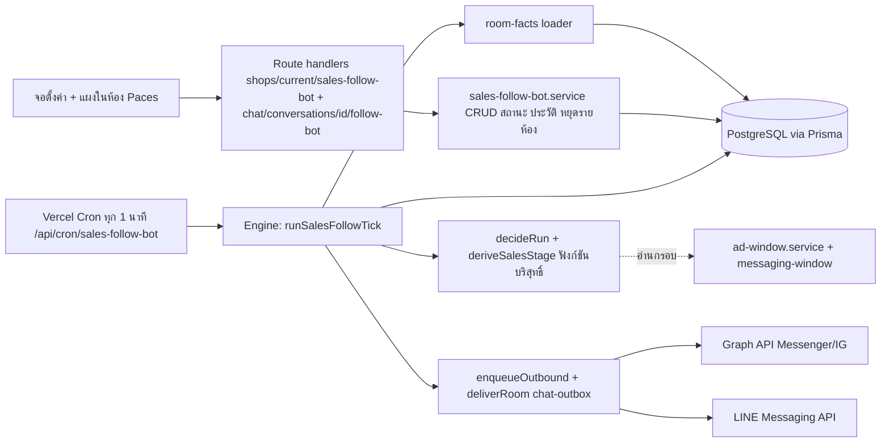
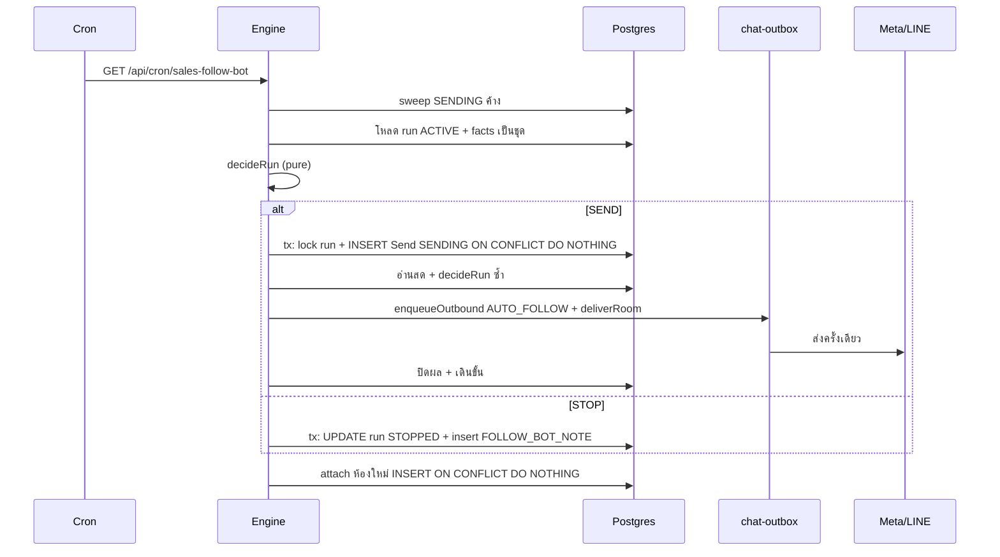
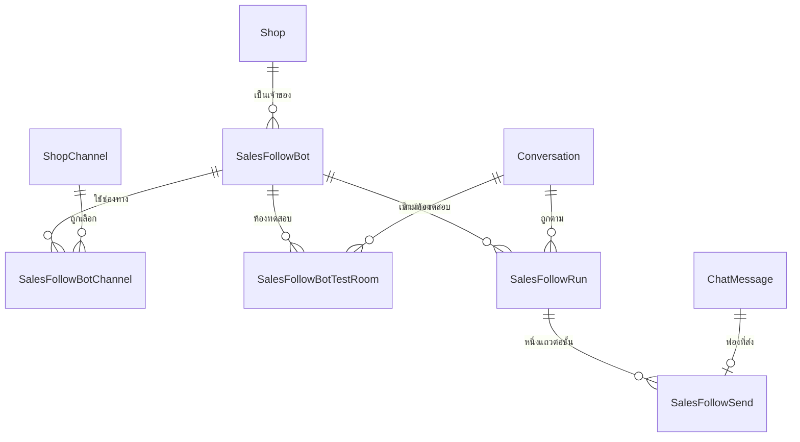

> **โมดูล:** 00095 — Sales Follow Bot (บอทติดตามยอดขาย)
> **ประเภทเอกสาร:** Software Requirements Specification (SRS) - TECHNICAL
> **เวอร์ชัน:** 0.1 (ขอบเขต P1 เท่านั้น)
> **วันที่จัดทำ:** 2026-11-16
> **สถานะ:** Draft — รอ Controller เขียนไฟล์ + user review
> **เจ้าของเอกสาร:** SA (ดู [[Feature-Docs-Ownership]])

# SRS: บอทติดตามยอดขาย (Sales Follow Bot)

> รหัส: `TFR-FB-nn` ข้อกำหนดเชิงเทคนิค · `NFR-FB-nn` · `R-FB-n` ความเสี่ยง · `OD-FB-n` ข้อที่ต้องให้ผู้ตัดสิน · `FR/BR/AC-FB-nn` อ้างกลับ [[BRD]] (รวมมติ §0 ของ BRD: Q-2 กรอบโฆษณา 7 วัน · Q-11 ทุกคนที่ตอบแชทได้แก้บอทได้)
> ทุก `path:line` เปิดอ่านจาก worktree `safepay-00095` เมื่อ 2026-11-16 · ส่วนที่ยังไม่ได้ตรวจเขียนว่า "ต้อง Explore" ไม่เดา

---

## 1. บทนำ

### 1.1 วัตถุประสงค์
กำหนดข้อกำหนดเชิงเทคนิคของบอทที่ตามลูกค้าที่เงียบเป็นขั้นตามเวลา สำหรับ DEV/QA/DB agent: โมเดลข้อมูล (ระดับ logical) · นิยามสถานะการขาย/ลูกค้าตอบ/ร้านตอบ/ร้านค้างตอบเป็น query จริง · เครื่องยนต์ (engine) · ด่านก่อนส่ง · ค่าป้ายผู้ส่งใหม่และจุดที่ต้องรู้จัก · สิทธิ์ · rollout

### 1.2 ขอบเขตเชิงระบบ
- **ใน P1:** บอทตามเงื่อนไข · ขั้นข้อความ/ข้อความ+รูป · ตัวแปร `{ชื่อ}` · สถานะการขาย (คำนวณ) · แท็กร้าน any/all · ช่องทาง Messenger/IG/LINE · สถานะ ปิด/ทดสอบ/เปิดใช้ · หยุดครบทุกเหตุ · ด่านก่อนส่ง · ประวัติ · แผงในห้อง+ป้ายหัวห้อง · capability · ร้านนำร่อง
- **นอก P1 (ส่วนขยายภายหลัง):** P2 การ์ดสินค้า/ข้อความที่ใช้บ่อย/ปุ่ม/บอทเฉพาะกลุ่ม/ป้ายกระพริบในรายการ/รายงาน — P3 ส่งเกินกรอบ (Utility template) · ค่า enum ใน SRS นี้ออกแบบให้ขยายแบบเพิ่มค่าอย่างเดียว (BR-FB-81)
- **ไม่ทำ:** ห้อง `channel='DEEP'` · Marketplace · เปลี่ยนสถานะการขายด้วยมือ · HUMAN_AGENT/message tag

### 1.3 เอกสารอ้างอิง
| เอกสาร | ความสัมพันธ์ |
|---|---|
| [[PRD]] · [[BRD]] (§0 มติ 2026-11-16) | ที่มาของ FR/BR/AC |
| [[REFERENCE-gochat-v3]] · [[MAPPING-safepay]] | ต้นแบบ engine + ของเทียบฝั่งเรา |
| 00078 SRS/SDS (`docs/20 - Features/00078 - Chat Customer Signals & Auto Notify/`) | ฐานโครง ledger/claim/revalidate/outbox |
| บั๊กกรอบโฆษณา (BRD §0.1) | ตัวช่วยกรอบ: `getWindowState(lastInboundAt, now, adWindowStartAt)` `src/lib/messaging-window.ts:27` · `getAdWindowStartAt/Many` `src/services/ad-window.service.ts:18,63` — **dev อีกตัวกำลังเขียน SRS นี้ใช้ ห้ามออกแบบตัวคำนวณกรอบซ้ำ** |

### 1.4 นิยาม
| คำ | ความหมายเชิงเทคนิค |
|---|---|
| **run** | แถว `SalesFollowRun` — บอท 1 ตัวตามห้อง 1 ห้อง |
| **ตราประทับ (stageStamp)** | เวลาเหตุการณ์ที่ทำให้ห้องเข้าสถานะการขายปัจจุบัน ปัดเป็นมิลลิวินาที (TFR-FB-02) |
| **ข้อความจริงของลูกค้า** | `RealBuyerMsg` (TFR-FB-03) |
| **ร้านตอบที่นับ** | `CountedShopReply` (TFR-FB-03) |
| **ร้านค้างตอบ** | ข้อความจริงล่าสุดของห้อง (จาก RealBuyerMsg ∪ CountedShopReply) เป็นของลูกค้า |
| **AUTO_FOLLOW** | ค่า `ChatMessage.autoReplyKind` ใหม่ = ฟองของบอทติดตาม |
| **FOLLOW_BOT_NOTE** | ค่า `ChatMessage.type` ใหม่ = บรรทัดระบบภายในห้อง (ประเภท internal เหมือน `META_NOTICE`) |
| **HOLD / WAIT / STOP / SEND** | ผลของ `decideRun()` (TFR-FB-11) |

---

## 2. ภาพรวมสถาปัตยกรรม

### 2.1 บริบทระบบ

### 2.2 องค์ประกอบ
| Component | หน้าที่ | ที่อยู่ (ไฟล์ใหม่ ยกเว้นระบุ) |
|---|---|---|
| constants | ค่าคงที่/enum (ตรง DB CHECK) | `src/lib/sales-follow-bot/constants.ts` |
| gate | ร้านนำร่อง fail-closed | `src/lib/sales-follow-bot/gate.ts` |
| sales-stage | คำนวณสถานะการขาย + ตราประทับ (pure) | `src/lib/sales-follow-bot/sales-stage.ts` |
| decide | ตัดสิน STOP/HOLD/WAIT/SEND ตามลำดับ BR-FB-40 (pure) | `src/lib/sales-follow-bot/decide.ts` |
| schemas | Valibot + validateSteps + findChannelConflicts (ใช้ทั้ง client/server) | `src/lib/sales-follow-bot/schemas.ts`, `conflicts.ts` |
| messages | นิยาม query ข้อความจริง/ร้านตอบ (Prisma where + SQL) | `src/lib/sales-follow-bot/message-defs.ts` |
| room-facts | โหลดข้อเท็จจริงของห้องเป็นชุด | `src/services/sales-follow-facts.service.ts` |
| config service | CRUD บอท · สถานะ · ลบ · หยุดรายห้อง · ประวัติ | `src/services/sales-follow-bot.service.ts` |
| engine | tick: sweep → evaluate/send → attach | `src/services/sales-follow-engine.service.ts` |
| cron | `GET` + `CRON_SECRET` | `src/app/api/cron/sales-follow-bot/route.ts` |
| stop line | เขียนบรรทัดระบบ (insert ตรง ไม่ผ่านตัวส่ง) | `src/services/sales-follow-note.service.ts` |

### 2.3 Deploy
cron แยกจาก `chat-outbox` (ไม่เกาะ) เพื่อไม่เสี่ยงตัวการันตีของคิวขาออก (`src/app/api/cron/chat-outbox/route.ts:12-17`) · `maxDuration = 60` · งบเวลา tick 40 วิ · ไม่มี lock ระดับ cron (กันซ้ำด้วย claim ระดับแถวเหมือน 00078/outbox) · เพิ่มบรรทัดใน `vercel.json:12-32`

---

## 3. ข้อกำหนดเชิงฟังก์ชันเชิงเทคนิค (TFR)

### TFR-FB-01 คำนวณสถานะการขาย (HR16 ปักนิยามจากโค้ดจริง)
- **Trace:** FR-FB-10, 12 · BR-FB-10..12, 16, 17 · AC-FB-25..29, 34, 35
- **ฟังก์ชัน:** `deriveSalesStage(facts): { key: SalesStageKey; stamp: Date | null } | null` (pure) — `null` = ค่าไม่รู้จัก (BR-FB-17)
- **SalesStageKey (7):** `NOT_BOUGHT` ยังไม่ซื้อ · `BILLED` เปิดบิล · `ORDER_CONFIRMED` ยืนยันแล้ว · `SHIPPED` ส่งแล้ว · `COMPLETED` สำเร็จ · `PARCEL_PROBLEM` พัสดุมีปัญหา · `CANCELLED` ยกเลิก
  - **สำคัญ:** ห้ามตั้งชื่อ `CONFIRMED` — ชนกับ `Order.status='CONFIRMED'` ที่แปลว่า "ผู้ซื้อยืนยันรับ/ปิดงาน" (`src/lib/order-stage.ts:644-649`, MAPPING §6) · key นี้ไม่ใช่ค่า `Order.status`
- **ออเดอร์อ้างอิง E** = ออเดอร์ของห้อง `Order.conversationId = room.id AND shopId = room.shopId AND status <> 'DRAFTED' AND isDryRun = false` เรียง `createdAt DESC, id DESC` เอาใบแรก (ตรงกับตัวโหลดป้ายแชท `src/services/order-stage.service.ts:121-` ที่ใช้ "ออเดอร์ล่าสุด"; `Order.createdAt` ถูกเขียนทับเมื่อร้านเลื่อนวันที่ย้อนหลัง `order.service.ts:1507` — ข้อจำกัดที่รู้แล้ว R-FB-6)
- **ตารางแปลง (เรียงตามลำดับ — ข้อแรกที่ตรงชนะ):**

| # | เงื่อนไขบน E | ผล | ที่มา/หลักฐาน |
|---|---|---|---|
| 0 | ไม่มี E | `NOT_BOUGHT` (ตราประทับ TFR-FB-02 ข้อ ก) | BR-FB-11 · ร่าง=`status='DRAFTED'` `order-stage.ts:270` · ทดสอบ=`isDryRun` `schema.prisma:1050` |
| 1 | `E.status = 'CANCELLED'` | `CANCELLED` | `order-display.ts:299-305` |
| 2 | `E.status = 'RETURNED'` · หรือ `parcelClose = 'LOST_ON_RETURN'` · หรือ `deriveShippingStage(E) ∈ {PROBLEM, RETURNED, DELIVERY_FAILED}` | `PARCEL_PROBLEM` | SSOT `deriveShippingStage` `order-stage.ts:255` (ห้ามเขียนรายชื่อ carrierStatus ซ้ำ) · ตรงนิยามไม่นับของ `countsAsCustomerOrder` `customer-behavior.ts:112-116` (AC-FB-28) |
| 3 | `E.status = 'CONFIRMED'` | `COMPLETED` | CONFIRMED = ผู้ซื้อ/ระบบปิดงาน |
| 4 | `deriveShippingStage(E) ∈ {DONE, AWAITING_COD}` | `COMPLETED` | ส่งถึง = สำเร็จ (มติ gochat 17 ต.ค.) · AWAITING_COD = ของถึงแล้วรอเงินปลายทาง |
| 5 | stage = `NOT_SHIPPING` (นัดรับ/ดิจิทัล/หน้าร้าน) และ `E.handedOverAt ≠ null` | `COMPLETED` | `schema.prisma:959` |
| 6 | stage = `SHIPPING` (iShip/Flash/ส่งเองกด "จัดส่งแล้ว") | `SHIPPED` | `order-stage.ts:331` |
| 7 | ที่เหลือ (AWAITING_PARCEL · AWAITING_DISPATCH · AWAITING_PICKUP · NOT_SHIPPING ที่ยังไม่มอบ) และ **ชำระ/ยืนยันแล้ว** = `isCODPayment(E.paymentMethod)` หรือ `E.paymentConfirmedAt ≠ null` หรือ `E.codReceivedAt ≠ null` | `ORDER_CONFIRMED` | HR16: "ชำระแล้วยังไม่ส่ง" — `isCODPayment` `order-display.ts:44` · `paymentConfirmedAt` `schema.prisma:972` เขียนโดย `setPaymentConfirmed` `order.service.ts:2484` · `codReceivedAt` `schema.prisma:946` |
| 8 | ที่เหลือ | `BILLED` | |
| — | `E.status` ไม่อยู่ใน {PENDING, SHIPPED, CONFIRMED, CANCELLED, RETURNED} | คืน `null` | BR-FB-17 |

- **ผู้เรียกเมื่อได้ `null`:** ตัวแนบ = ไม่แนบห้อง · run ที่ตามอยู่ = ไม่ตัดสิน STAGE_CHANGED รอบนี้ + `console.warn` ครั้งเดียวต่อ (orderId,status) — ไม่ย้ายสถานะ ไม่เดาเป็น NOT_BOUGHT
- **ข้อตีความที่ต้องให้ผู้ตัดสิน (OD-FB-1):** ใบ **เก็บเงินปลายทาง (COD)** ถูกนับ `ORDER_CONFIRMED` ตั้งแต่เปิดบิล (ลูกค้าผูกมัดแล้ว ไม่มีอะไรให้ "ตามเงิน" ก่อนส่ง) · ถ้าให้เป็น `BILLED` จนส่ง บอท "เปิดบิล" จะทักลูกค้า COD ที่สั่งแล้ว (ขัดหลัก "ไม่ส่งหาคนที่ไม่ควรส่ง") · สลิปที่แนบ (`Order.slipFileId`) **ไม่นับ** เป็นยืนยัน (ไม่มีเวลาให้ประทับ และลูกค้าส่งสลิปทางแชท = ข้อความจริง → บอทหยุดด้วย CUSTOMER_REPLIED อยู่แล้ว)
- **Edge:** ออเดอร์ที่สร้างนอกห้อง (`conversationId = NULL` — `schema.prisma:1001-1018` ไม่ backfill) **ไม่มีผล** ต่อห้อง (A-4 ของ BRD) → ดู R-FB-3
- **เทสบังคับ:** ตาราง input→output ครอบทุกค่า `ShippingStageKey` (`order-stage.ts:108-165`) + ทุก `Order.status` + เทส mutation สลับลำดับกฎ 2/3/4 + เทสที่แดงเมื่อมีค่า stage ใหม่ใน `ShippingStageKey` ที่ตารางไม่ครอบ (ใช้ `Record<ShippingStageKey, …>` ให้ tsc บังคับ)

### TFR-FB-02 ตราประทับสถานะ + จบรอบ (BR-FB-13/14)
- **Trace:** FR-FB-11 · BR-FB-13, 14 · AC-FB-30..33
- **ค่าพักก่อนนับเป็นรอบใหม่:** `COMPLETED` 7 วัน · `SHIPPED` 14 วัน · `CANCELLED` 0 วัน · สถานะอื่น **ไม่จบรอบเอง** (`HOLD_MS` ใน constants; เทียบแบบ **เกินจริง** `>` ไม่ใช่ `>=`)
- **ตราประทับต่อสถานะ (ปัดเป็นมิลลิวินาที, ห้ามอนาคต: ค่า `> now` ถูกตัดทิ้งจากผู้สมัคร):**

| สถานะ | stamp = | แหล่ง |
|---|---|---|
| BILLED | `ORDER_CREATED.occurredAt` ของ E (ไม่มี → `E.createdAt`) | `OrderEvent.occurredAt` `schema.prisma:4349` |
| ORDER_CONFIRMED (โอน/เงินสด) | `E.paymentConfirmedAt` | `schema.prisma:972` |
| ORDER_CONFIRMED (COD) | เหมือน BILLED | |
| SHIPPED | `max(occurredAt ของ MANUAL_DISPATCHED, SHIPMENT_CREATED, SHIPMENT_LINKED, TRACKING_ADDED)` | ไม่มีคอลัมน์ "เวลารับพัสดุครั้งแรก" ที่คงที่ — `carrierStatusAt` ถูกเขียนทับทุกสถานะ (`schema.prisma:2821`, คอมเมนต์ `:2827-2831`) ⇒ ใช้ event เป็นตัวแทน (ข้อจำกัด R-FB-6) |
| COMPLETED | `min(OrderShipment.deliveredAt, occurredAt ของ SELLER_DELIVERED, BUYER_CONFIRMED, SYSTEM_CONFIRMED, COD_SETTLED, HANDED_OVER)` ที่มีค่า | `deliveredAt` เขียนครั้งเดียว `schema.prisma:2832` · ชนิด event `order-event.ts:12-70` |
| PARCEL_PROBLEM | `min(OrderShipment.problemAt, occurredAt ของ RETURN_RECEIVED/PARCEL_PROBLEM_CLOSED)` | `problemAt` ประทับครั้งเดียว `schema.prisma:2847` |
| CANCELLED | `occurredAt` ของ `ORDER_CANCELLED` | |
| NOT_BOUGHT | ดูข้อ ก | |

  ไม่พบผู้สมัครสักค่า → stamp = `null` ⇒ **รอบไม่จบเอง** (ปลอดภัยไว้ก่อน) + นับ anomaly ใน log (ใช้ตรวจ dry-run ก่อนขึ้น prod BR-FB-82)
- **ข ) จบรอบ:** ถ้า stage ∈ {COMPLETED, SHIPPED, CANCELLED} และมี `RealBuyerMsg` ที่ `createdAt > stamp + HOLD` → ผลเป็น `NOT_BOUGHT` ตราประทับ = `createdAt` ของ RealBuyerMsg **แรก** ที่ `> stamp + HOLD` (ออเดอร์ใหม่ย้ายสถานะได้ทันทีโดยไม่ผ่านกติกานี้ — เพราะ E เปลี่ยนเอง)
- **ก ) NOT_BOUGHT:** ตราประทับ = `createdAt` ของ RealBuyerMsg **แรก** ของรอบ (ไม่มี E → แรกสุดของห้อง; มี E ที่จบรอบ → แรกหลัง `stamp + HOLD`) · ไม่มี RealBuyerMsg เลย → `deriveSalesStage` คืน NOT_BOUGHT ด้วย `stamp = null` และห้องนั้นแนบไม่ได้
- **เทียบเวลา:** ทุกการเทียบ stamp/ข้อความเทียบฝั่ง JS บนค่ามิลลิวินาทีที่ได้จากสูตรเดียวกันทั้งตอนแนบและตอนตรวจ (คอลัมน์ฝั่งเราเป็น `timestamp(3)`) · ห้ามเทียบ `Date` กับ `now()` ของ Postgres ระดับไมโครวินาที (บทเรียน gochat #5)
- **ผลกระทบต่อพฤติกรรม (OD-FB-3):** ห้องที่ไม่เคยมีออเดอร์ ตราประทับ NOT_BOUGHT คงที่ตลอดรอบ ⇒ บอทที่เลือก "ยังไม่ซื้อ" แนบ **ครั้งเดียวต่อห้องต่อรอบ** (ตามต้นแบบ gochat `follow_bot_runs_once` — REFERENCE §4.4) ลูกค้าถามใหม่ในรอบเดิมหลังบอทจบแล้วไม่ถูกตามซ้ำ

### TFR-FB-03 นิยามข้อความ (HR16 — นิยามเดียว ใช้ทุกจุดของบอท)
นิยามเป็น `Prisma.ChatMessageWhereInput` + ฉบับ SQL เดียวใน `message-defs.ts` พร้อมเทส parity ทั้งสองรูป · ทุก query ต้องมีขอบ `createdAt >= now - 30 วัน` (AC-FB-47)

| ชื่อ | เงื่อนไข (คอลัมน์ `ChatMessage` — `schema.prisma:2257-`) |
|---|---|
| **RealBuyerMsg** (ลูกค้าตอบจริง) | `senderRole='BUYER' AND isDeleted=false AND type NOT IN INTERNAL_MESSAGE_TYPES AND (externalMessageId IS NULL OR externalMessageId NOT LIKE 'pb:%')` |
| **CountedShopReply** (ร้านตอบที่นับ) | `senderRole='SHOP' AND isDeleted=false AND type NOT IN INTERNAL_MESSAGE_TYPES AND autoReplyKind IS DISTINCT FROM 'AUTO_FOLLOW' AND deliveryStatus IS DISTINCT FROM 'FAILED'` |
| **ร้านตอบล่าสุด** | `max(createdAt)` ของ CountedShopReply ในห้อง (ไม่พบใน 30 วัน → ค่าสำรองตาม TFR-FB-12) |
| **ร้านค้างตอบ** | แถวล่าสุด (`createdAt DESC, seq DESC`) ของ RealBuyerMsg ∪ CountedShopReply มี `senderRole='BUYER'` |
| **ลูกค้าตอบ (หลังฟองบอท)** | มี RealBuyerMsg ที่ `(createdAt, seq) > (ฟองบอทล่าสุดที่ SENT ของ run)` · ก่อนส่งขั้นแรก = ไม่ใช่เหตุหยุด (BR-FB-42) |

เหตุผลของแต่ละข้อ (พิสูจน์จากโค้ด):
- `INTERNAL_MESSAGE_TYPES` = SSOT เดิม `src/lib/auto-order-message-type.ts:16` (การ์ด 00061 ใช้ `senderRole='SHOP'` `auto-order-internal-message.service.ts:56-64` — ถ้าไม่ตัดด้วย type จะถูกนับเป็นร้านตอบ) · บรรทัดระบบของบอทเพิ่มเป็นสมาชิกที่สาม (TFR-FB-17)
- reaction/คลิกโฆษณา **ไม่สร้าง ChatMessage** แต่ขยับ `lastInboundAt` (`channel-chat.service.ts:2603-2648`, `:2704-2725`) · Messenger/IG postback ไม่สร้างข้อความ (`:2741`) ⇒ นิยามจาก `ChatMessage` จึงไม่นับสามอย่างนี้ โดยไม่ต้องกรองเพิ่ม · **ห้ามใช้ `lastInboundAt` ตัดสินลูกค้าตอบ** (ใช้ได้เฉพาะกรอบส่ง ซึ่ง Meta นับ react/postback ด้วยจริง)
- **LINE postback สร้าง ChatMessage** (`externalMessageId = 'pb:<webhookEventId>'`, `src/app/api/channels/line/webhook/route.ts:169-187`) ⇒ ต้องตัดด้วย `NOT LIKE 'pb:%'` ตาม Q-15 (ผิดกับที่ MAPPING §3 เขียนซึ่งถูกเฉพาะ Meta) — OD-FB-6
- LINE follow/unfollow ไม่สร้างข้อความ (`webhook/route.ts:139`, เทส `route.test.ts:430`) ⇒ ไม่ปนเป็น "ตอบ" (A-9)
- CountedShopReply รวม echo จาก Business Suite/Meta AI (`autoReplyKind` null) และ `AUTO`/`AUTO_TEST`/`AUTO_NOTICE` (Q-7 ก) · ไม่รวม `FAILED` (บทเรียน #2) · `QUEUED` นับ (ชั่วคราว — ผลคือเลื่อนกำหนด ไม่ยิงเร็วขึ้น)
- index ที่รองรับ: `(conversationId, createdAt)` `schema.prisma:2447` · `(conversationId, senderRole, createdAt)` `:2466` · `(conversationId, autoReplyKind, createdAt)` `:2449` — **ไม่เพิ่ม index ใหม่บน ChatMessage ใน P1** (ตารางใหญ่สุด ยังไม่วัด) — ต้อง `EXPLAIN` บน prod แบบอ่านอย่างเดียวก่อนเปิดร้านที่ 2 (TFR-FB-22)

### TFR-FB-04 ฟอร์มบอท: ฟิลด์ + ตรวจ
- **Trace:** FR-FB-01, 03, 04 · BR-FB-24, 37 · AC-FB-01, 02, 10..18
- ฟิลด์: `name` (trim ไม่ว่าง ≤60 code point) · `status` · `salesStatuses` (⊆ 7 key, ว่างได้) · `tags` (ชื่อแท็ก → แปลงเป็น `tagKeys` ด้วย `tagNameKey` `src/lib/shop-tag-match.ts:24`, ≤20 ค่า — ตัวเลขนี้เป็นข้อเสนอของ SRS เพราะ BRD ไม่ระบุ) · `tagMatch` ANY|ALL · `channelIds` (1..50) · `steps` (1..10)
- ขั้น: `{ delayMin:int ≥1, kind:'TEXT'|'TEXT_IMAGE', text:string, imageFileId:string|null }` · ข้อความ trim ไม่ว่าง ≤1,000 code point (`countCodePoints` `src/lib/auto-notify/variables.ts:63`) · `TEXT_IMAGE` ต้องมี `imageFileId`
- ตัวแปร: อนุญาตเฉพาะ `{ชื่อ}` (ใช้ `parseTemplate` `variables.ts:73` + allow-list 1 ค่า; ตัวแปรอื่น → issue `UNKNOWN_VARIABLE` พร้อมชื่อ) · ลูกค้าไม่มีชื่อ → ตัดตัวแปรพร้อมช่องว่างซ้อน (AC-FB-13; ห้ามใช้ `customerDisplayName` ของ 00078 ที่คืน "ลูกค้า" `values.ts:46`) · ชื่อ = `ExternalContact.name`
- เวลา: `Σ delayMin ≤ 10,020` (6 วัน 23 ชม.) · ขั้นที่ผลรวมสะสม `> 1,380` (23 ชม.) ติดธง `adOnly` (**คำนวณ ไม่เก็บ**) เพื่อแสดงป้าย "ส่งเฉพาะลูกค้าที่ทักจากโฆษณา (Messenger/IG)" (AC-FB-16) · ขั้นแรกป้าย "หลังแอดมินตอบล่าสุด" ขั้นถัดไป "ถ้ายังไม่ตอบ รอต่ออีก" (UI)
- เงื่อนไขอย่างน้อยหนึ่งอย่าง: `salesStatuses` หรือ `tags` ไม่ว่างทั้งคู่ (AC-FB-02) → issue `NO_CONDITION`
- ช่องทาง: ต้องเป็น `ShopChannel.shopId = gate.shopId` และ `provider IN ('MESSENGER','INSTAGRAM','LINE')` — อื่นๆ ตอบ `CHANNEL_NOT_FOUND` เหมือนกันทุกกรณี (ไม่เปิดเผยว่ามีในร้านอื่น)
- ตัวเลข P1 ทั้งหมดอยู่ใน `constants.ts` ที่เดียว และตรง DB CHECK (เทส `sales-follow-bot-db-constraint.test.ts` แบบ `auto-notify-db-constraint.test.ts` ที่ 00078 ใช้) — ขยายเพดานขั้นในอนาคตต้องไล่ **ทุก** CHECK พร้อมกัน (บทเรียน #4): `SalesFollowBot.steps` · `SalesFollowRun.nextStep` · `SalesFollowSend.step`

### TFR-FB-05 ชน "1 ช่องทาง 1 บอทต่อสถานะ"
- **Trace:** FR-FB-05 · BR-FB-07 · AC-FB-19..22
- `findChannelConflicts(candidate, others): {channelId, botId, botName}[]` (pure, ใช้ทั้ง client และ server) — ชนเมื่อ `others` = บอทอื่นของร้านเดียวกันที่ `deletedAt IS NULL AND status <> 'CLOSED'` และ (ช่องทางร่วมกัน) และ (`salesStatuses` ซ้อนกัน **หรือ** ฝ่ายใดฝ่ายหนึ่งว่าง) · ยกเว้นบอทที่ **ไม่มีเงื่อนไขเหลือ** (AC-FB-22)
- ตรวจทุกครั้งที่ สร้าง/แก้/เปลี่ยนสถานะเป็นไม่ปิด ภายใน transaction เดียวกับ `pg_advisory_xact_lock(hashtextextended('sales-follow-bot:' || shopId, 0))` (แบบเดียวกับ `auto-notify.service.ts:170`) → บันทึกพร้อมกันสองตัวที่ชน = ตัวที่สองเจอตัวแรกแล้วถูกปฏิเสธ (AC-FB-21)
- พ่น `SalesFollowBotChannelConflictError{conflicts}` → route แปลงเป็น 409 `CHANNEL_CONFLICT` (SDS §7)

### TFR-FB-06 สถานะบอทและห้องทดสอบ
- **Trace:** FR-FB-02 · BR-FB-03 · AC-FB-04..09
- `status ∈ {CLOSED, TESTING, ACTIVE}` เก็บคอลัมน์เดียว (ไม่ใช้ `enabled+testing` แบบ gochat) · บอทใหม่ `CLOSED` เสมอ — `POST` สร้างไม่รับ `status` (AC-FB-04)
- `TESTING` ต้องมีห้องทดสอบ 1..20 (`SalesFollowBotTestRoom`) ที่ `Conversation.shopChannelId ∈ bot.channelIds` และ `shopId` ตรง · ตอนตั้งเป็น TESTING/ACTIVE ตรวจซ้ำ TFR-FB-05
- เปลี่ยนสถานะ → run ที่ตามอยู่ถูกประเมินรอบ tick ถัดไป: `CLOSED` → `BOT_DISABLED` · `TESTING` และห้อง ∉ ห้องทดสอบ → `OUT_OF_SCOPE` (ตามต้นแบบ gochat `engine.ts:243`; ข้อความ AC-FB-08 ใน BRD ใช้คำว่า "จากทดสอบเป็น…" ซึ่งกำกวม — SRS ตีความตามต้นแบบ)
- บอท ACTIVE ครั้งแรกไม่แนบห้องเก่า: BR-FB-06 บังคับใน TFR-FB-10 (ไม่ต้องมี `enabledAt`)

### TFR-FB-07 แก้/ลบ/แท็กหาย
- **Trace:** FR-FB-06, 32 · BR-FB-43, 44, 51 · AC-FB-23, 24, 77..79
- `structureRev` เพิ่มเมื่อ "โครง" ขั้นเปลี่ยน = จำนวนขั้น · `kind` รายขั้น · ลำดับ (เทียบ `steps.map(s => s.kind)`) · เปลี่ยน → ใน transaction เดียวกับการบันทึก `UPDATE SalesFollowRun SET status='STOPPED', stopReason='BOT_EDITED' WHERE botId AND status='ACTIVE'` + เขียนบรรทัดระบบ · engine เทียบ `run.structureRev <> bot.structureRev` เป็นด่านสำรอง
- แก้เฉพาะถ้อยคำ/รูป/`delayMin` = ไม่หยุด (due คิดใหม่ทุก tick อยู่แล้ว)
- ลบ = soft delete (`deletedAt`) + หยุดทุก run `BOT_DELETED` ในทรานแซกชันเดียว · ตอบ `activeRunCount` ล่วงหน้าให้ UI ยืนยัน (AC-24) · ประวัติ `SalesFollowSend` ยังอยู่ และ UI แสดง "บอทที่ถูกลบแล้ว" เมื่อ `bot.deletedAt ≠ null`
- **แท็กหาย:** แท็กของบอทเก็บเป็น `tagKeys`; "หาย" = key ไม่มีใน `ShopTag.nameKey` ของร้าน (ลบ/เปลี่ยนชื่อ/รวม) · ตัวเตือนคำนวณตอนอ่านรายการ (ไม่เก็บ) · **ALL ที่มีแท็กหาย = ไม่แนบห้องใหม่** (fail-closed — กันตายเงียบ บทเรียน #10) · ANY = แนบต่อด้วยแท็กที่เหลือ · run เดิมตัดสินจาก `ExternalContact.tags` ปัจจุบันเสมอ (BR-FB-50) — OD-FB-7

### TFR-FB-08 ด่านร้านนำร่อง (fail-closed ที่ตัวแนบ/ตัวส่ง)
- **Trace:** FR-FB-51 · BR-FB-01, 80, 83 · AC-FB-96..98, 83
- env `SALES_FOLLOW_BOT_SHOP_IDS` — รายการ `Shop.id` คั่น comma · ว่าง/ไม่ตั้ง = **ปิดทั้งระบบ** · ค่า `*` = เปิดทุกร้าน (ค่าเดียวที่เปิดทั้งหมด ต้องตั้งโดยเจตนา) · `isSalesFollowBotEnabled(shopId)` อ่าน `process.env` ทุกครั้งที่เรียก (ไม่ cache ระดับ module)
- ใช้ที่: (1) ตัวแนบ — เฉพาะร้านที่เปิด (2) ตัวส่ง — ตรวจซ้ำก่อนยิงทุกครั้ง (3) เมนู/หน้า/API ทุกตัว (4) engine ประเมิน run ของ **ทุกร้าน** แต่ร้านที่ถูกถอน = `sendAllowed=false` → ยังหยุดตามกรอบ/เหตุอื่นได้ (AC-FB-97) แต่ห้าม SEND
- ร้านต้องเป็น `Shop.vertical = 'ONLINE_SALES'` (Q-14 ก) — ใช้ `requireOnlineSalesVertical` `src/lib/shop-api-guard.ts:165` (ต้อง Explore: status/ข้อความที่คืน) และกรองที่ตัวแนบ
- **ความหน่วงของ kill switch (R-FB-2):** Vercel ใช้ค่า env ใหม่หลัง redeploy เท่านั้น ⇒ "ถอนร้านแล้วหยุดรอบถัดไป" (BR-FB-83) จริงเมื่อ redeploy · ทางเร็วกว่า: สคริปต์ `scripts/sales-follow-bot-close-shop.ts` (dry-run เป็นค่าตั้งต้น, `--apply` ต้องยืนยัน — BR-FB-84) ตั้งบอทของร้านเป็น CLOSED → tick ถัดไปหยุดทุก run (`BOT_DISABLED`)

### TFR-FB-09 Engine: tick
- **Trace:** FR-FB-20..24 · NFR-FB-01, 02
- `runSalesFollowTick(now, opts?: { shopIds?: string[]; budgetMs?: number })` — `opts.shopIds` ใช้ในเทสเท่านั้น (HR13)
- ลำดับ: **(0) sweep** แถว `SENDING` ค้าง (TFR-FB-16) → **(1) evaluate/send** run ที่ ACTIVE (หยุดมาก่อนแนบ เพื่อให้เหตุหยุดทำงานภายในรอบถัดไป) → **(2) attach** ห้องใหม่
- งบเวลา: `TICK_BUDGET_MS=40_000` (cron `maxDuration=60`) · เช็คงบก่อนเริ่มงานต่อห้องทุกครั้ง (ไม่ตัดกลางการยิง — แบบ `drainRoom` `chat-outbox.service.ts:578`) · เกินงบ = ออกลูปคืน `timedOut:true` งานที่เหลือรอ tick หน้า
- **ไม่ throw ออกลูป:** ห่อ try/catch ต่อ run และต่อห้องที่แนบ — พังที่ห้องหนึ่ง log `errTag` (ไม่ log ข้อความ Prisma) แล้วไปห้องถัดไป
- ชุดงาน evaluate: `SalesFollowRun WHERE status='ACTIVE'` เรียง `(nextDueAt <= now) DESC, updatedAt ASC` `LIMIT 50` แล้ว touch `updatedAt` ให้คิวหมุน (แบบ gochat `engine.ts:168-174`) · ร้านนำร่องไม่กี่ร้านพอ — ขยายเมื่อเปิดทุกร้านต้องวัดใหม่ (R-FB-5)
- ผลของ tick: `{ shops, evaluated, stopped, held, sent, skipped, failed, attached, timedOut }` ใส่ `console.log("[sales-follow-bot]", JSON.stringify(...))` ทุกรอบ แม้เป็นศูนย์ (แบบ chat-outbox)

### TFR-FB-10 แนบบอทให้ห้อง
- **Trace:** FR-FB-20 · BR-FB-05, 06, 08, 09 · AC-FB-36..41
- ต่อบอทที่ `deletedAt IS NULL AND status IN ('TESTING','ACTIVE')` ของร้านที่เปิดอยู่ · ผู้สมัคร (SQL — ไม่พึ่ง index ใหม่): `Conversation c` ที่
  - `c.shopId = bot.shopId AND c.channel IN ('MESSENGER','INSTAGRAM','LINE') AND c.shopChannelId IN (bot channels) AND c.externalContactId IS NOT NULL`
  - `c.isSpam = false AND c.isHidden = false` (BR-FB-38 — **ไม่ตัด `resolvedAt`**: A-6)
  - `c.lastInboundAt > now - (delayMin ของขั้นแรก)` (BR-FB-06: ตัวกรองหยาบ ใช้ index `(shopId,lastInboundAt)` `schema.prisma:2183`) · TESTING เพิ่ม `c.id IN (ห้องทดสอบ)`
  - `shopChannel.status = 'ACTIVE'`
  - `NOT EXISTS run ACTIVE ของห้อง` · `LIMIT 200 ORDER BY lastInboundAt DESC` ต่อบอทต่อ tick (`ATTACH_ROOM_LIMIT`)
- แล้วตรวจต่อในโค้ด (ฟังก์ชัน pure `eligibleToAttach`):
  1. มี RealBuyerMsg ที่ `createdAt > now - delay1` (ตัวจริงของ BR-FB-06 — `lastInboundAt` ขยับจาก reaction/โฆษณาจึงเป็นแค่ตัวกรองหยาบ)
  2. **กรอบส่งยังเปิด** ตาม BR-FB-23: `getWindowState(lastInboundAt, now, adWindowStartAt).open` โดย `adWindowStartAt` จาก `getAdWindowStartAtMany(rooms, now)` (ข้ามห้องที่ไม่ใช่ Meta เอง) — **ขยาย AC-FB-36 ข้อ "ภายใน 24 ชม." เป็น "กรอบส่งของห้องยังเปิด" ตามมติ Q-2** ห้ามเขียนตัวคำนวณกรอบเอง
  3. `ExternalContact.salesStatus <> 'NOT_INTERESTED'` · LINE: `isBlocked = false` · (กันห้องที่ `externalContactId` null = DEEP-like)
  4. สถานะ: `deriveSalesStage` ไม่ใช่ `null` · `bot.salesStatuses` ว่าง หรือมี stage นั้น
  5. แท็ก: ใช้ `ExternalContact.tags` ปัจจุบัน ปรับด้วย `tagNameKey` เทียบ `bot.tagKeys` (ANY/ALL) ตามกฎแท็กหาย TFR-FB-07 · บอทที่ไม่มีทั้งสถานะและแท็กที่ใช้ได้ = ไม่แนบ (A-7)
  6. บอท **ไม่เลือกสถานะ**: ถ้า run ล่าสุดของ (บอท,ห้อง) จบ (`finishedAt`) แล้ว ต้องมี RealBuyerMsg ที่ใหม่กว่า `finishedAt` จึงแนบได้ (BR-FB-09, กัน "สถานะเปลี่ยนแล้วหยิบใหม่ส่งหาคนที่เพิ่งจ่าย")
  7. stamp ไม่ `null`
- เขียน: `INSERT INTO "SalesFollowRun" … ON CONFLICT DO NOTHING` (ไม่ใช้ create+catch P2002 — ก่อ ERROR ใน log: convention `insert-then-catch-logs-every-error`) · กันซ้ำด้วย unique สองตัว: `(conversationId) WHERE status='ACTIVE'` (BR-FB-08, AC-FB-37) และ `(botId, conversationId, stageStamp)` (BR-FB-09, AC-FB-38) · บันทึก `stageKey`,`stageStamp`,`structureRev`,`nextStep=0`
- ห้องหนึ่งมีบอทหลายตัวเข้าเงื่อนไข (ข้ามช่องทางไม่ได้ เพราะ TFR-FB-05) — ถ้ายังมี ใช้ unique "หนึ่ง ACTIVE ต่อห้อง" เป็นผู้ตัดสิน (ตัวแรกที่ INSERT ชนะ)

### TFR-FB-11 `decideRun()` — ลำดับตัดสิน (BR-FB-40)
`decideRun(facts, now): { action: 'STOP', reason } | { action: 'DONE' } | { action: 'HOLD', reason } | { action: 'WAIT', dueAt: Date | null } | { action: 'SEND', step }` — pure, ไม่แตะ DB/เวลาจริง (รับ `now`) · เรียกซ้ำ**ตัวเดียวกัน**ทั้งตอนประเมินและตอนตรวจซ้ำก่อนยิง (กันนิยามสอง — HR16)

| ลำดับ | ตรวจ | ผล |
|---|---|---|
| 1 | stage ที่คำนวณ ≠ `run.stageKey` · หรือ stamp ≠ `run.stageStamp` · หรือ `bot.salesStatuses` ไม่ว่างและ stage ∉ รายการ (ข้ามเมื่อ `deriveSalesStage` คืน null) | STOP `STAGE_CHANGED` |
| 2 | บอทมีเงื่อนไขแท็กที่ใช้ได้ และ `ExternalContact.tags` ไม่ผ่าน ANY/ALL · หรือไม่เหลือเงื่อนไขเลย | STOP `TAG_REMOVED` |
| 3 | `bot.status='CLOSED'` · หรือ `structureRev` ไม่ตรง | STOP `BOT_DISABLED` / `BOT_EDITED` |
| 4 | มี "ลูกค้าตอบ" (TFR-FB-03) | STOP `CUSTOMER_REPLIED` |
| 5 | `run.nextStep >= steps.length` | DONE (`COMPLETED`) |
| 6 | `window.open=false` (รวมไม่มี `lastInboundAt`) · หรือ `dueAt >= window.expiresAt` | STOP `WINDOW_CLOSED` |
| 7 | `ExternalContact.salesStatus='NOT_INTERESTED'` | STOP `NOT_INTERESTED` |
| 8 | ช่องทางของห้อง ∉ ช่องทางบอท · `isSpam`/`isHidden` · TESTING และห้อง ∉ ห้องทดสอบ | STOP `OUT_OF_SCOPE` |
| 9 | LINE และ `isBlocked=true` | STOP `CONTACT_BLOCKED` |
| 10 | `sendAllowed=false` (ร้านไม่อยู่ในรายชื่อนำร่อง) | HOLD `SHOP_NOT_ENABLED` |
| 11 | `decideMetaAiHolding(...)=true` (Messenger/IG) `src/lib/meta-ai-holder.ts:48` | HOLD `META_AI_HOLDING` |
| 12 | `Conversation.autoReplyEnabled === false` (เฉพาะ false ตรง ๆ ไม่ดู `AutoReplyConfig.isEnabled`) | HOLD `AUTO_REPLY_OFF` |
| 13 | `ShopChannel.status <> 'ACTIVE'` | HOLD `CHANNEL_NOT_ACTIVE` |
| 14 | ร้านค้างตอบ (TFR-FB-03) | WAIT `dueAt = null` (ไม่หยุด) |
| 15 | `dueAt > now` | WAIT `dueAt` |
| 16 | เหลือ | SEND `run.nextStep` |

- **ไม่เช็ก** `Conversation.handoffAt`/`autoReplyPausedUntil` โดยตั้งใจ: คนรับช่วง = ร้านตอบที่นับ ไม่หยุดบอท (BRD §8.4)
- ข้อ 1/2 อ่านสถานะ **ปัจจุบัน** ทุกรอบ (ไม่พึ่ง event/เวลาติดแท็ก — Deep ไม่มี: `chat-crm.service.ts:99` เขียนทั้งอาร์เรย์)
- HOLD เขียน `run.holdReason` เฉพาะเมื่อค่าเปลี่ยน (= "บันทึกเหตุผลครั้งเดียวต่อขั้น" AC-FB-54)

### TFR-FB-12 เวลาถึงกำหนดของขั้น
- **Trace:** FR-FB-21 · BR-FB-20..22 · AC-FB-42..46
- `dueAt(step) = max(ร้านตอบล่าสุด, run.lastSentAt) + delayMin(step)·60_000` (`lastSentAt` = `ChatMessage.createdAt` ของฟองบอทล่าสุดที่ SENT — **เวลาฟองจริง ไม่ใช่เวลาจอง** AC-FB-87)
- ค่าสำรองเมื่อไม่พบร้านตอบใน 30 วัน: `Conversation.lastInboundAt` → ไม่มี = STOP `WINDOW_CLOSED`
- ร้านตอบใหม่ระหว่างรอ → ค่า `max` ขยับ ⇒ ไม่ยิงตามเวลาเก่า (AC-FB-43) · `run.nextDueAt` เป็นแคชเพื่อเรียง/แสดง เขียนเมื่อเปลี่ยน
- echo ของฟองบอทเองอาจเข้ามาเป็นแถว `autoReplyKind=null` (race E-17 ที่ `chat-outbox.service.ts:419-433`) — ไม่ทำให้ผิด เพราะค่า `max` ≈ `lastSentAt` (R-FB-8) · ไม่นับเป็นพนักงาน เพราะ `isHumanAgentReply` ต้องมี `senderUserId` (`agent-performance.ts:63`)

### TFR-FB-13 กรอบส่ง (ใช้ตัวช่วยของบั๊ก §0.1 เท่านั้น)
- `window = getWindowState(room.lastInboundAt, now, adStart)` โดย `adStart = (await getAdWindowStartAtMany(rooms, now)).get(room.id) ?? null` — Messenger/IG: `max(lastInbound+24h, adStart+AD_WINDOW_MS)` · LINE: `getAdWindowStartAtMany` ข้ามช่องทางที่ไม่ใช่ Meta ⇒ 24 ชม. จาก `lastInboundAt` (BR-FB-23 ก)
- **ห้ามใช้ `humanAgentOpen`/`HUMAN_AGENT_WINDOW_MS`** (AC-FB-58) — เทสสแกนว่าไม่มี `humanAgent`/`HUMAN_AGENT`/`tag:` ใน `src/lib/sales-follow-bot/**` และ `sales-follow-*.service.ts`
- Meta ปฏิเสธเพราะนอกกรอบทั้งที่ระบบคิดว่าเปิด (นโยบายใช้คำ "may last") ⇒ ขั้นนั้น `SKIPPED/META_WINDOW_REJECTED` แล้ว run `STOPPED/WINDOW_CLOSED` ไม่ลองซ้ำ (AC-FB-48a)
- **ขึ้นกับงานแก้บั๊กอีกตัว:** ถ้า `ad-window.service.ts` เปลี่ยนลายเซ็น/ตัวเลข ต้องเปลี่ยนตามไฟล์นั้น ไม่คัดลอก

### TFR-FB-14 จอง → ตรวจซ้ำ → ยิง → ปิดผล
- **Trace:** FR-FB-22, 24 · BR-FB-31..34 · AC-FB-49..53, 60..62
1. **claim (ทรานแซกชันสั้น):** `SELECT … FROM "SalesFollowRun" WHERE id AND status='ACTIVE' FOR UPDATE SKIP LOCKED` → `INSERT INTO "SalesFollowSend"(runId, step, status='SENDING', …) ON CONFLICT ("runId","step") DO NOTHING RETURNING id` — ไม่ได้แถว = มีคนส่ง/ส่งแล้ว → ข้าม · **COMMIT ก่อนยิง** (BR-FB-33; บทเรียน #16)
2. **ตรวจซ้ำ (อ่านสดหลัง COMMIT) — ใช้ `decideRun` ตัวเดิม** ต้องได้ `SEND` ขั้นเดิม **และ** เพิ่ม: (ก) ไม่มี CountedShopReply ที่ `createdAt > send.createdAt` (แอดมินตอบหลังจอง — AC-FB-50) (ข) ร้านยังเปิด `isSalesFollowBotEnabled` (ค) stamp เท่าเดิม (อยู่ใน decideRun แล้ว) · ไม่ผ่าน = `DELETE FROM "SalesFollowSend" WHERE id AND status='SENDING'` (คืนกุญแจ) แล้วจบ
3. **ด่านก่อนส่งที่ไม่ใช่ decide (ข้ามขั้น ไม่ใช่พัก):** LINE → `getLineQuotaByChannelId(shopChannelId,{shopId})` แล้ว `shouldBlockLinePush(snapshot.level)` (`src/services/line-quota.service.ts:150`, `src/lib/line/quota.ts:62`) เต็ม = `SKIPPED/LINE_QUOTA_FULL` · รูปหาย = `SKIPPED/IMAGE_MISSING` (ต้อง Explore: helper ตรวจไฟล์ที่ `/api/files` ใช้) · ข้อความว่างหลังแทนตัวแปร = `SKIPPED/EMPTY_MESSAGE`
4. **ยิง:** `enqueueOutbound({ conversationId, actorUserId: null, systemShopId: shopId, autoReplyKind: 'AUTO_FOLLOW', text })` (`chat-outbox.service.ts:201`) แล้ว `TEXT_IMAGE` ต่อด้วยอีกหนึ่งครั้งที่ `attachment:{fileId,kind:'IMAGE',name:null,size:null}` (ข้อความก่อนแล้วรูป AC-FB-12) → `deliverRoom(conversationId,'cron')` · บันทึก `chatMessageId` (+`imageMessageId`) ลงแถว Send ทันที (conditional `status='SENDING'`)
   - `enqueueOutbound` โยน `CONTACT_BLOCKED`/`CHANNEL_NOT_ACTIVE` ก่อนสร้างข้อความ (`:225-228`) ⇒ คืนกุญแจ: BLOCKED→หยุดรอบหน้าด้วย TFR-FB-11 ข้อ 9 · NOT_ACTIVE→HOLD
   - ไม่ตั้ง `replyOnly` ⇒ LINE ตกไป push ได้ (กินโควตา — Q-8 ก)
5. **ปิดผล (แบบ `settleFromMessage` ของ 00078 `auto-notify.service.ts:306-318`):** อ่าน `deliveryStatus` ของข้อความ: `SENT`/null→`SENT` · `FAILED`→จัดเหตุผล (ด้านล่าง) · `QUEUED`→ปล่อยให้ sweeper ตาม · แล้ว `UPDATE Run SET nextStep = step+1, lastSentAt, nextDueAt=NULL WHERE id AND status='ACTIVE' AND nextStep = step` (conditional) · ครบขั้น → `status='DONE'`
- **การจัดเหตุผลล้ม (`mapFollowFailure(failureReason)`):** ใช้รหัสข้อความดิบแบบเดียวกับ `mapFailureToLedgerReason` (`src/lib/auto-notify/ledger.ts:29-34`) —
  `WINDOW_CLOSED` → SKIPPED `META_WINDOW_REJECTED` + STOP WINDOW_CLOSED · "another app is controlling" (`chat-send-failure.ts:190-215`, ต้อง Explore วิธีจำแนก — ไฟล์ export แค่ `describeSendFailure`) → SKIPPED `OTHER_APP_CONTROLS` · `QUOTA_EXCEEDED` → SKIPPED `LINE_QUOTA_FULL` · `UNCERTAIN_SEND_REASON` → FAILED `UNCERTAIN_SEND` · อื่น ๆ → FAILED `PLATFORM_REJECTED` · ทุกกรณี **เดินขั้นต่อ ไม่ลองซ้ำ** (Q-9 ก)

### TFR-FB-15 ด่านก่อนส่งตามลำดับสิทธิ์ (FR-FB-23)
สรุปตำแหน่ง: Meta AI/ปิดตอบอัตโนมัติ/ช่องทางไม่ ACTIVE = **HOLD ใน decideRun** (ข้อ 11-13) · LINE โควตา/แอปอื่นคุม/Meta ปฏิเสธนอกกรอบ = **SKIPPED ตอนยิง** (TFR-FB-14) · เพดานต่อห้องต่อวันของ 00078 (`DAILY_CAP_DEFAULT`) **ไม่นับและไม่บล็อก** บอทนี้ — ห้ามเรียก `AutoNotifyLedger` จากโค้ดบอท (AC-FB-59) · ห้ามตั้ง HUMAN_AGENT (เทสสแกน TFR-FB-13)

### TFR-FB-16 ตัวกวาด (sweep)
- **Trace:** AC-FB-62, 63 · BR-FB-34
- (ก) `SENDING` ที่ **ยังไม่มี `chatMessageId`** และ `createdAt < now - 10 นาที` → ปิด `FAILED/UNCERTAIN_SEND` + เดินขั้นต่อ **ไม่ยิงซ้ำ** (ต้องไม่ยิง: Meta ไม่มี idempotency key `auto-notify.service.ts:8-9`) · (ข) `SENDING` ที่มี `chatMessageId` → ปิดตามสถานะข้อความ (`settleFromMessage`) · (ค) `claim` ของ `ChatMessage` ที่ค้างถูกปิดโดย `sweepOutbox` เองที่ 3 นาที (`STALE_CLAIM_MS`) ก่อน (ข) จะเห็นเป็น FAILED
- เรียกเป็นขั้น (0) ของทุก tick · `LIMIT 20` ต่อรอบ · ใช้งบแยก 5 วิ

### TFR-FB-17 บรรทัดระบบ
- **Trace:** FR-FB-31 · BR-FB-41 · AC-FB-75, 76
- `ChatMessage.type = 'FOLLOW_BOT_NOTE'` (ค่าคงที่ใน `src/lib/auto-order-message-type.ts` เพิ่มเป็นสมาชิกของ `INTERNAL_MESSAGE_TYPES`) · `senderRole='SHOP'` · `senderUserId=null` · `autoReplyKind=null` · `body` = ข้อความไทย snapshot "บอทติดตาม “<ชื่อบอท>” หยุด: <เหตุผล>" · **`prisma.chatMessage.create` ตรง** ไม่ผ่านตัวส่ง และ **ไม่แตะ** `Conversation.lastMessageAt/lastMessagePreview/lastSenderRole` (แบบ `auto-order-internal-message.service.ts:49-66`)
- เขียนในทรานแซกชันเดียวกับการปิด run (`UPDATE … WHERE status='ACTIVE'` count=0 → ไม่เขียนบรรทัด) · ไม่เขียนเมื่อ `DONE`
- ผลที่ต้องเป็นจริง: ลูกค้า/ช่องทางนอกไม่เห็น (กรอง `INTERNAL_MESSAGE_TYPES` ที่ `chat.service.ts:578,714`, `channel-chat.service.ts:4487`) · ไม่เพิ่มไม่ได้อ่าน (นิยามต้อง `senderRole='BUYER'` `chat.service.ts:494-505`) · ไม่กลายเป็น "ร้านตอบ" (type ถูกตัด) · ไม่ดันห้อง

### TFR-FB-18 ค่า `AUTO_FOLLOW` และจุดที่ต้องรู้จัก (AC-FB-99, 100)
ค่าใหม่: `ChatMessage.autoReplyKind = 'AUTO_FOLLOW'` (คอลัมน์ไม่มี CHECK `schema.prisma:2385` → ไม่ต้อง migration) · ฟองบอทติดป้ายนี้ตั้งแต่ `enqueueOutbound` (แถวเข้าคิวมีป้ายแต่แรก)

| # | จุด (path:line) | ปัจจุบัน | ต้องทำ | กลไกบังคับ |
|---|---|---|---|---|
| 1 | `src/lib/auto-reply-constants.ts:126-145` | `AUTO_REPLY_KINDS=['AUTO','AUTO_TEST']`, `AutoReplyKind=…\|'AUTO_NOTICE'`, `shopSendSenderRolePatch` ข้าม lastSenderRole เฉพาะ AUTO_NOTICE | เพิ่ม `'AUTO_FOLLOW'` ใน `AutoReplyKind` (ไม่ใส่ `AUTO_REPLY_KINDS`) · เพิ่ม `isFollowBotKind` · `shopSendSenderRolePatch` คืน `{}` ให้ AUTO_FOLLOW **ด้วย** | เหตุ: ถ้าตั้ง `lastSenderRole='SHOP'` หลังลูกค้าเพิ่งพิมพ์ ข้อความลูกค้าจะหายจากไม่ได้อ่าน (`chat.service.ts:502` `lastSenderRole IS DISTINCT FROM 'SHOP'`) = AC-FB-100 · เทส mutation |
| 2 | `src/services/chat-outbox.service.ts:316,328` | ส่งต่อ kind + patch | ไม่ต้องแก้ (ใช้ฟังก์ชันข้อ 1) | เทส |
| 3 | `chat-outbox.service.ts:545` · `channel-chat.service.ts:3754,4426` | `pauseForHumanTakeover` เฉพาะ `!autoReplyKind` | ไม่ต้องแก้ — AC-FB-52 ข้อ "ไม่ทำให้ 00023 หยุด" ได้อัตโนมัติ | เทส: ส่ง AUTO_FOLLOW แล้ว `autoReplyPausedUntil` ยังเป็น null |
| 4 | `src/services/shop-tag-auto.service.ts:34` · `src/services/auto-order-detect.service.ts:91` | `autoReplyKind != null` → ข้าม | ไม่ต้องแก้ | เทส (ไม่ติดแท็ก/ไม่สร้างออเดอร์จากฟองบอท) |
| 5 | `src/lib/agent-performance.ts:63-95` · `agent-performance-sql.ts:43,48` · `HUMAN_AGENT_REPLY_WHERE` `:85` · `thread-agents.service.ts:51` | ต้อง `autoReplyKind IS NULL` และมี `senderUserId` | ไม่ต้องแก้ | เทส: ฟอง AUTO_FOLLOW ไม่ถูกนับผลงาน |
| 6 | `src/lib/chat-desk/rules.ts:46` (`pickDesk`) | `autoReplyKind && !isSystemNoticeKind` → โต๊ะ BOT | ข้าม AUTO_FOLLOW ด้วย (ไม่ใช่โต๊ะบอทตอบ) | เทสที่แดงเมื่อถอด |
| 7 | `src/services/chat-desk.service.ts:151,168,382` | `IS DISTINCT FROM 'AUTO_NOTICE'` (นิยาม lastShopMessage/ลูกค้ารอ) | เพิ่ม `'AUTO_FOLLOW'` ทั้งฉบับ SQL และ `isSystemNoticeKind` ที่ `:382` | เทส parity SQL↔TS |
| 8 | `src/services/auto-reply.service.ts:725-766` (`enrichWithAutoReplyBadge`) | kind อื่นนอก AUTO_NOTICE ผ่านเป็น `lastMessageAutoReplyKind` → `InboxRow.tsx:117` ขึ้น DeepBot | ตัด AUTO_FOLLOW ออกจาก `kind` (ให้ null) และคืน `lastMessageIsFollowBot` ใหม่ · `src/lib/preview-attribution.ts` เพิ่มคำนำหน้า `FOLLOW_BOT` ("บอทติดตาม:") | เทส + OD-FB-4 |
| 9 | `ThreadMessageList.tsx:683-687,987,998` | AUTO_NOTICE กับ "บอทอื่น" แยกสาขา | เพิ่มสาขา AUTO_FOLLOW: ป้ายเล็ก "บอทติดตาม" (ไม่มี popover เหตุผลแบบ DeepBot) · ข้อความล้ม = ใช้ข้อความเดิม 'ส่งไม่สำเร็จ' | ux gate |
| 10 | `chat-outbox.service.ts:168-180` (`notifySendFailed`) | push "ส่งไม่ออก" ทุกแถว FAILED | ข้ามสำหรับ AUTO_FOLLOW (ผลอยู่ในประวัติบอทแล้ว) — ต้องส่ง kind เข้า `failRow` | เทส + OD-FB-5 |
| 11 | ตัวกรองคู่ `type: { not: AUTO_ORDER_RESULT_TYPE }, NOT: { type: META_NOTICE_TYPE }` 9 จุด: `chat-memory-ai.service.ts:81` · `ai-suggest-auto.service.ts:218,226` · `api/chat/conversations/[id]/ai-suggest/route.ts:144,313` · `chat-metrics.service.ts:73` · `api/cron/auto-order-sweeper/route.ts:98` · `api/chat/conversations/[id]/memory/refresh/route.ts:57` · `auto-reply.service.ts:858` | ไม่รู้จักประเภท internal ตัวที่สาม | เปลี่ยนเป็น `type: { notIn: [...INTERNAL_MESSAGE_TYPES] }` ทุกจุด · `chat.service.ts:714` (มุมมอง buyer) เพิ่มชนิดใหม่ · `chat.service.ts:37` `StoredMessageType` | เทส ต่อจุด + grep gate `rg "not: AUTO_ORDER_RESULT_TYPE"` = 0 |
| 12 | `ThreadMessageList.tsx:619` (เรนเดอร์ META_NOTICE กลางห้อง) · `:334` | | เพิ่มเรนเดอร์ `FOLLOW_BOT_NOTE` เป็นบรรทัดกลางห้องแบบเดียวกัน | ux gate |
| 13 | `src/lib/meta-system-notice.ts:256` | `if (m.autoReplyKind) continue` | ไม่ต้องแก้ | — |
| 14 | `useSellerChatThread.ts:236` (type คอมเมนต์) | | อัปเดตคอมเมนต์/ชนิด | tsc |
| 15 | ประวัติ/ส่งออกข้อความแชท | — | ไม่พบจุดอ่าน `autoReplyKind` เพิ่มเติม (grep `autoReplyKind` ทั้ง `src/` เมื่อ 2026-11-16 ได้รายการข้างต้นครบ) | grep gate ซ้ำตอน review |

### TFR-FB-19 จอรายการ + ประวัติ
- **Trace:** FR-FB-40 · AC-FB-80..84 · BR-FB-70, 71, 73..75
- แท็บ "บอท" = ตารางจาก `GET bots` · แท็บ "ประวัติการส่ง" = keyset `(createdAt DESC, id DESC)` หน้าละ 50 · cursor ปลอม/พัง → `200 { items: [], nextCursor: null }` ไม่ใช่ 400/500 (AC-FB-81) · ไม่มีตัวกรองใน P1 · เมนู: `/settings/sales-follow-bot` ใน `src/lib/seller-menu.ts` ข้าง `auto-notify` (`:187`) และ slug ใน `seller-menu.test.ts` · ร้านที่ไม่เปิด/ไม่ใช่ ONLINE_SALES = ไม่เห็นเมนู + หน้า "เร็ว ๆ นี้"
- ทุกสิทธิ์อ่าน/เขียน = H2 (Q-11 ข) — **ไม่มีหน้าอ่านอย่างเดียว** ⇒ AC-FB-82 ข้อ "ผู้ไม่มีสิทธิ์แก้เห็นแบบอ่านอย่างเดียว" **ไม่เกิดใน P1** (บทบาทที่ไม่มี H2 ไม่เห็นหน้า) — แจ้ง BRD ให้ปรับ AC

### TFR-FB-20 แผงในห้อง + ชิปหัวห้อง
- **Trace:** FR-FB-41, 42 · AC-FB-85..90
- `GET /api/chat/conversations/[id]/follow-bot` คืน `available` + `run` (null เมื่อไม่มี run หรือ `decideRun` บอกว่า "จะหยุดแล้ว" ที่เหตุ ลูกค้าตอบ/แท็กไม่ตรง — ซ่อนทันทีก่อน tick ถัดไป AC-FB-74) · ห้อง `channel='DEEP'`/ร้านไม่ผ่านด่าน/ไม่ใช่ ONLINE_SALES = `available:false` (UI ไม่แสดงแถว)
- แถวขั้น: `SENT` "ส่งแล้ว HH:MM" (เวลา `ChatMessage.createdAt` ของฟอง) · `PENDING` "อีก … / รอส่ง" · `SENDING` · `SKIPPED/FAILED` + เหตุผลไทย · ขั้นปัจจุบันขณะร้านค้างตอบ "รอคุณตอบลูกค้า" · พัก: แสดง `holdReason`
- ชิป "บอทติดตามอยู่" ที่ `ThreadChipStrip.tsx` เมื่อมี run ACTIVE (P1) · ป้ายกระพริบในรายการห้อง = P2 (ไม่ทำ)
- ปุ่ม "หยุด": `POST …/follow-bot/stop` · optimistic + toast `pacesToast` (HR9) · ผู้ที่เปิดห้องไม่ได้ = ใช้สิทธิ์ H2 + ห้องของร้านตนเท่านั้น (ไม่มีแนวคิด "ล็อกห้องให้คนอื่น" ที่ตรวจได้ใน Deep — ต้อง Explore ก่อน ux gate ว่ามีหรือไม่; ถ้าไม่มี AC-FB-89 ว่างเปล่า)

### TFR-FB-21 สิทธิ์และการกรองร้าน
- **Trace:** FR-FB-50 · AC-FB-92..95
- ทุก route: `requireShopCapability(await getServerSession(authOptions), 'H2')` (`src/lib/shop-capability.ts:56`) แล้วใช้ `gate.shopId`/`gate.userId` — **ห้ามรับ shopId จาก body/query** · ทุก query ใส่ `shopId` ที่ WHERE แรก (ไม่มี RLS) · id บอท/ห้อง/แท็ก/ช่องทางของร้านอื่น = ตอบเหมือนไม่พบ (404 หรือ `CHANNEL_NOT_FOUND`)
- ประกาศใน `src/lib/route-capabilities.ts` ก่อนใช้ (รายการ SDS §6) · cron อยู่ใต้ prefix `src/app/api/cron/` (class `CRON` `route-capabilities.ts:50`) แล้ว · พารามิเตอร์สิทธิ์ไม่มีค่าตั้งต้นเปิด (convention `permission-gate-follows-the-row`)
- บทบาท BILLING/TECHNICIAN ไม่มี H2 (`shop-permissions.ts:25-26`) → ไม่เห็นหน้า/แผง

### TFR-FB-22 วัดแผน query + retention
- ก่อนเปิดร้านที่ 2 ให้ `EXPLAIN (ANALYZE, BUFFERS)` สามตัวบน prod แบบอ่านอย่างเดียว (Supabase PAT — memory `reference_prod_readonly_sql_via_supabase_pat`): (Q1) ออเดอร์ล่าสุดของห้องเป็นชุด 200 ห้อง (Q2) ข้อเท็จจริงข้อความต่อห้องเป็นชุด (Q3) ผู้สมัครแนบ · เกณฑ์ผ่าน: tick รวมทั้งหมดเฉลี่ย ≤ 10 วิ ที่ 200 ห้อง (ตัวเลขนี้เป็นเป้า ไม่ใช่ผลวัด) · **ไม่เพิ่มดัชนีก่อนวัด** (บทเรียน #13 / memory `feedback_measure_before_optimize`)
- retention: P1 ไม่ตั้ง (BR-FB-49, Q-16 ก) · มีดัชนี `SalesFollowSend(createdAt)` ให้ตัดแถวเก่าได้ภายหลัง · ห้ามตัดแถว `SalesFollowSend` ที่ run ยัง ACTIVE (เป็นกุญแจกันซ้ำ)

### TFR-FB-23 Rollout และสคริปต์
- BR-FB-81..84: migration เพิ่มค่าอย่างเดียว · ก่อนขึ้น prod รัน **dry-run** `scripts/sales-follow-bot-preflight.ts` นับ (ก) ห้อง/ร้านที่จะเข้าเงื่อนไขทันที (ข) ห้องที่ลูกค้าตอบไปแล้วในอดีต (ค) ออเดอร์ที่ไม่พบ stamp (ง) ออเดอร์นอกห้องของลูกค้าที่มี Messenger/IG contact (R-FB-3) — `--apply` ไม่มีสำหรับสคริปต์นี้ (อ่านอย่างเดียว) · สคริปต์ปิดบอททั้งร้านมี `--apply` ต้องยืนยัน
- ก่อน deploy ห้ามให้ร้านสร้างบอทแบบไม่เลือกสถานะ (ค่าเริ่มต้นร้านนำร่องยังไม่เปิด) — migration ไม่สร้างแถวใดๆ

---

## 4. Interface (สรุป — เต็มใน [[API]])

| Method | Path | Capability |
|---|---|---|
| GET/POST | `/api/shops/current/sales-follow-bot/bots` | H2 |
| GET/PATCH/DELETE | `/api/shops/current/sales-follow-bot/bots/[id]` | H2 |
| PUT | `/api/shops/current/sales-follow-bot/bots/[id]/status` | H2 |
| GET | `/api/shops/current/sales-follow-bot/options` | H2 |
| GET | `/api/shops/current/sales-follow-bot/test-rooms` | H2 |
| GET | `/api/shops/current/sales-follow-bot/sends` | H2 |
| GET | `/api/chat/conversations/[id]/follow-bot` | H1 |
| POST | `/api/chat/conversations/[id]/follow-bot/stop` | H2 |
| GET | `/api/cron/sales-follow-bot` | CRON_SECRET |

Events/Queue: ไม่มี broker ใหม่ — ใช้คิวขาออกเดิมของแชท (`ChatMessage.deliveryStatus='QUEUED'`)

---

## 5. ข้อมูล (ระดับ logical — DATABASE.md ตัวจริงเขียนโดย safepay-database)

### 5.1 Entities
| Entity | ความหมาย |
|---|---|
| `SalesFollowBot` | บอท 1 ตัวของร้าน (ตั้งค่า + ขั้นเป็น JSON) |
| `SalesFollowBotChannel` | ช่องทางที่บอทใช้ (M:N) |
| `SalesFollowBotTestRoom` | ห้องทดสอบของบอท |
| `SalesFollowRun` | บอทที่ติดกับห้อง |
| `SalesFollowSend` | ประวัติ + กุญแจกันส่งซ้ำ (หนึ่งแถวต่อ run×ขั้น) |

คอลัมน์ที่เสนอ (ทุกเวลาเป็น `Timestamptz(3)`; String + DB CHECK ตาม convention ไม่ใช้ Prisma enum):

**SalesFollowBot** — `id` uuid · `shopId` FK Shop CASCADE · `name` text · `status` text default `'CLOSED'` · `salesStatuses` text[] default `{}` · `tagKeys` text[] default `{}` · `tagMatch` text default `'ANY'` · `steps` jsonb · `structureRev` int default 1 · `createdByUserId` FK User SET NULL · `updatedByUserId` FK User SET NULL · `createdAt` · `updatedAt` · `deletedAt` null
- CHECK: `btrim(name) <> '' AND char_length(name) <= 60` · `status IN ('CLOSED','TESTING','ACTIVE')` · `tagMatch IN ('ANY','ALL')` · `salesStatuses <@ ARRAY['NOT_BOUGHT','BILLED','ORDER_CONFIRMED','SHIPPED','COMPLETED','PARCEL_PROBLEM','CANCELLED']` · `cardinality(tagKeys) <= 20` · `jsonb_typeof(steps)='array' AND jsonb_array_length(steps) BETWEEN 1 AND 10` · `cardinality(salesStatuses) > 0 OR cardinality(tagKeys) > 0`
- Index: `(shopId, status) WHERE deletedAt IS NULL` · `(shopId, deletedAt)`

**SalesFollowBotChannel** — `botId` FK CASCADE · `shopChannelId` FK ShopChannel CASCADE · PK `(botId, shopChannelId)` · Index `(shopChannelId)` · (จำนวน ≤50 บังคับที่ service)

**SalesFollowBotTestRoom** — `botId` FK CASCADE · `conversationId` FK Conversation CASCADE · `createdByUserId` · `createdAt` · PK `(botId, conversationId)` (≤20 บังคับที่ service)

**SalesFollowRun** — `id` · `shopId` FK Shop CASCADE · `botId` FK SalesFollowBot CASCADE · `conversationId` FK Conversation CASCADE · `stageKey` text · `stageStamp` timestamptz(3) · `structureRev` int · `nextStep` int default 0 · `lastSentAt` null · `nextDueAt` null · `holdReason` text null · `status` text default `'ACTIVE'` · `stopReason` text null · `stoppedByUserId` FK User SET NULL null · `createdAt` · `updatedAt` · `finishedAt` null
- CHECK: `stageKey IN (7 ค่า)` · `nextStep BETWEEN 0 AND 10` · `status IN ('ACTIVE','DONE','STOPPED')` · `stopReason` ∈ `{STAGE_CHANGED,TAG_REMOVED,BOT_DISABLED,BOT_EDITED,BOT_DELETED,CUSTOMER_REPLIED,WINDOW_CLOSED,NOT_INTERESTED,OUT_OF_SCOPE,CONTACT_BLOCKED,ADMIN_STOPPED}` หรือ null · `holdReason` ∈ `{SHOP_NOT_ENABLED,META_AI_HOLDING,AUTO_REPLY_OFF,CHANNEL_NOT_ACTIVE}` หรือ null · รูปแบบสถานะ: `(status='ACTIVE' AND stopReason IS NULL AND finishedAt IS NULL) OR (status='DONE' AND stopReason IS NULL AND finishedAt IS NOT NULL) OR (status='STOPPED' AND stopReason IS NOT NULL AND finishedAt IS NOT NULL)`
- Unique: `UNIQUE (conversationId) WHERE status='ACTIVE'` · `UNIQUE (botId, conversationId, stageStamp)`
- Index: `(status, updatedAt)` WHERE `status='ACTIVE'` (ตัวหยิง evaluate) · `(botId) WHERE status='ACTIVE'` · `(conversationId, createdAt)`

**SalesFollowSend** — `id` uuid · `shopId` · `runId` FK Run CASCADE · `conversationId` FK CASCADE · `botId` text (**ไม่มี FK** ประวัติอยู่หลังลบบอท แบบ gochat `0201:93`) · `step` int · `status` text · `reason` text null · `chatMessageId` FK ChatMessage SET NULL null · `imageMessageId` FK ChatMessage SET NULL null · `createdAt` · `settledAt` null
- CHECK: `step BETWEEN 0 AND 9` · `status IN ('SENDING','SENT','FAILED','SKIPPED')` · `reason` ∈ `{PLATFORM_REJECTED,UNCERTAIN_SEND,OTHER_APP_CONTROLS,LINE_QUOTA_FULL,META_WINDOW_REJECTED,IMAGE_MISSING,EMPTY_MESSAGE}` หรือ null · `(status IN ('FAILED','SKIPPED')) = (reason IS NOT NULL)` · `(status = 'SENDING') = (settledAt IS NULL)`
- Unique: `UNIQUE (runId, step)` (**ตัวกันส่งซ้ำ BR-FB-31**)
- Index: `(shopId, createdAt DESC, id DESC)` (ประวัติ) · `(conversationId, createdAt)` (แผงห้อง) · `(createdAt) WHERE status='SENDING'` (sweeper)

ไม่เก็บ: สถานะการขายเป็นแท็ก/คอลัมน์ (คำนวณ) · เนื้อข้อความที่ส่ง/เบอร์/ที่อยู่ (อยู่ใน ChatMessage แล้ว) · ธง `adOnly`

### 5.2 ERD

### 5.3 Migration / lifecycle
- ชื่อที่เสนอ `prisma/migrations/20261117100000_00095_sales_follow_bot` (รูปแบบ `MAPPING §10`) · CHECK/partial unique เป็น SQL ใน migration (Prisma DSL ประกาศไม่ได้) → **ห้าม `db pull`/`migrate dev`** (HR13/14) · push main = `migrate deploy` บน prod (HR15 — ก่อน migrate ต้องแจ้ง user 3 ข้อ) · ไม่มี backfill (ไม่มีแถว = ไม่มีบอท)
- ไม่ migration สำหรับ `autoReplyKind`/`type` ค่าใหม่ (ไม่มี CHECK)
- **ส่งต่อ safepay-database ก่อนเขียนโค้ด S-3** (SDS §8)

---

## 6. NFR
| ด้าน | ข้อกำหนด | เป้าหมายที่วัดได้ |
|---|---|---|
| NFR-FB-01 Performance | tick ทั้งรอบ ≤ งบ cron | `TICK_BUDGET_MS=40_000` จาก `maxDuration=60` · ขั้นที่ถึงกำหนดส่งภายใน 3 นาที ≥95% (PRD §8) |
| NFR-FB-02 Isolation | ห้อง/ร้านหนึ่งพังไม่กระทบอื่น | try/catch ต่อ run · ไม่ throw ออก route |
| NFR-FB-03 Correctness | ไม่ส่งซ้ำ/ไม่ส่งผิดจังหวะ | unique `(runId,step)` + claim + re-check + ยิงหลัง COMMIT · เทสแข่งกัน 2 tick = 1 ฟอง |
| NFR-FB-04 Security | กรอง `shopId` ทุก query · ไม่ log ข้อความ/เบอร์ | เทสข้ามร้านต่อ endpoint |
| NFR-FB-05 Observability | log สรุปทุก tick · เหตุผลหยุด/ข้ามเป็นรหัส CHECK | `[sales-follow-bot]` JSON |
| NFR-FB-06 Maintainability | นิยามเดียว: stage/ข้อความ/กรอบ/ขีดจำกัด | ไฟล์ SSOT + เทส parity (TS↔SQL) + `rule-must-be-enforced`: ทุก BR มีเทสที่แดงเมื่อถอด + mutation ที่กฎหยุด/กันซ้ำ |
| NFR-FB-07 i18n | ข้อความหน้าจอไทย ผ่านพจนานุกรม 00047 | ต้อง Explore กติกาการเติมคีย์ (กับดัก "mint แล้วลืม wire") |

---

## 7. ข้อจำกัด การพึ่งพา สมมติฐาน

### 7.1 ข้อจำกัด
Next.js 16 ใน repo ต่างจากที่คุ้น — **อ่าน `node_modules/next/dist/docs/` ไม่ได้ในรอบนี้** (worktree/เครื่องนี้ไม่มี `node_modules`) ⇒ ใช้แบบ route/cron ที่มีอยู่แล้วเป็นแม่แบบ: `src/app/api/cron/chat-outbox/route.ts` (GET + `maxDuration` + `CRON_SECRET`) และ `src/app/api/shops/current/auto-notify/settings/route.ts` (`export const dynamic='force-dynamic'`, `jsonNoStore`) · dev ต้องอ่านเอกสาร Next ที่เกี่ยวกับ route handler/params ก่อนเขียน (อ้างแบบ `…/switches/[kind]/route.ts` สำหรับ `[param]`)
ห้าม `db pull`/`migrate dev` · ห้าม HUMAN_AGENT · ห้ามอ่าน/แก้ `Conversation.lastInboundAt` เป็นตัวตัดสินลูกค้าตอบ

### 7.2 การพึ่งพา
| Dependency | ความเสี่ยงเมื่อล่ม/เปลี่ยน |
|---|---|
| 00078 ฐานโครง (`auto-notify.service.ts`, `chat-outbox.service.ts`) | ยกแบบ ไม่ import ข้ามไป (บอทเรียกเฉพาะ `enqueueOutbound`/`deliverRoom`) |
| บั๊กกรอบโฆษณา (`ad-window.service.ts`, `messaging-window.ts`) | ถ้ายังไม่ merge — S-4 ต้องรอ (ลายเซ็นตามที่อ่านในเวิร์กทรี 2026-11-16) |
| Meta AI holder `meta-ai-holder.ts` · `ourMetaAppId` `src/lib/facebook/app-id.ts:5` | ใช้ตัวตัดสินเดิม ไม่ออกแบบใหม่ |
| LINE quota `line-quota.service.ts` | อ่านไม่ได้ต้องไม่บล็อก (TD-006 เดิม) → ส่งต่อได้ ผลจริงตัดสินที่ตัวยิง |

### 7.3 ผลยืนยันสมมติฐานของ BRD §12 (HR16 — เปิดโค้ดแล้ว)
| รหัส | ผล | หลักฐาน |
|---|---|---|
| **A-4** `Order.conversationId` ผูกถูก | **จริง มีข้อแม้** — เขียนตอน `createOrder` จากห้องที่สร้าง · `NULL` = สร้างนอกแชท · ออเดอร์เก่า **ไม่ backfill โดยตั้งใจ** | `schema.prisma:1001-1028` · ผล: ออเดอร์ที่ร้านเปิดจากหน้า /orders ของลูกค้าที่คุยทางแชท ไม่นับต่อห้อง → R-FB-3 |
| **A-6** สแปม/ซ่อน/ปิดงาน | **จริง** — `resolvedAt` = "ปิดงาน" กดมือ เคลียร์เองเมื่อลูกค้าทักใหม่ · เส้นทางส่งไม่กั้น resolved (ตัวส่งตัวอย่าง `auto-reply-send.service.ts:92-116` เช็ค isSpam/handoff/pause/window/channel เท่านั้น) · isSpam/isHidden ต้องกั้นเองที่บอท | `schema.prisma:2087-2093` · `channel-chat.service.ts:1736,1983-1984,2108-2109` · `chat.service.ts:1001` · `chat-desk/rules.ts:25` |
| **A-8** `OrderEvent` ให้เวลาเข้าสถานะ | **จริงบางส่วน** — มี `occurredAt` (เวลาเหตุการณ์จริง ไม่ใช่เวลาบันทึก `schema.prisma:4349`) และเหตุการณ์ครอบ: สร้าง/ยกเลิก/ยืนยันรับเงิน/จัดส่งเอง/ส่งเองสำเร็จ/ผู้ซื้อ-ระบบยืนยัน/COD settle/คืนของ/ปิดพัสดุ (`order-event.ts:12-70`) · **ไม่มี** event สำหรับขนส่งรับของ/ส่งถึง (อยู่ที่ `OrderShipment.deliveredAt/problemAt` `schema.prisma:2832,2847`) · ไม่มีเวลาแนบสลิป · ไม่มีเวลา "ขนส่งรับของครั้งแรก" ที่คงที่ ⇒ ตาราง stamp TFR-FB-02 |
| **A-9** follow/unfollow ของ LINE | **จริงและเข้มกว่าที่คาด** — webhook ข้าม follow/unfollow ทั้งหมด (ไม่สร้าง ChatMessage) · `isBlocked` ถูกเขียนเฉพาะเมื่อ push ล้ม `CONTACT_BLOCKED` (`channel-chat.service.ts:3950,3970`) · Messenger/IG ไม่เคยเขียน (`chat-outbox.service.ts:219-223`) ⇒ ตรวจ "บล็อก" ได้ช้า (หลังส่งล้มหนึ่งครั้ง) · **ข้อค้นพบใหม่:** LINE postback **สร้าง** ChatMessage (`pb:`) |
| **A-10** index ChatMessage พอ | **จริงสำหรับ query รายห้องที่มีขอบเวลา** — มี `(conversationId, createdAt)` · `(conversationId, senderRole, createdAt)` · `(conversationId, autoReplyKind, createdAt)` · แต่ **ยังไม่ได้วัดบน prod** (ไม่มีสิทธิ์ DB ในรอบนี้) ⇒ TFR-FB-22 |

### 7.4 ข้อตีความ/ข้อที่ BRD ต้องปรับตาม
1. AC-FB-36 "ภายใน 24 ชม." → "กรอบส่งยังเปิด" (Q-2) · 2. AC-FB-08 ใช้ความหมายตามต้นแบบ (TFR-FB-06) · 3. AC-FB-82 ไม่มีหน้าอ่านอย่างเดียว (Q-11 ข) · 4. ห้องสแปม/ซ่อนระหว่างตาม = STOP `OUT_OF_SCOPE` (ไม่มีใน BR-FB-40 เดิม) · 5. BR-FB-12 ปรับถ้อยคำเป็น: สถานะมาจากออเดอร์จริงล่าสุดของห้อง (ไม่ใช่ร่าง/ทดสอบ); `countsAsCustomerOrder` ใช้ยืนยันความสอดคล้องกับ AC-FB-28 ไม่ใช่ตัวกรอง E

---

## 8. ความเสี่ยงเชิงสถาปัตยกรรม
| รหัส | ความเสี่ยง | ผลกระทบ | แนวทางลด |
|---|---|---|---|
| R-FB-1 | ค่า `AUTO_FOLLOW`/`FOLLOW_BOT_NOTE` ตกหล่นในจุดอ่านป้าย/ตัวกรอง internal 9+ จุด (TFR-FB-18) | บอทถูกนับเป็นคน/ขึ้นป้าย DeepBot/ปนใน AI-ความจำ-รายงาน/ไม่ได้อ่านหาย | ตาราง TFR-FB-18 + grep gate + เทสที่แดงเมื่อถอดทีละจุด |
| R-FB-2 | kill switch ผ่าน env ต้อง redeploy | บอทส่งต่อได้อีกหลายนาทีหลังตัดสินใจถอน | สคริปต์ปิดบอททั้งร้าน (ผล tick ถัดไป) + แจ้งในคู่มือ rollout |
| R-FB-3 | ออเดอร์ที่ไม่ผูกห้อง (`conversationId=NULL`) ทำให้บอท "ยังไม่ซื้อ" ทักลูกค้าที่ซื้อแล้ว | ส่งผิดจังหวะ (ความเสียหายหลักของฟีเจอร์) | dry-run (ง) ใน TFR-FB-23 ก่อนเปิด · OD-FB-2 · ร้านนำร่องที่เปิดบิลจากแชทเป็นหลัก |
| R-FB-4 | แยก `lastInboundAt` กับ "ข้อความจริง" ผิด (LINE `pb:`) | บอทหยุด/ไม่หยุดผิดจังหวะ | นิยามเดียว TFR-FB-03 + เทส corpus ครบ (reaction/postback/โฆษณา/pb:/ถูกลบ) |
| R-FB-5 | tick ล้นเมื่อเปิดทุกร้าน (ไม่มี eachTenant) | ส่งช้า | งบเวลา + คิวหมุน + เกณฑ์วัดก่อนเปิด `*` |
| R-FB-6 | stamp ของ SHIPPED/วันที่ย้อนหลัง ไม่คงที่สมบูรณ์ | รอบจบเร็ว/ช้ากว่าจริงเล็กน้อย | ใช้ตัวแทนที่ระบุ · ไม่มีผู้สมัคร = รอบไม่จบ (ปลอดภัย) |
| R-FB-7 | ตัวแปรกรอบโฆษณายังไม่ merge/เปลี่ยนลายเซ็น | บอทคิดกรอบผิด | S-4 พึ่ง S-บั๊ก · เทสบอทใช้ผ่านตัวช่วยเท่านั้น |
| R-FB-8 | echo ของฟองบอทเข้าเป็นแถว null-kind (race E-17) | KPI "ส่งซ้ำ" นับเกิน · กำหนดเวลาขยับเล็กน้อย | KPI ต้องนับ `SalesFollowSend` ไม่นับแถวใน ChatMessage |
| R-FB-9 | ฟองบอทเด้งห้องขึ้นบนรายการ (`lastMessageAt` ถูกอัปเดตตามปกติ) | แอดมินเห็นห้องกระโดด | ตั้งใจให้เหมือน AUTO_NOTICE (พรีวิวตรงความจริง) — ให้ ux ยืนยัน |

---

## 9. Traceability
| BRD | TFR | Component |
|---|---|---|
| FR-FB-01 | TFR-FB-04, 05 | schemas · config service |
| FR-FB-02 | TFR-FB-06 | config service · decide |
| FR-FB-03, 04 | TFR-FB-04 | schemas |
| FR-FB-05 | TFR-FB-05 | conflicts |
| FR-FB-06, 32 | TFR-FB-07 | config service |
| FR-FB-10..12 | TFR-FB-01, 02 | sales-stage |
| FR-FB-20 | TFR-FB-10 | engine attach |
| FR-FB-21 | TFR-FB-03, 12, 13 | message-defs · decide |
| FR-FB-22, 24 | TFR-FB-14, 16 | engine send · sweeper |
| FR-FB-23 | TFR-FB-11, 14, 15 | decide · engine |
| FR-FB-30, 31 | TFR-FB-11, 17 | decide · note service |
| FR-FB-40 | TFR-FB-19 | routes · UI |
| FR-FB-41, 42 | TFR-FB-20 | panel route · UI |
| FR-FB-50 | TFR-FB-21 | route-capabilities |
| FR-FB-51 | TFR-FB-08 | gate |
| FR-FB-52 | TFR-FB-18 | consumers |
| BR-FB-81..85 | TFR-FB-22, 23 | scripts · docs sync |

---

## 10. สรุป

SRS นี้ปักนิยามเชิงเทคนิคทั้งหมดของ P1 จากโค้ดจริง: สถานะการขายคำนวณจาก `deriveShippingStage` (ไม่เก็บ) · "ลูกค้าตอบ" นับจาก `ChatMessage` ไม่ใช่ `lastInboundAt` · กรอบส่งใช้ตัวช่วยของบั๊ก §0.1 · ฟองบอทติดป้าย `AUTO_FOLLOW` พร้อมตารางจุดที่ต้องรู้จัก

**Open Decisions (ต้องมีผู้ตัดสินก่อน/ระหว่างเขียนโค้ด — ค่าที่ SRS ใช้อยู่คือค่าตั้งต้น):**
- **OD-FB-1** COD นับเป็น "ยืนยันแล้ว" ตั้งแต่เปิดบิล · **OD-FB-2** ออเดอร์นอกห้อง (R-FB-3): ยอมรับเป็นข้อจำกัดของ P1 หรือเพิ่มด่านจับคู่ด้วย `ExternalContact.customerId` · **OD-FB-3** NOT_BOUGHT แนบครั้งเดียวต่อรอบ (ตามต้นแบบ) หรือตามซ้ำทุกครั้งที่ทักใหม่ · **OD-FB-4** คำนำหน้าพรีวิว/ป้ายบับเบิล "บอทติดตาม" · **OD-FB-5** ไม่ push แจ้ง "ส่งไม่ออก" ให้ฟองบอท · **OD-FB-6** LINE postback ไม่นับเป็น "ลูกค้าตอบ" (ตาม Q-15) · **OD-FB-7** บอท ALL ที่แท็กหาย = ไม่แนบ (เข้มกว่า A-7)

## ภาคผนวก A — เพิ่มหลังอนุมัติ (2026-11-16)

### TFR-FB-24 ป้ายขั้นบนฟองบอท (ผู้ใช้ขอ "บอทติดตาม 1/3")
- `SalesFollowSend.stepCount Int NOT NULL` + CHECK `stepCount BETWEEN 1 AND 10 AND step < stepCount` (อยู่ใน migration `20261117100000_00095_sales_follow_bot`) · ตั้ง = `bot.steps.length` ตอน claim (TFR-FB-14 ข้อ 1)
- ข้อความแชทฝั่งร้าน (`getMessages` + delta/ห้อง) คืนฟิลด์เพิ่มสำหรับแถว `autoReplyKind='AUTO_FOLLOW'`: `followStep` (1-based) และ `followStepCount` จาก join `SalesFollowSend` ด้วย `chatMessageId OR imageMessageId` (กรอง shopId) · ไม่พบ = null ทั้งคู่ · ฝั่งผู้ซื้อไม่คืน
- เทส: ฟองข้อความ+รูปได้เลขเดียวกันทั้งสองแถว · บอทถูกแก้จำนวนขั้นหลังส่ง = ป้ายเดิมไม่เปลี่ยน
- ขยายเพดานขั้นในอนาคตต้องไล่ CHECK 4 ตัว (เพิ่ม `SalesFollowSend_stepCount_check`)
- กระทบ native-chat-sync (shape ข้อความเปลี่ยน) — แอปต้องแสดงป้ายเดียวกัน

### TFR-FB-25 รอบละหลายชิ้น + quick message (มติ 2026-11-16 — ทับ TFR-FB-04 เรื่องชนิดขั้น)
- `SalesFollowBot.steps` = `[{ delayMin, parts: Part[1..5] }]` (1..10 รอบ) · `Part` = `{kind:'TEXT', text}` (trim ไม่ว่าง ≤1,000, ตัวแปร `{ชื่อ}` เท่านั้น) | `{kind:'IMAGES', fileIds: string[1..5]}` | `{kind:'QUICK_MESSAGE', quickMessageId}` (ต้องเป็นของร้าน ณ ตอนบันทึก)
- โครงรอบ (`structureRev`) = จำนวนรอบ + ลำดับชนิดของชิ้นในแต่ละรอบ · แก้ข้อความ/รูป/เลือก quick message ตัวอื่น = ไม่หยุด
- ส่ง: ชิ้นตามลำดับผ่าน `enqueueOutbound` ทีละชิ้น (IMAGES ใช้ทางส่งรูปหลายรูปตัวเดียวกับช่องพิมพ์แชท · QUICK_MESSAGE = ข้อความ แล้วรูปของมัน ตามท่าของช่องพิมพ์แชท) แล้ว `deliverRoom` ครั้งเดียว · quick message ถูกลบ/ไฟล์รูปหาย = ข้ามชิ้นนั้น · ไม่เหลือชิ้นที่ส่งได้ = `SKIPPED/EMPTY_MESSAGE`
- `SalesFollowSend`: `chatMessageId` = ฟองแรกของรอบ (ใช้ติดป้าย "บอทติดตาม n/N") · `messageIds text[]` = ทุกฟองของรอบ (ปิดผล: SENT เมื่อทุกฟอง SENT · มีฟองล้ม = FAILED พร้อมเหตุผลของฟองแรกที่ล้ม) · ตัด `imageMessageId`
- ป้ายบนฟอง: ติดเฉพาะฟองแรกของรอบ

## ภาคผนวก B — ส่วนต่อขยาย 2026-11-16 (ตามครบแล้วไม่ตอบ + ดึงสิทธิ์คืน)

ต้นทาง [[EXT-2026-11-16-final-action]] · FR-FA-1..5 · BR-FA-1..8 · TFR-FB-26 action ท้ายสุด (`final-action.ts` ตัวตัดสิน pure → engine ขั้น (3) หลังแนบห้อง ≤50 run/tick) · TFR-FB-27 ดึงสิทธิ์คืน (`thread-control.ts` + `reclaimIfBlocked` ใน engine) · ลงมือผ่าน `updateConversationState` ตัวเดียวกับปุ่มกล่องแชท · บรรทัดระบบ `FOLLOW_BOT_NOTE` "บอทตามครบ {n} รอบ ลูกค้าไม่ตอบ — …" · แก้ค่าไม่นับเป็นโครงรอบ (ไม่ขยับ structureRev)

**FR-FA-7 / BR-FA-10 (ต่อขยาย 2026-11-16 · ส่งห้องต่อเมื่อลูกค้าตอบ)** — ตั้งค่าบอท `replyHandoff` ∈ `ADMIN`(default)|`META_AI` · ทำเมื่อ run หยุด `CUSTOMER_REPLIED` เท่านั้น ครั้งเดียวต่อ run · ADMIN ดึงสิทธิ์คืนจาก Meta AI เมื่อมีหลักฐานว่าถือห้อง · META_AI ส่งให้ Business AI เท่านั้น · LINE = ADMIN เสมอ · เขียน FOLLOW_BOT_NOTE + `ChatHandoverEvent` `deep-follow-bot-handoff:*` · ดู [[EXT-2026-11-16-final-action]]

## ต่อขยาย FR-FA-8 / BR-FA-11 — เงื่อนไขการเริ่มติดตามแบบแถว (2026-11-17)
> แทนที่ `salesStatuses`/`tags`/`tagMatch` ใน §FR-FB-01..04 / TFR-FB-04..07 / ข้อ 4-5 ของลำดับแนบ และข้อ 1-2 ของลำดับตัดสิน (TFR-FB-11): เงื่อนไขอยู่ที่ `conditionMatch` + `conditionRules` ทั้งหมด รายละเอียดกฎและเหตุผลที่ [[EXT-2026-11-16-final-action]] ภาคผนวก FR-FA-8
- **ฟิลด์:** `conditionMatch` ALL|ANY (default ALL) · `rules[1..10]` `{field:'stage',op:'is'|'is_not',values:SalesStageKey[1..20]}` | `{field:'tag',op:'has_any'|'has_all'|'has_none',values:ชื่อแท็ก[1..20]}` (ขาเข้าเป็นชื่อ → เก็บ `nameKey`) · issue ใหม่ `RULES_COUNT` `RULE_VALUES`(+`ruleIndex`) `RULES_TOO_BROAD` · `NO_CONDITION` = ไม่มีแถวเลย
- **ลำดับตัดสิน:** ข้อ 1 ตัด clause "stage ∉ รายการบอท" ออก (เหลือ key/stamp เปลี่ยน) · ข้อ 2 = `evaluateConditions` → STOP `CONDITION_UNMATCHED` (แทน `TAG_REMOVED`) · ตัวแนบข้อ 4-5 ใช้ตัวเดียวกัน (ไม่ตรง = ไม่แนบ)
- **AC-FA-8-1** ห้องที่ติดแท็กตามแถว `has_none` อยู่ก่อนแนบ = ไม่แนบ · **AC-FA-8-2** ติดแท็กนั้นกลางทาง = run หยุด `CONDITION_UNMATCHED` ภายใน 1 tick + บรรทัดระบบระบุชื่อแท็ก · ไม่ส่งห้องต่อ · **AC-FA-8-3** บอทที่มีแต่แถว "ไม่ใช่/ไม่มี" บันทึกไม่ได้ (`RULES_TOO_BROAD`) · **AC-FA-8-4** บอทเดิมทำงานเหมือนเดิมหลัง backfill

**FR-FA-9 / BR-FA-12 (แก้บั๊ก 2026-11-18 · ช่วงรอ action ท้ายสุด)** — run `DONE` + `finalAction≠NONE` + `finalActionAt IS NULL` = "pending": ชิปแถวกล่องแชท/แผงในห้องแสดงเวลาที่บอทจะลงมือ · ลูกค้า/ร้านตอบระหว่างรอ = claim SKIP ทันทีใน tick ถัดไป (ลูกค้าตอบ → ส่งห้องต่อ `replyHandoff` ครั้งเดียว + FOLLOW_BOT_NOTE) · แอดมินยกเลิกได้ `POST /api/chat/conversations/[id]/follow-bot/cancel-final` (cap H2 · idempotent) · pending กันบอทอื่นแนบห้อง · ไม่มี migration · ดู [[EXT-2026-11-16-final-action]]
