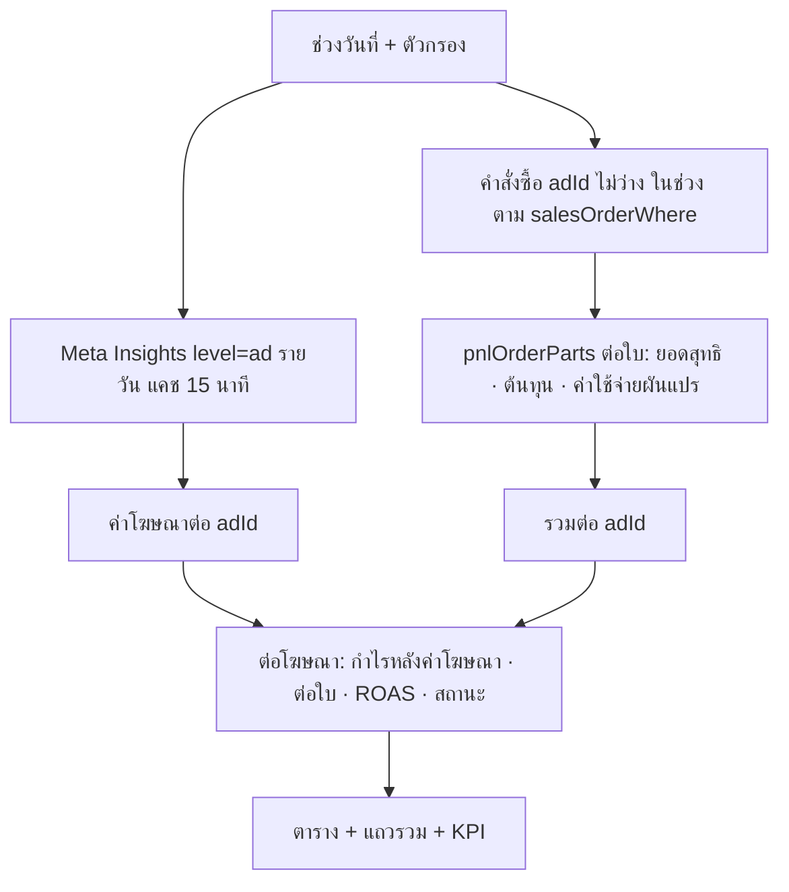
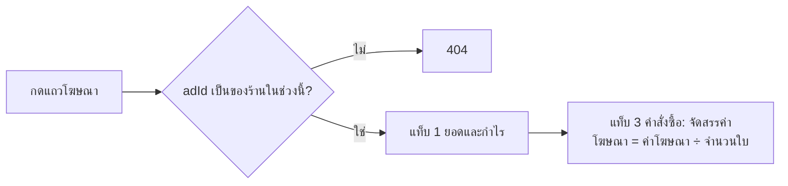

> **โมดูล:** 00096 — Daily Ads Profit & Performance
> **ประเภทเอกสาร:** Business Requirements Document (BRD)
> **เวอร์ชัน:** 1.0
> **วันที่จัดทำ:** 2026-11-16
> **สถานะ:** Approved — user "อนุมัติ" 2026-11-16 · Q1 ค่าส่งขาไป = ตามกฎหน้ากำไรเดิม · KPI = 4 ใบหลัก + แถบรอง 4 ช่อง (ตามแนะนำ)

# BRD: รายงานกำไรและประสิทธิภาพโฆษณารายวัน (Business Requirements Document)

---

## 1. บทนำ

### 1.1 วัตถุประสงค์ของเอกสาร
กำหนดความต้องการที่ทดสอบได้ของหน้า `/reports/ads-profit` — ตาราง P&L รายโฆษณารายวัน KPI 8 ใบ และหน้ารายละเอียดโฆษณา โดยใช้ข้อมูลและสูตรชุดเดียวกับรายงาน 00091 และหน้ากำไร/ขาดทุน

### 1.2 ขอบเขตของระบบ
- **ในขอบเขต:** P0 + P1 ตาม PRD §10.2 (P2 แยกเอกสารเมื่อถึงเวลา)
- **นอกขอบเขต:** ตาม PRD §5

### 1.3 กลุ่มผู้ใช้งาน
| กลุ่ม | สิทธิ์ |
|---|---|
| เจ้าของร้าน | เห็นทั้งหน้า (capability F1) |
| ผู้ช่วย/พนักงาน | ไม่เห็น (ตามสิทธิ์การเงินเดิม 00071) |

---

## 2. ความต้องการหลัก (Functional Requirements)

### 2.1 ตัวกรองและช่วงเวลา

#### FR-001: เลือกช่วงวันที่
- ปุ่ม: วันนี้ (ค่าตั้งต้น) · เมื่อวาน · 7 วัน · 14 วัน · 30 วัน · กำหนดเอง (สูงสุด 90 วัน ตามเพดานรายงานเดิม)
- ขอบวันตามเวลาไทย 00:00–23:59
- **AC:** เลือก "เมื่อวาน" แล้ว URL เก็บช่วง (`?from=&to=`) · รีเฟรชแล้วได้ช่วงเดิม · ใบที่สร้าง 23:59 ไทย อยู่ในวันนั้น ไม่ไหลไปวันถัดไป (เทสขอบเวลา)

#### FR-002: เทียบช่วงก่อน
- ค่าตั้งต้น: ช่วงก่อนหน้าความยาวเท่ากัน · ตัวเลือก: ค่าเฉลี่ย 7 วันก่อนหน้า (P1)
- ช่วงที่มีวันนี้ (ยังไม่จบวัน): ไม่แสดง % เทียบ แสดงป้าย "วันนี้ยังไม่ครบวัน"
- **AC:** เลือก "วันนี้" → การ์ดไม่มีป้าย % · เลือก "เมื่อวาน" → มี % เทียบวันก่อนหน้า

#### FR-003: ตัวกรองเพจ/แคมเปญ/ชุดโฆษณา/โหมดกำไร
- เพจ: ตัวกรองเพจแบบมีรูป (ตัวเดียวกับหน้า 00091) · แคมเปญ/ชุด: react-select (ห้าม select native)
- โหมดกำไร: คาดการณ์ (ค่าตั้งต้น) / รับเงินแล้ว
- **AC:** เลือกแคมเปญ A → ตาราง KPI กราฟ แสดงเฉพาะโฆษณาใน A · ผลรวมเท่ากับแถวแคมเปญ A ในหน้า 00091

### 2.2 KPI

#### FR-004: KPI 8 ใบ
- ตาม PRD §3.2 · จัด 4 ใบต่อแถว 2 แถว (ข้อยกเว้นมติ "KPI ไม่เกิน 4" — ขอ user ยืนยันใน §8.3)
- ตัวหาร 0 → "—" ไม่ใช่ 0 หรือ ∞
- ต้นทุนไม่ครบ → การ์ดกำไรมีป้าย "ต้นทุนไม่ครบ N ใบ"
- Meta ไม่ OK → การ์ดที่ใช้ค่าโฆษณาแสดง "—" + แถบสถานะใบเดียว (ตามท่า 00093)
- **AC:** ข้อมูลชุดตัวอย่าง Video A (PRD §8) ให้ค่าตรงทุกการ์ด

### 2.3 ตาราง P&L รายโฆษณา

#### FR-005: แถวและคอลัมน์
- แถว = โฆษณาที่มีค่าโฆษณา > 0 **หรือ** มีคำสั่งซื้อในช่วง
- คอลัมน์ตั้งต้น 9 + กลุ่มคอลัมน์เพิ่ม 3 กลุ่ม ตาม PRD §3.3 · ตั้งค่าที่เลือกจำใน localStorage
- **AC:** โฆษณาใช้ ฿500 ไม่มีใบ → แถว: 0 ใบ · ยอด ฿0 · กำไรรวม −฿500 · ต้นทุนต่อใบ "—" · สถานะ "ขาดทุน"

#### FR-006: การจัดสถานะโฆษณา
| สถานะ | เงื่อนไข |
|---|---|
| ต้นทุนไม่ครบ | มีใบที่ต้นทุนสินค้าไม่ครบ ≥ 1 ใบ |
| ข้อมูลไม่พอ | คำสั่งซื้อ < 3 และค่าโฆษณา < ฿300 (ค่าเริ่มต้น ปรับได้ใน `INSIGHT_RULES`) |
| กำไร | กำไรหลังค่าโฆษณา > 0 |
| เท่าทุน | |กำไรหลังค่าโฆษณา| ≤ 2% ของค่าโฆษณา |
| ขาดทุน | กำไรหลังค่าโฆษณา < 0 |
- ตรวจตามลำดับบนลงล่าง · สถานะมีทั้งสีและข้อความ/ไอคอน (ไม่พึ่งสีอย่างเดียว)

#### FR-007: แถวรวมและกระทบยอด
- แถวรวม = ผลรวมทุกแถว (ไม่ใช่เฉพาะหน้าหรือผลค้นหา) = ค่าบนการ์ด KPI
- **AC:** เทส DB: Σ ค่าโฆษณาแถว = KPI ค่าโฆษณา · Σ ใบ = KPI ใบ · Σ กำไรรวม = KPI กำไรหลังค่าโฆษณา

#### FR-008: การใช้งานตาราง
- เรียง · ค้นหา · กรองกำไร/ขาดทุน/ทั้งหมด · ชื่อตรึงซ้าย · แบ่งหน้า 10/25/50 · ส่งออก CSV (ทศนิยม 2 ตำแหน่ง · กันสูตร Excel) · กดแถว → FR-009

### 2.4 รายละเอียดโฆษณา

#### FR-009: หน้ารายละเอียด `/reports/ads-profit/[adId]`
- ช่วงเวลาและตัวกรองตามหน้าแม่ (ส่งผ่าน query) · `adId` ต้องเป็นโฆษณาของร้านในช่วงนั้น ไม่งั้น 404 (กันไล่ยิง Graph ด้วยรหัสสุ่ม — ท่าเดียวกับ 00093)
- แท็บ 1 + 3 (P0) · แท็บ 2 + 5 (P1)
- **AC:** Σ ยอดในแท็บ 3 = ยอดของแถวนี้ในตาราง · Σ ค่าโฆษณาจัดสรร = ค่าโฆษณาของแถว (ปัดเศษแล้วต่างไม่เกิน ฿0.01 × จำนวนใบ และใบสุดท้ายรับเศษ)

#### FR-010: คำสั่งซื้อในแท็บ 3
- ข้อมูลลูกค้าแสดงตามกฎปกปิดเบอร์ฝั่งผู้ขายเดิม · กดเลขที่ → หน้าคำสั่งซื้อเดิม
- ใบที่ยกเลิก/ตีกลับแสดงเป็นแถวจาง ไม่นับในยอด/กำไร

### 2.5 วิเคราะห์และคำแนะนำ (P1)

#### FR-011: กราฟวิเคราะห์
- ตาม PRD §3.5 ผ่าน `ApexChart` wrapper + `getColor('chart-*')` (HR10) · กราฟคนละหน่วยไม่ใช้แกนร่วม

#### FR-012: คำแนะนำรายวัน
- กฎตายตัว (ไม่ใช้ AI สร้างตัวเลข) · ต่อยอด `buildInsights` เดิม · ข้อละ: ข้อสังเกต · ตัวเลข · ฐานเทียบ · ความสำคัญ · สาเหตุที่เป็นไปได้ · สิ่งที่ลองได้ · ความมั่นใจ
- แสดงในปุ่มลอยคำแนะนำ (มติเดิม) และ 3 ข้อแรกเป็นแถบสรุปด้านบน

#### FR-013: ประโยคสรุปประจำวัน
- สร้างจากตัวเลขจริงด้วยแม่แบบ i18n · มีค่าประมาณ/ต้นทุนไม่ครบ → ต่อท้าย "(ตัวเลขบางส่วนเป็นค่าประมาณ)"

#### FR-014: ดึงข้อมูล Meta เพิ่ม (P1)
- เพิ่ม field `reach` (รายโฆษณาทั้งช่วง — ไม่รวมข้ามวัน) · `effective_status` · `objective` (ระดับแคมเปญ)
- ไม่เพิ่มคีย์ใหม่ในค่าที่แคชเดิม → เปลี่ยนคีย์แคช (บทเรียน unstable_cache เปลี่ยน shape)

### 2.6 P2 (อนุมัติ 2026-11-16)

#### FR-015: แท็บสินค้าในรายละเอียดโฆษณา (เสร็จ — ไม่ต้อง migration)
- รายบรรทัดสินค้า (ราคา × จำนวน ก่อนหักส่วนลดท้ายบิล) ไม่เอายอดทั้งบิลใส่ทุกสินค้า · ค่าโฆษณาจัดสรรตามสัดส่วนยอด รวม = ค่าโฆษณาจริง (`productProfit` + เทส)

#### FR-016: ตั้งค่าต้นทุนต่อออเดอร์ของร้าน (เสร็จ — migration `20261118100000_00096_shop_variable_costs`)
- คอลัมน์ `Shop.variableCosts Json?` (packagingPerOrder · codFeePct · paymentFeePct · commissionPct) ตรวจค่าที่ API ด้วย `VariableCostSchema` (บาท 0–100,000 · % 0–100) · อ่านด้วย `resolveVariableCosts` (ช่องเสีย = 0) — เจ้าของร้านแก้ได้ (F1)
- หน้า `/settings/variable-costs` (เมนูตั้งค่า "ต้นทุนต่อออเดอร์") ช่องตัวเลข 4 ช่อง + ตัวอย่างต่อใบ ฿1,000 (COD/โอน/เงินสด)
- **AC:** ไม่ตั้ง = 0 ทั้งหมด ตัวเลขทุกหน้าเท่าเดิม · ตั้งค่าแพ็ก ฿10 → ใบละ −฿10 ในทุกหน้าที่ใช้ `pnlOrderParts`

#### FR-017: ใช้ค่าตั้งค่าใน `pnlOrderParts` (เสร็จ — Q2 = ทุกหน้าที่คิดกำไรสุทธิ)
- ค่าใช้จ่ายผันแปรต่อใบ = ค่าแพ็ก + ยอด × % (ตามวิธีชำระ) + ยอด × คอมมิชชัน % · ไม่ซ้ำกับ `Shipment.codFee` (ใบ iShip ที่มี codFee จริงไม่คิด % COD ซ้ำ)
- เทส: `src/lib/variable-cost.test.ts` (ใบ iShip มี codFee ไม่คิด % ซ้ำ · เงินสด 0 · ไม่ตั้ง = 0) · `variable-cost.db.test.ts` (หน้ากำไร = รายงานโฆษณา หักเท่ากัน 105) · เทสเดิมทุกตัวผ่าน (ไม่ตั้ง = เท่าเดิม)
- พื้นผิวที่หัก: กำไรขาดทุน (บรรทัด "ต้นทุนต่อออเดอร์" ในรายการค่าใช้จ่าย) · ภาพรวมธุรกิจ · รายงานกลุ่ม LINE · กราฟการเงินร้านบริการ · รายงานโฆษณา · **ไม่หัก:** ชีตยอดขาย (กำไรจากการขาย)

---

## 3. Acceptance Criteria สรุป

### 3.1 ความถูกต้องทางการเงิน
- ตัวอย่าง Video A ตรงทุกค่า · โฆษณา 0 ใบ = −ค่าโฆษณา · ต้นทุนไม่ครบไม่ถูกนับเป็นกำไร 0 · ใบหลายสินค้าไม่นับยอดซ้ำ · ใบยกเลิก/ตีกลับไม่นับยอด · COD ยังไม่รับเงินอยู่ในคาดการณ์ ไม่อยู่ในรับเงินแล้ว

### 3.2 การกระทบยอด
- การ์ด = แถวรวมตาราง = หน้า 00091 ช่วงเดียวกัน · แท็บ 3 = แถวตาราง · ค่าโฆษณาจัดสรรรวม = ค่าโฆษณาจริง

### 3.3 ความปลอดภัย
- ข้อมูลทุกคำสั่งผูก `shopId` ของ session (tenant isolation) · เทสร้านอื่นดูโฆษณาร้านนี้ไม่ได้ (404)

---

## 4. Business Flows (กระบวนการทำงาน)

### 4.1 Flow หลัก: สร้างตาราง P&L

### 4.2 Flow รายละเอียดโฆษณา

---

## 5. Use Case Scenarios (สถานการณ์การใช้งานจริง)

### Scenario 1: เช้าวันจันทร์ ดูเมื่อวาน
ร้านเลือก "เมื่อวาน" → KPI: ค่าโฆษณา ฿3,000 · 30 ใบ · กำไรหลังค่าโฆษณา ฿2,100 → เรียงตารางตามกำไรรวม → เห็น Video C −฿450 (0 ใบ) → กดดู → แท็บคำแนะนำ "ใช้เงินแต่ไม่มีคำสั่งซื้อ ลองตรวจข้อความโฆษณา/กลุ่มเป้าหมาย"

### Scenario 2: ROAS สูงแต่ขาดทุน
Video A ROAS 3.2 แต่สถานะ "ขาดทุน" เพราะต้นทุนสินค้า 75% ของยอด → คำแนะนำ "ROAS สูงแต่กำไรติดลบ ตรวจราคาขาย/ต้นทุน"

### Scenario 3: ยังไม่เชื่อมบัญชีโฆษณา
ไม่มีค่าโฆษณา → การ์ดค่าโฆษณา/ROAS/กำไรหลังค่าโฆษณาเป็น "—" + แถบ "ยังไม่ได้เชื่อมบัญชีโฆษณา Facebook" + ปุ่มเชื่อม · ตารางยังแสดงคำสั่งซื้อ/ยอด/กำไรก่อนค่าโฆษณา

---

## 6. ความต้องการด้านคุณภาพ (Quality Requirements)

### 6.1 ความถูกต้องของข้อมูล
เงินคำนวณเป็นจำนวนเต็มสตางค์/ปัด 2 ตำแหน่งที่ขอบ service (`round2` เดิม) · สูตรรวมศูนย์ใน `src/lib` + เทส

### 6.2 ความรวดเร็ว
หน้าโหลด ≤ 3 วินาทีที่ 30 วัน/ 100 โฆษณา (แคช Insights) · คำสั่งซื้อเกินเพดานแสดงป้าย "นับไม่ครบ" ตามท่า 00091

### 6.3 ความน่าเชื่อถือ
Meta ล่ม/สิทธิ์หมด → หน้าไม่ล่ม ฝั่งคำสั่งซื้อยังแสดง

### 6.4 ความปลอดภัย
`gatePage(session,'F1')` · ทุก query ผูก `shopId` · route ประกาศใน `route-capabilities.ts`

### 6.5 ความสะดวกในการใช้งาน (Usability)
ป้ายไทยทั้งหมด · ห้ามคำว่า "Deep"/"แอด" · คำอธิบายอยู่ใน ⓘ · ตัวเลขชิดขวาบรรทัดเดียว · ห้าม select native

---

## 7. ข้อจำกัด (Constraints)

### 7.1 ข้อจำกัดทางธุรกิจ
ค่าใช้จ่ายผันแปรมีเท่าที่ระบบเก็บ (PRD §4.2) · ผูกโฆษณาได้เฉพาะใบที่มาจากแชทที่มีข้อมูลการคลิก

### 7.2 ข้อจำกัดทางเทคนิค
ไม่มี migration ใน P0/P1 · Meta reach รวมข้ามวันไม่ได้ (ต้องขอเป็นช่วงเดียว)

---

## 8. กฎทางธุรกิจ (Business Rules)

### 8.1 สูตร
ตาม PRD §3.2, §4.1 (A–F) — ต้นแบบเทส: Video A

### 8.2 การจัดสรรค่าโฆษณา
ค่าโฆษณาจัดสรรต่อใบ = ค่าโฆษณา ÷ ใบของโฆษณานั้น · ใบสุดท้ายรับเศษให้ผลรวมเท่าค่าโฆษณาจริง · 0 ใบไม่จัดสรร

### 8.3 ข้อยกเว้นมติเดิมที่ต้องให้ user ยืนยัน
- KPI 8 ใบ (มติเดิม "KPI ไม่เกิน 4") — **แนะนำ:** 4 ใบหลัก (ค่าโฆษณา · คำสั่งซื้อ · กำไรหลังค่าโฆษณา · กำไรต่อใบ) + 4 ใบรองเป็นแถบตัวเลขเล็กใต้ (ท่า "การแสดงผลและต้นทุน" ของ 00093)
- Q1 ค่าส่งขาไป (PRD §4.3)

---

## 9. อภิธานศัพท์ (Glossary)
ดู PRD §7

---

## 10. สรุป
หน้าใหม่ที่ทำให้กำไรหลังค่าโฆษณารายโฆษณารายวันเป็นพระเอก ใช้สูตรและข้อมูลชุดเดียวกับรายงานเดิมทั้งหมด ไม่มี migration ใน P0/P1 เริ่มลงโค้ดหลัง user อนุมัติเอกสารนี้และตอบ §8.3
