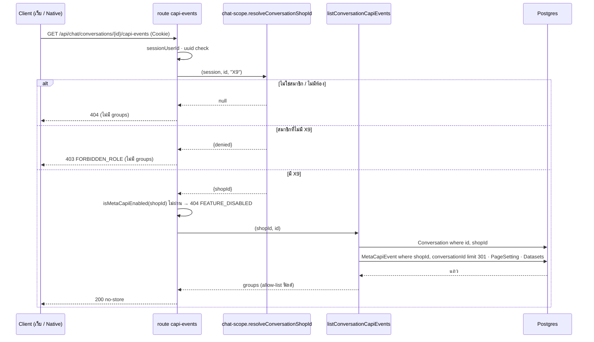

> **โมดูล:** 00097 - CAPI Event Log per Chat and Order
> **ประเภทเอกสาร:** API Contract
> **เวอร์ชัน:** 0.1
> **วันที่จัดทำ:** 2026-11-16
> **สถานะ:** Draft
> **เจ้าของเอกสาร:** SA (ดู [[Feature-Docs-Ownership]])

# API Contract: ดูเหตุการณ์ Conversions API ในห้องแชทและในคำสั่งซื้อ

---

## 1. Overview

API ชุดนี้ให้กลุ่มเหตุการณ์ CAPI ที่บันทึกไว้แล้ว (อ่านอย่างเดียว) แก่ห้องแชทเว็บและแชท Native และขยายตัวกรองของ API บันทึกการส่งเดิม · provider = deep-web (Next.js 16 route handlers) · ผู้บริโภค = ห้องแชทเว็บ (`useCapiLines`) · แชท Native ใน deep-seller-app · `LogClient` ("โหลดเพิ่ม") · การ์ดคำสั่งซื้อไม่มี API (RSC — [[SDS]] TD-007)

- **เอกสารออกแบบต้นทาง:** [[SDS]] ของโมดูลนี้ (TD-001 · TD-003 · TD-004)
- **Base URL:** `https://seller.deepthailand.app` (prod) · `https://seller.deepth.local:4000` (dev) — path ขึ้นต้น `/api/`
- **Content-Type:** `application/json`
- **Convention:** route ใต้ `/api/chat/conversations/[id]/**` (ด่านแชท 00037/00071) · error ของ CAPI = `{ error, code }` ผ่าน `capiRun` (`src/lib/meta-capi/route-helpers.ts`) · ทุก response `Cache-Control: private, no-store, max-age=0, must-revalidate` · `export const dynamic = "force-dynamic"`

---

## 2. Authentication

| รายการ | ค่า |
|--------|-----|
| **วิธี (Auth Method)** | NextAuth session cookie ของ subdomain `seller.*` (เว็บ) · แชท Native ส่งคุกกี้เดียวกันจาก WebView (`modules/deep-cookies`) |
| **Header** | `Cookie: next-auth.session-token=…` (ไม่มี Bearer) |
| **Token / Scope** | capability **X9** (`shop-permissions.ts` `X9: [O]` — เจ้าของร้าน) ของ **ร้านเจ้าของห้อง** (`capi-events`) / ร้าน active (`…/log` เดิม) · ฟีเจอร์ต้องเปิดให้ร้าน (`isMetaCapiEnabled`) |
| **กรณีไม่ผ่าน** | 401 ไม่มี session · 404 ไม่ใช่สมาชิกร้านของห้อง / ห้องไม่มี · 403 `FORBIDDEN_ROLE` สมาชิกที่ไม่มี X9 · 404 `FEATURE_DISABLED` ฟีเจอร์ปิด (ข้อ 5) |

---

## 3. Endpoint List

| Method | Path | คำอธิบาย |
|--------|------|----------|
| `GET` | `/api/chat/conversations/{id}/capi-events` | กลุ่มเหตุการณ์ CAPI ของห้อง + สถานะเพจหยุดส่ง (**ใหม่**) |
| `GET` | `/api/shops/meta-capi/{channelId}/log` | บันทึกการส่งของเพจ — เพิ่ม query `conversation` `order` และฟิลด์ `sentAt` (**ขยาย**) |

---

## 4. Endpoint Detail

### 4.1 `GET /api/chat/conversations/{id}/capi-events`

คืนทุกกลุ่มเหตุการณ์ของห้อง (เพดาน 300 แถวล่าสุด) เรียง `at` เก่า → ใหม่ ให้ client แทรกในรายการข้อความ · อ่านอย่างเดียว idempotent · client คุมจังหวะเรียก ([[SRS]] TFR-004)

**Request**

| ส่วน | ฟิลด์ | ชนิด | บังคับ | คำอธิบาย |
|------|-------|------|--------|----------|
| Path Param | `id` | `string (uuid)` | yes | `Conversation.id` · ไม่ใช่ uuid = 400 |

**Response — Success (200)**

| ฟิลด์ | ชนิด | คำอธิบาย |
|-------|------|----------|
| `visible` | `boolean` | `false` = ห้องไม่ใช่ Messenger / ไม่มีเพจ → client ไม่วาดและไม่เรียกซ้ำ |
| `channelId` | `string \| null` | `null` เมื่อเพจถูกยกเลิกการเชื่อม (DISCONNECTED) → ไม่แสดงลิงก์/แถบ · ไม่ null = `ShopChannel.id` ของเพจ — ลิงก์ `/settings/capis/{channelId}/log?conversation={id}` และ `/settings/capis/{channelId}` |
| `pageStopped` | `boolean` | `capiPageStatus(...) === 'stopped'` (เพจเปิดส่ง + ทุกชุดข้อมูล `STOPPED`) → แถบบนหัวห้อง |
| `truncated` | `boolean` | มีแถวมากกว่าเพดาน — ไม่ได้คืนกลุ่มที่เก่ากว่า |
| `groups` | `array` | กลุ่มตาม `dedupeKey` เรียง `at` เก่า → ใหม่ |
| `groups[].id` | `string` | id แถวแรกของกลุ่ม (ใช้เป็น React key — ไม่ใช่ `dedupeKey`) |
| `groups[].eventKey` | `CapiEventKey` | เช่น `PURCHASE` · ชื่อไทยจาก `conversionsApi.events[key].label` |
| `groups[].at` | `string (ISO)` | `min(createdAt)` ของกลุ่ม |
| `groups[].value` | `number \| null` | `payload.value` (บาท) |
| `groups[].datasets[]` | `array` | ผลต่อชุดข้อมูล เรียงตามชื่อชุด |
| `…datasets[].label` | `string \| null` | ชื่อชุดข้อมูล (null → แสดง `datasetId`) |
| `…datasets[].datasetId` | `string` | Dataset ID ของ Meta |
| `…datasets[].status` | `"PENDING" \| "SENT" \| "FAILED" \| "SKIPPED"` | สถานะแถว |
| `…datasets[].reasonKey` | `"queued" \| "retrying" \| "waitToken" \| "maxAttempts" \| "rejected" \| "tooOld" \| "none"` | `capiReasonKey()` — ไม่ใช่ `reason` ดิบ |
| `…datasets[].attempts` | `number` | ใช้แสดง "ลองใหม่ครั้งที่ {n} จาก 3" (`min(max(attempts,1),3)`) |
| `…datasets[].sentAt` | `string (ISO) \| null` | เวลาที่ Meta รับ ("Meta รับเมื่อ …") |

**ห้ามมีใน response (allow-list ข้างบนเท่านั้น):** `psid` `pageId` `payload` `items` `orderId` `dedupeKey` `reason` `lastHttpStatus` `lastRequest` `lastResponse` `lockedAt` `nextAttemptAt` `tokenEnc` `shopId`

**Response — Error**
- 400 `{ error: "รหัสบทสนทนาไม่ถูกต้อง" }` — `id` ไม่ใช่ uuid
- 401 `{ error: "unauthorized" }`
- 403 `FORBIDDEN_ROLE` (`forbiddenRoleResponse()`) — สมาชิกร้านของห้องที่ไม่มี X9
- 404 `{ error: "ไม่พบบทสนทนานี้" }` — ห้องไม่มี / ไม่ใช่สมาชิกร้านของห้อง
- 404 `{ error: "ไม่พบหน้านี้", code: "FEATURE_DISABLED" }` — `isMetaCapiEnabled(shopId)` เป็นเท็จ
- 500 `{ error: "เกิดข้อผิดพลาด กรุณาลองใหม่อีกครั้ง" }`
- ทุก error body **ไม่มี** key `groups`

**ตัวอย่าง JSON**

```json
// Request
// GET /api/chat/conversations/5b0c2f0e-8a52-4d0e-9a0f-2f4f2d6c1a11/capi-events

// Response 200 — ห้อง Messenger
{
  "visible": true,
  "channelId": "3f1e7a2c-0b4d-4c55-9e0a-7d9c3b2a1f00",
  "pageStopped": false,
  "truncated": false,
  "groups": [
    {
      "id": "a1c0…",
      "eventKey": "ADD_PAYMENT_INFO",
      "at": "2026-11-16T04:18:02.120Z",
      "value": 1070,
      "datasets": [
        { "label": "หลัก", "datasetId": "1234567890", "status": "SENT", "reasonKey": "none", "attempts": 1, "sentAt": "2026-11-16T04:18:40.000Z" }
      ]
    },
    {
      "id": "b7d2…",
      "eventKey": "PURCHASE",
      "at": "2026-11-16T04:20:00.000Z",
      "value": 1070,
      "datasets": [
        { "label": "หลัก", "datasetId": "1234567890", "status": "SENT", "reasonKey": "none", "attempts": 1, "sentAt": "2026-11-16T04:20:41.000Z" },
        { "label": "เว็บ", "datasetId": "9876543210", "status": "PENDING", "reasonKey": "retrying", "attempts": 1, "sentAt": null }
      ]
    },
    {
      "id": "c9e4…",
      "eventKey": "ORDER_SHIPPED",
      "at": "2026-11-16T05:02:11.000Z",
      "value": 1070,
      "datasets": [
        { "label": "หลัก", "datasetId": "1234567890", "status": "PENDING", "reasonKey": "queued", "attempts": 0, "sentAt": null }
      ]
    }
  ]
}

// Response 200 — ห้อง LINE
{ "visible": false, "channelId": null, "pageStopped": false, "truncated": false, "groups": [] }
```

### 4.2 `GET /api/shops/meta-capi/{channelId}/log` (ขยาย)

สัญญาเดิมตาม `docs/20 - Features/00089 - Meta Conversion API/API.md` + พารามิเตอร์/ฟิลด์ใหม่ · ด่าน `requireShopCapability(session,'X9')` (ร้าน active) เดิม

**Request**

| ส่วน | ฟิลด์ | ชนิด | บังคับ | คำอธิบาย |
|------|-------|------|--------|----------|
| Path Param | `channelId` | `string` | yes | เพจ Messenger ของร้าน (ไม่ใช่ = 404 `NOT_FOUND`) |
| Query | `status` | `PENDING\|SENT\|FAILED\|SKIPPED` | no | เดิม |
| Query | `eventKey` | `CapiEventKey` | no | เดิม |
| Query | `conversation` | `string (uuid)` | no | **ใหม่** — เฉพาะแถวของห้องนี้ (ร้านนี้) |
| Query | `order` | `string ≤64` (publicToken) | no | **ใหม่** — เฉพาะแถวที่ `payload.orderId` = คำสั่งซื้อนี้ ในห้องที่เกี่ยวกับคำสั่งซื้อ · ไม่พบคำสั่งซื้อของร้าน = `rows: []` |
| Query | `cursor` | `string ≤64` | no | เดิม |
| Query | `take` | `string ^\d{1,3}$` | no | เดิม (บีบ 1–50 · ค่าเริ่ม 20) |

**Response — Success (200)**

| ฟิลด์ | ชนิด | คำอธิบาย |
|-------|------|----------|
| `rows[]` | `array` | ฟิลด์เดิม (`id` `createdAt` `eventKey` `datasetLabel` `datasetId` `value` `status` `reason` `attempts` `customer` `order` `ad`) |
| `rows[].sentAt` | `string (ISO) \| null` | **ใหม่** — "Meta รับเมื่อ {sentAt}" |
| `nextCursor` | `string \| null` | เดิม |

**Response — Error**
- 400 `INVALID_INPUT` — `conversation` ไม่ใช่ uuid / `order` ยาวเกิน 64 (ข้อความจาก Valibot) · ที่เหลือเดิม

**ตัวอย่าง JSON**

```json
// Request
// GET /api/shops/meta-capi/3f1e…/log?conversation=5b0c…&status=SENT&take=20

// Response 200
{
  "rows": [
    {
      "id": "b7d2…", "createdAt": "2026-11-16T04:20:00.000Z", "eventKey": "PURCHASE",
      "datasetLabel": "หลัก", "datasetId": "1234567890", "value": 1070,
      "status": "SENT", "reason": null, "attempts": 1, "sentAt": "2026-11-16T04:20:41.000Z",
      "customer": { "name": "คุณเอ", "avatarUrl": null },
      "order": { "orderNo": "DP256911A1B2C3D4", "publicToken": "a1b2c3d4-…" },
      "ad": null
    }
  ],
  "nextCursor": null
}
```

---

## 5. Error Code Table

| Error Code | HTTP Status | ความหมาย / เงื่อนไข |
|------------|-------------|----------------------|
| `INVALID_INPUT` | `400` | query ไม่ผ่าน `CapiLogQuerySchema` (`…/log`) |
| (ไม่มี code) | `400` | `id` ของห้องไม่ใช่ uuid (`capi-events`) |
| `unauthorized` | `401` | ไม่มี session / ไม่รู้ตัวตนผู้ใช้ (`sessionUserId`) |
| `FORBIDDEN_ROLE` | `403` | สมาชิกร้านแต่ไม่มี X9 |
| `NOT_FOUND` / ไม่มี code | `404` | ห้อง/เพจไม่มี หรือไม่ใช่ของร้านที่ผู้ใช้เป็นสมาชิก (ไม่ยืนยันว่ามีอยู่) |
| `FEATURE_DISABLED` | `404` | `isMetaCapiEnabled(shopId)` เป็นเท็จ — ทำเหมือนไม่มี |
| (ไม่มี code) | `500` | ข้อผิดพลาดอื่น · log `[meta-capi api]` ไม่มี body/token |

**โครง error response มาตรฐาน**

โครงจริงของโปรเจกต์ (ไม่ใช่ envelope ซ้อน):

```json
{
  "error": "ข้อความภาษาไทยสำหรับแสดง/debug",
  "code": "FEATURE_DISABLED"
}
```

---

## 6. Sequence (ถ้า flow ซับซ้อน)

> **บังคับ:** ถ้ามี flow/diagram ใด ๆ ในหัวข้อนี้ **ต้องใช้ Mermaid เท่านั้น**
> ห้าม ASCII art, ห้ามรูปภาพ, ห้าม external tool (ดู [[Feature-Docs-Ownership]] §4)



---

## 7. Traceability

| Endpoint | SDS Component / Decision | BRD FR |
|----------|--------------------------|--------|
| `GET /api/chat/conversations/{id}/capi-events` | `capi-events/route.ts` · `listConversationCapiEvents` · TD-001 · TD-002 · TD-004 · TD-006 | FR-001 · FR-002 · FR-003 · FR-004 · FR-005 · FR-006 · FR-011 |
| `GET /api/shops/meta-capi/{channelId}/log` (ขยาย) | `listCapiLog` · `LogClient` · TD-003 | FR-008 · FR-009 |

---

## 8. สรุป (Summary)

เอกสาร API Contract นี้กำหนด **สัญญาการเชื่อมต่อ** ของ **มุมมองเหตุการณ์ CAPI ต่อห้องและต่อคำสั่งซื้อ** ให้ชัดพอที่ DEV
นำไป implement ได้โดยไม่ต้องตัดสินใจรูปร่าง request/response ใหม่, QA ใช้ตาราง error
ในข้อ 5 วางแผนทดสอบ negative case และทุก endpoint trace กลับ [[SDS]] ได้

**Open Questions:**
- ไม่มี
