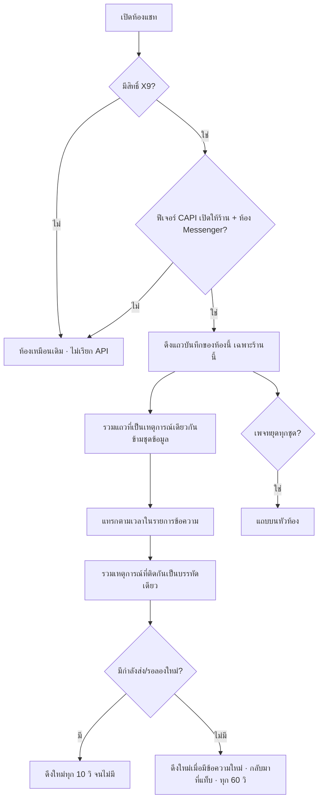
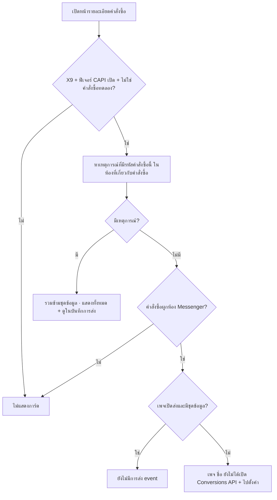

> **โมดูล:** 00097 - CAPI Event Log per Chat and Order
> **ประเภทเอกสาร:** Business Requirements Document (BRD) - NON-TECHNICAL
> **เวอร์ชัน:** 0.2
> **วันที่จัดทำ:** 2026-11-16
> **สถานะ:** Approved — user ตอบ "OK เลย" 2026-11-16 รับข้อเสนอทุกข้อ (ตารางมติ §8.6) · ม็อกอัพ `docs/superpowers/specs/2026-11-16-00097-capi-event-log-mockup.{html,md}`
> **เจ้าของเอกสาร:** BA (ดู [[Feature-Docs-Ownership]])

# BRD: ดูเหตุการณ์ Conversions API ที่ส่งให้ Meta ในห้องแชทและในคำสั่งซื้อ (Business Requirements Document)

---

## 1. บทนำ

### 1.1 วัตถุประสงค์ของเอกสาร

เอกสารนี้มีวัตถุประสงค์เพื่อ:
1. กำหนดว่าห้องแชท หน้าคำสั่งซื้อ และหน้าบันทึกการส่ง แสดงเหตุการณ์ CAPI อะไร ให้ใครเห็น และแสดงอย่างไร
2. กำหนดขอบเขต: อ่านอย่างเดียว ใช้บันทึกการส่งของ 00089 ไม่สร้างข้อมูลใหม่ ไม่เขียนแถวข้อความ
3. กำหนดกฎสิทธิ์ · การรวมรายการ · คำสถานะ · ข้อมูลที่ห้ามแสดง · ความเท่ากันของเว็บกับ Native
4. เป็นเกณฑ์รับงานที่เทสบังคับได้

### 1.2 ขอบเขตของระบบ

**มุมมองเหตุการณ์ CAPI ต่อห้องและต่อคำสั่งซื้อ** คือส่วนแสดงผลที่ดึงบันทึกการส่งของ 00089 มาแสดงเฉพาะของห้องแชทหรือคำสั่งซื้อที่ผู้ใช้เปิดอยู่

**เข้าสู่ระบบ (Input):**
- บันทึกการส่ง CAPI ที่มีอยู่ (1 แถวต่อเหตุการณ์ต่อชุดข้อมูล)
- ห้องแชท / คำสั่งซื้อที่เปิดอยู่ · สิทธิ์ของผู้ใช้ · สวิตช์ฟีเจอร์ CAPI ของร้าน · สถานะชุดข้อมูลของเพจ

**ออกจากระบบ (Output):**
- บรรทัดเหตุการณ์ตัวเทากลางห้องแชท + แถบ "เพจหยุดส่ง" บนหัวห้อง (เว็บ + แอป Native)
- การ์ด "Event ที่ส่งให้ Meta" ในหน้ารายละเอียดคำสั่งซื้อ (เว็บ)
- หน้าบันทึกการส่งที่กรองตามแชทหรือคำสั่งซื้อได้
- คำสถานะ "Meta รับแล้ว" แทน "สำเร็จ" ทั้งระบบ · คำเตือนในกล่องยืนยันลบชุดข้อมูล

**ระบบที่เกี่ยวข้อง:**
- 00089 Meta Conversion API (บันทึก · สวิตช์ · ข้อความ · หน้าบันทึก · หน้าตั้งค่า)
- 00071 บทบาทและสิทธิ์ (capability X9)
- ห้องแชทเว็บ · 00088 แชท Native ในแอปผู้ขาย
- หน้ารายละเอียดคำสั่งซื้อ

### 1.3 กลุ่มผู้ใช้งาน

| กลุ่มผู้ใช้ | บทบาท | สิทธิ์การใช้งาน |
|-----------|--------|----------------|
| **ผู้มีสิทธิ์ X9 (ตอนนี้ = เจ้าของร้าน)** | ตรวจผลการส่งให้ Meta | เห็นบรรทัดในห้อง · แถบเพจหยุดส่ง · การ์ดคำสั่งซื้อ · หน้าบันทึกที่กรองแล้ว |
| **บทบาทอื่น (ผู้ดูแล · แอดมินแชท ฯลฯ)** | ทำงานแชท/ออเดอร์ตามปกติ | ไม่เห็นอะไรเลย · server ไม่ส่งข้อมูลให้ · API ปฏิเสธ |
| **ลูกค้า (ผู้ซื้อใน Messenger)** | คุยกับร้าน | ไม่เห็นเด็ดขาด — บรรทัดไม่ถูกส่งออก |
| **Developer / ทีม Deep** | เปิดฟีเจอร์ CAPI ให้ร้าน | ผ่านตัวแปรระบบของ 00089 (ไม่มีอะไรใหม่) |

---

## 2. ความต้องการหลัก (Functional Requirements)

### 2.1 บรรทัดเหตุการณ์ในห้องแชท (เว็บ)

#### FR-001: บรรทัดเหตุการณ์กลางห้อง

**User Story:**
> ในฐานะเจ้าของร้าน ฉันต้องการเห็นในห้องแชทว่าระบบส่งเหตุการณ์อะไรของลูกค้าคนนี้ให้ Meta ตรงจังหวะในบทสนทนา เพื่อรู้ว่าแอดได้เครดิตยอดขายจากแชทนี้หรือยัง

**Acceptance Criteria:**
- [ ] แสดงเมื่อผ่าน BR-VIS-01..03 เท่านั้น
- [ ] 1 บรรทัด = 1 เหตุการณ์ (รวมชุดข้อมูลตาม BR-GRP-01) แทรกในรายการข้อความเรียงตามเวลา (BR-GRP-02) · วันที่ไม่มีข้อความแต่มีเหตุการณ์ได้ตัวคั่นวันของตัวเอง
- [ ] หน้าตาเป็นบรรทัดระบบกลางห้องแบบเดียวกับบรรทัดระบบของ Meta: ไม่มีพื้น ไม่มีรูป ไม่มีปุ่มคัดลอก/ตอบกลับ/รีแอค ไม่ชิดซ้ายขวา
- [ ] เนื้อหา: ไอคอน Meta · `ส่ง "{ชื่อเหตุการณ์}" ให้ Meta` · ยอด (ถ้ามี) · เวลา (ชั่วโมง:นาที) · ผล (ไอคอน + คำ ตาม BR-TXT-02) · เหตุผลสั้น (ถ้ามี)
- [ ] กดบรรทัดแล้วกางกล่องขอบเส้นประ: ทีละชุดข้อมูล (ชื่อชุด · สถานะ · "Meta รับเมื่อ {เวลา}" หรือเหตุผลเต็ม) + ลิงก์ "ดูในบันทึกการส่ง" ไปหน้าบันทึกของเพจที่กรองแชทนี้ · กางได้หลายบรรทัดพร้อมกัน · สถานะกาง/หุบไม่จำข้ามการเปิดห้อง
- [ ] ข้อความเก่าที่ยังไม่ได้โหลด → บรรทัดช่วงนั้นยังไม่แสดง จนกว่าผู้ใช้เลื่อนขึ้นโหลดข้อความเก่า
- [ ] ดึงรายการไม่สำเร็จ → ไม่มีบรรทัด ไม่มีข้อความผิดพลาด ห้องใช้งานได้ปกติ

**Business Flow:**
1. ผู้ใช้เปิดห้องแชท
2. ระบบตรวจสิทธิ์ · สวิตช์ · ช่องทางของห้อง
3. ผ่าน → ดึงเหตุการณ์ของห้อง รวมตามเหตุการณ์ แทรกตามเวลา

**Example:**
```
            คุณเอ: โอนแล้วค่ะ  [สลิป]
     [Meta] ส่ง "แนบสลิป" ให้ Meta · ฿1,070 · 11:18 · [ok] Meta รับแล้ว
                                      ร้าน: ได้รับยอดแล้วค่ะ
     [Meta] ส่ง "ซื้อ" ให้ Meta · ฿1,070 · 11:20 · [รอ] Meta รับแล้ว 1 จาก 2  [v]
        ┆ ชุดหลัก   Meta รับแล้ว · Meta รับเมื่อ 16 พ.ย. 11:20   ┆
        ┆ ชุดเว็บ   รอ · ลองใหม่ครั้งที่ 1 จาก 3                 ┆
        ┆                              ดูในบันทึกการส่ง ›        ┆
```
(ภาพประกอบเท่านั้น — หน้าจอจริงใช้ไอคอน Tabler ตามม็อกอัพ ไม่มี emoji)

#### FR-002: รวมบรรทัดที่ติดกัน

**User Story:**
> ในฐานะเจ้าของร้าน ฉันต้องการให้เหตุการณ์ที่เกิดติดกันรวมเป็นบรรทัดเดียว เพื่อไม่ให้บรรทัดเทาดันข้อความจริงห่างกัน

**Acceptance Criteria:**
- [ ] เหตุการณ์ ≥2 รายการที่ไม่มีข้อความคั่นและอยู่วันเดียวกัน → 1 บรรทัด `ส่ง {n} event ให้ Meta · {สรุปผล}` (BR-GRP-04)
- [ ] สรุปผล: ทุกเหตุการณ์ Meta รับแล้วทุกชุด → "Meta รับแล้วทั้งหมด" · นอกนั้น → "Meta รับแล้ว {ok} จาก {n}" + ไอคอนของสถานะที่แย่สุด · ทุกเหตุการณ์ยังไม่เคยยิง → "กำลังส่ง {n} event ให้ Meta…"
- [ ] กางแล้วเห็นทุกเหตุการณ์ในกลุ่ม (ชื่อ · ยอด · ผล · ผลรายชุดข้อมูลเมื่อผลไม่เท่ากัน) + ลิงก์ "ดูในบันทึกการส่ง" 1 ลิงก์
- [ ] มีข้อความใหม่แทรกระหว่างกลุ่ม → แยกเป็นบรรทัดตามตำแหน่งใหม่

#### FR-003: บรรทัด "กำลังส่ง" และการอัปเดตเอง

**User Story:**
> ในฐานะเจ้าของร้าน ฉันต้องการเห็นว่าเหตุการณ์กำลังรอส่ง แล้วผลขึ้นเองเมื่อส่งเสร็จ เพื่อไม่ต้องรีโหลดหน้า

**Acceptance Criteria:**
- [ ] เหตุการณ์ที่ทุกชุดข้อมูลยังไม่เคยยิง → บรรทัดจาง + ไอคอนหมุน (หยุดหมุนเมื่อผู้ใช้ตั้งลดการเคลื่อนไหว) "กำลังส่ง "{ชื่อ}" ให้ Meta…" ไม่มีปุ่มกาง · อ่านโดยโปรแกรมอ่านหน้าจอเป็นสถานะ
- [ ] เมื่อตัวส่งส่งเสร็จ (ปกติ 1–2 นาที) บรรทัดเปลี่ยนเป็นผลเองโดยไม่ต้องรีโหลด ภายใน ≤ 15 วินาทีหลังสถานะในบันทึกเปลี่ยน ขณะห้องเปิดอยู่และแท็บมองเห็น
- [ ] เหตุการณ์ใหม่ที่เกิดขณะเปิดห้อง (เช่น ร้านยืนยันชำระเงิน → "ซื้อ") ปรากฏเองเมื่อมีข้อความใหม่ในห้อง หรือภายในรอบอัปเดตถัดไป (≤ 60 วินาที)
- [ ] ไม่มีบรรทัดรอ/กำลังส่ง → ไม่ดึงถี่

#### FR-004: แถบ "เพจหยุดส่ง" บนหัวห้อง

**User Story:**
> ในฐานะเจ้าของร้าน ฉันต้องการเห็นครั้งเดียวว่าเพจนี้หยุดส่งทั้งหมดและต้องทำอะไร แทนการอ่านเหตุผลซ้ำทุกบรรทัด

**Acceptance Criteria:**
- [ ] ทุกชุดข้อมูลของเพจที่ห้องนี้ผูกอยู่หยุด (สถานะเพจ "หยุดส่ง") และเพจเปิดส่งอยู่ → แถบ 1 แถบบนหัวห้อง: "หยุดส่ง · ต้องเชื่อมเพจใหม่" + ลิงก์ไปหน้าตั้งค่าเพจ
- [ ] ขณะแถบแสดง บรรทัดที่รอเพราะชุดข้อมูลหยุด แสดงแค่ "รอ" ไม่ต่อเหตุผล "รอเชื่อมเพจใหม่"
- [ ] หยุดบางชุด (ไม่ใช่ทุกชุด) → ไม่มีแถบ บรรทัดแสดงเหตุผลสั้น "รอเชื่อมเพจใหม่" ตามปกติ
- [ ] เห็นเฉพาะ BR-VIS-01..03 เหมือนบรรทัด

#### FR-005: ห้องที่ไม่มีบรรทัด

**User Story:**
> ในฐานะแอดมินแชท ฉันต้องการให้ห้องแชทเหมือนเดิม เพื่อทำงานได้โดยไม่มีข้อมูลที่ไม่ใช่งานของฉัน

**Acceptance Criteria:**
- [ ] ผู้ใช้ไม่มี X9 → ไม่มีบรรทัด ไม่มีแถบ ไม่มีที่ว่าง · หน้าเว็บไม่เรียก API ของส่วนนี้ · ถ้าเรียกตรงได้ 403 ไม่มีข้อมูลเหตุการณ์ใน response
- [ ] ฟีเจอร์ CAPI ปิดสำหรับร้าน → ไม่มีอะไรเปลี่ยน
- [ ] ห้องไม่ใช่ Messenger (LINE · Instagram · แชทในแอป Deep) → ไม่มีอะไรเปลี่ยน
- [ ] ห้อง Messenger ที่เพจไม่เคยเปิดส่ง / ไม่มีเหตุการณ์ → ไม่มีบรรทัด (ไม่มีข้อความ "ยังไม่มี")

### 2.2 บรรทัดเหตุการณ์ในห้องแชท (แอป Native)

#### FR-006: บรรทัดเดียวกันในแชท Native

**User Story:**
> ในฐานะเจ้าของร้านที่ใช้แชทในแอปมือถือ ฉันต้องการเห็นบรรทัดเดียวกับบนเว็บ เพื่อไม่ต้องเปิดเว็บเพื่อเช็ค

**Acceptance Criteria:**
- [ ] ห้องแชทใน deep-seller-app แสดงบรรทัด · การรวม · กำลังส่ง/อัปเดตเอง · แถบเพจหยุดส่ง · คำ เท่ากับเว็บ (FR-001..005)
- [ ] ใช้ API ตัวเดียวกับเว็บ · ไม่มีสิทธิ์/ฟีเจอร์ปิด = ไม่แสดง และไม่เรียกซ้ำในห้องนั้น
- [ ] "ดูในบันทึกการส่ง" เปิดหน้าบันทึกบนเว็บ (แอปไม่มีหน้าบันทึกของตัวเอง)
- [ ] ด่าน native-chat-sync เขียว และ PR มีบรรทัด `Native: <PR ของแอป>`

### 2.3 การ์ดในหน้ารายละเอียดคำสั่งซื้อ (เว็บ)

#### FR-007: การ์ด "Event ที่ส่งให้ Meta"

**User Story:**
> ในฐานะเจ้าของร้าน ฉันต้องการเห็นในหน้าคำสั่งซื้อว่าออเดอร์นี้ส่ง Purchase และเหตุการณ์อื่นแล้วหรือยัง เพื่อเทียบกับยอดใน Ads Manager

**Acceptance Criteria:**
- [ ] แสดงใต้การ์ด "ประวัติออเดอร์" เมื่อผ่าน BR-VIS-01..02 และ BR-SCOPE-03
- [ ] แสดงทุกเหตุการณ์ของคำสั่งซื้อตาม BR-SCOPE-02 รวมตาม BR-GRP-01 เรียงใหม่ → เก่า (ไม่จำกัดจำนวน)
- [ ] แต่ละรายการ: วันเวลา · ชื่อเหตุการณ์ · ยอด · ป้ายสถานะ · "Meta รับเมื่อ {เวลา}" เมื่อ Meta รับแล้วทุกชุด · ผลไม่เท่ากัน → "Meta รับแล้ว {ok} จาก {n} ชุดข้อมูล" + รายชุด
- [ ] ปุ่ม "ดูในบันทึกการส่ง" ไปหน้าบันทึกที่กรองคำสั่งซื้อนี้
- [ ] ไม่มีเหตุการณ์ + เพจเปิดส่ง → "ยังไม่มีการส่ง event" · เพจยังไม่เปิดส่ง → "เพจ {ชื่อ} ยังไม่ได้เปิด Conversions API" + "ไปตั้งค่า"
- [ ] โหลดไม่สำเร็จ → "โหลด event ไม่สำเร็จ" + "ลองใหม่" · การ์ดอื่นในหน้าไม่กระทบ
- [ ] แอป Native ไม่มีการ์ดนี้รอบนี้

### 2.4 หน้าบันทึกการส่ง

#### FR-008: กรองตามแชทหรือคำสั่งซื้อ

**User Story:**
> ในฐานะเจ้าของร้าน ฉันต้องการกด "ดูในบันทึกการส่ง" แล้วเห็นบันทึกเฉพาะแชทหรือคำสั่งซื้อนั้น เพื่อดูย้อนหลังครบโดยไม่ต้องไล่รายการรวม

**Acceptance Criteria:**
- [ ] หน้าบันทึกเดิมรับตัวกรองแชท / คำสั่งซื้อจากลิงก์ · แสดงชิป "แชท: {ชื่อลูกค้า}" / "ออเดอร์ #{เลข}" ที่มีปุ่ม × ล้างเฉพาะตัวนั้น
- [ ] ใช้ร่วมกับตัวกรองสถานะและเหตุการณ์เดิมได้ · "โหลดเพิ่ม" คงตัวกรองทุกตัว · "ล้างตัวกรอง" ล้างทุกตัวรวมชิป
- [ ] กรองแชท → ซ่อนคอลัมน์ "ลูกค้า"
- [ ] แถวที่ Meta รับแล้ว แสดง "Meta รับเมื่อ {เวลา}" ใต้ป้ายสถานะ · ป้ายสถานะมีไอคอนนำหน้า
- [ ] แชท/คำสั่งซื้อที่ไม่ใช่ของร้าน → ไม่มีชิป ไม่กรอง (ทำเหมือนตัวกรองที่ไม่รู้จัก — ไม่บอกว่ามีอยู่ในร้านอื่น)
- [ ] ตารางยังเป็น 1 แถวต่อชุดข้อมูล (การรวมใช้เฉพาะในห้อง/การ์ด)

### 2.5 คำและคำเตือน

#### FR-009: เปลี่ยน "สำเร็จ" เป็น "Meta รับแล้ว" ทั้งระบบ

**Acceptance Criteria:**
- [ ] ป้ายสถานะในหน้าบันทึก · ตัวกรองสถานะ · การ์ดสถิติ "ส่งสำเร็จ" · บรรทัดในห้อง · การ์ดคำสั่งซื้อ ใช้ "Meta รับแล้ว" (ภาษาอังกฤษ "Received by Meta")
- [ ] สถานะอื่นคงคำเดิม: รอ · ล้มเหลว · ข้าม

#### FR-010: คำเตือนตอนลบชุดข้อมูล

**Acceptance Criteria:**
- [ ] กล่องยืนยันลบชุดข้อมูลบอกว่า "บันทึกการส่งของชุดนี้จะถูกลบด้วย" (ไม่เปลี่ยนพฤติกรรมการลบ)

### 2.6 สิทธิ์ของ API

#### FR-011: API ใหม่ประกาศสิทธิ์ X9 และไม่รั่ว

**Acceptance Criteria:**
- [ ] ทุก route ใหม่ประกาศ capability X9 ในทะเบียนสิทธิ์ของ route
- [ ] ไม่มีสิทธิ์ → 403 · ไม่ใช่สมาชิกร้านของห้อง → 404 · ฟีเจอร์ปิด → 404 แบบเดียวกับ API ของ 00089 · ทุกกรณีไม่มีข้อมูลเหตุการณ์ใน response
- [ ] ข้อมูลที่ตอบกลับไม่มีฟิลด์ตาม BR-PII-01

---

## 3. Acceptance Criteria สรุป

### 3.1 สิทธิ์และการมองเห็น

**เมื่อระบบทำงานถูกต้อง:**
- ผู้ไม่มี X9 ไม่เห็นและเรียก API ไม่ได้ ทั้งเว็บและ Native · ข้อมูลไม่ถึงเครื่อง
- ฟีเจอร์ CAPI ปิด = ไม่มีอะไรเปลี่ยนจากเดิม
- ห้องที่ไม่ใช่ Messenger ไม่มีบรรทัด
- ลูกค้าไม่เห็นบรรทัด — ไม่มีแถวข้อความใหม่ ไม่มีอะไรส่งเข้า Facebook

### 3.2 ความถูกต้องของรายการ

**เมื่อมีเหตุการณ์:**
- บรรทัด/การ์ดตรงกับหน้าบันทึกที่กรองแชท/คำสั่งซื้อเดียวกัน
- เหตุการณ์ที่ส่งหลายชุดข้อมูลแสดงเป็นรายการเดียว พร้อมผลต่อชุดข้อมูลเมื่อกาง
- คำสถานะและเหตุผลเหมือนหน้าบันทึกทุกตัวอักษร
- ไม่มี PSID · คำขอ/คำตอบดิบ · รหัสผิดพลาดของ Meta ถึงหน้าจอ

---

## 4. Business Flows (กระบวนการทำงาน)

### 4.1 Flow หลัก: เปิดห้องแชท



### 4.2 การ์ดคำสั่งซื้อ



---

## 5. Use Case Scenarios (สถานการณ์การใช้งานจริง)

### Scenario 1: Purchase — Meta รับบางชุดข้อมูล (พบบ่อย)

**ผู้เกี่ยวข้อง:** เจ้าของร้าน

**เงื่อนไขเริ่มต้น:**
- เพจส่ง 2 ชุดข้อมูล · ร้านยืนยันชำระเงิน → "ซื้อ" เข้าคิว

**ขั้นตอน:**
1. ใต้ข้อความยืนยันของร้าน เห็น "กำลังส่ง "ซื้อ" ให้ Meta…"
2. ราว 1 นาทีต่อมา บรรทัดเปลี่ยนเองเป็น `ส่ง "ซื้อ" ให้ Meta · ฿1,070 · 11:20 · Meta รับแล้ว 1 จาก 2`
3. กดกาง → ชุดหลัก: Meta รับเมื่อ 11:20 · ชุดเว็บ: รอ — ลองใหม่ครั้งที่ 1 จาก 3

**ผลลัพธ์:**
- รู้ว่าชุดหลักได้แล้ว อีกชุดกำลังลองใหม่ ไม่ต้องถามทีม Deep

### Scenario 2: token เพจหมดอายุ

**ผู้เกี่ยวข้อง:** เจ้าของร้าน

**เงื่อนไขเริ่มต้น:**
- ทุกชุดข้อมูลของเพจหยุด (STOPPED) เพราะ token เสีย · มีเหตุการณ์ค้าง

**ขั้นตอน:**
1. เปิดห้อง → แถบบนหัวห้อง "หยุดส่ง · ต้องเชื่อมเพจใหม่" + ลิงก์ตั้งค่า · บรรทัดที่ค้างขึ้นแค่ "รอ"
2. ไปเชื่อมเพจใหม่

**ผลลัพธ์:**
- กลับมาที่ห้อง แถบหาย · บรรทัดเปลี่ยนเป็น "Meta รับแล้ว" เมื่อตัวส่งรอบถัดไปส่งสำเร็จ

### Scenario 3: แอดมินแชทเปิดห้องเดียวกัน

**ผู้เกี่ยวข้อง:** แอดมินแชท (ไม่มี X9)

**เงื่อนไขเริ่มต้น:**
- ห้องเดียวกับ Scenario 1

**ขั้นตอน:**
1. เปิดห้องบนเว็บหรือแอป

**ผลลัพธ์:**
- ห้องเหมือนเดิมทุกอย่าง ไม่มีบรรทัด ไม่มีแถบ · เครื่องไม่ได้รับข้อมูลเหตุการณ์

### Scenario 4: หลายเหตุการณ์ติดกัน

**ผู้เกี่ยวข้อง:** เจ้าของร้าน

**เงื่อนไขเริ่มต้น:**
- ร้านสร้างออเดอร์แล้วส่งการ์ดคำสั่งซื้อทันที → "สร้างคำสั่งซื้อ" + "ส่งลิงก์สั่งซื้อ" โดยไม่มีข้อความลูกค้าคั่น

**ขั้นตอน:**
1. เปิดห้อง

**ผลลัพธ์:**
- เห็น 1 บรรทัด `ส่ง 2 event ให้ Meta · Meta รับแล้วทั้งหมด` · กดกางเห็นทั้งสองเหตุการณ์

### Scenario 5: คำสั่งซื้อที่ส่งการ์ดในห้องอื่น

**ผู้เกี่ยวข้อง:** เจ้าของร้าน

**เงื่อนไขเริ่มต้น:**
- คำสั่งซื้อสร้างจากหน้า /orders (ไม่ผูกห้อง) แล้วร้านส่งการ์ดคำสั่งซื้อเข้าห้อง Messenger ของลูกค้า → "ส่งลิงก์สั่งซื้อ"

**ขั้นตอน:**
1. เปิดหน้ารายละเอียดคำสั่งซื้อ

**ผลลัพธ์:**
- การ์ดแสดง "ส่งลิงก์สั่งซื้อ" (BR-SCOPE-02 ครอบห้องที่ส่งการ์ด)

### Scenario 6: ห้อง LINE

**ผู้เกี่ยวข้อง:** เจ้าของร้าน

**ขั้นตอน:**
1. เปิดห้องแชท LINE

**ผลลัพธ์:**
- ไม่มีบรรทัด ไม่มีแถบ

---

## 6. ความต้องการด้านคุณภาพ (Quality Requirements)

### 6.1 ความถูกต้องของข้อมูล
- รายการมาจากบันทึกการส่งตัวเดียวกับหน้าบันทึก ไม่คำนวณสถานะใหม่
- ยอดที่แสดง = ยอดที่ส่งไปจริง (เก็บในแถวตอนเข้าคิว) ไม่คำนวณจากคำสั่งซื้อปัจจุบัน

### 6.2 ความรวดเร็ว
- ดึงรายการเหตุการณ์แยกหลังห้องขึ้นแล้ว ไม่ทำให้ข้อความขึ้นช้าลง
- ดึงด้วยดัชนีห้องที่มีอยู่แล้ว · การ์ดคำสั่งซื้อค้นเฉพาะห้องที่เกี่ยวกับคำสั่งซื้อ ไม่ค้นทั้งร้าน

### 6.3 ความน่าเชื่อถือ
- ส่วนนี้ล้มต้องไม่ทำให้ห้องแชท/หน้าคำสั่งซื้อพัง
- อ่านอย่างเดียว ไม่เปลี่ยนคิวหรือสถานะใด ๆ

### 6.4 ความปลอดภัย
- ด่าน X9 ที่ server ทุกทาง (API และหน้าคำสั่งซื้อ) ไม่พึ่งการซ่อนบนหน้าจอ · ผูกร้านทุก query
- ไม่ส่งข้อมูลตาม BR-PII-01 ออกจาก server

### 6.5 ความสะดวกในการใช้งาน (Usability)
- บรรทัดสั้น ไม่มีข้อความอธิบายยาว · ไม่มีคำว่า "Deep" · ไม่มี emoji ใช้ไอคอนจริง
- ผลแสดงด้วยไอคอน + คำ ไม่ใช้สีอย่างเดียว · เป้ากด ≥44px บนมือถือ
- สองภาษา TH/EN ตามระบบ i18n (00047)

---

## 7. ข้อจำกัด (Constraints)

### 7.1 ข้อจำกัดทางธุรกิจ
- Messenger เท่านั้น · ไม่มีเหตุการณ์ก่อนร้านเปิดการส่ง
- สิทธิ์ X9 ปัจจุบันให้เจ้าของร้านเท่านั้น — ถ้าภายหลังเปิดให้บทบาทอื่น ส่วนนี้ตามไปเอง

### 7.2 ข้อจำกัดทางเทคนิค
- บันทึกไม่มีคอลัมน์รหัสคำสั่งซื้อ — อยู่ในข้อมูลแนบของแถวเท่านั้น
- บันทึกเก็บไม่มีหมดอายุ (PR #230) แต่ถูกลบตามเมื่อลบชุดข้อมูล · ยืนยันจากโค้ด 2026-11-16: ยกเลิกการเชื่อมเพจ = ตั้ง `ShopChannel.status=DISCONNECTED` (`shop-channel.service.ts`) ไม่ลบแถว ⇒ บันทึก **ไม่หาย** แต่หน้าบันทึกของเพจนั้นเปิดไม่ได้ (`loadChannel` ซ่อนเพจ DISCONNECTED)
- ตัวส่งทำงานทุก 1 นาที — "กำลังส่ง" อยู่ได้ 1–2 นาทีเป็นปกติ
- ไม่มี migration (ดู [[DATABASE]])

---

## 8. กฎทางธุรกิจ (Business Rules)

### 8.1 การมองเห็น
- **BR-VIS-01** เห็นเฉพาะผู้มี capability X9 ของร้านเจ้าของห้อง/คำสั่งซื้อ · ตัดสินที่ server ทุกครั้ง · ไม่มีสิทธิ์ = ข้อมูลไม่ออกจาก server
- **BR-VIS-02** ฟีเจอร์ CAPI ต้องเปิดสำหรับร้าน (`isMetaCapiEnabled`: สวิตช์ระบบ + รายชื่อร้านทดลอง) · ปิด = ไม่แสดง และ API ตอบแบบเดียวกับ API ของ 00089 ตอนปิด
- **BR-VIS-03** บรรทัดในห้องแสดงเฉพาะห้องช่องทาง Messenger
- **BR-VIS-04** บรรทัดไม่ใช่ข้อความ: ไม่ถูกบันทึกเป็นข้อความ · ไม่ส่งออกช่องทางใด · ไม่อยู่ในรายการแชท/พรีวิวข้อความล่าสุด/ตัวนับยังไม่อ่าน/ตัวนับข้อความ/ค้นหาข้อความ/AI ช่วยร่าง

### 8.2 แถวที่นับเป็นของห้อง / ของคำสั่งซื้อ
- **BR-SCOPE-01** ของห้อง = ทุกแถวบันทึกของร้านนี้ที่ผูกห้องนี้ ทุกเหตุการณ์ ทุกชุดข้อมูล
- **BR-SCOPE-02** ของคำสั่งซื้อ = แถวของร้านนี้ที่มีรหัสคำสั่งซื้อนี้ในข้อมูลแนบ ในห้องที่คำสั่งซื้อผูก **หรือ** ห้องที่ร้านเคยส่งการ์ดคำสั่งซื้อนี้ ได้แก่ สร้างคำสั่งซื้อ · ซื้อ · แนบสลิป · จัดส่งแล้ว · ส่งถึงแล้ว · ยกเลิก · คืนสินค้า · ส่งลิงก์สั่งซื้อ · ทิ้งตะกร้า (ดูสินค้าและผู้สนใจ ไม่ผูกคำสั่งซื้อ)
- **BR-SCOPE-03** การ์ดคำสั่งซื้อแสดงเมื่อมีเหตุการณ์ตาม BR-SCOPE-02 อย่างน้อย 1 รายการ หรือคำสั่งซื้อผูกห้อง Messenger · นอกนั้นไม่แสดง · คำสั่งซื้อทดลอง (dry-run) ไม่แสดงเสมอ

### 8.3 การรวมรายการ
- **BR-GRP-01** แถวที่มีคีย์กันซ้ำเดียวกัน = เหตุการณ์เดียวกันที่ส่งหลายชุดข้อมูล → 1 รายการ · ผลของรายการ: ทุกชุดสถานะเดียวกัน = สถานะนั้น · ไม่เท่ากัน = "Meta รับแล้ว {ok} จาก {n}" กับไอคอนของสถานะที่แย่สุด (ล้มเหลว > รอ > ข้าม > Meta รับแล้ว) · ทุกชุดยังไม่เคยยิง = "กำลังส่ง"
- **BR-GRP-02** เวลาของรายการ = เวลาเข้าคิวที่เก่าสุดในกลุ่ม ใช้เรียงและแทรกในห้อง
- **BR-GRP-03** ชุดข้อมูลที่ไม่มีชื่อ แสดง Dataset ID แทน
- **BR-GRP-04** บรรทัดรวม = รายการ ≥2 ที่อยู่ติดกันในห้อง (ไม่มีข้อความคั่น) และวันเดียวกัน · ตัวเลขทุกตัว (`{n} event`, `{ok} จาก {n}`) นับเป็นเหตุการณ์หลังรวมตาม BR-GRP-01 ไม่ใช่นับแถว

### 8.4 คำและรูปแบบ
- **BR-TXT-01** ชื่อเหตุการณ์ สถานะ และเหตุผล ใช้ข้อความชุดเดียวกับหน้าบันทึกการส่ง (`conversionsApi.events` · `logStatus` · `logReason`) — ห้ามตั้งคำใหม่ (HR16) · เหตุผลสั้นในบรรทัดห้องเป็นชุดย่อที่ผูกกับคีย์เหตุผลเดียวกัน
- **BR-TXT-02** คำสถานะ: รอ · **Meta รับแล้ว** · ล้มเหลว · ข้าม (เปลี่ยนจาก "สำเร็จ" ทั้งระบบ 2026-11-16)
- **BR-TXT-03** คำบนบรรทัด: `ส่ง "{ชื่อเหตุการณ์ไทย}" ให้ Meta` · รวม: `ส่ง {n} event ให้ Meta` · กำลังส่ง: `กำลังส่ง "{ชื่อ}" ให้ Meta…`
- **BR-TXT-04** เหตุผลสั้น (บรรทัดห้อง): Meta ไม่บันทึก · ลองครบ 3 ครั้งแล้ว · ลองใหม่ครั้งที่ n จาก 3 · รอเชื่อมเพจใหม่ · เก่ากว่า 7 วัน · เหตุผลเต็ม (กล่องกาง/การ์ด/หน้าบันทึก) ใช้ชุดเดิม — ไม่แสดงรหัสภายในหรือรหัสของ Meta
- **BR-TXT-05** วันเวลาใช้ฟังก์ชันจาก `src/lib/format-date.ts` เท่านั้น · ยอดเป็นบาท ทศนิยมตามรูปแบบเงินของระบบ เฉพาะเหตุการณ์ที่มียอด
- **BR-TXT-06** สีและไอคอนสถานะเหมือนหน้าบันทึก: Meta รับแล้ว = สำเร็จ (เขียว) · รอ = เตือน · ล้มเหลว = อันตราย · ข้าม = เทา · บรรทัดในห้องยังเป็นตัวเทา เฉพาะไอคอน/คำผล/เหตุผลสั้นเป็นสีสถานะ

### 8.5 ข้อมูลที่ห้ามแสดง และความเท่ากันของเว็บกับ Native
- **BR-PII-01** API และหน้าจอไม่มี PSID · คำขอ/คำตอบดิบ · HTTP status · รหัสผิดพลาดของ Meta · รหัสเหตุผลภายใน · token
- **BR-NAT-01** แอป Native มีบรรทัดในห้อง + แถบเพจหยุดส่ง เท่ากับเว็บในรอบเดียวกัน (00088 BRD FR-006 · HR18 ด่าน native-chat-sync) · การ์ดคำสั่งซื้อไม่อยู่ในแอปรอบนี้
- **BR-RET-01** บันทึกเก็บไม่มีหมดอายุตามเวลา · แต่บันทึกของชุดข้อมูลที่ถูกลบหายไปด้วย → กล่องยืนยันลบชุดข้อมูลต้องเตือน (FR-010) · ยืนยันจากโค้ด 2026-11-16: ยกเลิกการเชื่อมเพจ = ตั้ง `ShopChannel.status=DISCONNECTED` (`shop-channel.service.ts`) ไม่ลบแถว ⇒ บันทึก **ไม่หาย** แต่หน้าบันทึกของเพจนั้นเปิดไม่ได้ (`loadChannel` ซ่อนเพจ DISCONNECTED)

### 8.6 ตารางมติ

| # | วันที่ | มติ | ผู้ตัดสิน |
|---|--------|-----|----------|
| D1 | 2026-11-16 | เห็นเฉพาะผู้มีสิทธิ์ X9 · server ตัดข้อมูลสำหรับผู้ไม่มี X9 (เครื่องไม่ได้รับเลย) · API ปฏิเสธแบบเดียวกับ API CAPI เดิม · ซ่อนเมื่อฟีเจอร์ CAPI ปิด | user |
| ~~D2~~ | ~~2026-11-16~~ | ~~ส่วนใหม่ในแท็บ "ข้อมูล" ของแผงลูกค้า ~5 เหตุการณ์ล่าสุด + "ดูทั้งหมด"~~ — **ถูกแทนด้วย D2′** | user |
| D2′ | 2026-11-16 | ในห้องแชท: บรรทัดตัวเทากลางห้อง แทรกตามเวลาปนกับข้อความ แบบบรรทัดระบบของ Meta · ไม่ส่งเข้า Facebook · กดกางผลรายชุดข้อมูล + "ดูในบันทึกการส่ง" (`?conversation=`) · "กำลังส่ง…" จางและอัปเดตเอง · แผงลูกค้าไม่เปลี่ยน | user |
| D3 | 2026-11-16 | แอป Native (deep-seller-app) ทำบรรทัดในห้องแชทในรอบเดียวกัน | user |
| D4 | 2026-11-16 | อ่านจากบันทึกการส่ง (`MetaCapiEvent`) แล้วแทรกตอนแสดง — ไม่เขียนเป็นแถวข้อความ | user (รับข้อเสนอ) |
| D5 | 2026-11-16 | เหตุการณ์ที่ติดกันรวมเป็นบรรทัดเดียว กางได้ · ไม่มีสวิตช์ซ่อน | user (รับข้อเสนอ) |
| D6 | 2026-11-16 | คำบนบรรทัด `ส่ง "ซื้อ" ให้ Meta` | user (รับข้อเสนอ) |
| P1 → D7 | 2026-11-16 | การ์ดหน้ารายละเอียดคำสั่งซื้อใต้ "ประวัติออเดอร์" รอบนี้ — เว็บเท่านั้น (PRD Q1/Q5) | user |
| P2 → D8 | 2026-11-16 | ห้องที่ไม่ใช่ Messenger ไม่แสดงอะไร (PRD Q2) | user |
| P3 → D9 | 2026-11-16 | เปลี่ยน "สำเร็จ" เป็น "Meta รับแล้ว" ทั้งระบบ รวมหน้าบันทึก · สถานะอื่นคงเดิม (PRD Q3) | user |
| D10 | 2026-11-16 | กล่องยืนยันลบชุดข้อมูลเตือนว่าบันทึกถูกลบด้วย (PRD Q4) | user |
| D11 | 2026-11-16 | การนับทุกจุดนับเป็นเหตุการณ์หลังรวมตามคีย์กันซ้ำ (PRD Q6) | user |
| D12 | 2026-11-16 | หน้าบันทึก: ชิปตัวกรองแชท/ออเดอร์ · ซ่อนคอลัมน์ "ลูกค้า" เมื่อกรองแชท · "Meta รับเมื่อ {sentAt}" | user |
| D13 | 2026-11-16 | เพจหยุดทุกชุด: แถบเดียวบนหัวห้อง แทนเหตุผลซ้ำทุกบรรทัด | user |

### 8.7 กรณีขอบ
- **BR-EDGE-01** ร้านยังไม่ได้ตั้ง CAPI เลย แต่ฟีเจอร์เปิดให้ร้าน → ห้อง Messenger ไม่มีบรรทัด ไม่มีแถบ
- **BR-EDGE-02** เพจเคยเปิดแล้วปิด → แถวเก่ายังแสดงตามปกติ · ไม่มีแถบ
- **BR-EDGE-03** ชุดข้อมูลหยุดบางชุด → บรรทัด "รอ · รอเชื่อมเพจใหม่" (ไม่มีแถบ) · หยุดทุกชุด → แถบ (FR-004)
- **BR-EDGE-04** คำสั่งซื้อไม่ผูกห้องและไม่เคยส่งการ์ดในห้อง Messenger → ไม่แสดงการ์ด
- **BR-EDGE-05** ห้องที่ถูกลบภายหลัง → แถวบันทึกยังอยู่ (ไม่มี FK) · การ์ดคำสั่งซื้อยังแสดงจากห้องที่ส่งการ์ด/ห้องเดิมตามที่หาได้
- **BR-EDGE-06** แถวที่ shopId ไม่ตรงกับร้านของห้อง/คำสั่งซื้อ → ไม่แสดงเด็ดขาด
- **BR-EDGE-07** คำสั่งซื้อทดลอง (dry-run) → ไม่มีเหตุการณ์ ไม่แสดงการ์ด
- **BR-EDGE-08** ห้องที่มีเหตุการณ์มากเกินเพดานต่อคำขอ → แสดงเฉพาะรายการล่าสุดถึงเพดาน (ดู [[SRS]]) · ครบถ้วนดูได้ที่หน้าบันทึก
- **BR-EDGE-09** เพจที่ยกเลิกการเชื่อมแล้ว (DISCONNECTED) → บรรทัดเก่าในห้องยังแสดง แต่ไม่มีลิงก์ "ดูในบันทึกการส่ง" และไม่มีแถบ (หน้าบันทึก/ตั้งค่าของเพจนั้นเปิดไม่ได้)

---

## 9. อภิธานศัพท์ (Glossary)

| คำศัพท์ | ความหมาย |
|---------|----------|
| **แถวบันทึก** | เหตุการณ์ 1 รายการที่ส่ง (หรือรอส่ง) ไปชุดข้อมูล 1 ชุด |
| **คีย์กันซ้ำ** | รหัสที่บอกว่าเป็นเหตุการณ์เดียวกัน ใช้ร่วมกันทุกชุดข้อมูลของเหตุการณ์นั้น |
| **บรรทัดเหตุการณ์** | บรรทัดตัวเทากลางห้องแชทที่แสดง 1 เหตุการณ์ — ไม่ใช่ข้อความ |
| **บรรทัดรวม** | บรรทัดเดียวที่แทนเหตุการณ์ ≥2 รายการที่อยู่ติดกัน |
| **X9** | capability ตั้งค่า/ดู Meta CAPI (ปัจจุบัน = เจ้าของร้าน) |
| **แชท Native** | แชทในแอปผู้ขาย deep-seller-app ที่ต้องเท่ากับแชทเว็บ |

---

## 10. สรุป

เอกสาร BRD นี้อธิบายความต้องการหลักของ **มุมมองเหตุการณ์ CAPI ต่อห้องและต่อคำสั่งซื้อ** แบบไม่ใช่เทคนิค

**จุดเด่นของระบบ:**
- ตอบ "Meta ได้รับไหม" ตรงจังหวะในห้องแชทและในหน้าคำสั่งซื้อ
- ใช้บันทึก · ข้อความ · หน้าบันทึกเดิมของ 00089 ไม่สร้างข้อมูลใหม่ · คำสถานะชุดเดียวทั้งระบบ
- เห็นเฉพาะเจ้าของร้าน (X9) · เว็บกับแอปเท่ากันในห้องแชท

**ผลลัพธ์ที่คาดหวัง:**
- เจ้าของร้านเช็คสถานะการส่งของแชท/ออเดอร์ได้เองโดยไม่ถามทีม Deep · ไม่มีข้อมูลรั่วถึงผู้ไม่มีสิทธิ์หรือลูกค้า

---

**หมายเหตุ:**
สำหรับความต้องการทางธุรกิจระดับภาพรวม/personas/KPI ดู [[PRD]] ของโมดูลนี้
สำหรับ technical specification ดู [[SRS]] · [[SDS]] · [[API]] · [[DATABASE]] · [[TestCase]] ของโมดูลนี้
