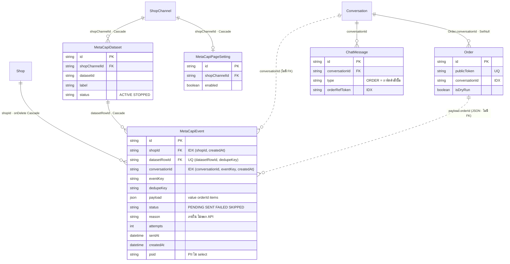

> **โมดูล:** 00097 - CAPI Event Log per Chat and Order
> **ประเภทเอกสาร:** DATABASE Design
> **เวอร์ชัน:** 0.1
> **วันที่จัดทำ:** 2026-11-16
> **สถานะ:** Draft
> **เจ้าของเอกสาร:** SA (ดู [[Feature-Docs-Ownership]])

# DATABASE: ดูเหตุการณ์ Conversions API ในห้องแชทและในคำสั่งซื้อ

---

## 1. Overview

**ไม่มี migration · ไม่มีตาราง/คอลัมน์/ดัชนีใหม่** — ฟีเจอร์นี้อ่านตารางของ 00089 (`MetaCapiEvent` · `MetaCapiDataset` · `MetaCapiPageSetting`) และตารางแชท/คำสั่งซื้อเดิม (`Conversation` · `ChatMessage` · `Order` · `ShopChannel`) ด้วยดัชนีที่มีอยู่ ไม่มีการเขียนใด ๆ

- **เอกสารออกแบบต้นทาง:** [[SDS]] ของโมดูลนี้ (TD-001 · TD-003 · TD-007)
- **Store ที่เกี่ยวข้อง:** PostgreSQL 16 (Supabase) ผ่าน Prisma — store เดียว
- **Engine / Charset (ถ้ามี):** Postgres · `payload` เป็น `jsonb` (Prisma `Json`)

---

## 2. ERD



---

## 3. Tables

ไม่มีตารางใหม่หรือคอลัมน์ใหม่ — ตารางที่อ่าน (คอลัมน์เฉพาะที่ฟีเจอร์นี้ใช้):

### 3.1 `MetaCapiEvent` (Postgres · 00089)

ใช้เป็นแหล่งเดียวของบรรทัด/การ์ด/หน้าบันทึก ([[SDS]] TD-001 · TD-005) · 🛑 select เฉพาะคอลัมน์ข้างล่าง — `psid` `pageId` `lastRequest` `lastResponse` `lastHttpStatus` `lockedAt` `nextAttemptAt` ห้ามอยู่ใน select

| Column | Type | Null | Default | Key |
|--------|------|------|---------|-----|
| `id` | `text (uuid)` | `NO` | `uuid()` | `PK` |
| `shopId` | `text` | `NO` | `-` | `FK Shop · IDX (shopId, createdAt)` |
| `datasetRowId` | `text` | `NO` | `-` | `FK MetaCapiDataset · UQ (datasetRowId, dedupeKey)` |
| `conversationId` | `text` | `YES` | `NULL` | `IDX (conversationId, eventKey, createdAt)` |
| `eventKey` | `text` | `NO` | `-` | `-` |
| `dedupeKey` | `text` | `NO` | `-` | `UQ ร่วม datasetRowId` |
| `payload` | `jsonb` | `NO` | `'{}'` | `-` (อ่าน `value` · `orderId`) |
| `status` | `text` | `NO` | `'PENDING'` | `IDX (status, nextAttemptAt)` |
| `reason` | `text` | `YES` | `NULL` | `-` (แปลงเป็น `reasonKey` ใน service) |
| `attempts` | `int` | `NO` | `0` | `-` |
| `sentAt` | `timestamptz(3)` | `YES` | `NULL` | `-` |
| `createdAt` | `timestamptz(3)` | `NO` | `now()` | `-` |

### 3.2 `MetaCapiDataset` · `MetaCapiPageSetting` (Postgres · 00089)

| Column | Type | Null | Default | Key |
|--------|------|------|---------|-----|
| `MetaCapiDataset.label` | `text` | `YES` | `NULL` | `-` |
| `MetaCapiDataset.datasetId` | `text` | `NO` | `-` | `UQ (shopChannelId, datasetId)` |
| `MetaCapiDataset.status` | `text` | `NO` | `'ACTIVE'` | `-` |
| `MetaCapiDataset.shopChannelId` | `text` | `NO` | `-` | `FK ShopChannel` |
| `MetaCapiPageSetting.enabled` | `boolean` | `NO` | — | `UQ shopChannelId` |

### 3.3 `ChatMessage` · `Order` · `Conversation` (Postgres · เดิม)

| Column | Type | Null | Default | Key |
|--------|------|------|---------|-----|
| `ChatMessage.orderRefToken` | `text` | `YES` | `NULL` | `IDX (orderRefToken)` |
| `ChatMessage.type` | `text` | `NO` | `'TEXT'` | `-` |
| `ChatMessage.conversationId` | `text` | `NO` | `-` | `FK Conversation` |
| `Order.publicToken` | `text` | `NO` | `uuid()` | `UQ` |
| `Order.conversationId` | `text` | `YES` | `NULL` | `IDX Order_conversationId_idx` |
| `Order.isDryRun` | `boolean` | `NO` | `false` | `-` |
| `Conversation.channel` · `.shopChannelId` · `.shopId` | `text` | — | — | PK lookup |

---

## 4. Indexes

ไม่สร้างดัชนีใหม่ — query ที่ใช้และดัชนีที่ตั้งใจให้ planner ใช้:

| Table | Columns | Type | Rationale (query pattern ที่รองรับ) |
|-------|---------|------|--------------------------------------|
| `MetaCapiEvent` | `(conversationId, eventKey, createdAt)` (มีอยู่) | `BTREE composite` | Q1 บรรทัดของห้อง · Q2/Q4 จำกัดด้วย `conversationId IN convSet` · Q3 ตัวกรองแชท — ใช้ prefix `conversationId` (เรียง `createdAt` ในหน่วยความจำ เพราะ `eventKey` คั่นกลาง — แถวต่อห้องน้อย) |
| `MetaCapiEvent` | `(shopId, createdAt)` (มีอยู่) | `BTREE composite` | หน้าบันทึกแบบไม่กรองแชท/ออเดอร์ (เดิม) — **ไม่ควร** ถูกเลือกสำหรับ Q1–Q4 |
| `ChatMessage` | `(orderRefToken)` (มีอยู่) | `BTREE` | Q2 หา convSet จากการ์ดคำสั่งซื้อ |
| `Order` | `publicToken` (UQ มีอยู่) | `UNIQUE` | Q4 resolve `?order=` |

**Query ที่ใช้ (SQL ที่ Prisma สร้างโดยประมาณ):**

```sql
-- Q1 บรรทัดของห้อง (listConversationCapiEvents)
SELECT e.id, e."dedupeKey", e."eventKey", e.status, e.reason, e.attempts, e."sentAt", e."createdAt", e.payload,
       d.label, d."datasetId"
FROM "MetaCapiEvent" e JOIN "MetaCapiDataset" d ON d.id = e."datasetRowId"
WHERE e."shopId" = $shopId AND e."conversationId" = $conversationId
ORDER BY e."createdAt" DESC, e.id DESC
LIMIT 301;

-- Q2 การ์ดคำสั่งซื้อ (listOrderCapiEvents)
SELECT DISTINCT m."conversationId"
FROM "ChatMessage" m JOIN "Conversation" c ON c.id = m."conversationId"
WHERE m."orderRefToken" = $publicToken AND m.type = 'ORDER' AND c."shopId" = $shopId;
-- convSet = ผลข้างบน ∪ {Order.conversationId}
SELECT …(คอลัมน์เท่า Q1)…, d."shopChannelId"
FROM "MetaCapiEvent" e JOIN "MetaCapiDataset" d ON d.id = e."datasetRowId"
WHERE e."shopId" = $shopId
  AND e."conversationId" = ANY($convSet)
  AND e.payload #> '{orderId}' = to_jsonb($orderId::text)   -- Prisma: payload: { path: ['orderId'], equals: orderId }
ORDER BY e."createdAt" DESC, e.id DESC;

-- Q3 หน้าบันทึก กรองแชท (listCapiLog + conversationId)
… WHERE e."shopId" = $shopId AND d."shopChannelId" = $channelId AND e."conversationId" = $conversationId
      [AND e.status = $status] [AND e."eventKey" = $eventKey]
ORDER BY e."createdAt" DESC, e.id DESC LIMIT $take+1 [cursor];

-- Q4 หน้าบันทึก กรองคำสั่งซื้อ (listCapiLog + orderToken)
SELECT id, "conversationId" FROM "Order" WHERE "publicToken" = $token AND "shopId" = $shopId;
-- แล้ว Q2 (convSet) + เงื่อนไข d."shopChannelId" = $channelId + cursor/take เหมือน Q3
```

---

## 5. Migration Plan

### 5.1 ลำดับการ Migrate

| ลำดับ | การเปลี่ยนแปลง | Submodule / Store | หมายเหตุ (dependency) |
|-------|----------------|--------------------|------------------------|
| — | **ไม่มี migration** | deep-web → Postgres | push `main` ไม่รัน DDL ใหม่ (HR15 ไม่ต้องแจ้ง 3 ข้อ) |
| (เงื่อนไข) | `@@index([conversationId, createdAt])` บน `MetaCapiEvent` — **ทำเฉพาะเมื่อ** ด่านยืนยันข้างล่างไม่ผ่าน | deep-web → Postgres | additive · ต้องแจ้ง user 3 ข้อตาม HR15 ก่อน |

**ด่านยืนยันก่อน merge (ทำแล้ว 2026-11-16 — ผ่าน · ไม่ต้อง migration):** seed ฐาน dev (`localhost:5434`) 24,300 แถว `MetaCapiEvent` · 5 ร้าน × 600 ห้อง (3,000 ห้อง) × 3 ชุดข้อมูล/ร้าน · 40 คำสั่งซื้อ + การ์ดคำสั่งซื้อ 40 ใบ · ห้องหนัก 1 ห้อง (309 แถว) · `ANALYZE "MetaCapiEvent"` ก่อนวัด · seed scope ด้วย id ที่สร้างเอง และลบหมดหลังวัด (ตรวจแล้ว leftover = 0) · SQL = ตาม §4 ทุกตัว (รัน 1 รอบอุ่น แล้ว `EXPLAIN (ANALYZE, BUFFERS)`)

| Query | แผนที่ planner เลือก | Execution | Buffers |
|-------|----------------------|-----------|---------|
| Q1 ห้องทั่วไป (9 แถว) | Bitmap Index Scan `MetaCapiEvent_conversationId_eventKey_createdAt_idx` → Bitmap Heap | 0.056 ms | 8 |
| Q1 ห้องหนัก (301 แถว) | BitmapAnd: `…conversationId_eventKey_createdAt_idx` (309 แถว) + `…shopId_createdAt_idx` (5,100 แถว) | 0.324 ms | 43 |
| Q2a convSet จากการ์ด | Index Scan `ChatMessage_orderRefToken_idx` | 0.043 ms | 11 |
| Q2b แถวของคำสั่งซื้อ | BitmapAnd เหมือน Q1 หนัก + Filter JSON path บน 120 แถว | 0.341 ms | 191 |
| Q3 หน้าบันทึก กรองห้อง | Bitmap Index Scan ดัชนีห้อง (ต่อ dataset ของเพจ) | 0.057 ms | 19 |
| Q4 หน้าบันทึก กรองคำสั่งซื้อ | BitmapAnd ดัชนีห้อง + `datasetRowId_dedupeKey_key` + JSON filter | 0.355 ms | 223 |

**Verdict: ผ่าน** — ทุก query ใช้ดัชนี `MetaCapiEvent_conversationId_eventKey_createdAt_idx` (ไม่มีตัวไหนสแกน `shopId_createdAt` ทั้งร้านเป็นหลัก) และ ≤ 0.4 ms (เกณฑ์ < 50 ms) · ข้อสังเกต: ที่ Q1 ห้องหนัก/Q2b planner เลือก BitmapAnd ที่ดึงดัชนี `shopId_createdAt` ของร้าน (5,100 แถว) มาตัดด้วย — ยังถูก (23 buffers) แต่ต้นทุนเส้นนี้โตตามจำนวนแถวต่อร้าน ถ้าร้านมีหลักแสนแถวให้วัดซ้ำบน prod (`EXPLAIN` อ่านอย่างเดียวผ่าน Supabase PAT) · ไม่มี migration

<details><summary>แผนเต็ม (paste จาก EXPLAIN ANALYZE)</summary>

```text
seeded rows (scoped)=24300 · rows in table=24300 · shops=5 · rooms=3000 · orders=40

### Q1 ห้องทั่วไป (~8 แถว)
Limit  (cost=37.17..37.18 rows=2 width=188) (actual time=0.038..0.039 rows=9 loops=1)
  Buffers: shared hit=8
  ->  Sort  (cost=37.17..37.18 rows=2 width=188) (actual time=0.038..0.038 rows=9 loops=1)
        Sort Key: e."createdAt" DESC, e.id DESC
        Sort Method: quicksort  Memory: 27kB
        Buffers: shared hit=8
        ->  Nested Loop  (cost=4.47..37.16 rows=2 width=188) (actual time=0.013..0.033 rows=9 loops=1)
              Join Filter: (e."datasetRowId" = d.id)
              Rows Removed by Join Filter: 144
              Buffers: shared hit=8
              ->  Seq Scan on "MetaCapiDataset" d  (cost=0.00..2.04 rows=4 width=73) (actual time=0.003..0.004 rows=17 loops=1)
                    Buffers: shared hit=2
              ->  Materialize  (cost=4.47..35.01 rows=2 width=189) (actual time=0.001..0.001 rows=9 loops=17)
                    Buffers: shared hit=6
                    ->  Bitmap Heap Scan on "MetaCapiEvent" e  (cost=4.47..35.00 rows=2 width=189) (actual time=0.007..0.009 rows=9 loops=1)
                          Recheck Cond: ("conversationId" = 'b1c21618-8663-4119-aadc-4e9c473ac5ad'::text)
                          Filter: ("shopId" = '6510d2b8-5850-4cc5-b0f0-123068297388'::text)
                          Heap Blocks: exact=3
                          Buffers: shared hit=6
                          ->  Bitmap Index Scan on "MetaCapiEvent_conversationId_eventKey_createdAt_idx"  (cost=0.00..4.47 rows=8 width=0) (actual time=0.005..0.005 rows=9 loops=1)
                                Index Cond: ("conversationId" = 'b1c21618-8663-4119-aadc-4e9c473ac5ad'::text)
                                Buffers: shared hit=3
Planning:
  Buffers: shared hit=12
Planning Time: 0.092 ms
Execution Time: 0.056 ms

### Q1 ห้องหนัก (300 แถว)
Limit  (cost=554.35..554.51 rows=65 width=188) (actual time=0.262..0.279 rows=301 loops=1)
  Buffers: shared hit=58
  ->  Sort  (cost=554.35..554.51 rows=65 width=188) (actual time=0.262..0.269 rows=301 loops=1)
        Sort Key: e."createdAt" DESC, e.id DESC
        Sort Method: quicksort  Memory: 104kB
        Buffers: shared hit=58
        ->  Nested Loop  (cost=325.68..552.39 rows=65 width=188) (actual time=0.110..0.202 rows=309 loops=1)
              Join Filter: (e."datasetRowId" = d.id)
              Rows Removed by Join Filter: 309
              Buffers: shared hit=58
              ->  Bitmap Heap Scan on "MetaCapiEvent" e  (cost=325.68..546.59 rows=65 width=189) (actual time=0.107..0.124 rows=309 loops=1)
                    Recheck Cond: (("conversationId" = '25420bab-e910-4426-9852-ddc77da3c5ab'::text) AND ("shopId" = '6510d2b8-5850-4cc5-b0f0-123068297388'::text))
                    Heap Blocks: exact=15
                    Buffers: shared hit=57
                    ->  BitmapAnd  (cost=325.68..325.68 rows=65 width=0) (actual time=0.106..0.106 rows=0 loops=1)
                          Buffers: shared hit=42
                          ->  Bitmap Index Scan on "MetaCapiEvent_conversationId_eventKey_createdAt_idx"  (cost=0.00..18.73 rows=309 width=0) (actual time=0.011..0.011 rows=309 loops=1)
                                Index Cond: ("conversationId" = '25420bab-e910-4426-9852-ddc77da3c5ab'::text)
                                Buffers: shared hit=5
                          ->  Bitmap Index Scan on "MetaCapiEvent_shopId_createdAt_idx"  (cost=0.00..306.66 rows=5100 width=0) (actual time=0.090..0.090 rows=5100 loops=1)
                                Index Cond: ("shopId" = '6510d2b8-5850-4cc5-b0f0-123068297388'::text)
                                Buffers: shared hit=37
              ->  Materialize  (cost=0.00..2.06 rows=4 width=73) (actual time=0.000..0.000 rows=2 loops=309)
                    Buffers: shared hit=1
                    ->  Seq Scan on "MetaCapiDataset" d  (cost=0.00..2.04 rows=4 width=73) (actual time=0.001..0.001 rows=3 loops=1)
                          Buffers: shared hit=1
Planning:
  Buffers: shared hit=12
Planning Time: 0.076 ms
Execution Time: 0.314 ms

### Q2a convSet จากการ์ด (ChatMessage)
Unique  (cost=16.77..16.78 rows=1 width=14) (actual time=0.023..0.024 rows=1 loops=1)
  Buffers: shared hit=10
  ->  Sort  (cost=16.77..16.78 rows=1 width=14) (actual time=0.023..0.023 rows=1 loops=1)
        Sort Key: m."conversationId"
        Sort Method: quicksort  Memory: 25kB
        Buffers: shared hit=10
        ->  Nested Loop  (cost=0.71..16.76 rows=1 width=14) (actual time=0.020..0.020 rows=1 loops=1)
              Join Filter: (c.id = m."conversationId")
              Rows Removed by Join Filter: 128
              Buffers: shared hit=10
              ->  Index Scan using "ChatMessage_orderRefToken_idx" on "ChatMessage" m  (cost=0.42..8.44 rows=1 width=14) (actual time=0.004..0.004 rows=1 loops=1)
                    Index Cond: ("orderRefToken" = 'd9ffcf49-e262-4a16-b9ab-66a74922153b'::text)
                    Filter: (type = 'ORDER'::text)
                    Buffers: shared hit=4
              ->  Index Scan using "Conversation_shopId_isHidden_isPinned_lastInboundAt_idx" on "Conversation" c  (cost=0.29..8.30 rows=1 width=14) (actual time=0.004..0.012 rows=129 loops=1)
                    Index Cond: ("shopId" = '6510d2b8-5850-4cc5-b0f0-123068297388'::text)
                    Buffers: shared hit=6
Planning:
  Buffers: shared hit=19
Planning Time: 0.088 ms
Execution Time: 0.032 ms

### Q2b แถวของคำสั่งซื้อ (convSet + JSON path)
Sort  (cost=413.51..413.51 rows=1 width=225) (actual time=0.166..0.169 rows=120 loops=1)
  Sort Key: e."createdAt" DESC, e.id DESC
  Sort Method: quicksort  Memory: 55kB
  Buffers: shared hit=170
  ->  Nested Loop  (cost=9.79..413.50 rows=1 width=225) (actual time=0.015..0.140 rows=120 loops=1)
        Join Filter: (e."datasetRowId" = d.id)
        Rows Removed by Join Filter: 120
        Buffers: shared hit=170
        ->  Bitmap Heap Scan on "MetaCapiEvent" e  (cost=9.79..411.41 rows=1 width=189) (actual time=0.013..0.071 rows=120 loops=1)
              Recheck Cond: ("conversationId" = ANY ('{1b7aee61-b6f0-49f0-959a-934cbfc47d7d,7aca1999-46a2-4f71-8e18-776cf058acf4}'::text[]))
              Filter: (("shopId" = '6510d2b8-5850-4cc5-b0f0-123068297388'::text) AND ((payload #> '{orderId}'::text[]) = to_jsonb('34432f7f-2c21-4e61-b650-accf1ddf936b'::text)))
              Heap Blocks: exact=43
              Buffers: shared hit=50
              ->  Bitmap Index Scan on "MetaCapiEvent_conversationId_eventKey_createdAt_idx"  (cost=0.00..9.79 rows=128 width=0) (actual time=0.010..0.010 rows=120 loops=1)
                    Index Cond: ("conversationId" = ANY ('{1b7aee61-b6f0-49f0-959a-934cbfc47d7d,7aca1999-46a2-4f71-8e18-776cf058acf4}'::text[]))
                    Buffers: shared hit=7
        ->  Seq Scan on "MetaCapiDataset" d  (cost=0.00..2.04 rows=4 width=110) (actual time=0.000..0.000 rows=2 loops=120)
              Buffers: shared hit=120
Planning:
  Buffers: shared hit=12
Planning Time: 0.085 ms
Execution Time: 0.195 ms

### Q3 หน้าบันทึก กรองห้อง
Limit  (cost=37.08..37.09 rows=1 width=216) (actual time=0.029..0.030 rows=9 loops=1)
  Buffers: shared hit=20
  ->  Sort  (cost=37.08..37.09 rows=1 width=216) (actual time=0.029..0.030 rows=9 loops=1)
        Sort Key: e."createdAt" DESC, e.id DESC
        Sort Method: quicksort  Memory: 27kB
        Buffers: shared hit=20
        ->  Nested Loop  (cost=4.47..37.07 rows=1 width=216) (actual time=0.008..0.025 rows=9 loops=1)
              Join Filter: (e."datasetRowId" = d.id)
              Rows Removed by Join Filter: 18
              Buffers: shared hit=20
              ->  Seq Scan on "MetaCapiDataset" d  (cost=0.00..2.05 rows=1 width=73) (actual time=0.001..0.002 rows=3 loops=1)
                    Filter: ("shopChannelId" = '659deaed-b902-4c8b-9fa7-c6917c2b75bb'::text)
                    Rows Removed by Filter: 14
                    Buffers: shared hit=2
              ->  Bitmap Heap Scan on "MetaCapiEvent" e  (cost=4.47..35.00 rows=2 width=217) (actual time=0.004..0.006 rows=9 loops=3)
                    Recheck Cond: ("conversationId" = 'b1c21618-8663-4119-aadc-4e9c473ac5ad'::text)
                    Filter: ("shopId" = '6510d2b8-5850-4cc5-b0f0-123068297388'::text)
                    Heap Blocks: exact=9
                    Buffers: shared hit=18
                    ->  Bitmap Index Scan on "MetaCapiEvent_conversationId_eventKey_createdAt_idx"  (cost=0.00..4.47 rows=8 width=0) (actual time=0.003..0.003 rows=9 loops=3)
                          Index Cond: ("conversationId" = 'b1c21618-8663-4119-aadc-4e9c473ac5ad'::text)
                          Buffers: shared hit=9
Planning:
  Buffers: shared hit=12
Planning Time: 0.069 ms
Execution Time: 0.047 ms

### Q4 หน้าบันทึก กรองคำสั่งซื้อ (convSet + JSON + ช่อง)
Limit  (cost=266.99..267.00 rows=1 width=123) (actual time=0.334..0.336 rows=21 loops=1)
  Buffers: shared hit=229
  ->  Sort  (cost=266.99..267.00 rows=1 width=123) (actual time=0.334..0.335 rows=21 loops=1)
        Sort Key: e."createdAt" DESC, e.id DESC
        Sort Method: top-N heapsort  Memory: 35kB
        Buffers: shared hit=229
        ->  Nested Loop  (cost=230.60..266.98 rows=1 width=123) (actual time=0.087..0.315 rows=120 loops=1)
              Buffers: shared hit=229
              ->  Seq Scan on "MetaCapiDataset" d  (cost=0.00..2.05 rows=1 width=69) (actual time=0.003..0.004 rows=3 loops=1)
                    Filter: ("shopChannelId" = '659deaed-b902-4c8b-9fa7-c6917c2b75bb'::text)
                    Rows Removed by Filter: 14
                    Buffers: shared hit=2
              ->  Bitmap Heap Scan on "MetaCapiEvent" e  (cost=230.60..264.92 rows=1 width=128) (actual time=0.080..0.100 rows=40 loops=3)
                    Recheck Cond: (("conversationId" = ANY ('{1b7aee61-b6f0-49f0-959a-934cbfc47d7d,7aca1999-46a2-4f71-8e18-776cf058acf4}'::text[])) AND ("datasetRowId" = d.id))
                    Filter: (("shopId" = '6510d2b8-5850-4cc5-b0f0-123068297388'::text) AND ((payload #> '{orderId}'::text[]) = to_jsonb('34432f7f-2c21-4e61-b650-accf1ddf936b'::text)))
                    Heap Blocks: exact=120
                    Buffers: shared hit=227
                    ->  BitmapAnd  (cost=230.60..230.60 rows=9 width=0) (actual time=0.078..0.078 rows=0 loops=3)
                          Buffers: shared hit=107
                          ->  Bitmap Index Scan on "MetaCapiEvent_conversationId_eventKey_createdAt_idx"  (cost=0.00..9.79 rows=128 width=0) (actual time=0.007..0.007 rows=120 loops=3)
                                Index Cond: ("conversationId" = ANY ('{1b7aee61-b6f0-49f0-959a-934cbfc47d7d,7aca1999-46a2-4f71-8e18-776cf058acf4}'::text[]))
                                Buffers: shared hit=21
                          ->  Bitmap Index Scan on "MetaCapiEvent_datasetRowId_dedupeKey_key"  (cost=0.00..220.56 rows=1620 width=0) (actual time=0.069..0.069 rows=1700 loops=3)
                                Index Cond: ("datasetRowId" = d.id)
                                Buffers: shared hit=86
Planning:
  Buffers: shared hit=12
Planning Time: 0.077 ms
Execution Time: 0.354 ms

cleanup: leftover events=0
```

</details>

### 5.2 Rollback

ไม่มี DDL ให้ rollback · ถอนฟีเจอร์ = revert โค้ด (route/UI) หรือปิด `OPEN_META_CAPI` (ปิดทั้ง 00089 ด้วย) · ถ้าเกิดกรณีเงื่อนไขและเพิ่มดัชนีแล้ว rollback = `DROP INDEX` (ไม่กระทบข้อมูล)

### 5.3 ผลกระทบ (Impact)

ไม่มี downtime/lock · ไม่เปลี่ยนข้อมูลเดิม · ข้อมูลที่บันทึกตั้งแต่ 00089 ขึ้น prod (2026-11-14) แสดงได้ทันทีโดยไม่ backfill · ไม่กระทบตัวส่ง (อ่านแถวเดียวกันแบบไม่ล็อก — `SELECT` ธรรมดา ไม่ใช้ `FOR UPDATE`) · คอมเมนต์ใน `prisma/schema.prisma` เหนือ `model MetaCapiEvent` ที่ยังเขียน "ลบแถวเก่ากว่า 180 วัน" แก้เป็น "เก็บถาวร (PR #230)" — เป็นคอมเมนต์ ไม่สร้าง migration

---

## 6. Retention / ข้อควรระวัง

- **Data Retention:** `MetaCapiEvent` เก็บถาวร (PR #230 ถอด purge 180 วัน) · หายเมื่อ `MetaCapiDataset` ถูกลบ หรือแถว `ShopChannel` ถูกลบ (cascade) หรือร้านถูกลบ · **ยกเลิกการเชื่อมเพจไม่ลบ** — ตั้ง `ShopChannel.status=DISCONNECTED` (`shop-channel.service.ts`) แถวบันทึกจึงยังอยู่ (ไม่พบโค้ดที่ลบแถว `ShopChannel` ใน `src/services`/`src/app/api`) · ตารางโตต่อเนื่องตามจำนวนเหตุการณ์ × ชุดข้อมูล — เหตุผลที่ query ต้องเริ่มจากห้องเสมอ
- **PII / ข้อมูลอ่อนไหว:** `psid` (ระบุตัวลูกค้าใน Messenger) · `lastRequest`/`lastResponse` (ข้อมูลดิบ) — ไม่อยู่ใน select ของ service ใด ๆ ในฟีเจอร์นี้ · `payload.items` อ่านเฉพาะฝั่ง server เพื่อดึง `value` ไม่ออก API · ยอด (`value`) เป็นข้อมูลการเงิน → เฉพาะ X9
- **Performance:** ความเสี่ยงเดียวคือ planner เลือก `(shopId, createdAt)` สำหรับ Q1–Q4 (ดู §5.1) · Q2 JSON-path filter ทำบนชุดแถวของ convSet เท่านั้น · ห้ามค้น `payload.orderId` โดยไม่มี `conversationId IN …`
- **Consistency ข้าม store:** store เดียว · แหล่งความจริงของสถานะ = `MetaCapiEvent.status/sentAt` ที่ตัวส่งเขียน · `conversationId` และ `payload.orderId` เป็นภาพนิ่งตอนเข้าคิว ไม่มี FK — ห้อง/คำสั่งซื้อถูกลบภายหลัง แถวยังอยู่ (route ห้องคืน 404 เพราะหาห้องไม่เจอ · การ์ดคำสั่งซื้อหายไปพร้อมคำสั่งซื้อ)

---

## 7. Traceability

| Table / Collection | SDS Component / Decision | สถานะ |
|--------------------|--------------------------|-------|
| `MetaCapiEvent` | `listConversationCapiEvents` · `listOrderCapiEvents` · `listCapiLog` · TD-001 · TD-003 | Draft |
| `MetaCapiDataset` · `MetaCapiPageSetting` | `pageStopped` · `pageState` การ์ดคำสั่งซื้อ (TFR-005/006) | Draft |
| `ChatMessage` (`orderRefToken`) | convSet · TD-003 | Draft |
| `Order` · `Conversation` | ด่านห้อง/คำสั่งซื้อ · ชิปหน้าบันทึก (TFR-007) | Draft |

---

## 8. สรุป (Summary)

เอกสาร DATABASE นี้กำหนด **โครงสร้างข้อมูล** ของ **มุมมองเหตุการณ์ CAPI ต่อห้องและต่อคำสั่งซื้อ** ให้ DEV นำไปเขียน migration จริง
ตาม convention ของแต่ละ submodule, QA ใช้เข้าใจ data model เพื่อวางแผนทดสอบ และทุกตาราง
trace กลับ [[SDS]] ได้ — ในฟีเจอร์นี้ **ไม่มี migration** ใช้ดัชนีเดิมทั้งหมด โดยมีด่านยืนยันแผน query ก่อน merge

**Open Questions:**
- ~~ผล EXPLAIN~~ — ตอบแล้ว 2026-11-16 (§5.1): ไม่ต้องเพิ่มดัชนี · แนะนำวัดซ้ำบน prod เมื่อมีข้อมูลจริงมากขึ้น
