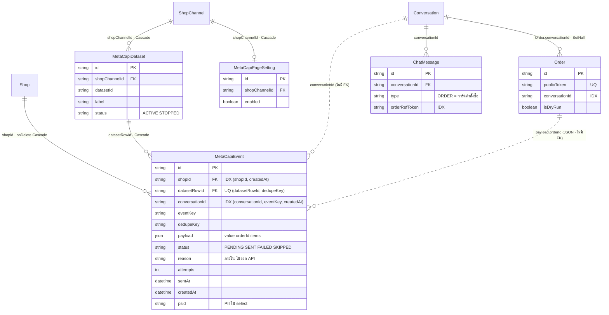

> **โมดูล:** 00097 - CAPI Event Log per Chat and Order
> **ประเภทเอกสาร:** DATABASE Design
> **เวอร์ชัน:** 0.1
> **วันที่จัดทำ:** 2026-11-16
> **สถานะ:** Draft
> **เจ้าของเอกสาร:** SA (ดู [[Feature-Docs-Ownership]])

# DATABASE: ดูเหตุการณ์ Conversions API ในห้องแชทและในคำสั่งซื้อ

---

## 1. Overview

**ไม่มี migration · ไม่มีตาราง/คอลัมน์/ดัชนีใหม่** — ฟีเจอร์นี้อ่านตารางของ 00089 (`MetaCapiEvent` · `MetaCapiDataset` · `MetaCapiPageSetting`) และตารางแชท/คำสั่งซื้อเดิม (`Conversation` · `ChatMessage` · `Order` · `ShopChannel`) ด้วยดัชนีที่มีอยู่ ไม่มีการเขียนใด ๆ

- **เอกสารออกแบบต้นทาง:** [[SDS]] ของโมดูลนี้ (TD-001 · TD-003 · TD-007)
- **Store ที่เกี่ยวข้อง:** PostgreSQL 16 (Supabase) ผ่าน Prisma — store เดียว
- **Engine / Charset (ถ้ามี):** Postgres · `payload` เป็น `jsonb` (Prisma `Json`)

---

## 2. ERD



---

## 3. Tables

ไม่มีตารางใหม่หรือคอลัมน์ใหม่ — ตารางที่อ่าน (คอลัมน์เฉพาะที่ฟีเจอร์นี้ใช้):

### 3.1 `MetaCapiEvent` (Postgres · 00089)

ใช้เป็นแหล่งเดียวของบรรทัด/การ์ด/หน้าบันทึก ([[SDS]] TD-001 · TD-005) · 🛑 select เฉพาะคอลัมน์ข้างล่าง — `psid` `pageId` `lastRequest` `lastResponse` `lastHttpStatus` `lockedAt` `nextAttemptAt` ห้ามอยู่ใน select

| Column | Type | Null | Default | Key |
|--------|------|------|---------|-----|
| `id` | `text (uuid)` | `NO` | `uuid()` | `PK` |
| `shopId` | `text` | `NO` | `-` | `FK Shop · IDX (shopId, createdAt)` |
| `datasetRowId` | `text` | `NO` | `-` | `FK MetaCapiDataset · UQ (datasetRowId, dedupeKey)` |
| `conversationId` | `text` | `YES` | `NULL` | `IDX (conversationId, eventKey, createdAt)` |
| `eventKey` | `text` | `NO` | `-` | `-` |
| `dedupeKey` | `text` | `NO` | `-` | `UQ ร่วม datasetRowId` |
| `payload` | `jsonb` | `NO` | `'{}'` | `-` (อ่าน `value` · `orderId`) |
| `status` | `text` | `NO` | `'PENDING'` | `IDX (status, nextAttemptAt)` |
| `reason` | `text` | `YES` | `NULL` | `-` (แปลงเป็น `reasonKey` ใน service) |
| `attempts` | `int` | `NO` | `0` | `-` |
| `sentAt` | `timestamptz(3)` | `YES` | `NULL` | `-` |
| `createdAt` | `timestamptz(3)` | `NO` | `now()` | `-` |

### 3.2 `MetaCapiDataset` · `MetaCapiPageSetting` (Postgres · 00089)

| Column | Type | Null | Default | Key |
|--------|------|------|---------|-----|
| `MetaCapiDataset.label` | `text` | `YES` | `NULL` | `-` |
| `MetaCapiDataset.datasetId` | `text` | `NO` | `-` | `UQ (shopChannelId, datasetId)` |
| `MetaCapiDataset.status` | `text` | `NO` | `'ACTIVE'` | `-` |
| `MetaCapiDataset.shopChannelId` | `text` | `NO` | `-` | `FK ShopChannel` |
| `MetaCapiPageSetting.enabled` | `boolean` | `NO` | — | `UQ shopChannelId` |

### 3.3 `ChatMessage` · `Order` · `Conversation` (Postgres · เดิม)

| Column | Type | Null | Default | Key |
|--------|------|------|---------|-----|
| `ChatMessage.orderRefToken` | `text` | `YES` | `NULL` | `IDX (orderRefToken)` |
| `ChatMessage.type` | `text` | `NO` | `'TEXT'` | `-` |
| `ChatMessage.conversationId` | `text` | `NO` | `-` | `FK Conversation` |
| `Order.publicToken` | `text` | `NO` | `uuid()` | `UQ` |
| `Order.conversationId` | `text` | `YES` | `NULL` | `IDX Order_conversationId_idx` |
| `Order.isDryRun` | `boolean` | `NO` | `false` | `-` |
| `Conversation.channel` · `.shopChannelId` · `.shopId` | `text` | — | — | PK lookup |

---

## 4. Indexes

ไม่สร้างดัชนีใหม่ — query ที่ใช้และดัชนีที่ตั้งใจให้ planner ใช้:

| Table | Columns | Type | Rationale (query pattern ที่รองรับ) |
|-------|---------|------|--------------------------------------|
| `MetaCapiEvent` | `(conversationId, eventKey, createdAt)` (มีอยู่) | `BTREE composite` | Q1 บรรทัดของห้อง · Q2/Q4 จำกัดด้วย `conversationId IN convSet` · Q3 ตัวกรองแชท — ใช้ prefix `conversationId` (เรียง `createdAt` ในหน่วยความจำ เพราะ `eventKey` คั่นกลาง — แถวต่อห้องน้อย) |
| `MetaCapiEvent` | `(shopId, createdAt)` (มีอยู่) | `BTREE composite` | หน้าบันทึกแบบไม่กรองแชท/ออเดอร์ (เดิม) — **ไม่ควร** ถูกเลือกสำหรับ Q1–Q4 |
| `ChatMessage` | `(orderRefToken)` (มีอยู่) | `BTREE` | Q2 หา convSet จากการ์ดคำสั่งซื้อ |
| `Order` | `publicToken` (UQ มีอยู่) | `UNIQUE` | Q4 resolve `?order=` |

**Query ที่ใช้ (SQL ที่ Prisma สร้างโดยประมาณ):**

```sql
-- Q1 บรรทัดของห้อง (listConversationCapiEvents)
SELECT e.id, e."dedupeKey", e."eventKey", e.status, e.reason, e.attempts, e."sentAt", e."createdAt", e.payload,
       d.label, d."datasetId"
FROM "MetaCapiEvent" e JOIN "MetaCapiDataset" d ON d.id = e."datasetRowId"
WHERE e."shopId" = $shopId AND e."conversationId" = $conversationId
ORDER BY e."createdAt" DESC, e.id DESC
LIMIT 301;

-- Q2 การ์ดคำสั่งซื้อ (listOrderCapiEvents)
SELECT DISTINCT m."conversationId"
FROM "ChatMessage" m JOIN "Conversation" c ON c.id = m."conversationId"
WHERE m."orderRefToken" = $publicToken AND m.type = 'ORDER' AND c."shopId" = $shopId;
-- convSet = ผลข้างบน ∪ {Order.conversationId}
SELECT …(คอลัมน์เท่า Q1)…, d."shopChannelId"
FROM "MetaCapiEvent" e JOIN "MetaCapiDataset" d ON d.id = e."datasetRowId"
WHERE e."shopId" = $shopId
  AND e."conversationId" = ANY($convSet)
  AND e.payload #> '{orderId}' = to_jsonb($orderId::text)   -- Prisma: payload: { path: ['orderId'], equals: orderId }
ORDER BY e."createdAt" DESC, e.id DESC;

-- Q3 หน้าบันทึก กรองแชท (listCapiLog + conversationId)
… WHERE e."shopId" = $shopId AND d."shopChannelId" = $channelId AND e."conversationId" = $conversationId
      [AND e.status = $status] [AND e."eventKey" = $eventKey]
ORDER BY e."createdAt" DESC, e.id DESC LIMIT $take+1 [cursor];

-- Q4 หน้าบันทึก กรองคำสั่งซื้อ (listCapiLog + orderToken)
SELECT id, "conversationId" FROM "Order" WHERE "publicToken" = $token AND "shopId" = $shopId;
-- แล้ว Q2 (convSet) + เงื่อนไข d."shopChannelId" = $channelId + cursor/take เหมือน Q3
```

---

## 5. Migration Plan

### 5.1 ลำดับการ Migrate

| ลำดับ | การเปลี่ยนแปลง | Submodule / Store | หมายเหตุ (dependency) |
|-------|----------------|--------------------|------------------------|
| — | **ไม่มี migration** | deep-web → Postgres | push `main` ไม่รัน DDL ใหม่ (HR15 ไม่ต้องแจ้ง 3 ข้อ) |
| (เงื่อนไข) | `@@index([conversationId, createdAt])` บน `MetaCapiEvent` — **ทำเฉพาะเมื่อ** ด่านยืนยันข้างล่างไม่ผ่าน | deep-web → Postgres | additive · ต้องแจ้ง user 3 ข้อตาม HR15 ก่อน |

**ด่านยืนยันก่อน merge (ยังไม่ได้ทำ):** ฐาน dev ณ 2026-11-16 มี `MetaCapiEvent` = 0 แถว — `EXPLAIN` บนตารางว่างเลือก Seq Scan และเมื่อปิด seqscan เลือก `MetaCapiEvent_shopId_createdAt_idx` ทั้ง Q1 และ Q2 (สถิติตารางว่างไม่มีความหมาย) ⇒ ต้องรัน `EXPLAIN (ANALYZE, BUFFERS)` ของ Q1/Q2/Q3 บน dev ที่ seed ≥ 20,000 แถว กระจาย ≥ 5 ร้าน × ≥ 500 ห้อง (`ANALYZE "MetaCapiEvent"` ก่อน) หรือ `EXPLAIN` (ไม่ ANALYZE) แบบอ่านอย่างเดียวบน prod ผ่าน Supabase PAT · ผ่าน = แผนใช้ `MetaCapiEvent_conversationId_eventKey_createdAt_idx` (หรือ BitmapAnd ที่มีมัน) และ p95 < 50 ms · 🛑 คำสั่ง seed/ANALYZE ต้องปักหมุด URL localhost ในคำสั่งตรง ๆ (HR14) และ seed ต้อง scope ลบด้วย id ที่สร้าง (HR13)

### 5.2 Rollback

ไม่มี DDL ให้ rollback · ถอนฟีเจอร์ = revert โค้ด (route/UI) หรือปิด `OPEN_META_CAPI` (ปิดทั้ง 00089 ด้วย) · ถ้าเกิดกรณีเงื่อนไขและเพิ่มดัชนีแล้ว rollback = `DROP INDEX` (ไม่กระทบข้อมูล)

### 5.3 ผลกระทบ (Impact)

ไม่มี downtime/lock · ไม่เปลี่ยนข้อมูลเดิม · ข้อมูลที่บันทึกตั้งแต่ 00089 ขึ้น prod (2026-11-14) แสดงได้ทันทีโดยไม่ backfill · ไม่กระทบตัวส่ง (อ่านแถวเดียวกันแบบไม่ล็อก — `SELECT` ธรรมดา ไม่ใช้ `FOR UPDATE`) · คอมเมนต์ใน `prisma/schema.prisma` เหนือ `model MetaCapiEvent` ที่ยังเขียน "ลบแถวเก่ากว่า 180 วัน" แก้เป็น "เก็บถาวร (PR #230)" — เป็นคอมเมนต์ ไม่สร้าง migration

---

## 6. Retention / ข้อควรระวัง

- **Data Retention:** `MetaCapiEvent` เก็บถาวร (PR #230 ถอด purge 180 วัน) · หายเมื่อ `MetaCapiDataset` ถูกลบ หรือแถว `ShopChannel` ถูกลบ (cascade) หรือร้านถูกลบ · **ยกเลิกการเชื่อมเพจไม่ลบ** — ตั้ง `ShopChannel.status=DISCONNECTED` (`shop-channel.service.ts`) แถวบันทึกจึงยังอยู่ (ไม่พบโค้ดที่ลบแถว `ShopChannel` ใน `src/services`/`src/app/api`) · ตารางโตต่อเนื่องตามจำนวนเหตุการณ์ × ชุดข้อมูล — เหตุผลที่ query ต้องเริ่มจากห้องเสมอ
- **PII / ข้อมูลอ่อนไหว:** `psid` (ระบุตัวลูกค้าใน Messenger) · `lastRequest`/`lastResponse` (ข้อมูลดิบ) — ไม่อยู่ใน select ของ service ใด ๆ ในฟีเจอร์นี้ · `payload.items` อ่านเฉพาะฝั่ง server เพื่อดึง `value` ไม่ออก API · ยอด (`value`) เป็นข้อมูลการเงิน → เฉพาะ X9
- **Performance:** ความเสี่ยงเดียวคือ planner เลือก `(shopId, createdAt)` สำหรับ Q1–Q4 (ดู §5.1) · Q2 JSON-path filter ทำบนชุดแถวของ convSet เท่านั้น · ห้ามค้น `payload.orderId` โดยไม่มี `conversationId IN …`
- **Consistency ข้าม store:** store เดียว · แหล่งความจริงของสถานะ = `MetaCapiEvent.status/sentAt` ที่ตัวส่งเขียน · `conversationId` และ `payload.orderId` เป็นภาพนิ่งตอนเข้าคิว ไม่มี FK — ห้อง/คำสั่งซื้อถูกลบภายหลัง แถวยังอยู่ (route ห้องคืน 404 เพราะหาห้องไม่เจอ · การ์ดคำสั่งซื้อหายไปพร้อมคำสั่งซื้อ)

---

## 7. Traceability

| Table / Collection | SDS Component / Decision | สถานะ |
|--------------------|--------------------------|-------|
| `MetaCapiEvent` | `listConversationCapiEvents` · `listOrderCapiEvents` · `listCapiLog` · TD-001 · TD-003 | Draft |
| `MetaCapiDataset` · `MetaCapiPageSetting` | `pageStopped` · `pageState` การ์ดคำสั่งซื้อ (TFR-005/006) | Draft |
| `ChatMessage` (`orderRefToken`) | convSet · TD-003 | Draft |
| `Order` · `Conversation` | ด่านห้อง/คำสั่งซื้อ · ชิปหน้าบันทึก (TFR-007) | Draft |

---

## 8. สรุป (Summary)

เอกสาร DATABASE นี้กำหนด **โครงสร้างข้อมูล** ของ **มุมมองเหตุการณ์ CAPI ต่อห้องและต่อคำสั่งซื้อ** ให้ DEV นำไปเขียน migration จริง
ตาม convention ของแต่ละ submodule, QA ใช้เข้าใจ data model เพื่อวางแผนทดสอบ และทุกตาราง
trace กลับ [[SDS]] ได้ — ในฟีเจอร์นี้ **ไม่มี migration** ใช้ดัชนีเดิมทั้งหมด โดยมีด่านยืนยันแผน query ก่อน merge

**Open Questions:**
- ผล EXPLAIN บนข้อมูลที่มีสถิติจริง (ฐาน dev ว่าง ณ วันที่เขียน) — ตัดสินว่าต้องเพิ่มดัชนี `(conversationId, createdAt)` หรือไม่
