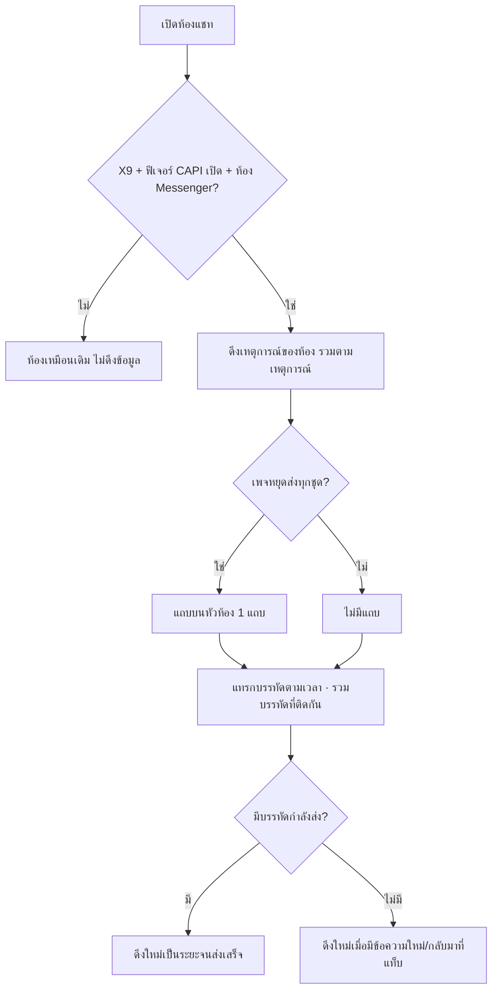

> **โมดูล:** 00097 - CAPI Event Log per Chat and Order
> **ประเภทเอกสาร:** Product Requirements Document (PRD)
> **เวอร์ชัน:** 0.2
> **วันที่จัดทำ:** 2026-11-16
> **สถานะ:** Approved — user ตอบ "OK เลย" 2026-11-16 รับข้อเสนอทุกข้อ (มติครบใน [[BRD]] §8.6) · ม็อกอัพที่อนุมัติ `docs/superpowers/specs/2026-11-16-00097-capi-event-log-mockup.{html,md}`
> **เจ้าของเอกสาร:** BA + PO + PM (ดู [[Feature-Docs-Ownership]])
> **ที่มา:** ลูกค้าขอผ่าน user 2026-11-16 — "อยากให้เพิ่ม log บอกในแต่ละ conversation + order ด้วยว่ามีการส่ง conversion api event ไหนไปให้บ้าง"

# PRD: ดูเหตุการณ์ Conversions API ที่ส่งให้ Meta ในห้องแชทและในคำสั่งซื้อ

---

## Executive Summary

ฟีเจอร์ 00089 ส่งเหตุการณ์จากห้องแชท Messenger (สร้างคำสั่งซื้อ · ซื้อ · จัดส่ง · ผู้สนใจ ฯลฯ) ไปที่ Meta แล้ว แต่ร้านดูผลได้ที่เดียวคือหน้า "บันทึกการส่ง" ต่อเพจ ซึ่งเป็นรายการรวมทุกห้องทุกออเดอร์ กรองได้แค่สถานะกับชื่อเหตุการณ์ เวลาคนยิงแอดอยากรู้ว่า "ออเดอร์นี้ Meta ได้ Purchase หรือยัง" หรือ "แชทนี้ส่งอะไรไปบ้าง" ต้องไล่หาเองในรายการยาว

ฟีเจอร์นี้แสดงเหตุการณ์ที่ส่ง **ตรงที่ร้านกำลังดูอยู่** 3 จุด:

1. **ในห้องแชท** — บรรทัดตัวเทาตรงกลางห้อง แทรกตามเวลาปนกับข้อความ แบบเดียวกับบรรทัดระบบของ Meta (`META_NOTICE`) เช่น `ส่ง "ซื้อ" ให้ Meta · ฿1,070 · 11:20 · Meta รับแล้ว` ไม่ได้ส่งเข้า Facebook ลูกค้าไม่เห็น กดแล้วกางผลรายชุดข้อมูล + ลิงก์ "ดูในบันทึกการส่ง" · เหตุการณ์ที่ติดกันรวมเป็นบรรทัดเดียว · รายการที่ยังไม่ส่งขึ้น "กำลังส่ง …" จาง ๆ แล้วเปลี่ยนเป็นผลเองเมื่อส่งเสร็จ · เว็บและแอป Native ได้ในรอบเดียวกัน
2. **ในหน้ารายละเอียดคำสั่งซื้อ (เว็บ)** — การ์ด "Event ที่ส่งให้ Meta" ใต้ "ประวัติออเดอร์"
3. **ในหน้าบันทึกการส่งเดิม** — ตัวกรองแชท/ออเดอร์จากลิงก์ เป็นชิปที่กดล้างได้

เห็นเฉพาะผู้ที่มีสิทธิ์ X9 (ตอนนี้คือเจ้าของร้าน) — server ไม่ส่งข้อมูลนี้ให้คนอื่นเลย ไม่สร้างตารางใหม่ ใช้บันทึกการส่งที่มีอยู่ และเปลี่ยนคำสถานะ "สำเร็จ" เป็น "Meta รับแล้ว" ทั้งระบบ

---

## 1. Business Goals & KPIs

### 1.1 เป้าหมายทางธุรกิจ

| เป้าหมาย | รายละเอียด |
|----------|-----------|
| **ตอบคำถาม "Meta ได้รับไหม" ตรงจุดที่ทำงาน** | เจ้าของร้านเห็นในห้องแชทและหน้าคำสั่งซื้อทันทีว่าเหตุการณ์ไหน Meta รับแล้ว ไม่ต้องไล่หน้าบันทึกรวม |
| **ร้านเชื่อตัวเลขใน Ads Manager มากขึ้น** | เห็นว่าออเดอร์ไหนส่ง Purchase ไปแล้ว ยอดเท่าไร เทียบกับ Ads Manager เองได้ |
| **ลดคำถามที่มาถึงทีม Deep** | ร้านอ่านเหตุผลภาษาไทยของรายการที่รอ/ล้มเหลว/ข้ามได้เอง |

### 1.2 ตัวชี้วัดความสำเร็จ (KPIs)

| KPI | คำอธิบาย | เป้าหมาย |
|-----|----------|---------|
| **คำถามเรื่อง CAPI จากร้าน** | จำนวนครั้งที่ร้านถามทีม Deep ว่าเหตุการณ์ของแชท/ออเดอร์หนึ่งส่งแล้วหรือยัง | ลดลงหลังเปิดใช้ (นับด้วยมือจากช่องทางซัพพอร์ต) |
| **ความตรงกับหน้าบันทึก** | เหตุการณ์ที่แสดงในห้อง/ออเดอร์ตรงกับหน้าบันทึกที่กรองห้อง/ออเดอร์เดียวกัน | 100% (เทสอัตโนมัติ) |

---

## 2. User Personas (กลุ่มผู้ใช้งาน)

### 2.1 เจ้าของร้านที่ยิงโฆษณา Messenger (มีสิทธิ์ X9)

**ข้อมูลพื้นฐาน:**
- เปิด Conversions API ของ 00089 แล้วอย่างน้อย 1 เพจ ยิงแอด Click-to-Messenger ดูแลแอดเองหรือทำงานกับคนยิงแอด

**เป้าหมาย:**
- ยืนยันว่าออเดอร์ที่ปิดในแชทถูกรายงานเป็น Purchase พร้อมยอดที่ถูกต้อง

**ความต้องการ:**
- เห็นในห้องแชทไปพร้อมกับบทสนทนาว่าระบบส่งอะไรให้ Meta ตอนไหน · เห็นเหตุผลภาษาไทยเมื่อ Meta ยังไม่รับ

**จุดปวด (Pain Points):**
- หน้าบันทึกการส่งเป็นรายการรวมทั้งเพจ ไม่มีตัวกรองตามห้องหรือออเดอร์
- เห็นยอดใน Ads Manager ไม่ตรงกับยอดขาย แต่ชี้ไม่ได้ว่าออเดอร์ไหนหายไป

### 2.2 แอดมินแชท / พนักงานร้าน (ไม่มีสิทธิ์ X9)

**ข้อมูลพื้นฐาน:**
- ตอบแชทและสร้างคำสั่งซื้อ การกระทำของเขาเป็นตัวจุดเหตุการณ์

**เป้าหมาย:**
- ทำงานในห้องแชทได้โดยไม่มีข้อมูลที่ไม่เกี่ยวกับงานมาแทรก

**ความต้องการ:**
- ไม่เห็นบรรทัด/การ์ด/แถบใด ๆ ของฟีเจอร์นี้ (มติ D1)

**จุดปวด (Pain Points):**
- ไม่มี (ห้องแชทและหน้าคำสั่งซื้อเหมือนเดิมทุกอย่าง)

---

## 3. Business Requirements

### 3.1 บรรทัดเหตุการณ์กลางห้องแชท (เว็บ + Native)

**ความต้องการ:**
- ในรายการข้อความของห้อง แทรกบรรทัดตัวเทาตรงกลาง 1 บรรทัดต่อ 1 เหตุการณ์ เรียงตามเวลาปนกับข้อความ: `ส่ง "{ชื่อเหตุการณ์}" ให้ Meta · ยอด · เวลา · ผล`
- เหตุการณ์ที่อยู่ติดกัน (ไม่มีข้อความคั่น) รวมเป็นบรรทัดเดียว: `ส่ง 3 event ให้ Meta · Meta รับแล้วทั้งหมด`
- กดบรรทัดแล้วกางผลรายชุดข้อมูล ("Meta รับเมื่อ …" หรือเหตุผล) + ลิงก์ "ดูในบันทึกการส่ง" ที่กรองห้องนี้
- เหตุการณ์ที่ยังไม่เคยยิง ขึ้นจาง ๆ "กำลังส่ง "…" ให้ Meta…" แล้วเปลี่ยนเป็นผลเองโดยไม่ต้องรีโหลด
- เพจที่หยุดส่งทุกชุดข้อมูล: แถบเดียวบนหัวห้อง แทนการเขียน "รอเชื่อมเพจใหม่" ซ้ำทุกบรรทัด
- แอป Native ทำบรรทัดในห้องแชทชุดเดียวกันในรอบนี้

**Business Rules:**
- เห็นเฉพาะผู้มีสิทธิ์ X9 และเมื่อฟีเจอร์ CAPI เปิดให้ร้านนั้น · server ไม่ส่งข้อมูลลงมาให้ผู้ไม่มีสิทธิ์
- เฉพาะห้อง Messenger — ห้องช่องทางอื่นไม่มีอะไรเปลี่ยน
- บรรทัดไม่ใช่ข้อความ: ไม่ส่งเข้า Facebook · ไม่โผล่ในรายการแชท/ข้อความล่าสุด · ไม่นับเป็นข้อความ · สถานะเปลี่ยนได้
- 1 เหตุการณ์ = แถวบันทึกทุกชุดข้อมูลที่มีคีย์กันซ้ำเดียวกัน · ตัวเลขทุกตัว ("3 event", "รับแล้ว 1 จาก 2") นับหลังรวมแล้ว

**เหตุผล:**
- ห้องแชทคือที่เจ้าของร้านเห็นลูกค้าจากแอด การเห็นว่าส่งอะไรไป "ตรงจังหวะในบทสนทนา" ตอบคำถามได้เร็วกว่าส่วนแยกในแผงข้าง (user 2026-11-16: "อยากให้อยู่ตรงกลาง chat เลย เหมือนเป็น 1 ใน chat message แค่ไม่ส่งเข้า facebook")

### 3.2 การ์ดในหน้ารายละเอียดคำสั่งซื้อ (เว็บ)

**ความต้องการ:**
- การ์ด "Event ที่ส่งให้ Meta" ใต้การ์ด "ประวัติออเดอร์" แสดงทุกเหตุการณ์ของคำสั่งซื้อ (สร้าง · ซื้อ · แนบสลิป · จัดส่ง · ส่งถึง · ยกเลิก · คืน · ส่งลิงก์สั่งซื้อ · ทิ้งตะกร้า) เรียงใหม่ → เก่า + ปุ่ม "ดูในบันทึกการส่ง" ที่กรองคำสั่งซื้อนี้

**Business Rules:**
- สิทธิ์และสวิตช์เหมือน 3.1 · แอป Native ไม่ทำรอบนี้
- คำสั่งซื้อที่ไม่เกี่ยวกับแชท Messenger และไม่มีเหตุการณ์ = ไม่แสดงการ์ด · คำสั่งซื้อทดลอง = ไม่แสดง

**เหตุผล:**
- คำถามที่ร้านถามบ่อยที่สุดคือ "ออเดอร์นี้ส่ง Purchase แล้วหรือยัง"

### 3.3 ตัวกรองแชท/ออเดอร์ในหน้าบันทึกการส่ง

**ความต้องการ:**
- หน้าบันทึกการส่งเดิมรับตัวกรอง "แชทนี้" / "ออเดอร์นี้" จากลิงก์ · แสดงเป็นชิปที่กดล้างได้ · กรองแชทแล้วซ่อนคอลัมน์ "ลูกค้า" (ซ้ำทุกแถว) · แถวที่ Meta รับแล้วแสดง "Meta รับเมื่อ {เวลา}"

**Business Rules:**
- ใช้ร่วมกับตัวกรองสถานะ/เหตุการณ์เดิมได้ · ตารางยังเป็น 1 แถวต่อชุดข้อมูล · ไม่มีปุ่มส่งซ้ำ

**เหตุผล:**
- ใช้หน้าที่มีอยู่เป็นที่ดูครบ แทนการสร้างหน้าใหม่

### 3.4 คำสถานะทั้งระบบ

**ความต้องการ:**
- เปลี่ยนคำสถานะ "สำเร็จ" เป็น **"Meta รับแล้ว"** ทุกที่ (หน้าบันทึกการส่ง · การ์ดสถิติ · บรรทัดในห้อง · การ์ดออเดอร์) — สถานะอื่นคงเดิม

**สถานะที่ต้องรองรับ:**

| สถานะ | ชื่อภาษาไทย | คำอธิบาย | การใช้งาน |
|-------|------------|----------|----------|
| **SENT** | Meta รับแล้ว | Meta ตอบรับเหตุการณ์แล้ว (ไม่ได้แปลว่าจับคู่กับแอดได้) | ไม่มีเหตุผลต่อท้าย · แสดง "Meta รับเมื่อ {เวลา}" |
| **PENDING** | รอ | อยู่ในคิว / รอลองใหม่ / ชุดข้อมูลหยุดรอเชื่อมเพจใหม่ | ยังไม่เคยยิง = "กำลังส่ง …" ในห้องแชท · อื่น ๆ แสดงเหตุผล |
| **FAILED** | ล้มเหลว | Meta ไม่รับ หรือลองครบ 3 ครั้ง | แสดงเหตุผลภาษาไทย |
| **SKIPPED** | ข้าม | เก่ากว่า 7 วัน Meta ไม่รับ | แสดงเหตุผลภาษาไทย |

**เหตุผล:**
- "สำเร็จ" วางข้างชื่อเหตุการณ์ "ซื้อ" อ่านได้ว่า "ปิดการขายสำเร็จ" · คำต้องเป็นนิยามเดียวทั้งระบบ (HR16) จึงเปลี่ยนพร้อมกันทุกจุด

---

## 4. Business Rules & Constraints

### 4.1 กฎทางธุรกิจหลัก

| กฎ | คำอธิบาย |
|----|----------|
| **สิทธิ์ X9 เท่านั้น** | ไม่มีสิทธิ์ = ไม่เห็นอะไร และ server ไม่ส่งข้อมูลลงมา (ตัดที่ต้นทาง ไม่ใช่ซ่อนฝั่งหน้าจอ) |
| **อ่านอย่างเดียว** | แสดงสิ่งที่บันทึกไว้แล้ว ไม่ส่งซ้ำ ไม่แก้ไข ไม่สร้างเหตุการณ์ ไม่เขียนแถวข้อความ |
| **คำเดียวทั้งระบบ** | ชื่อเหตุการณ์ สถานะ และเหตุผล ใช้ข้อความชุดเดียวกับหน้าบันทึกการส่ง (HR16) |
| **ไม่ส่งข้อมูลดิบถึงหน้าจอ** | ไม่มี PSID · คำขอ/คำตอบดิบ · รหัสผิดพลาดของ Meta · HTTP status |
| **ไม่ย้อนหลัง** | เหตุการณ์ที่เกิดก่อนร้านเปิดการส่ง ไม่เคยถูกบันทึก จึงไม่มีให้แสดง |

### 4.2 ข้อจำกัดทางธุรกิจ

| ข้อจำกัด | รายละเอียด |
|---------|-----------|
| **Messenger เท่านั้น** | ห้อง LINE / Instagram / แชทในแอป Deep ไม่ส่ง CAPI จึงไม่มีอะไรแสดง |
| **ลบชุดข้อมูล = บันทึกของชุดนั้นหายด้วย** | บันทึกไม่มีหมดอายุตามเวลา (PR #230) แต่ลบตามกัน (cascade) เมื่อชุดข้อมูลถูกลบ · กล่องยืนยันลบชุดข้อมูลต้องเตือน · ยืนยันจากโค้ด 2026-11-16: ยกเลิกการเชื่อมเพจ = ตั้ง `ShopChannel.status=DISCONNECTED` (`shop-channel.service.ts`) ไม่ลบแถว ⇒ บันทึก **ไม่หาย** แต่หน้าบันทึกของเพจนั้นเปิดไม่ได้ (`loadChannel` ซ่อนเพจ DISCONNECTED) |
| **"Meta รับแล้ว" ≠ จับคู่กับแอดได้** | Meta รับเหตุการณ์แล้วเท่านั้น การจับคู่เป็นเรื่องฝั่ง Meta |

### 4.3 กรณีที่ไม่มีอะไรแสดง

- ห้องที่ไม่ใช่ Messenger · ฟีเจอร์ปิด · เพจไม่เคยเปิดส่ง → ไม่มีบรรทัด ไม่มีแถบ (ห้องเหมือนเดิม)
- ดึงรายการเหตุการณ์ของห้องไม่สำเร็จ → ไม่มีบรรทัด ไม่บล็อกห้อง
- คำสั่งซื้อที่ผูกห้อง Messenger แต่ยังไม่มีเหตุการณ์ → การ์ดว่าง "ยังไม่มีการส่ง event" · เพจยังไม่เปิดส่ง → "เพจ {ชื่อ} ยังไม่ได้เปิด Conversions API" + "ไปตั้งค่า"

---

## 5. Out of Scope (นอกขอบเขต)

| หัวข้อ | คำอธิบาย |
|--------|----------|
| **ส่วนในแผงลูกค้า (แท็บ "ข้อมูล")** | มติ D2 เดิม ถูกแทนด้วยบรรทัดกลางห้องแล้ว — แผงลูกค้าไม่เปลี่ยน |
| **ปุ่มส่งซ้ำ** | คิวของ 00089 ลองใหม่เองแล้ว · ส่งซ้ำด้วยมือเสี่ยง Purchase ซ้ำ |
| **แก้ไข/ลบเหตุการณ์** | Meta ไม่มีการถอนเหตุการณ์ |
| **แสดง PSID · คำขอ/คำตอบดิบ · รหัสผิดพลาดของ Meta** | ข้อมูลลูกค้าและข้อมูลดิบ |
| **ผู้ไม่มีสิทธิ์ X9** | มติ D1 |
| **การ์ดคำสั่งซื้อในแอป Native** | Native ทำเฉพาะบรรทัดในห้องแชทรอบนี้ (มติ D3/Q5) |
| **สวิตช์ "ซ่อนบรรทัด Meta" ในห้อง** | ใช้การรวมบรรทัดที่ติดกันแทน |
| **เหตุการณ์ของช่องทางอื่น (Instagram/LINE)** | 00089 ไม่ส่ง |

---

## 6. Risks & Mitigation (ความเสี่ยงและแนวทางแก้ไข)

### 6.1 ความเสี่ยงทางธุรกิจ

| ความเสี่ยง | ผลกระทบ | ระดับความรุนแรง | แนวทางแก้ไข |
|-----------|---------|-----------------|-------------|
| **บรรทัดเทาดันข้อความจริงห่างกัน** | ห้องที่มีหลายออเดอร์อ่านยาก | กลาง | รวมเหตุการณ์ที่ติดกันเป็นบรรทัดเดียว · บรรทัดเทาเล็ก ไม่ใช่ฟอง |
| **ร้านคิดว่าบรรทัดถูกส่งถึงลูกค้า** | กังวล/สับสน | กลาง | ไม่ใช่ฟอง ไม่มีรูป ไม่มีปุ่มตอบกลับ · กล่องที่กางมีขอบเส้นประ · คำ "ส่ง … ให้ Meta" |
| **บันทึกหายเมื่อลบชุดข้อมูล** | ห้องเก่าไม่มีบรรทัด คิดว่าไม่เคยส่ง | กลาง | คำเตือนในกล่องยืนยันลบชุดข้อมูล |
| **เหตุการณ์เดียวซ้ำหลายบรรทัด** | ร้านคิดว่าส่งซ้ำ | กลาง | รวมเป็น 1 บรรทัดต่อเหตุการณ์ แยกผลต่อชุดข้อมูลเมื่อกาง |

### 6.2 ความเสี่ยงทางเทคนิค

| ความเสี่ยง | ผลกระทบ | แนวทางแก้ไข |
|-----------|---------|-------------|
| **ข้อมูลรั่วถึงผู้ไม่มีสิทธิ์** | พนักงานเห็นยอดที่ส่งออก | API แยกที่ปฏิเสธผู้ไม่มี X9 · ประกาศ capability ใน `route-capabilities.ts` · เทสสิทธิ์ |
| **ห้องแชทช้าลง** | เปิดห้องช้า | ดึงรายการเหตุการณ์แยกหลังห้องขึ้นแล้ว ไม่ขวางข้อความ |
| **แอป Native ไม่ตามเว็บ** | ผู้ใช้โหมด Native ไม่เห็น | ด่าน native-chat-sync (HR18) + บรรทัด `Native:` ใน PR |
| **ไม่มีคอลัมน์รหัสคำสั่งซื้อในบันทึก** | หาเหตุการณ์ของออเดอร์ช้า | ค้นในห้องที่เกี่ยวกับออเดอร์ (มีดัชนีห้องอยู่แล้ว) แล้วกรองรหัสในข้อมูลแนบ — ไม่มี migration (ดู [[DATABASE]]) |

---

## 7. Glossary (อภิธานศัพท์)

| คำศัพท์ | ความหมาย |
|---------|----------|
| **CAPI** | Conversions API ของ Meta — ส่งเหตุการณ์จากเซิร์ฟเวอร์ (ฟีเจอร์ 00089) |
| **เหตุการณ์ (event)** | สิ่งที่เกิดในร้านแล้วรายงานให้ Meta เช่น ซื้อ · สร้างคำสั่งซื้อ · ผู้สนใจ |
| **ชุดข้อมูล (Dataset)** | ที่เก็บเหตุการณ์ใน Events Manager · เพจหนึ่งส่งได้สูงสุด 3 ชุด |
| **บรรทัดเหตุการณ์** | บรรทัดตัวเทากลางห้องแชทที่บอกว่าส่งอะไรให้ Meta — ไม่ใช่ข้อความ |
| **บันทึกการส่ง** | หน้ารายการการส่งต่อเพจของ 00089 |
| **X9** | สิทธิ์ตั้งค่า/ดู Meta CAPI — ปัจจุบันให้เจ้าของร้านเท่านั้น |

---

## 8. Success Metrics (ตัวชี้วัดความสำเร็จ)

| ตัวชี้วัด | ค่าที่คาดหวัง | วิธีวัด |
|----------|---------------|--------|
| **ข้อมูลรั่วถึงผู้ไม่มีสิทธิ์** | 0 | เทสสิทธิ์ API + ตรวจหน้าจอด้วยบัญชีแอดมินแชท |
| **ข้อมูลดิบถึงหน้าจอ** | 0 (ไม่มี PSID/คำขอ/คำตอบ ใน response) | เทสรูปร่าง response |
| **บรรทัดหลุดออกนอกระบบ** | 0 (ไม่อยู่ในตารางข้อความ · ไม่ส่ง Facebook) | เทส + ตรวจห้องฝั่งลูกค้าใน Messenger |
| **เว็บกับ Native ตรงกัน** | บรรทัดในห้องเท่ากันทั้งสองฝั่ง | ด่าน native-chat-sync เขียว + ตรวจด้วยตา |

---

## 9. Dependencies & Assumptions

### 9.1 สิ่งที่ต้องพึ่งพา (Dependencies)

| ระบบ/ส่วนประกอบ | ความสัมพันธ์ |
|-----------------|-------------|
| **00089 Meta Conversion API** | บันทึกการส่ง · สวิตช์ฟีเจอร์ · ข้อความสถานะ/เหตุผล · หน้าบันทึกการส่ง |
| **00071 บทบาทและสิทธิ์** | capability X9 |
| **ห้องแชทเว็บ** | รายการข้อความ (ที่วางบรรทัด) · หัวห้อง (ที่วางแถบเพจหยุดส่ง) |
| **แอปผู้ขาย deep-seller-app (แชท Native · 00088)** | บรรทัดเดียวกันในห้องแชท Native |
| **หน้ารายละเอียดคำสั่งซื้อ** | ที่วางการ์ด |

### 9.2 สมมติฐาน (Assumptions)

- ไม่ต้องเพิ่มตารางหรือ migration — ยืนยันแล้วใน [[DATABASE]] (ยกเว้นผล EXPLAIN บนข้อมูลจริงไม่ใช้ดัชนีห้อง — ดู [[DATABASE]] §5)
- ทุกเส้นทางที่เข้าคิว CAPI บันทึกรหัสห้องแชทไว้ในแถวเสมอ (ยืนยันจากโค้ด `insertRows`)
- เหตุการณ์ของคำสั่งซื้อเก็บรหัสคำสั่งซื้อไว้ในข้อมูลแนบ — อาจอยู่ในห้องอื่นที่ไม่ใช่ห้องของคำสั่งซื้อ ถ้าร้านส่งการ์ดคำสั่งซื้อในห้องอื่น (ส่งลิงก์สั่งซื้อ · ทิ้งตะกร้า) — [[SRS]] ครอบกรณีนี้

---

## 10. Appendix

### 10.1 ตัวอย่าง User Journey

**Scenario: เจ้าของร้านเช็คว่าออเดอร์จากแอดส่ง Purchase แล้ว**

1. เจ้าของร้านเปิดห้องแชท Messenger ของลูกค้าที่มาจากแอด
2. ใต้ข้อความ "โอนแล้วค่ะ" + สลิป เห็นบรรทัดเทา `ส่ง "แนบสลิป" ให้ Meta · ฿1,070 · 11:18 · Meta รับแล้ว`
3. ใต้ข้อความยืนยันของร้าน เห็น `ส่ง "ซื้อ" ให้ Meta · ฿1,070 · 11:20 · Meta รับแล้ว 1 จาก 2` กดกาง → ชุดหลัก: Meta รับเมื่อ 16 พ.ย. 11:20 · ชุดเว็บ: รอ — ลองใหม่ครั้งที่ 1 จาก 3
4. กด "ดูในบันทึกการส่ง" → หน้าบันทึกของเพจ กรองแชทนี้ (ชิป "แชท: คุณเอ")
5. แอดมินแชทที่เปิดห้องเดียวกันไม่เห็นบรรทัดเหล่านี้

### 10.2 คำถามเปิด — ตอบครบแล้ว (user 2026-11-16 "OK เลย")

| # | คำถาม | คำตอบ (2026-11-16) |
|---|-------|--------|
| Q1 | ทำการ์ดในหน้ารายละเอียดคำสั่งซื้อรอบนี้ไหม | ทำ — ใต้ "ประวัติออเดอร์" เว็บเท่านั้น |
| Q2 | ห้องที่ไม่ใช่ Messenger | ไม่แสดงอะไร |
| Q3 | คำสถานะ | เปลี่ยน "สำเร็จ" เป็น "Meta รับแล้ว" ทั้งระบบ รวมหน้าบันทึก · สถานะอื่นคงเดิม |
| Q4 | บันทึกหายเมื่อลบชุดข้อมูล (ยกเลิกเชื่อมเพจไม่ลบ — ตรวจจากโค้ด) | เพิ่มคำเตือนในกล่องยืนยันลบชุดข้อมูล |
| Q5 | Native ทำการ์ดคำสั่งซื้อไหม | ไม่ทำรอบนี้ — Native ทำเฉพาะบรรทัดในห้องแชท |
| Q6 | การนับ "ล่าสุด"/จำนวน | นับเป็นเหตุการณ์ หลังรวมตามคีย์กันซ้ำ |
| Q7 | เก็บบรรทัดเป็นข้อความ หรืออ่านจากบันทึก | อ่านจากบันทึกการส่งแล้วแทรกตอนแสดง ไม่เขียนเป็นข้อความ |
| Q8 | ห้องที่มีเหตุการณ์เยอะ | รวมเหตุการณ์ที่ติดกันเป็นบรรทัดเดียว กางได้ |
| Q9 | คำบนบรรทัด | `ส่ง "ซื้อ" ให้ Meta` (ชื่อไทยในเครื่องหมายคำพูด) |
| Q10 | กรองแชทในหน้าบันทึก คอลัมน์ "ลูกค้า" ซ้ำ | ซ่อนเมื่อกรองแชท |
| Q11 | เพจหยุดทุกชุด | แถบเดียวบนหัวห้อง แทนเหตุผลซ้ำทุกบรรทัด |

---

**หมายเหตุ:**
เอกสารนี้เป็นการบันทึกความต้องการทางธุรกิจ (Business Requirements) โดยไม่มีรายละเอียดทางเทคนิค
สำหรับ Functional Requirements / User Story / Acceptance Criteria ดู [[BRD]] ของโมดูลนี้
สำหรับ technical specification ดู [[SRS]] · [[SDS]] · [[API]] · [[DATABASE]] · [[TestCase]] ของโมดูลนี้
